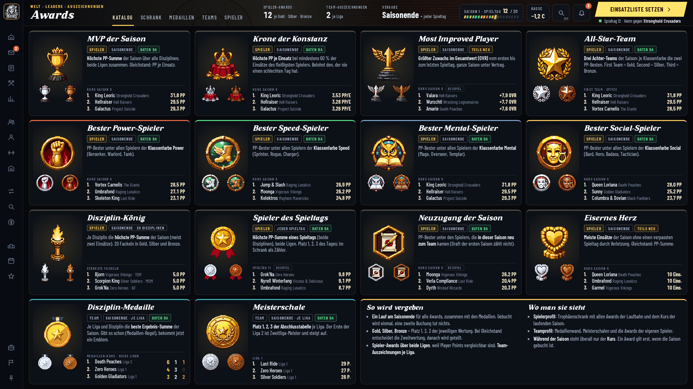
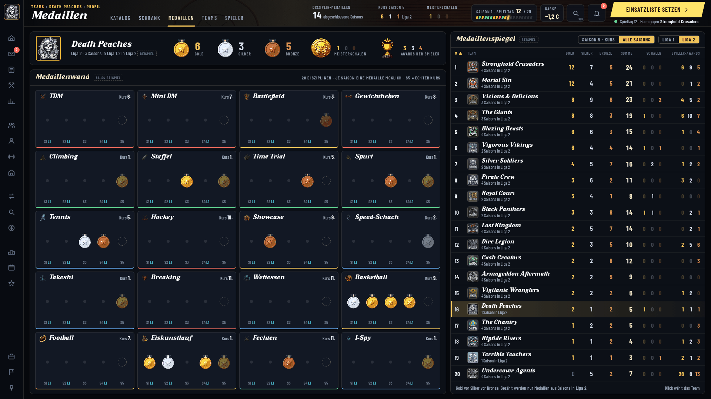
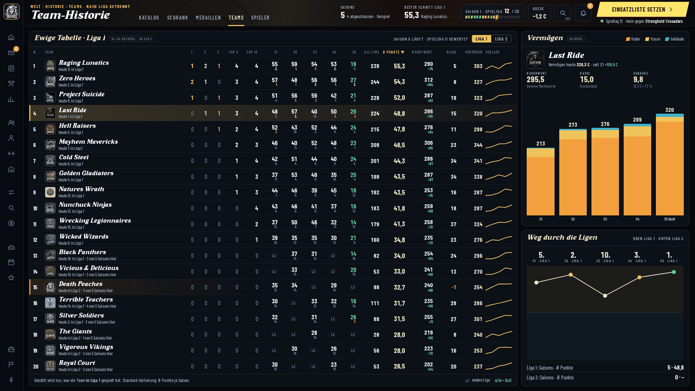
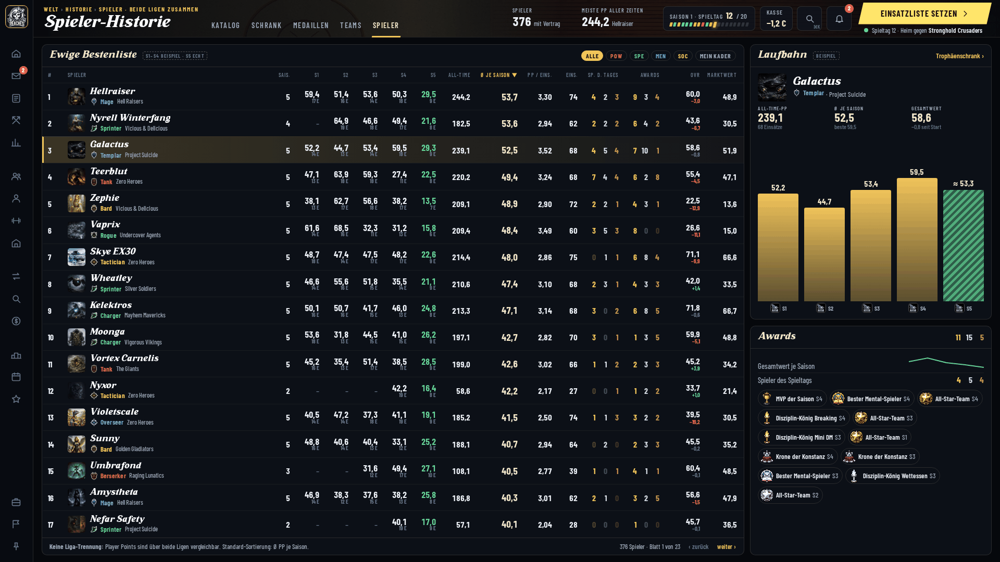
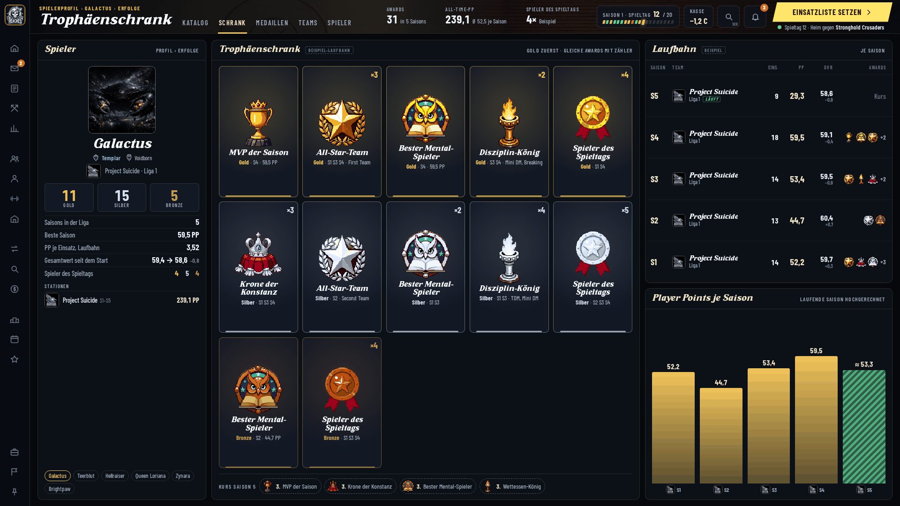

# Awards, Medaillen und Historie: Konzept und Mockup (24.11.)

Auftrag (Chris, 24.11., aus `spieler-teams-modern-24-11.md` Abschnitt 6a): Spieler-Awards mit eigenen Emblemen in Gold, Silber
und Bronze, Team-Medaillen im Teamprofil mit Medaillenspiegel, eine Team-Historie über alle Saisons **getrennt nach Liga** und
eine Spieler-Historie **ohne** Liga-Trennung.

Mockup: `public/mockups/awards-historie-24-11.html` (kein App-Code). Es nutzt den Baukasten `public/mockups/modern-24-11/`
der Mockups Spieler, Teams und Spielplan und führt `historie-modern-18-11.html` weiter (Ewige Tabelle, Blatt rechts mit dem
Verlauf eines Teams, Auf- und Abstiege).

## 1. Was heute schon da ist

| Baustein | Stelle | Stand |
|---|---|---|
| Saison-Auszeichnungen (ein Sieger je Titel) | `lib/season/season-review-service.ts` (`buildSeasonReview`) | `champion`, `player_of_the_season`, `mvs_king`, `pps_king`, `all_star_pow/spe/men/soc`, `mvp` (heute: OVR-Bester), `training_award`, `most_improved_player` (Feldposition), `best_transfer`, `discipline_monster` |
| Ablage je Saison | `seasonSnapshots[].seasonAwards` (`SeasonSnapshotAwardRecord`) | nur der Sieger, keine Stufen |
| Anzeige im Profil | `lib/foundation/player-season-awards.ts` | Emoji je Titel |
| Disziplin-Medaillen der Teams | `lib/medaillen/`, `seasonState.medaillenRegel`, `medaillenVergabe` | Gold, Silber, Bronze je Liga und Disziplin, mit Geld und Moral |
| Farb-Partner | `sponsoren-rework-bau-24-11.md` | hat den Farb-Meister ersetzt, ist Geld vom Sponsor, **keine Medaille** |
| Spieler des Spieltags | `baueSpieltagsMvps` in `lib/foundation/leaders-modern.ts`, `mvpCount` im Archiv | nur Platz 1 |
| Ewige Tabelle | `lib/foundation/all-time-table.ts` | Rang, Punkte, Marktwert, Kasse je Saison, `leagueTier`, Top 5, Top 10 |
| Rekorde und Legenden | `lib/foundation/league-records-hall-of-fame.ts` | Laufbahn-PP, Einsätze, MVP-Zahl |
| Team-Schnappschuss je Saison | `SeasonSnapshotTeamRecord` | `rank`, `points`, `cashEnd`, `marketValueEnd`, `leagueTier`, `isGold/isSilver/isBronze/isTop5/isTop10` |
| Spieler-Schnappschuss je Saison | `SeasonSnapshotPlayerPerformanceRecord` | `pps`, `appearances`, `ovr`, `mvpCount`, `disciplineBreakdown`, `teamBreakdown` |

Es fehlen: Stufen (Silber, Bronze), eigene Embleme, ein Medaillenspiegel, der Gebäudewert im Archiv und eine Historie, die
Liga 1 und Liga 2 auseinanderhält.

## 2. Award-Katalog

Zwölf Spieler-Awards und zwei Team-Auszeichnungen. Jeder hat ein eigenes Emblem in Gold, Silber und Bronze
(`public/sprites/awards/<name>-gold|silber|bronze.png`). Gold, Silber, Bronze heißt immer Platz 1, 2, 3 der Wertung.
Spieler-Awards gelten über beide Ligen, Team-Auszeichnungen je Liga.

| Emblem | Award | Kriterium | Takt | Datenquelle | Ersetzt heute |
|---|---|---|---|---|---|
| `mvp` | **MVP der Saison** | Höchste PP-Summe der Saison, alle Disziplinen. Gleichstand: PP je Einsatz | Saisonende | Saison-PP je Spieler (da) | `mvp` (OVR), `player_of_the_season`, `pps_king` |
| `pp` | **Krone der Konstanz** | Höchste PP je Einsatz bei mindestens 60 % der Einsätze des fleißigsten Spielers | Saisonende | PP und Einsätze (da) | neu |
| `mip` | **Most Improved Player** | Größter OVR-Zuwachs vom ersten bis zum letzten Spieltag, ganze Saison unter Vertrag | Saisonende | OVR am Saisonende steht im Archiv; **neu:** OVR-Start der Saison stempeln | `most_improved_player`, `training_award` |
| `allstar` | **All-Star-Team** | Drei Achter-Teams: je Klassenfarbe die zwei PP-Besten. First Team Gold, Second Silber, Third Bronze (24 Spieler) | Saisonende | Saison-PP und Klassenfarbe (da) | neu |
| `pow` `spe` `men` `soc` | **Bester Power-, Speed-, Mental-, Social-Spieler** | PP-Bester unter den Spielern dieser **Klassenfarbe** (alle seine PP zählen) | Saisonende | Saison-PP und Klassenfarbe (da) | `all_star_pow/spe/men/soc` (heute: PP in den Disziplinen der Achse) |
| `disziplin` | **Disziplin-König** | Je Disziplin die höchste PP-Summe der Saison, 20 Fackeln | Saisonende | `disciplineBreakdown` (da) | `discipline_monster` |
| `spieltag` | **Spieler des Spieltags** | Höchste PP-Summe eines Spieltags, Platz 1 bis 3. Im Schrank ein Zähler | jeder Spieltag | `baueSpieltagsMvps` (da für Platz 1) | `mvpCount` |
| `neuzugang` | **Neuzugang der Saison** | PP-Bester unter den Spielern, die in dieser Saison neu zum Team kamen. Der Draft der ersten Saison zählt nicht | Saisonende | Transfers und Saison-PP (da) | `best_transfer` |
| `eisern` | **Eisernes Herz** | Meiste Einsätze ohne verpassten Spieltag durch Verletzung. Gleichstand: PP-Summe | Saisonende | Einsätze (da); **neu:** Verletzungs-Spieltage je Saison zählen | neu |
| `medaille` | **Disziplin-Medaille** (Team) | Je Liga und Disziplin die beste Ergebnis-Summe | Saisonende | `seasonState.medaillenVergabe` (da) | bekommt nur das Emblem |
| `meister` | **Meisterschale** (Team) | Platz 1, 2, 3 der Abschlusstabelle je Liga. Der Erste der Liga 2 ist Zweitliga-Meister | Saisonende | `finalStandings` (da) | `champion` |

Wo sie erscheinen:

- **Spielerprofil › Erfolge** (Trophäenschrank): alle Awards der Laufbahn, Gold zuerst, gleiche Awards mit Zähler; darunter
  der Kurs der laufenden Saison.
- **Teamprofil**: Medaillenwand (20 Disziplinen × Saisons), Meisterschalen, Awards der eigenen Spieler, Medaillenspiegel.
- **Leaders**: der Katalog mit dem aktuellen Kurs je Award.
- **Historie**: Zähler in beiden Tabellen.

`mvs_king` (Fame-Wert) habe ich nicht übernommen: er misst keine Leistung der Saison. Der Farb-Partner bekommt keine Medaille,
weil er eine Zahlung des Sponsors ist.

Ideen ohne Emblem (nicht bestellt, bei Bedarf je 1 Generation): Kapitän der Saison, Comeback nach Verletzung, Fan-Liebling
(Werbewert), Wertsprung (größter Marktwert-Zuwachs).

### Während der Saison gilt nur der Kurs

Ein Award zählt erst, wenn die Saison gebucht ist. Bis dahin zeigen Katalog, Schrank und Medaillenwand den **Kurs**
(gestrichelt bzw. abgeblendet). So steht nie ein Titel im Profil, der sich noch ändern kann; das ist dieselbe Regel wie in
`player-season-awards.ts` und beim Medaillen-Kurs.

## 3. Was für den Spielstand neu ist

1. **Regel-Stempel** `seasonState.awardsRegel = { seasonId, regel: "an" | "aus", katalog: "v1" }`, gesetzt beim Anlegen und beim
   Saisonwechsel, wie `medaillenRegel`. Abfrage nur über eine Funktion `awardsAktiv(gameState)`. Rückweg `OLY_AWARDS=aus`
   (neue Saisons), nur Server.
2. **Ein Saisonende-Lauf** in `buildSeasonReview`, der einzigen Stelle, an der Auszeichnungen entstehen. Er läuft mit der
   Medaillen-Buchung, ist idempotent und schreibt nach `seasonSnapshots[].seasonAwards`.
3. **Das Ablageformat wächst additiv** (alte Einträge bleiben lesbar): `stufe: 1 | 2 | 3`, `disziplinId?`,
   `teamIdBeiVergabe` (für „Awards der Spieler“ im Teamprofil), `liga?` bei Team-Auszeichnungen.
4. **Spieler des Spieltags** wird je Spieltag gebucht: `seasonState.spieltagsAwards[matchdayId] = [{ playerId, platz, pp }]`,
   mit dem Spieltagsabschluss. Gebuchte Spieltage bleiben.
5. **OVR-Start je Saison** je Spieler stempeln (für den MIP in der ersten Saison eines Spielers).
6. **Verletzungs-Spieltage je Saison** je Spieler zählen (für das Eiserne Herz).
7. **Gebäudewert im Team-Schnappschuss:** neues Feld `buildingValueEnd` = Summe über alle Gebäude aus Investition × Zustand in
   Prozent. Kasse (`cashEnd`) und Kaderwert (`marketValueEnd`) stehen schon dort.
8. **Bestehender Spielstand:** Der Live-Stand steht in Saison 1, es gibt noch keine alten Awards. Die erste Vergabe wäre das Ende
   von Saison 1.

Awards ändern keine Wertung und keine PP. Der Wertungs-Fingerabdruck bleibt unberührt. Ob sie Geld oder Moral geben, ist
Frage 5. Mehrspieler: Awards sind ligaweit und für alle Manager gleich, es gibt keinen Zustand je Manager und nichts zu
delegieren.

## 4. Regeln des Medaillenspiegels

- Gezählt werden die **Disziplin-Medaillen**: 20 Disziplinen × 3 Plätze je Liga und Saison.
- **Rang:** Gold vor Silber vor Bronze. Gleichstand: der bessere Tabellenplatz.
- **Je Liga getrennt:** In den Spiegel der Liga 1 zählen nur Medaillen aus Saisons, die ein Team in Liga 1 gespielt hat. Ein
  Aufsteiger nimmt seine Liga-2-Medaillen nicht mit in den Liga-1-Spiegel; im eigenen Teamprofil stehen alle.
- **Zwei Zeiten:** „Saison · Kurs“ (laufende Saison, Stand der Disziplin-Wertung) und „Alle Saisons“ (nur gebuchte).
- **Geteilte Medaillen** zählen bei beiden Teams voll (das Geld wird wie heute halbiert).
- Die **Meisterschalen** stehen in einer eigenen Spalte und zählen nicht in die Summe.
- Spalte **Spieler-Awards:** Awards, die Spieler in diesem Team gewonnen haben, ohne den Spieler des Spieltags.

## 5. Team-Historie: Kennzahlen

Zwei Tabellen, eine je Liga. In der Tabelle einer Liga zählt nur, was ein Team **in dieser Liga** gespielt hat. Ein Team, das
auf- und abgestiegen ist, steht in beiden Tabellen, jeweils mit seinen Saisons dort. Saisons in der anderen Liga zeigt die
Zeile gestrichelt („L2“).

| Spalte | Definition |
|---|---|
| 1., 2., 3. | Wie oft das Team eine abgeschlossene Saison dieser Liga auf diesem Platz beendet hat |
| Top 5, Top 10 | Platz 1 bis 5 bzw. 1 bis 10 (schließt die Plätze davor ein, wie `isTop5` / `isTop10`) |
| S1, S2 … | Punkte der Saison, klein der Platz. Die laufende Saison ist grün |
| All-Time | Summe aller Punkte in dieser Liga, mit der laufenden Saison |
| **Ø Punkte** | Punkte je **abgeschlossener** Saison in dieser Liga. **Standard-Sortierung.** Gibt es noch keine abgeschlossene Saison, steht die Hochrechnung der laufenden mit „≈“ |
| Marktwert | Kaderwert heute, klein die Änderung seit der ersten Saison |
| Kasse | Kontostand heute |
| Vermögen | Kasse + Kaderwert + Gebäude (Investition × Zustand %), dazu der Verlauf über die Saisons |

Alle Spalten sind sortierbar. Ein Klick auf ein Team füllt rechts zwei Tafeln: **Vermögen** je Saison als Stapel aus Kader,
Kasse und Gebäude, und der **Weg durch die Ligen** (Platz je Saison, oben Liga 1, unten Liga 2). Marktwert, Kasse und Vermögen
sind Werte des Teams und nicht nach Liga getrennt.

## 6. Spieler-Historie: Kennzahlen

Eine Tabelle für alle Spieler mit Vertrag, **ohne Liga-Trennung**. Spalten: Saisons, PP je Saison (klein die Einsätze),
All-Time-PP, **Ø PP je abgeschlossener Saison (Standard-Sortierung)**, PP je Einsatz, Einsätze, Spieler des Spieltags
(Gold/Silber/Bronze), Awards (Gold/Silber/Bronze), OVR mit Änderung seit dem Start, Marktwert. Filter: Klassenfarbe und
„Mein Kader“. Rechts die Laufbahn des gewählten Spielers mit Sprung in den Trophäenschrank.

## 7. Echt und Beispiel

Der Live-Stand (Abbild vom 24.11. in `modern-24-11/daten.js`) steht in **Saison 1, 11 Spieltage gewertet**.

- **Echt:** Teams, Liga, Tabelle, Punkte, Kasse, Kaderwert, PP und Einsätze je Spieler, beste Disziplinen je Spieler, Stand
  der Disziplin-Wertung. Daraus entsteht der Kurs von MVP, Krone, Klassenfarben, All-Star, Disziplin-König, Eisernem Herz,
  Medaillen und Meisterschale.
- **Beispiel (im UI markiert):** alle abgeschlossenen Saisons (im Mockup S1 bis S4, die echte laufende Saison steht dort als
  S5), der Gebäudewert, die OVR-Entwicklung (damit der MIP-Kurs), der Spieler des Spieltags.
- `?saisons=1` zeigt nur, was heute echt da ist: leerer Schrank mit Kurs, Ø Punkte als Hochrechnung.

Das Beispiel ist bewusst nicht geglättet. Es zeigt zwei Dinge, die beim Bau geklärt sein müssen: ein Team mit **einer** starken
Liga-2-Saison steht beim Schnitt weit oben (Frage 3), und wenige Stars sammeln sehr viele Awards (Frage 4).

## 8. Ansichten und Bilder

| Ansicht | URL | Ziel in der App |
|---|---|---|
| Award-Katalog | `?ansicht=katalog` | Leaders, neuer Reiter |
| Trophäenschrank | `?ansicht=schrank&spieler=<slug>` | Spielerprofil › Erfolge |
| Medaillen und Medaillenspiegel | `?ansicht=medaillen&team=…&zeit=alle\|saison&liga=1\|2` | Teamprofil (Tafel „Historie & Medaillen“ öffnet diese Ansicht) |
| Team-Historie | `?ansicht=teams&liga=1\|2&team=…` | Historie (ersetzt die Ewige Tabelle vom 18.11.) |
| Spieler-Historie | `?ansicht=spieler&farbe=0..3&kader=1` | Historie, zweiter Reiter |

Weitere Schalter: `?saisons=1`, `?sort=<spalte>&dir=-1|1`, `?still=1`.

Bilder unter `docs/design/awards-historie-24-11/` (34 Aufnahmen, `?still=1`, Geräte-Pixelverhältnis 1, auf 256 Farben
verkleinert): jede Ansicht bei 1920×1080 und 2560×1440, die fünf Hauptansichten auch bei 1710×1112, dazu je Ansicht der echte
Stand der Saison 1. Geprüft je Aufnahme: kein Seitenscroll, keine JS-Fehler, kein Element außerhalb der Bühne, kein
abgeschnittener Text.

## 9. PixelLab-Protokoll

Skript `scripts/pixellab-awards.py`, Endpunkt `/create-image-pixflux`, 96×96, ohne Hintergrund, je Emblem ein POST unter
`flock /tmp/pixellab-bestell.lock`, keine Wiederholung. Bestellt wurde je Award nur das **Gold-Emblem**; Silber und Bronze
entstehen lokal durch Umfärben der Gold-Töne (`stufen`, 0 Generationen). Edelsteine, Emaille und Bänder behalten ihre Farbe.

| Schritt | Embleme | Generationen | Guthaben |
|---|---|---:|---:|
| Stand vorher | | | 203,54 |
| Stilprobe | `mvp`, `pow`, `medaille` | 3 | 200,54 |
| Satz | `mip`, `spe`, `men`, `soc`, `allstar`, `meister`, `pp`, `spieltag`, `disziplin` | 9 | 191,54 |
| Nachtrag | `neuzugang`, `eisern` | 2 | 189,54 |
| **Summe** | 14 Embleme, 42 Dateien | **14** | **189,54** |

Schätzung vorher: 1 Generation je Emblem, höchstens 20. Alle 14 waren Treffer, kein Fehlgriff. Reserve 150 unberührt
(39,5 darüber). Herkunft je Datei: `public/sprites/awards/quellen.json`.

## 10. Offene Fragen an Chris

| # | Frage | Empfehlung |
|---|---|---|
| 1 | **MVP nach Leistung statt nach OVR?** Heute ist `mvp` der OVR-Beste („OVR = MVP“, Ticket #41). | **Nach PP-Summe.** Der OVR-Beste steht schon vor der Saison fest. |
| 2 | **Klassen-Awards nach Klassenfarbe des Spielers** (alle seine PP) oder wie heute nach den PP in den Disziplinen der Achse, egal welche Klasse? | **Klassenfarbe**, so war der Auftrag formuliert. |
| 3 | **Mindestzahl Saisons für den Schnitt?** Ein Team mit einer einzigen starken Liga-2-Saison steht sonst weit oben. | **Ab 2 Saisons in der Liga** in der Standard-Sortierung, darunter grau am Ende. |
| 4 | **Zu viele Awards?** 12 Spieler-Awards ergeben je Saison rund 110 Embleme plus 60 für den Spieler des Spieltags. | **Disziplin-König und Spieler des Spieltags nur als Zähler**, große Trophäen nur für die anderen zehn. |
| 5 | **Geben Awards etwas?** Moral, Marktwert, Werbewert, Geld? | **Moral +4 / +2 / +1 wie bei Medaillen und Werbewert**, kein Geld, keine Wirkung auf die Wertung. |
| 6 | **Spieler-Awards über beide Ligen** oder je Liga? | **Über beide**, wie die Spieler-Historie. |
| 7 | **All-Star-Team:** 8 Spieler mit 2 je Klassenfarbe, drei Teams? | **Ja.** Alternative: ein Team je Liga. |
| 8 | **Liga-Trennung nach gespielter Saison** (ein Auf- und Absteiger steht in beiden Tabellen) oder nach heutiger Liga? | **Nach gespielter Saison**, nur so zählen 20 Liga-2-Punkte nie in Liga 1. |
| 9 | **Scouting-Nebel:** Der MIP verrät den OVR-Zuwachs eines fremden Spielers. | **Award öffentlich, die Zahl als Stufe**, solange der Spieler nicht gescoutet ist. |
| 10 | **Gebäudewert:** Investition × Zustand, ohne Abschreibung über die Jahre? | **Ja**, so wie beauftragt. |
| 11 | **Weitere Awards** (Kapitän der Saison, Comeback, Fan-Liebling, Wertsprung)? | Erst nach dem Bau der zwölf entscheiden. |
