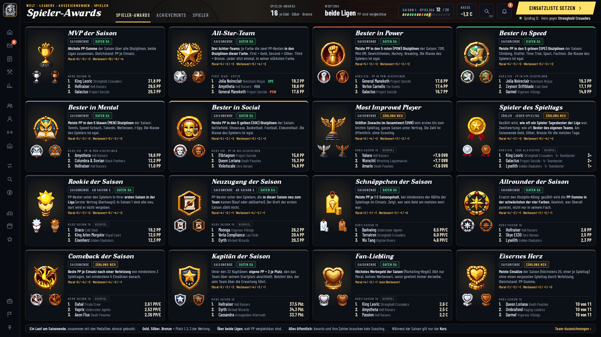
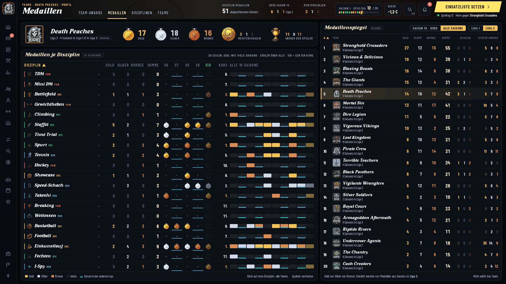
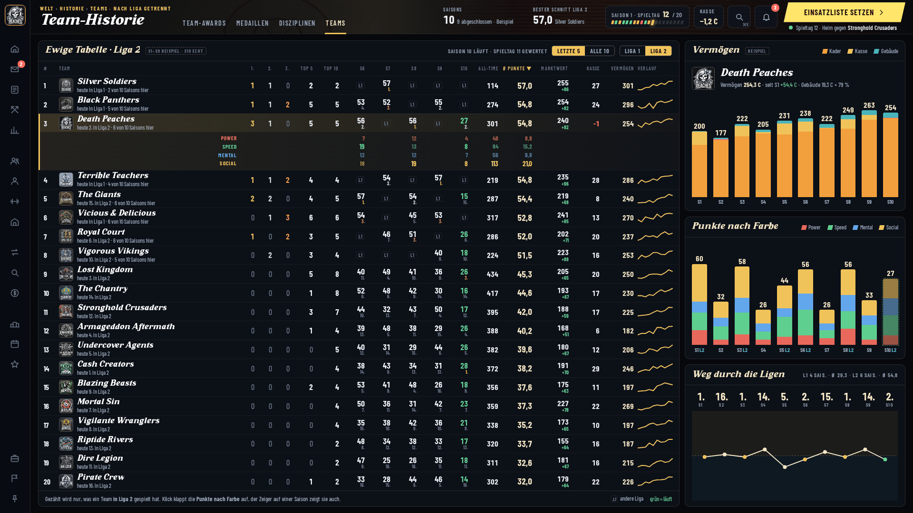
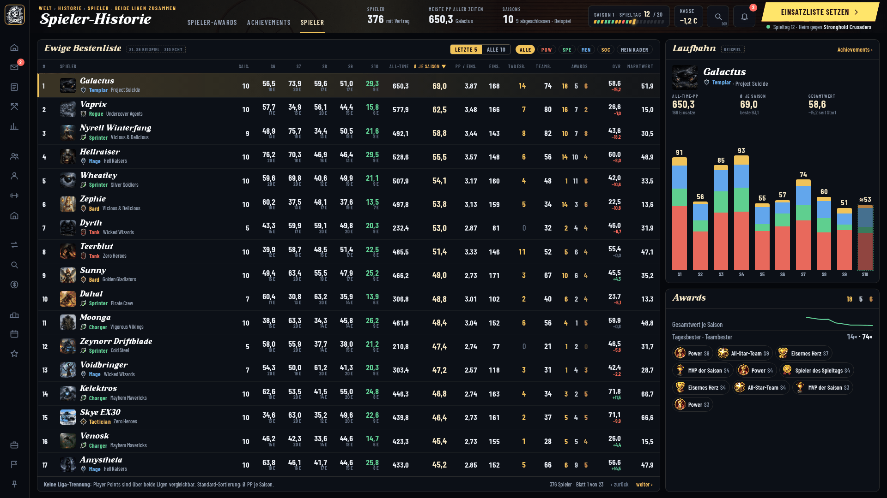
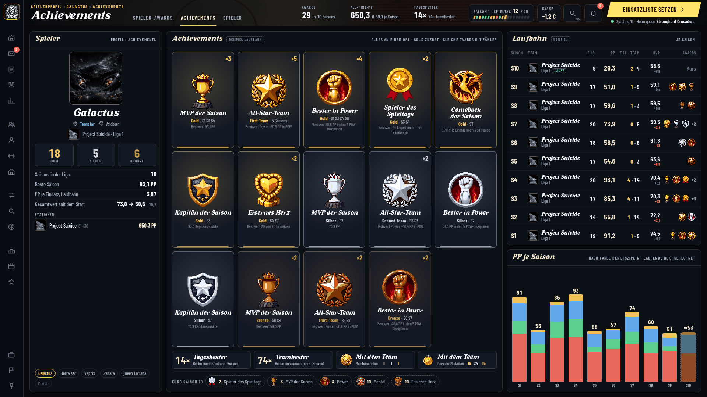
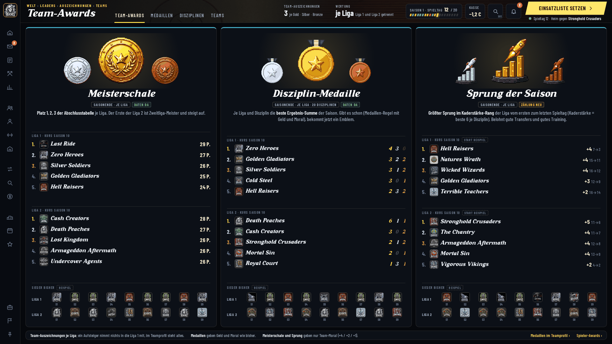
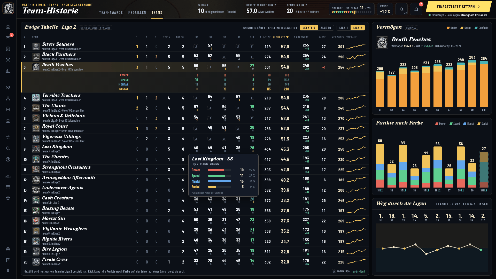
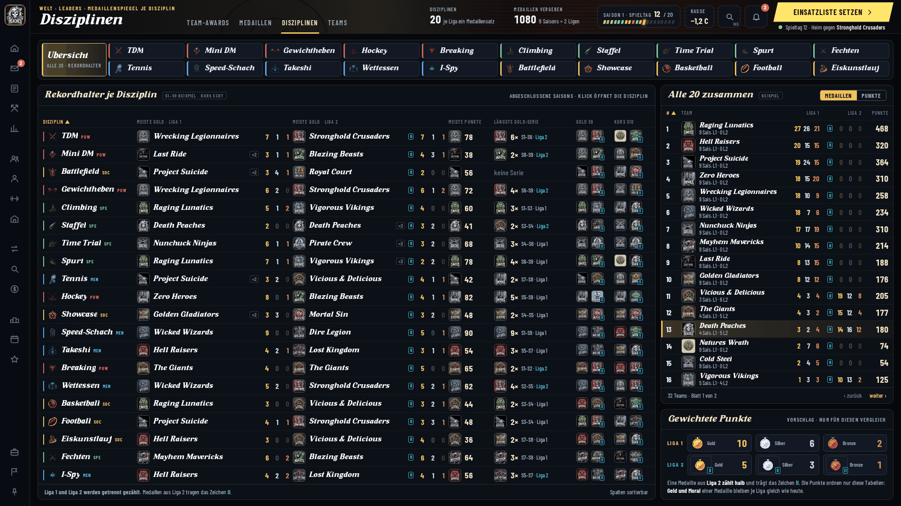
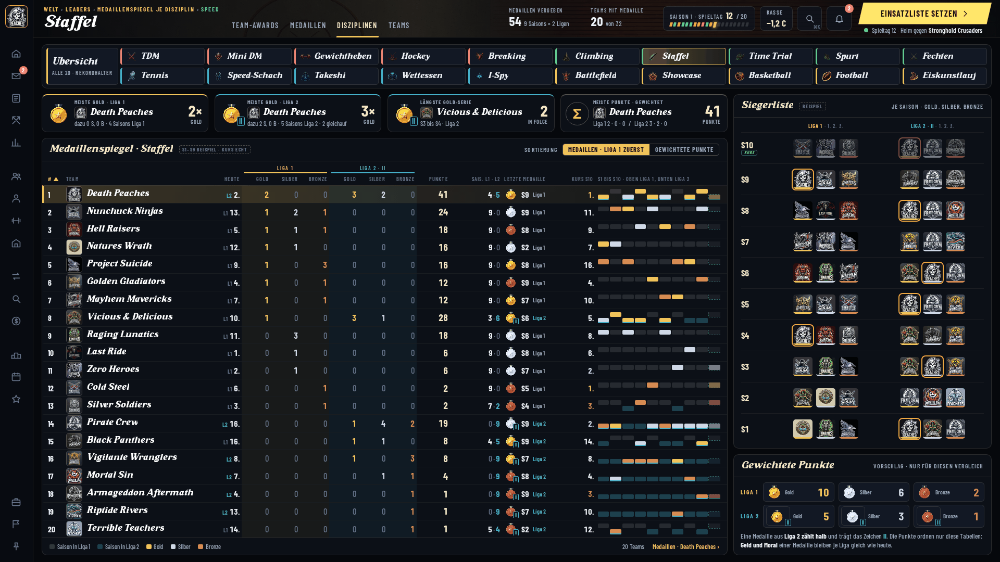

# Awards, Medaillen und Historie: Konzept und Mockup (24.11.)

Auftrag (Chris, 24.11., aus `spieler-teams-modern-24-11.md` Abschnitt 6a): Spieler-Awards mit eigenen Emblemen in Gold, Silber
und Bronze, Team-Medaillen im Teamprofil mit Medaillenspiegel, eine Team-Historie über alle Saisons **getrennt nach Liga** und
eine Spieler-Historie **ohne** Liga-Trennung.

Mockup: `public/mockups/awards-historie-24-11.html` (kein App-Code). Es nutzt den Baukasten `public/mockups/modern-24-11/`
der Mockups Spieler, Teams und Spielplan und führt `historie-modern-18-11.html` weiter (Ewige Tabelle, Blatt rechts mit dem
Verlauf eines Teams, Auf- und Abstiege).

> **Stand: Runde 2 (24.11.).** Chris' Feedback und Entscheidungen stehen in **Abschnitt 11**; er ersetzt den Katalog aus
> Abschnitt 2 und die Fragen aus Abschnitt 10. Die Abschnitte 1 bis 10 sind der Stand der Runde 1 und bleiben zum Nachlesen.

## 1. Was heute schon da ist

| Baustein | Stelle | Stand |
|---|---|---|
| Saison-Auszeichnungen (ein Sieger je Titel) | `lib/season/season-review-service.ts` (`buildSeasonReview`) | `champion`, `player_of_the_season`, `mvs_king`, `pps_king`, `all_star_pow/spe/men/soc`, `mvp` (heute: OVR-Bester), `training_award`, `most_improved_player` (Feldposition), `best_transfer`, `discipline_monster` |
| Ablage je Saison | `seasonSnapshots[].seasonAwards` (`SeasonSnapshotAwardRecord`) | nur der Sieger, keine Stufen |
| Anzeige im Profil | `lib/foundation/player-season-awards.ts` | Emoji je Titel |
| Disziplin-Medaillen der Teams | `lib/medaillen/`, `seasonState.medaillenRegel`, `medaillenVergabe` | Gold, Silber, Bronze je Liga und Disziplin, mit Geld und Moral |
| Farb-Partner | `sponsoren-rework-bau-24-11.md` | hat den Farb-Meister ersetzt, ist Geld vom Sponsor, **keine Medaille** |
| Spieler des Spieltags | `baueSpieltagsMvps` in `lib/foundation/leaders-modern.ts`, `mvpCount` im Archiv | nur Platz 1 |
| Ewige Tabelle | `lib/foundation/all-time-table.ts` | Rang, Punkte, Marktwert, Kasse je Saison, `leagueTier`, Top 5, Top 10 |
| Rekorde und Legenden | `lib/foundation/league-records-hall-of-fame.ts` | Laufbahn-PP, Einsätze, MVP-Zahl |
| Team-Schnappschuss je Saison | `SeasonSnapshotTeamRecord` | `rank`, `points`, `cashEnd`, `marketValueEnd`, `leagueTier`, `isGold/isSilver/isBronze/isTop5/isTop10` |
| Spieler-Schnappschuss je Saison | `SeasonSnapshotPlayerPerformanceRecord` | `pps`, `appearances`, `ovr`, `mvpCount`, `disciplineBreakdown`, `teamBreakdown` |

Es fehlen: Stufen (Silber, Bronze), eigene Embleme, ein Medaillenspiegel, der Gebäudewert im Archiv und eine Historie, die
Liga 1 und Liga 2 auseinanderhält.

## 2. Award-Katalog (Runde 1, ersetzt durch Abschnitt 11.3)

Zwölf Spieler-Awards und zwei Team-Auszeichnungen. Jeder hat ein eigenes Emblem in Gold, Silber und Bronze
(`public/sprites/awards/<name>-gold|silber|bronze.png`). Gold, Silber, Bronze heißt immer Platz 1, 2, 3 der Wertung.
Spieler-Awards gelten über beide Ligen, Team-Auszeichnungen je Liga.

| Emblem | Award | Kriterium | Takt | Datenquelle | Ersetzt heute |
|---|---|---|---|---|---|
| `mvp` | **MVP der Saison** | Höchste PP-Summe der Saison, alle Disziplinen. Gleichstand: PP je Einsatz | Saisonende | Saison-PP je Spieler (da) | `mvp` (OVR), `player_of_the_season`, `pps_king` |
| `pp` | **Krone der Konstanz** | Höchste PP je Einsatz bei mindestens 60 % der Einsätze des fleißigsten Spielers | Saisonende | PP und Einsätze (da) | neu |
| `mip` | **Most Improved Player** | Größter OVR-Zuwachs vom ersten bis zum letzten Spieltag, ganze Saison unter Vertrag | Saisonende | OVR am Saisonende steht im Archiv; **neu:** OVR-Start der Saison stempeln | `most_improved_player`, `training_award` |
| `allstar` | **All-Star-Team** | Drei Achter-Teams: je Klassenfarbe die zwei PP-Besten. First Team Gold, Second Silber, Third Bronze (24 Spieler) | Saisonende | Saison-PP und Klassenfarbe (da) | neu |
| `pow` `spe` `men` `soc` | **Bester Power-, Speed-, Mental-, Social-Spieler** | PP-Bester unter den Spielern dieser **Klassenfarbe** (alle seine PP zählen) | Saisonende | Saison-PP und Klassenfarbe (da) | `all_star_pow/spe/men/soc` (heute: PP in den Disziplinen der Achse) |
| `disziplin` | **Disziplin-König** | Je Disziplin die höchste PP-Summe der Saison, 20 Fackeln | Saisonende | `disciplineBreakdown` (da) | `discipline_monster` |
| `spieltag` | **Spieler des Spieltags** | Höchste PP-Summe eines Spieltags, Platz 1 bis 3. Im Schrank ein Zähler | jeder Spieltag | `baueSpieltagsMvps` (da für Platz 1) | `mvpCount` |
| `neuzugang` | **Neuzugang der Saison** | PP-Bester unter den Spielern, die in dieser Saison neu zum Team kamen. Der Draft der ersten Saison zählt nicht | Saisonende | Transfers und Saison-PP (da) | `best_transfer` |
| `eisern` | **Eisernes Herz** | Meiste Einsätze ohne verpassten Spieltag durch Verletzung. Gleichstand: PP-Summe | Saisonende | Einsätze (da); **neu:** Verletzungs-Spieltage je Saison zählen | neu |
| `medaille` | **Disziplin-Medaille** (Team) | Je Liga und Disziplin die beste Ergebnis-Summe | Saisonende | `seasonState.medaillenVergabe` (da) | bekommt nur das Emblem |
| `meister` | **Meisterschale** (Team) | Platz 1, 2, 3 der Abschlusstabelle je Liga. Der Erste der Liga 2 ist Zweitliga-Meister | Saisonende | `finalStandings` (da) | `champion` |

Wo sie erscheinen:

- **Spielerprofil › Erfolge** (Trophäenschrank): alle Awards der Laufbahn, Gold zuerst, gleiche Awards mit Zähler; darunter
  der Kurs der laufenden Saison.
- **Teamprofil**: Medaillenwand (20 Disziplinen × Saisons), Meisterschalen, Awards der eigenen Spieler, Medaillenspiegel.
- **Leaders**: der Katalog mit dem aktuellen Kurs je Award.
- **Historie**: Zähler in beiden Tabellen.

`mvs_king` (Fame-Wert) habe ich nicht übernommen: er misst keine Leistung der Saison. Der Farb-Partner bekommt keine Medaille,
weil er eine Zahlung des Sponsors ist.

Ideen ohne Emblem (nicht bestellt, bei Bedarf je 1 Generation): Kapitän der Saison, Comeback nach Verletzung, Fan-Liebling
(Werbewert), Wertsprung (größter Marktwert-Zuwachs).

### Während der Saison gilt nur der Kurs

Ein Award zählt erst, wenn die Saison gebucht ist. Bis dahin zeigen Katalog, Schrank und Medaillenwand den **Kurs**
(gestrichelt bzw. abgeblendet). So steht nie ein Titel im Profil, der sich noch ändern kann; das ist dieselbe Regel wie in
`player-season-awards.ts` und beim Medaillen-Kurs.

## 3. Was für den Spielstand neu ist

1. **Regel-Stempel** `seasonState.awardsRegel = { seasonId, regel: "an" | "aus", katalog: "v1" }`, gesetzt beim Anlegen und beim
   Saisonwechsel, wie `medaillenRegel`. Abfrage nur über eine Funktion `awardsAktiv(gameState)`. Rückweg `OLY_AWARDS=aus`
   (neue Saisons), nur Server.
2. **Ein Saisonende-Lauf** in `buildSeasonReview`, der einzigen Stelle, an der Auszeichnungen entstehen. Er läuft mit der
   Medaillen-Buchung, ist idempotent und schreibt nach `seasonSnapshots[].seasonAwards`.
3. **Das Ablageformat wächst additiv** (alte Einträge bleiben lesbar): `stufe: 1 | 2 | 3`, `disziplinId?`,
   `teamIdBeiVergabe` (für „Awards der Spieler“ im Teamprofil), `liga?` bei Team-Auszeichnungen.
4. **Spieler des Spieltags** wird je Spieltag gebucht: `seasonState.spieltagsAwards[matchdayId] = [{ playerId, platz, pp }]`,
   mit dem Spieltagsabschluss. Gebuchte Spieltage bleiben.
5. **OVR-Start je Saison** je Spieler stempeln (für den MIP in der ersten Saison eines Spielers).
6. **Verletzungs-Spieltage je Saison** je Spieler zählen (für das Eiserne Herz).
7. **Gebäudewert im Team-Schnappschuss:** neues Feld `buildingValueEnd` = Summe über alle Gebäude aus Investition × Zustand in
   Prozent. Kasse (`cashEnd`) und Kaderwert (`marketValueEnd`) stehen schon dort.
8. **Bestehender Spielstand:** Der Live-Stand steht in Saison 1, es gibt noch keine alten Awards. Die erste Vergabe wäre das Ende
   von Saison 1.

Awards ändern keine Wertung und keine PP. Der Wertungs-Fingerabdruck bleibt unberührt. Ob sie Geld oder Moral geben, ist
Frage 5. Mehrspieler: Awards sind ligaweit und für alle Manager gleich, es gibt keinen Zustand je Manager und nichts zu
delegieren.

## 4. Regeln des Medaillenspiegels

- Gezählt werden die **Disziplin-Medaillen**: 20 Disziplinen × 3 Plätze je Liga und Saison.
- **Rang:** Gold vor Silber vor Bronze. Gleichstand: der bessere Tabellenplatz.
- **Je Liga getrennt:** In den Spiegel der Liga 1 zählen nur Medaillen aus Saisons, die ein Team in Liga 1 gespielt hat. Ein
  Aufsteiger nimmt seine Liga-2-Medaillen nicht mit in den Liga-1-Spiegel; im eigenen Teamprofil stehen alle.
- **Zwei Zeiten:** „Saison · Kurs“ (laufende Saison, Stand der Disziplin-Wertung) und „Alle Saisons“ (nur gebuchte).
- **Geteilte Medaillen** zählen bei beiden Teams voll (das Geld wird wie heute halbiert).
- Die **Meisterschalen** stehen in einer eigenen Spalte und zählen nicht in die Summe.
- Spalte **Spieler-Awards:** Awards, die Spieler in diesem Team gewonnen haben, ohne den Spieler des Spieltags.

## 5. Team-Historie: Kennzahlen

Zwei Tabellen, eine je Liga. In der Tabelle einer Liga zählt nur, was ein Team **in dieser Liga** gespielt hat. Ein Team, das
auf- und abgestiegen ist, steht in beiden Tabellen, jeweils mit seinen Saisons dort. Saisons in der anderen Liga zeigt die
Zeile gestrichelt („L2“).

| Spalte | Definition |
|---|---|
| 1., 2., 3. | Wie oft das Team eine abgeschlossene Saison dieser Liga auf diesem Platz beendet hat |
| Top 5, Top 10 | Platz 1 bis 5 bzw. 1 bis 10 (schließt die Plätze davor ein, wie `isTop5` / `isTop10`) |
| S1, S2 … | Punkte der Saison, klein der Platz. Die laufende Saison ist grün |
| All-Time | Summe aller Punkte in dieser Liga, mit der laufenden Saison |
| **Ø Punkte** | Punkte je **abgeschlossener** Saison in dieser Liga. **Standard-Sortierung.** Gibt es noch keine abgeschlossene Saison, steht die Hochrechnung der laufenden mit „≈“ |
| Marktwert | Kaderwert heute, klein die Änderung seit der ersten Saison |
| Kasse | Kontostand heute |
| Vermögen | Kasse + Kaderwert + Gebäude (Investition × Zustand %), dazu der Verlauf über die Saisons |

Alle Spalten sind sortierbar. Ein Klick auf ein Team füllt rechts zwei Tafeln: **Vermögen** je Saison als Stapel aus Kader,
Kasse und Gebäude, und der **Weg durch die Ligen** (Platz je Saison, oben Liga 1, unten Liga 2). Marktwert, Kasse und Vermögen
sind Werte des Teams und nicht nach Liga getrennt.

## 6. Spieler-Historie: Kennzahlen

Eine Tabelle für alle Spieler mit Vertrag, **ohne Liga-Trennung**. Spalten: Saisons, PP je Saison (klein die Einsätze),
All-Time-PP, **Ø PP je abgeschlossener Saison (Standard-Sortierung)**, PP je Einsatz, Einsätze, Spieler des Spieltags
(Gold/Silber/Bronze), Awards (Gold/Silber/Bronze), OVR mit Änderung seit dem Start, Marktwert. Filter: Klassenfarbe und
„Mein Kader“. Rechts die Laufbahn des gewählten Spielers mit Sprung in den Trophäenschrank.

## 7. Echt und Beispiel

Der Live-Stand (Abbild vom 24.11. in `modern-24-11/daten.js`) steht in **Saison 1, 11 Spieltage gewertet**.

- **Echt:** Teams, Liga, Tabelle, Punkte, Kasse, Kaderwert, PP und Einsätze je Spieler, beste Disziplinen je Spieler, Stand
  der Disziplin-Wertung. Daraus entsteht der Kurs von MVP, Krone, Klassenfarben, All-Star, Disziplin-König, Eisernem Herz,
  Medaillen und Meisterschale.
- **Beispiel (im UI markiert):** alle abgeschlossenen Saisons (im Mockup S1 bis S4, die echte laufende Saison steht dort als
  S5), der Gebäudewert, die OVR-Entwicklung (damit der MIP-Kurs), der Spieler des Spieltags.
- `?saisons=1` zeigt nur, was heute echt da ist: leerer Schrank mit Kurs, Ø Punkte als Hochrechnung.

Das Beispiel ist bewusst nicht geglättet. Es zeigt zwei Dinge, die beim Bau geklärt sein müssen: ein Team mit **einer** starken
Liga-2-Saison steht beim Schnitt weit oben (Frage 3), und wenige Stars sammeln sehr viele Awards (Frage 4).

## 8. Ansichten und Bilder (Runde 1, aktuell: Abschnitt 11.6)

| Ansicht | URL | Ziel in der App |
|---|---|---|
| Award-Katalog | `?ansicht=katalog` | Leaders, neuer Reiter |
| Trophäenschrank | `?ansicht=schrank&spieler=<slug>` | Spielerprofil › Erfolge |
| Medaillen und Medaillenspiegel | `?ansicht=medaillen&team=…&zeit=alle\|saison&liga=1\|2` | Teamprofil (Tafel „Historie & Medaillen“ öffnet diese Ansicht) |
| Team-Historie | `?ansicht=teams&liga=1\|2&team=…` | Historie (ersetzt die Ewige Tabelle vom 18.11.) |
| Spieler-Historie | `?ansicht=spieler&farbe=0..3&kader=1` | Historie, zweiter Reiter |

Weitere Schalter: `?saisons=1`, `?sort=<spalte>&dir=-1|1`, `?still=1`.

Bilder unter `docs/design/awards-historie-24-11/` (34 Aufnahmen, `?still=1`, Geräte-Pixelverhältnis 1, auf 256 Farben
verkleinert): jede Ansicht bei 1920×1080 und 2560×1440, die fünf Hauptansichten auch bei 1710×1112, dazu je Ansicht der echte
Stand der Saison 1. Geprüft je Aufnahme: kein Seitenscroll, keine JS-Fehler, kein Element außerhalb der Bühne, kein
abgeschnittener Text.

## 9. PixelLab-Protokoll

Skript `scripts/pixellab-awards.py`, Endpunkt `/create-image-pixflux`, 96×96, ohne Hintergrund, je Emblem ein POST unter
`flock /tmp/pixellab-bestell.lock`, keine Wiederholung. Bestellt wurde je Award nur das **Gold-Emblem**; Silber und Bronze
entstehen lokal durch Umfärben der Gold-Töne (`stufen`, 0 Generationen). Edelsteine, Emaille und Bänder behalten ihre Farbe.

| Schritt | Embleme | Generationen | Guthaben |
|---|---|---:|---:|
| Stand vorher | | | 203,54 |
| Stilprobe | `mvp`, `pow`, `medaille` | 3 | 200,54 |
| Satz | `mip`, `spe`, `men`, `soc`, `allstar`, `meister`, `pp`, `spieltag`, `disziplin` | 9 | 191,54 |
| Nachtrag | `neuzugang`, `eisern` | 2 | 189,54 |
| **Summe** | 14 Embleme, 42 Dateien | **14** | **189,54** |

Schätzung vorher: 1 Generation je Emblem, höchstens 20. Alle 14 waren Treffer, kein Fehlgriff. Reserve 150 unberührt
(39,5 darüber). Herkunft je Datei: `public/sprites/awards/quellen.json`.

## 10. Offene Fragen an Chris (Runde 1, beantwortet in Abschnitt 11.2)

| # | Frage | Empfehlung |
|---|---|---|
| 1 | **MVP nach Leistung statt nach OVR?** Heute ist `mvp` der OVR-Beste („OVR = MVP“, Ticket #41). | **Nach PP-Summe.** Der OVR-Beste steht schon vor der Saison fest. |
| 2 | **Klassen-Awards nach Klassenfarbe des Spielers** (alle seine PP) oder wie heute nach den PP in den Disziplinen der Achse, egal welche Klasse? | **Klassenfarbe**, so war der Auftrag formuliert. |
| 3 | **Mindestzahl Saisons für den Schnitt?** Ein Team mit einer einzigen starken Liga-2-Saison steht sonst weit oben. | **Ab 2 Saisons in der Liga** in der Standard-Sortierung, darunter grau am Ende. |
| 4 | **Zu viele Awards?** 12 Spieler-Awards ergeben je Saison rund 110 Embleme plus 60 für den Spieler des Spieltags. | **Disziplin-König und Spieler des Spieltags nur als Zähler**, große Trophäen nur für die anderen zehn. |
| 5 | **Geben Awards etwas?** Moral, Marktwert, Werbewert, Geld? | **Moral +4 / +2 / +1 wie bei Medaillen und Werbewert**, kein Geld, keine Wirkung auf die Wertung. |
| 6 | **Spieler-Awards über beide Ligen** oder je Liga? | **Über beide**, wie die Spieler-Historie. |
| 7 | **All-Star-Team:** 8 Spieler mit 2 je Klassenfarbe, drei Teams? | **Ja.** Alternative: ein Team je Liga. |
| 8 | **Liga-Trennung nach gespielter Saison** (ein Auf- und Absteiger steht in beiden Tabellen) oder nach heutiger Liga? | **Nach gespielter Saison**, nur so zählen 20 Liga-2-Punkte nie in Liga 1. |
| 9 | **Scouting-Nebel:** Der MIP verrät den OVR-Zuwachs eines fremden Spielers. | **Award öffentlich, die Zahl als Stufe**, solange der Spieler nicht gescoutet ist. |
| 10 | **Gebäudewert:** Investition × Zustand, ohne Abschreibung über die Jahre? | **Ja**, so wie beauftragt. |
| 11 | **Weitere Awards** (Kapitän der Saison, Comeback, Fan-Liebling, Wertsprung)? | Erst nach dem Bau der zwölf entscheiden. |

## 11. Runde 2 (24.11.)

### 11.1 Feedback von Chris und was sich geändert hat

| # | Feedback | Änderung im Mockup |
|---|---|---|
| 1 | Farb-Awards zählen nur die PP in den Disziplinen der Farbe, nicht die Klassenfarbe des Spielers | Vier Awards „Bester in Power / Speed / Mental / Social“. Auf der Karte steht: „Meiste PP in den 5 gelben (SOC) Disziplinen der Saison: Battlefield, Showcase, Basketball, Football, Eiskunstlauf. Die Klasse des Spielers ist egal.“ Der Kurs und jedes Achievement nennen die Zahl („38,4 PP in den 5 SOC-Disziplinen“). |
| 2 | All-Star-Team streichen | **Bleibt** (Chris hat es danach doch freigegeben, siehe 11.2 Nr. 7). Je Farbe die zwei PP-Besten in den Disziplinen dieser Farbe; jeder Spieler sitzt einmal, in seiner stärksten Farbe. |
| 3 | Krone der Konstanz streichen | Gestrichen. Emblem `pp-*` bleibt im Ordner, ungenutzt. |
| 4 | Disziplin-König streichen oder ersetzen | Gestrichen. Ersatz: **Allrounder der Saison** (PP-Summe in der schwächsten der vier Farben). Er nutzt dieselbe Quelle (PP je Disziplin), unterscheidet aber wirklich, weil er nicht am Deckel von 5 PP je Einsatz hängt. |
| 5 | Spieler des Spieltags neu: zählen, wie oft Tagesbester und wie oft Bester des eigenen Teams | Zwei Zähler: **Tagesbester** (bester Spieler eines Spieltags, beide Ligen) und **Teambester**. Sie stehen in den Achievements, in der Laufbahn je Saison („Tag · Team“) und als zwei Spalten in der Spieler-Historie. Am Saisonende gibt es Gold, Silber, Bronze für die meisten Tage als Tagesbester, Zweitwertung Teambester. |
| 6 | Neuzugang und Eisernes Herz bleiben, Höchstwert 20 Einsätze | Beide bleiben. Die Beispiel-Saisons reichen jetzt bis 20 Einsätze („20 von 20 Einsätzen“), der Kurs der laufenden Saison zeigt „10 von 11“ (echt: 11 Spieltage gewertet). |
| 7 | Team-Auszeichnungen von Spieler-Awards trennen | Zwei Kataloge: **Spieler-Awards** und **Team-Awards**, jeder mit eigener Seite. Die Reiter zeigen nur den eigenen Zusammenhang (Spieler: Spieler-Awards, Achievements, Spieler; Team: Team-Awards, Medaillen, Teams). |
| 8 | Team-Historie: je Saison die Punkte nach Power / Speed / Mental / Social, als Hover und/oder aufklappbare Zeile | Beides. Klick auf ein Team klappt eine Zeile auf, die in denselben Spalten je Saison die vier Farben zeigt, dazu Summe und Schnitt je Farbe. Der Zeiger auf einer Saison-Zelle öffnet eine Tafel mit Balken und Anteilen. Rechts neu: „Punkte nach Farbe“ als Stapel je Saison. Die Spieler-Historie hat dieselbe Zeiger-Tafel für PP nach Farbe. |
| 9 | Nicht „Schrank“, eine Ansicht je Spieler | Heißt **Achievements**. Eine Ansicht: alle Awards, die zwei Zähler, „Mit dem Team“ (Meisterschalen und Disziplin-Medaillen aus seinen Vertragsjahren), Kurs, Laufbahn. Keine Unterreiter. |
| 10 | Medaillenwand wird nach 10 Saisons unübersichtlich; Zählstreifen, Zahl der Spieler-Awards und Medaillenspiegel bleiben | Die Wand ist ersetzt durch **„Medaillen je Disziplin“**: 20 feste Zeilen, egal wie viele Saisons. Je Disziplin Gold, Silber, Bronze, Summe (über alle Saisons), die letzten fünf Saisons als Embleme, der Kurs und ein Streifen mit einem Feld je Saison. Sortierbar. Das Beispiel hat jetzt 10 Saisons. Zählstreifen und Medaillenspiegel sind unverändert. |
| 11 | 2 bis 4 bessere Awards als Ersatz | **Rookie der Saison**, **Schnäppchen der Saison**, **Allrounder der Saison**, **Comeback der Saison**. Dazu aus den Antworten: **Kapitän der Saison**, **Fan-Liebling**. Als Team-Award: **Sprung der Saison** (Kaderstärke-Rang). |

Die Team-Historie und die Spieler-Historie haben bei mehr als fünf Saisons einen Umschalter „Letzte 5 / Alle“; bei „Alle“ fallen
Nebenspalten weg, damit die Saison-Spalten Platz haben.

### 11.2 Entscheidungen Chris 24.11.

| # | Entscheidung | Umsetzung |
|---|---|---|
| 1 | MVP = höchste PP-Summe der Saison | so im Katalog |
| 2 | Farb-Awards = PP in den Disziplinen der Farbe, nicht die Klassenfarbe | so im Katalog, siehe 11.1 Nr. 1 |
| 3 | Kein Mindestwert an Saisons für den Schnitt; nach Saison 1 ist der Schnitt gleich S1 | Schnitt ohne Mindestzahl, im Tooltip vermerkt |
| 4 | Awards heben Moral und Werbewert, je Award verschieden | Vorschlag je Award in 11.4, auf jeder Karte als Zeile |
| 5 | Spieler-Awards über beide Ligen | so im Katalog |
| 6 | Die Ewige Tabelle folgt der gespielten Liga; Auf- und Absteiger stehen in beiden Tabellen | unverändert so |
| 7 | All-Star-Team bleibt: 8 Spieler, zwei je Farbe, First / Second / Third | bleibt, Auswahl nach PP in den Disziplinen der Farbe |
| 8 | Kein Nebel auf Statistiken und Awards: Liga-Statistiken, Punkte, PP und Awards sind offiziell und immer öffentlich, auch der OVR-Zuwachs beim MIP | Im Mockup stand kein Nebel auf diesen Zahlen; die Empfehlung „Zahl als Stufe“ aus Runde 1 ist verworfen. Hinweis im Katalog („Alles öffentlich“) und in den Tooltips |
| 9 | Gebäudewert = Investition × Zustand %, Abschreibung nur über den Zustand | unverändert so, Formel steht im Vermögen-Kopf |
| 10 | Weitere Awards, wenn zählbar: Kapitän der Saison, Comeback, Fan-Liebling | alle drei im Katalog, Stand der Zählung in 11.3 |

### 11.3 Der neue Katalog

**Spieler-Awards (16), über beide Ligen, je Gold, Silber, Bronze.** „da“ = die Daten stehen heute im Spielstand; „Zählung neu“ =
die Rohdaten sind da, ein Zähler oder Stempel kommt dazu.

| Emblem | Award | Kriterium | Daten |
|---|---|---|---|
| `mvp` | MVP der Saison | Höchste PP-Summe der Saison. Gleichstand: PP je Einsatz | da |
| `allstar` | All-Star-Team | Drei Achter-Teams, je Farbe die zwei PP-Besten in den Disziplinen der Farbe. First = Gold, Second = Silber, Third = Bronze | da (`disciplineBreakdown`) |
| `pow` `spe` `men` `soc` | Bester in Power, Speed, Mental, Social | Meiste PP in den fünf Disziplinen der Farbe, Klasse egal | da (`disciplineBreakdown`) |
| `mip` | Most Improved Player | Größter OVR-Zuwachs der Saison, öffentlich | Zählung neu: OVR-Start je Saison stempeln |
| `spieltag` | Spieler des Spieltags | Zähler Tagesbester, Zweitwertung Teambester; Saison-Award für die meisten Tage | Zählung neu: PP je Spieltag sind da, die zwei Zähler kommen dazu |
| `rookie` | Rookie der Saison | PP-Bester in der ersten Saison in der Liga (erster Vertrag). Ab Saison 2 | da |
| `neuzugang` | Neuzugang der Saison | PP-Bester unter den neu zum Team Gekommenen. Ab Saison 2 | da |
| `schnaeppchen` | Schnäppchen der Saison | Meiste PP je 1 C Saisongehalt, mindestens die Hälfte der Spieltage im Einsatz | da |
| `allrounder` | Allrounder der Saison | PP-Summe in der schwächsten der vier Farben | da (`disciplineBreakdown`) |
| `comeback` | Comeback der Saison | Beste PP je Einsatz nach einer Verletzung von mindestens 3 Spieltagen, mindestens 5 Einsätze danach | Zählung neu: Verletzung und PP je Spieltag sind da, die Auswertung kommt dazu |
| `kapitaen` | Kapitän der Saison | Unter den 32 Kapitänen: eigene PP + 2 je Platz, den das Team über seinem Startplatz abschließt | da (Kapitän, Startplatz, Abschlussplatz) |
| `fanliebling` | Fan-Liebling | Höchstes Werbegeld der Saison | da (Marketing-Regel) |
| `eisern` | Eisernes Herz | Meiste Einsätze (höchstens 20) ohne verpassten Spieltag durch Verletzung | Zählung neu: Verletzungs-Spieltage je Saison |

**Team-Auszeichnungen (3), je Liga, je Gold, Silber, Bronze.**

| Emblem | Auszeichnung | Kriterium | Daten |
|---|---|---|---|
| `meister` | Meisterschale | Platz 1, 2, 3 der Abschlusstabelle | da |
| `medaille` | Disziplin-Medaille | Je Disziplin die beste Ergebnis-Summe der Saison | da (`medaillenVergabe`) |
| `sprung` | Sprung der Saison | Größter Sprung im Kaderstärke-Rang vom ersten zum letzten Spieltag | Zählung neu: Rang am Saisonstart stempeln |

Gestrichen: Krone der Konstanz, Disziplin-König. Nicht übernommen aus der Ideenliste: **Wertsprung** (höchster
Marktwert-Zuwachs; läuft fast gleich mit dem MIP) und **Duell-König** (Duellsiege je Spieler gibt es nur in den Duell-Disziplinen,
dafür fehlt eine einheitliche Zählung).

### 11.4 Vorschlag: Wirkung auf Moral und Werbewert

Einmalig bei der Vergabe am Saisonende, für Gold / Silber / Bronze. Keine Wirkung auf Wertung, PP oder Marktwert.

| Award | Moral | Werbewert | Warum |
|---|---|---|---|
| MVP der Saison | +8 / +5 / +3 | +10 / +6 / +4 | größter Titel |
| All-Star-Team (First / Second / Third) | +5 / +3 / +2 | +6 / +4 / +2 | 24 Spieler, deshalb kleiner |
| Bester in einer Farbe | +5 / +3 / +2 | +5 / +3 / +2 | |
| Most Improved Player | +6 / +4 / +2 | +3 / +2 / +1 | stolz, aber noch kein Star |
| Spieler des Spieltags (Saison) | +4 / +3 / +2 | +6 / +4 / +2 | dazu je Tag als Tagesbester Moral +1 sofort |
| Rookie der Saison | +5 / +3 / +2 | +6 / +4 / +2 | neues Gesicht zieht |
| Neuzugang der Saison | +4 / +2 / +1 | +4 / +2 / +1 | |
| Schnäppchen der Saison | +2 / +1 / +1 | +2 / +1 / 0 | Titel für den Manager, weniger für den Spieler |
| Allrounder der Saison | +4 / +2 / +1 | +3 / +2 / +1 | |
| Comeback der Saison | +6 / +4 / +2 | +4 / +2 / +1 | |
| Kapitän der Saison | +5 / +3 / +2 | +4 / +2 / +1 | |
| Fan-Liebling | +4 / +2 / +1 | keiner | er wird am Werbegeld gemessen; mit Werbewert würde immer derselbe gewinnen |
| Eisernes Herz | +3 / +2 / +1 | +2 / +1 / 0 | |
| Meisterschale, Sprung der Saison (Team) | Team-Moral +4 / +2 / +1 | keiner | Disziplin-Medaillen geben Geld und Moral wie bisher |

Je Spieler und Saison empfehle ich einen Deckel von Moral +12 und Werbewert +15, damit ein Star mit fünf Awards nicht davonläuft.

### 11.5 Echt und Beispiel in Runde 2

- **Echt:** Punkte des Teams nach Farbe in der laufenden Saison (aus den Ergebnissen je Disziplin), Medaillen-Kurs, Tabelle,
  PP und Einsätze, Gehalt, Kapitän, Startplatz.
- **Teils echt:** PP je Spieler nach Farbe in der laufenden Saison. Im Abbild-Auszug stehen je Spieler nur die drei besten
  Disziplinen; der Rest der PP ist nach Achsen-Eignung verteilt. Im Spiel kommt alles aus `disciplineBreakdown`.
- **Beispiel:** die neun abgeschlossenen Saisons, Tagesbester und Teambester, Comeback, OVR-Entwicklung, Kaderstärke-Rang am
  Saisonstart, Werbegeld, Gebäudewert.

### 11.6 Ansichten und Bilder

| Ansicht | URL | Ziel in der App |
|---|---|---|
| Spieler-Awards | `?ansicht=katalog` | Leaders › Auszeichnungen › Spieler |
| Team-Awards | `?ansicht=teamawards` | Leaders › Auszeichnungen › Teams |
| Achievements | `?ansicht=achievements&spieler=<slug>` | Spielerprofil › Achievements |
| Medaillen und Medaillenspiegel | `?ansicht=medaillen&team=…&zeit=alle\|saison&liga=1\|2` | Teamprofil |
| Team-Historie | `?ansicht=teams&liga=1\|2&team=…&spann=5\|alle&zu=1&zeig=<Team>\|<Saison>` | Historie |
| Spieler-Historie | `?ansicht=spieler&farbe=0..3&kader=1&spann=5\|alle` | Historie, zweiter Reiter |

36 Aufnahmen unter `docs/design/awards-historie-24-11/` (`?still=1`, Geräte-Pixelverhältnis 1, 256 Farben), alle alten ersetzt:
`01` bis `12` bei 1920×1080 und 2560×1440, die sechs Hauptansichten (`01`, `02`, `03`, `05`, `07`, `11`) auch bei 1710×1112,
`13` bis `18` der echte Stand der Saison 1 bei 1920×1080. Geprüft je Aufnahme per Skript und an den Hauptansichten mit eigenen
Augen: kein Seitenscroll, keine JS-Fehler, kein Überlauf, kein abgeschnittener Text.

### 11.7 PixelLab in Runde 2

| Schritt | Embleme | Generationen | Guthaben |
|---|---|---:|---:|
| Stand vorher | | | 189,54 |
| Stilprobe | `rookie`, `schnaeppchen` | 2 | 187,54 |
| Satz | `allrounder`, `comeback`, `kapitaen`, `sprung`, `fanliebling` | 5 | 182,54 |
| **Summe Runde 2** | 7 Embleme, 21 Dateien | **7** | **182,54** |

Schätzung vorher: 1 Generation je Emblem, Rahmen höchstens 12. Je Emblem ein POST unter `flock`, keine Wiederholung, alle sieben
Treffer. Silber und Bronze lokal umgefärbt. Reserve 150 unberührt (32,5 darüber). Der Fan-Liebling (Herz auf Sockel) ähnelt dem
Eisernen Herz (Herz im Kettenrahmen); wenn das stört, kostet ein anderes Sinnbild 1 Generation.

### 11.8 Offene Fragen

| # | Frage | Empfehlung |
|---|---|---|
| 1 | **Name:** „Achievements“ wie von dir genannt, oder deutsch „Erfolge“? | **Achievements**, passt zu „Awards“, „Leaders“, „MVP“. |
| 2 | **Größe der Wirkung** auf Moral und Werbewert (11.4) und der Deckel je Saison? | Wie vorgeschlagen, nach einer Mess-Saison nachstellen. |
| 3 | **16 Spieler-Awards** sind mehr als in Runde 1 (12). Zu viele? | Wenn ja: zuerst Schnäppchen und Neuzugang streichen (Rookie deckt „neu“ ab). |
| 4 | **Tagesbester bei Gleichstand** (mehrere mit 5,0 PP)? | Alle Gleichen zählen als Tagesbester; mit dem PP-Tagesanker ist das selten. |
| 5 | **Kapitän der Saison:** eigene PP + 2 je Platz über dem Startplatz. Passt die Formel? | Ja; Alternative: nur die Plätze über dem Startplatz, dann ist es ein reiner Team-Erfolg. |
| 6 | **Sprung der Saison** nach Kaderstärke-Rang oder nach Tabellenplatz gegenüber der Vorsaison? | Kaderstärke-Rang; der Tabellenplatz wird von Auf- und Abstieg verzerrt. |
| 7 | **Rookie in Saison 1:** nicht vergeben, weil alle neu sind? | Ja, ab Saison 2. |
| 8 | **Spieler-Historie, Filter POW/SPE/MEN/SOC:** nach Klassenfarbe des Spielers (wie jetzt) oder nach Farbe der Disziplinen? | Klassenfarbe lassen; die PP nach Farbe zeigt die Zeiger-Tafel. |

## 12. Runde 3 (24.11.): Medaillenspiegel je Disziplin

### 12.1 Idee von Chris und was gebaut ist

Chris, 24.11.: je Disziplin soll man sehen, welches Team dort über alle Saisons die meisten Medaillen geholt hat. Sein Einwand
dazu: die Death Peaches holen in Liga 2 viele Medaillen, in Liga 1 wären es weniger. Entscheidung: **Liga 1 und Liga 2 werden
getrennt gezählt** und stehen nebeneinander; dazu darf es eine gemeinsame Punktzahl mit verschiedenen Gewichten geben.

Neue Ansicht `?ansicht=disziplinen` (`&dis=<slug>` wählt die Disziplin), Reiter **„Disziplinen“** im Team-Zusammenhang
(Team-Awards · Medaillen · Disziplinen · Teams).

| Teil | Inhalt |
|---|---|
| Auswahl oben | „Übersicht“ und alle 20 Disziplinen mit Icon, nach Farbe geordnet (Power, Speed, Mental, Social, je fünf), Rand in Klassenfarbe |
| Übersicht | 20 Zeilen, je Disziplin: Rekordhalter Liga 1 (meiste Gold, daneben sein Gold · Silber · Bronze dort), Rekordhalter Liga 2, Team mit den meisten Punkten, längste Gold-Serie, Gold der letzten Saison und Kurs der laufenden (je Liga 1 und Liga 2). Klick auf eine Zeile öffnet die Disziplin. Rechts „Alle 20 zusammen“: jedes Team mit Liga-1-Block, Liga-2-Block und Punkten |
| Je Disziplin: Rekordhalter | vier Kacheln: meiste Gold Liga 1, meiste Gold Liga 2, längste Gold-Serie, meiste Punkte |
| Je Disziplin: Tabelle | alle Teams, die dort je eine Medaille geholt haben: Platz heute, **Liga 1** Gold · Silber · Bronze, **Liga 2** Gold · Silber · Bronze, Punkte, Saisons in Liga 1 · Liga 2, letzte Medaille (Saison und Liga), Kurs der laufenden Saison, Verlauf |
| Verlauf | je Saison ein Feld in zwei Reihen: oben Liga 1, unten Liga 2. Springt ein Team von einer Reihe in die andere, ist das ein Auf- oder Abstieg |
| Siegerliste (rechts) | je Saison Gold, Silber, Bronze beider Ligen als Wappen, die laufende Saison als Kurs. Bei mehr als zehn Saisons die letzten zehn |
| Gewichtete Punkte (rechts) | die Gewichte als feste Tafel, dazu der Satz, dass Geld und Moral je Liga bleiben |

**Sortierung.** Standard: Gold, dann Silber, dann Bronze der Liga 1, danach Gold, Silber, Bronze der Liga 2. Der Umschalter
„Medaillen · Liga 1 zuerst / Gewichtete Punkte“ stellt um; jede Spalte ist außerdem per Klick sortierbar.

**Liga-2-Medaillen** tragen ein kleines blaues Zeichen **II** unten rechts am Emblem, die Zahlen stehen in einem blau getönten
Block, der Text „Liga 2“ ist blau. Das Zeichen ist eine CSS-Marke auf dem vorhandenen Medaillen-Emblem, **keine neue
PixelLab-Generation**.

**Verknüpfung.** In „Medaillen“ (Teamprofil) öffnet ein Klick auf eine Disziplin-Zeile diese Ansicht für die Disziplin. Aus der
Disziplin führt „Medaillen · Teamname ›“ zurück ins Teamprofil.

### 12.2 Gewichtung (Vorschlag)

| | Gold | Silber | Bronze |
|---|---:|---:|---:|
| Liga 1 | 10 | 6 | 2 |
| Liga 2 (halb) | 5 | 3 | 1 |

Das ist dein Vorschlag (5 / 3 / 1, Liga 2 halb) mal zwei, damit keine Kommazahlen in den Tabellen stehen. Reihenfolge und
Verhältnisse sind dieselben. Folgen: Gold in Liga 2 (5) liegt knapp unter Silber in Liga 1 (6) und über Bronze in Liga 1 (2). Die
Gewichte stehen in jeder Ansicht in der Tafel „Gewichtete Punkte“, im Kopf der Seite und als Tooltip an jeder Punktzahl
(„Liga 1: 2 × 10 + 0 × 6 + 0 × 2 · Liga 2: 3 × 5 + 2 × 3 + 0 × 1 = 41 Punkte“). Im Mockup ist es eine Konstante (`GEW`).

**Die Punkte ordnen nur diesen Vergleich.** Die Vergabe im Spiel ändert sich nicht: Medaillen werden weiter je Liga, je Disziplin
und je Saison vergeben (`medaillenSummen`, `medaillenTabelle`, `medaillenPlaetze` in `lib/foundation/leaders-modern.ts`), Geld und
Moral einer Medaille sind in Liga 1 und Liga 2 gleich wie heute. Die Gewichtung ist reine Anzeige.

### 12.3 Regeln im Detail

- Gezählt werden nur abgeschlossene Saisons. Die laufende Saison steht als **Kurs** daneben (echt, aus der Disziplin-Wertung).
- **Saisons je Liga:** jede Saison enthält jede Disziplin, deshalb sind die Saisons eines Teams in einer Liga zugleich seine
  Saisons in der Disziplin.
- **Rekordhalter** = meiste Gold in der Liga; bei gleich viel Gold entscheiden Silber, dann Bronze. Die Kachel und die Übersicht
  zeigen, wenn mehrere Teams gleich viel Gold haben („2 gleichauf“, „=2“).
- **Längste Gold-Serie** = aufeinanderfolgende Saisons mit Gold in derselben Liga. Ein Auf- oder Abstieg beendet die Serie.
- Geteilte Medaillen (voller Gleichstand) zählen für jedes der Teams voll, wie bei der Vergabe.

### 12.4 Echt und Beispiel

- **Beispiel:** die neun abgeschlossenen Saisons (dieselben Beispiel-Medaillen wie in „Medaillen“), mit Auf- und Absteigern.
  In der Staffel stehen die Death Peaches mit 2 Gold aus vier Saisons in Liga 1 und 3 Gold, 2 Silber aus fünf Saisons in Liga 2.
- **Echt:** der Kurs der Saison 1. Mit `?saisons=1` zeigt die Ansicht nur ihn: alle Zähler stehen auf 0, die Tabelle listet die
  Teams, die auf einem Medaillenplatz liegen.

### 12.5 Bilder

| Datei | Inhalt | Größen |
|---|---|---|
| `19-disziplinen-uebersicht` | Übersicht, alle 20 Disziplinen | 1920, 2560, 1710 |
| `20-disziplinen-staffel` | Staffel, Standard-Sortierung | 1920, 2560, 1710 |
| `21-disziplinen-staffel-punkte` | Staffel, nach gewichteten Punkten (`&sort=pkt`) | 1920, 2560 |
| `22-disziplinen-basketball` | zweite Stichprobe | 1920 |
| `23-echt-disziplinen-uebersicht`, `24-echt-disziplinen-staffel` | echter Stand der Saison 1 | 1920 |
| `02`, `05`, `07` | neu aufgenommen, weil der Reiter „Disziplinen“ dazukam und die Disziplin-Zeilen in „Medaillen“ jetzt Links sind | 1920, 2560, 1710 |

Aufgenommen mit `?still=1`, Geräte-Pixelverhältnis 1, unter `flock /tmp/oly-aufnahme.lock`. Geprüft je Aufnahme per Skript und mit
eigenen Augen: kein Seitenscroll, keine JS-Fehler, kein Element außerhalb der Bühne, kein abgeschnittener Text, kein fehlendes
Bild. Die Aufnahmen `06`, `08` bis `10`, `14`, `16`, `17` zeigen im Kopf noch drei statt vier Reiter; ihr Inhalt ist unverändert.

### 12.6 PixelLab in Runde 3

Keine Generation. Guthaben unverändert 182,54.

### 12.7 Offene Fragen

| # | Frage | Empfehlung |
|---|---|---|
| 1 | **Gewichte** 10 / 6 / 2 und 5 / 3 / 1, oder lieber mit Kommazahlen 5 / 3 / 1 und 2,5 / 1,5 / 0,5? | Ganze Zahlen; das Verhältnis ist gleich. |
| 2 | **Standard-Sortierung** nach Medaillen (Liga 1 zuerst) oder nach Punkten? | Medaillen, wie von dir genannt. Nach Punkten kann ein starkes Liga-2-Team vor einem Liga-1-Team mit Goldmedaille stehen. |
| 3 | **Gold-Serie über einen Liga-Wechsel hinweg** zählen (Gold in Liga 2, Aufstieg, Gold in Liga 1)? | Nein, je Liga; sonst mischt die Serie wieder, was getrennt bleiben soll. |
| 4 | Soll der Medaillenspiegel in „Medaillen“ (Teamprofil) dieselbe Punkte-Spalte bekommen? | Ja, als nächste kleine Ergänzung; dort ist er heute je Liga umschaltbar. |
