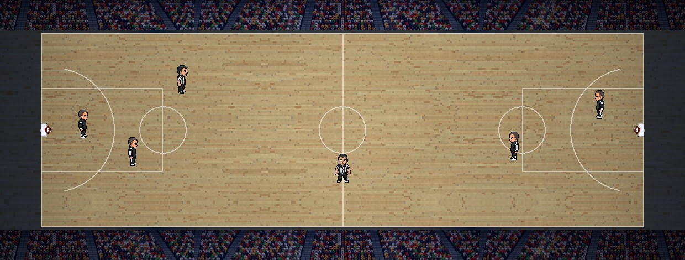
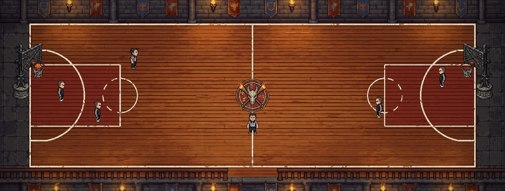
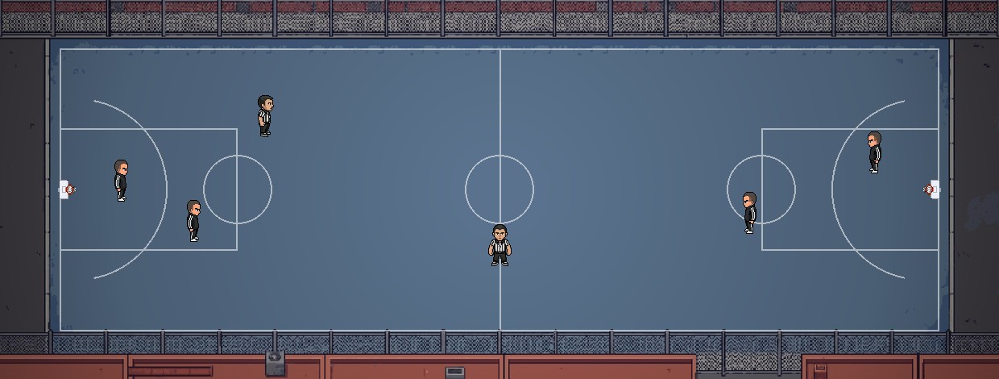
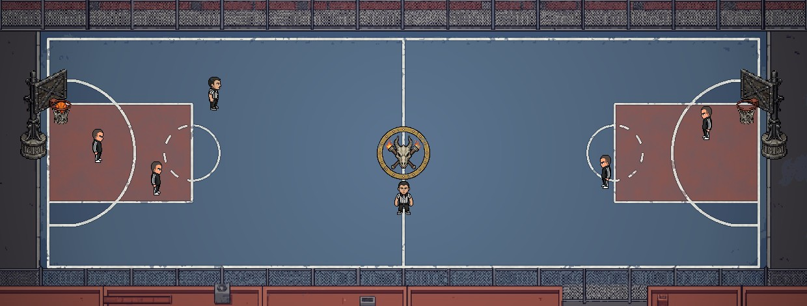
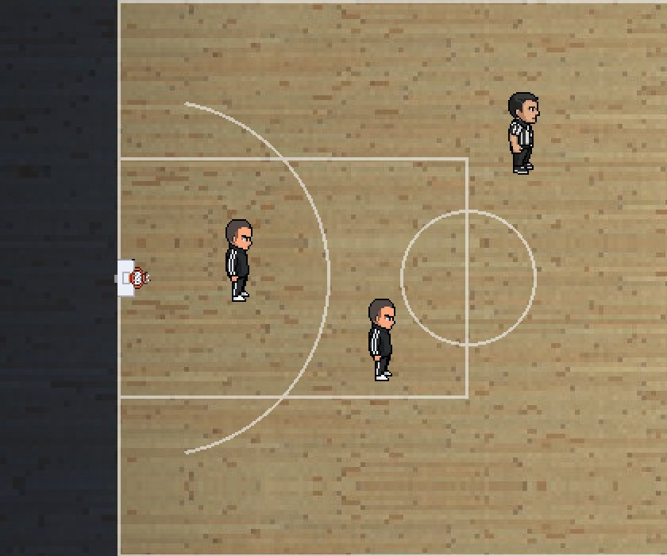
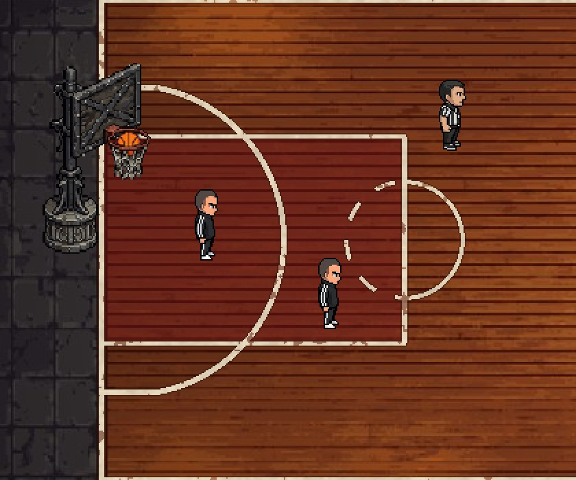
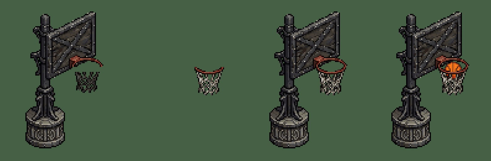

# Basketball-Assets für die Benchmark-Disziplin (17.11.)

Basketball ist die Benchmark-Disziplin (Chris, 17.11.). Diese Runde liefert die Bild-Assets dafür als
REMAKE im Dark-Fantasy-Stil der Figurenwelt: einen echten Korb in zwei Ebenen, Platzmarkierungen für
beide Maps, eine neue Parkett-Halle, Mittelkreis-Wappen und einen Rahmen für die Schussuhr.

**Der Motor (`public/mockups/battle-mode.engine.js`) ist nicht angefasst.** Die Verdrahtung macht der
Agent, der parallel Bewegung, Spacing und Korbgeometrie baut; Abschnitt 4 sagt genau, wie. Sofort
sichtbar ist nur die neue Parkett-Halle, weil sie die bestehende Datei `parkett.jpg` ersetzt. Bis zur
Verdrahtung liegen darauf weiter die weißen Vektorlinien und der alte Draufsicht-Korb.

Der Wertungs-Fingerabdruck ist unverändert: `GESAMT e80babacb68c (75 Eintraege)`.

## 1. Was geliefert ist

| Datei | Größe | Inhalt |
|---|---|---|
| `public/sprites/basketball/korb_links_hinten.png` | 96×128 | Sockel, Mast, Brett, hinterer Ringbogen, dunkle Netz-Rückseite |
| `public/sprites/basketball/korb_links_vorne.png` | 96×128 | vorderer Ringbogen und Netz-Vorderseite |
| `public/sprites/basketball/korb_links.png` | 96×128 | beide Ebenen in einem Bild |
| `public/sprites/basketball/korb_rechts_hinten.png`, `korb_rechts_vorne.png`, `korb_rechts.png` | 96×128 | Spiegelung des linken Korbs |
| `public/sprites/kulissen/basketball/parkett_linien.png` | 1240×470 | Boden-Overlay Parkett, transparent |
| `public/sprites/kulissen/basketball/streetcourt_linien.png` | 1240×470 | Boden-Overlay Street-Court, transparent |
| `public/sprites/kulissen/basketball/parkett.jpg` | 1240×470 | neue Parkett-Halle (ersetzt die alte Datei) |
| `public/sprites/basketball/wappen_parkett.png`, `wappen_streetcourt.png` | 96×96 | Mittelkreis-Wappen, schon im Overlay eingerechnet |
| `public/sprites/basketball/schussuhr_rahmen.png` | 48×32 | Rahmen für die Schussuhr am Korb |

Basketball hat **zwei** Maps (`KULISSEN.basketball` in `battle-mode.kulissen.js`): `parkett` und
`streetcourt`. Beide haben ein eigenes Overlay.

Dazu gehören:

- Rohbilder: `data/generated/pixellab-requisiten/roh/bb_korb.png`, `bb_wappen.png`,
  `bb_wappen_street.png`, `bb_schussuhr.png`, `kulisse_basketball_parkett.png`
- Auswahl: fünf neue Einträge in `data/generated/pixellab-requisiten/auswahl.json`
- Bestellprotokoll und Anker: `data/generated/pixellab-requisiten/basketball-17-11/bestellprotokoll.json`
  und `anker.json`
- Herkunft: `public/sprites/basketball/quellen.json` und `public/sprites/kulissen/quellen.json`
- Skripte: `scripts/pixellab-basketball-bestellen.py` (Bestellen) und
  `scripts/baue-basketball-assets.py` (Bauen, ohne Netz)
- `scripts/baue-kulisse-buehnen.py`: ein Eintrag in `PL_RAENDER` für die Parkett-Halle
- `scripts/pixellab-requisiten.py`: der Parkett-Auftrag steht zusätzlich am gewohnten Ort
- `public/mockups/battle-mode.kulissen.js`: `dunkel` für Parkett 0,18 → 0,06 (vom Generator aus der
  Bildhelligkeit gerechnet)

## 2. Vorher und nachher

Die Bilder sind **Montagen** aus `scripts/baue-basketball-assets.py --vorschau`, keine
Motor-Screenshots. „Vorher“ baut die heutige Zeichnung von `bodenFeldspiel()` nach (weiße Vektorlinien,
`korb_topdown.png`), „nachher“ legt Overlay und Korb mit den Ankern aus Abschnitt 3 auf die Kulisse.
Abdunklung und Randverlauf sind wie in `kulisseZeichnen()` gerechnet. Die Figuren sind Bestandsfiguren
im Motor-Maßstab (52 px hoch) und dienen nur dem Größenvergleich. Ein echter Motor-Screenshot des
heutigen Street-Courts liegt unter
`docs/design/pixellab-nur-neue-assets-17-11/welle-a-basketball-streetcourt-nachher.jpg`.

**Parkett, vorher:**



**Parkett, nachher:**



**Street-Court, vorher:**



**Street-Court, nachher:**



**Korb und Zone im Detail (doppelte Größe), vorher und nachher:**




**Die Korb-Ebenen (vierfach): hinten, vorne, zusammen, mit Ball zwischen den Ebenen:**



Kontaktbögen der Kandidaten: `basketball-assets-17-11/kontaktbogen-korb.png` (gewählt: 3),
`kontaktbogen-wappen.png` (gewählt: 2 für Parkett, 0 für Street-Court),
`kontaktbogen-schussuhr.png` (gewählt: 20).

## 3. Ankerpunkte

Alle Angaben in Pixeln der jeweiligen Datei, Ursprung oben links. Maschinenlesbar stehen sie in
`data/generated/pixellab-requisiten/basketball-17-11/anker.json`.

### 3.1 Korb (96×128)

| Punkt | linker Korb | rechter Korb |
|---|---|---|
| Ring-Mittelpunkt (Mitte der Öffnung) | (68, 52) | (27, 52) |
| Bodenpunkt senkrecht unter dem Ring | (68, 111) | (27, 111) |
| Mitte der Sockel-Standfläche | (33, 111) | (62, 111) |

- Ring außen (mit Kontur): 24×14 px, x 56…80, y 44…58.
- Freie Ringöffnung: 16×7 px, x 62…77, y 49…55.
- Ringhöhe über dem Boden: 59 px.
- Netz: y 59…75, hängt unter dem Ring.
- Schnitt der Ebenen: `vorne` enthält alle Pixel mit y ≥ 53 und x ≥ 56 (links), also den vorderen
  Ringbogen und das Netz. Alles andere ist `hinten`.

**Maßstab.** Eine Figur ist im Motor 52 px hoch (`HOEHEN_BEZUG`), der Ball 18 px breit
(`drawImage(bkBild.ball, bx-9, by-35, 18, 18)`). Der Ball ist damit rund 2,6-mal so groß wie in echt
und passt bei Maßstab 1 nicht durch die 16 px breite Öffnung. **Empfohlen ist Zeichenmaßstab 1,25:**

| Größe | bei 1,25 |
|---|---:|
| Ringöffnung | 20 px breit (Ball 18 px) |
| Ring außen | 30 px breit |
| Ringhöhe über dem Boden | 73,8 px (das 1,4-Fache der Figur; echt wäre das 1,65-Fache) |
| Sockelmitte | 43,75 px hinter dem Bodenpunkt |

Mit `korbX = W*0.076 = 94,2` steht der Sockel bei x ≈ 50,5 und reicht bis x ≈ 71. Er steht damit
knapp außerhalb der Grundlinie (x = 74,4), und der Ring ragt ins Feld. Das passt ohne Änderung an
`korbXVon()`.

### 3.2 Boden-Overlay (1240×470)

Das Overlay liegt deckungsgleich auf der Leinwand, Zeichnen bei (0, 0) in voller Größe. Die Geometrie
ist die von `bodenFeldspiel()`:

| Element | Wert |
|---|---|
| Feld | x 74,4…1165,6, y 60…410, Außenlinie 4 px |
| Mittellinie | x = 620, 3 px |
| Mittelkreis | Wappen, Mitte (620, 235), Ringdurchmesser 82 px (Motor: 84,6) |
| Zone | 220,6 tief, 150,4 breit, farbig gefüllt, Rahmen 3 px |
| Freiwurfkreis | Radius 42,3 um das Zonenende; feldseitig durchgezogen, in der Zone gestrichelt |
| Dreierlinie | Kreis mit Radius 112,8 um (`korbX`, 235), 4 px; Enden 0,20 rad vor der Senkrechten |
| Eckstücke der Dreierlinie | gerade von den Bogenenden zur Grundlinie, bei y = 235 ± 110,6 |
| Fläche innerhalb der Dreierlinie | leicht abgetönt |

Die Eckstücke sind neu. Der Motor zeichnet heute nur den Bogen, dessen Enden frei im Feld hängen. Die
Eckstücke liegen bei 110,6 px Abstand, `DREIER_RADIUS` ist 112,8. Sie weichen also höchstens 2,2 px
von der Distanzregel ab.

### 3.3 Schussuhr-Rahmen (48×32)

- Rahmen: x 4…43, y 2…31.
- Schiefertafel innen: x 11…36, y 9…23 (26×15 px).
- Mitte für die Ziffer: (24, 16).

### 3.4 Wappen (96×96)

Mitte (48, 48), Ringdurchmesser 82 px. Im Overlay schon enthalten.

## 4. Einbau in den Motor

### 4.1 Dateiliste

`BK_TEILE` lädt aus `/sprites/basketball/<name>.png`. Zu ergänzen sind:

```js
const BK_TEILE=["parkett","korb_topdown","zuschauer","ball",
  "korb_links_hinten","korb_links_vorne","korb_rechts_hinten","korb_rechts_vorne","schussuhr_rahmen"];
```

Das Overlay liegt neben der Kulisse. Sein Pfad ergibt sich aus dem der Kulisse:

```js
// kulisseAktiv.bild = "/sprites/kulissen/basketball/parkett.jpg"
const linienSrc=kulisseAktiv.bild.replace(/\.jpg$/,"_linien.png");
```

### 4.2 Zeichenreihenfolge

1. `kulisseZeichnen()` wie bisher (Kulisse, Abdunklung, Randverlauf).
2. Overlay: `ctx.drawImage(linien,0,0,W,H)`. Es ersetzt im Basketball-Zweig von `bodenFeldspiel()`
   alles von `ctx.strokeRect(W*0.06,60,…)` bis einschließlich der Dreierlinie. Ist das Overlay nicht
   geladen oder liegt keine Kulisse darunter, bleiben die Vektorlinien als Rückfall.
3. Korb, hintere Ebene.
4. Figuren und Ball.
5. Korb, vordere Ebene. Sie gehört über den Ball, solange er am oder im Ring ist.

Der Korb, mit `s = 1.25`:

```js
const s=1.25, links=(seite===1);              // links: korbX = W*0.076
const n=links?"korb_links":"korb_rechts";
const rx=links?68:27;                          // Ring-Mittelpunkt x in der Datei
const x=korbX-rx*s, y=H/2-111*s;               // Bodenpunkt unter dem Ring liegt auf (korbX, H/2)
ctx.drawImage(bkBild[n+"_hinten"],x,y,96*s,128*s);
// ... Ball ...
ctx.drawImage(bkBild[n+"_vorne"],x,y,96*s,128*s);
```

Der Ring-Mittelpunkt liegt dann bei **(`korbX`, `H/2 − 59·s`)**, also 73,8 px über dem Bodenpunkt. Der
Ballflug muss dort enden, nicht auf dem Bodenpunkt. Danach fällt der Ball senkrecht durch: vom
Ring-Mittelpunkt bis zum Netzende sind es 24·s = 30 px.

**Tiefe.** Der Korb steht auf der Bodenlinie y = `H/2`. Eine Figur mit Fußpunkt über dieser Linie
steht hinter dem Korb und wird vor ihm gezeichnet; eine Figur mit Fußpunkt darunter steht davor. Wer
die Figuren ohnehin nach y sortiert, reiht den Korb mit y = `H/2` ein.

**Entfallen** können damit der gedrehte `korb_topdown`-Aufruf und der graue Ständerstrich zur
Grundlinie. Der Mast steht jetzt im Bild.

### 4.3 Schussuhr

`zeichneShotClock()` zeichnet eine 38×22-Box bei (`gx`, `gy`). Mit dem Rahmen:

```js
ctx.drawImage(bkBild.schussuhr_rahmen,gx-24,gy-16,48,32);   // Ziffernmitte (24,16) liegt auf (gx,gy)
```

Die Tafel innen ist 26×15 px. Für den Zustand „knapp“ (unter 5 s) bietet sich eine rote Ziffer oder
ein roter Schein auf der Tafel an, statt die Box umzufärben. Mit dem neuen Korb sitzt die Uhr besser
über dem Mast, etwa bei (`korbX` ∓ 44, `H/2` − 146), als an der Grundlinie. Die Mastspitze liegt bei
`H/2` − 129.

### 4.4 Wenn sich die Geometrie ändert

Verschiebt der Motor Korb, Bogen oder Zone, wird das Overlay neu gebaut:

```sh
python3 -I scripts/baue-basketball-assets.py --korb-x 0.076 --dreier-rx 112.8 --dreier-ry 112.8 --zone-tiefe 220.6 --zone-breite 150.4
```

`--dreier-rx` und `--dreier-ry` dürfen verschieden sein, dann wird der Bogen eine Ellipse. Die
Standardwerte sind die heutigen des Motors. `--vorschau <ordner>` schreibt die Montagen neu.

## 5. Gestaltung

- **Korb.** Schmiedeeiserner Mast auf einem behauenen Steinsockel, genietetes Holzbrett mit
  Eisenkreuz, roter Eisenring, Seilnetz. Die Ansicht ist die der Arena-Kamera: Draufsicht-Karte mit
  Figuren in Dreiviertelsicht, die Körbe stehen an den Schmalseiten, das Brett zeigt ins Feld.
- **Parkett-Halle.** Eine Burghalle mit Fackeln, Wappenbannern und Holzgeländer statt der gekachelten
  Alt-Halle. Lichtkegel der Fackeln liegen auf dem Dielenboden. Das Bild folgt dem Aufbau des
  Street-Courts aus Welle A: Rand oben und unten, Boden frei, keine Markierungen.
- **Markierungen.** Die Linien rechnet das Skript, PixelLab malt sie nicht. Der Grund: `DREIER_RADIUS`,
  Zone und `korbXVon()` müssen exakt getroffen werden (Kommentar an `DREIER_RADIUS` im Motor), und ein
  generiertes Bild trifft sie nicht. Die Linien sind pixelgenau ohne Kantenglättung, haben eine dunkle
  Kontur und Farbabrieb. Parkett: cremeweiße Linien, dunkelrote Zone. Street-Court: weiße Linien,
  ziegelrote Zone.
- **Ein Korb für beide Maps.** Der schmiedeeiserne Korb steht auch auf dem Street-Court. Ein zweiter
  Korb im Straßenstil hätte 10 Gen. gekostet und ist nicht bestellt.

## 6. Kostenabrechnung

Topf Basketball: höchstens 70 Gen. Verbraucht sind **55 Gen.** in vier Aufträgen, 15 bleiben
ungenutzt. Maßgeblich ist `usage.generations` aus der Job-Antwort; die Kontodifferenz stimmt hier
damit überein.

| # | Auftrag | Größe | Job | Kandidaten | Gen. | Konto vorher | Konto nachher |
|---|---|---|---|---:|---:|---:|---:|
| 1 | `bb_korb` (Stilprobe) | 96×128 | `43bc9a7a-0846-4e53-b617-3bb9fc54714b` | 4 | 10 | 921,7 | 911,7 |
| 2 | `kulisse_basketball_parkett` | 792×300 | `b7170b39-7f9e-41d7-9e0b-379951b2796b` | 1 | 25 | 911,7 | 886,7 |
| 3 | `bb_wappen` (zwei Treffer) | 96×96 | `2dab1080-7571-4dac-8a80-7a9e4c7645dd` | 4 | 10 | 886,7 | 876,7 |
| 4 | `bb_schussuhr` | 48×32 | `5f986250-143a-4d37-b875-ccdbdb00c932` | 36 | 10 | 876,7 | 866,7 |
| | **Summe** | | | | **55** | **921,7** | **866,7** |

Alle Aufträge liefen über `/v2/generate-image-v2`, Saat 11, am 17.11. zwischen 13:19 und 13:26 UTC.
Kein Auftrag ist fehlgeschlagen, keiner wurde wiederholt. Bestellt wurden nur Requisiten und eine
Kulisse, keine Figuren und keine Animationen.

Eingehaltene Regeln:

- **Kein wiederholter POST.** `api()` in `scripts/lib/pixellab_api.py` wiederholt weiterhin auch POSTs
  (bei Zeitüberschreitung, Netzfehler und 5xx). `scripts/pixellab-basketball-bestellen.py` schickt den
  POST deshalb mit einer eigenen Funktion genau einmal und bricht bei einem Fehler mit dem Kontostand
  ab. Nur die GETs für Konto und Job dürfen wiederholen. Die Bibliothek selbst ist nicht geändert.
- **Sperre.** `flock /tmp/pixellab-bestell.lock` um jeden Auftrag.
- **Stilprobe zuerst.** Der Korb war der erste Auftrag und wurde angesehen, bevor der Rest lief.
- **Budgetbremse.** Das Skript bestellt nicht, wenn der Topf (70) überschritten oder die Reserve (150)
  angetastet würde.

## 7. Offene Punkte

1. **Verdrahtung im Motor** steht aus (Abschnitt 4). Bis dahin sind Korb, Overlays und Schussuhr-Rahmen
   ungenutzt.
2. **Die Dreierlinie liegt innerhalb der Zone.** Der Bogen hat Radius 112,8 um den Korb und reicht bis
   x ≈ 207. Die Zone ist seit dem 03.09. 220,6 px tief, die Freiwurflinie liegt bei x ≈ 295. Ein Wurf
   von der Freiwurflinie ist damit ein Dreier. Das Overlay bildet das getreu ab, weil es die Geometrie
   des Motors zeigen muss. Im echten Maßstab des Feldes (94 ft auf 1091 px, 50 ft auf 350 px) wäre der
   Bogen etwa 275 px tief und 154 px hoch. Das ist eine Wertungsfrage für den Agenten mit der
   Korbgeometrie; die Schalter aus Abschnitt 4.4 bauen das Overlay danach neu.
3. **Ballflug zum erhöhten Ring.** Heute zielt der Wurf auf (`korbX`, `H/2`). Der Ring liegt jetzt
   73,8 px darüber.
4. **Ballgröße.** Bei Maßstab 1,25 bleibt 1 px Luft je Seite zwischen Ball (18 px) und Ringöffnung
   (20 px). Ein Ball von 16 px säße lockerer.
5. **Zuschauer** sind nicht bestellt. Die neue Halle hat Mauern, Banner und Fackeln, aber kein
   Publikum. Ein Zuschauerrand liegt nahe an Figuren und ist deshalb ohne Freigabe nicht bestellt.
6. **`korb_topdown.png` bleibt** als Rückfall und weil `tests/arena-kulissen.test.ts` die Datei prüft.
   `korb_seite.png`, `korb_front.png` (Kenney) und `baelle_varianten.png` sind weiter ungenutzte
   Alt-Assets.
7. **Bodenschatten** unter Sockel und Ring sind nicht im Bild. Eine dunkle Ellipse auf dem Bodenpunkt
   (`korbX`, `H/2`) würde den Ring auf dem Feld verorten.
