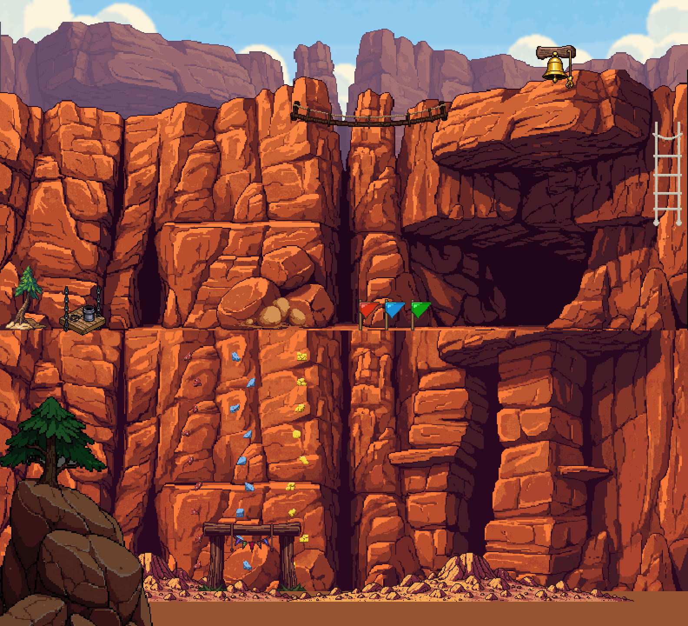
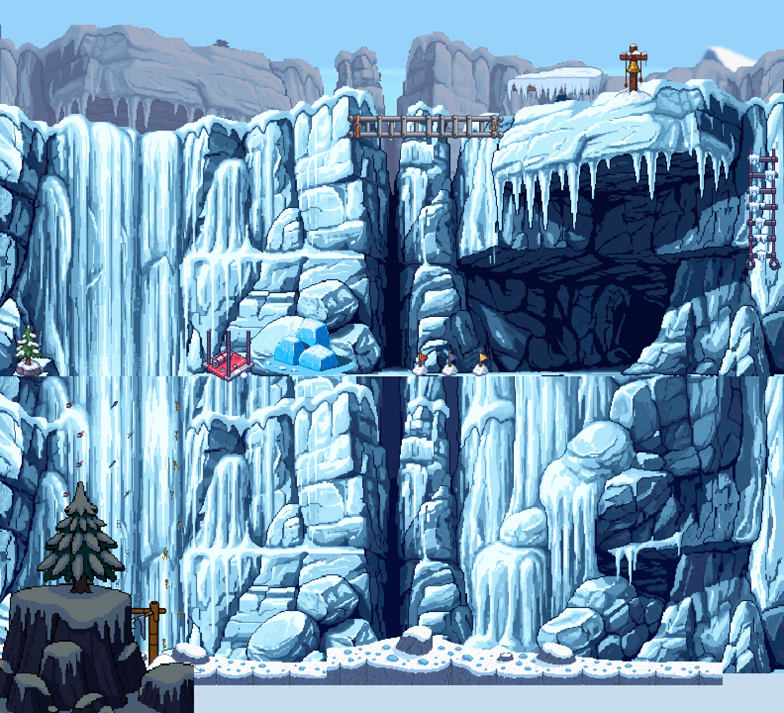
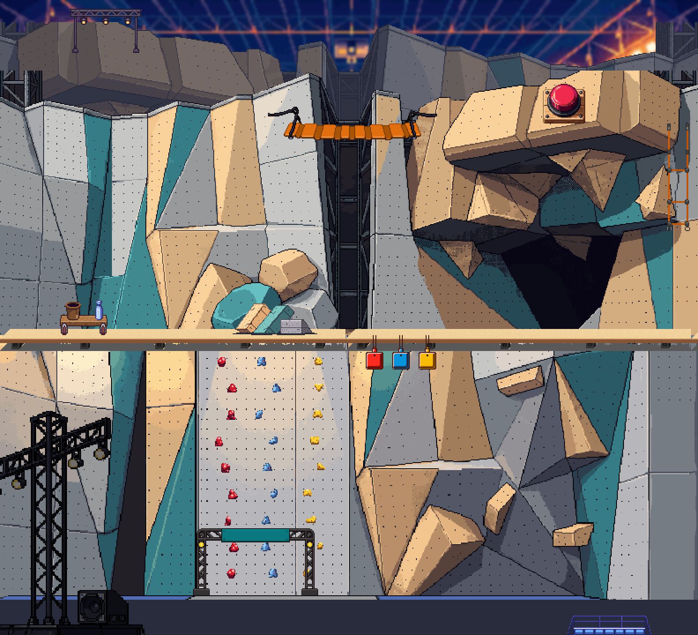

# Climbing neu: PixelLab-Assets für Canyon, Eisfall und Kletterhalle (18.11.)

Bestellung zum Konzept `docs/design/climbing-neu-18-11.md` (PR #1615), von Chris am 18.11. freigegeben
(„kannst die andern auch anpassen“): alle drei Wände, Deckel gesamt 280 Gen., Canyon zuerst (Deckel 90).
Keine Figuren, keine Animationen. Der Einbau in den Motor läuft auf `claude/climbing-canyon-bau-18-11`.

## 1. Kosten

| | Gen. | Deckel |
|---|---:|---:|
| Guthaben vorher (`/balance`) | 761,7 | |
| Canyon | 89,0 | 90 |
| Eisfall | 67,2 | 95 |
| Kletterhalle | 91,0 | 110 |
| **Summe** | **247,2** | 280 |
| Guthaben nachher (`/balance`) | 514,5 | Reserve 150 unberührt |

Die Summe stimmt mit der Kontodifferenz überein (761,735 − 514,540 = 247,195); in der Zeit hat niemand
sonst bestellt. Jeder POST ging genau einmal hinaus, alle unter `flock /tmp/pixellab-bestell.lock`.
Einzelposten mit `gen_vorher`/`gen_nachher`, Prompt, Saat und Job stehen in den beiden `quellen.json`.

56 Aufträge: 51 Treffer (davon 2 mit Abstrich), 4 verworfen, 1 leer zurück (nicht berechnet).

| Verworfen | Gen. | Grund |
|---|---:|---|
| Canyon, untere Wandhälfte, erster Versuch | 25 | `no_background: true` hat den sonnenbeschienenen Fels als Hintergrund entfernt (76 % transparent). Seither werden deckende Wandteile mit `no_background: false` bestellt |
| Halle, untere Wandhälfte, erster Versuch | 25 | fast eine Kopie der oberen Hälfte, mit zweitem Dach. Zweiter Versuch mit einem Stilbild-Ausschnitt ohne Dach: Treffer |
| Canyon `felsband` (Bandleiste) | 1 | Plattformer-Kacheln, passt nicht zur Wand. Das Band ist im Wandbild selbst |
| Canyon `wandfuss_b` (Sandstreifen) | 1 | flacher, greller Streifen. Ersetzt durch das Geröll `wandfuss.png` |
| Eisfall `aluleiter_bruecke` (erster Versuch) | 1 | dünner Strich zwischen zwei Eisklötzen. Zweiter Versuch: Treffer |
| Canyon `wandfuss` (erster Auftrag) | 0 | kam leer zurück, laut API nicht berechnet (Konto unverändert) |

Treffer mit Abstrich: `canyon_rastpodest.png` und `eisfall_rastpodest.png` sind wieder leicht von oben
gesehen statt frontal (brauchbar, aber nicht die bestellte Frontansicht); `wandfuss.png` (Canyon) hat einen
Gipfel in der Mitte und taugt eher als Geröllhaufen als als durchgehender Streifen.

Nicht bestellt, weil der Canyon-Deckel erreicht war: Bohrhaken mit Schlinge, Standplatz-Kette, loser
Einzelblock. Felsstaub und Eisstaub gibt es schon (`fx-bodenstaub-lite`, `fx-eisstaub-lite`).

## 2. Aufbau jeder Wand

Jede Wand besteht aus **zwei Breitformaten übereinander**, je 792×300, zusammen 792×600. Sie wird
**1-fach** gezeichnet, ein Wandpixel ist damit so groß wie ein Figurenpixel (im Mockup war die Wand 2-fach
gezeichnet). Die Naht bei y = 300 ist das Band. `wand.png` ist die fertig zusammengesetzte Fassung; die
Hälften liegen daneben, falls der Motor sie getrennt laden will.

Alle drei Wände haben dieselbe Struktur, weil die obere Canyon-Hälfte Stilbild und Vorlage der beiden
anderen war. Koordinaten in Wandpixeln (x von links, y von oben, 792×600), auf etwa ±10 px:

| Stelle | Canyon | Eisfall | Halle |
|---|---|---|---|
| Wandfuß | y 600 (kein Boden im Bild, `wandfuss.png` davor) | y 590, Schnee im Bild | y 590, Matten im Bild |
| Einstiegswand (Grifflinien) | x 190–370, y 310–590 | gefrorener Wasserfall x 30–200 | helle Platte x 225–395 |
| Kamin (Technik-Einstieg) | x 150–185, y 310–600 | Spalte x 385–410 (mittig, nicht links) | x 125–165 |
| Band (Quergang) | y 295–300, ganze Breite | y 295–300, Schnee | y 300, mit `halle_galerie.png` belegen |
| Rastpunkt | Band, x ≈ 95 | Band, x ≈ 230 | Band, x ≈ 95 |
| Engstelle (Blöcke im Bild) | x 250–385, y 205–300 | x 250–385 | x 240–385 (Volumen) |
| Obenrum (Absatz über den Blöcken) | x 190–370, y 175 | x 190–370, y 180 | x 180–370, y 180 |
| Gabelung | x ≈ 440, y 300 | x ≈ 440 | x ≈ 440 |
| Spalt zwischen den Türmen | x 385–410, y 30–300 | x 385–410 | x 370–420 (Stahlgerüst) |
| Seilbrücke | y ≈ 50, x 340–510 | Alu-Leiter, y ≈ 48 | Hängebrücke, y ≈ 60 |
| Dach, Unterkante / Lippe | x 465–750, y 95–190; Lippe x 500–520, y 60–110 | Lippe mit Zapfen y 75–150 | x 470–760, y 100–260 |
| Rastnische unter dem Dach | x 560–680, y 200–290 | x 480–680, y 180–290 | x 570–700, y 210–295 |
| Flanke mit Leiter | x 750–792, y 20–300 | x 755–792 | x 760–792 |
| Gipfelgrat, Topp | Dachblock oben, x 520–750, y 5–25; Glocke x ≈ 640 | x 520–750, y 5–25 | Dachblock x 510–770, y 5–60; Buzzer x ≈ 640 |

Die untere Canyon-Hälfte wiederholt Formen der oberen (Absatz, Blöcke); beim Eisfall und in der Halle ist
die untere Hälfte eigenständig. Der Kamin sitzt beim Eisfall in der Mitte statt links, der Motor braucht
also je Wand eigene Ankerpunkte.

## 3. Dateien

### 3.1 Kulissen: `public/sprites/kulissen/climbing-canyon/`, `…/climbing-eisfall/`, `…/climbing-halle/`

| Datei | Ebene | Größe | Inhalt |
|---|---|---|---|
| `wand.png` | E4 | 792×600 | ganze Wand, Himmel transparent |
| `wand_oben.png` | E4 | 792×300 | obere Hälfte, Himmel transparent |
| `wand_unten.png` | E4 | 792×300 | untere Hälfte, deckend |
| `reihe_e3.png` | E3 | 792×300 | zweite Reihe hinter dem Grat: obere Hälfte gespiegelt und getönt (0 Gen., wie im Konzept) |
| `panorama.png` | E1 | 400×224 (Halle 400×198) | Canyon aus der Stilprobe, Gletscher, Halleninneres mit Tribünen; auf Wandbreite strecken und weich ziehen |
| `vordergrund.png` | E5 | ≈ 180×200 | Felsnase mit Kiefer (Stilprobe), Schneefels mit Tanne, Lichtmast mit Box; im Motor abdunkeln |
| `wandfuss.png` | vor E4 | 400×57 / 400×60 | Geröll (Canyon), Schneewehe (Eisfall); Halle hat die Matten im Wandbild |

### 3.2 Requisiten: `public/sprites/arena/climbing/`

| Zweck | Canyon | Eisfall | Halle |
|---|---|---|---|
| Topp | `canyon_glocke.png` 46×50 | `eisfall_glocke.png` 38×60 | `halle_buzzer.png` 48×45 |
| Brücke (Technikweg) | `canyon_seilbruecke.png` 182×32 | `eisfall_aluleiter_bruecke.png` 158×24 | `halle_haengebruecke.png` 192×38 |
| Leiter (Ausdauerweg) | `canyon_strickleiter.png` 35×120 | `eisfall_leiter.png` 34×123 | `halle_leiter.png` 26×122 |
| Rastpunkt | `canyon_rastpodest.png` 54×57, `canyon_rastpodest_schraeg.png` 80×57 | `eisfall_rastpodest.png` 53×52 | `halle_rastpodest.png` 54×40 |
| Engstelle (frei setzbar) | `canyon_bloecke.png` 86×38 | `eisfall_bloecke.png` 93×59 | `halle_volumen.png` 96×36 |
| Wegweiser der drei Wege | `canyon_wegweiser.png` 84×36 | `eisfall_wegweiser.png` 78×26 | `halle_wegweiser.png` 80×39 |
| Startbogen | `canyon_startbogen.png` 126×80 | `eisfall_startbogen.png` 165×73 | `halle_startbogen.png` 142×77 |
| Griffblätter je Weg, 4×2 Zellen zu 32 px | `canyon_griffe_rot/_blau/_gelb.png`, `canyon_griffe_bunt.png` | `eisfall_griffe_rot/_blau/_gelb.png` (Eisschrauben, Schlingen) | `halle_griffe_rot/_blau/_gelb.png` |
| Eigenes | `canyon_kiefer.png` 48×75 | `eisfall_tanne.png` 29×52, `eisfall_wechte.png` 97×39 (Gipfel) | `halle_galerie.png` 392×25 (Band, kachelbar), `halle_tribuene.png` 119×62, `halle_scheinwerfer.png` 82×50 |

Die Griffe sind für 1-fach gezeichnete Figuren eher groß; in den Übersichtsbildern sind sie halbiert.
Matte, Seilsack, Kreidebeutel und Eiszapfen gibt es schon unter `public/sprites/arena/climbing_*.png`.

### 3.3 Effekte (VFX lite): `public/sprites/arena/climbing/fx-climbing-*.png` + `.json`

| Datei | Rahmen | Zelle | Für |
|---|---:|---|---|
| `fx-climbing-kreide-lite` | 8 | 32×32 | Greifen, Rastpunkt |
| `fx-climbing-steinschlag-lite` | 10 | 32×64 | Abrutschen (Canyon) |
| `fx-climbing-glocke-lite` | 10 | 64×64 | Topp |
| `fx-climbing-eisbruch-lite` | 9 | 32×64 | Abrutschen (Eisfall) |
| `fx-climbing-buzzer-lite` | 8 | 64×64 | Topp (Halle) |

Rohdateien und Auftragsdaten liegen wie bei den übrigen Effekten unter `data/generated/pixellab-vfx/roh/`.
Die Effekte sind klein und zurückhaltend; ob sie in der Totale tragen, zeigt erst der Einbau.

## 4. Übersichtsbilder

Zusammengesetzte Ebenen mit Requisiten an ihren Stellen, 2-fach vergrößert. Ohne Figuren, ohne Licht (E6)
und ohne Partikel (E7).

## 5. Was der Bestellweg gelehrt hat

1. Ein **Stilbild** bei `generate-image-v2` überträgt nicht nur Stil und Pixelgröße, sondern auch den
   Bildaufbau. Das hat hier geholfen (drei Wände mit gleicher Struktur), kostet aber einen Versuch, wenn
   der Aufbau gerade nicht übernommen werden soll (untere Hallenhälfte). Dann einen Ausschnitt ohne das
   störende Teil als Stilbild geben.
2. Deckende Wandteile mit `no_background: false` bestellen. Für den Himmel der oberen Hälften wurde eine
   einfarbige dunkle Fläche verlangt und von der Oberkante her per Flutfüllung entfernt.
3. Dieselbe Saat liefert bei `generate-image-v2` nicht dasselbe Bild.
