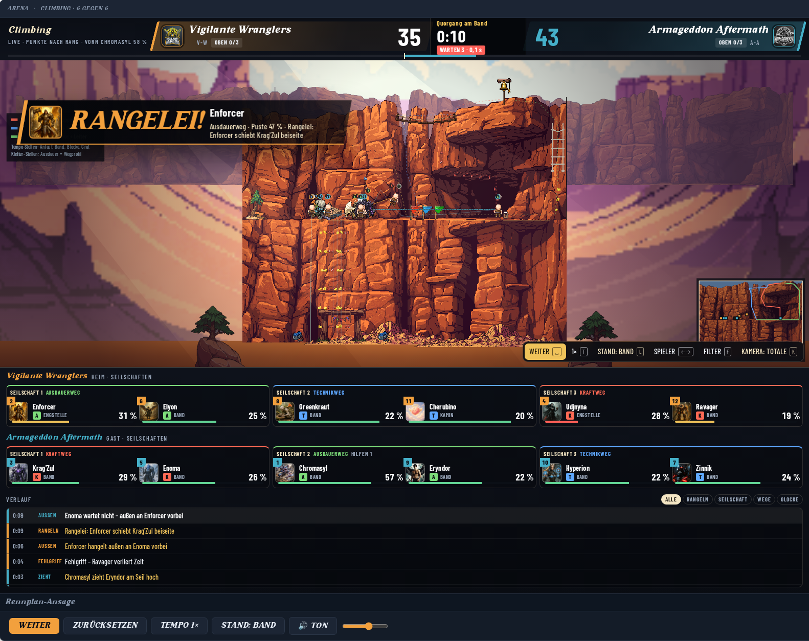
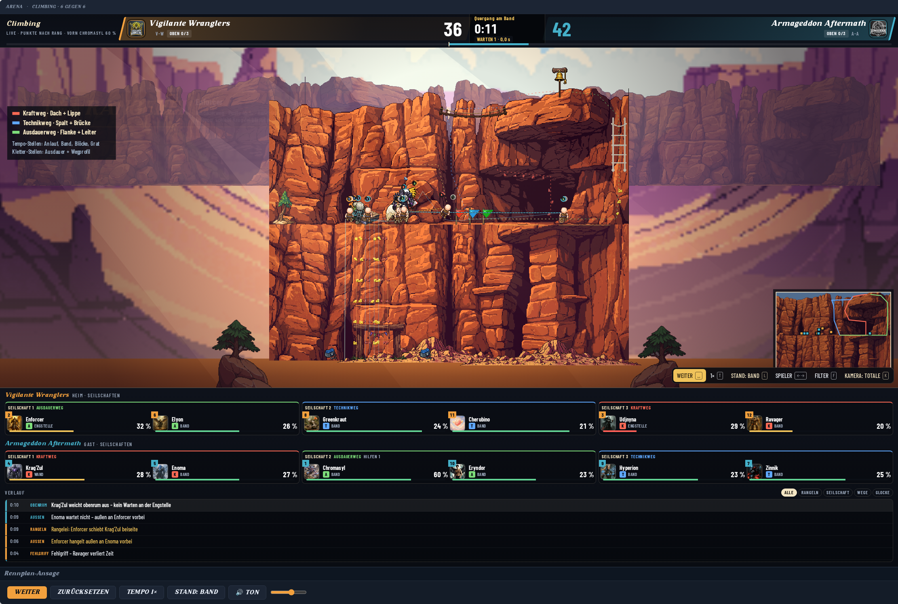
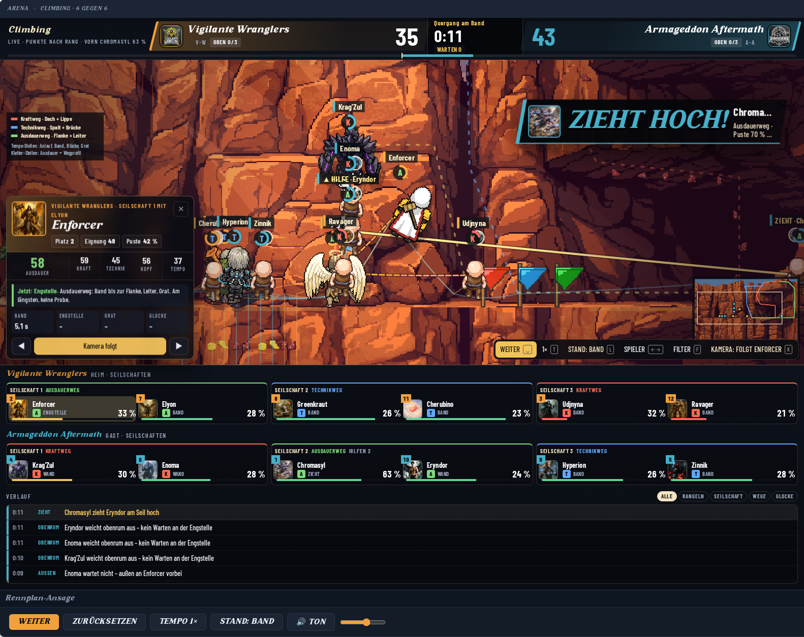
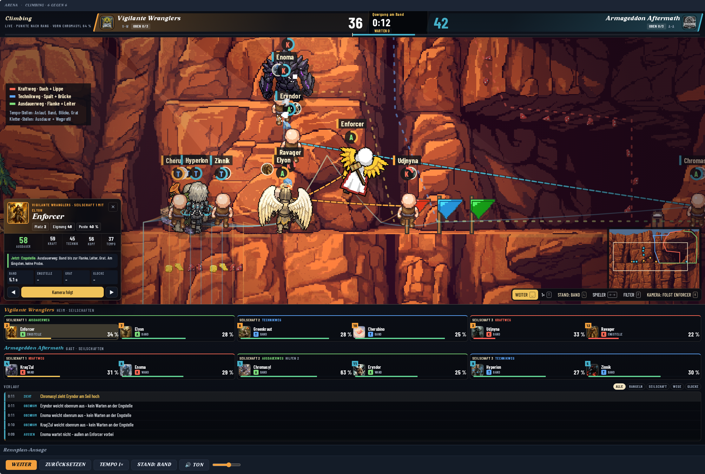
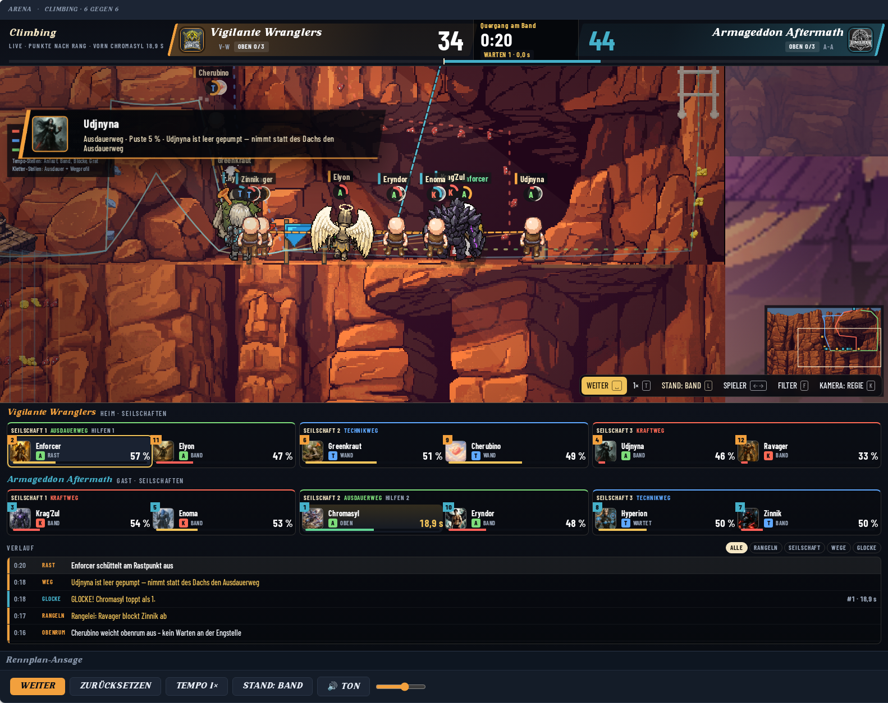
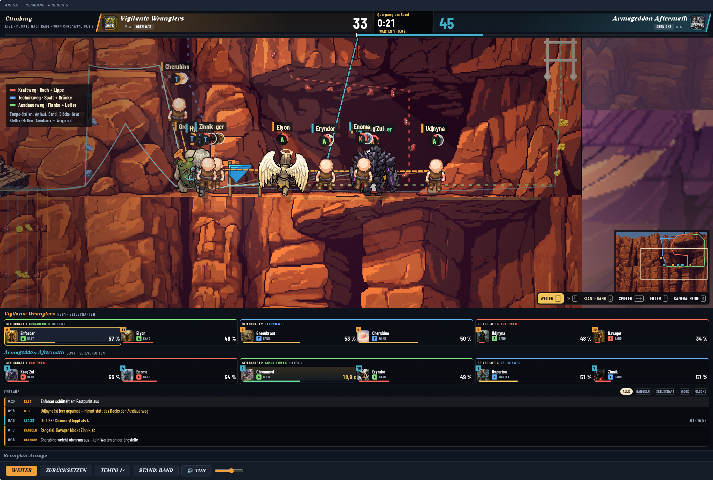
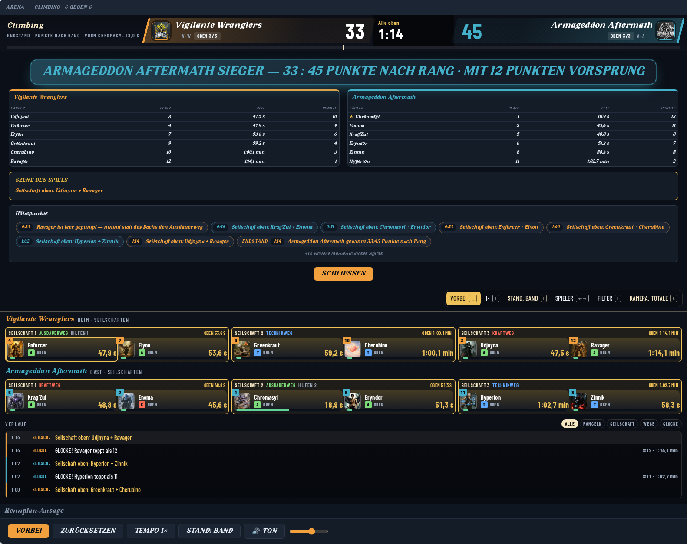
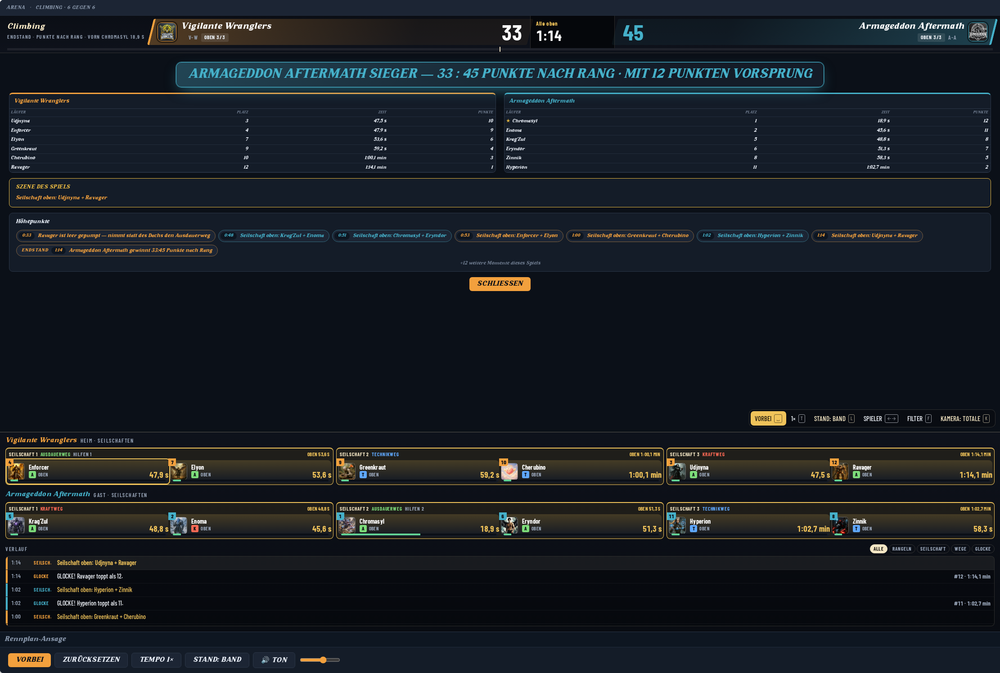
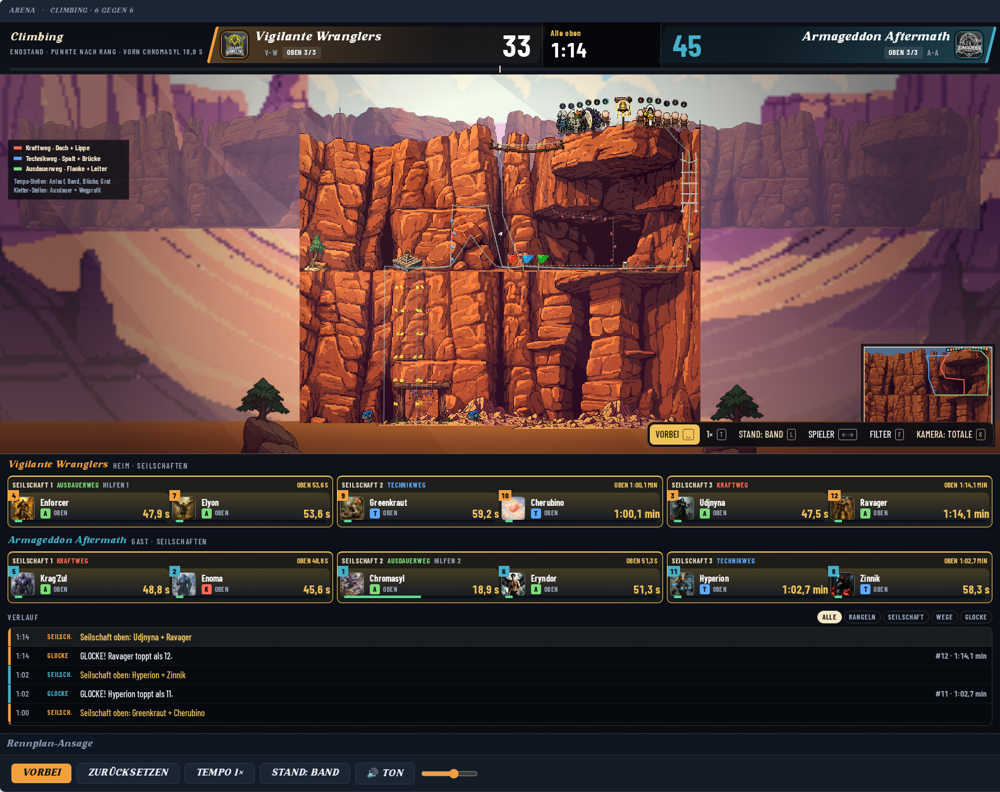
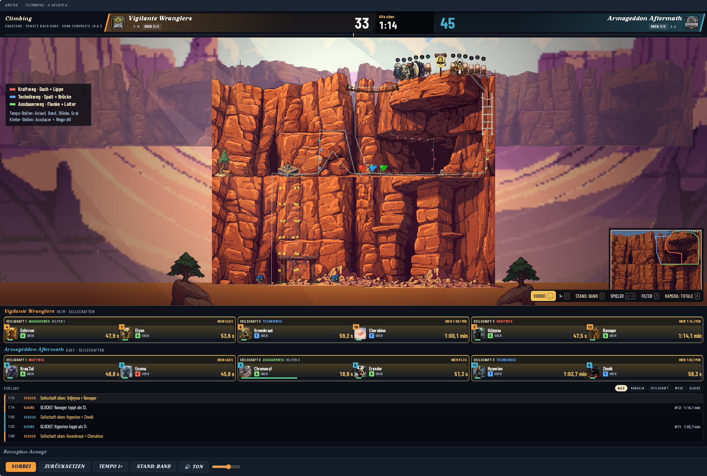

# Climbing „Canyon“ live: Schalter im Spiel, HUD-Profil, Kamera Totale und Folgen (18.11.)

Chris am 18.11.: „Ja, Canyon soll live gehen.“ Grundlage ist der Bau aus PR #1633
(`docs/design/climbing-canyon-bau-18-11.md`), das Mockup `public/mockups/climbing-neu-18-11.html` und das Konzept
`docs/design/climbing-neu-18-11.md`. Diese PR macht drei Dinge:

1. **Canyon ist das Climbing im echten Spiel.** Vorlauf, Buchung (PP, Teampunkte) und Anzeige rechnen dasselbe Format;
   ein schon gewerteter Spieltag bleibt in seinem Format, das neue gilt ab dem nächsten gewerteten Climbing-Spieltag.
   Ein Abschalt-Schalter holt das alte Format zurück.
2. **HUD-Profil `climbing`** im HUD-System vom 17.11. (#1564/#1566): Kopfleiste mit Phase, Dock mit Seilschaft-Kästen,
   Spielerkarte mit Profilwerten, Weg und Zwischenzeiten, Verlauf mit Filtern, Einblender mit Portrait und Puste.
3. **Kamera-Modi Totale und Folgen** neben der Regie.

## 0. Kurzfassung

| | Wert |
|---|---|
| Format im Spiel | Canyon (Motor-Vorgabe `BAHN_FLAGS.climbingFormat="canyon"`, im Spiel aus dem Saison-Stempel) |
| Abschalt-Schalter | `OLY_CLIMBING_FORMAT=standard` in `deploy/hetzner/.env` (compose reicht ihn an Container und Build-Arg `NEXT_PUBLIC_OLY_CLIMBING_FORMAT`) |
| rho je Spiel (n = 48, fünf Kader) | **0,860** (Spannweite 0,172), Saison 0,888; n = 24: 0,867 |
| Pp (Saatstämme 0 / 10 000 000) | **12,3 / 16,1** (Pflicht ≤ 25) |
| Fingerabdruck GESAMT | `d3a39030a3ef` → **`eaafed96150e`** (75 Einträge), nur `spiele climbing 1/7/42` |
| Altes Format geschützt | `CLIMBING-STANDARD 164b3d846334` (drei Zeilen `spiele climbing/standard`, außerhalb von GESAMT) |
| HUD und Kamera | reine Anzeige, Fingerabdruck unverändert (`eaafed96150e` vor und nach HUD/Kamera) |

## 1. Canyon im echten Spiel

### 1.1 Eine Quelle für alle Wege: `lib/resolve/climbing-format.ts`

`climbingFormatFuer(gameState, matchdayId)` sagt für jeden Spieltag `"canyon"` oder `"standard"`. Alle drei Wege, auf
denen der Motor Climbing rechnet, lesen diese Funktion und reichen das Ergebnis im Kader-Umschlag als
`formatByDisciplineId.climbing` an den Motor:

| Weg | Stelle |
|---|---|
| Chromium-Runner (Vorlauf, Buchung) | `bereiteFixturesVor()` → `VorbereitetesFixture.formatByDisciplineId` → Umschlag (`addInitScript` und `haengeMotorNeuEin`) |
| Node-Motor (Quick-Sim, Vorlauf im Node-Weg) | derselbe `bereiteFixturesVor()` → `DuellAuftrag` → `simuliereDuelle()` → `ladeMotorInstanz()` |
| Host (Anzeige, Spieltags-Ansicht) | `FoundationBattleArenaHost.tsx`, `arenaFormatByDiscipline` im Umschlag |

Im Motor wählt `climbingFormatWaehlen()`: ausdrücklich gesetzt (`bahnFlags`, `__olyBahnFlags`, Messskripte,
Fingerabdruck) vor dem Umschlag, sonst die Vorgabe `"canyon"`. `bahnFlags({climbingFormat:null})` gibt die Wahl an den
Umschlag zurück. Das Format steht außerdem im **Eingabe-Hash** des Vorlaufs (`lib/battle/arena-eingabe-hash.ts`, nur für
Climbing): wechselt es zwischen Vorlauf und Buchung, wird der Vorlauf verworfen und neu gerechnet, statt einen Lauf im
falschen Format zu buchen. Jede andere Disziplin behält ihren Hash Zeichen für Zeichen.

### 1.2 Laufende Spielstände: Wechselliste im Spielstand

`seasonState.climbingFormat = { seasonId, wechsel: [{ ab: null, format }, { ab: "<Spieltag>", format }, …] }`, gesetzt
beim Laden (`stempleClimbingFormat()` in `lib/persistence/save-repository.ts`, neben der PP-Skala-Migration; rein,
idempotent, nur Battle-Spielstände). Muster wie `seasonState.wertungsSkalen`, aber je Spieltag statt je Saison:

| Fall | Stempel |
|---|---|
| neue Saison, noch nichts gewertet | `[{ab:null, format:<Schalter>}]` |
| laufende Saison ohne Stempel (der Live-Save am 18.11.) | `[{ab:null, "standard"}, {ab:<erster ungewerteter Spieltag>, "canyon"}]` |
| Schalter wechselt mitten in der Saison | ein Wechsel ab dem ersten ungewerteten Spieltag wird angehängt; ohne gewerteten Spieltag dazwischen ersetzt statt gestapelt |
| Stempel einer anderen Saison | zählt nicht, die neue Saison beginnt mit dem Schalter |

Damit spielt die Wiedergabe eines **schon gewerteten** Spieltags immer in dem Format, in dem er gebucht wurde
(gezeigt = gebucht auch für die Historie), und ein Hin- und Zurückschalten kann keinen gebuchten Spieltag umschreiben.
Ein Spielstand, der noch nicht durch die Lade-Migration ging, liest denselben Stempel, den sie setzen würde.

### 1.3 Schalter

| `OLY_CLIMBING_FORMAT` | Wirkung |
|---|---|
| leer, `canyon`, `an` | Canyon (Standard seit 18.11.) |
| `standard`, `aus`, `0`, `false` | ab dem nächsten gewerteten Climbing-Spieltag wieder das alte Format; gebuchte Canyon-Spieltage bleiben Canyon |

Nach einer Änderung neu bauen (`docker compose up -d --build`), wie bei `OLY_PP_SKALA`; der Browser liest den Schalter
nur für Spielstände ohne Stempel (`NEXT_PUBLIC_OLY_CLIMBING_FORMAT`), sonst den Stempel aus dem Spielstand.

### 1.4 Wertung

Unverändert gegenüber #1633: `MOTOREN.climbing.wert()` ordnet nach Glockenzeit, `bahnTeamstand()` vergibt Rangpunkte
N..1, die PPS-Referenz (`data/generated/climbing-pps-referenz.json`) arbeitet auf denselben Rangpunkten und bleibt gültig.
„Seilschaften oben“ ist Anzeige, keine zweite Wertung.

## 2. Abnahme im Live-Format

Node-Motor, derselbe Messcode wie Chromium (`disziplinMessen()`, `einflussVon()`); `scripts/miss-alle-disziplinen.mjs`
hat dafür den Schalter `--node` bekommen. Ohne Schalter misst jedes Werkzeug jetzt Canyon (Motor-Vorgabe).

| Größe | Standard (bis 18.11.) | **Canyon live** |
|---|---:|---:|
| rho je Spiel, n = 48 (Median, fünf Kader) | 0,816 | **0,860** |
| je Kader | 0,816 / 0,912 / 0,814 / 0,738 / 0,884 | 0,794 / 0,866 / 0,904 / 0,732 / 0,860 |
| Spannweite | 0,174 | 0,172 |
| rho Saison | 0,881 | 0,888 |
| rho je Spiel, n = 24 (Basislinie der Rangtreue-Schranke) | 0,837 | 0,867 (Spannweite 0,155, Saison 0,916) |
| Pp Stamm 0 / 10 000 000 | 12,7 / 9,6 | **12,3 / 16,1** |

Befehle: `node scripts/miss-alle-disziplinen.mjs 48 climbing --node`, `node scripts/miss-climbing-canyon.mjs 48 --pp`.
Nachgezogen: `data/generated/disziplin-abnahme.json` (Climbing-Eintrag und Beobachtungsliste) und
`data/generated/rangtreue-basislinie.json` (Climbing von Hand, wie am 01.10., nicht über `baue-rangtreue-basislinie.mjs`).
Pp je Attribut (Stamm 0 / Stamm 2, Matrix): stamina 26,1 / 26,3 (26), determination 13,0 / 13,4 (16), speed 14,2 / 16,3
(12), dexterity 14,2 / 15,4 (12), health 11,7 / 9,3 (10), power 7,2 / 7,4 (8), will 7,0 / 5,7 (8), awareness 6,7 / 6,1 (8).

## 3. Fingerabdruck

`node scripts/pruefe-wertung-fingerabdruck.mjs --node`:

| Zeile | vorher (`d3a39030a3ef`) | nachher (`eaafed96150e`) |
|---|---|---|
| `spiele climbing 1` | `58b9222c223b` | `310b216c1cc8` |
| `spiele climbing 7` | `b2b7c6e4bfbc` | `727f3c3d16ef` |
| `spiele climbing 42` | `d26ad5352068` | `8f7923e36b5e` |
| alle anderen 72 Zeilen | gleich | gleich |

Die drei neuen Werte sind genau die früheren `spiele climbing/canyon`-Zeilen aus #1633 (`CANYON a3ffa010b879`). Das
alte Format steht jetzt dort, wo vorher Canyon stand: `spiele climbing/standard 1/7/42` = die drei alten Werte, Summe
`CLIMBING-STANDARD 164b3d846334`, außerhalb von GESAMT. HUD-Profil und Kamera ändern keinen Wert (Lauf vor und nach
dem Anzeige-Commit identisch). Der Chromium-Lauf (ohne `--node`, unter der Aufnahme-Sperre, nach dem Merge von `main`)
trifft dieselben Werte: GESAMT `eaafed96150e`, `CLIMBING-STANDARD 164b3d846334`.

## 4. HUD-Profil und Kamera

Erstes Bahn-Profil im HUD-System. Dieselben Bauteile wie Basketball/Hockey/Football, drei Erweiterungen am Baukasten:
`nurWenn` (das Profil gilt nur im Format Canyon; im alten Format bleibt das alte HUD), eigene Ereignisquelle für den
Verlauf (`CANYON.ereignisse` statt `fsZuege`) und eigenes Dock und eigene Karte. Alles liest den gebuchten Zustand, nichts
schreibt in Läufer- oder Kletterer-Objekte.

| Bauteil | Quelle (gezeigt = gebucht) |
|---|---|
| Kopfleiste: Stand | `bahnTeamstand().seiten` (= `#score`, Punkte nach Rang) |
| Kopfleiste: Uhr | `rennT × zeitFaktor()` (= `#clock`) |
| Kopfleiste: Phase | Kantenart des vordersten Kletterers ohne Glocke („Quergang am Band“, „An der Lippe“, „Alle oben“) |
| Kopfleiste: Chip je Team | „OBEN 2/3“ — Seilschaften, deren Partner alle geläutet haben |
| Kopfleiste: Zusatz | „WARTEN n · längste Wartezeit“ |
| Kopfleiste: Unterzeile, Momentum | „vorn Name 63 %“; Tauzieh-Balken aus dem mittleren Routenanteil je Team |
| Dock | je Team drei Seilschaft-Kästen (Nummer, Weg in Wegfarbe, Hilfen, „oben“ mit Zeit), darin je Kletterer Rang (`bahnRangliste()`), Portrait, Name, Weg-Buchstabe, Ort, Anteil bzw. Glockenzeit (`bahnZeitAnzeige()`, = Spalte „Zeit“), Puste-Balken (`K.res`) |
| Spielerkarte | Platz, Eignung, Form, Puste; fünf Profilwerte aus den Sub-Skills, mit denen der Motor rechnet (Ausdauer, Kraft, Technik, Kopf, Tempo; der des eigenen Wegs groß); der Weg in einem Satz samt Nebenweg-Hinweis; Zwischenzeiten Band, Engstelle, Grat, Glocke |
| Verlauf | `CANYON.ereignisse`, Filter Alle / Rangeln / Seilschaft / Wege / Glocke; Glocke mit Platz und Zeit |
| Einblender | `canyonMelde(gross)` → `callout()` → HUD-Einblender, mit Portrait, Weg, Puste und Satz |
| Bildkopf im Canvas | „Seilschaften oben“/Wartezähler entfallen, wenn die DOM-Kopfleiste steht; Weg-Legende und Routen-Inset bleiben |

**Kamera** (`canyonKam`, reine Anzeige): *Regie* wie in #1633; *Totale* — die ganze Wand mit Wandfuß und Grat, so groß,
wie Breite und Höhe es zulassen; *Folgen* — ein Kletterer, Bildmitte über ihm (Zoom 1,9), nach der Glocke auf der Glocke.
Bedienung: Knopf „Kamera“ in der Bedienleiste und Taste `K` (Regie → Totale → Folgen), Klick auf eine Dock-Leiste
(öffnet die Karte, Kamera folgt), `←`/`→` (nächster Kletterer, Kamera folgt mit), `Esc` (Karte zu, zurück in die Regie),
Knopf „Kamera folgen“ auf der Karte. Bei angehaltener Uhr zieht die Kamera nach Wandzeit nach, damit ein Wechsel in der
Pause sichtbar ist. Schnittstelle für Aufnahmen und Tests: `window.__arena.canyonKamera(modus, id)`,
`window.__arena.canyonHudProbe()`.

## 5. Tests

| Datei | Was |
|---|---|
| `tests/climbing-format.test.ts` | Schalter, Stempel beim Laden (neue Saison, laufende Saison, Hin- und Zurückschalten, andere Saison, Manager-Modus), Umschlag nur für Climbing |
| `tests/climbing-canyon.test.ts` | Canyon ist Vorgabe; Standard dazwischen hinterlässt keinen Zustand; Umschlag wählt das Format, ausdrücklich gesetzt geht vor; gezeigt = gebucht je Tick |
| `tests/arena-node-runner-paritaet.test.ts` | Node-Runner spielt im Format des Spieltags (Canyon nach dem Laden, „standard“ bei altem Stempel), Motor gleich; mit Chromium: Climbing im Live-Format (Liste) und im Format „standard“ identisch |
| `tests/hud-system-climbing.test.ts` (Chromium, CI-Job `arena-chromium-tests`) | Komponenten, gezeigt = gebucht an 30 Stellen bis zum Ende (Stand, Uhr, jede Leiste), Kamera Totale/Folgen/Esc/K, altes Format und `hudSystem(false)` behalten das alte HUD |
| `tests/bahn-climbing-gezeigt-gleich-gebucht.test.ts` | hält jetzt ausdrücklich das alte Format fest (Rückweg) |

## 6. Bilder (1920 und 2560, Gerätefaktor 1)

Aufnahme: `flock /tmp/oly-aufnahme.lock node scripts/screenshot-climbing-canyon-hud.mjs` — Battle-Mode-Seite in der
Einbettung des Spiels (`im-spiel`, dunkel), echter Kader (erste Paarung der Kaderfamilie, 6 gegen 6), Saat 1337. Die
Szenen sind nicht gestellt: die Wiedergabe wird an die Zeitpunkte des gebuchten Laufs gespult, nur die Kamera wechselt.

| Szene | 1920 | 2560 |
|---|---|---|
| Totale, erste Rangelei am Band |  |  |
| Folgen nach Klick auf eine Dock-Leiste, Spielerkarte offen |  |  |
| Regie, erste Glocke |  |  |
| Endstand-Tafel |  |  |
| Totale nach dem Ende, Dock mit allen Glockenzeiten |  |  |

### Abgleich mit dem Mockup

| Bauteil | Mockup (`climbing-neu-18-11/09-karte-nebenweg.png`, `06-totale-routen.png`) | Bau | Stand |
|---|---|---|---|
| Kopfleiste | großer Wert „Seilschaften oben“, Unterzeile „vorn Name %“, Phase unter der Uhr | großer Wert = **gebuchter Teamstand** (Rangpunkte, wie `#score`), „OBEN n/3“ als Chip, Unterzeile „vorn Name %“, Phase über der Uhr | bewusst anders: der große Wert muss die Wertung zeigen, „Seilschaften oben“ ist keine (Abschnitt 1.4) |
| Dock | sechs Seilschaft-Kästen in einer Reihe über die ganze Breite | Heim und Gast je eine Reihe mit drei Kästen, darunter der Verlauf | gleiche Kästen und Leisten (Rang, Portrait, Name, Weg-Buchstabe, Ort, Anteil/Zeit, Puste); die Arena hat unten den HUD-Dock statt Overlay |
| Verlauf | Overlay rechts oben, Wartezähler im Kopf | im Dock mit Filtern; Wartezähler in der Kopfleiste | gleich, anderer Ort |
| Spielerkarte | fünf Profilwerte, Weg-Satz mit Nebenweg, Zwischenzeiten | dieselben, dazu Platz, Eignung, Form, Puste, Knopf „Kamera folgen“ | mehr |
| Einblender | Wort, Portrait, „Name · Weg · Puste“ | Wort, Portrait, Name, „Weg · Puste · Satz“ | gleich |
| Routen-Inset, Weg-Legende | links oben als Overlay | im Bild (Inset rechts unten, Legende links oben, wie #1633) | gleich, anderer Ort |
| Kamera | Regie, Totale, Folgen (Taste K schaltet Regie ↔ Totale) | Regie, Totale, Folgen (Taste K schaltet alle drei) | gleich |
| Szenen-Knöpfe 1–5, Ebenen-Schalter | ja (Mockup-Bedienung) | nein (im Spiel ohne Sinn) | entfällt |

## 7. Offene Punkte

1. **Wegwechsel-Ansage durch den Spieler** (optional laut Auftrag): nicht gebaut. Der Motor wechselt selbst (Gabel,
   Rastnische); ein Knopf ginge über die Rennplan-Ansage (`planWechsel`) und wäre eine Wertungsänderung mit eigener
   Abnahme.
2. **Pp zweiter Stamm 16,1** knapp über dem Optimum 15 (Tempo-Kanäle auf dem Band), Pflicht ≤ 25 erfüllt.
3. **Format-Chips der Testansicht**: die Aufstellungs-/Testansicht hat Format-Chips nur für Spurt; Climbing zeigt dort
   das Format des nächsten Spieltags. Ein Chip „Canyon / Standard“ wäre eine kleine Ergänzung.
4. Eisfall, Kletterhalle, Abseilen, Flut: unverändert später (#1632-Assets liegen bereit).
