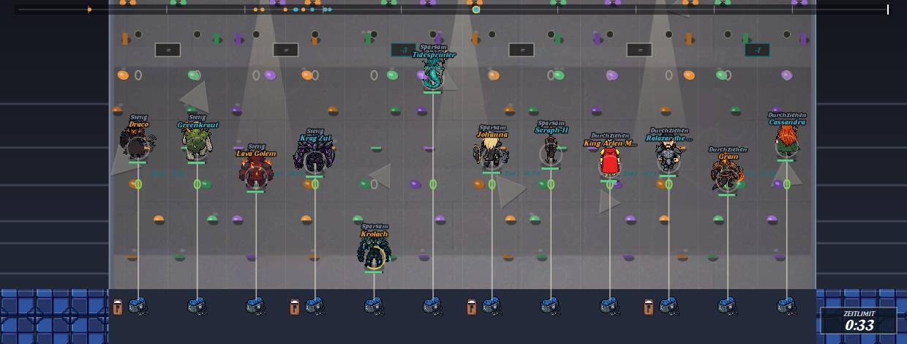
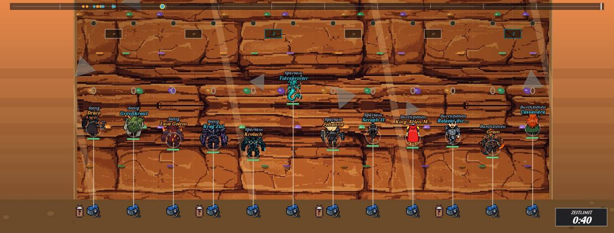
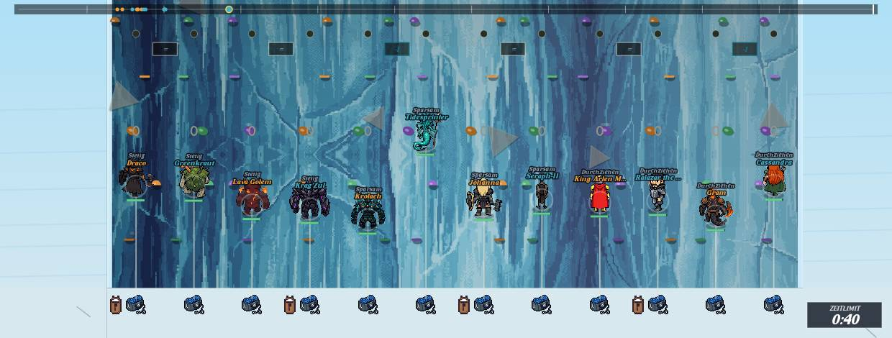
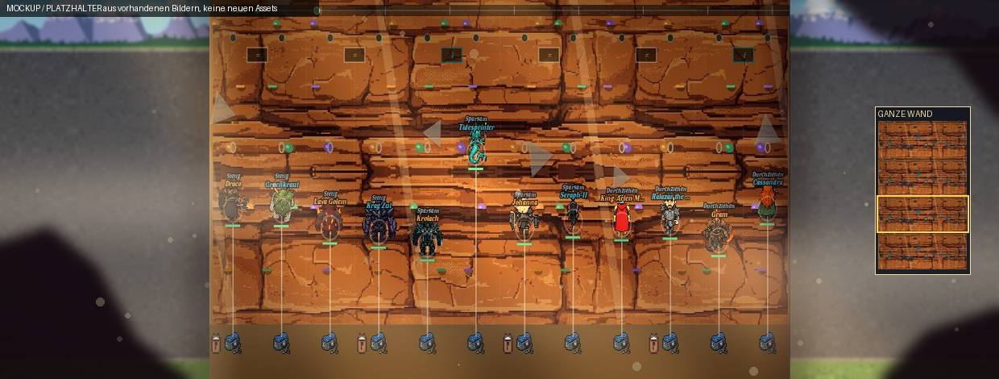

# Climbing: neue Spielformate und HD-2D-Optik im PixelLab-Stil (Konzept, 17.11.)

Anlass, Chris am 17.11., wörtlich: „und klettern hat bisher auch nur 1 konzept nach oben, vllt könnte man da
was mit abseilen machen oder kp was überlege mal was da noch möglich wäre nicht nur neue skins hatte ich ja
gesagt für die karten - die sehen beim climbing auch sehr lame aus. kann man das nicht auch pixel lab mäßig
in diesem hd 2d look oder so machen?“

Dieses Dokument ist ein Konzept. Es wurde **nichts gebaut, nichts bestellt, nichts gemessen**; alle rho- und
Pp-Angaben zu neuen Formaten sind Erwartungen, keine Messwerte.

## 0. Kurzfassung

- **Befund:** Climbing hat ein einziges Format (Lead-Wand, alle zwölf klettern parallel nach oben). Die drei
  Karten (Halle, Fels, Eis) unterscheiden sich nur in der Textur der Wandfläche. Chris' „nur Skins“ trifft zu.
- **Formate:** acht Ideen bewertet. Empfehlung in Bau-Reihenfolge:
  1. **Gipfelsturm & Abseilen** (rauf, Glocke, am Seil wieder runter) — Chris' eigener Vorschlag.
  2. **Die Flut** (Höhen-Hatz: etwas steigt von unten, wer eingeholt wird, scheidet aus) — kleinster Aufwand,
     weil das Hatz-Muster aus dem Spurt schon existiert.
  3. **Boulder-Runde** (vier kurze Probleme, je zwei bis drei Wege) — das Format, das „mehrere Wege zum
     Erfolg“ am besten trägt, aber das größte Pp-Risiko hat. Erst nach 1 und 2.
- **Optik:** HD-2D entsteht nicht durch eine schönere Wandtextur, sondern durch **Tiefe um die Wand herum**:
  Himmel, Fernpanorama, seitliche Flanken, Wand, Vordergrund-Silhouetten, Licht, Partikel, alles mit
  eigenem Parallaxfaktor zur Folgekamera. Die drei bezahlten Wandbilder bleiben die Wandebene.
- **Kosten:** Variante B **109 Gen. geplant, Deckel 120**. Variante A (nur Licht, Partikel, ein Panorama) 47.
- **Standardformat bleibt bit-identisch.** Neue Formate hängen hinter einem Schalter und bekommen eigene
  Fingerabdruck-Einträge.

## 1. Ist-Zustand

### 1.1 Mechanik (Motor `public/mockups/battle-mode.engine.js`, `BAHN_ART.climbing`, ab ca. Z. 48225)

| Baustein | Stand |
|---|---|
| Chassis | Bahn (`stepSpurt` mit Climbing-Gates), 6 je Seite, feste Duellpartner auf gespiegelten Routen |
| Strecke | eine Wand, `pos` 0→1, zehn Griffe (`hindernisse` 0,08 … 0,89), drei Exen (`zonen` 0,26/0,53/0,80) |
| Griffarten | fünf Typen in drei Layouts (`kurse`: Überhang, Platte, Dach) — die einzige spielerische Varianz |
| Haushalt | Reserve (Pump), `steigung` 0,85, Rasten je Plan (Sparsam, Stetig, Durchziehen) |
| Fehler | Fehlgriff kostet Zeit; Kraftzug und Umsetzen als Nebenwege; Abrutschen bis zur letzten Exe |
| Kontakt | Duelldruck G-2, Herunterziehen und Wehren an zwei Kreuzungsgriffen (0,44/0,71; Freigabe 14.10.) |
| Ende | Zeitlimit 10,6 Sim-s; Wertung `rang`: Tops nach Zeit, darunter Höchstmarke („Griff 7+“) |
| Sub-Skills | acht (`rezept`): Zug, Ausdauertempo, Griff, Umsetzen, Kraftausdauer, Kraftzug, Zähigkeit, Kopf; `mengeAusEignung` |

**Matrix** (`lib/player-generator/official-discipline-weights.ts`, gesperrt): stamina 26, determination 16,
speed 12, dexterity 12, health 10, power 8, awareness 8, will 8. Vier Attribute zählen nicht (0).

**Abnahme** (`docs/design/stand-aller-disziplinen.md`, `data/generated/disziplin-abnahme.json`):
rho je Spiel **0,801** (n=48; n=24: 0,797), Saison 0,881, Kaderspannweite 0,209, Pp 12,0 / 9,5. Climbing ist
über der Mindestschranke 0,75, aber der knappste Wert am Ziel 0,80 und steht auf der Beobachtungsliste.
Das begrenzt, was man dem Standardformat noch zumuten darf: **jede Idee hier ist ein eigenes Format, kein
Umbau des Standards.**

Frühere Entscheidungen, die weiter gelten (`climbing-opus-gegencheck-24-09.md`,
`fable-ideen-heben-breaking-climbing-30-09.md` 4.3): kein Störgriff G-1, kein Helfer-Bonus für
Teamkollegen, kein neunter Sub-Skill-Kanal (gemessen schlechter, 41 → 47,7 Pp), Boulder-Wertung nicht auf
der Lead-Wand. Die Boulder-Absage galt dem **Mischen** in das Lead-Format; als eigenes Format ist sie neu
zu entscheiden (Frage 3).

### 1.2 Optik

Kulissen `climbing/wand` (Halle), `climbing/fels`, `climbing/eis`. Fels und Eis sind seit Welle A Batch 2
(`origin/claude/pixellab-welle-a-batch2-v2-17-11`, je 25 Gen.) PixelLab-Breitformate, senkrecht kachelbar;
`kulisseZeichnen(versatzY)` zeichnet zwei Kopien und lässt die Wand mit der Kamera mitlaufen. Darüber
zeichnet `bodenWand()` Griffe, Volumen, Exen, Seile und Wandfuß; bezahlte Requisiten: Matte, Kreidebeutel,
Seilsack, Eiszapfen.

Ist-Screenshots (Batch-2-Kulissen über dem aktuellen Motor, Leinwand 1240×470, Demo-Kader):

### 1.3 Diagnose: warum es „lame“ aussieht

1. **Die Wand ist eine Fläche, kein Ort.** Sie füllt 960 von 1240 Pixeln frontal und ohne Kante. Es gibt
   keinen Himmel, keinen Horizont, keine Fallhöhe. Das Bild liest sich wie ein Boden von oben.
2. **Die Ränder sind einfarbige Streifen.** Links und rechts je 140 Pixel Farbfläche mit ein paar Linien.
   Genau dort müsste die Tiefe sitzen.
3. **Die Karten sind wirklich nur Skins.** Fels, Eis und Halle tauschen die Textur. Griffe, Volumen, Licht,
   Wandfuß und Spielverlauf sind identisch.
4. **Zwölf gleiche Spuren in eine Richtung.** Keine Route kreuzt, niemand quert, niemand kommt entgegen. Aus
   der Totale ist ein Balkendiagramm zu sehen, das wächst.
5. **Stilbruch auf der Wand.** Graue Canvas-Dreiecke (Volumen), Ovale (Griffe) und Rechtecke (Routenschilder)
   liegen auf einem PixelLab-Bild. Der Ersatz ist in Welle B schon geplant (Griffsatz und Volumen, 39 Gen.).
6. **Die Figuren klettern nicht.** Sie stehen in der Laufpose auf der Wand. Neue Animationen sind gesperrt;
   was ohne geht, steht in 3.4.
7. **Kachelnaht.** Im Eisbild ist die senkrechte Spiegelachse in der Bildmitte sichtbar.

## 2. Neue Spielformate

### 2.1 Fundament: Format-Schalter wie beim Spurt

Muster `BAHN_FLAGS.spurtFormat` (`klassisch` / `hatz` / `hyrox`, `spurt-format-die-hatz-08-11.md`):
ein Feld `climbingFormat`, Standard `"klassisch"`, gesetzt über `window.__arena.bahnFlags(...)`, Chips in
der Aufstellungsansicht, im echten Spiel später per Saat (`spurtFormatWaehlen`-Muster, Frage 1).

Vier Regeln für jedes Format:

- **Eignung bleibt die Matrix.** Jedes Format muss stamina 26 / determination 16 usw. durchreichen
  (Pp ≤ 25, Ziel < 15). Deshalb nutzen alle Vorschläge die **acht vorhandenen Sub-Skills und ihr Rezept**
  und stellen keinen neuen Kanal daneben.
- **Standard unberührt.** Formatcode nur hinter dem Schalter; neue Zustände in WeakMaps oder nur bei
  aktivem Format angelegt, sonst verschiebt sich der Fingerabdruck. Die 75 bestehenden Einträge bleiben
  gleich; jedes Format bekommt drei eigene (`spiele climbing/<format> <saat>`, Saaten 1/7/42). Die
  Gesamtprüfsumme ändert sich dadurch zwangsläufig und wird neu in CLAUDE.md festgehalten.
- **Gezeigt = gebucht.** Jede Szene (Sturz ins Seil, Pendler, Glocke, Ausscheiden) ist ein Motor-Ereignis
  mit Folge für Zeit, Höhe oder Punkte. Keine Deko-Stürze.
- **Keine neuen Animationen.** Abseilen, Pendeln und Hängen entstehen aus Grundposen plus Seil, Drehung,
  Versatz und Effekten (3.4).

### 2.2 Die acht Ideen

Aufwand: K klein (Tage), M mittel, G groß. rho/Pp: Erwartung gegenüber dem Standard (0,80 / 12).

| # | Format | Spielidee | Wertung | rho-Erwartung | Pp-Erwartung | Aufwand | Urteil |
|---|---|---|---|---|---|---|---|
| F1 | **Gipfelsturm & Abseilen** | Aufstieg auf verkürzter Wand, Gipfelglocke, Abseilen zurück zum Wandfuß | Gesamtzeit; ohne Glocke Höchstmarke | gleich bis leicht besser (mehr Ereignisse je Läufer) | gleich, wenn Abseilen dieselben Kanäle nutzt | M | **bauen, zuerst** |
| F2 | **Die Flut** (Höhen-Hatz) | Endlose Wand, von unten steigt Wasser, Lava oder Lawinennebel; wer eingeholt wird, ist raus | erreichte Höhe beim Ausscheiden | besser (Höhe ist stetig, Ausdauer trennt sauber) | gut, stamina trägt von selbst | K–M | **bauen, als zweites** |
| F3 | **Boulder-Runde** | Vier kurze Probleme nacheinander, je zwei bis drei Linien, mehrere Versuche | Punkte je Problem (Top, Zone, Versuche) | unsicher, eher gleich | **Risiko**: stamina 26 schwer zu tragen | G | bauen, als drittes, nach Messung |
| F4 | **Seilschaft** | Zweier-Seilschaften, Vorsteiger klettert, Partner sichert, Wechsel je Seillänge | Etappenwertung je Seillänge (Staffel-Muster) | je Spieler schlechter (Ergebnis hängt am Partner) | mittel | G | zurückstellen |
| F5 | **Speed-Duell K.o.** | Zwei nebeneinander auf Normwand, Turnierbaum | K.o.-Runden | **schlecht** (wenige Ereignisse, Rauschen entscheidet) | mittel | M | nicht bauen |
| F6 | **Überhang-Marathon** | Dach-Layout mit harter Pump-Kurve, Rastpunkte als Entscheidung | wie Standard | gleich | gut | K | kein Format: als Wandcharakter (3.5) |
| F7 | **Eiswand, Pickel-Rhythmus** | Schlagrhythmus statt Griffwahl, brechendes Eis | wie Standard | gleich | mittel | M | kein Format: als Wandcharakter (3.5) |
| F8 | **Sturm und Steinschlag** | Wetterereignisse, denen man ausweicht oder die man aussitzt | wie Standard | schlechter, wenn Zufall trifft | — | K | nur als Ereignis **innerhalb** von F1/F2, eignungsgebunden |

### 2.3 F1 Gipfelsturm & Abseilen (Empfehlung 1)

**Idee.** Drei Phasen auf einer Wand mit sieben statt zehn Griffen: Aufstieg wie heute, oben die
**Gipfelglocke** (ein fester, sichtbarer Wendepunkt), dann Abseilen in drei Seillängen zurück zur Matte.
Die Kamera fährt erst mit nach oben und dann mit nach unten; im Bild begegnen sich Auf- und Absteiger.

**Abseilen als Mechanik, nicht als Rückspulen.** Je Seillänge wählt der Rennplan das Tempo:

| Weg | Kanal (vorhanden) | Attribute laut Rezept | Wirkung |
|---|---|---|---|
| Primär: kontrolliert bremsen | Kraftausdauer (STEHEN), Zähigkeit (ROBUST) | stamina, will, health | sicher, mittleres Tempo; Bremshand ermüdet mit der Reserve |
| Nebenweg: Pendelsprünge | Zug (ANTRITT), Kraftzug (WUCHT) | power, speed, determination | schneller, aber Aufprallprobe; misslingt sie, Zeitstrafe |
| Nebenweg: sauber umhängen | Griff (TECHNIK), Umsetzen (WENDIGKEIT) | dexterity, awareness | spart Zeit an den zwei Standplätzen |
| Gate: freies Hängen | Kopf (GLEICHGEWICHT) | determination, will, awareness | wer die Probe verliert, bremst hart (Zeit), kein Sturz |

Wer oben leer ankommt, seilt langsam ab. Damit entscheidet der Haushalt zweimal: Durchziehen gewinnt den
Aufstieg und verliert das Abseilen. Das ist die Ausdauer-Disziplin, die die Matrix verlangt.

**Kontakt.** Die Kreuzungsgriffe bleiben im Aufstieg. Neu und klein: am Standplatz ist nur ein Haken frei,
der Zweite wartet (Zeit, kein Zufall). Kein Seilkappen, kein Fremdsturz.

**Wertung.** Gesamtzeit Start bis Matte. Ohne Glocke im Zeitlimit: Höchstmarke wie heute, hinter allen, die
unten sind. Anzeige: „GLOCKE 0:31“, „UNTEN 0:52“.

**Risiko.** Abseilen in der Laufpose kann albern wirken; Gegenmittel in 3.4 (Figur leicht gekippt, Seil
gespannt, Staub am Fels). Die Glockenquote muss kalibriert werden (Ziel wie heute 40–55 % im Limit), sonst
entscheidet nur der Aufstieg.

### 2.4 F2 Die Flut (Empfehlung 2)

**Idee.** Die Wand hört nicht auf. Nach einer Schonfrist steigt von unten eine Bedrohung, erst langsam,
dann schneller; je Karte passend: Lava (Vulkan), Schmelzwasser oder Lawinenstaub (Eis), Sandsturm (Fels),
Hallenflutung als Gag (Halle). Wer eingeholt wird, scheidet aus. Der Letzte an der Wand gewinnt.

**Wege.** Primär Ausdauertempo und Kraftausdauer (stamina, determination). Nebenwege: Rastpunkte
(kurz stehen, Reserve laden, während die Flut näher kommt: Kopf-Probe unter Druck), Kraftzug über einen
Dachriegel (schneller, teurer), Umsetzen um den Riegel herum (langsamer, billig). Alle fünf Griffarten
kehren zyklisch wieder, damit kein Kanal ausfällt.

**Kontakt.** Herunterziehen an Kreuzungsgriffen wirkt hier stärker als im Standard, weil Höhe gleich
Überleben ist. Der Deckel (`zugDeckel`) bleibt, damit kein Zug „durch fremde Hand vernichtet“ wird.

**Wertung.** Höhe beim Ausscheiden, stetig, keine Gleichstände. Erwartung: gute Rangtreue, weil die
Flut eine lange, gleichmäßige Ausdauerprüfung ist und der Zeitlimit-Schnitt entfällt.

**Aufwand.** Klein bis mittel: Bedrohung, Ausscheiden und Wellenlogik gibt es als Muster in der Hatz;
die Wand scrollt bereits endlos. Risiko: Spieldauer streut; Deckel über die Flutbeschleunigung.

### 2.5 F3 Boulder-Runde (Empfehlung 3)

**Idee.** Vier Probleme nacheinander, je etwa vier Züge hoch, alle zwölf gleichzeitig an eigenen Blöcken.
Jedes Problem hat zwei bis drei farbige Linien, und die Figur nimmt die, die zu ihr passt:

| Linie | Kanal | Attribute | Lohn |
|---|---|---|---|
| Dynamo (Sprung) | Zug, Kraftzug | power, speed | volle Punkte, hohe Sturzquote |
| Platte (Technik) | Griff, Umsetzen, Kopf | dexterity, awareness | volle Punkte, langsam |
| Henkelquergang (Ausdauer) | Kraftausdauer, Ausdauertempo | stamina, will, health | etwas weniger Punkte, fast sicher, kostet Reserve |

Das ist das Primär-/Nebenweg-Muster aus der I-Spy-Runde in Reinform. Versuche kosten Reserve, und die
Reserve wird zwischen den Problemen nur teilweise aufgefüllt; so bleibt stamina der schwerste Faktor,
obwohl jedes Problem kurz ist. Genau das ist die offene Flanke: gelingt das nicht, fällt Pp durch.

**Wertung.** Punkte je Problem (Top, Zone, Abzug je Versuch), als Summe. Viele kleine Ereignisse (bis zu
vier mal drei Versuche) sprechen für gute Verlässlichkeit.

**Aufwand.** Groß: eigene Geometrie (Blöcke statt Wand), eigene Kamera, neue Anzeige. Deshalb zuletzt.

### 2.6 Warum die anderen nicht

- **Seilschaft (F4):** die schönste Team-Idee, aber sie koppelt das Ergebnis eines Spielers an den Partner.
  Die Abnahme misst rho je Spieler; bei 0,80 Ausgangslage ist dafür kein Spielraum. Außerdem berührt das
  Sichern den Präzedenzfall „kein Helfer-Bonus“. Wieder aufmachen, wenn F1 und F2 stehen.
- **Speed-Duell (F5):** ein Lauf von wenigen Sekunden hat zu wenige Ereignisse; im Gegencheck vom 24.09.
  bereits verworfen.
- **F6, F7, F8:** gute Zutaten, aber keine Formate. Sie werden Eigenschaften der Wandvarianten (3.5).

## 3. Optik: HD-2D im PixelLab-Look

### 3.1 Was „HD-2D“ hier heißt

Pixelfiguren und Pixelflächen bleiben scharf und pixelig; die **Bühne** bekommt Tiefe, Licht und Luft.
Das Rezept sind getrennte Ebenen, die sich bei Kamerafahrt verschieden schnell bewegen, dazu weiches Licht
und Unschärfe außerhalb der Schärfeebene. Climbing eignet sich dafür besser als jede andere Disziplin, weil
die Kamera ohnehin die ganze Zeit fährt.

### 3.2 Ebenenaufbau (alles reine Anzeige)

| Ebene | Inhalt | Parallax zur Kamera | Quelle | Gen. |
|---|---|---:|---|---:|
| E0 | Himmel mit Tageszeitverlauf | 0 | Canvas-Verlauf | 0 |
| E1 | Fernpanorama (Canyonweite, Gletscherkette) | 0,05–0,10 | PixelLab-Breitformat, leicht unscharf | 28 je Karte |
| E2 | Dunst- und Nebelbänder | 0,2–0,5, driften seitlich | Canvas-Verläufe, optional VFX lite | 0–1 |
| E3 | Wandfläche | 1,0 | **vorhandene** Bilder wand/fels/eis | 0 |
| E4 | Wandkante und Volumen | 1,0 | Canvas: Kantenlicht links, Schatten rechts, Schlagschatten auf E1 | 0 |
| E5 | Vordergrund-Silhouetten (Felsnase mit Kiefer, Eisüberhang, Hallenträger) | 1,5–1,8 | PixelLab-Requisit, einmalig vorab weichgezeichnet | 13 je Stück |
| E6 | Licht: Sonnenbahnen, Gegenlicht am Gipfel, Vignette | 0,3 | Canvas `lighter` / `multiply` | 0 |
| E7 | Partikel und Wetter: Schnee, Kreidestaub, Funken, Steinsplitter | je Tiefe | `/v2/vfx` lite | 1 je Effekt |

Technisch wichtig:

- **Kein `ctx.filter` je Bild.** Unschärfe wird einmal beim Laden in ein Offscreen-Canvas gerechnet.
- **Geometrie bleibt.** Spuren, Wandbreite und Maße des Motors ändern sich nicht. Die Tiefe sitzt in den
  beiden Rändern, über der Gipfelkante, unter dem Wandfuß und in den halbtransparenten Ebenen davor.
- **Mehr Rand durch Kamera, nicht durch Umbau.** Die Folgekamera zoomt auf eine Gruppe; in der Totale wird
  die Wand als Ganzes kleiner gezeichnet und steht dann als Körper in der Landschaft.
- **Wertungsneutral.** Kein neues Feld an Läuferobjekten; Kamera- und Ebenenzustand in modulweiten
  Variablen oder WeakMaps. Der Fingerabdruck `e80babacb68c` muss vor und nach dem Bau gleich sein.

Skizze des Ebenenprinzips, **Platzhalter aus vorhandenen Bildern** (das Panorama ist ein zweckentfremdetes
Zeitfahr-Bild, die Silhouetten sind gemalte Flächen; es zeigt nur Staffelung, Schattenwurf, Licht und Inset):

### 3.3 Kamera

- **Folgekamera** (vorhanden, senkrecht): bekommt Zoomstufen. Standard folgt der Spitzengruppe.
- **Überblick-Inset:** die ganze Wand als schmale Miniatur am Rand, mit Punkten je Läufer und Rahmen für
  den sichtbaren Ausschnitt. Bei F1 sieht man dort Auf- und Absteiger, bei F2 den Flutpegel.
- **Läufer anklicken:** Kamera heftet sich an eine Figur. Das ist derselbe Mechanismus wie der geplante
  Kamera-Umschalter (`arbeitsplan-16-11.md`, `chris-feedback-breite-runde-13-10.md`) und sollte dessen
  Bedienung übernehmen statt eine eigene zu erfinden.
- **Regie-Momente:** kurzer Zoom bei Glocke, Sturz ins Seil und Ausscheiden, nur auf gebuchte Ereignisse.

### 3.4 Klettern ohne neue Animationen

- Figur 8–12 Grad zur Wand gekippt, bei jedem Griff ein kurzer Ruck nach oben (Canvas-Transformation der
  vorhandenen Frames).
- Seil als gespannte Linie mit Durchhang zur letzten Exe; beim Abseilen straff nach oben.
- Kreidewolke am Griff, Staub beim Abrutschen, Eissplitter beim Pickelschlag (VFX lite).
- Griffe, Volumen und Exen als PixelLab-Requisiten (Welle B, 39 Gen., bereits geplant und hier nicht
  noch einmal gerechnet).

Falls das nicht reicht, wäre eine Kletterpose ein Vorschlag an Chris mit Kostenschätzung über den ganzen
Figurenbestand, keine Bestellung.

### 3.5 Wandvarianten, die sich auch spielerisch unterscheiden

Heute wählt ein Hash die Kulisse, und sie ist reine Anzeige. Vorschlag: jede Wand bekommt einen
**Wandcharakter** aus Stellgrößen, die es schon gibt.

| Wand | Bild | Charakter | Stellgröße | betont |
|---|---|---|---|---|
| Kletterhalle | vorhanden | Normwand, Referenz | Standardwerte | — |
| Sandsteinschlucht | vorhanden | Platte, wenige große Griffe, Hitze | Layout „Platte“, Pump etwas höher | Griff, Ausdauer |
| Eisfall | vorhanden | rutschig, Pickel-Rhythmus, Eisschlag | Abrutschen höher, Umsetzen billiger | Kopf, Umsetzen |
| Vulkanschlot (neu) | 28 + 28 | Hitze von unten, Dach am Ende | `steigung` höher, Layout „Dach“ | Kraftausdauer, Kraftzug |
| Turmruine (neu, optional) | 28 + 28 | lose Steine, Fenster als Rastplätze | Griffbruch als Technikprobe, mehr Rast | Griff, Zähigkeit |
| Eiskathedrale (neu, optional) | 28 + 28 | Überhang-Marathon unter Eisgewölbe | Layout „Überhang“, lange Dachzone | Ausdauertempo |

**Achtung:** damit wird die Kulisse wertungsrelevant. Für das Standardformat bedeutet das eine absichtliche
Fingerabdruck-Änderung und eine rho/Pp-Messung je Wand. Empfehlung: Wandcharakter zuerst **nur in den neuen
Formaten** und mit kleinen Spannen; im Standard erst nach Messung und Chris' Ja (Frage 2).

### 3.6 Asset-Liste und Kosten

Maßstab: Kulisse 792×300 ≈ 25–28 Gen., Requisit ≈ 10–13, VFX lite 1, VFX pro 6–8.
Geprüft: die vorhandenen Berg-Kulissen (`time-trial/*`, `hockey/bergsee`) sind Draufsichten und taugen
nicht als Panorama. Wiederverwendet werden die drei Wandbilder, Matte, Kreidebeutel, Seilsack, Eiszapfen.

| Posten | Zweck | A | B |
|---|---|---:|---:|
| Panorama Schlucht (E1, Fels) | Tiefe hinter der Wand | 28 | 28 |
| Panorama Gletscher (E1, Eis) | dito | — | 28 |
| Halle: Tribüne und Träger | Canvas plus vorhandene Hallenteile | 0 | 0 |
| Vordergrund Felsnase mit Kiefer (E5) | Silhouette Fels | 13 | 13 |
| Vordergrund Eisüberhang (E5) | Silhouette Eis (Eiszapfen vorhanden ergänzt) | — | 13 |
| Gipfelglocke mit Gipfelkante | Wendepunkt F1, sichtbares Ziel in jedem Format | — | 13 |
| VFX lite: Schnee, Kreidestaub, Felsstaub, Eissplitter, Funken, Nebelschwade | Partikel E7 | 6 | 6 |
| VFX pro: steigende Flut (Lava/Wasser, umfärbbar) | Bedrohung F2 | — | 8 |
| **Summe** | | **47** | **109** |

Deckel für Variante B: **120 Gen.** (elf Gen. Luft für eine Nachbestellung eines Requisits, kein zweites
Panorama). Variante C wären neue Wände zu je rund 56 Gen. (Wandkachel plus Panorama) und liegt außerhalb
der Zielgröße; Vulkanschlot wäre die erste.

Bestellweg, wenn es losgeht: Stilprobe mit **einem** Panorama (28 Gen.) gegen das Fels-Wandbild halten;
nur bei Treffer den Rest. Vorher `/balance`, um jede Bestellung `flock /tmp/pixellab-bestell.lock`, Kosten
aus `usage.generations` protokollieren, Herkunft in `public/sprites/kulissen/quellen.json`.

## 4. Bau-Reihenfolge, Messplan, offene Fragen

### 4.1 Reihenfolge

| Schritt | Inhalt | Wertung berührt | Gen. |
|---|---|---|---:|
| 1 | Ebenen-Renderer (E0, E2, E4, E6 aus Canvas), Zoomstufen, Inset | nein | 0 |
| 2 | Stilprobe Panorama Schlucht, bei Treffer Rest von Variante B | nein | 28, dann 81 |
| 3 | Format-Schalter `climbingFormat`, Chips, Fingerabdruck-Einträge | nein (Standard) | 0 |
| 4 | F1 Gipfelsturm & Abseilen | nur neues Format | 0 |
| 5 | F2 Die Flut | nur neues Format | 0 |
| 6 | Wandcharakter in F1/F2 | nur neue Formate | 0 |
| 7 | F3 Boulder-Runde, eigenes Konzeptdokument vorab | nur neues Format | offen |

Schritt 1 kostet nichts und beantwortet Chris' Optikfrage schon zur Hälfte; deshalb steht er vor der
Bestellung.

### 4.2 Messplan

- **Vor jedem Schritt und danach:** `node scripts/pruefe-wertung-fingerabdruck.mjs`. Schritte 1–3:
  `GESAMT e80babacb68c` unverändert. Ab Schritt 4: die 75 alten Einträge unverändert, neue kommen dazu.
- **Standard-Gegenprobe:** `node scripts/miss-alle-disziplinen.mjs 48 climbing` liefert weiter 0,801.
- **Je neues Format** (die Sonden brauchen dafür einen Format-Parameter wie beim Spurt): rho je Spiel
  n=48 in zwei Saatstämmen, Mindestschranke 0,75, Ziel > 0,80; Saisonwert daneben, um Uhr und Rezept zu
  trennen; Pp über `messe-arena-einfluss.mjs` und `messe-arena-einfluss-zweiter-saatstamm.mjs`, ≤ 25,
  Ziel < 15; Star auf Rang 1 und Paartreue ab 15 Punkten Abstand (`miss-star-paartreue.mjs`).
- **Formatspezifisch:** F1 Glockenquote 40–55 % und Anteil des Abseilens an der Zeitstreuung (soll
  20–35 % sein, sonst ist es Deko); F2 Spieldauer und Reihenfolge des Ausscheidens gegen Eignung;
  F3 Anteil der gewählten Linien (keine Linie über 60 %).
- **Optik:** Vorher-Nachher-Screenshots aller drei Wände in Früh-, Mittel- und Spätphase, Bildrate in der
  Totale mit allen Ebenen.

### 4.3 Offene Fragen an Chris

1. **Sollen die neuen Climbing-Formate im echten Spiel per Saat gemischt werden, so wie Spurt seit dem
   16.11.?** Empfehlung: **Ja**, aber je Format erst nach bestandener rho- und Pp-Messung.
2. **Dürfen sich die Wände spielerisch unterscheiden (Eis rutschiger, Vulkan zehrender), obwohl die
   Kulisse damit die Wertung beeinflusst?** Empfehlung: **Ja**, zuerst nur in den neuen Formaten und mit
   kleinen Spannen; im Standardformat erst nach eigener Messung.
3. **Boulder als eigenes Format wieder aufmachen, obwohl Boulder am 24.09. für die Lead-Wand verworfen
   wurde?** Empfehlung: **Ja**, als drittes Format und nur mit eigenem Konzept und Pp-Nachweis vorab.

## 5. Quellen

- Motor: `public/mockups/battle-mode.engine.js` (`BAHN_ART.climbing`, `bodenWand()`, `kulisseZeichnen()`,
  `BAHN_FLAGS`, `spurtFormatWaehlen()`)
- Matrix: `lib/player-generator/official-discipline-weights.ts`
- Stand: `docs/design/stand-aller-disziplinen.md`, `data/generated/disziplin-abnahme.json`
- Climbing-Vorgeschichte: `climbing-neukonzept-22-09.md`, `climbing-opus-gegencheck-24-09.md`,
  `climbing-kontakt-konzept-14-10.md`, `fable-ideen-heben-breaking-climbing-30-09.md`
- Formatmuster: `spurt-format-die-hatz-08-11.md`, `spurt-format-hyrox-stationen-08-11.md`
- Optik und Budget: `pixellab-nur-neue-assets-audit-17-11.md`, `pixellab-hud-effekte-schiri-plan-17-11.md`,
  `hyrox-optik-konzept-17-11.md`
- Kontaktregel „gezeigt = gebucht“: `fable-kontakt-interaktionen-16-11.md`
