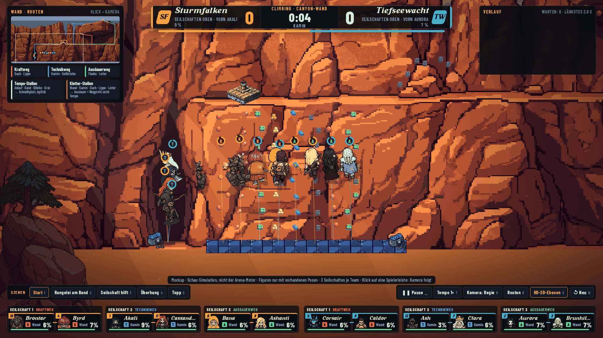

# Climbing neu: die Canyon-Wand als Ort, drei Wege, eine Engstelle (Mockup + Konzept, 18.11.)

Anlass, Chris am 18.11. abends nach einer Live-Partie, wörtlich: „Das Climbing, was man hier sieht, ist auf
jeden Fall rotz langweilig — man geht einfach nur hoch und nix passiert, keine Interaktion, nichts. Vllt
brauchen wir hier auch wieder echte Assets, eine Wand, an der horizontal und vertikal geklettert wird, wo
man über Dinge klettern muss etc.“

Dieses Dokument ist **Mockup + Erklärung** nach der Mockup-zuerst-Regel. **Im Spiel ist nichts gebaut, am
Motor nichts geändert, nichts gemessen.** Alle Aussagen zu rho und Pp sind Risiken und Erwartungen, keine
Messwerte. Die Zahlen im Mockup (Zeiten, Puste, Proben) stammen aus einer kleinen Schau-Simulation, die nur
die Regie des Mockups füttert; sie ist nicht der Arena-Motor und kennt weder Matrix noch Rezept.

- Mockup: `public/mockups/climbing-neu-18-11.html` (im Spiel-Host unter `/mockups/climbing-neu-18-11.html`)
- Stilprobe-Assets: `public/mockups/climbing-neu-18-11/` (8 Dateien, zusammen 82 KB)
- Bilder: `docs/design/climbing-neu-18-11/`
- Vorgänger: `climbing-formate-optik-konzept-17-11.md` (Formate und Ebenen), `climbing-kontakt-konzept-14-10.md`
  (Kreuzungsgriffe), `climbing-neukonzept-22-09.md`

## 0. Kurzfassung

1. **Die Wand wird ein Ort.** Statt einer flachen Textur, die nach oben scrollt, steht eine Felswand mit
   erkennbaren Stellen im Bild: Kamin, Band, Felsblöcke auf dem Band, ein großes Dach mit Lippe, ein Spalt
   zwischen zwei Türmen, Gipfelgrat mit Glocke. Die Stilprobe (ein PixelLab-Breitformat, 25 Gen.) hat genau
   das geliefert.
2. **Die Route ist ein S, kein Strich.** Einstiegswand senkrecht, dann ein langer Quergang nach rechts, dann
   teilt sich der Weg dreifach und läuft am Gipfelgrat wieder zusammen. Es wird senkrecht, waagerecht,
   hängend und über Hindernisse geklettert.
3. **Interaktion entsteht aus Geometrie.** Alle zwölf müssen über dasselbe Band und durch dieselbe
   Engstelle. Dort gibt es Stau, den Kreuzungsgriff (Freigabe 14.10.), Überholen „außen an der Bandkante“ und
   Rastpunkte. Das Rennen entscheidet sich sichtbar an drei Stellen: Engstelle, Schlüsselstelle des
   gewählten Wegs, Gipfelgrat.
4. **Drei Wege für drei Profile**, alle mit Ausdauer als Grundlast: Kraftweg (Dach und Lippe), Technikweg
   (Kamin und Seilbrücke), Ausdauerweg (Flanke und Leiter).
5. **Keine neue Animation.** Klettern, Stemmen, Hangeln und Abrutschen entstehen aus den vorhandenen Posen
   (Nord-Standbild, Nord-Gehen als Gliederwechsel, Ost-Standbild, Treffer-Nord, Süd-Standbild) plus Ruck,
   Neigung, Versatz, Schlagschatten, Seil und Kreide. Ehrliche Einschränkung: das Hangeln am Dach ist die
   schwächste Stelle (Abschnitt 4).
6. **Stilprobe: 35 Generationen**, 8 Treffer behalten, 3 verworfen. Wichtigster Nebenbefund: kleine
   Requisiten kosten über `create-image-pixflux` **1 Gen.** statt 13.
7. **Voller Bau der ersten Wand: rund 60 Gen.** (Deckel 90). Drei Wände: rund 215 Gen. (Deckel 280).
8. Neues Format hinter einem Schalter (`climbingFormat: "canyon"`), der Standard bleibt bit-identisch.

## 1. Was am heutigen Climbing fehlt

Die Diagnose vom 17.11. (dort Abschnitt 1.3) gilt weiter: die Wand ist eine Fläche, die Ränder sind leer,
zwölf gleiche Spuren laufen in eine Richtung, die Figuren stehen in der Laufpose auf der Wand. Chris' Satz
vom 18.11. fügt zwei Dinge hinzu, die das Konzept vom 17.11. noch nicht gelöst hat:

- **„keine Interaktion“:** die Kreuzungsgriffe vom 14.10. existieren, aber auf zwölf parallelen Spuren
  sieht man sie nicht. Es gibt keinen Ort, an dem sich Kletterer begegnen müssen.
- **„horizontal und vertikal, über Dinge klettern“:** das Konzept vom 17.11. hat neue Formate (Abseilen,
  Flut, Boulder) und Tiefe um die Wand herum vorgeschlagen, die Wand selbst aber als die drei vorhandenen
  flachen Bilder behalten. Das reicht nicht; die Wand braucht Relief, und die Route muss es benutzen.

## 2. Der Entwurf

### 2.1 Die Wand


| Stelle | Was man sieht | Was dort passiert |
|---|---|---|
| Wandfuß | Matten, Seilsäcke, Vordergrund-Fels mit Kiefer | Start, je Kletterer eine eigene Linie |
| Einstiegswand | sieben farbige Grifflinien, senkrecht | Aufstieg, Schlüsselstelle auf halber Höhe (Fehlgriff kostet Zeit) |
| Kamin (links) | dunkler Spalt vom Boden bis zum Band | Technik-Einstieg: stemmen, kostet kaum Puste, aber nur hintereinander |
| Rastpunkt | Podest mit Kreideeimer am Band | wer unter der Schwelle ist, schüttelt aus (Zeit gegen Puste) |
| Band | waagerechtes Felsband über die ganze Wandbreite | Quergang, hintereinander; Überholen nur in den Buchten, hängend an der Bandkante |
| Engstelle | Felsblöcke auf dem Band | Überklettern, immer nur einer; davor der **Kreuzungsgriff** |
| Gabelung | hinter der Engstelle | die drei Wege trennen sich |
| Dach und Lippe | großer Überhang mit tiefem Schatten | Kraftweg: unter dem Dach hangeln, an der Lippe eine Kraftprobe |
| Spalt und Seilbrücke | Kamin zwischen zwei Türmen, oben die Brücke | Technikweg: stemmen, dann Kopfprobe auf der Brücke |
| Rastnische | im Schatten unter dem Dach | Kraftkletterer laden vor dem Dach noch einmal auf |
| Flanke und Leiter | rechte Wandkante, Strickleiter | Ausdauerweg: am längsten, ohne Probe |
| Gipfelgrat | Oberkante des Dachblocks | alle Wege laufen zusammen, Schlussspurt |
| Glocke | Messingglocke am Balken | Topp: wer läutet, ist im Ziel |

### 2.2 Tiefe (HD-2D)

Übernommen aus dem Ebenenplan vom 17.11. (dort 3.2), im Mockup alle acht Ebenen umgesetzt und mit der Taste
`E` abschaltbar:

| Ebene | Inhalt im Mockup | Parallax | Quelle |
|---|---|---:|---|
| E0 | Himmelsverlauf, Abendlicht | 0 | CSS/Canvas-Verlauf |
| E1 | Fernpanorama Canyon mit Fluss, weich gezogen | 0,08 | PixelLab (1 Gen.) |
| E2 | Dunst über dem Tal, drei Vögel | – | Verlauf |
| E3 | zweite Felsreihe hinter dem Grat | 0,45 waagerecht | dieselbe Wand, gespiegelt und violett getönt (0 Gen.) |
| E4 | **die Wand**, Himmel transparent | 1,0 | PixelLab-Breitformat (25 Gen.) |
| E4+ | Griffe, Rastpodest, Leiter, Brücke, Glocke, Matten | 1,0 | PixelLab (je 1 Gen.), Matten/Seilsack/Kreidebeutel vorhanden |
| E5 | Vordergrund: Felsnase mit Kiefer, abgedunkelt | 1,35 | PixelLab (1 Gen.) |
| E6 | Sonnenbahnen von links oben, Vignette, vertiefter Dachschatten | 0,3 | Canvas `lighter` |
| E7 | Schwebstaub, Kreide beim Greifen, Steinchen beim Abrutschen | je Tiefe | im Mockup Partikel; im Bau `/v2/vfx` lite |

Zum Vergleich dieselbe Totale ohne die Ebenen:


Jede Figur wirft ihre eigene Pose als dunkle, versetzte Fläche auf die Wand. Das ist der billigste Trick im
Mockup und der wirksamste: die Figur hängt damit **vor** der Wand statt auf einem Bild zu stehen.

### 2.3 Übernahme aus dem Konzept vom 17.11.

| Aus dem 17.11. | Stand hier |
|---|---|
| Ebenenaufbau E0–E7, Folgekamera mit Zoomstufen, Überblick-Inset, Läufer anklicken | übernommen und im Mockup gezeigt |
| „Die drei bezahlten Wandbilder bleiben die Wandebene“ | **ersetzt.** Die flachen Bilder tragen kein Relief. Jede Wand wird als Ort neu bestellt (REMAKE statt Übertragung) |
| Gipfelglocke als sichtbares Ziel (F1) | übernommen, in jedem Format |
| Format-Schalter `climbingFormat`, Standard bleibt unberührt | übernommen; die Canyon-Wand ist das Format `"canyon"` |
| F1 Gipfelsturm & Abseilen | passt auf diese Wand: nach der Glocke am Seil über die Dachkante frei hängend hinunter. Zweiter Schritt |
| F2 Die Flut | passt als Variante: die Flut steigt vom Wandfuß, das Band wird zur letzten sicheren Linie. Zweiter Schritt |
| F3 Boulder-Runde (Primär-/Nebenweg je Problem) | der Kern davon steckt jetzt in den drei Wegen; ein eigenes Boulder-Format ist damit vorerst nicht nötig |
| Wandcharakter je Karte (Eis rutschiger usw.) | bleibt Vorschlag; jede neue Wand bringt ohnehin eigene Stellen mit (Abschnitt 9) |
| Kein Störgriff, kein Helfer-Bonus, kein neunter Sub-Skill | gilt weiter |

## 3. Interaktion: wo sich das Rennen entscheidet

### 3.1 Die Engstelle und der Kreuzungsgriff


Über die Felsblöcke auf dem Band kommt immer nur einer. Wer ankommt, während ein Gegner direkt hinter ihm
ist, muss den Griff verteidigen: **Kreuzungsgriff**, einmal je Kletterer, entschieden aus Kraftzug und Kopf
(dieselben zwei Kanäle wie in der Freigabe vom 14.10.). Der Verlierer wird abgedrängt und verliert Zeit und
etwas Puste; ein Sturz, ein Rang oder eine Höhe wird dadurch nicht direkt verändert. Wer hinter einem
Wartenden steht, wartet mit („WARTET“ über dem Kopf). Für den Zuschauer ist das die Szene, die heute fehlt:
ein Pulk, der sich an einer Stelle staut, und zwei, die um den Vortritt ringen.

### 3.2 Überholen am Band

Auf dem Band läuft man hintereinander. In den **Überholbuchten** (im Mockup mit `R` als goldene Streifen
sichtbar) darf der Schnellere außen vorbei: er hängt sich an die Bandkante und hangelt unter dem Vordermann
durch. Das kostet gut die doppelte Puste und ist deshalb eine Entscheidung, kein Automatismus. Wer am
Rastpunkt ausschüttelt, wird dort regelmäßig überholt.


### 3.3 Drei Wege (Primär- und Nebenweg)

Chris' Leitlinie vom 21.09. („mehrere Wege zum Erfolg“) wird hier zur Geometrie. Hinter der Engstelle wählt
jeder Kletterer den Weg, der zu seinem Profil passt:

| Weg | Strecke | Schlüsselstelle | Sub-Skills (vorhanden) | Attribute laut Rezept | Preis |
|---|---|---|---|---|---|
| **Ausdauerweg** (Primärweg der Matrix) | Band bis zur rechten Flanke, Flanke, Strickleiter, Grat | keine Probe, nur Länge | Ausdauertempo, Kraftausdauer, Zähigkeit | stamina, health, speed | am längsten; wer leer ist, wird langsam |
| **Kraftweg** | Rastnische, Wand im Schatten, unter dem Dach hangeln, über die Lippe | Kraftprobe an der Lippe; leer gepumpt am Dach = Sturz ins Seil | Kraftzug, Kraftausdauer, Zug | power, stamina, determination | am kürzesten, zehrt am meisten; Abrutschen kostet Zeit |
| **Technikweg** | Kamin zwischen den Türmen, Felsturm, Seilbrücke | Kopfprobe auf der Brücke (wer wankt, steht) | Griff, Umsetzen, Kopf | dexterity, awareness, will | mittellang, langsam, schont die Puste |

Dazu der kleine Bruder am Wandfuß: Technik-Profile nehmen statt der Einstiegswand den **Kamin**.


Die Regel dahinter, damit die Matrix durchkommt: **jeder Weg ist zuerst eine Ausdauerprüfung.** Die Puste
(Reserve des Motors) läuft auf allen Wegen mit und macht langsam, wenn sie leer ist. Der Weg entscheidet nur,
*welcher zweite Kanal* an der Schlüsselstelle mitredet. Im Mockup sieht man das am Endstand: vorn liegen die
beiden Ausdauerstärksten, dahinter mischen sich Kraft- und Technikweg.

### 3.4 Was sonst gebucht wird

- **Rastpunkte** (Podest am Band, Nische unter dem Dach): stehen und ausschütteln, Zeit gegen Puste.
  Kraftkletterer laden vor dem Dach fast voll auf, sonst reicht es nicht bis über die Lippe.
- **Abrutschen an der Lippe:** Kraftprobe misslingt, die Figur fällt ins Seil, pendelt, zweiter Versuch mit
  besserer Chance.
- **Sturz ins Seil am Dach:** nur bei leerer Puste, höchstens einmal je Kletterer.
- **Fehlgriff** an der Schlüsselstelle der Einstiegswand.
- **Wanken auf der Seilbrücke.**

Für alles gilt die Regel aus dem Kontaktkonzept: **gezeigt = gebucht.** Jede dieser Szenen ist ein
Motor-Ereignis mit Folge für die Zeit, keine Deko.

### 3.5 Topp


Die drei Wege laufen am Grat zusammen. Wer die Glocke läutet, ist im Ziel; sie schwingt, es gibt einen
Einblender, und die Figur dreht sich zur Kamera und jubelt (Süd-Standbild mit Hüpfer). Wertung wie heute:
Tops nach Zeit, darunter die Höchstmarke; mit dieser Wand heißt die Höchstmarke „Anteil der Route“ oder
benannt „bis Engstelle“, „bis Lippe“.

## 4. Klettern nur mit vorhandenen Posen

Verwendet werden ausschließlich `north`, `south`, `east` (gespiegelt als West), `walk-north`, `walk-east`,
`treffer-north`. Keine Angriffs-Animation (sie zeigt Waffen), keine neue Pose.

| Abschnitt | Pose | Was daraus Klettern macht |
|---|---|---|
| Wand, Leiter | `walk-north`, Bild springt nur beim Zug weiter | **Ruck statt Gleiten:** 42 % der Zeit hängt die Figur still, dann zieht sie in einem Zug 13 px hoch; abwechselnd 3,5 px Versatz nach links und rechts, 6 Grad Neigung zur greifenden Seite; Kreidewolke am Griff |
| Kamin | `east`, je Zug gespiegelt | Stemmen: die Figur dreht sich von Wand zu Wand, 6 px Versatz, 11 Grad Neigung |
| Band | `walk-north`, seitlicher Nachstellschritt | Gesicht zur Wand, 12-px-Schritte mit kleinem Heben; beim Warten Standbild |
| Außen vorbei | `walk-north`, 22 px tiefer | hängt an der Bandkante, pendelt um den Griffpunkt |
| Felsblöcke | `walk-north`, der Schräge nach geneigt | Überklettern in Rucken |
| Dach | `north`, 40 px unter der Dachlinie | Drehpunkt an den Händen statt an den Füßen, Pendeln ±18 Grad, Hand-über-Hand in 15-px-Zügen |
| Lippe | `walk-north` | beginnt 43 Grad nach hinten gekippt unter der Kante und richtet sich mit jedem Zug auf; zittert bei leerer Puste |
| Abrutschen, Sturz | `treffer-north` | fällt bis zu 48 px, hängt im straffen Seil, pendelt, Steinchen |
| Rast | `north` | leichtes Wippen, Marke „RAST“ |
| Brücke, Grat | `walk-east` | Brücke: folgt dem Durchhang, wankt bei misslungener Probe |
| Topp | `south` | dreht sich zur Kamera, hüpft |

Dazu für alle: **Schlagschatten der eigenen Pose** auf der Wand, das **Seil** vom Wandfuß über alle
passierten Punkte bis zur Hüfte (es zeichnet nebenbei den Weg nach, den jeder genommen hat), und über dem
Kopf eine kleine Marke mit Teamfarbe, Puste-Bogen und Weg-Buchstabe (K, T, A).

**Ehrlich:** Wand, Kamin, Band, Lippe und Abrutschen lesen sich als Klettern. Das Hangeln unter dem Dach
ist die schwächste Stelle, weil keine Pose die Arme über den Kopf nimmt; es wirkt wie eine hängende,
pendelnde Figur, nicht wie Hand-über-Hand. Falls das Chris nicht reicht, wäre **eine** zusätzliche Animation
„Klettern Nord“ (Arme greifen abwechselnd nach oben) der Hebel für Wand, Dach und Lippe zugleich. Das ist
ein Vorschlag, keine Bestellung: bei rund 360 Figuren und dem Preis der Nord-Kampagne wäre das eine
Größenordnung von mehreren tausend Generationen für den ganzen Bestand; nach Chris' Idee vom 17.11. (nur für
tatsächlich gepickte Spieler erzeugen) entsprechend weniger. Siehe Frage 4.

## 5. Kamera und HUD

Im Stil des HUD-Systems vom 17.11. (`hud-system-17-11.md`: Tokens, Barlow Condensed für Zahlen, RaniraSeason
für Namen, die eine Schräge, Teamfarbe als Bedeutung).

| Bauteil | Im Mockup | Datenquelle im Bau |
|---|---|---|
| Kopfleiste | Teams, **Tops** groß, „Beste: Name · Anteil“, Uhr, Phase („Quergang am Band“, „An der Lippe“) | `bahnTeamstand()`, Phase aus dem Abschnitt des Führenden |
| Momentum | Kletterfortschritt beider Teams als Tauzieh-Balken | Summe der Routenanteile |
| Routen-Inset | ganze Wand als Miniatur, drei Wege farbig, Punkt je Kletterer, Rahmen des Bildausschnitts; Klick setzt die Kamera | Routengraph und Positionen |
| Weg-Legende | Kraftweg, Technikweg, Ausdauerweg mit Farbe | fest |
| Verlauf | neueste Zeile oben, große Ereignisse in Gold | Ereignisliste des Motors |
| Einblender | „DUELL AM GRIFF“, „AUSSEN VORBEI!“, „ÜBER DIE LIPPE!“, „ABGERUTSCHT!“, „GLOCKE!“ mit Portrait, Weg und Puste | `hudCallout()` |
| Dock | zwölf Spielerleisten: Rang, Portrait, Name, Weg-Buchstabe, Ort („Band“, „Wartet“, „Im Seil“), Anteil oder Zielzeit, Puste-Balken | `wertungVon(disc).zeilen()` plus Reserve |
| Spielerkarte | vier Profilwerte, der Weg in einem Satz, Zwischenzeiten Band, Engstelle, Grat, Glocke | vorhandene Karte, neue Spalten |
| Bedienleiste | Start/Pause, Tempo, Kamera, Routen, Ebenen, Neu; Szenen-Knöpfe 1–4 | `hudBedienTick()` |

**Kamera.** Drei Modi: *Regie* (folgt den vorderen vier, zoomt auf gebuchte große Ereignisse und hält sie
kurz), *Totale* (die ganze Wand steht als Körper in der Landschaft), *Folgen* (Klick auf eine Leiste oder
Pfeiltasten). Die Kamera fährt in beiden Achsen; dadurch arbeitet der Parallax ständig, auch im Quergang.



## 6. Mechanik-Skizze für den Motor

Chassis bleibt die Bahn (`BAHN_ART.climbing`, `stepSpurt` mit Climbing-Gates). Neu ist nur, dass `pos` 0→1
nicht mehr eine Gerade ist, sondern über einen **Routengraphen** auf die Wand gelegt wird.

```js
// nur bei climbingFormat === "canyon" angelegt; Standard bleibt unberührt
CANYON_WAND = {
  knoten:   { start, band0, eng0, eng1, gabel, nische, dach0, lippe0, lippe1, spalt0, turm, bruecke1, flanke0, leiter0, grat0, glocke },
  kanten:   [ { von, nach, art: "wand"|"kamin"|"band"|"block"|"dach"|"lippe"|"bruecke"|"leiter"|"grat",
                geteilt: true|false, exklusiv: true|false, probe: null|"lippe"|"bruecke", rast: null|{ schwelle } } ],
  wege:     { ausdauer: [...Kanten], kraft: [...], technik: [...] },
  buchten:  [ [x0, x1], ... ],            // Überholen nur hier
};
```

| Baustein | Vorschlag | Bestehendes Muster |
|---|---|---|
| Position | je Kletterer `pos` 0→1 auf **seinem** Weg; die Weglängen werden so kalibriert, dass gleiche Eignung auf allen drei Wegen dieselbe Sollzeit ergibt | HYROX-Routen (`spurt-hyrox-routen-design-opus-09-11.md`) |
| Abschnittstempo | je Kantenart ein Gewichtsvektor über die **acht vorhandenen Sub-Skills**; kein neuer Kanal | `rezept`, `mengeAusEignung` |
| Griffe und Gates | die zehn Griffe und drei Exen werden auf die Kanten verteilt (Einstiegswand 3, Band 2, Schlüsselstelle 3, Grat 2); die fünf Griffarten bleiben | `hindernisse`, `zonen`, `kurse` |
| Puste | die vorhandene Reserve; Zehrung je Kantenart statt eines einzigen `steigung` | Reserve, Rennpläne |
| Wegwahl | fest vor dem Start aus dem Sub-Skill-Profil (nicht aus Rohattributen), sichtbar in der Aufstellung; kein Würfel | Rennplan-Wahl |
| Abstand | auf geteilten Kanten Mindestabstand; Engstelle exklusiv | Kontakt im klassischen Spurt (Stand `7c9257b4435c`) |
| Kreuzungsgriff | wie am 14.10. freigegeben (Kraftzug gegen Kopf, wirkt nur über Balance/Zeit), jetzt **an der Engstelle verortet** statt an zwei abstrakten Griffen; einmal je Kletterer, `zugDeckel` bleibt | `climbing-kontakt-konzept-14-10.md` |
| Überholen | in Buchten, Zehrung ×2,4, Bedingung: Tempovorteil und Reserve über Schwelle | neu, klein |
| Wartedeckel | wer länger als etwa 1,5 Sim-Sekunden an der Engstelle steht, darf „obenrum“ (über dem Block, kostet Puste) | neu; begrenzt den Zufall der Ankunftsreihenfolge |
| Proben | Lippe (Kraftzug, Reserve), Brücke (Kopf); Verlust gedeckelt (Ziel: höchstens 4 % der Laufzeit je Ereignis) | Fehlgriff, Abrutschen bis zur letzten Exe |
| Ende und Wertung | unverändert: Tops nach Zeit, darunter Höchstmarke; Zeitlimit so, dass 40–55 % toppen (wie heute) | `rang` |
| Zeichnen | Position aus dem Graphen statt aus der Spur; Posenwahl nach Kantenart (Abschnitt 4) | `bodenWand()`, `kulisseZeichnen()` |

**Wertungsneutralität.** Format hinter dem Schalter; alle neuen Zustände nur bei aktivem Format und nicht
als Felder an Läuferobjekten des Standardformats (WeakMap oder modulweite Arrays). Die 75 Einträge des
Fingerabdrucks (`GESAMT ce8fcef66028`) bleiben gleich; das Format bekommt drei eigene
(`spiele climbing/canyon 1/7/42`), die Gesamtprüfsumme ändert sich dadurch zwangsläufig und wird neu
festgehalten. Der Ebenen-Renderer und die Posen sind reine Anzeige.

## 7. Risiken für rho und Pp (benannt, nicht gemessen)

Ausgangslage: Climbing steht bei rho je Spiel 0,801 (knappster Wert am Ziel 0,80), Pp 12,0 / 9,5. Das neue
Format darf darunter nicht fallen: Mindestschranke 0,75, Ziel über 0,80, Pp ≤ 25 (Optimum unter 15).

| # | Risiko | Wirkt auf | Gegenmittel |
|---|---|---|---|
| R1 | **Kopplung an andere.** An Engstelle und Band hängt die eigene Zeit davon ab, wer vor einem ist. Das ist die gewünschte Interaktion und zugleich Rauschen je Spieler | rho | Wartedeckel („obenrum“), Überholbuchten, Kreuzungsgriff nur einmal je Kletterer und attributgebunden; Wartezeit als Anteil der Laufzeit messen (Ziel unter 5 %) |
| R2 | **Wege ungleich schnell.** Ist ein Weg systematisch schneller, ordnet das Ergebnis nach Weg statt nach Eignung | rho, Pp | Kalibrierregel: mittlere Zeit je Weg bei gleicher Eignung innerhalb ±2 %; je Weg einzeln messen |
| R3 | **Kraft und Technik bekommen über die Wegwahl mehr Gewicht als in der Matrix** (power 8, dexterity 12, awareness 8, will 8 gegen stamina 26, determination 16) | Pp | jede Kante trägt überwiegend Ausdauer-Kanäle; die Schlüsselstelle bestimmt nur einen kleinen Zeitanteil (Richtwert 15–20 %); Wegwahl aus Sub-Skills, die bereits matrixgewichtet sind |
| R4 | **Binäre Ereignisse** (Abrutschen, Sturz ins Seil) sind wenige, teure Zufälle | rho | Wahrscheinlichkeit an Kanal und Reserve gebunden, Verlust gedeckelt, zweiter Versuch mit Bonus, Sturz höchstens einmal |
| R5 | **speed (12) und health (10)** haben im Entwurf keine eigene sichtbare Stelle | Pp | speed über Zug und Ausdauertempo auf Band und Grat, health über Zähigkeit bei Rast-Erholung und Abrutsch-Folgen; mit `einflussVon` prüfen |
| R6 | **Weniger Tops oder zu viele Tops.** Die Wand ist länger als die heutige | rho (Gleichstände) | Zeitlimit und Weglängen auf 40–55 % Tops kalibrieren; darunter stetige Höchstmarke (Routenanteil) |
| R7 | **Kamin-Stau am Start** benachteiligt Technik-Profile systematisch | Pp (dexterity) | Kamin-Einstieg nur als Wahl, wenn die Sollzeit gleich ist; sonst im Bau streichen (rein optisch behalten) |
| R8 | **Rastentscheidungen** als fester Plan können Ausdauerstarke bremsen | rho | Rast nur unter Schwelle; Schwelle aus dem Rennplan |

**Messplan** (wie am 17.11., 4.2): Fingerabdruck vor und nach; Standard-Gegenprobe 0,801;
`miss-alle-disziplinen.mjs` mit Format-Parameter, n=48 in zwei Saatstämmen; Saisonwert daneben;
`messe-arena-einfluss.mjs` und zweiter Saatstamm für Pp; Star auf Rang 1 und Paartreue ab 15 Punkten.
Formatspezifisch zusätzlich: Wartezeit-Anteil (R1), mittlere Zeit je Weg (R2), Zeitanteil der
Schlüsselstellen (R3), Anteil der Wege (keiner über 50 %).

## 8. Stilprobe PixelLab (18.11.)

Guthaben vorher 796,7 Gen. (`/balance`), Reserve 150 unberührt. Alle Bestellungen einzeln unter
`flock /tmp/pixellab-bestell.lock`, jeder POST genau einmal, Kosten aus `usage.generations`.

| # | Auftrag | Endpunkt | Größe | Gen. | Ergebnis |
|---|---|---|---|---:|---|
| 1 | Gipfelglocke | `create-image-pixflux` | 64×64 | 1 | **Treffer** |
| 2 | Wand mit Dach (Pixflux-Versuch) | `create-image-pixflux` | 400×400 | 1 | verworfen (flach, abstrakt) |
| 3 | Felspfeiler (Pixflux-Versuch) | `create-image-pixflux` | 400×400 | 1 | verworfen (wirkt wie Baumstumpf, Hintergrund nicht frei) |
| 4 | Fernpanorama Canyon | `create-image-pixflux` | 400×224 | 1 | **Treffer** |
| 5 | Seilbrücke | `create-image-pixflux` | 192×64 | 1 | **Treffer** |
| 6 | **Canyon-Wand** (Band, Dach, Kamin, Spalt, Grat) | `generate-image-v2` | 792×300 | 25 | **Treffer**, Job `e946ecd5-3b6d-4d61-a9af-333a43fe3fe3` |
| 7 | Vordergrund-Felsnase mit Kiefer | `create-image-pixflux` | 192×224 | 1 | **Treffer** (Hintergrund nachträglich entfernt) |
| 8 | Strickleiter | `create-image-pixflux` | 48×128 | 1 | **Treffer** |
| 9 | Griffblatt (acht Griffe) | `create-image-pixflux` | 128×64 | 1 | **Treffer** |
| 10 | Bohrhaken mit Expressschlinge | `create-image-pixflux` | 32×48 | 1 | verworfen (Felsstreifen im Bild) |
| 11 | Rastpodest mit Kreideeimer | `create-image-pixflux` | 96×64 | 1 | **Treffer** (Blickwinkel leicht von oben, für den Bau neu als Frontansicht) |
| | **Summe** | | | **35** | 8 behalten, 3 verworfen |

Guthaben danach rechnerisch 761,7 Gen. Herkunft der acht behaltenen Dateien steht in
`public/sprites/kulissen/quellen.json` (Wand, Panorama) und `public/sprites/arena/quellen.json`
(Requisiten), jeweils unter `mockup/climbing-neu-18-11/…` mit Prompt, Saat, Endpunkt und Generationen.

**Drei Befunde für die Budgetplanung:**

1. `create-image-pixflux` kostet **1 Gen.** je Bild und liefert bei kleinen, klar benannten Requisiten
   brauchbare Treffer. Die bisherige Rechnung „Requisit = 13 Gen.“ (`generate-image-v2` mit vielen
   Kandidaten) ist für einfache Objekte nicht nötig.
2. Für die **Wand selbst** taugt Pixflux nicht (zwei Versuche, beide verworfen). Das Breitformat über
   `generate-image-v2` hat dagegen beim ersten Versuch alle bestellten Stellen geliefert. Der Prompt nennt
   die Stellen einzeln und verlangt transparenten Hintergrund; so entsteht der Himmel für den Parallax.
3. Pixflux entfernt den Hintergrund nicht immer (Felsnase, Felspfeiler). Flächiger Hintergrund lässt sich
   per Flutfüllung entfernen; das gehört in das Einsetz-Skript.

**Pixeldichte.** Im Mockup ist die Wand 2-fach gezeichnet, die Figuren 1-fach; ein Wandpixel ist also
doppelt so groß wie ein Figurenpixel. In der Totale fällt das nicht auf, in der Nahkamera sieht man es. Für
den Bau wird die Wand deshalb aus **zwei Breitformaten übereinander** bestellt (untere und obere Hälfte je
792×300), dann stimmt die Dichte, und die Wand wird doppelt so hoch.

## 9. Asset-Liste und Kosten für den vollen Bau

Maßstab nach der Stilprobe: Breitformat 25 Gen., Pixflux-Requisit 1 Gen. (mit Fehlversuchen 2), VFX lite 1,
VFX pro 6. Neue Figuren und Animationen: **keine**.

### 9.1 Wand 1: Canyon (Sandstein)

| Posten | Zweck | Gen. |
|---|---|---:|
| Wand, obere Hälfte | vorhanden aus der Stilprobe (als Vorlage; wird mit der unteren Hälfte als Paar neu bestellt, wenn die Naht nicht passt) | 0–25 |
| Wand, untere Hälfte (Einstiegswand, Kamin, Wandfuß) | Pixeldichte, doppelte Höhe | 25 |
| Fernpanorama | vorhanden | 0 |
| Vordergrund-Felsnase | vorhanden | 0 |
| Glocke, Seilbrücke, Strickleiter, Griffblatt | vorhanden | 0 |
| Rastpodest (Frontansicht), Bohrhaken mit Schlinge, Standplatz-Kette, Wegweiser-Fähnchen je Weg (3), Startbogen, Kiefer am Band, loser Block | Requisiten, je 1–2 | 14 |
| Griffblätter in drei Routenfarben | Wege lesbar machen | 3 |
| VFX lite: Kreidewolke, Felsstaub, Steinschlag, Glockenring | Ereignisse | 4 |
| **Summe Canyon** | | **46–71**, Deckel **90** |

### 9.2 Wand 2 und 3 (Varianten mit eigenen Assets, nicht umgefärbt)

| Wand | Eigene Stellen | Posten | Gen. |
|---|---|---|---:|
| **Eisfall** | gefrorener Wasserfall als Quergang, Eisdach mit Zapfen, Gletscherspalte mit Alu-Leiter, Schneewechte am Gipfel | 2 Breitformate, Panorama Gletscher, Vordergrund Eisüberhang (Eiszapfen vorhanden), 10 Requisiten, 3 VFX | **~70**, Deckel 95 |
| **Kletterhalle** | Volumen und Überhang-Bug, Quergang an der Galerie, Wettkampf-Dach, Buzzer statt Glocke, Tribüne | 2 Breitformate, Hallenhintergrund als Breitformat, 10 Requisiten, 2 VFX | **~90**, Deckel 110 |

### 9.3 Gesamt

| Umfang | Gen. geplant | Deckel |
|---|---:|---:|
| Stufe 1: Canyon | 46–71 | 90 |
| Stufe 2: plus Eisfall | ~140 | 185 |
| Stufe 3: plus Kletterhalle | ~215–230 | 280 |

Zum Vergleich: das Konzept vom 17.11. rechnete Variante B mit 109 Gen. (Deckel 120) für Ebenen um die alten
Wandbilder herum. Für wenig mehr gibt es jetzt eine neue Wand je Karte. Bestellt wird stufenweise: erst die
untere Canyon-Hälfte als Probe der Naht, nur bei Treffer weiter. Die bereits geplanten 39 Gen. aus Welle B
(Griffsatz und Volumen für die alte Wand) entfallen für jede Karte, die auf das neue Format umzieht.

## 10. Fragen an Chris

1. **Ist das die Richtung: eine Wand als Ort mit S-Route, Engstelle und drei Wegen?**
   Empfehlung: **Ja.** Es beantwortet „horizontal und vertikal“, „über Dinge klettern“ und „keine
   Interaktion“ zugleich.
2. **Neues Format neben dem Standard oder Ersatz?** Empfehlung: zuerst **eigenes Format hinter dem
   Schalter** (`climbingFormat: "canyon"`), der Standard bleibt bit-identisch. Besteht das Format rho und
   Pp, löst es den Standard im echten Spiel ab; das alte „nur hoch“ bleibt dann nur als Rückfall.
3. **Drei Wege mit fester Wegwahl aus dem Profil, sichtbar schon in der Aufstellung?** Empfehlung: **Ja.**
   Alternative wäre eine freie Wahl durch den Spieler je Kletterer (mehr Taktik, mehr Bedienung); das kann
   später dazukommen.
4. **Reicht das Klettern mit den vorhandenen Posen (bitte das Mockup in Bewegung ansehen, vor allem das
   Dach)?** Empfehlung: **damit bauen.** Falls das Hangeln nicht reicht, wäre *eine* Animation „Klettern
   Nord“ der Vorschlag, zuerst nur als Kostenprobe an einer Figur und nur mit deiner Einzelfreigabe.
5. **Kreuzungsgriff an der Engstelle so deutlich (abdrängen, Einblender „DUELL AM GRIFF“)?** Die Freigabe
   vom 14.10. deckt die Mechanik; neu ist nur der feste Ort und die Sichtbarkeit. Empfehlung: **Ja.**
6. **Budget: Stufe 1 (Canyon, Deckel 90 Gen.) jetzt, Eisfall und Halle danach?** Empfehlung: **Ja**, Stufe
   2 und 3 erst, wenn die Canyon-Wand im Spiel steht und gemessen ist.
7. **Abseilen und Flut (17.11.) auf dieser Wand als zweiter Schritt?** Empfehlung: **Ja, danach**; beide
   passen auf die Geometrie, brauchen aber je eine eigene Messung.

## 11. Bauplan

| Schritt | Inhalt | Wer | Wertung berührt | Gen. |
|---|---|---|---|---:|
| 0 | Chris sieht das Mockup und beantwortet die Fragen | Chris | – | 0 |
| 1 | Routengraph und Format-Schalter im Motor, noch mit alter Zeichnung; Fingerabdruck-Einträge `climbing/canyon` | Sonnet nach diesem Entwurf, Opus-Review (Eingriff in die Arena-Engine) | nur neues Format | 0 |
| 2 | Messrunde 1: rho, Pp, Wartezeit-Anteil, Zeit je Weg; Kalibrierung der Weglängen und Proben | Mess-Agent | nur neues Format | 0 |
| 3 | Bestellung Stufe 1 (untere Wandhälfte zuerst als Nahtprobe) | Fable | nein | ≤ 90 |
| 4 | Ebenen-Renderer, Wand, Requisiten, Posenwahl nach Kantenart, Schlagschatten, Seil | Sonnet | nein (Fingerabdruck gleich) | 0 |
| 5 | HUD-Profil `HUD_PROFIL.climbing` auf „fertig“: Kopf, Inset, Dock mit Puste, Einblender, Karte | Sonnet | nein | 0 |
| 6 | Kamera: Regie, Totale, Folgen; Verzahnung mit dem geplanten Kamera-Umschalter | Sonnet | nein | 0 |
| 7 | Messrunde 2 und Sichtprüfung mit Screenshots; bei Bestehen Freigabe für das echte Spiel | Mess-Agent, Hauptsitzung | – | 0 |
| 8 | Eisfall, Kletterhalle; danach Abseilen und Flut als Formate auf der neuen Geometrie | wie 3–7 | je Format | ≤ 190 |

Die laufenden Reparaturen (Platzhalter-Figuren, Lauf endet erst, wenn alle im Ziel sind) sind davon
unabhängig und betreffen den Standard.

## 12. Das Mockup bedienen

| Taste / Klick | Wirkung |
|---|---|
| `1` `2` `3` `4` | Szenen: Start, Quergang-Duell, Überhang, Topp (springt an die Stelle im Lauf, Kamera hält kurz) |
| Leertaste | Start / Pause |
| `T` | Tempo 1×, 2×, 4× |
| `K` | Kamera Regie ↔ Totale |
| `R` | Routen, Überholbuchten und Beschriftung der Stellen ein/aus |
| `E` | HD-2D-Ebenen ein/aus (Vergleich mit und ohne Tiefe) |
| `N` | Lauf neu starten |
| Klick auf Spielerleiste, `←` `→` | Kamera folgt, Spielerkarte öffnet; `Esc` schließt |
| Klick ins Routen-Inset | Kamera an diese Stelle |

Der Lauf ist fest (eine Saat), damit die Szenen-Knöpfe immer dieselben Momente zeigen. Zwei Teams zu je
sechs: vier Kraft-, fünf Technik-, drei Ausdauerprofile. Sprites werden aus `../sprites/` geladen; für
Aufnahmen aus dem schlanken Arbeitsverzeichnis gibt es `?sprites=<Basis-URL>`.

## 13. Quellen

- Motor: `public/mockups/battle-mode.engine.js` (`BAHN_ART.climbing`, `bodenWand()`, `kulisseZeichnen()`)
- Vorgeschichte: `climbing-formate-optik-konzept-17-11.md`, `climbing-kontakt-konzept-14-10.md`,
  `climbing-neukonzept-22-09.md`, `climbing-opus-gegencheck-24-09.md`
- HUD: `hud-system-17-11.md`; Budget und Bestellregeln: `offene-punkte-entscheidungen-17-11.md`,
  `pixellab-nur-neue-assets-audit-17-11.md`
- Matrix (gesperrt): `lib/player-generator/official-discipline-weights.ts` — stamina 26, determination 16,
  speed 12, dexterity 12, health 10, power 8, awareness 8, will 8
