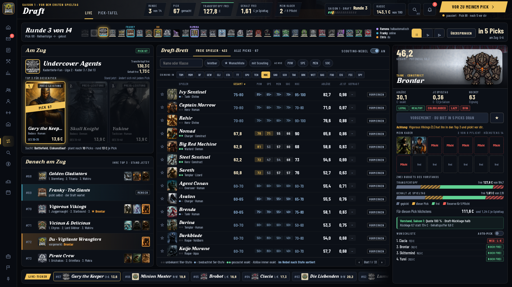
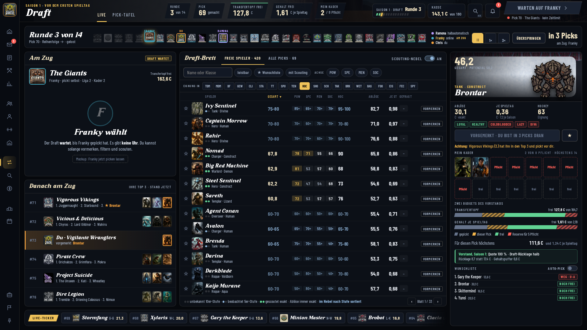
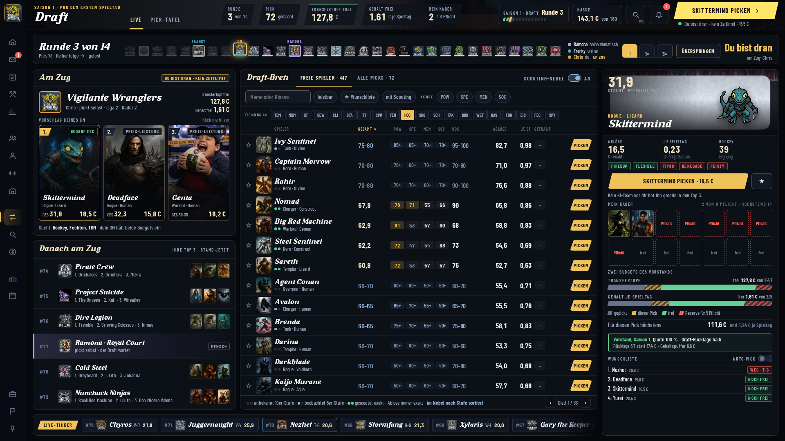
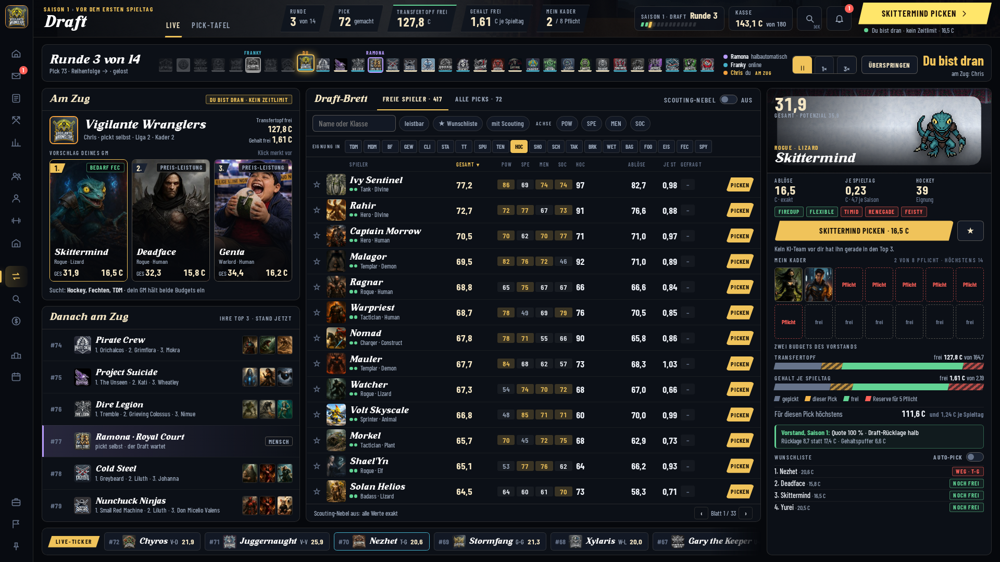
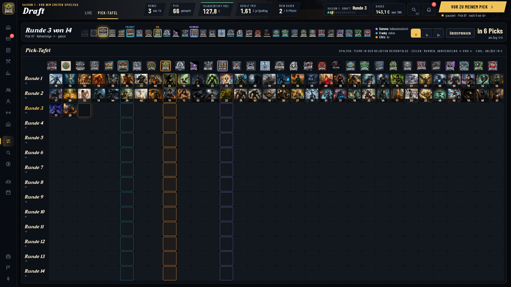
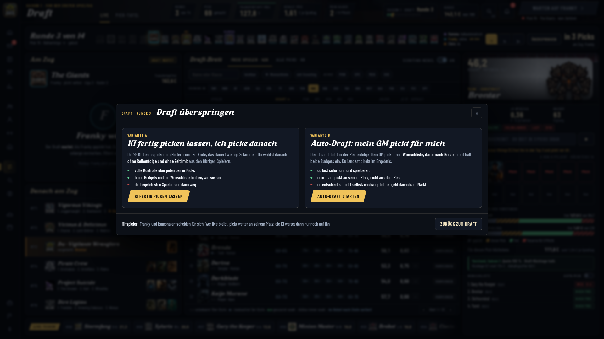
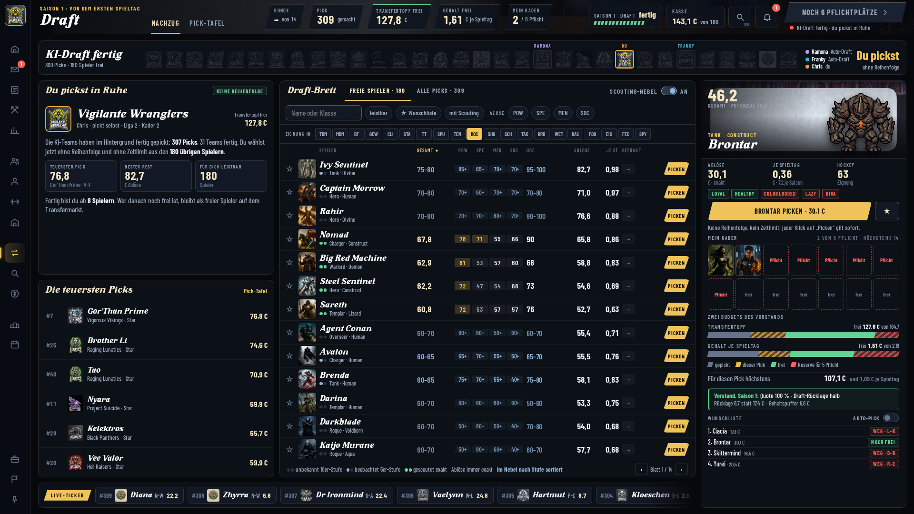
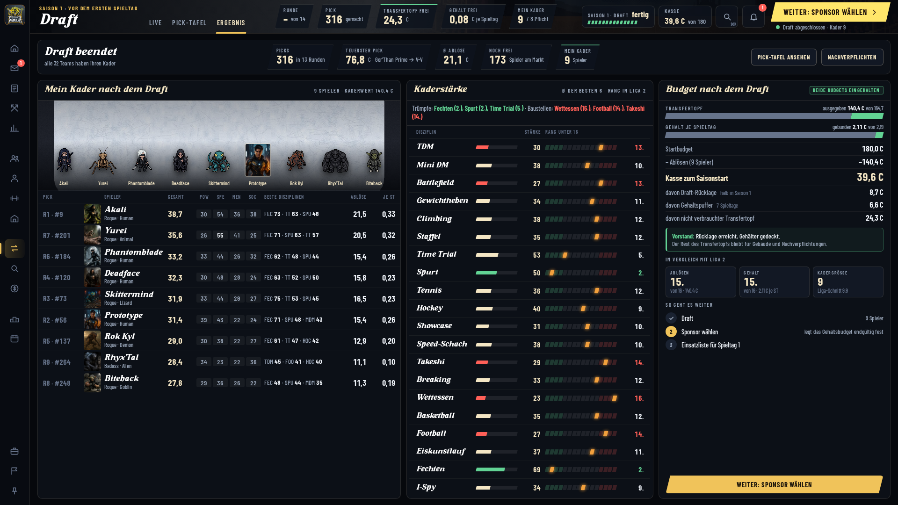

# Draft-Neubau (Saisonstart-Draft) — Mockup im neuen Stil (18.11.2026)

**Status: Mockup + Erklärung. Gebaut wird erst nach Chris' OK. Kein App-Code in diesem PR.**

- Mockup (klickbar): `public/mockups/draft-modern-18-11.html`
- Bilder: `docs/design/draft-modern-18-11/`
- Stil: steht im App-Rahmen (`app-rahmen-modern-18-11.html`); Rahmen, Tabellen, Geld-Balken und Dialog sind unverändert aus
  `transfermarkt-modern-18-11.html` übernommen. Neu ist nur der Draft selbst.
- Ersetzt den Abschnitt 2.6 „Draft, Saison 1“ aus `docs/design/transfermarkt-modern-18-11.md`. Der Reiter „Draft“ im
  Transfermarkt-Mockup entfällt damit; der Draft ist ein eigener Ort in der Schiene, solange er läuft.

---

## 0. Die sechs Kernentscheidungen

1. **Die KI pickt sichtbar, einen Pick nach dem anderen.** Links steht das Team am Zug mit seinen **Top 3** für diesen Pick, dann
   wird eine der drei Karten aufgedeckt („PICK 67“), der Spieler verschwindet vom Brett und läuft in den Ticker. Heute füllt ein
   Hintergrundlauf alle KI-Kader in rund 40 Sekunden hinter einem „Liga wird erstellt …“-Schild.
2. **Man sieht, was die Teams vor einem wollen.** „Danach am Zug“ zeigt die nächsten sechs Teams mit ihren Top 3. Steht dort der
   eigene vorgemerkte Spieler, wird er orange markiert, und „Mein Draft“ sagt es in einem Satz („Mortal Sin (2.) hat ihn in den
   Top 3 und pickt vor dir“). Das ist die eigentliche Draft-Entscheidung: jetzt nehmen oder riskieren.
3. **Keine Uhr.** Für einen menschlichen Pick gibt es kein Zeitlimit und keine Anzeige einer verstrichenen Zeit. Einstellbar ist
   nur das Tempo der KI-Picks (Pause, 1×, 3×) und „Vor zu meinem Pick“ im Taktgeber.
4. **Menschen sind Sitze in der Kette.** Chris, Franky und Ramona tragen in der Pick-Kette ein Namensschild in ihrer Farbe. Ist
   ein Mitspieler dran, steht links „Franky wählt · der Draft wartet“ und der Taktgeber zeigt „Warten auf Franky“. Das Brett, die
   Wunschliste und das Scouting bleiben in der Wartezeit bedienbar.
5. **Überspringen hat zwei ehrliche Varianten.** A: die KI-Teams picken im Hintergrund fertig, man wählt danach ohne Reihenfolge
   aus dem Rest. B: der eigene GM pickt mit (Auto-Draft), man landet direkt im Ergebnis. Variante A ist der heutige Ablauf.
6. **Jeder Pick wird gegen zwei Budgets geprüft.** Transfertopf und Gehaltsbudget des Vorstands (Finanzkonzept V2), in Saison 1
   mit Quote 100 % und halber Draft-Rücklage. Beide Balken zeigen „gepickt · dieser Pick · frei · Reserve für die Pflichtplätze“;
   daraus folgt die eine Zahl, die man braucht: „Für diesen Pick höchstens“.

---

## 1. Was sich gegenüber heute ändert

| Bereich | Heute | Mockup |
|---|---|---|
| KI-Draft | `kickoffLeagueSetupDraft` startet einen Hintergrundlauf (`runAiPicksExecutePreview`), jedes KI-Team kauft seinen ganzen Kader am Stück; die Shell zeigt „Liga wird erstellt … (KI-Teams werden befüllt)“ | Pick für Pick in einer Reihenfolge über alle 32 Teams, sichtbar mit Team, Spieler, Ablöse und Grund |
| Mensch | menschliche Teams sind vom Lauf ausgenommen (`excludeTeamIds`) und kaufen danach aus dem, was übrig ist | pickt an seinem Platz in der Reihenfolge; „aus dem Rest“ gibt es nur noch, wenn man überspringt (Variante A) |
| Absicht der KI | unsichtbar | Top 3 je KI-Team für den nächsten Pick, „gefragt“-Zähler je Spieler |
| Zeit | keine Uhr, aber auch kein Ablauf | keine Uhr; Tempo der KI wählbar; der Draft wartet auf Menschen |
| Mehrspieler | Koop-Start füllt die KI-Kader, Menschen kaufen parallel | Sitze in der Kette, „wer ist dran“, Warten sichtbar, Überspringen je Mensch |
| Werte fremder Spieler | alle exakt (nur das Potenzial verdeckt) | Scouting-Nebel wie im Kader-/Transfermarkt-Mockup, abschaltbar |
| Geld | Kasse; die KI plant mit Rücklage und Gehaltsquote, der Mensch sieht davon nichts | zwei Budgets mit Reserve für die Pflichtplätze, gleich für Mensch und KI |
| Übersicht | Transferhistorie | Pick-Tafel (32 Teams × 14 Runden), „Alle Picks“ als Reiter des Bretts, Live-Ticker |
| Ende | Einstiegs-Ablauf springt weiter, sobald der Mindestkader steht | Ergebnis-Ansicht: Kader, Kaderstärke in 20 Disziplinen mit Liga-Rang, beide Budgets, Kasse zum Saisonstart |

Was bewusst **bleibt**: Kader 8 bis 14, die organische KI-Bewertung (`buyUtility`, `stopUtility`) entscheidet, wen ein KI-Team
nimmt und wann es aufhört; die Wunschliste aus dem Scouting; Ablöse = Marktwert; der Draft gibt es nur in Saison 1.

---

## 2. Die Ansichten

Reiter im Regieband: **Live · Pick-Tafel**, nach dem letzten Pick zusätzlich **Ergebnis**. Kennzahlen im Regieband: Runde, Picks,
Transfertopf frei, Gehalt frei je Spieltag, mein Kader gegen die 8 Pflichtplätze. Der Taktgeber führt: „Vor zu meinem Pick“ →
„Warten auf Franky“ → „Brontar picken“ → „Weiter: Sponsor wählen“.

### 2.1 Live: die KI pickt (`?zug=ki`)

- **Kopfleiste:** Runde und Pick, die Kette der 32 Wappen in Pick-Reihenfolge (erledigt grau, am Zug gold, Strich unten = Liga,
  Namensschild = Mensch), rechts die drei Sitze mit Zustand, Tempo (Pause, 1×, 3×), „Überspringen“, „in n Picks“.
- **Am Zug (links oben):** Wappen, GM-Typ, Liga, Kader gegen Zielkader, freier Transfertopf und freies Gehalt des Teams. Darunter
  seine Top 3 als Karten mit Rang, Grund (Star, Bedarf an einer Disziplin, Preis-Leistung, Kadertiefe), Gesamt im eigenen
  Scouting-Stand und Ablöse. Beim Pick wird die gewählte Karte gold, die anderen verblassen. Fußzeile: was das Team sucht, wie
  viele Picks es noch plant und was es je Pick etwa ausgibt.
- **Danach am Zug (links unten):** die nächsten sechs Picks. KI-Teams mit ihren Top 3 (Namen und Köpfe), Menschen mit „pickt
  selbst · der Draft wartet“, der eigene Platz mit dem vorgemerkten Spieler. Ein Klick auf eine Zeile oder ein Wappen der Kette
  zeigt dieses Team oben als „Vorschau“.
- **Draft-Brett (Mitte):** freie Spieler, 13 je Blatt. Spalten: Wunsch-Stern, Kopf, Name mit Scouting-Punkten, Gesamt, vier
  Achsen, Eignung in der gewählten Disziplin, Ablöse, Gehalt je Spieltag, „gefragt“ (wie viele KI-Teams ihn gerade in den Top 3
  haben), Aktion. Filter: Suche, leistbar, Wunschliste, beobachtet / gescoutet, stärkste Achse. Sortierung: Gesamt, Eignung,
  Ablöse, günstig, gefragt. Zweiter Reiter „Alle Picks“.
- **Mein Draft (rechts):** der vorgemerkte Spieler mit Figur, Ablöse, Gehalt, Eignung, Traits (oder „verdeckt“ mit
  „beobachten / scouten“), Pick-Knopf, Warnung bei Konkurrenz, 14 Kaderplätze (8 Pflicht), die zwei Budgets, Wunschliste mit
  Zustand („weg · M-S“, „noch frei“, „zu teuer“) und Schalter „Auto-Pick“.
- **Live-Ticker (unten):** die letzten sieben Picks als Bauchbinden, Menschen in ihrer Farbe.

### 2.2 Live: der Draft wartet auf einen Mitspieler (`?zug=franky`)

„Am Zug“ zeigt keinen Favoriten (die Wunschliste eines Menschen ist privat), sondern den Wartezustand in Frankys Farbe. Der
Taktgeber ist gesperrt („Warten auf Franky · kein Zeitlimit“). Im Mockup lässt ein gestrichelter Knopf den Mitspieler picken.

### 2.3 Live: du bist dran (`?zug=ich`)

„Am Zug“ zeigt den Vorschlag des eigenen GM als drei Karten (Klick merkt vor). Im Brett erscheint „Picken“ in jeder leistbaren
Zeile; „zu teuer“ heißt: sprengt den Transfertopf samt Reserve, „Gehalt“: sprengt das Gehaltsbudget samt Reserve. Ab 8 Spielern
gibt es „Ich bin fertig“ (nimmt das Team aus der Reihenfolge).

Dieselbe Szene mit abgeschaltetem Nebel (`&nebel=aus`):

### 2.4 Pick-Tafel (`?ansicht=tafel`)

Spalten sind die 32 Teams in der gelosten Reihenfolge, Zeilen die Runden (abwechselnd → und ←). Jede Zelle zeigt den Kopf des
Spielers und die Ablöse; die Zelle am Zug pulsiert gold, „fertig“ heißt: das Team pickt nicht mehr. Die Spalten der Menschen
sind in ihrer Farbe umrandet.

### 2.5 Überspringen (`?ansicht=skip`)

| | Variante A: KI fertig picken lassen | Variante B: Auto-Draft |
|---|---|---|
| Was passiert | KI-Teams picken im Hintergrund zu Ende; das eigene Team wird übersprungen | das eigene Team bleibt in der Reihenfolge, der GM pickt (Wunschliste, dann Bedarf) |
| Danach | Ansicht „Nachzug“: picken ohne Reihenfolge und ohne Zeitlimit aus dem Rest, fertig ab 8 Spielern | direkt die Ergebnis-Ansicht |
| Preis | die begehrtesten Spieler sind weg | man entscheidet nicht selbst |
| Im Code | der heutige Weg (`excludeTeamIds`) | der heutige Weg ohne Ausnahme für das eigene Team |

Nachzug nach Variante A (`?ansicht=rest`):

### 2.6 Ergebnis (`?ansicht=ende`)

- **Kopf:** Picks und Runden, teuerster Pick der Liga, Ø Ablöse, freie Spieler am Markt, eigene Kadergröße.
- **Mein Kader:** die Figuren in einer Reihe, darunter die Tabelle mit Runde und Pick-Nummer, Gesamt, Achsen, den drei besten
  Disziplinen, Ablöse und Gehalt je Spieltag.
- **Kaderstärke:** 20 Disziplinen, Ø der besten sechs, Rang unter den 16 Teams der eigenen Liga als Leiste; oben Trümpfe und
  Baustellen in einem Satz.
- **Budget nach dem Draft:** beide Töpfe, die Rechnung Startbudget − Ablösen = Kasse zum Saisonstart, aufgeteilt in
  Draft-Rücklage, Gehaltspuffer und nicht verbrauchten Transfertopf; Vergleich mit der Liga; die nächsten Schritte (Sponsor,
  Einsatzliste).

---

## 3. Die Regeln im Mockup

| Thema | Regel im Mockup | Stand |
|---|---|---|
| Reihenfolge | Runde 1 gelost (Saat des Spielstands), danach Schlange (Runde 2 rückwärts usw.) | Frage 1 |
| Runden | höchstens 14 (= Kader-Maximum). Ein KI-Team steigt aus, wenn sein Zielkader steht oder nichts mehr in beide Budgets passt; ein Mensch ab 8 Spielern über „Ich bin fertig“ | Frage 2 |
| Preis | Ablöse = Marktwert, sofort aus dem Transfertopf; Gehalt = Forderung, zählt gegen das Gehaltsbudget | wie Transfermarkt-Mockup |
| Pflichtplätze | Reserve = die billigsten freien Spieler für die noch fehlenden Pflichtplätze, in beiden Budgets. Unter 8 Spielern bleibt der billigste freie Spieler immer pickbar | Finanzkonzept V2, „Pflicht-Auffüllung“ |
| Top 3 | die drei besten Kandidaten nach der KI-Bewertung zum jetzigen Stand; die KI nimmt Platz 1. Die Liste ändert sich mit jedem Pick | Frage 3 |
| „gefragt“ | Zahl der KI-Teams, die den Spieler gerade in den Top 3 haben | Frage 4 |
| Nebel | unbekannt 10er-Stufe, beobachtet 5er-Stufe, gescoutet exakt; Ablöse und Gehalt immer exakt; Sortierung nach der Stufe, innerhalb alphabetisch; der Achsen-Filter lässt Verdecktes weg; Traits und Potenzial nur gescoutet | wie `kader-teams-modern-18-11.md` Abschnitt 3 |
| Nebel aus | Schalter am Brett; gehört als Einstellung an den Spielstand | Frage 6 |
| Saison 1 | Quote 100 % für alle; Draft-Rücklage halb | Entscheidung Chris, Frage 9 zur Wirkung |
| Mehrspieler | der Draft wartet ohne Limit auf jeden Menschen, der nicht übersprungen hat | Frage 7 |

**Tempo:** bei 1× dauert ein KI-Pick rund 2,4 Sekunden (Top 3 zeigen, aufdecken). Eine Runde mit 29 KI-Teams läuft damit in gut
einer Minute, der ganze Draft ohne Vorspulen in rund 12 Minuten, bei 3× in 4 Minuten. „Vor zu meinem Pick“ springt.

---

## 4. Datenquellen im Code

„Vorhanden“: Wert oder Funktion gibt es heute. „Neu“: muss gebaut werden oder hängt an einer anderen Baustufe.

| Element | Quelle | Stand |
|---|---|---|
| Liga-Draft heute | `lib/game/league-setup-draft-service.ts` (`kickoffLeagueSetupDraft`, `fuehreLigaSetupDraftAus`), Status `seasonState.leagueSetupStatus`, Schild in `app/foundation/FoundationShellRouterBody.tsx` | vorhanden; wird der Überspring-Pfad |
| KI-Bewertung je Kandidat | `lib/ai/organic-squad/draft-builder.ts` (`buildOrganicSquadPlan`: je Schritt `buyUtility` für jeden Kandidaten, `stopUtility` beendet), `utility.ts`, `draft-adapter.ts` (`planOrganicDraftForTeam`) | vorhanden; rechnet heute den ganzen Kader eines Teams in einer Schleife |
| Top 3 | dieselbe Schleife: statt nur des besten Kandidaten die drei besten behalten | **neu**, klein |
| Ein Pick als Einzelschritt, Reihenfolge, Runden | es gibt `lib/ai/market-pick-engine/pick-step.ts` und `execute-live-pick.ts` für einen Slot, aber keine Reihenfolge über Teams und keinen Draft-Zustand im Spielstand | **neu** (Kern des Baus) |
| Reserve für Pflichtplätze | `reserveForMin` in `draft-builder.ts` (billigste Preise für die fehlenden Plätze) | vorhanden für die Ablöse; fürs Gehalt neu |
| Rücklage, Liquidität im Draft | `lib/ai/ai-team-cash-reserve-service.ts` (`resolveDraftLiquidityReserveFactor`), `season1-draft-cash-planner.ts` | vorhanden; wird durch die zwei Budgets abgelöst |
| Zwei Budgets | `docs/design/finanzkonzept-v2-budgets-18-11.md` Abschnitt 1 und 2.1, Budget-Dienst (Stufe 2a) | **neu** |
| Wunschliste, Draft-Phase | `lib/scouting/scouting-wishlist-slots.ts` (`isTeamSetupDraftWishlistPhase`), `ScoutingShortlistBoard` | vorhanden; Auto-Pick neu |
| Scouting-Stand, verdeckte Traits | `lib/market/transfermarkt-scouting.ts` | vorhanden; Stufe „beobachtet“ und Nebel-Dienst neu (Kader-/Teams-Plan, Stufe 2) |
| Wer steuert welches Team | `lib/foundation/team-control-settings.ts` (Besitzer Chris, Ramona, Franky; `controlMode`, `aiLineupAutoApplyEnabled`, `aiTransferAutoApplyEnabled`), online: `teamOwnership` in `lib/room/online-room-model.ts` | vorhanden; „halbautomatisch“ = Einsätze automatisch, Transfers von Hand |
| Koop-Start | `lib/room/room-store.ts` (`startRoom`) ruft denselben Liga-Draft | vorhanden; braucht den Draft-Zustand und „wer ist dran“ |
| Spieler, Teams, GM-Typ, Finanzwert, Startbudget | Spielerdaten, Team-Stammdaten, `teamIdentities` | vorhanden |
| Kaderstärke, Liga-Rang | `lib/market/transfermarkt-roster-impact.ts`; Lese-Dienst „beste sechs, Rang je Liga“ aus dem Transfermarkt-/Kader-Plan | Dienst neu, gemeinsam genutzt |
| Figuren, Köpfe, Kulissen, Wappen | `public/sprites/figuren/`, `public/portraits/`, `public/sprites/kulissen/`, `public/team-logos/` | vorhanden |

**Echt im Mockup:** Spieler (Name, Klasse, Rasse, Traits, Kopf, Figur, Gesamt, Marktwert, Forderung, Achsen, 20 Eignungen;
489 der 2984 Spieler), Teams, Wappen, Liga, Startbudget, Finanzwert, GM-Typ, die Formeln für Rücklage und Gehaltspuffer.
**Erfunden:** die Pick-Reihenfolge, alle Picks, die Bewertung hinter den Top 3 (eine einfache Formel aus Gesamt, Bedarf und
Preis; sie steht nur dort, wo im Spiel `buyUtility` rechnet), Zielkader je GM-Typ, gesuchte Disziplinen je Team, tragbares
Gehalt (0,21 × Startbudget + 6 C), Scouting-Stand je Spieler, die Sitze (Chris: Vigilante Wranglers, Franky: The Giants,
Ramona: Royal Court). Eine dritte Sitzfarbe (Violett für Ramona) ist neu; das Designsystem kennt bisher nur Heim und Gast.

---

## 5. Offene Fragen an Chris, jeweils mit Empfehlung

| # | Frage | Empfehlung |
|---|---|---|
| 1 | **Reihenfolge der ersten Runde:** gelost oder nach Startbudget aufsteigend (so stand es im Transfermarkt-Mockup)? | **Gelost aus der Saat des Spielstands, danach Schlange.** Weil jeder Pick Geld kostet, entscheidet das Budget ohnehin mehr als der Platz; das Los macht jeden Spielstand anders und ist für drei Menschen am fairsten. |
| 2 | **Ende des Drafts:** bis zu 14 Runden, jedes Team steigt selbst aus (KI nach ihrer Bewertung, Mensch ab 8 über „Ich bin fertig“)? | **Ja.** Feste 12 Runden würden KI-Teams mit kleinem Zielkader zu Käufen zwingen, die sie heute nicht machen. |
| 3 | **Top 3 für alle KI-Teams sichtbar**, also auch für die, die erst in fünf Picks dran sind? Und nimmt die KI immer ihren Platz 1? | **Ja, alle, als „Stand jetzt“. Die KI nimmt Platz 1.** So wird die Liste eine verlässliche Information; Abwechslung kommt daraus, dass ein Pick davor die Liste ändert. |
| 4 | **Spalte „gefragt“:** verrät sie im Nebel zu viel (drei Teams wollen einen Unbekannten = er ist gut)? | **Behalten.** Es ist ein Marktsignal, kein Wert; es belohnt, wer hinsieht, und ersetzt kein Scouting. |
| 5 | **Scouten während des Drafts** (beobachten / scouten am vorgemerkten Spieler)? | **Ja, mit den Plätzen aus dem Scouting.** Ohne Uhr gibt es keinen Grund, es zu verbieten. Kosten und Zahl der Plätze gehören ins Scouting-Mockup. |
| 6 | **„Nebel aus“:** Einstellung je Spielstand (gilt für alle Mitspieler) oder je Mensch? | **Je Spielstand, beim Anlegen gewählt.** Sonst sieht ein Mitspieler mehr als der andere. |
| 7 | **Ein Mitspieler ist nicht da.** Wartet der Draft unbegrenzt? | **Ja, unbegrenzt.** Jeder kann für sich „Auto-Pick“ einschalten, bevor er weggeht. Zusätzlich darf der Gastgeber für einen Abwesenden „Auto-Pick auslösen“, mit Rückfrage und Eintrag im Ticker. |
| 8 | **Ramona (halbautomatisch):** pickt sie im Draft selbst? | **Ja, Käufe macht sie selbst.** Der Vorschlag ihres GM ist vorgemerkt, ein Klick genügt; „Auto-Pick“ ist bei ihr aus, aber einen Klick entfernt. |
| 9 | **Halbe Draft-Rücklage wirkt bei vielen Teams kaum.** Rücklage und Gehaltspuffer ergeben zusammen max(Rücklage-Ziel, 0,35 × Gehaltsbudget). Bei den Wranglers: voll 17,4 C, halb 8,7 C, aber der Gehaltspuffer füllt auf 15,3 C auf. Der Transfertopf wächst nur um 2,1 C (162,6 → 164,7 C). Spürbar ist die Halbierung nur bei hohem Finanzwert. Gewollt? | **In Saison 1 auch den Gehaltspuffer halbieren** (Wranglers: 171,3 C Transfertopf). Sonst kommt „mehr Spielraum beim Draft“ bei den meisten Teams nicht an. Das Gehaltsbudget bleibt hart, es bindet im Draft ohnehin zuerst. |
| 10 | **Überspringen im Mehrspieler:** je Mensch einzeln, oder nur alle gemeinsam? | **Je Mensch.** Wer live bleibt, pickt an seinem Platz weiter. Nachzügler picken gleichzeitig aus dem Rest; wer zuerst klickt, bekommt den Spieler. |
| 11 | **Variante A ohne Ausgleich?** Wer überspringt, bekommt nur den Rest. | **Ja, ohne Ausgleich**, aber der Dialog sagt es deutlich. Wer gute Spieler will, ohne zuzusehen, nimmt Variante B. |
| 12 | **Vertrag im Draft:** Forderung, Wunschlaufzeit und Wunschform gelten ohne Verhandlung? | **Ja**, sonst dauert ein Pick zu lang. Verhandelt wird ab dem ersten Transferfenster. |
| 13 | **Draft-Pool:** alle freien Spieler (2984) oder eine Auswahl? Das Mockup zeigt 489. | **Alle**, das Brett lädt in Blättern wie die Marktliste. Wer nicht gepickt wird, bleibt freier Spieler. |

---

## 6. Bauplan in Stufen (nach dem OK, kleine PRs, Sonnet baut)

Neue Komponente im Mockup-Stil (`app/foundation/draft-modern/`), nicht in Transfermarkt oder Scouting eingehängt.

| # | PR | Inhalt | Hängt an |
|---|---|---|---|
| 1 | Draft-Motor als Einzelschritt | Draft-Zustand im Spielstand (Reihenfolge, Runde, Platz, Picks, wer fertig ist), reine Funktionen „wer ist dran“, „Top 3 des Teams“, „ein KI-Pick“; nutzt `buyUtility` / `stopUtility` unverändert. Tests für Schlange, Aussteigen, Pflicht-Auffüllung | nichts |
| 2 | Messlauf | 32 KI-Teams (kein menschliches Team), Draft in Reihenfolge gegen den heutigen Blocklauf: Kadergrößen, Ablösen, Gehälter, Kasse, Identität je GM-Typ. **Opus-Review**, weil sich die Kaufreihenfolge der KI ändert | 1 |
| 3 | Überspringen | Variante A und B auf dem heutigen Hintergrundlauf; „Nachzug“ als Zustand | 1 |
| 4 | Schritt-Route und Mehrspieler | serverseitiger Pick-Schritt, Schreibrecht je Sitz (`teamOwnership`), „wer ist dran“ für alle Teilnehmer, Auto-Pick je Sitz | 1 |
| 5 | Ansicht Live | Kopfleiste, Am Zug, Danach am Zug, Brett, Mein Draft, Ticker; Taktgeber | App-Rahmen, 1, 4 |
| 6 | Nebel und Budgets anschließen | Nebel-Dienst (Kader-/Teams-Plan, Stufe 2) und Budget-Dienst (Finanzkonzept V2, Stufe 2a); bis dahin exakte Werte und Kasse | 5 |
| 7 | Pick-Tafel und Ergebnis | beide Ansichten; Kaderstärke über den gemeinsamen Lese-Dienst | 5 |
| 8 | Aufräumen | „Liga wird erstellt“-Schild nur noch im Überspring-Pfad, Draft-Banner und Draft-Sonderfälle im alten Transfermarkt und Scouting entfernen | alle |

Abnahme je PR: Abgleich Mockup | App bei 2560×1440, 1920×1080 und 1710×1112, Seite scrollt nicht, keine Tafel läuft über,
Tests grün. Keine Änderung an Wertung, Matrix oder Arena-Engine. 0 PixelLab-Generationen.

---

## 7. Bedienung des Mockups und Bilder

Graue Leiste oben (gehört nicht zum UI): Szene und Nebel. Mit `?still=1` verschwindet sie, `?halt=1` hält den Autolauf an.

Klickbar: Tempo und Pause, „Vor zu meinem Pick“, Wappen und Zeilen als Vorschau eines Teams, Spieler vormerken, Stern
(Wunschliste), beobachten / scouten, Filter, Sortierung, Disziplin, Suche, Blättern, „Alle Picks“, Nebel-Schalter, Picken
(Zeile, „Mein Draft“, Taktgeber), „Ich bin fertig“, Auto-Pick, Überspringen mit beiden Varianten, Nachzug bis „Draft
abschließen“, Pick-Tafel, Ergebnis.

| Datei | Zeigt |
|---|---|
| `01-ki-pickt-1920.png`, `-2560` | KI pickt, Pick aufgedeckt |
| `02-wartet-auf-franky-1920.png` | der Draft wartet auf einen Mitspieler |
| `03-du-bist-dran-1920.png`, `-2560` | eigener Pick |
| `04-nebel-aus-1920.png` | eigener Pick, Nebel abgeschaltet |
| `05-pick-tafel-1920.png`, `-2560` | Pick-Tafel |
| `06-ueberspringen-1920.png` | Dialog mit beiden Varianten |
| `07-nachzug-1920.png` | Nachzug nach Variante A |
| `08-ergebnis-1920.png`, `-2560` | Ergebnis |
| `09-mit-mockup-leiste-1920.png` | mit der grauen Steuerleiste |
| `10-du-bist-dran-1710.png` | eigener Pick auf dem MacBook (1710×1112) |

Geprüft je Bild: keine Skriptfehler, kein Seitenscroll, keine Tafel läuft über (automatisch gemessen; der Live-Ticker läuft
absichtlich rechts aus). Nicht geprüft: Firefox und Safari, Tastatur, ein voller Klick-Durchlauf im Browser (die Abläufe
liefen nur als Trockenlauf der Logik ohne Browser).

---

## Entscheidungen von Chris (18.11. abends) — Mockup freigegeben

1. **Pick-Reihenfolge:** Jede Runde beginnt beim **schwächsten Team** (keine Schlange, kein Los).
2. **Umfang:** höchstens **16 Runden**, höchstens **14 Picks** je Team; ein Team darf einen Pick **auslassen** (Skip).
3. **Mitspieler nicht da:** Der Draft wartet; jeder kann für sich Auto-Pick einschalten (Empfehlung angenommen).
4. **Ramona (halbautomatisch):** pickt im Draft selbst, **wenn sie will — oder danach** im Nachzug.
5. **Saison 1:** Neben der Draft-Rücklage wird auch der **Gehaltspuffer halbiert** (sonst kommt „mehr Spielraum“ kaum an).

Alle übrigen Fragen: Empfehlungen aus diesem Dokument gelten als angenommen. Bau nach dem Bauplan oben (Draft-Zustand im Spielstand + Einzelschritt, Messlauf mit 32 KI-Teams, Opus-Review der geänderten KI-Kaufreihenfolge).

## Nachtrag 19.11. (Chris, Rückmeldung zum neuen Spielstand)

Gebaut auf `claude/draft-mensch-ablauf-19-11`. Was sich gegenüber den Entscheidungen vom 18.11. ändert oder bestätigt wird:

- **Entscheidung 12 („Vertrag im Draft ohne Verhandlung“) bleibt gültig.** Ein Zwischenstand dieses Nachtrags hatte den Verhandlungstisch in den Draft geholt („es wird aktuell direkt gepickt, anstatt dass man noch verhandeln kann“); Chris hat das am selben Tag ersetzt: *„im DRAFT also NUR im draft mode, werden alle spieler 1 jahres verträge bekommen und werden direkt gepickt zu den konditionen die angegeben sind, also gehalt und marktwert, das macht das cleaner und schneller beim picken“*. Also: **kein Verhandlungstisch im Draft**, Ablöse = Marktwert, Gehalt = Forderung der Kauf-Vorschau.
- **Alle Draft-Picks haben genau 1 Saison Vertrag** (Mensch, KI, Auto-Pick, Nachzug). Gesetzt an EINER Stelle: `LIGA_DRAFT_VERTRAGSLAUFZEIT` in `lib/draft/liga-draft-dienst.ts`. Normale Transfermarkt-Käufe (auch „Selbst kaufen“ nach dem Draft, spätere Transferfenster) behalten ihre Laufzeit. In Saison 1 empfiehlt die Vertragslogik ohnehin 1 Saison; die Konstante wirkt dort als Festschreibung.
- **Startwahl statt Vorlauf (H):** Spielt ein Mensch ohne Auto-Pick mit, legt der Kickoff nur den Draft-Zustand an; er steht bei Pick 1. Jeder Mensch wählt je Sitz „Draft spielen“ (Pick 1, Tempo 1×) oder „Selbst kaufen“ (= Überspringen A: die KI pickt sofort durch, danach kauft er im Transfermarkt). Solange einer nicht gewählt hat, läuft kein Pick. Reine KI-Ligen und Auto-Pick laufen wie bisher. Die Liga bleibt bis zum Draft-Ende gesperrt (`leagueSetupStatus: in_progress`), Spieltage starten erst mit vollen Kadern.
- **Erst Office, dann Draft (B/C):** Der App-Rahmen zeigt „Draft wartet — Pick 1 …“ mit „Draft spielen“ / „Selbst kaufen“ bzw. „Zum Draft“; auf der Draft-Seite führt „← Zurück ins Office“ zurück (der Takt läuft in der Seite und pausiert beim Verlassen, der Zustand liegt im Spielstand).
- **Vor zu meinem Pick (D):** ständig in der Kopfleiste, fährt die KI-Picks in einem Rutsch (`ki_hintergrund`) bis zum nächsten Menschen; alle Picks bleiben im Ticker und unter „Alle Picks“.
- **Tempo (N):** die frühere 3× (0,8 s je KI-Pick) ist die neue 1× und der Standard; die neue 3× ist dreimal so schnell (0,27 s).
- **KI-Wahl (O):** Entscheidung 3 („die KI nimmt Platz 1“) ist abgelöst: die KI wählt unter ihren Top 3 gewichtet nach Bewertungsabstand, Gewicht = exp(−(N₁ − Nᵢ)/T) mit T = 2, deterministisch aus Saat + Pick-Nummer. Gemessen (`scripts/miss-liga-draft-ki-wahl.ts`, 32 KI-Teams, 383 Picks): 67 % Platz 1, 23 % Platz 2, 10 % Platz 3; Median-Abstand Platz 1 zu 2 = 1,9 Nutzenpunkte. Die Top-3-Anzeige bleibt nach Bewertung sortiert, der Ticker sagt „nahm Platz N“.
- **Profil, Liga-Sicht, Opt (F, G, I, K, L, M):** Klick auf einen Spieler öffnet das große Spielerprofil als Overlay über dem Draft; Reiter „Liga & Ränge“ mit Kaderstärke je Disziplin samt Liga-Rang und Teams-Übersicht; „Mein Kader“ markiert die Plätze bis zum Opt des GM (Quelle: `playerOpt` der GM-Identität; ein Vorstandsziel zur Kadergröße gibt es nicht mehr); Gehalt wird je Saison gezeigt.
