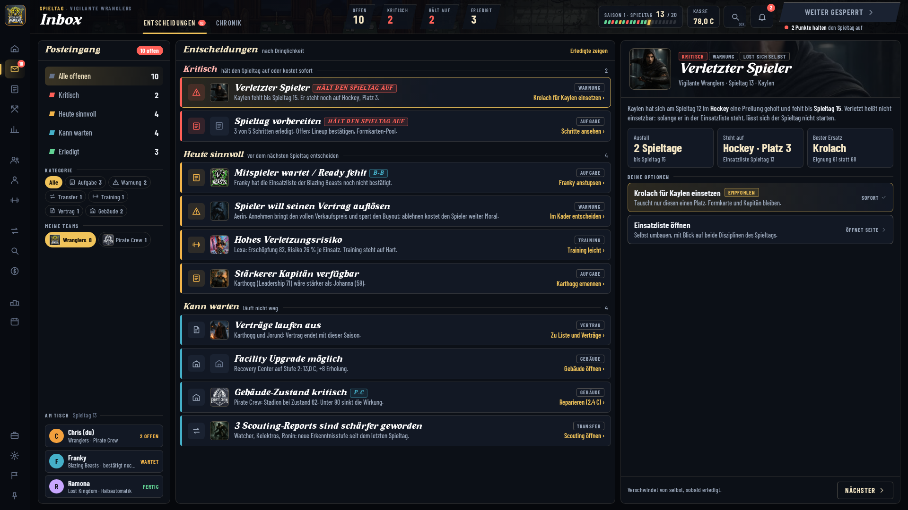
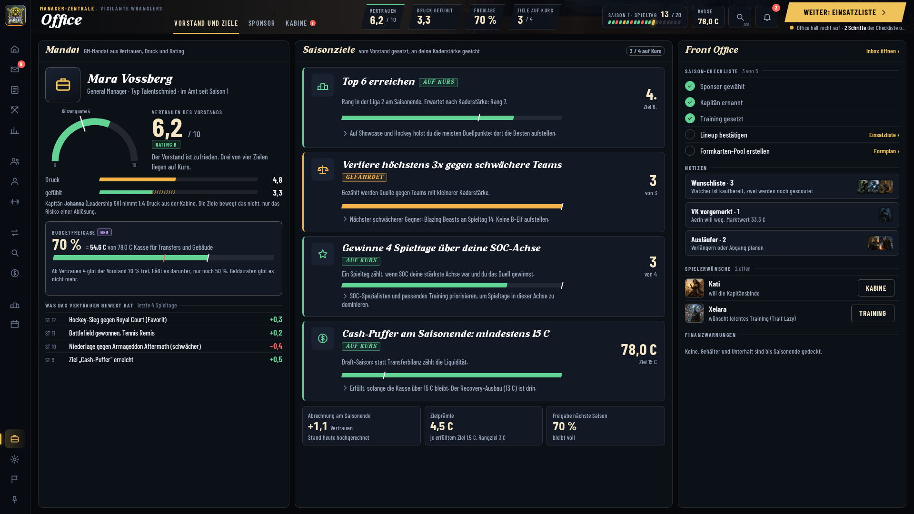
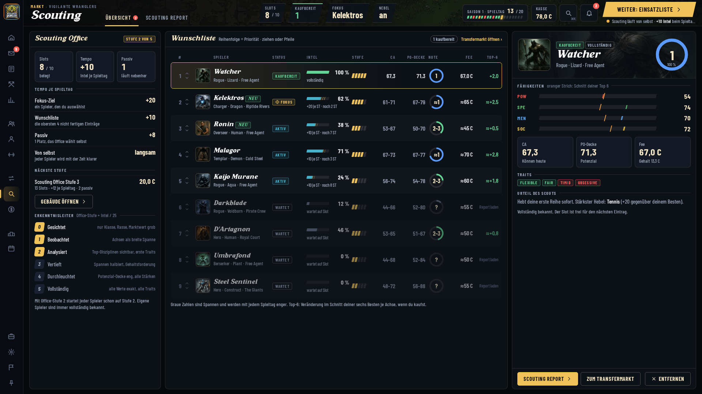
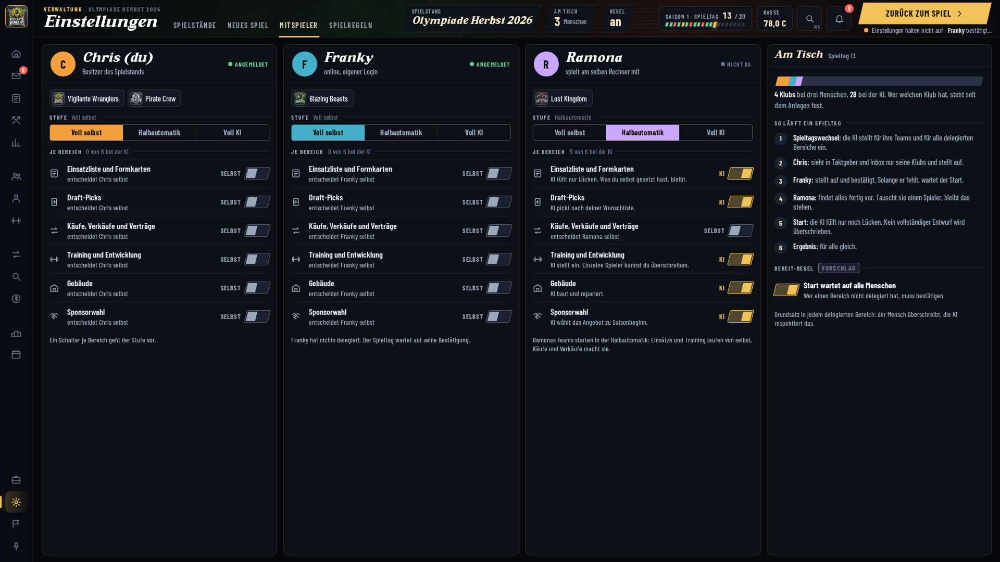

# Fehlende Seiten: Bestandsaufnahme und vier neue Mockups (18.11.)

Auftrag von Chris: „Bereite parallel weitere Mockups von den anderen Seiten vor, die noch fehlen.“

Dies ist **Konzept und Mockup, kein App-Code**. Gebaut wird erst, wenn Chris die Mockups gesehen hat (CLAUDE.md, „Größere
Konzepte: immer zuerst Mockup + Erklärung“). Die vier Dateien übernehmen Tokens, Schriften, Schiene, Regieband, Taktgeber,
Karten und Marken unverändert aus `public/mockups/app-rahmen-modern-18-11.html` und `training-modern-18-11.html`
(das Rahmen-CSS ist dieselbe Zeichenfolge, nicht nachgebaut). 0 PixelLab-Generationen: Portraits, Logos und Kulissen sind
vorhandene Bilder.

| Mockup | Datei | Ansichten |
|---|---|---|
| Inbox | `public/mockups/inbox-modern-18-11.html` | Entscheidungen, Chronik |
| Office | `public/mockups/office-modern-18-11.html` | Vorstand und Ziele, Sponsor, Kabine |
| Scouting | `public/mockups/scouting-modern-18-11.html` | Übersicht, Scouting Report, jeweils mit und ohne Nebel |
| Einstellungen | `public/mockups/einstellungen-modern-18-11.html` | Spielstände, Neues Spiel, Mitspieler und Delegation, Spielregeln |

Öffnen: Datei direkt im Browser oder über die App unter `/mockups/<datei>`. Die graue Leiste oben schaltet Ansichten und
Zustände um und gehört nicht zum UI (`?still=1` blendet sie aus). Alles Klickbare im Mockup reagiert: Einträge entscheiden,
Kapitän ernennen, Wunschliste umsortieren, Klubs verteilen, Delegation schalten, Nebel umstellen.

Bilder: `docs/design/fehlende-seiten-mockups-18-11/`, je Ansicht in 1920×1080 und 2560×1440.

## 1. Bestandsaufnahme: was hat noch kein Mockup im neuen Stil?

Grundlage: `lib/foundation/foundation-nav-config.ts` (Navigation), die Reiter in `app/foundation/FoundationShellRouterBody.tsx`
und das Seitenverzeichnis in `docs/design/seiten-umbau-fahrplan-18-11.md` (43 Flächen). Abgezogen sind alle Seiten, die
schon ein Mockup haben oder gerade eins bekommen: Startseite, App-Rahmen, Einsatzliste und Formplan, Nach dem Spieltag,
Saisonstand, Transfermarkt (mit Verhandlung, Verkauf, Verträgen und damit auch den Kauf-/Verkaufsdialogen), Spielerprofil,
Kader und Teams (#1595), Finanzen, Training und Gebäude, Form/Moral, Draft, Arena.

Priorität = wie oft die Seite im Spieltagsablauf gesehen wird, wie alt sie aussieht, und ob etwas anderes an ihr hängt.

| Rang | Seite (Nr. im Fahrplan) | Wie oft | Stand heute | Mockup |
|---:|---|---|---|---|
| 1 | **Inbox** (3) | jeden Spieltag, Ziel fast jeder Meldung | alt, 827 Zeilen, lange Liste mit Sprung-Knöpfen | **hier** |
| 2 | **Office** (2): Vorstand, Ziele, Kapitän, Notizen | jeden Spieltag ein Blick, trägt die neue Budgetfreigabe | alt, Tabellen und Text | **hier** |
| 3 | **Scouting** (25) | jede Kaufphase, hängt am Scouting-Nebel des Transfermarkts | alt, vier Karten und zwei Tabellen | **hier** |
| 4 | **Einstellungen, Spielstände, Neues Spiel** (35) | selten, aber erster Kontakt und Ort für Mehrspieler und Nebel-Schalter | alt, 2895 Zeilen, vier Unterbereiche gemischt mit Werkzeugen | **hier** |
| 5 | **Saisonende / Finale** (9) | einmal je Saison, aber der Höhepunkt | alt, 435 Zeilen | fehlt. Braucht die Buchungen aus Finanzen V2 (Rangbonus, Sponsor, Kassensturz, Auf-/Abstieg), deshalb nach deren Freigabe |
| 6 | **Sponsoren, ganze Seite** (29) | Saisonstart, sonst gelegentlich | alt, 1804 Zeilen | zum Teil hier (Office, Reiter „Sponsor“). Offene Frage 2.4: eigene Seite oder Reiter |
| 7 | **Leaders**: Bestenlisten, Rekorde, Trophäenschrank, legendäre Spieler (32) | gelegentlich, viel Schauwert | alt, 2470 Zeilen | fehlt |
| 8 | **Spielplan** (31) und **Ranks** (30) | mehrmals je Saison | alt, zwei Tabellen | fehlt. Tabellen-Muster aus dem Saisonstand trägt, ein gemeinsames Mockup genügt |
| 9 | **Ewige Tabelle** (21) und **Transferhistorie** (26) | selten | alt | fehlt, reine Tabellen: mit Rang 8 zusammen |
| 10 | **Kredite** (27) | selten, bei Geldnot wichtig | alt, 1447 Zeilen | im Finanz-Mockup nur angerissen. Mit dem Pflichtkredit aus Finanzen V2 zusammen |
| 11 | **Login** (40) und **Spielstandwahl / Räume** (41) | bei jedem Start, außerhalb des App-Rahmens | alt | fehlt. Die Spielstand-Liste aus dem Einstellungen-Mockup lässt sich dort wiederverwenden |
| 12 | **Lexikon** (33) | selten, aber alle neuen Begriffe gehören hinein | alt, im Router eingebettet | fehlt |
| 13 | **Fehler melden** (Flagge in der Schiene) | wenn etwas schiefgeht | alter Dialog | fehlt, klein |
| 14 | **Merkliste** (18), **Changelog** (36) | selten | alt, klein | fehlt. Merkliste geht in den Listen aus #1595 auf, Changelog braucht nur Tokens |
| 15 | Saisonstand-Preview (10), Spieltag-Steuerung (11), Generator (34), Admin (37), Debug (38) | intern | alt | kein Mockup nötig: Preview streichen, Rest nur Tokens |

Empfohlene nächste Runde: Saisonende (5) sobald Finanzen V2 steht, dann Leaders (7) und ein gemeinsames Tabellen-Mockup für
Spielplan, Ranks, Ewige Tabelle und Transferhistorie (8, 9).

## 2. Die vier Mockups

Jedes Mockup steht im App-Rahmen und nutzt ihn so, wie `app-rahmen-modern-18-11.md` es festlegt: Unterreiter und Kennzahlen
im Regieband, eine Hauptaktion im Taktgeber, kein eigener Seitenkopf, kein Seitenscroll (nur Listen scrollen in ihrer Karte).

### 2.1 Inbox

**Idee: entscheiden, ohne die Seite zu verlassen.** Heute ist die Inbox eine lange Liste, und fast jeder Knopf springt auf eine
andere Seite. Neu sind es drei Spalten: links Filter, in der Mitte die Liste nach Dringlichkeit, rechts der gewählte Eintrag
mit Erklärung, drei Zahlen und den Optionen. Was sich sofort erledigen lässt (Training leicht, Kapitän ernennen, Vertrag
auflösen, reparieren), passiert rechts mit einem Klick.

Was das Mockup zeigt und woher es kommt:

- **Gruppen und Titel sind die des Spiels**: Kritisch, Heute sinnvoll, Kann warten, Berichte (`inbox-urgency-groups.ts`); die
  Titel und Texte der Einträge aus `game-inbox-service.ts` („Verletzter Spieler“, „Spieler will seinen Vertrag auflösen“,
  „Hohes Verletzungsrisiko“, „Stärkerer Kapitän verfügbar“, „Mitspieler wartet / Ready fehlt“ …).
- **„Hält den Spieltag auf“** ist neu als eigene rote Marke. Solange so ein Eintrag offen ist, ist der Taktgeber gesperrt, und
  ein Klick darauf springt zum ersten Blocker.
- **Das Bündel „Spieltag vorbereiten“** (`inbox-bundling.ts`) ist eine Checkliste mit fünf Schritten statt fünf Einträgen.
- **Optionen mit Folgen**: jede Option sagt, was passiert und ob sie sofort wirkt, eine Seite öffnet oder nur ausblendet
  (die drei Arten aus `inbox-quick-action-service.ts`). Eine ist als „Empfohlen“ markiert.
- **„Am Tisch“** unten links: wer von Chris, Franky und Ramona noch dran ist. Ramonas Team in der Halbautomatik ist fertig,
  Franky fehlt die Bestätigung.
- **Chronik** als zweiter Reiter: Ergebnisse, Transfers und Story Cards nach Spieltag, rechts als große Karte mit Kulisse.
- Neue Regeln sind eingearbeitet: verletzt = nicht einsetzbar (der Eintrag blockiert), Budgetfreigabe des Vorstands.

Weitere Bilder: `inbox-02-vertrag-aufloesen`, `inbox-03-chronik`, `inbox-04-alles-erledigt`.

Offene Fragen an Chris:

1. **Ein Posteingang für alle eigenen Teams?** Heute zeigt die Inbox nur das gerade gewählte Team. Im Mockup stehen die
   Einträge aller eigenen Klubs in einer Liste, fremde mit Kürzel markiert. Empfehlung: ja, mit Filter je Team.
2. **Sofort-Aktionen**: Dürfen Entscheidungen mit Folgen (Vertrag auflösen, Kapitän wechseln, reparieren) direkt in der Inbox
   fallen, oder soll die Inbox dort nur hinführen? Empfehlung: direkt, aber mit den drei Zahlen daneben.
3. **Franky anstupsen**: Soll es die Meldung an einen Mitspieler geben? Das ist neu und braucht eine kleine Server-Funktion.
4. **Chronik in der Inbox oder auf der Startseite?** Die Startseite hat schon einen Ticker. Empfehlung: Chronik bleibt hier
   als Archiv, die Startseite zeigt nur die letzten drei.

### 2.2 Office

**Idee: das Office beantwortet drei Fragen, je Reiter eine.** Wie steht der Vorstand zu mir? Was zahlt der Sponsor? Wie geht
es der Kabine?

- **Vorstand und Ziele**: links das Mandat (Vertrauen als Bogen, Druck, gefühlter Druck nach Abzug des Kapitäns, Rating), in
  der Mitte die Saisonziele als Karten mit Stand, Ziellinie und einem Satz, was zu tun ist, rechts Checkliste, Notizen
  (Wunschliste, VK vorgemerkt, Ausläufer) und Spielerwünsche. Zielarten und Texte stammen aus
  `lib/board/team-season-objectives-service.ts`, der Abzug des Kapitäns aus `BOARD_V2_CAPTAIN` (Leadership / 40, höchstens 2,0).
- **Budgetfreigabe** steht im Mandat als eigener Kasten: wie viel Prozent der Kasse der Vorstand für Transfers und Gebäude
  freigibt, und ab wann er kürzt. Das ist die Regel vom 18.11. („weniger Budgetfreigabe statt Geldstrafen“) und noch nicht in
  der Spiellogik. Der Zustand „unter Druck“ (`?vorstand=druck`) zeigt die gekürzte Freigabe und was dadurch nicht mehr geht.
- **Sponsor**: laufender Vertrag mit seinen Bausteinen (Basis, Gewinnstufen, Tabellenziel, Sonderziel, Klausel, Perk aus
  `sponsor-modules.ts`), die Auszahlung über 20 Spieltage als Balkenreihe (Basis in Raten, Bonus am Ende, nach Finanzkonzept
  V2), Kommerz-Score mit den drei Treibern, rechts die Sponsoren der Liga. Zum Saisonstart (`?sponsor=wahl`) stehen stattdessen
  drei Angebote nebeneinander.
- **Kabine**: Kapitänswahl als Tabelle mit Leadership, Stil und den vier Wirkungen, daneben die Moral des Kaders mit Gründen
  und offenen Spielerwünschen.

Weitere Bilder: `office-02-vorstand-unter-druck`, `office-03-sponsor`, `office-04-sponsor-angebote`, `office-05-kabine`.

Offene Fragen an Chris:

1. **Seite oder Blatt?** Im Rahmen-Mockup ist das Office ein Blatt, das von rechts hereinfährt. Für Ziele, Sponsor und Kapitän
   ist das zu schmal. Vorschlag: das Blatt bleibt als Kurzfassung (Vertrauen, Freigabe, nächstes Ziel) und öffnet diese Seite.
2. **Budgetfreigabe**: Stimmen die Stufen (70 % normal, 50 % unter Vertrauen 4)? Die Zahlen sind gesetzt, nicht gemessen, und
   gehören mit Finanzen V2 abgestimmt.
3. **Zielprämien**: Soll ein erfülltes Vorstandsziel Geld bringen (im Mockup 1,5 C, Rangziel 3 C) oder nur Vertrauen?
4. **Sponsor: Reiter im Office oder eigene Seite?** Heute ist „Sponsoren“ ein eigener Punkt unter „Welt“. Empfehlung: Reiter
   im Office, der Navigationspunkt entfällt. Die Liga-Übersicht aller Sponsoren bleibt als rechte Spalte erhalten.
5. **Kapitänswechsel mitten in der Saison**: Soll er etwas kosten (im Mockup verliert der alte Kapitän Moral)?

### 2.3 Scouting

**Idee: die Wunschliste ist die Seite, und Unwissen sieht man.** Jede Zahl eines fremden Spielers ist eine Spanne, die mit
dem Scouting-Stand enger wird. Graue Zahlen sind unsicher, weiße exakt.

- **Übersicht**: links das Scouting Office mit dem, was es wirklich leistet (Stufe 2: 10 Slots, +10 Intel je Spieltag, 1
  passiver Platz, Fokus-Ziel +20, aus `facility-scout-pipeline-service.ts`) und die Erkenntnisleiter mit den sechs Stufennamen
  des Spiels. In der Mitte die Wunschliste in Prioritätsreihenfolge mit Status (Fokus, Aktiv, Wartet, Kaufbereit),
  Intel-Balken samt Zuwachs des nächsten Spieltags, Erkenntnisstufe, CA, PO-Decke, Scout-Note im Ring, Fee und Wirkung auf die
  Top 6. Rechts der Kurzbericht zum gewählten Spieler.
- **Scouting Report**: der ganze Bericht mit Achsen als Spannenbalken (oranger Strich = Schnitt der eigenen Top 6), Können und
  Potenzial, Markt, den acht stärksten Disziplinen mit Abstand zum eigenen Besten, Traits (verdeckte als „?“) und dem Urteil
  des Scouts. Rechts die Einordnung im Kader und die Leiter dieses Spielers mit „in x Spieltagen“.
- **Nebel aus** (`?nebel=aus`): der Schalter des Spielstands. Alle Werte exakt, ein gelbes Band sagt es, Slots und Tempo
  sind ohne Wirkung, die Wunschliste bleibt als Merkliste. Deckt sich mit dem Transfermarkt-Mockup („Nebel aus (Test)“).

Weitere Bilder: `scouting-02-report`, `scouting-03-report-nebel-aus`, `scouting-04-uebersicht-nebel-aus`.

Offene Fragen an Chris:

1. **Spannen statt Buchstaben?** Heute zeigt das Scouting Stufen-Buchstaben und Sterne. Das Mockup zeigt Zahlenspannen
   („63–71“), weil sie zum Transfermarkt-Mockup passen. Ist das die gewünschte Richtung für die ganze App?
2. **Wie viele Einträge scoutet die Wunschliste gleichzeitig?** Im Mockup die obersten vier nicht fertigen, der Rest wartet.
   Der echte Wert hängt am Gebäude (`scouting-wishlist-slots.ts`) und sollte im Bau von dort kommen.
3. **Draft**: Das Draft-Mockup (läuft parallel) nutzt die Wunschliste als Auto-Pick-Liste. Soll die Scouting-Seite im Draft
   dieselbe Liste zeigen, nur mit anderer Überschrift?
4. **Merkliste**: Geht der Navigationspunkt „Merkliste“ in dieser Wunschliste auf (für Spieler) und in der Teamliste (für
   Teams)? Empfehlung: ja, ein Punkt weniger in der Schiene.

### 2.4 Einstellungen: Spielstände, Neues Spiel, Mitspieler, Spielregeln

**Idee: vier Reiter für vier Fragen, Werkzeuge raus.** Die heutige Seite mischt Spielstände, Team-Fokus, KI-Verhalten und
Identity/Strategie. Für Spieler bleiben vier Dinge: Welcher Spielstand? Neues Spiel? Wer steuert was? Welche Regeln gelten?

- **Spielstände**: Liste mit Modus, Stand, wer mitspielt, wann und von wem gespeichert; laden, duplizieren, löschen. Rechts
  der gewählte Spielstand mit „Wer steuert was“ und der Gefahrenzone (Season-Start-Reset, Löschen). „Tests und Sandbox“ ist
  ein eigener Bereich, damit Testsaves nicht zwischen den echten stehen.
- **Neues Spiel**: drei Schritte links (Manager Mode oder Battle Mode, wer spielt mit, Name), in der Mitte alle 32 Klubs nach
  Liga, ein Klick wechselt den Besitzer (KI → Chris → Franky → Ramona), rechts die Vorschau mit Besitz, Liga-Zuordnung und Start.
- **Mitspieler und Delegation**: je Mensch eine Karte mit seinen Klubs, der Stufe (Voll selbst, Halbautomatik, Voll KI) und
  sechs Schaltern je Bereich. Das ist das Modell aus `lib/foundation/team-delegation.ts` (Branch
  `claude/mehrspieler-delegation-18-11`): Ramona startet in der Halbautomatik, ein Einzelschalter geht der Stufe vor, und in
  jedem delegierten Bereich gilt „Mensch überschreibt, KI respektiert das“. Rechts der Ablauf eines Spieltags mit drei Menschen.
- **Spielregeln**: Schalter je Spielstand. **Scouting-Nebel** mit Vorher/Nachher an einem echten Spieler, einer Liste, was
  sich auf welchen Seiten ändert, und dem Hinweis, dass der Wechsel alle am Tisch betrifft. Darunter, was seit dem Anlegen
  fest ist (Modus, Liga-Aufteilung, Sitze).

Weitere Bilder: `einstellungen-01-spielstaende`, `einstellungen-02-neues-spiel`, `einstellungen-04-spielregeln`,
`einstellungen-05-mit-mockup-leiste`.

Offene Fragen an Chris:

1. **Wohin mit den Werkzeugen?** KI-Verhalten, Identity und Strategie, AI-Preseason-Diagnose, Import-Status und der Generator
   stehen heute unter „Verwaltung“. Vorschlag: sie ziehen in den Admin-Bereich, „Einstellungen“ wird ein Zahnrad unten in der
   Schiene neben dem Office.
2. **Nebel umstellen mitten in der Saison**: erlaubt (im Mockup ja, mit Warnung) oder nur beim Anlegen?
3. **Wer darf Spielregeln und Delegation ändern?** Im Mockup stellt nur der Besitzer des Spielstands die Regeln um, und jeder
   Mensch seine eigene Delegation. Darf Chris die Delegation für Ramona setzen, wenn sie nicht da ist?
4. **Sicherungspunkte je Spieltag** (als „Vorschlag“ markiert): Heute gibt es nur „Duplizieren“. Sollen alle am Tisch
   gemeinsam auf den Stand vor einem Spieltag zurückkönnen?
5. **Bereit-Regel** (als „Vorschlag“ markiert): Wartet der Spieltag immer auf alle Menschen, oder übernimmt nach einer Frist
   die KI die fehlenden Schritte?
6. **Ramona im Klub-Raster**: Der Delegations-Branch macht sie beim Spielstart wählbar. Das Mockup geht davon aus, dass das
   so auf `main` kommt.

## 3. Was echt ist und was nicht

Jede Datei nennt im Kommentar am Anfang, was aus dem Spiel stammt und was erfunden ist. Kurz:

- **Echt**: Texte, Gruppen, Kategorien und Schnellaktionen der Inbox; Zielarten, Kapitäns-Wirkungen und Sponsor-Bausteine;
  Office-Stufen, Tempo, Stufennamen und Status im Scouting; Unterbereiche, Modi, Besitzer und Delegationsstufen der
  Einstellungen; alle Spieler mit Klasse, Achsen, Eignungen, Traits, Marktwert und Gehalt; alle 32 Teams mit Liga und Logo.
- **Erfunden**: welche Einträge gerade offen sind, Stände und Beträge, Intel-Stände und Spannenbreiten, die Spielstand-Liste,
  die Sitzverteilung (Chris: Wranglers und Pirate Crew, Franky: Blazing Beasts, Ramona: Lost Kingdom).
- **Neu und noch nicht in der Spiellogik**: Budgetfreigabe des Vorstands, Sponsor-Basis in 20 Raten (beides Finanzen V2),
  „hält den Spieltag auf“ als Marke, Anstupsen, Sicherungspunkte, Bereit-Regel.

## 4. Geprüft

- Alle vier Dateien laufen ohne JavaScript-Fehler; ein Trockenlauf klickt jede Aktion einmal durch (Inbox 48, Office 19,
  Scouting 36, Einstellungen 103 Aktionen) und findet kein `undefined` oder `NaN` im erzeugten HTML.
- Sichtprüfung der Bilder bei 1920×1080 und 2560×1440: siehe Abschnitt 5.
- Nicht geprüft: Verhalten unter 1700 px Breite und auf dem Handy. Die Mockups sind wie die anderen auf 16:9 ab Full HD ausgelegt.
