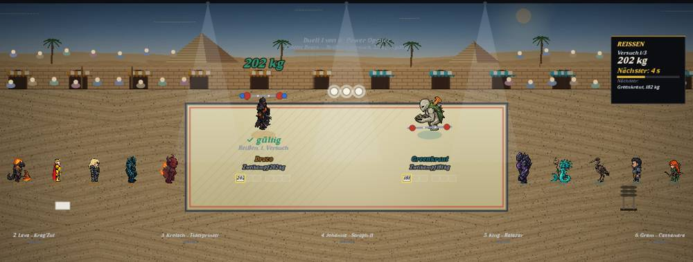
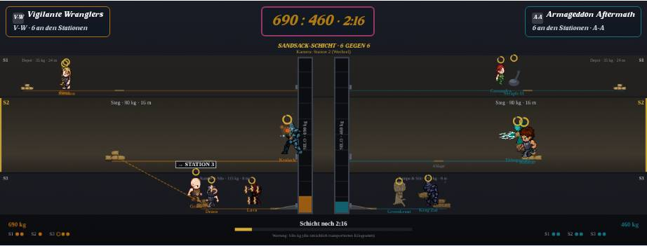
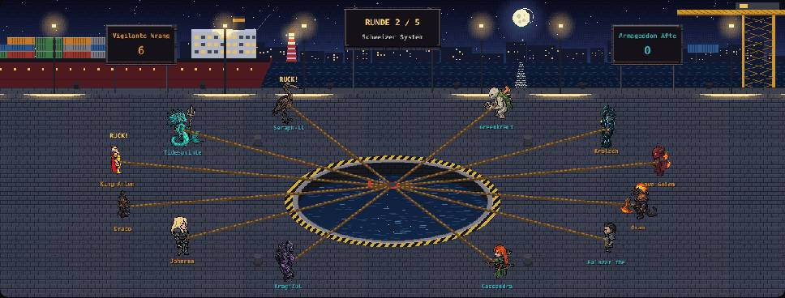
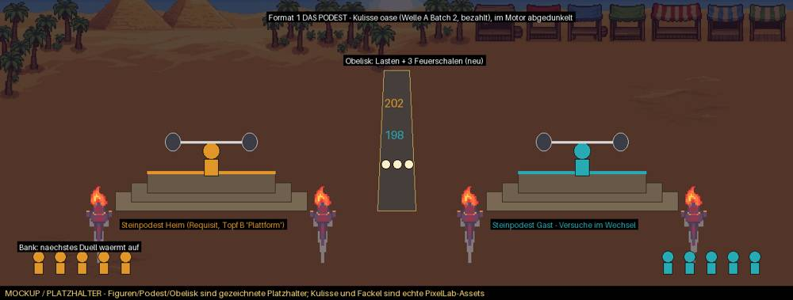
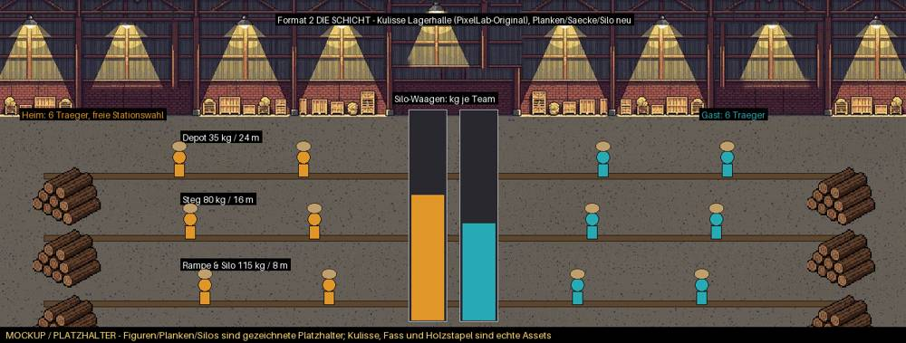

# Gewichtheben: drei Formate, drei Arenen — Remake-Konzept (17.11.)

Anlass, Chris am 17.11. zum Screenshot der Wüstenkulisse: „ist gewichtheben so wie es da ist
spannend? was kann man daraus noch machen? da hatten wir doch dieses sandsack tragen? tauziehen
etc? das sollte doch alles neu und frisch gebaut werden, das ist doch so quatsch. Da kannst du dich
inspirieren lassen von Physical 100 zb und 3 verschiedene arenen mit verschiedenen regeln sollte ja
gar kein problem sein!“

Reines Konzept. Kein Code, keine Bestellung, keine Messung in diesem Schritt. Alle Zahlen unten
stammen aus den genannten Dokumenten und sind dort gemessen, nicht hier.

## 0. Ergebnis vorab

1. **Chris erinnert sich richtig, und beides liegt fertig oder halbfertig im Repo, nur
   abgeschaltet.** Das Sandsack-Tragen ist im Motor gebaut, gemessen und im Spiel sichtbar
   (`BUEHNE_FLAGS.gewichthebenSandsack=10`), aber die App setzt den Schalter nie. Das Tauziehen
   existiert als eigenständiger Prototyp (`public/mockups/tauziehen-prototyp.html`), nicht im
   Motor. Im Spiel läuft deshalb immer nur das Hantel-Duell.
2. **Empfehlung: drei Formate mit drei eigenen Regelwerken und drei eigenen Arenen.**
   - **Das Podest** (Pyramidenhof): das klassische Heben, eins gegen eins je Slot, als Remake der
     Darstellung. Mechanik unverändert, bleibt Standard im Fingerabdruck.
   - **Die Schicht** (Lagerhalle): sechs gegen sechs tragen 150 Sekunden lang Säcke an drei
     Stationen mit steigender Last; es zählt die geschaffte Arbeit.
   - **Die Grube** (Hafenkai): alle zwölf ziehen in fünf Schweizer Runden eins gegen eins über einen
     Schacht, der Verlierer geht baden; zum Schluss das Große Tau sechs gegen sechs.
3. **Alle drei lesen dieselben fünf Teilwerte des bestehenden Rezepts.** Kein Matrix-Eingriff, kein
   Override. Was wechselt, ist die Handlung, nicht die Gewichtung.
4. **PixelLab: 76 Generationen neu, Obergrenze 105 mit Fehlversuchen.** Keine neue Großkulisse,
   keine Figur, keine Animation. Die drei Kulissen sind schon bezahlt. Dazu kommen die 65
   Generationen, die Topf B für Gewichtheben ohnehin vorsieht (Hantel, Plattform, Silo, Rampe, Sack).
5. **Bau-Reihenfolge:** Umschalter-Fundament → Schicht → Podest-Remake → Grube.

## 1. Ist-Zustand

### 1.1 Was heute läuft

Bilder: `gewichtheben-17-11/ist-hantel-oase.jpg` (das ist Chris' Screenshot),
`ist-hantel-hafen.jpg`, `ist-hantel-lagerhalle.jpg`.

| | Stand |
|---|---|
| Motor | Bühnen-Chassis, `BUEHNE_ART.gewichtheben` (`heben:true`, 6 je Seite), Builder `baueHebenDuelle()`, Weiche in `bauBuehne()` |
| Ablauf | sechs Duelle Slot gegen Slot, je Heber drei Versuche Reißen und drei Stoßen, 72 enthüllte Versuche nacheinander |
| Sendezeit | 7:11 (`format-varianten-machbarkeit-08-11.md` Abschnitt 7) |
| Matrix | power 28, charisma 23, health 16, determination 12, will 7, speed 6, dexterity 6, stamina 2; übrige 0 |
| Rezept | fünf Teilwerte: LAST (power 60, health 25, det 15), TECHNIK (speed, dexterity, det), NERVEN (charisma, will, det, health), ANSAGE (charisma 53), ERHOLUNG (stamina 40, health 35, will 25) |
| rho je Spiel | 0,892, Spannweite 0,039, Saison 0,944 (`data/generated/disziplin-abnahme.json`, Kaderfamilie 15.11.) |
| Pp | 8,5 / 10,0 (`stand-aller-disziplinen.md`) |
| Kulissen | oase, hafen (beide in Welle A Batch 2 durch PixelLab ersetzt, Branch `claude/pixellab-welle-a-batch2-v2-17-11`), sandsack/Lagerhalle (PixelLab-Original) |

Die Mechanik ist die rangtreueste Bühnen-Disziplin des Projekts. Das Problem liegt nicht in der
Wertung, sondern im Bild.

### 1.2 Was „quatsch“ und statisch wirkt

- **Zwei Figuren stehen auf einem beigen Teppich, zehn stehen daneben.** Das Bild steht in rund
  95 % der Sendezeit (`format-varianten-brainstorm-08-11.md` Abschnitt 1). Bewegung gibt es nur in
  der Hebepose selbst.
- **7:11 Minuten für 72 Versuche nacheinander.** Die anderen Formate brauchen 2:42 (Schicht) und
  rund 1:35 (Grube-Prototyp). Das Zielfenster der Sendung ist 2:30–4:00.
- **Die Arena ist ein Hintergrundbild mit leerer Fläche.** Die Kulissen haben oben einen schmalen
  Horizontstreifen und darunter zwei Drittel leeren Boden. Darauf liegt ein prozedural gemalter
  Teppich mit Punkt-Zuschauern und drei Kreisen als Kampfrichterlampen. Das ist genau die
  „Übertragung statt Remake“, die Chris am 17.11. ausgeschlossen hat.
- **Die Oase ist taghell.** Sie passt nicht zum dunklen Look von I-Spy, TDM und der HYROX-Halle.
- **Kein Kontakt, keine Interaktion.** Der Gegner ist nur eine Zahl, die man überbieten muss.
- **Drei Kulissen, ein Regelwerk.** Die Kulissenwahl ist folgenlos.

### 1.3 Was es zu Sandsack, Tauziehen und Physical 100 schon gibt

| Vorarbeit | Stand | Zahlen | Quelle |
|---|---|---|---|
| **Sandsack-Schicht**, 6 gegen 6, drei Stationen, freie Stationswahl (Flag 10) | im Motor, im Spiel sichtbar mit HUD, Ticker, Boxscore, Endstand; Standard AUS; Wertung „Arbeitswert“ als vorläufig markiert | rho 0,849, schwächste Paarung 0,825, Pp 11,3 / 10,0, Sendezeit fest 2:42 (06.10., alte Kaderfamilie) | `gewichtheben-sandsack-wegc-parallel-stufe3-sichtbarkeit-06-10.md` |
| Sandsack-Läufe 2 gegen 2 (Flag 1) und Messvarianten 2–9 | im Motor, abgelöst durch Flag 10 | rho 0,882, Pp 15,0 / 17,0 | `gewichtheben-sandsack-finale-wegc-format-05-10.md` |
| Trage-Pose in sechs Laststufen | gebaut als Gelenk-Rig aus den vorhandenen Sprites, **ohne** neue PixelLab-Animation | — | `gewichtheben-sandsack-trage-pose-05-10.md` |
| **Tauziehen „Die Grube“**, Schweizer Runden | Prototyp außerhalb des Motors, Stern- und Kai-Ansicht, Boxscore, Ticker | Vorab-Sonde rho 0,895 / 0,895, Pp 13,8 / 14,0 (15.11., neue Kaderfamilie) | `format-varianten-machbarkeit-08-11.md` |
| Tauziehen als gemeinsamer Ring 12 → 8 → 5 → 3 → 1 | gemessen und **verworfen** | rho 0,538 / 0,538 | ebenda Abschnitt 4 |
| „Die Ladestrecke“ (Scheiben tragen zwischen Reißen und Stoßen) | Konzept, nicht gebaut | per Bauart neutral | `gewichtheben-physical100-fable-konzept-03-10.md` |
| Produktionsreife der Grube | am 15.11. zurückgestellt, bis die Budget-Kampagne durch ist | — | `arenen-mechaniken-konzept-konsolidiert-15-11.md` Zeile 37 |

Bilder dazu: `gewichtheben-17-11/ist-sandsack-schicht-flag10.jpg`,
`ist-tauziehen-prototyp-grube.jpg`, `ist-tauziehen-prototyp-kai.jpg`.

Zwei Lehren aus diesen Runden gelten für alles Weitere:

- **Gewichtheben darf kein Ausdauerformat werden.** stamina wiegt 2, charisma 23. Jedes Format, in
  dem der Zähere gewinnt, fällt bei Pp durch. Puste ist deshalb in allen drei Formaten ein Bild
  der **relativen Last** (LAST), nicht der Ausdauer. ERHOLUNG wirkt nur zwischen den Belastungen.
- **Ausscheiden nach einer leichten Runde misst die Schwachen an nichts.** Deshalb Schweizer Runden
  statt K.-o.-Ring, und in der Schicht schwere Stationen für alle.

## 2. Die drei Formate

Gemeinsam für alle drei: Zwei-Team-Begegnung mit 6 gegen 6 wie heute, kein Vierer-Pod. Der
Kraft-Kernbereich hat mit Mini-DM schon sein Vier-Team-Format (Freigabe 01.11.), und die Bühne kann
keine N Seiten. Jeder Spieler handelt in jedem Format selbst, es gibt keine Zuschauerrolle.

| | **1 Das Podest** | **2 Die Schicht** | **3 Die Grube** |
|---|---|---|---|
| Vorbild | olympisches Heben | Physical 100: Sandsack-Schleppen, Schiffsladung | Physical 100: Tauziehen, Zurückdrängen |
| Wer gegen wen | 1 gegen 1 je Slot, sechs Duelle | 6 gegen 6 gleichzeitig | 12 Einzelne, fünf Schweizer Runden, dann 6 gegen 6 |
| Entschieden wird über | höchste gültige Last | geschaffte Arbeit in fester Zeit | Boden am Seil, Fall in den Schacht |
| Wertung Mannschaft | gewonnene Duelle, Kilogramm als Gleichstandsregel | Arbeitswert a : b | Siege aller Zieher plus 2 für das Große Tau |
| Spielerwert | eigene Zweikampf-Kilogramm | Tragenote gegen Referenzträger an derselben Last | Zugnote gegen Referenzzieher an derselben Gegenlast, plus Siege |
| Entscheidender Moment | dritter Versuch | 115-kg-Sack an der Rampe, Rutscher | Fersen an der Kante, „RUCK!“ |
| Kontakt | keiner (Nervenspiel über die Ansage) | Übergabe Hand zu Hand im eigenen Team | direkter Gegenzug, Zurückdrängen, Sturz |
| Sendezeit | Ziel ≤ 4:00 (heute 7:11) | 2:42 fest | Ziel 2:30–2:45 (Prototyp 1:35) |
| Arena | Pyramidenhof bei Fackelnacht | Lagerhalle, Verladehof | Hafenkai bei Nacht, Schacht |
| Stand | läuft, Darstellung neu | gebaut, abgeschaltet | Prototyp, Motor fehlt |

### 2.1 Format 1: Das Podest (klassisches Heben, Remake)

**Spielidee.** Zwei Heber stehen sich auf zwei Steinpodesten gegenüber und treiben sich
abwechselnd hoch. Die Regeln bleiben, wie sie sind: Reißen und Stoßen, je drei Versuche, Ansage der
Eröffnungslast, der Heber sieht die Last des Gegners.

**Warum es bleibt.** Es ist das Format mit rho 0,892 und Pp 8,5 / 10,0, der Anker im
Wertungs-Fingerabdruck und das einzige mit dem Risiko-Kanal „kühner Versuch“. Wegfallen sollte die
heutige **Darstellung**, nicht die Mechanik.

**Was sich ändert (alles Anzeige, Wertung bit-identisch):**

- Zwei Podeste statt eines Teppichs. Beide Heber stehen während des ganzen Duells oben, die
  Versuche laufen im Wechsel. Wer nicht hebt, kreidet, schaut hin, reagiert auf „gültig“ oder
  „ungültig“ des Gegners (vorhandene Grundposen).
- Ein Obelisk in der Mitte trägt die Lasten beider Heber und drei Feuerschalen als
  Kampfrichterlampen. Die Schalen flammen bei „gültig“ auf.
- Die Bank ist Teil des Bildes: Das nächste Paar geht während des laufenden Duells zum Podest.
- Sendezeit auf höchstens 4:00. Mittel: Leerlauf zwischen den Versuchen kürzen (heute „Nächster:
  5 s“), sichere Eröffnungsversuche beider Heber eng hintereinander zeigen. **Jeder Versuch bleibt
  sichtbar** (gezeigt = gebucht). Vor dem Bau prüfen, ob `rundenDauer` und
  `ZEIT_DEHNUNG.gewichtheben` in den Fingerabdruck eingehen. Falls ja, wird nur die Anzeige-Uhr
  verkürzt, nicht die Motorzeit.
- Kulisse oase bleibt, wird aber über den vorhandenen Kulissen-Parameter `dunkel` auf Fackelnacht
  gezogen. Fackeln gibt es schon (`public/sprites/arena/fackel.png`).

**Attribute.** Primärweg LAST (power, health, determination): Hebe-Obergrenze. Nebenwege: ANSAGE
(charisma) für Eröffnungshöhe und kühnen Versuch, NERVEN an der Grenzlast, TECHNIK für das
Gelingen, ERHOLUNG für das Stoßen nach dem Reißen. Unverändert.

**Ausdauer/Puste.** Keine Leiste. Die Frische nach dem Reißen (ERHOLUNG) ist heute unsichtbar; sie
wird als Atemwölkchen und Haltung auf dem Podest gezeigt, ohne Rechenwirkung.

**rho/Pp.** Unverändert per Bauart, Fingerabdruck `e80babacb68c` bleibt. **Aufwand:** ein PR,
mittel. **Risiko:** niedrig; einziges Risiko ist ein versehentlicher Eingriff in die Motorzeit.

### 2.2 Format 2: Die Schicht (Sandsack-Tragen)

**Spielidee.** Beide Mannschaften entladen gleichzeitig. 150 Sekunden, drei Stationen mit
steigender Last und kürzerem Weg, jeder sucht sich seine Station selbst.

**Regeln (gebaut, Flag 10):**

- Stationen: Depot 35 kg über 24 m, Steg 80 kg über 16 m, Rampe und Silo 115 kg über 8 m.
- Jeder Träger wählt seine Station frei und darf wechseln. Schwere Säcke bringen mehr, kosten aber
  mehr Puste.
- Drei Entscheidungen je Gang: normal ablegen, durchpowern (schneller, teurer), direkt übergeben
  (Hand zu Hand an einen Mitspieler).
- Rutscher und Zwangspausen sind feste Würfe aus eigenem Saatstrom.
- Wertung: Arbeitswert je Mannschaft, die Beiträge der Spieler summieren sich exakt darauf.

**Attribute.** Primärweg LAST: Traglast, Ermüdung über die relative Last. Nebenwege: TECHNIK
(Leertempo, seltener rutschen) macht den schnellen Leichten am Depot wertvoll; ANSAGE (Wagnis,
Durchpowern) und NERVEN (Biss an der Grenzlast, Pausenschwelle) tragen charisma; ERHOLUNG bestimmt
die Pausenlänge. Das ist das Mehrwege-Muster in Reinform: Der Starke gehört an die Rampe, der
Flinke ans Depot, beide liefern.

**Ausdauer/Puste.** Puste-Ring über jeder Figur, gespeist aus der relativen Last. stamina kam in
der Messung auf 0,3 % Einfluss; das soll so bleiben.

**Kontakt.** Im eigenen Team die Übergabe. Zwischen den Teams bewusst keiner: Die Seiten sind
gespiegelt, damit kein Team durch Stau benachteiligt wird. Ein gemeinsamer Engpass am Silo wäre
ein späterer Kontakt-Baustein und braucht eine eigene Messung.

**rho/Pp-Erwartung.** Gemessen 0,849 / Pp 11,3 | 10,0 auf der alten Kaderfamilie. Erwartung auf der
neuen: 0,83–0,87, Pp unter 15. Die schwächste Paarung lag bei 0,825; das ist die Zahl, die über der
Mindestschranke 0,75 bleiben muss. **Aufwand:** ein bis zwei PRs (Neumessung, Arena-Remake,
Anschluss an den Umschalter). **Risiko:** niedrig bis mittel; offen sind kleinere Kader (2 bis 5 je
Seite) und die Bestätigung der Wertung.

**Arena-Remake.** Die Schicht zeichnet heute drei einfarbige Bänder über die Kulisse. Neu: Die
Lagerhalle bleibt Hintergrund, die Bahnen werden Plankenstege auf dem Hallenboden, Sackstapel und
Silo-Waagen sind PixelLab-Requisiten (Topf B), Staub beim Ablegen.

### 2.3 Format 3: Die Grube (Tauziehen)

**Spielidee.** Zwölf Zieher stehen rund um einen Schacht im Kai. Jedes Seil verbindet zwei Gegner
auf gegenüberliegenden Speichen, sechs Seile kreuzen sich über dem Wasser. Wer verliert, wird über
die Kante gezogen und geht baden.

**Regeln (Prototyp, Schweizer Fassung):**

- Fünf Runden, je sechs Taue gleichzeitig. Runde 1 paart Slot gegen Slot, danach Sieger gegen
  Sieger nach Schweizer System, auch Mitspieler gegeneinander.
- Im Zug: LAST zieht, TECHNIK ist der Stand, bei einem Ruck entscheidet ein fester Wurf über den
  Rutscher. An der Kante gibt es einmal je Zug das „Aufbäumen“ über NERVEN.
- Zwischen den Runden füllt ERHOLUNG die Puste.
- Zum Schluss das **Große Tau**, sechs gegen sechs an einem Seil, mit Zurückdrängen über die
  Mittellinie. Es bringt der Mannschaft 2 Punkte und geht nicht in den Spielerwert ein. So ist es
  gemessen, und so soll es bleiben.
- Mannschaftswertung: Summe der Einzelsiege plus Großes Tau. Duelle unter Mitspielern sind für die
  Mannschaft neutral, schärfen aber die Einzelrangfolge.

**Attribute.** Primärweg LAST. Nebenwege: NERVEN (Aufbäumen an der Kante) und ANSAGE (Vollzug oder
Halten, Einschüchterung des Gegenübers) geben charisma seinen Kanal; TECHNIK ist der Stand. Ohne
einen großen ANSAGE-Kanal reicht ein Tauziehen die Matrix nicht durch (Machbarkeit Abschnitt 4).

**Ausdauer/Puste.** Ermüdung wächst mit dem Quadrat der relativen Last, nicht mit der Zeit.
stamina darf nicht über etwa 4 % Einfluss kommen.

**Kontakt.** Das Format ist Kontakt: Gegenzug, Ruck, Zurückdrängen, Sturz. Persönlichkeit darf
später die Gangart wählen (Vollzug oder Halten), die Eignung entscheidet den Ausgang.

**rho/Pp-Erwartung.** Vorab-Sonde 0,895 / Pp 13,8 | 14,0. Die Sonde kennt weder Slot- noch Trait-
noch Formkanal und ist an ihren Messdaten kalibriert. Ehrliche Erwartung im Motor: 0,82–0,88, Pp
unter 20. **Aufwand:** groß, drei PRs (Motor-Builder `baueTauziehen()` mit eigenem Spielerwert
nach Referenz-Muster; Szene, HUD, Boxscore; Abnahme und kleinere Kader). **Risiko:** mittel; offen
sind die Slot-Bedeutung ab Runde 2, Kader unter vier Ziehern und die Zieh-Pose. Die Pose wird wie
die Trage-Pose als Rig aus vorhandenen Sprites gebaut, **ohne** neue Animation; der Prototyp nutzt
bereits Geh- und Angriffsanimation.

**Sendezeit.** Der Prototyp läuft 1:35. Für das Fenster 2:30–4:00 bekommt jede Runde einen kurzen
Aufbau und der Sturz seinen Moment. Gezeigt werden alle sechs Taue jeder Runde gleichzeitig, nichts
wird im Hintergrund gebucht.

**Arena-Remake.** Hafenkai bei Nacht mit der neuen PixelLab-Kulisse aus Welle A Batch 2. Der
Prototyp hat seine Kulisse aus der alten, prozedural gemalten Hafenszene gebaut; sie wird aus dem
neuen Bild neu zusammengesetzt. Schacht mit Kettenrand, Poller an jeder Speiche, Platscher beim
Sturz. Das Ist-Bild des Prototyps oben dient als Mockup und ist in diesem Sinn ein Platzhalter.

### 2.4 Geprüft und nicht empfohlen

| Idee | Grund |
|---|---|
| Hängen/Halten (Griffkraft) | reines Ausdauerformat, stamina wiegt 2, Pp-Durchfall absehbar; braucht außerdem eine Hängepose, also eine neue Animation |
| Reifenschieben, Baumstamm-Wuchten | mechanisch dasselbe wie Sack tragen, nur anderes Requisit; wäre ein Skin, kein Regelwerk. Als vierte Station der Schicht später denkbar |
| Pyramidenstein statt Hantel | reiner Requisitentausch im Podest; möglich, ändert aber keine Regel. Die Hantel ist in Topf B schon eingeplant |
| Steigerungsleiter mit Ausscheiden (alle zwölf an derselben, steigenden Last) | echter vierter Kandidat mit eigenem Regelwerk, aber ungemessen und ohne charisma-Kanal. Erst nach den drei Formaten |
| Vierer-Pod | Kraft-Kernbereich ist mit Mini-DM besetzt, Bühne kann keine N Seiten |

## 3. Umschalter, Fingerabdruck, Abnahme

**Umschalter nach dem Spurt-Muster** (`BAHN_FLAGS.spurtFormat`, `spurtFormatExplizit`,
`spurtFormatWaehlen()`):

- Neues Feld `BUEHNE_FLAGS.gewichthebenFormat` mit `"podest" | "schicht" | "grube"` und
  `gewichthebenFormatExplizit`. Der alte Zahlenschalter `gewichthebenSandsack` bleibt für die
  Messvarianten bestehen; `"schicht"` entspricht Wert 10.
- Im echten Spiel wählt eine Funktion das Format, wenn niemand es ausdrücklich setzt. Alle
  kaderlosen Messwerkzeuge laufen weiter im Standard `"podest"`.
- Format-Chips in der Aufstellungs- und Testansicht wie beim Spurt.
- Die Wahl muss außerhalb des Motors feststehen (`lib/`), damit Kaderbildschirm, Manager-Pfad und
  Headless-Runner dasselbe Format meinen. Der TS-Port des Format-Hashs ist im Strategie-Pilot
  HYROX (Paket X1) ohnehin geplant und wird mitbenutzt.
- Der PPS-Pfad braucht je Format eine eigene Referenz, sonst bucht er für eine Schicht
  Hantel-Erwartungswerte.

**Fingerabdruck.** Der Standard bleibt unverändert: die 75 heutigen Einträge behalten ihre Werte.
Jedes neue Format bekommt eigene Einträge nach dem Muster `spiele gewichtheben/schicht <saat>` und
`…/grube <saat>` mit den Saaten 1, 7, 42. GESAMT ändert sich dadurch zwangsläufig (wie beim Spurt
von 69 auf 75 Einträge); geprüft wird, dass die ersten 75 Einträge identisch bleiben. Neue Zahl in
CLAUDE.md und `data/generated/` festhalten.

**Abnahme je Format, nicht je Disziplin.** Eigene Zeile `formate.schicht` und `formate.grube` in
`data/generated/disziplin-abnahme.json`, damit ein schwaches Format nicht hinter dem starken
verschwindet.

**Messplan je Format:**

1. Isolation: bei `"podest"` Fingerabdruck und `miss-alle-disziplinen.mjs 4` über alle zwanzig
   unverändert (Vorlage `scripts/pruefe-sandsack-wegc-isolation.mjs`).
2. rho: `node scripts/miss-alle-disziplinen.mjs 24 gewichtheben --flags=…` auf der Kaderfamilie vom
   15.11. Hart ≥ 0,75 in jeder Paarung, Ziel > 0,80, angestrebt 0,85. Dazu Star auf Rang 1 und in
   den ersten zwei.
3. Pp: `node scripts/messe-arena-einfluss.mjs gewichtheben 48 --flags=…` in zwei Saatströmen.
   Pflicht ≤ 25, angestrebt < 15. stamina einzeln ausweisen.
4. Film = Mechanik: gezeigte Säcke, Züge und Stürze gegen die gebuchten Werte, Spieler für Spieler.
5. Kadergrößen 2 bis 6 je Seite einzeln messen.
6. Sichtprüfung im Browser, Dev-Server nur mit `OLY_AUTO_EXPORT_SAVES=0 OLY_AUTO_EXPORT_PUSH=0`.

## 4. Bau-Reihenfolge

| # | Paket | Inhalt | Aufwand | PixelLab |
|---|---|---|---|---:|
| 0 | Fundament | `gewichthebenFormat`, Chips, Fingerabdruck-Einträge, Abnahme-Zeilen je Format, Wahl in `lib/` | 1 PR | 0 |
| 1 | Die Schicht | Neumessung, Arena-Remake, kleinere Kader, Freischaltung | 1–2 PRs | 14 (+39 aus Topf B) |
| 2 | Das Podest | Zwei Podeste, Obelisk, Feuerschalen, Sendezeit ≤ 4:00, Nachtlicht | 1 PR | 27 (+26 aus Topf B) |
| 3 | Die Grube | Motor-Builder, Szene, Abnahme, Freischaltung | 3 PRs | 35 |

Begründung: Die Schicht ist gebaut und gemessen, sie bringt mit dem kleinsten Risiko das erste
sichtbar andere Spiel. Das Podest ist reine Anzeige und macht den Standard ansehnlich, bevor das
dritte Format dazukommt. Die Grube ist der größte Brocken und profitiert vom fertigen Fundament.
Paket 2 kann parallel zu Paket 1 laufen, wenn zwei Agenten frei sind (verschiedene Motor-Regionen).

## 5. Assets und PixelLab-Kosten

**Schon bezahlt, wird wiederverwendet:**

| Bild | Herkunft | Verwendung |
|---|---|---|
| Kulisse oase 1240×470 | Welle A Batch 2 | Podest, abgedunkelt |
| Kulisse sandsack/Lagerhalle | PixelLab-Original der Asset-Runde | Schicht |
| Kulisse hafen | Welle A Batch 2 | Grube |
| `fackel.png` | Arena-Bestand | Podest, Grube |
| `falle_fass.png`, `deko_holz.png`, `hind_seil.png` | Arena-Bestand | Staffage Schicht und Grube |
| `grube_gross.png` (80×48) | Mini-DM-Bestand | nur als Stilvorlage; für zwölf Zieher zu klein |

**Schon budgetiert in Topf B (65 Gen., `offene-punkte-entscheidungen-17-11.md` 4.4), nicht neu:**
Hantel und Plattform (26, die Plattform wird als Steinpodest bestellt), Silo, Rampe, Sack (39).

**Neu für dieses Konzept:**

| Format | Asset | Art | Gen. |
|---|---|---|---:|
| Podest | Obelisk mit Lastentafel | Requisit | 13 |
| Podest | Feuerschale, aus und lodernd (ersetzt die drei Lampenkreise) | Requisit | 13 |
| Podest | Kreidestaub | VFX lite | 1 |
| Schicht | Plankensteg, kachelbar | Requisit | 13 |
| Schicht | Staubwolke beim Ablegen | VFX lite | 1 |
| Grube | Schacht groß mit Kettenrand und Wasser | Requisit | 13 |
| Grube | Poller mit Seiltrommel | Requisit | 13 |
| Grube | Platscher beim Sturz | VFX pro | 8 |
| Grube | Seilruck-Funken | VFX lite | 1 |
| | **Summe neu** | | **76** |
| | Puffer für höchstens einen Fehlversuch je Requisit (keine automatische Wiederholung) | | 29 |
| | **Obergrenze** | | **105** |

Gesamtbild für Gewichtheben: 76 neu plus 65 aus Topf B sind 141. Muss die Grenze von 120
**einschließlich** Topf B gelten, entfallen zuerst Poller und Plankensteg (zusammen 26; beide lassen
sich aus `hind_seil.png` und `deko_holz.png` behelfen), dann sind es 115.

Keine neue Großkulisse, keine Figur, keine Animation. Trage- und Zieh-Pose sind Rigs aus den
vorhandenen Sprites. Bestellt wird erst je Paket, mit Stilprobe, `/balance` vorher und
`usage.generations` nachher, unter `flock /tmp/pixellab-bestell.lock`.

**Bilder in `docs/design/gewichtheben-17-11/`:**

| Datei | Inhalt |
|---|---|
| `ist-hantel-oase.jpg`, `ist-hantel-hafen.jpg`, `ist-hantel-lagerhalle.jpg` | Hantel-Duell heute in den drei Kulissen (Arbeitsbaum, also noch mit den alten Fassungen von oase und hafen) |
| `ist-sandsack-schicht-flag10.jpg` | Sandsack-Schicht, wie sie hinter dem Schalter liegt |
| `ist-tauziehen-prototyp-grube.jpg`, `ist-tauziehen-prototyp-kai.jpg` | Tauziehen-Prototyp, beide Ansichten; zugleich Mockup für Format 3 |
| `mockup-format1-podest.jpg` | Platzhalter: neue oase abgedunkelt, echte Fackeln, Podeste, Obelisk und Figuren gezeichnet |
| `mockup-format2-schicht.jpg` | Platzhalter: Lagerhalle, echtes Fass und Holzstapel, Stege, Silos und Figuren gezeichnet |

## 6. Offene Fragen an Chris

1. **Sind Podest, Schicht und Grube die drei Formate, ohne ein viertes (Hängen, Reifen,
   Steigerungsleiter) in dieser Runde?** Empfehlung: **Ja.** Zwei davon sind schon gemessen, und
   Hängen scheitert an der Matrix (stamina 2).
2. **Gilt der Arbeitswert als Wertung der Schicht?** Er ist seit dem 06.10. als vorläufig markiert
   und wartet auf deine Bestätigung. Empfehlung: **Ja**, weil sich die Spielerbeiträge exakt darauf
   summieren.
3. **Sollen die Formate innerhalb einer Saison reihum drankommen statt per Saat-Zufall wie beim
   Spurt?** Empfehlung: **Ja.** Bei wenigen Gewichtheben-Spielen je Saison kann der Zufall
   zweimal dasselbe Format ziehen, und der Manager soll vor dem Spieltag wissen, wofür er aufstellt.

## Quellen

`public/mockups/battle-mode.engine.js` (`BUEHNE_ART.gewichtheben`, `BUEHNE_FLAGS`, `bauBuehne()`,
`BAHN_FLAGS`, `spurtFormatWaehlen()`), `scripts/pruefe-wertung-fingerabdruck.mjs`,
`lib/player-generator/official-discipline-weights.ts`, `data/generated/disziplin-abnahme.json`,
`docs/design/stand-aller-disziplinen.md`, `format-varianten-brainstorm-08-11.md`,
`format-varianten-machbarkeit-08-11.md`, `gewichtheben-physical100-fable-konzept-03-10.md`,
`gewichtheben-sandsack-wegc-parallel-stufe3-sichtbarkeit-06-10.md`,
`gewichtheben-sandsack-trage-pose-05-10.md`, `arenen-mechaniken-konzept-konsolidiert-15-11.md`,
`pixellab-nur-neue-assets-audit-17-11.md`, `offene-punkte-entscheidungen-17-11.md` (auf `main`).
