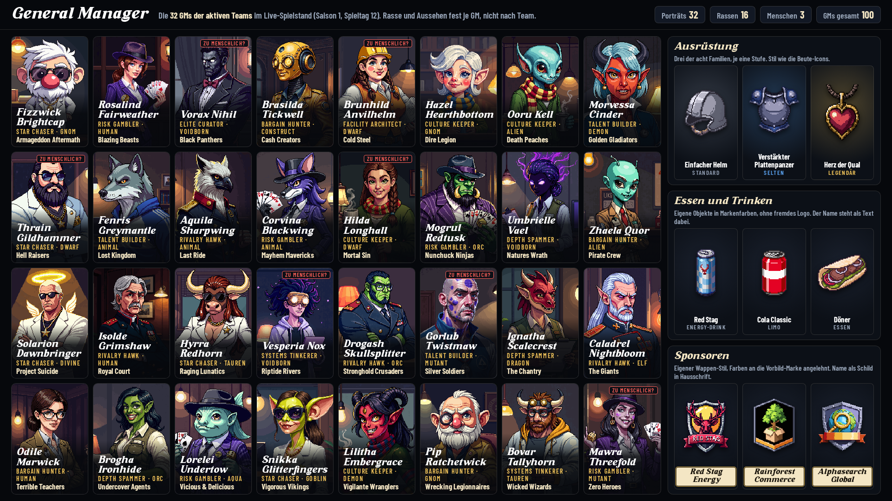

# GM-Porträts und Icon-Probe (22.11.)

Chris, 22.11., wörtlich: „die portraits gefallen mir sehr kannst du die von den aktiven teams die gerade drin sind alle
einmal bauen? und nicht passend zum team bauen sondern wir hatten doch 100 oder sogar 200 verschiedene in der datenbank
irgendwo drin? … wenn nicht bitte erstell mal genug GMs dass man auch rotieren kann da dürfen manche auch ähnlich
zueinander sein … aber aus allen möglichen rassen und vorlieben etc / ich hätte gerne icons für die Ausrüstung,
Essen/trinken, können wir auch logos für die sponsoren auf die art generieren mit dem passenden namen die wir da haben?
bitte mal checken und mir zeigen“. Dazu am selben Tag: „Achte bei den GMs darauf, dass die wirklich nicht nur wie Menschen
aussehen“ und zu den Sponsoren: „du sollst für die Sponsoren Logos n eigenen Stil finden auch wenn die Marken sehr an echte
angelehnt sind. Du darfst dich auch anlehnen.“

**Zum Ansehen:** `public/mockups/gm-galerie-22-11.html` (alle 32 Porträts und die neun Probe-Icons auf einer Seite).
Aufnahmen: `docs/design/gm-portraets-22-11/galerie-1920.png`, `galerie-2560.png`, `galerie-1710.png`.

## 1. Befund: die GM-Datenbank

- Es gibt **100 GM-Profile**, nicht 200: `TEAM_GENERAL_MANAGER_PROFILES` in `lib/foundation/team-general-managers.ts`,
  gebaut aus **10 Archetypen × 10 Varianten** (`gmId = gm-<archetyp>-<01..10>`). Die 200 sind die Sponsoren-Dachmarken
  (`lib/sponsor/sponsor-brand-parents.ts`).
- **Bis 22.11.** teilten sich die zehn Varianten **zehn Namen** (Ada Vale, Noah Crest, Mara Voss, Ivo Kade, Nia Solen,
  Bren Vale, Tessa Rune, Jaro Finch, Kira Morrow, Oren Slate); der Archetyp hing als Nachname dran („Ada Vale Bargain
  Hunter“) — dieselbe Person tauchte so zehnmal auf. Das ist behoben, siehe Abschnitt 8.
  Zwei Profile sind für Menschen reserviert (Chris `gm-systems-tinkerer-01`, Franky `gm-risk-gambler-02`).
- **Rasse und Aussehen gab es bisher nicht.** Ein Profil trägt nur Werte (Achsen, Vorlieben, Doktrin).
- Im Live-Spielstand (`live-save`, Stand 22.11. 20:40 UTC; aktiver Spielstand von `user_local`:
  `new-game-1795114260527-nzr0z9`, Saison 1, Spieltag 12) hat jedes der 32 Teams einen eigenen GM, **32 verschiedene
  GM-IDs**, alle `auto_generated`. Gelesen aus `seasonState.teamGeneralManagers`, nichts zurückgeschrieben; die Kopie des
  Abbilds ist gelöscht.

## 2. Aussehen: fest je GM, nicht nach Team

Neu: `data/gm-aussehen.json` (erzeugt von `scripts/gm-aussehen-erzeugen.py`, kein Zufall) und der Lesezugriff
`lib/foundation/gm-aussehen.ts` (`getGmAussehen`, `gmPortraetPfad`, `listGmIdsMitPortraet`). Wächter:
`tests/gm-aussehen.test.ts`. Noch **nicht** in einer Seite der App verbaut; das Bild liegt bereit unter
`public/portraits/gm/<gmId>.png`, `gmPortraetPfad` liefert `null`, solange es fehlt.

| Feld | Woher | Regel |
|---|---|---|
| Rasse | die 18 echten Rassen aus `data/generated/oly-player-stats.json` | Index `(5·Archetyp + 7·Variante) mod 18`: je Archetyp zehn verschiedene Rassen, je Rasse 5 oder 6 GMs. **Menschen: 6 von 100**, bei den 32 aktiven 3 |
| Geschlecht | Variantennummer | ungerade weiblich, gerade männlich (Namen in `data/gm-namen.json` passen dazu) |
| Alters-Anmutung, Ausdruck | Varianten-Profil | Prime gefasst, Wild jung und ungestüm, Patient alt und geduldig, Clinical kühl mit Brille, Popular gewinnend, Hardline alt und hart, Agile jung und wach, Builder zupackend, Showcase eitel, Lean hager |
| Kleidung, Beiwerk („Vorlieben“) | Archetyp | Bargain Hunter geflickter Tweed mit Monokel · Talent Builder Trainingsjacke mit Pfeife · Star Chaser weißer Anzug, Goldkette, Sonnenbrille · Depth Spammer Weste mit Klemmbrett · Elite Curator Samtjackett, weiße Handschuhe · Facility Architect Helm, Warnweste, Baupläne · Risk Gambler lila Nadelstreifen, Hut, Karten · Culture Keeper Strickjacke, Vereinsschal, Becher · Rivalry Hawk Uniformmantel mit Orden · Systems Tinkerer Laborkittel, Schutzbrille, Tablet |
| Animal | Archetyp | Fuchs, Wolf, Löwe, Bär, Panther, Dachs, Rabe, Eule, Falke, Waschbär |

Die Rassenmerkmale stehen im Prompt **vorn und ausführlich** (Hautfarbe, Hörner, Hauer, Schuppen, Fell, Metallkopf),
die Kleidung danach. Ähnliche GMs gibt es absichtlich: zehn Archetypen teilen sich je ein Kostüm, 18 Rassen je eine
Grundbeschreibung.

## 3. Bestellung und Kosten

Skript `scripts/pixellab-gm-portraets.py`: `/create-image-pixflux`, je Bild **ein POST ohne Wiederholung** (bewusst nicht
über `scripts/lib/pixellab_api.py`, das bei 5xx selbst wiederholt), unter `flock /tmp/pixellab-bestell.lock`, Reserve 150
im Skript geprüft. Stil-Baustein wie `public/portraits/vorstand` (192×224, Büro mit warmem Lampenlicht).

| Posten | Bilder | Größe | Generationen | Konto vorher → nachher |
|---|---:|---|---:|---|
| GM-Porträts, Stilprobe (Tauren, Voidborn, Wolf) | 3 | 192×224 | 3,0 | 303,54 → 300,54 |
| GM-Porträts, Rest der aktiven Teams | 29 | 192×224 | 29,0 | 300,54 → 271,54 |
| Icons Ausrüstung | 3 | 64×64 | 3,0 | 271,54 → 268,54 |
| Icons Essen/Trinken | 3 | 64×64 | 3,0 | 268,54 → 265,54 |
| Sponsor-Wappen | 3 | 96×96 | 3,0 | 265,54 → 262,54 |
| **Summe** | **41** | | **41,0** | **303,54 → 262,54** |

Schätzung vorher: 41 (32 + 9), Rahmen 45. Jedes Bild kostete laut `usage.generations` genau 1,0. Kein POST wurde
wiederholt, kein Bild nachbestellt. Reserve 150 unberührt; über der Reserve bleiben 112,5. Herkunft je Bild mit Prompt,
Saat und Kontostand: `public/portraits/gm/quellen.json`, `public/sprites/ausruestung/quellen.json`,
`public/sprites/verpflegung/quellen.json`, `public/sprites/sponsoren/quellen.json`.

## 4. Ergebnis der Porträts, selbst angesehen

32 von 32 sind im Stil der Vorstands-Porträts angekommen. Eindeutig nicht-menschlich und gut: Gnom, Construct, Alien,
Demon, Animal (Wolf, Falke, Fuchs), Orc, Divine, Tauren, Dragon, Elf, Aqua, Goblin.

**Nicht nachbestellt, zur Entscheidung markiert** (in der Galerie mit „zu menschlich?“, in `quellen.json` Feld `pruefen`):

| GM | Team | Rasse | Was stört |
|---|---|---|---|
| `gm-elite-curator-08` | Black Panthers | Voidborn | grauhäutiger Mensch im Smoking (erster Prompt; danach verschärft, der zweite Voidborn `gm-depth-spammer-01` ist gelungen) |
| `gm-systems-tinkerer-07` | Riptide Rivers | Voidborn | Mensch mit violettem Haar, die Schutzbrille verdeckt die leuchtenden Augen |
| `gm-talent-builder-10` | Silver Soldiers | Mutant | Mensch mit violetten Flecken |
| `gm-risk-gambler-09` | Zero Heroes | Mutant | Mensch mit violetten Flecken |
| `gm-star-chaser-06` | Hell Raisers | Dwarf | bärtiger Mensch mit Sonnenbrille |
| `gm-culture-keeper-05` | Mortal Sin | Dwarf | Menschenfrau mit Zöpfen |
| `gm-facility-architect-09` | Cold Steel | Dwarf | Menschenfrau mit Bauhelm |

Dazu eine Stilabweichung: `gm-star-chaser-02` (Armageddon Aftermath, Gnom) ist eine Ganzkörper-Figur statt eines
Brustbilds. Zusammen mit den drei echten Menschen wirken damit 10 von 32 menschlich; gewollt wären 3.

Die Prompt-Bausteine für Voidborn, Dwarf, Gnom und Mutant sind in `scripts/gm-aussehen-erzeugen.py` bereits
verschärft (gesichtslose Rauchwolke; spitze Ohren, Runenhaut; Tentakel und drei Augen). Die tatsächlich geschickten
Prompts stehen unverändert in `quellen.json`.

## 5. Icon-Probe

- **Ausrüstung** (`public/sprites/ausruestung/`): Einfacher Helm (Standard), Verstärkter Plattenpanzer (Selten), Herz der
  Qual (Amulett, Legendär). Familien und Stufen aus `zwischen-den-spieltagen-22-11.md` Abschnitt 59. Alle drei Treffer,
  gleicher Stil wie `public/sprites/beute/icon-*`.
- **Essen/Trinken** (`public/sprites/verpflegung/`): Energy-Drink-Dose blau-silber mit kleinem Hirschkopf, rote
  Cola-Dose mit weißem Band, Döner. Eigene Objekte in Markenfarben, kein fremdes Logo. Alle drei Treffer. Schrift auf
  64×64 ist nicht lesbar zu erwarten; der Name steht in der App als Text daneben.
- **Sponsoren** (`public/sprites/sponsoren/`): eigener Wappen-Stil (Schild mit Metallrand, Banner darunter), Farben an
  die Vorbild-Marke angelehnt, Sinnbild aus dem Namen. Red Stag Energy (roter Hirsch vor Sonne, **PixelLab hat „RED
  STAG“ lesbar ins Banner gesetzt**), Rainforest Commerce (Baum aus Versandkarton, Sechseck statt Schild), Alphasearch
  Global (Lupe über Globus, Banner leer). In der Galerie steht der volle Name zusätzlich als Schild in Hausschrift
  darunter, damit er immer stimmt.

**Befund Sponsoren-Katalog:** alle 200 Dachmarken in `lib/sponsor/sponsor-brand-parents.ts` sind **echte oder eng
angelehnte Markennamen** (O.B.I. Baumarkt, Lidl Plus, Siemenswerk AG, Deutsche Bank, Lufthansa Sky, Adidas Sport …).
Erfunden klingende Abwandlungen sind die Ausnahme (Red Stag Energy, Rainforest Commerce, Alphasearch Global, Teslara
Motors, Metaworld Social, Flixnet Media, Golden Arches, Cola Classic, Apple Core). Eigene Fantasie-Sponsoren gibt es
keine. Nach Chris' Klarstellung ist der Weg: eigener Wappen-Stil, Anlehnung in Farbe und Idee, **keine Kopie** des
Originallogos.

## 6. Vorschlag für den Rest (nichts davon bestellt)

| Paket | Umfang | Generationen (ein Bild = 1,0) | Anmerkung |
|---|---:|---:|---|
| Übrige GMs | 68 | 68, mit Ersatz für Fehlgriffe rund 75 | danach kann jeder Vorstandswechsel ein fertiges Bild ziehen |
| Ersatz für die 8 markierten | 8 | 8 | nur mit Chris' Ja |
| Ausrüstung, voller Satz | 91 (Sparweg 61) | 61 bis 105 | Schätzung aus Abschnitt 59; drei Familien-Icons sind jetzt da |
| Essen/Trinken | 22 Einzelartikel + rund 20 Partner-Getränke | rund 45 | drei sind da |
| Sponsor-Wappen | 200 Dachmarken | 200 | passt **nicht** ins Guthaben; siehe Frage 3 |

Über der Reserve liegen 112,5 Generationen. Die übrigen 68 GMs passen (es blieben rund 40), aber **nicht zusammen** mit
dem Ausrüstungs-Satz. Empfehlung: GMs erst bei Bedarf bestellen (ein neuer GM kommt nur bei einer Entlassung ins Spiel,
dann ein Bild), das Guthaben zuerst in Ausrüstung (Sparweg 61) und Essen/Trinken stecken. Sponsoren nur für die Marken,
die im Spielstand tatsächlich unter Vertrag oder im Angebot stehen (32 Verträge, bis 160 Angebote), sonst Wappen aus CSS
mit dem Namen.

## 7. Offene Fragen an Chris

1. **Die 8 markierten Porträts** (7 zu menschlich, 1 Ganzkörper): mit den schärferen Prompts neu bestellen (8
   Generationen) oder so lassen?
2. **Rest-GMs:** alle 68 jetzt (rund 75) oder je Bedarf beim GM-Wechsel?
3. **Sponsor-Wappen:** nur für aktive Verträge (32) bestellen und den Rest als CSS-Wappen mit Namen, oder alle 200 über
   mehrere Monate? Und: Name im Bild (klappt bei kurzen Namen wie „RED STAG“, bei langen unsicher) oder immer als Schild
   in Hausschrift darunter (immer richtig geschrieben)?
4. **Wo sollen die GM-Porträts erscheinen?** Vorschlag: Team-Seite (Kader & Teams), Vorstands-/Budget-Gespräch und Inbox
   bei GM-Wechsel. Das wäre ein eigener Bau nach Mockup.
5. **Chris und Franky** haben reservierte GM-Profile (`gm-systems-tinkerer-01`, `gm-risk-gambler-02`); die Formel gibt
   ihnen Dwarf und Demon. Sollen die beiden ein eigenes, selbst gewähltes Porträt bekommen statt des errechneten?

## 8. Eindeutige GMs und Rassennamen (Chris, 22.11.)

Wörtlich: „nenn die Leerengeborenen dann auch wie die Rasse Voidborn bei uns auch heißt damit das konsistent ist. Pass nur
auf, Mara Voss hab ich z. B. 2x gesehen, prüfe dass KEIN GM 2x vorkommt! jeder GM darf es nur 1x geben und kein Team darf
einen 2x haben, die sind EINZIGARTIG, also wenn was doppelt ist muss ein Team den GM austauschen.“

- **Rassennamen wie im Spiel:** `data/gm-aussehen.json` führt nur noch `rasse` (Human, Orc, Mutant, Elf, Lizard, Gnom, Alien,
  Plant, Construct, Dwarf, Divine, Tauren, Demon, Aqua, Voidborn, Animal, Dragon, Goblin); das Feld `rasseDe` ist weg, Galerie
  und Doku nennen dieselben Namen. Ein Test gleicht die Rassen mit `data/generated/oly-player-stats.json` ab.
- **100 eindeutige Namen:** `data/gm-namen.json` (gmId → Vor- und Nachname, ohne Archetyp-Suffix, passend zu Rasse und
  Geschlecht, auch die Vornamen sind alle verschieden). `buildProfile` in `lib/foundation/team-general-managers.ts` liest sie,
  das Erzeuger-Skript ebenfalls. Chris und Franky heißen weiter so. Die gmIds und damit die Porträt-Pfade sind unverändert.
  Beispiele: Odile Marwick (Human, Bargain Hunter), Vorax Nihil (Voidborn, Elite Curator), Thrain Gildhammer (Dwarf, Star
  Chaser), Corvina Blackwing (Animal, Risk Gambler).
- **Im Spielstand steht nur die gmId** (`seasonState.teamGeneralManagers[teamId].gmId`), der Name wird beim Anzeigen aus dem
  Profil gelesen. Eine Lade-Migration für Namen ist deshalb nicht nötig; alte Spielstände zeigen die neuen Namen sofort.
- **Einzigartigkeit im Code:** `buildTeamGeneralManagerAssignments` läuft bei jedem Laden (`withNormalizedTeamGeneralManagers`),
  Spielstart, Saisonwechsel und Board-Ersetzung und vergibt jeden GM höchstens einmal: behalten wird zuerst von menschlichen
  Teams, dann in Listenreihenfolge; ein Team mit schon vergebenem GM bekommt deterministisch einen freien, bevorzugt vom
  selben Archetyp (`previousGmId` hält den alten fest, die Team-Seite erzählt das als GM-Wechsel); sind alle 98 KI-Profile
  vergeben, werden vor einem Duplikat erst die reservierten freien Profile genommen. Wächter: `tests/gm-eindeutig.test.ts`
  (100 Namen und Vornamen eindeutig, Rassen gegen den Spielbestand, 80 Saaten mit 32 und 40 Teams, acht Saisons mit
  Board-Ersetzungen, Altstand mit Duplikat).
- **Live-Spielstand geprüft (22.11.):** alle sechs Spielstände im `live-save`-Abbild haben 32 Teams mit 32 verschiedenen GM-IDs,
  **keine Duplikate**. „Mara Voss 2x“ war derselbe Vorname bei zwei verschiedenen GM-IDs (gm-talent-builder-03 und
  gm-rivalry-hawk-03), also ein Namensproblem, kein Zuweisungsfehler. Ein Postfach-Hinweis beim Austausch ist nicht gebaut;
  die Team-Seite zeigt den Wechsel über `previousGmId`.
