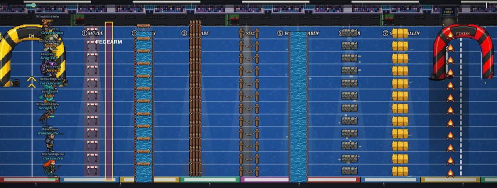
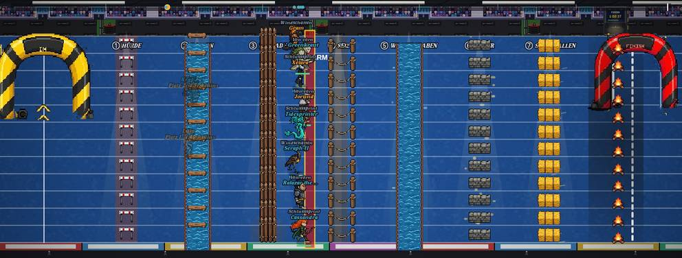
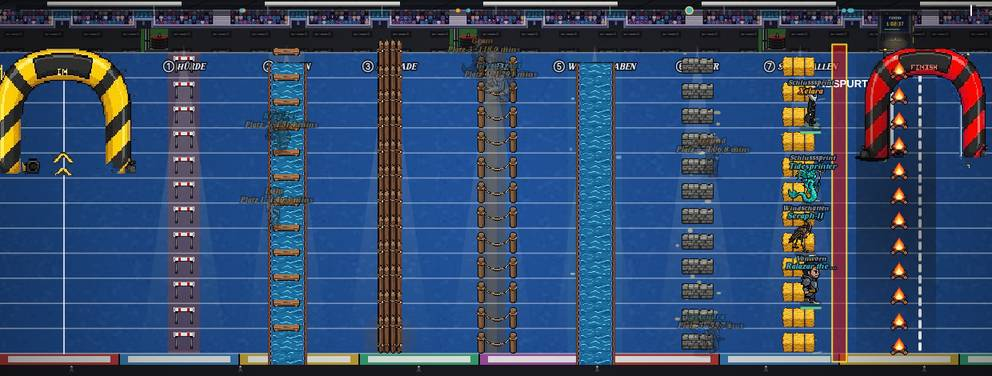
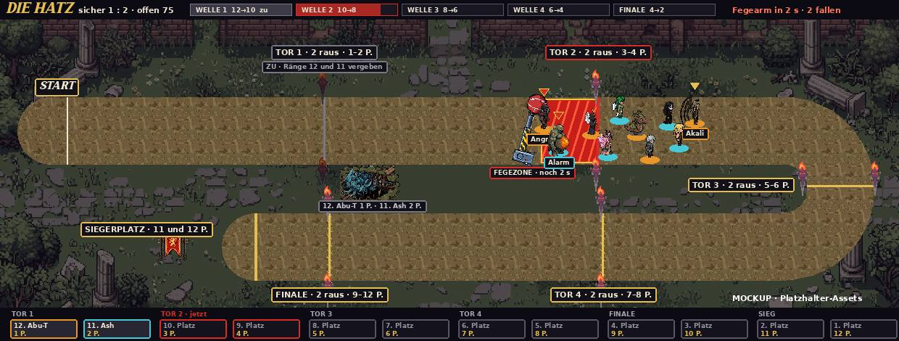
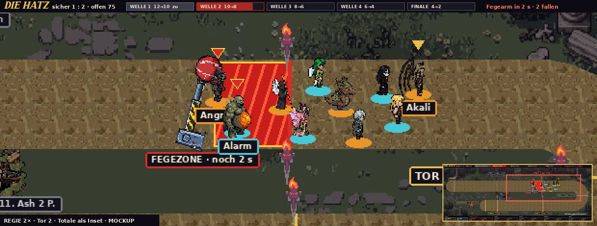

# Die Hatz: eigenes Areal und sichtbare Ausscheide-Punkte (17.11.)

Anlass, Chris am 17.11., wörtlich: „die hatz benötigt noch ein eigenes areal wo sie stattfindet und es
sollte auf dem weg klar sein WO die punkte sind wo spieler ausscheiden, das bitte optisch komplett neu
bauen -> frag fable“.

**Dieses Dokument ist ein Konzept.** Kein Code geändert, nichts bestellt, nichts committet. Die
Ist-Bilder stammen vom 17.11. aus `origin/main` (`250bc494`), die Mockups sind Skizzen aus vorhandenen
Assets (Platzhalter, kein Endbild). Schwesterdokument: `hyrox-optik-konzept-17-11.md`.

## 0. Kurzfassung

- **Ist:** Die Hatz läuft auf der Zwölf-Bahnen-Tartanbahn des klassischen Spurts (`kurs.jpg`). Die
  sieben Hindernisse im Bild haben in der Hatz **keine Funktion**. Entschieden wird an **fünf festen
  Stellen** der Strecke, die heute nicht markiert sind.
- **Kernbefund:** Der Motor kennt bereits feste Ausscheide-Stellen (18 / 37 / 55 / 74 / 92 % der
  Strecke) und feste Punkte je Stelle (1–2, 3–4, 5–6, 7–8, 9–12). Das Konzept macht daraus **fünf
  Tore** auf einem eigenen Weg. Es muss nichts an der Wertung erfunden werden.
- **Vorschlag:** ein eigenes Areal „Hatzgrund“ (verfallener Jagdgrund bei Dämmerung), fester U-Kurs
  mit fünf Toren, Fegezone mit Vorwarnung vor dem aktiven Tor, Rangband mit zwölf Punktefeldern.

  | Variante | Inhalt | PixelLab | Aufwand |
  |---|---|---:|---|
  | **A** konservativ | gerade Bahn bleibt, fünf Torlinien statt sieben Hindernisse, Rangband | 0–13 Gen. | 1 Sitzung |
  | **B** eigene Arena | Hatzgrund 792×300, U-Kurs, fünf Tore, Fegezone, Rangband, feste Totale | **56 Gen. Kern**, höchstens 97 | 2 Sitzungen |
  | **C** Arena plus Regie | B, dazu 2×-Regieschnitt auf das aktive Tor, Inset, Verfolger-Walze | B + 15 Gen. | B plus 1 Sitzung |

- **Empfehlung: B, C als zweite PR.** B-Kern passt mit 56 Gen. in die 65 Gen., die neben den
  geplanten Töpfen frei sind. Gesamtobergrenze Hatz **112 Gen.** (unter den erlaubten 150).
- **Wertung bleibt unberührt.** `GESAMT e80babacb68c (75 Eintraege)`, Hatz-Saaten 1 / 7 / 42 =
  `9f029aa1b41a` / `6c0dd765489a` / `e550ef44deb8` (nachgemessen 17.11. auf `250bc494`).

## 1. Ist-Zustand

### 1.1 Regeln und Mechanik (Motor `public/mockups/battle-mode.engine.js`)

| Baustein | Fundstelle | Was er tut |
|---|---|---|
| Schalter | `BAHN_FLAGS.spurtFormat==="hatz"`, `bahnHatzAktiv` | nur Spurt; gewählt aus der Saat (ein Drittel der Spurts) |
| Wellenplan | `baueHatz()` → `HATZ_WELLEN` (`{welle, finale, ende, rausIds, revealed}`) | **alles wird beim Bau entschieden**, deterministisch aus der Saat |
| Wellennote | `hatzWelleScore(u, finale)`, `HATZ_W`, `HATZ_W_FINALE`, `HATZ_RAUSCHEN_AKTUELL` | sechs Würfe je Läufer und Welle: Antritt (Finale: Endtempo), Technik, Wendigkeit, Wucht, Robust, Stehen |
| Takt | `HATZ_WELLEN_DAUER=12`, `HATZ_NEUORDNUNG_DAUER=3` | 12 Sim-s Welle, 3 Sim-s Neuordnung |
| Ablauf | `stepSpurtHatz(dt)` | deckt bei `rennT >= w.ende` die Welle auf: `u.raus=true`, `u.fertig=u.hatzRang` |
| Position | `stepSpurtHatz`, unterer Teil | `u.pos = ((welle + frac) / Wellen) * 0,92 + Jitter aus der ID` (reine Anzeige) |
| Fegearm | `zeichneHatzUeberlagerung()` | roter Balken mit Schrift „FEGEARM“ / „ENDSPURT“ |
| Punkte | `bahnRangliste()` → `bahnTeamstand()` („Punkte nach Rang“) | Rang 1 = N Punkte, letzter Rang = 1 Punkt; Teamstand = Summe |

Dokument dazu: `spurt-format-die-hatz-08-11.md`.

### 1.2 Wann und wo scheidet wer aus, und wie viele Punkte gibt es

Bei zwölf Läufern (sechs je Team, 78 Punkte im Topf). `Tor n` ist mein Name für die Stelle; im Motor
ist es `welleZielPos = (welle+1)/5 * 0,92`.

| Welle | Aktive | Sim-Zeit Ende | Stelle auf dem Weg (`pos`) | Wer fällt | Ränge | Punkte |
|---|---|---:|---:|---|---|---|
| 1 | 12 → 10 | 12 s | 0,184 | die zwei schwächsten Wellennoten | 12, 11 | **1, 2** |
| 2 | 10 → 8 | 27 s | 0,368 | ebenso | 10, 9 | **3, 4** |
| 3 | 8 → 6 | 42 s | 0,552 | ebenso | 8, 7 | **5, 6** |
| 4 | 6 → 4 | 57 s | 0,736 | ebenso | 6, 5 | **7, 8** |
| Finale | 4 → 2 | 72 s | 0,920 | die unteren zwei; die oberen zwei sind Sieger | 4, 3 und 2, 1 | **9, 10** und **11, 12** |

Folgerungen, auf denen das Konzept steht:

1. **Punkte hängen nur am Tor.** Wer an Tor 3 fällt, hat 5 oder 6 Punkte, egal wie. Jedes Tor hat
   also ein festes Preisschild.
2. **Die Stellen liegen fest**, in gleichen Abständen. Ausgeschiedene bleiben dort liegen
   (`u.pos` wird nicht mehr geschrieben).
3. **Alle Aktiven haben dieselbe Position.** `u.pos` unterscheidet sich nur um einen Jitter aus der
   Läufer-ID (höchstens 0,015). Man sieht bis zum Aufdecken nicht, wer hinten liegt.
4. **Der vorläufige Teamstand ist während der Welle ohne Aussage.** `bahnRangliste()` ordnet
   Unfertige nach `u.pos`, also nach dem ID-Jitter. Das „34 · 44 vorläufig“ in Chris' Bild ist
   keine Wertung.
5. **Der Fegearm jagt nicht.** Der Balken steht bei `welleZielPos − 0,06` und rückt um 0,06 vor; das
   Feld läuft von hinten auf ihn zu. Gezeichnet ist also ein Tor, beschriftet ist ein Verfolger.
6. **Die sieben Hindernisse sind Kulisse.** Hürde, Balken, Palisade, Seil, Wassergraben, Mauer,
   Strohballen gehören zum klassischen Spurt; die Hatz würfelt ihre „zwei Hürden, ein Rempel“
   abstrakt in der Wellennote.
7. **Tempo.** Im Headless-Lauf lag bei 1× nach 74 s Wandzeit erst das Ende von Welle 1 an, bei 4×
   nach 150 s der Endspurt. Das ist eine Messung im Testbrowser, kein Beweis für das echte Spiel;
   stimmt sie, steht je Welle etwa eine Minute lang ein unverändertes Bild. Vor dem Bau nachmessen.

### 1.3 Ist-Bilder (Leinwand 1240×470, Demo-Kader)

| Bild | Was man sieht |
|---|---|
|  | Welle 1: zwölf Läufer als senkrechter Stapel, Namensschilder überlappen, Balken „FEGEARM“ **vor** dem Feld |
|  | Welle 3: Ausgeschiedene liegen abgedunkelt an 18 % und 37 %, ohne Rang und ohne Punkte |
|  | Finale: vier Läufer vor dem Balken „ENDSPURT“, das Ziel ist ein moderner Event-Bogen |

Nachstellen: `node scripts/screenshot-kulisse.mjs spurt - 10000 /tmp/hatz.png --format=hatz`.

## 2. Diagnose: warum die Hatz neben I-Spy, TDM, Battlefield und der HYROX-Arena alt wirkt

| # | Punkt | Hatz heute | Neue Arenen |
|---|---|---|---|
| 1 | **Kein eigener Ort** | dieselbe blaue Tartanbahn wie der klassische Spurt, moderne Tribüne, aufblasbare Bögen | ein gemalter, leerer Ort als Bild (Krypta, Trainingshof, Ruine) |
| 2 | **Falsche Requisiten** | sieben Hindernisspalten ohne Funktion füllen das Bild | jedes Objekt hat eine Aufgabe |
| 3 | **Entscheidungsstellen unsichtbar** | fünf Stellen, keine Marke, kein Preisschild | Truhen, Punkte, Stationen sind als Orte lesbar |
| 4 | **Gefahr nicht lesbar** | 18 px breiter Balken, Systemschrift; keine Zone, kein Countdown, kein „wer ist dran“ | Verweilbalken, Marker in Hausoptik |
| 5 | **Feld als Stapel** | zwölf Bahnen, alle auf gleicher Höhe, Schilder übereinander | Figuren verteilt, ruhiger Grund |
| 6 | **Stand ohne Aussage** | „vorläufig“ aus ID-Jitter, Rang der Gefallenen nirgends im Bild | gezeigt = gebucht |
| 7 | **Leerlauf** | lange Strecken ohne Ereignis, dann ein Schlag | laufend kleine Ereignisse |
| 8 | **Stil** | gesättigte Vollfläche, kein Rand, Draufsicht ohne Rückwand; Fackel und Erde im Bestand sind LPC, nicht PixelLab | gedeckte Textur, Rückwand, gerahmter Rand, nur PixelLab |

Was bleiben soll: das Format (Wellen, zwei raus), der Takt, die Liegepose der Gefallenen, die Regel,
dass alles Sichtbare Anzeige ist.

## 3. Konzept

### 3.1 Leitidee: fünf Tore, fünf Preisschilder

Die Hatz wird als **Weg mit fünf Toren** gezeichnet. Jedes Tor ist genau eine Ausscheide-Stelle des
Motors. Am Ende jeder Welle fegt der Arm die Zone vor dem Tor leer: Wer noch darin steht, fällt.

**Areal „Hatzgrund“:** verfallener Jagdgrund der Figurenwelt bei Dämmerung. Rückwand oben
(Ruinenmauer mit steinernen Rängen, Banner, Feuerschalen), sonst offener, dunkler Boden mit Moos,
Wurzeln und Nebel, Mauerreste und Gestrüpp als Rand. Bewusst **draußen und verwildert**, damit es
sich vom gepflasterten HYROX-Trainingshof unterscheidet. Bauart wie I-Spy und HYROX-Arena: „Rahmen
statt Material“, im Bild ist kein Weg, kein Tor, keine Figur.

**Was auf dem Weg markiert ist:**

| Element | Darstellung | Quelle im Motor |
|---|---|---|
| **Tor (Ausscheide-Stelle)** | zwei Pfosten mit Feuerschale, Schwellenlinie quer über den Weg; Schild „TOR 2 · 2 raus · 3–4 P.“ | `welleZielPos`, Rangpunkte |
| **Torzustand** | offen: Gold, Feuer brennt · aktiv: Rot, pulsiert · zu: Grau, Feuer aus, „Ränge 12 und 11 vergeben“ | `w.revealed`, `hatzAktuelleWelle()` |
| **Fegezone (Gefahr)** | schraffiertes Feld vor dem aktiven Tor (die 0,06 Streckenanteile, die der Arm heute fährt) | `armPos` |
| **Vorwarnung** | ab 60 % der Welle glimmt die Zone, ab 80 % ist sie rot mit Countdown „noch 2 s“; der Arm fährt sichtbar an | `frac` |
| **Wer ist dran** | rote Marke über den zwei Letzten des Pulks, ab 60 % der Welle | `w.rausIds` (siehe 3.2) |
| **Gefallene** | bleiben in der Fangbucht neben ihrem Tor liegen, Schild „12. Name · 1 P.“ bis zum Rennende | `u.raus`, `u.hatzRang` |
| **Sieg** | Siegerplatz hinter Tor 5 mit Banner, „11 und 12 P.“ | Ränge 2 und 1 |
| **Welle-Fortschritt** | Leiste oben: fünf Segmente „WELLE 2 · 10→8“, das aktive füllt sich, daneben „Fegearm in 2 s · 2 fallen“ | `HATZ_WELLEN`, `rennT` |
| **Rangband** | unten zwölf Felder, links 1 P. bis rechts 12 P., gruppiert nach Tor; ein Feld füllt sich mit Name und Teamfarbe, sobald der Rang vergeben ist | `rennFertig` |
| **Teamstand** | „sicher 1 : 2 · offen 75“: nur gebuchte Punkte, dazu der Rest im Topf | Summe der vergebenen Ränge |

Die Neuordnung (3 Sim-s) bekommt ein Bild: Das Tor schließt, die Gefallenen werden in die Bucht
gefegt, das nächste Tor zündet, der Pulk stellt sich neu auf.

### 3.2 Der Pulk: sichtbar machen, wer hinten liegt

Heute stehen alle auf einer Linie. Neu wird der Pulk **in der Zeichnung** gestaffelt: Jeder Aktive
bekommt einen Versatz längs des Wegs (höchstens ±0,04), der bis zum Wellenende auf die gebuchte
Reihenfolge zuläuft. Bis 60 % der Welle wechseln die Plätze sichtbar (deterministisch aus ID und
Welle, ohne `rr()`), danach rücken die zwei aus `w.rausIds` ans Ende und tragen die rote Marke.
Am Wellenende sind die Vorderen durch das Tor, die zwei Letzten stehen in der Fegezone.

Damit gilt „gezeigt = gebucht“: Die Marke lügt nie, weil sie aus dem fertigen Wellenplan kommt.
Der Preis: Die letzten 40 % einer Welle sind keine Überraschung mehr, sondern ein Countdown. Das
ist gewollt (Vorwarnung), die Frist ist eine Konstante.

Gezeichnet wird in Dreierreihen statt auf zwölf Bahnen; Namensschilder nur für Führenden, die zwei
Gefährdeten und den gewählten Läufer.

### 3.3 Variante A: konservativ (gerade Bahn bleibt)

`kurs.jpg` und die Kamera bleiben. Die sieben Hindernisspalten werden in der Hatz nicht gezeichnet,
dafür fünf Torlinien mit Schild, Fegezone, Pulk-Staffelung, Wellenleiste und Rangband. Der Balken
wird durch `falle_fegearm` ersetzt (bezahlt, 0 Gen.).

- **Gewinn:** Chris' zweiter Satz („klar, wo die Punkte sind“) ist erfüllt. Diagnose 2–6 erledigt.
- **Bleibt offen:** der erste Satz („eigenes Areal“). Blaue Bahn, moderne Tribüne, Stapelbild
  (Diagnose 1, 5, 8). `falle_fegearm` ist ein gelb-schwarzer Takeshi-Arm und passt nicht zur
  Figurenwelt.
- **Kosten:** 0 Gen., mit einem dunklen Arm 13 Gen.

### 3.4 Variante B: eigene Arena „Hatzgrund“, feste Totale



*Skizze, Welle 2 kurz vor dem Fegen. Platzhalter: I-Spy-Kulisse „ruinengarten“ abgedunkelt als
Areal, Kachel `boden_pfad` als Weg, LPC-Fackeln als Torpfosten, `falle_fegearm`, `grube_gross`,
`deko_banner`, Figuren aus dem Bestand. Schilder, Zone, Leiste und Rangband sind die geplante
Canvas-Ebene.*

```
1240 x 470, feste Kamera
+---------------------------------------------------------------------------+
| DIE HATZ  sicher 1:2  [W1 zu][W2 ####-][W3][W4][FINALE]   Fegearm in 2 s   |
| Rueckwand: Ruinenmauer, Raenge, Banner, Feuerschalen                      |
|  START ====== Tor 1 ============ Tor 2 ==================.                |
|              (1-2 P.)   [zone]  (3-4 P.)                  \               |
|               Fangbucht                                    Tor 3 (5-6 P.) |
|                                                           /               |
|  SIEG  <=== Tor 5 ============== Tor 4 =================='                |
|  11/12 P.   (9-12 P.)           (7-8 P.)                                  |
| [1P][2P] [3P][4P] [5P][6P] [7P][8P] [9P][10P] [11P][12P]   Rangband       |
+---------------------------------------------------------------------------+
```

- **Weg als U-Kurs:** oben nach Osten, Kehre rechts, unten nach Westen. Gut 2000 px statt 1100 px
  Weglänge, also doppelte Bewegung im Bild. Die Tore liegen paarweise übereinander (1 über 5,
  2 über 4), Tor 3 in der Kehre. Der Bestand hat alle vier Blickrichtungen. Links unten bleibt
  Platz für den Siegerplatz.
- **Abbildung:** eine Funktion `hatzXY(pos, reihe)` nach dem Muster `hallenXY()`. `u.pos` bleibt,
  wie es ist.
- **Weg und Zonen** zeichnet der Motor als Texturebene über dem Areal (Kachel `boden_pfad`,
  PixelLab, 0 Gen.). Fällt die Rückwand anders aus als geplant, verschiebt sich eine Konstante.
- **Fegearm:** neuer dunkler Arm (Dornenbalken an Eisenachse), vom Motor am aktiven Tor gedreht.
- **Kamera:** keine. Alle zwölf, alle fünf Tore und alle Gefallenen sind immer im Bild.
- **Gewinn:** beide Sätze von Chris erfüllt, alle acht Diagnosepunkte erledigt, dieselbe Bauart wie
  I-Spy und HYROX-Arena.
- **Preis:** Figuren etwa 48 px wie in I-Spy.

### 3.5 Variante C: Arena plus Regie



*Skizze: derselbe Stand als Regieschnitt 2×, Totale als Inset.*

B plus eine Regie-Ebene nach dem HYROX-Muster (Chris' Entscheid dort: Totale als Grundzustand,
ganzzahlig 2×):

- **Ein Anlass, ein Schnitt:** in den letzten 20 % jeder Welle 2× auf das aktive Tor, nach dem
  Fegen zurück in die Totale. Höchstens fünf Schnitte je Rennen, im Finale bis zum Sieg.
- **Inset** unten rechts zeigt die Totale mit Ausschnittsrahmen. Läufer-Wahl per Klick auf ein
  Feld des Rangbands oder einen Punkt der Wellenleiste.
- **Verfolger sichtbar:** eine Dornenwalze rollt hinter dem Pulk her und schiebt die Fegezone vor
  sich. Sie ist ein Requisit, keine Kreatur.
- **Kamera-Umschalter** Totale / Regie / Auto in der Leiste.

### 3.6 Empfehlung

**B bauen, C als zweite PR.** A kostet nichts, lässt aber das eigene Areal weg, also die Hälfte
des Auftrags. B erfüllt beides für 56 Gen. C ist reine Anzeige obendrauf und hängt an Bauteilen
(2×-Schnitt, Inset), die HYROX C ohnehin liefert; die Hatz sollte sie übernehmen, nicht doppelt bauen.

## 4. Assets und Kosten

### 4.1 Wiederverwendung (0 Gen.)

| Bild | Einsatz | Anmerkung |
|---|---|---|
| `boden_pfad` | Wegbelag (Kachel, abgedunkelt) | PixelLab |
| `deko_banner` | Siegerplatz | PixelLab |
| `deko_pranger` | Deko an der Fangbucht | PixelLab |
| `grube_gross`, `grube_mittel` | Fangbucht neben den Toren | PixelLab; für Mini-DM vorgemerkt, Mitnutzung kostet nichts |
| `falle_fegearm` | nur Rückfall, falls der dunkle Arm misslingt | Takeshi-Optik |
| HYROX-Bögen (Eisentor mit Feuerschalen, Topf HYROX C1) | Start und Siegerplatz, sobald bestellt | sonst Canvas-Linie und Schild |
| gekaufte VFX (Staub, Funken) | Schlag des Arms, Torschluss | Bestand aus #1551 |

**Nicht verwenden:** `fackel` und `boden_erde` (LPC, widerspricht „nur PixelLab“), `kurs.jpg`,
`spurt_bogen_in` / `spurt_bogen_finish` (moderne Event-Bögen).

### 4.2 Bestellungen

| # | Posten | Format | Prompt-Richtung | Gen. | Variante |
|---|---|---|---|---:|---|
| 1 | Areal „Hatzgrund“ | 792×300 | „top-down view of one single very wide empty overgrown hunting ground at dusk, ruined stone wall with stone spectator tiers, torn banners without text and fire bowls along the top edge only, the whole rest is open flat dark earth with moss, roots and patches of mist, broken walls and thorn bushes at the left and right borders, no path, no gates, no characters, no text, 16-bit RPG top-down map, pixel art“, Saat 11 | 28 | B |
| 2 | Torpfosten mit Feuerschale | 32×64 | „weathered stone gate post with burning iron fire bowl on top, 3/4 top-down view as in a classic top-down RPG, clean single color dark outline“; „Feuer aus“ entsteht durch Abdunkeln plus Canvas-Rauch | 13 | B |
| 3 | Fegearm, dunkel | 96×24 | „long horizontal wooden sweep beam with iron spikes and chains on an iron pivot, top-down, clean single color dark outline“ | 13 | B |
| 4 | VFX `lite` | klein | Glut am Tor, Staubschlag (nur wenn der Bestand nicht trägt) | 2 | B |
| | **B Kern** | | | **56** | |
| 5 | zweiter Versuch Areal | 792×300 | nur wenn Versuch 1 Weg, Figuren oder Text einbrennt | 28 | B Ausbau |
| 6 | Punktestein | 32×48 | Wegstein mit leerer Tafel; ersetzt das Canvas-Schild am Tor | 13 | B Ausbau |
| | **B höchstens** | | | **97** | |
| 7 | Dornenwalze | 48×96 | „heavy wooden roller with iron spikes, top-down“ | 13 | C |
| 8 | VFX `lite` | klein | Walzenstaub, Schweiß | 2 | C |
| | **Hatz gesamt höchstens** | | | **112** | |

### 4.3 Einordnung ins Budget

Stand `offene-punkte-entscheidungen-17-11.md` (Abschnitt 4.4): Guthaben rund 1040 Gen., Reserve 150,
verfügbar 890, verplant 825 (A Batch 2, Climbing, B, C Kern, HYROX C, H2). **Frei: 65 Gen.**

- **B Kern (56) passt in die freien 65**, ohne einen Topf anzufassen.
- **Ausbau (41) und C (15) nur aus frei gewordenen Resten** anderer Töpfe (etwa wenn die
  Climbing-Probe scheitert und 60 Gen. zurückfallen). Sonst entfallen sie; das Canvas-Schild und
  die Totale reichen.
- Regeln wie dort und laut Koordinator: vor jeder Bestellung `/balance` lesen, Kosten aus
  `usage.generations` protokollieren, POST nur einmal, `flock /tmp/pixellab-bestell.lock`,
  Stilprobe zuerst (Posten 1), Herkunft in `quellen.json`. Keine Figur, keine Animation.

## 5. Wertungs-Neutralität

Alles in diesem Konzept ist Zeichnung. Regeln für den Bau:

- **Nicht anfassen:** `baueHatz()`, `hatzWelleScore()`, `HATZ_W*`, `HATZ_RAUSCHEN_AKTUELL`,
  `HATZ_WELLEN_DAUER`, `HATZ_NEUORDNUNG_DAUER`, die Zuweisung von `u.fertig` / `u.raus` /
  `u.hatzRang` und die Zeile, die `u.pos` schreibt.
- **Kein `rr()`** in neuer Zeichnung. Platzwechsel im Pulk und Flackern kommen aus einem Hash über
  Läufer-ID, Welle und Zeit.
- **Keine neuen Felder** an Läuferobjekten und keine an den Einträgen von `HATZ_WELLEN`. Die
  Reihenfolge im Pulk, Bucht-Plätze, Torzustände und die Kamerawahl liegen in einer `WeakMap` oder
  in modulweiten Arrays (Muster `viSchnappschussKF`). Die Reihenfolge innerhalb der zwei Gefallenen
  ergibt sich aus `u.hatzRang`, die der übrigen aus dem Hash; mehr braucht die Anzeige nicht.
- **`u.pos` bleibt.** Der Versatz im Pulk wird erst in `hatzXY()` addiert. So bleibt auch die
  Reihenfolge in `bahnRangliste()` während des Rennens, wie sie ist.
- **Teamstand:** „sicher / offen“ ist eine neue **Anzeige** in der Leiste. `bahnTeamstand()` und der
  Endstand bleiben unverändert.
- **Geometrie:** Die Tore stehen an `welleZielPos`, die Zone ist `0,06` lang. Beides wird gelesen,
  nicht neu festgelegt. Bei weniger als zwölf Läufern gibt es weniger Wellen; die Tore verteilen
  sich dann von selbst gleichmäßig über denselben Weg.
- **Prüfung vor und nach jedem Commit:**

  ```sh
  node scripts/pruefe-wertung-fingerabdruck.mjs
  ```

  Erwartet `GESAMT e80babacb68c (75 Eintraege)`, darin `spiele spurt/hatz 1` = `9f029aa1b41a`,
  `7` = `6c0dd765489a`, `42` = `e550ef44deb8`.

## 6. Bau-Reihenfolge, Risiken, Messkriterien

### 6.1 Reihenfolge

1. **Schritt 0, 0 Gen.:** Tempo nachmessen (1.2, Punkt 7). Canvas-Ebene auf der alten Bahn bauen:
   Tore, Schilder, Fegezone, Pulk-Staffelung, Wellenleiste, Rangband, „sicher / offen“. Das ist
   Variante A und zugleich der Unterbau von B.
2. **Schritt 1, 28 Gen.:** Areal als Stilprobe bestellen. Nur ein Treffer wird eingebaut.
3. **Schritt 2, 28 Gen.:** Torpfosten, dunkler Arm, VFX. `hatzXY()` mit U-Kurs, Kulisseneintrag
   `spurt/hatzgrund` in `battle-mode.kulissen.js` nur für das Format Hatz, Herkunft in `quellen.json`.
4. **Schritt 3:** Test `tests/spurt-hatz-arena.test.ts` (Tore an `welleZielPos`, Weglänge, Rangband
   zeigt genau die Punkte aus `bahnRangliste()`), Sichtprobe mit einem Skript nach dem Muster
   `scripts/screenshot-hyrox-arena.mjs`, Vorher- und Nachher-Bilder.
5. **Schritt 4 (eigene PR):** Variante C, nachdem HYROX C1 den 2×-Schnitt und das Inset gebaut hat.
6. **Danach:** „Kontakt Hatz“ (Runde 5 im Entscheidungsdokument: Sperre in den letzten Metern, ein
   Sturz je Welle) bekommt mit der Fegezone seinen Ort. Die Mechanik ist nicht Teil dieses Konzepts.

Aufwand im Motor: A etwa 200–250 Zeilen, B zusätzlich 200–250, C zusätzlich 150–200.

### 6.2 Risiken

- **R1 – Areal brennt Dinge ein** (Weg, Figuren, Schrift). Gegenmittel: Prompt ohne Weg und Tor,
  höchstens ein zweiter Versuch, sonst läuft B vorerst auf der Canvas-Ebene über `kurs.jpg` weiter.
- **R2 – Enge in der Kehre.** Tor 3 liegt im Bogen; zehn bis acht Figuren müssen dort durch.
  Notfalls die Kehre weiter ziehen oder Tor 3 um wenige Pixel auf die Gerade schieben (nur Zeichnung).
- **R3 – Früh verratene Welle.** Die rote Marke nimmt Spannung. Die Frist (60 %) ist eine
  Konstante und kann auf 80 % gehen.
- **R4 – Langes Stehen.** Stimmt die Tempomessung, hilft auch das neue Bild nur begrenzt. Das wäre
  eine Frage an die Zeitdehnung des Formats, nicht an die Optik, und eine eigene Entscheidung.
- **R5 – Verwechslung mit HYROX.** Beide sind dunkle Außenareale. Gegenmittel: Motiv (Wildnis gegen
  Pflasterhof), Wegform (U gegen Ring), Leitfarbe Rot-Gold gegen die drei Gruppenfarben.
- **R6 – Klassischer Spurt.** Bleibt auf `kurs.jpg` (Chris' Entscheid 1 zu HYROX). Die Hatz darf
  dessen Zeichnung nicht berühren; alles hängt hinter `bahnHatzAktiv`.

### 6.3 Messkriterien

1. Fingerabdruck und die drei Hatz-Einträge unverändert.
2. Jedes Tor trägt Nummer, „2 raus“ und Punkte; die Zahlen stimmen mit `bahnRangliste()` überein (Test).
3. Jeder Gefallene liegt am Tor seiner Welle und trägt Rang und Punkte bis zum Rennende.
4. Die rote Marke steht nie über einem Läufer, der die Welle übersteht (Test über alle Wellen,
   Saaten 1, 7, 42).
5. Vorwarnung mindestens 2 Sim-s vor jedem Fegen sichtbar.
6. „sicher“ plus „offen“ ergibt immer 78 (bei zwölf Läufern); am Ende gleich dem Endstand.
7. Sichtprobe zu fünf Zeitpunkten: keine überlappenden Schilder, alle Aktiven sichtbar, nichts
   liegt auf dem Rangband.
8. Prüfliste aus `hyrox-optik-konzept-17-11.md` Abschnitt 5.2: alle zwölf Punkte Ja.
9. Bestellkosten protokolliert, Summe höchstens 56 (Kern) bzw. 112.

## 7. Offene Fragen an Chris

1. **Fünf Tore auf einem U-Weg** statt Rundkurs mit einem einzigen Tor: einverstanden?
   **Empfehlung: Ja.** Nur so hat jede Ausscheide-Stelle einen eigenen Ort mit eigenem Preisschild,
   und die Gefallenen bleiben als Spur des Rennens liegen.
2. **Die zwei Gefährdeten ab 60 % der Welle rot markieren**, auch wenn die Welle damit früher
   entschieden aussieht: einverstanden? **Empfehlung: Ja.** Das ist die verlangte Vorwarnung, und
   sie zeigt nur, was gebucht ist.
3. **Motiv „Hatzgrund“** (verwilderter Jagdgrund bei Dämmerung, draußen) statt einer zweiten
   Steinarena: einverstanden? **Empfehlung: Ja.** Es grenzt die Hatz klar vom HYROX-Hof ab.
