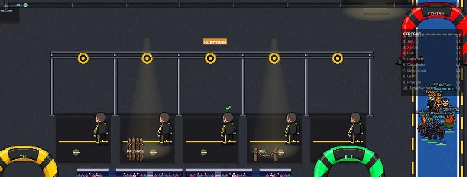
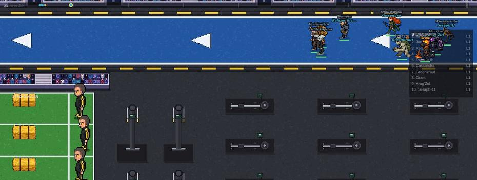
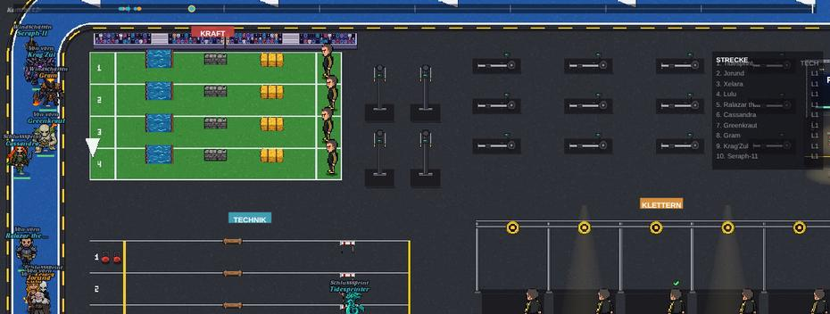
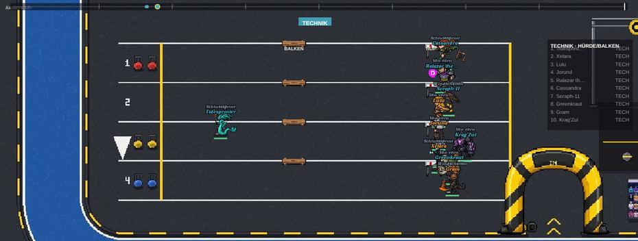
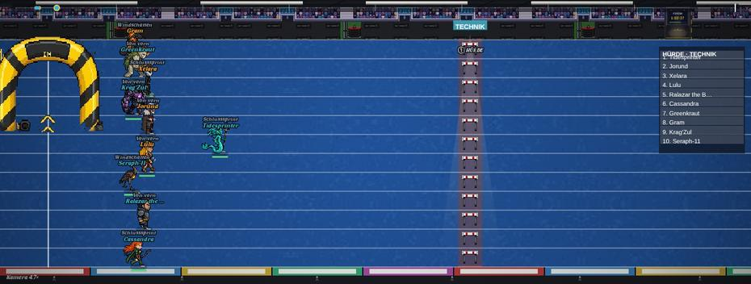
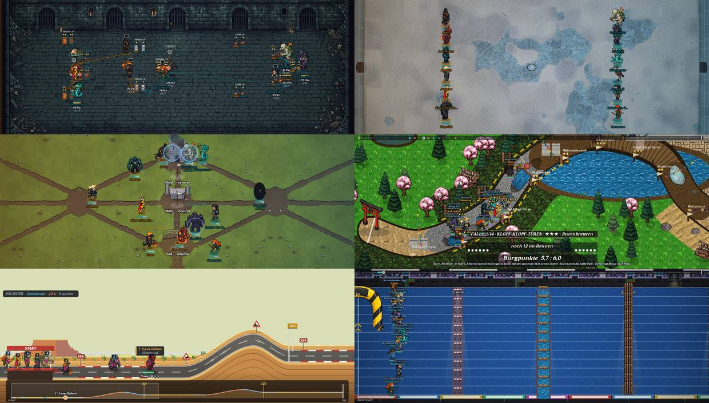
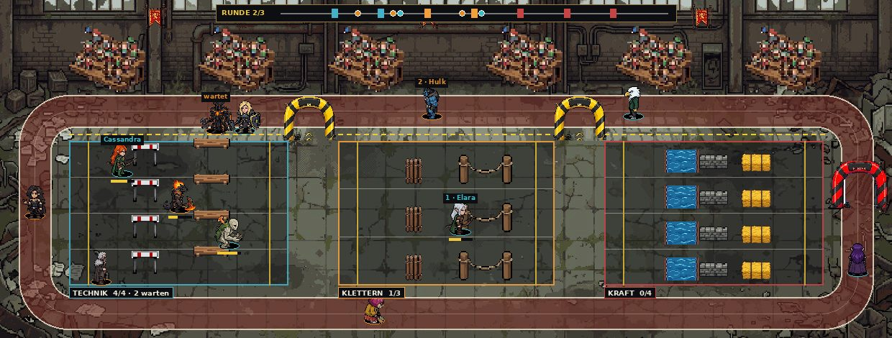
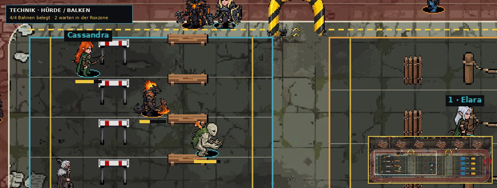

# HYROX: neues optisches Konzept im PixelLab-Stil (17.11.)

Anlass, Chris am 17.11. (Spracheingabe, wörtlich): „Kannst du hyrox nicht besser machen? Das linke mit
der langen Bahn ist einfach outdated im Vergleich zur Arena etc finde ich. Hast du da nicht ein besseres
optisches Konzept oder frag mal Fable. Alle Diszis sollen am Ende den gleichen Pixel lab Stil haben und
die Assets davon! Das ist das Target."

**Dieses Dokument ist ein Konzept.** Kein Code geändert, nichts bestellt, nichts committet. Die
Screenshots sind am 17.11. aus dem Stand `origin/main` (`0c39221f`) entstanden, die Mockups sind
Skizzen aus vorhandenen Assets (Platzhalter, kein Endbild).

## 0. Kurzfassung

- **Ist:** HYROX läuft seit dem 09.11. standardmäßig in der „Hallenrunde" (`hyroxAnsicht:"halle"`):
  eine flache Draufsicht 1680×960 (`public/sprites/arena/hyrox_halle.jpg`), über die eine Nahkamera
  mit stufenlosem Zoom (0,66–3,2×, in den Bildern 1,2–2,0×) schneidet. Die alte gerade Bahn (`hyroxAnsicht:"bahn"`) gibt es nur noch als
  QA-Schalter.
- **Warum es alt wirkt:** flacher, texturloser Asphalt, ein gesättigt blaues Laufband, das je nach
  Schnitt das halbe Bild füllt, keine Wand und keine Tiefe, wechselnder Pixel-Maßstab durch den Zoom,
  Hindernis-Sprites in drei verschiedenen Blickwinkeln, eingebrannte Kampfrichter-Figuren und ein HUD
  in 10-px-Systemschrift. Die neuen Arenen (I-Spy, TDM, Battlefield) sind das Gegenteil: **ein
  ganzes, texturiertes Bild, feste Kamera, Requisiten als eigene Sprites, kleine Marker.**
- **Vorschlag:** HYROX nach dem I-Spy-Muster neu aufbauen. Drei Varianten:

  | Variante | Inhalt | PixelLab-Kosten | Aufwand |
  |---|---|---:|---|
  | **A** Neu einkleiden | gleiche Geometrie und Kamera, neue Böden und Geräte | ~180 Gen. (mit Puffer ~240) | 1–2 Sitzungen |
  | **B** Eine Halle, eine Totale | Halle 792×300 wie I-Spy, Rundkurs um drei Stationsinseln, feste Kamera | ~200 Gen. (mit Puffer ~280) | 2–3 Sitzungen |
  | **C** Halle plus Regie | B, dazu Regieschnitt (ganzzahlig 2×) auf Führende oder gewählten Läufer, Inset, Stau-Anzeige | ~230 Gen. (mit Puffer ~310; optional +80) | B plus 1–2 Sitzungen |

- **Empfehlung: C in zwei Schritten, B ist Schritt 1.** B allein beseitigt schon alles, was Chris
  bemängelt. Der Regie-Teil von C kommt als zweite PR, wenn die Halle steht.
- **Wertung bleibt unberührt.** `hyroxFahrplan`/`HYROX_WEG` sind reine Anzeige. Fingerabdruck
  `GESAMT e80babacb68c` und die sechs HYROX-/Hatz-Einträge müssen vor und nach dem Umbau gleich sein.

## 1. Ist-Zustand

### 1.1 Was der Motor heute zeigt

| Baustein | Fundstelle (`public/mockups/battle-mode.engine.js`) | Zustand |
|---|---|---|
| Ansicht | `BAHN_FLAGS.hyroxAnsicht` (`"halle"` Standard, `"bahn"` QA), `istHyroxHalle()` | Halle ist Standard |
| Hallenbild | `hallenBild`/`hallenDa()`, `public/sprites/arena/hyrox_halle.jpg` (1680×960) | abgeleitet aus `public/szenen/spurt/hyrox.jpg` (Asset-Runde 01./02.11.), Figuren weggestempelt |
| Weg | `baueHyroxWeg()` → `HYROX_WEG`, `hallenXY()`, `HALLE_S` | drei Runden, je ein Ausflug in TECHNIK, KLETTERN, KRAFT |
| Zeitabbildung | `hyroxFahrplan()`, `hyroxVerteileZeit()`, `hyroxZustand()` | rein zeichnerisch, auf `u.hyroxZeit` normiert |
| Stationen | `HYROX_STATIONEN` aus `BA().hindernisse/-Bilder/-Namen`, `HYROX_GRUPPE_JE_STATION` | sieben Hindernisse: Hürde, Balken, Palisade, Seil, Wassergraben, Mauer, Strohballen |
| Kamera | `kameraUpdate()` Hallenzweig, `hyroxCamZiel`, `HYROX_ZONEN`, `hyroxKamT()` | vier Ziele (drei Zonen, Strecke), Schnitt nach Wandzeit |
| Überlagerung | `zeichneHyroxUeberlagerung()`, `zeichneHyroxRangleiste()` | Zonenschilder, Rangleiste rechts |
| Posen | `hyroxTechnikHop`, `hyroxKraftHaltung`, `hyroxLunge` (Kanal `u.lunge` → „angriff") | Bestandsposen, nur Cassandra hat drei eigene HYROX-Posen |

Dokumente dazu: `spurt-format-hyrox-stationen-08-11.md` (Format, Rezept), `spurt-hyrox-nahkamera-08-11.md`
(Kamera, Posen), `spurt-hyrox-routen-design-opus-09-11.md` (Fahrplan und Hallenrunde),
`spurt-stationsduell-sichtbar-10-11.md`.

### 1.2 Screenshots (Leinwand 1240×470, Seed der Demo-Kader)

| Bild | Was man sieht |
|---|---|
|  | Halle, 2,5 s: Feld am rechten Rand, die Bildmitte gehört einer leeren KLETTERN-Zone mit fünf eingebrannten Kampfrichtern |
|  | Halle, 9 s, Ziel „Strecke": **das lange blaue Band** quer durchs Bild, darunter SkiErgs und Rudergeräte, die keine Station sind |
|  | Halle, 18 s, Zoom 1,2×: Läufer am linken Rand übereinandergestapelt, Rangleiste liegt auf den Geräten |
|  | Halle, 30 s, Zone TECHNIK: links das blaue Band, vier weiße Linien auf Asphalt, Hürden und Balken 32 px klein |
|  | alte gerade Bahn (`hyroxAnsicht:"bahn"`), nur noch per QA-Schalter |

Nachstellen (vorhandenes Skript, kein Dev-Server):

```sh
node scripts/screenshot-kulisse.mjs spurt - 9000 /tmp/hyrox-halle.png --format=hyrox
node scripts/screenshot-kulisse.mjs spurt - 4000 /tmp/hyrox-bahn.png --format=hyrox --hyrox-ansicht=bahn
```

### 1.3 Was ich für „das linke mit der langen Bahn" gehalten habe

Eindeutig ist der Satz nicht. Meine Lesart: **das blaue Laufband der HYROX-Halle**. Es ist im Spiel
das dominante Element, je nach Schnitt als senkrechter Streifen am linken Bildrand (Bilder
„Übersicht" und „Technik") oder als waagerechter Balken über die ganze Breite (Bild „Strecke"). Es
sieht aus wie die Zwölf-Bahnen-Tartanbahn des klassischen Spurts und der alten HYROX-Bahn, also wie
die Generation vor den Arenen. Falls Chris ein Bildpaar vor sich hatte und mit „das linke" die alte
gerade Bahn (`hyroxAnsicht:"bahn"`) oder den klassischen Spurt meinte: die Diagnose in Abschnitt 2
trifft beide genauso, und der Vorschlag ersetzt beide (Abschnitt 6, Frage 1).

## 2. Diagnose: warum HYROX neben den neuen Arenen alt wirkt

Vergleichsbild, alle aus demselben Stand: I-Spy, TDM, Battlefield, Takeshi, Zeitfahren, Spurt klassisch.



| # | Punkt | HYROX heute | Neue Arenen (I-Spy, TDM, Battlefield) |
|---|---|---|---|
| 1 | **Bodentextur** | einfarbiger Asphalt mit feinem Rauschen, gesättigt blaues Band, grüner Rasen ohne Struktur | gemalter Boden mit Fugen, Flecken, Rissen, Lichtflächen |
| 2 | **Perspektive** | reine Draufsicht ohne Wand; die Halle hat keinen Raum | Draufsicht mit Rückwand am oberen Rand (3/4-Blick), der Raum ist als Ort lesbar |
| 3 | **Kamera** | Schnitte zwischen vier Ausschnitten, stufenloser Zoom 0,66–3,2×; man sieht nie die ganze Halle und verliert die Orientierung | ein festes Bild, alles gleichzeitig sichtbar |
| 4 | **Pixel-Maßstab** | Hallenpixel je nach Zoom 0,5–2,4 Leinwandpixel, die Figuren bleiben gleich groß; ein Rudergerät ist so breit wie eine Figur hoch | ein Maßstab: Kulisse fest 1,57×, Möbel und Figuren im festen Verhältnis |
| 5 | **Stationsdarstellung** | 32-px-Sprites in drei Blickwinkeln (Hürde von vorn, Seil von der Seite, Graben von oben), winzig auf großer leerer Fläche; daneben SkiErgs, Rudergeräte und Wall-Ball-Rig aus dem Hallenbild, die **keine** Stationen sind | Möbel in einem Blickwinkel, sinnvoll groß, jedes hat eine Funktion |
| 6 | **Stilbrüche** | eingebrannte Kampfrichter in Frontalansicht (Demo-Figuren der Szene, nicht aus dem Figurenbestand); Publikum als flacher Streifen von oben; HUD-Schilder in `sans-serif` 10 px | keine eingebrannten Figuren, Marker in Hausoptik |
| 7 | **Kontrast** | Figuren mit Namensschild, Rennplan-Etikett und Balken stapeln sich auf dem blauen Band; Schilder überlagern sich | ruhiger Grund, kleine Marker, Figuren heben sich ab |
| 8 | **Kulissen-Rand** | Bild endet in Asphalt oder schneidet Tribünenstreifen an | Wand oben, Schutt, Pflanzen oder Mauern an den Rändern rahmen das Feld |
| 9 | **Lesbarkeit** | „wo sind wir gerade" braucht die Kopfzeile der Rangleiste; Stau und Überholen sind nur im Ausschnitt sichtbar | Lage aller zwölf auf einen Blick |
| 10 | **Herkunft** | ein großes Szenenbild mit eingebackenen Geräten; wer etwas ändern will, stempelt Flicken ins JPEG (`scripts/baue-hyrox-halle.py`) | leere Halle plus einzelne Requisiten: austauschbar, je Auftrag belegt |

Was am Ist **gut** ist und bleiben soll: der Fahrplan (Läufer bleiben an Stationen hängen, echtes
Überholen), die drei Gruppen mit Farben (TECHNIK blau, KLETTERN orange, KRAFT rot), die Bögen
IN/OUT/FINISH (PixelLab, freigestellt) und die Regel, dass alles Anzeige ist.

## 3. Das neue Konzept

### 3.1 Leitidee: „Rahmen statt Material", wie I-Spy

1. **Eine leere Halle als Bild** (PixelLab, Breitformat 792×300, auf 1240×470 hochgezogen wie die
   I-Spy-Hallen): Rückwand oben mit Tribüne, Bannern, Traversen und Scheinwerfern, sonst freier
   Hallenboden. Keine Geräte, keine Linien, keine Figuren im Bild.
2. **Bodenmarkierungen als Texturebene**, vom Motor gezeichnet: die Laufrunde als halbtransparenter
   Belag über dem gemalten Boden (die Fugen scheinen durch), Mattenfelder der drei Stationsinseln,
   Bahnlinien, gelbe Roxzone-Strichlinie. Das sind Linien und Marker, die nach dem Audit (Abschnitt 5
   dort) Canvas bleiben dürfen. Der Belag selbst kann eine PixelLab-Kachel sein (Auftragsliste).
3. **Stationsgeräte als Requisiten** (PixelLab, ein Blickwinkel, eine Größe), vom Motor je Bahn
   gesetzt. Dadurch passt die Geometrie immer zur Sim-Anzeige, egal was PixelLab malt.
4. **Feste Totale**: die ganze Halle ist immer im Bild. Regie (Variante C) kommt obendrauf, ersetzt
   die Totale aber nicht.
5. **HUD im Arena-Stil**: Zeitleiste oben (Runde, sieben Stationsmarken in Gruppenfarbe, zwölf
   Läuferpunkte), Belegung je Insel als kleines Schild („TECHNIK 4/4 · 2 warten"), Arbeitsbalken
   unter der Figur wie der Verweilbalken in I-Spy. Hausschrift statt `sans-serif`.

### 3.2 Stationen und Geräte: zwei Lesarten (Frage 2 an Chris)

Die Sim kennt sieben **Hindernisse** in drei Gruppen. Echte HYROX-Geräte wären eine reine
Umbenennung und Neubebilderung, das Rezept bleibt gleich. Wichtig ist die Posen-Grenze: es gibt nur
Bestandsposen (Stehen, Gehen, „angriff", „treffer", „tod") plus die drei Code-Posen Hop, Stauchung
und Ausfallschritt. **Rudern und alles im Sitzen geht damit nicht.**

| Gruppe (Rezept) | Heute | Vorschlag echtes HYROX | Passende Bestandspose |
|---|---|---|---|
| TECHNIK | Hürde | Burpee Broad Jumps (Sprungfeld mit Bodenmarken) | Hop (`hyroxTechnikHop`) |
| TECHNIK | Balken | Wall Balls (Zielring am Gestell, Ball) | „angriff" |
| KLETTERN | Palisade | SkiErg (Standgerät, Figur steht davor) | „angriff" im Takt |
| KLETTERN | Seil | Sled Pull (Schlitten am Seil) | „angriff", Schlitten rückt heran |
| KRAFT | Wassergraben | Sled Push (Schlitten, wandert mit) | Stauchung (`hyroxKraftHaltung`) |
| KRAFT | Mauer | Farmers Carry (zwei Kettlebells neben der Figur) | Gehen, Stauchung |
| KRAFT | Strohballen | Sandbag Lunges (Sack über der Figur) | Ausfallschritt (`hyroxLunge`) |

Rudern entfällt bewusst (acht echte Stationen, sieben in der Sim, die sitzende Pose fehlt).
Bleibt Chris bei den sieben Hindernissen, werden dieselben sieben neu bestellt, aber in **einem**
Blickwinkel und doppelter Größe. Die Kosten sind in beiden Lesarten gleich (7 × 13 Gen.).

### 3.3 Variante A: neu einkleiden (konservativ)

Gleiche Welt 1680×960, gleicher Weg (`HYROX_WEG`), gleiche Kamera. Das JPEG fällt weg, der Motor
baut die Halle aus Kacheln und Requisiten.

```
+--------------------------------------------------------------------------+
| Tribuenen-Segmente (Requisit, gekachelt)                                 |
|  .--------------------------- Laufband (Belag-Kachel) ----------------.  |
|  |  +-KRAFT (Matte-Kachel)-+   Hallenboden-Kachel         +--Tafel--+ |  |
|  |  | Graben Mauer Ballen  |   (statt Asphalt)            | LED     | |  |
|  |  +----------------------+                              +---------+ |  |
|  |  +-TECHNIK--------------+   +-KLETTERN--------------+   [FINISH]   |  |
|  |  | Huerde      Balken   |   | Palisade      Seil    |              |  |
|  |  +----------------------+   +-----------------------+              |  |
|  '------------[IN]---------------------[OUT]-------------------------'  |
| Tribuenen-Segmente                                                       |
+--------------------------------------------------------------------------+
   Kamera wie heute: vier Ausschnitte, stufenloser Zoom
```

- **Gewinn:** Textur, einheitliche Geräte, keine eingebrannten Figuren, keine falschen Geräte.
- **Bleibt:** Draufsicht ohne Wand, Kameraschnitte, wechselnder Pixel-Maßstab, das lange Band im
  Ausschnitt. **Punkt 2, 3, 4 und 9 der Diagnose bleiben offen**, und genau das Band hat Chris
  genannt.
- **Risiko:** gekachelte Böden wirken auf 1680×960 schnell wie ein Editor-Raster; gegen eine
  gemalte I-Spy-Halle fällt das wieder ab.

PixelLab-Aufträge A:

| Posten | Anzahl | Format | Prompt-Richtung | Gen. |
|---|---:|---|---|---:|
| Hallenboden, nahtlos | 1 | 64×64 | „seamless dark sports hall floor tile, worn rubber and concrete, top-down" | 13 |
| Laufbahn-Belag, nahtlos | 1 | 64×64 | „seamless running track surface tile, dark red tartan, top-down" | 13 |
| Stationsmatte, nahtlos | 1 | 64×64 | „seamless black gym mat tile with fine texture, top-down" | 13 |
| Stationsgeräte | 7 | 48–64 px | Abschnitt 3.2, alle „3/4 top-down view as in a classic top-down RPG" | 91 |
| Tribünensegment | 1 | 96×48 | Bestand `takeshi_tribuene` prüfen (0), sonst „indoor bleacher segment with fans" | 0–13 |
| Absperrgitter | 1 | 64×32 | „metal crowd barrier segment with sponsor banner" | 13 |
| LED-Tafel | 1 | 96×64 | „LED scoreboard on truss stand, dark screen, no text" | 13 |
| Traverse mit Scheinwerfern | 1 | 128×32 | „lighting truss segment with spotlights, top-down" | 13 |
| **Summe** | | | | **169–182** |

### 3.4 Variante B: eine Halle, eine Totale



*Skizze aus vorhandenen Assets. Platzhalter: I-Spy-Halle „lostplace" als Hallenbild,
`takeshi_tribuene`, `deko_banner`, die heutigen `hind_*`-Sprites, Figuren aus dem Bestand. Belag,
Inselrahmen, Schilder und Zeitleiste sind die geplante Texturebene.*

```
1240 x 470, feste Kamera
+--------------------------------------------------------------------------+
| Rueckwand: Tribuene, Banner, Traversen, Scheinwerfer  [Zeitleiste R 2/3] |
|  .====================== Laufrunde (Texturebene) ====================.   |
|  ||   Roxzone - - - [IN] - - - - - - - - - [IN] - - - - - - - -    ||   |
|  ||  +--TECHNIK 4 Bahnen--+  +-KLETTERN 3 B.-+  +--KRAFT 4 Bahnen-+ ||   |
|  ||  | Geraet     Geraet  |  | Geraet Geraet |  | Ger. Ger. Ger.  |[F]   |
|  ||  | ...                |  | ...           |  | ...             | ||   |
|  ||  +--------------------+  +---------------+  +-----------------+ ||   |
|  '=================================================================='   |
+--------------------------------------------------------------------------+
```

- **Aufbau:** Laufrunde außen um drei Stationsinseln, Roxzone als Streifen zwischen Runde und
  Inseln (gelbe Strichlinie, Wartefeld vor jeder Insel), Ziel unter dem FINISH-Bogen rechts.
- **Bahnen je Insel 4 · 3 · 4.** Das sind genau die Startwerte aus dem Stau-Vorschlag im
  Strategie-Pilot (`strategie-pilot-hyrox-in-game-17-11.md`, Abschnitt 2.3, liegt noch im Worktree
  des Konzepts). Die Optik hat damit Plätze für „belegt" und „wartet", bevor es die Mechanik gibt.
  Bis dahin verteilt die Anzeige die Läufer nur auf die Bahnen (wie heute `hyroxBreite()`).
- **Figuren** laufen die Runde mit den vier Blickrichtungen des Bestands (Ost, West gespiegelt,
  Nord, Süd) und stehen an der Station in Laufrichtung der Bahn.
- **Kamera:** keine. Der Hallenzweig in `kameraUpdate()` entfällt für diese Ansicht.
- **Gewinn:** alle zehn Diagnosepunkte erledigt; dieselbe Bauart wie I-Spy, also derselbe Stil per
  Konstruktion. Weitere Hallen-Themen kosten später je 25–28 Gen., weil die Geräte getrennt sind.
- **Preis:** Figuren sind kleiner als im heutigen Nahschnitt (etwa 46 px, wie I-Spy). Die
  Arbeitspose an der Station ist in der Totale lesbar, aber nicht groß.

PixelLab-Aufträge B:

| Posten | Anzahl | Format | Prompt-Richtung | Gen. |
|---|---:|---|---|---:|
| HYROX-Halle | 1 (2 Versuche einplanen) | 792×300 | „top-down view of one single very wide empty indoor fitness race arena hall, back wall with spectator stands, sponsor banners without text, lighting truss and spotlights along the top edge only, the whole rest is open flat dark sports floor with subtle wear, crowd barriers at the left and right borders, no equipment in the middle, no characters, no text, 16-bit RPG top-down map, pixel art", Saat 11 | 28 (56) |
| Stationsgeräte | 7 | 48–64 px | Abschnitt 3.2, ein Blickwinkel, Familie „16-bit RPG style, clean single color dark outline" | 91 |
| Laufbahn-Belag, nahtlos | 1 | 64×64 | wie A | 13 |
| Stationsmatte, nahtlos | 1 | 64×64 | wie A | 13 |
| Roxzone-Requisiten | 3 | 48–64 px | Absperrgitter, Wasserstation mit Bechern, LED-Tafel auf Ständer | 39 |
| Effekte `/v2/vfx` | 2 | klein | Kreidestaub beim Greifen, Staubwolke am Schlitten | ~10 |
| **Summe** | | | | **194 (222 mit zweitem Hallenversuch)** |

Wiederverwendung für 0 Gen.: `spurt_bogen_in`, `spurt_bogen_finish` (PixelLab, freigestellt).
Die Tribüne ist Teil des Hallenbilds, kein eigener Auftrag.

### 3.5 Variante C: Halle plus Regie (Mischform)



*Skizze: derselbe Stand wie Mockup B, als Regieschnitt. Unten rechts die Totale als Inset mit dem
Ausschnittsrahmen.*

C ist B plus eine Regie-Ebene. Alles Zusätzliche ist Anzeige.

- **Regieschnitt mit ganzzahligem Zoom 2×** auf dieselbe Welt. Figuren und Halle skalieren
  gemeinsam, der Maßstab zwischen beiden bleibt also fest (Diagnosepunkt 4). Keine stufenlosen
  Zwischenwerte.
- **Wem die Kamera folgt:** Standard ist die Insel mit dem Führenden oder mit Stau. Dazu die
  **Läufer-Wahl per Klick** wie in Zeitfahren Rework 2 (`docs/design/zeitfahren-rework2-16-11/`,
  Bild 04): Klick auf Läuferpunkt in der Zeitleiste oder auf eine Zeile der Rangleiste.
- **Inset:** im Schnitt zeigt ein kleines Fenster die Totale mit Ausschnittsrahmen; in der Totale
  kann umgekehrt ein Stations-Inset (etwa 300×150) ein Duell oder einen Stau groß zeigen.
- **Schnitt-Regeln:** Totale ist Grundzustand. Geschnitten wird höchstens alle 6–8 Zuschausekunden
  und nur bei Anlass (Führungswechsel an einer Station, Stau ab zwei Wartenden, Zieleinlauf). Die
  vier Ziele und `HYROX_HALLE_SCHNITT_SEK` gibt es schon, sie bekommen nur neue Kästen.
- **Stau und Roxzone sichtbar:** Wartende stehen im Wartefeld vor der Insel (Blick zur Insel),
  das Inselschild zählt „4/4 · 2 warten", ein Drängeln aus dem Strategie-Pilot bekäme hier seinen
  Ort (kurzer Rempler, Strafzeit als Schwebetext). Die Mechanik selbst ist nicht Teil dieses
  Konzepts.

PixelLab-Aufträge C: alles aus B, dazu

| Posten | Anzahl | Format | Prompt-Richtung | Gen. |
|---|---:|---|---|---:|
| Effekte `/v2/vfx` | 2 | klein | Schweißtropfen, Aufprall-Staub am Rempler | ~10 |
| Markierungs-Requisiten | 2 | 32–48 px | Kreideeimer, Pylon-Reihe für das Wartefeld | 26 |
| optional: Nahbild je Insel | 3 | 792×300 | dieselbe Halle, Ausschnitt einer Insel, für das Stations-Inset statt 2×-Vergrößerung | +75–84 |
| **Summe C** | | | | **~230–260, mit Option ~310–340** |

## 4. Risiken und Grenzen

- **R1 – Wertung.** `hyroxFahrplan`, `HYROX_WEG`, `HYROX_ZONEN`, Kamera und Überlagerung sind
  Anzeige. Der Umbau tauscht nur Wegpunkte und Zeichnung. Regeln dafür:
  - Abschnittsliste (Art `lauf`/`rox`/`zone`/`arbeit`, Gruppe, Station) und die Zeitanteile
    (`HYROX_ANTEILE_HALLE`, `HYROX_ANTEIL_ROX`) bleiben, nur die Koordinaten ändern sich. Dann
    bleibt `tests/spurt-hyrox-fahrplan.test.ts` inhaltlich gültig.
  - Keine neuen Felder an Läuferobjekten (Bahnnummer, Warteplatz, Kamerawahl): `WeakMap` oder
    modulweite Arrays, Muster `viSchnappschussKF`.
  - Kein `rr()`-Aufruf in der neuen Zeichnung.
  - Prüfung vor und nach jedem Commit:

    ```sh
    node scripts/pruefe-wertung-fingerabdruck.mjs
    ```

    Erwartet `GESAMT e80babacb68c (75 Eintraege)`, darin unverändert die Einträge
    `spiele spurt/hyrox 1` (`7e454d5b8508`), `7` (`e45fd6c3f140`) und `42` (`249ab52fcfef`),
    nachgemessen am 17.11. auf `0c39221f`.
- **R2 – Geometrie aus PixelLab.** PixelLab trifft keine exakten Maße. Deshalb enthält das
  Hallenbild **keine** Bahn und kein Gerät; alles Geometrische zeichnet der Motor. Fällt die Rückwand
  höher oder niedriger aus als geplant, verschiebt sich nur eine Konstante (Oberkante der Runde).
- **R3 – Enge.** Zwölf Läufer, drei Inseln und eine Runde auf 1240×470: je Bahn bleiben etwa 50 px
  Höhe (Mockup). Namensschilder dürfen nur noch für Führenden, Gewählten und eigene Auffälligkeiten
  stehen, sonst kehrt Diagnosepunkt 7 zurück.
- **R4 – Posen.** Geräte, die eine Haltung verlangen, die es nicht gibt (Sitzen, Hängen), sind
  ausgeschlossen. SkiErg und Wall Balls leben vom Takt der „angriff"-Pose; ob das trägt, zeigt erst
  der Prototyp. Neue Animationen bleiben gesperrt; die drei HYROX-Posen von Cassandra bleiben ein
  Einzelfall.
- **R5 – Charakter-Grenze.** Publikum auf der Tribüne ist Teil des Hallenbilds (wie bei
  `takeshi_tribuene`), keine Figur. Kampfrichter und Betreuer werden **nicht** bestellt.
- **R6 – Stil der Halle.** Eine moderne Messehalle ist neben Krypta und Aztekenhof ein anderes
  Motiv. Der Stil hält trotzdem, wenn Prompt-Familie, Saat 11, Format und Bauweg dieselben sind wie
  bei I-Spy. Ein Fehlversuch kostet 25–28 Gen.; zwei Versuche sind eingeplant.
- **R7 – Guthaben.** Audit-Wellen A bis C kosten 878 Gen. (mit Puffer ~1215), HYROX-Variante C
  ~230–310. Bei rund 1500 Gen. Guthaben ist beides zusammen knapp. Abschnitt 5.3 schlägt deshalb
  vor, den Spurt-Posten der Welle C (25 Gen.) mit der HYROX-Halle zu verrechnen.
- **R8 – Alte Ansichten.** `hyroxAnsicht:"halle"` und `"bahn"` sollten eine Runde lang als
  QA-Schalter bleiben (Vorher-Bilder), danach samt `hyrox_halle.jpg` und
  `scripts/baue-hyrox-halle.py` entfernt werden.

Aufwand im Motor (grobe Schätzung): B etwa 350–450 Zeilen (neue Wegtabelle, `bodenSpurt`-Zweig für
Texturebene und Inseln, Geräte je Bahn, HUD, Kamerazweig aus), ein Eintrag in `battle-mode.kulissen.js`
und `quellen.json`, Tests für Weglänge und Fahrplan-Summe. C zusätzlich 250–350 Zeilen
(2×-Schnitt, Läufer-Wahl, Inset, Schnittregeln).

## 5. Zielbild: ein PixelLab-Stil für alle zwanzig Disziplinen

Chris' Target: „Alle Diszis sollen am Ende den gleichen Pixel lab Stil haben und die Assets davon!"

### 5.1 Was „gleicher Stil" konkret heißt

| Achse | Festlegung | Referenz |
|---|---|---|
| **Pixel-Maßstab** | Kulisse 792×300 (oder ein Vielfaches davon), auf 1240×470 gezogen: 1 Quellpixel ≈ 1,57 Leinwandpixel, überall gleich. Requisiten in derselben Rasterweite bestellt (kleines Möbel 32–48 px, großes Gerät 64–96 px). Kamerazoom nur ganzzahlig und für Figuren und Kulisse gemeinsam | I-Spy-Hallen, `ispy_schreibtisch` 40×30 |
| **Perspektive** | Draufsicht mit Rückwand am oberen Rand; Requisiten „3/4 top-down view as in a classic top-down RPG". Ausnahme nur, wo die Disziplin eine andere Achse braucht (Zeitfahren und Climbing als Seitenansicht), dann aber durchgehend in dieser | I-Spy, TDM |
| **Palette und Licht** | gedeckte, texturierte Flächen; „even soft light", Lichtakzente gemalt (Fenster, Fackeln, Scheinwerfer), keine gesättigten Vollflächen; Abdunklung über `dunkel` je Kulisse, damit Figuren sich abheben | `battle-mode.kulissen.js` |
| **Kontur** | „16-bit RPG style, clean single color dark outline", Saat 11 als Familienanker | `data/generated/pixellab-requisiten/auswahl.json` |
| **Kulisse** | ein ganzer, leerer Ort als Bild; nichts Geometrisches eingebacken („Rahmen statt Material") | I-Spy 17.11. |
| **Requisiten** | jedes Objekt ein eigener PixelLab-Auftrag mit Job-ID; Zustände als Variantenpaar (zu/offen, heil/kaputt) | `truhe_*`, `ispy_schreibtisch_durchsucht` |
| **Effekte** | `/v2/vfx` oder bestehende Canvas-Partikel; ein Satz für alle Disziplinen (Staub, Funken, Blut) | `zeichneEffekte()` |
| **HUD und Marker** | Canvas, eine Hausschrift, eine Schildform (dunkles Feld, farbiger Rand in Team- oder Gruppenfarbe), kleine Marker statt großer Tafeln | I-Spy-Etiketten, Verweilbalken |
| **Keine Stilbrüche** | kein LPC, Kenney, OGA; keine mit Python gemalten Kulissenteile; keine Canvas-Primitive als Objekt; keine eingebrannten Figuren | Audit 17.11. |

### 5.2 Prüfliste je Disziplin

Eine Disziplin ist „im Zielbild", wenn alle Punkte mit Ja beantwortet sind.

1. Kulisse: PixelLab-Auftrag mit Job-ID in `kulissen/quellen.json`, keine prozeduralen Anteile?
2. Kulisse zeigt einen leeren Ort; Feld, Bahn und Geräte kommen vom Motor?
3. Pixel-Maßstab: Kulisse im Standardformat, kein stufenloser Zoom, Figuren und Kulisse skalieren
   gemeinsam?
4. Perspektive: Kulisse und alle Requisiten im selben Blickwinkel?
5. Jedes sichtbare Objekt ist ein PixelLab-Sprite mit Job-ID (Normalbetrieb, nicht Rückfall)?
6. Keine eingebrannten Figuren, kein bestellter Charakter, keine neue Animation?
7. Figuren heben sich in beiden Teamfarben vom Boden ab (Sichtprobe hell und dunkel)?
8. Der Bildrand ist gerahmt (Wand, Bande, Natur), nichts endet im Leeren?
9. HUD in Hausschrift und Schildform, nichts überlagert Figuren oder Rangleiste?
10. Alle Beteiligten sind in der Grundansicht gleichzeitig sichtbar, oder die Regie sagt, warum
    nicht?
11. Fingerabdruck vor und nach dem Umbau gleich (`e80babacb68c`)?
12. Vorher- und Nachher-Bild in `docs/design/` abgelegt, Herkunft in `quellen.json` eingetragen?

Stand heute nach dieser Liste: I-Spy erfüllt sie, TDM, Mini-DM und Staffel bis auf Details.
HYROX scheitert an 2, 3, 4, 6, 8, 9 und 10.

### 5.3 Empfohlene Reihenfolge

Die Wellen stammen aus `pixellab-nur-neue-assets-audit-17-11.md`; HYROX ist dort nur mit dem
Hatz-Fegearm und den Kopf- und Fußstreifen von `kurs.jpg` geführt, weil die Halle formal PixelLab ist.
Das Zielbild verlangt mehr als die Herkunft, deshalb ein eigener Posten.

1. **0-Gen.-Schritte** (Audit Abschnitt 6.1): bezahlte Bilder verdrahten, Herkunftstexte korrigieren.
2. **HYROX-Umbau, Schritt B, als zweiter Pilot des Musters „Rahmen statt Material".** I-Spy hat es
   für einen Raum gezeigt, HYROX zeigt es für eine Bahn-Disziplin mit Weg und Stationen. Chris hat
   HYROX ausdrücklich genannt, und der Pilot liefert die Bauteile (Texturebene, Geräte je Bahn,
   feste Totale), die Welle A für Tennis, Basketball und die anderen Feldkulissen braucht.
3. **Welle A, Pilot und dann die 17 weiteren Kulissen**, nach Spielhäufigkeit.
4. **Spurt klassisch und Hatz in dieselbe Hallenfamilie ziehen.** Dann entfällt der Welle-C-Posten
   „Spurt-Kopf- und -Fußstreifen" (25 Gen.), und der Mischfall `kurs.jpg` ist erledigt.
5. **Welle B** (Requisiten) in der Audit-Reihenfolge: Zeitfahren, Wettessen, Gewichtheben, Climbing,
   Breaking, Showcase, Hockey, Rest.
6. **HYROX-Umbau, Schritt C** (Regie), zusammen mit oder nach dem Stau aus dem Strategie-Pilot.
7. **Welle C** nach Chris' Entscheid zu Handgeräten und Zuschauern.

Budget in dieser Reihenfolge: HYROX B ~200–280, Welle A 450–675, Welle B 364–475, HYROX C ~40–90
zusätzlich, Welle C 39–64. Summe etwa **1090–1580 Gen.** Bei rund 1500 Gen. passt der Basisweg,
mit allen Puffern wird es eng; die Option „Nahbild je Insel" sollte deshalb warten.

## 6. Empfehlung und offene Fragen

**Empfehlung:** Variante C in zwei PRs, B zuerst. A lohnt nicht: es kostet fast so viel wie B
(~180 gegen ~200 Gen.), lässt aber Perspektive, Kamera und das lange Band stehen. Erster Schritt
wäre ein einzelner Hallenauftrag (28 Gen.) als Stilprobe, bevor die Geräte bestellt werden.

Offene Fragen an Chris:

1. **Lesart:** Meintest du mit „das linke mit der langen Bahn" das blaue Laufband der HYROX-Halle,
   oder die alte gerade Zwölf-Bahnen-Ansicht (auch im klassischen Spurt und in der Hatz)? Sollen
   Spurt klassisch und Hatz in dieselbe neue Halle mit umziehen?
2. **Geräte:** echte HYROX-Geräte (SkiErg, Schlitten, Kettlebells, Sandsack, Wall Balls; ohne
   Rudern, weil die Sitzpose fehlt) oder die sieben Hindernisse von heute, neu und einheitlich
   bestellt? Bei echten Geräten ändern sich die sieben Stationsnamen im HUD.
3. **Motiv:** moderne Wettkampfhalle mit Traversen und Bannern, oder eine Halle, die näher an der
   Welt der Figuren liegt (Gladiatoren-Trainingshof, Schmiedehalle)? Später weitere Themen wie bei
   I-Spy (je 25–28 Gen.)?
4. **Freigabe:** etwa 200 Gen. für Schritt B (Stilprobe 28 Gen. vorab), später 40–90 Gen. für
   Schritt C. In Ordnung, auch mit Blick auf die Audit-Wellen (878–1215 Gen.)?
5. **Kamera:** feste Totale als Grundzustand mit seltenen Regieschnitten und Läufer-Wahl per Klick,
   oder soll HYROX weiter überwiegend nah zeigen?
