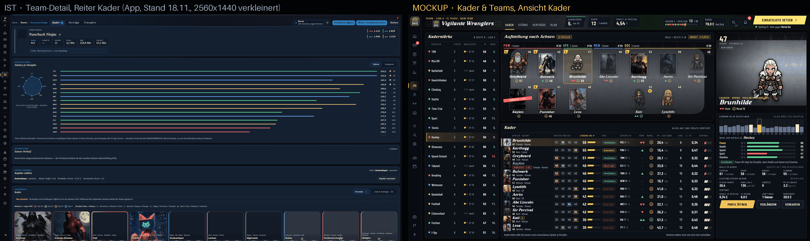
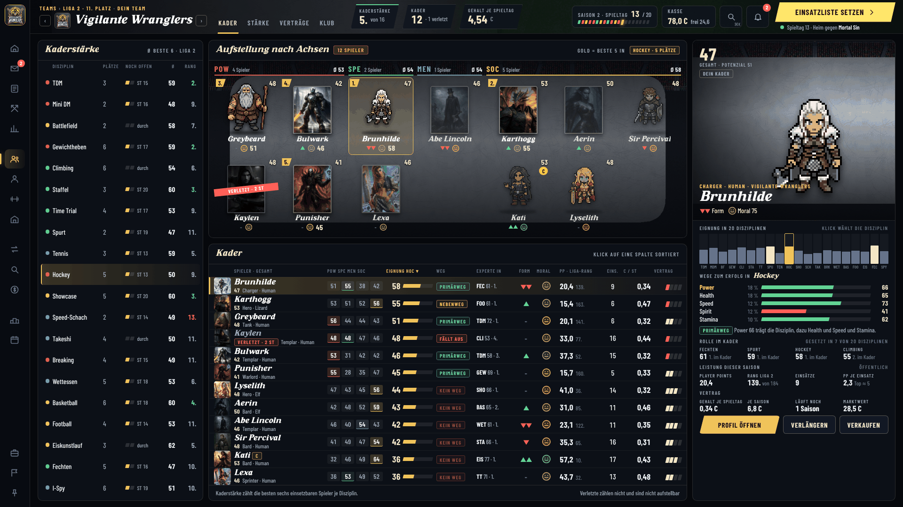
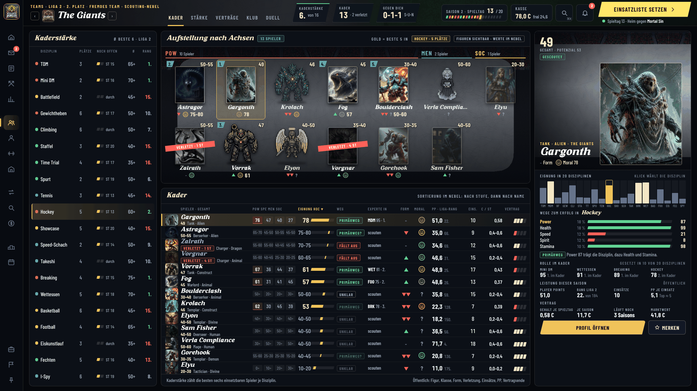
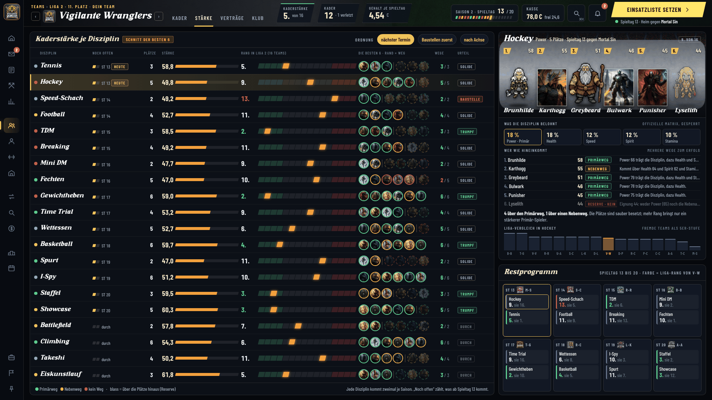
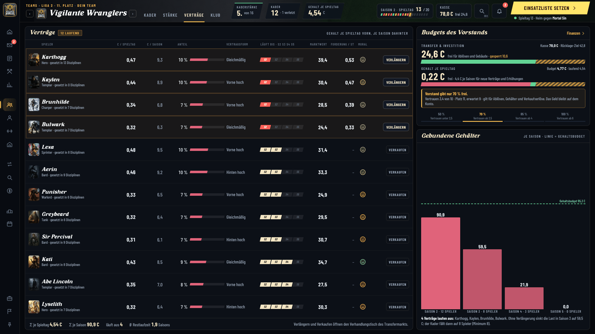
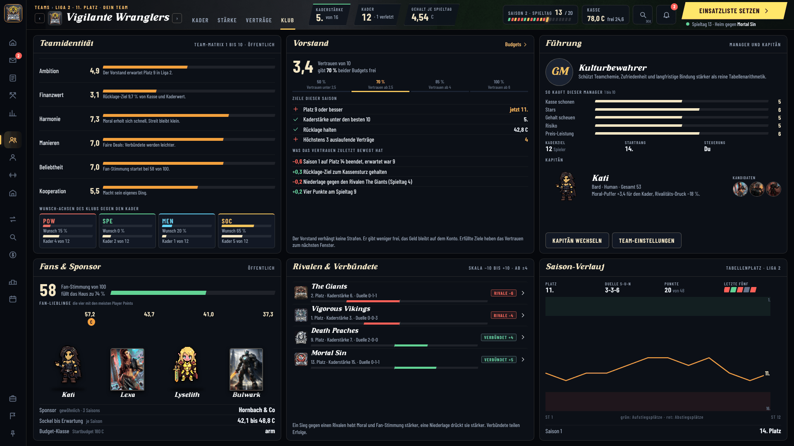
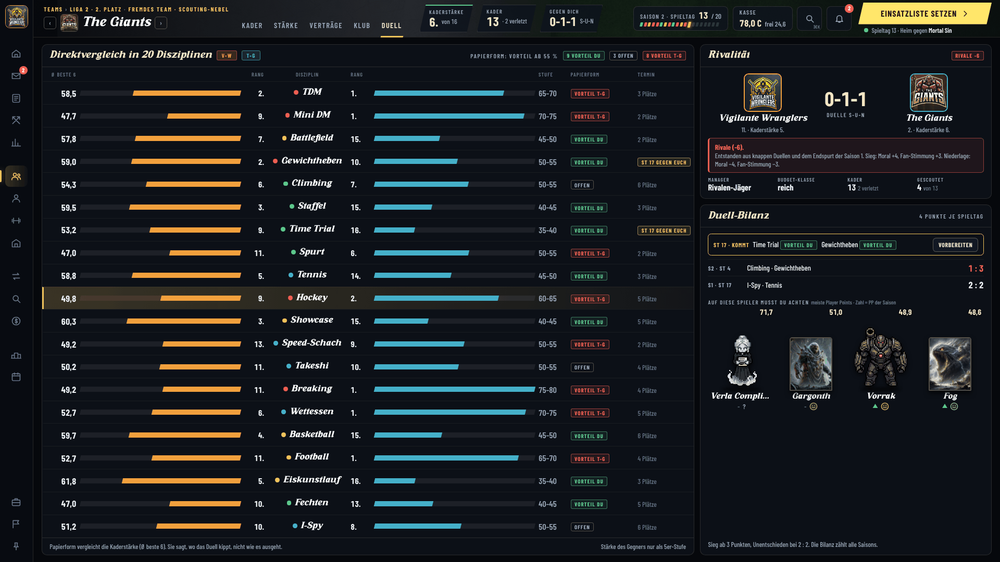
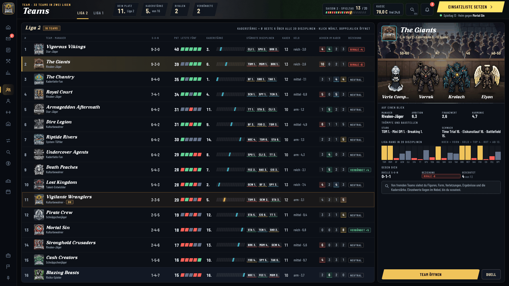
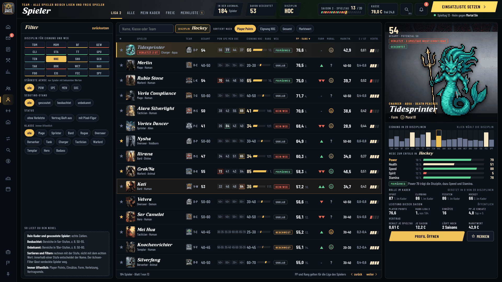

# Kader & Teams — Mockup im neuen Stil (18.11.2026)

**Status: Mockup + Erklärung. Gebaut wird erst nach Chris' OK. Kein App-Code in diesem PR.**

- Mockup (klickbar): `public/mockups/kader-teams-modern-18-11.html`
- Bilder: `docs/design/kader-teams-modern-18-11/`
- Fahrplan-Bezug: `docs/design/seiten-umbau-fahrplan-18-11.md`, Zeilen 13 bis 16 und 18 (Teams, Team-Detail, Teamprofil, Spieler-Liste,
  Merkliste), Welle 2, Kandidat Nr. 3
- Stil: steht im Rahmen aus `public/mockups/app-rahmen-modern-18-11.html` (Schiene, Regieband, Taktgeber, Meldungen; CSS des Rahmens
  unverändert übernommen). Tabellen, Filterleiste, Fokus-Spieler, Kaderstärke-Leiste und Geld-Bausteine sind dieselben wie in
  `transfermarkt-modern-18-11.html`; Form-Pfeil und Moral-Gesicht wie in Einsatzliste und Spielerprofil.

---

## 0. Die fünf Kernentscheidungen

1. **Aus vier Seiten wird ein Team mit vier Reitern.** Heute gibt es die Team-Liste mit Disziplin-Profil (`FoundationTeamsNewLook`),
   das Team-Detail mit Kader, Verträgen und Transfers (`FoundationTeamsDetailPanel`), das Teamprofil (`TeamProfileNewLook`) und Teile
   der Team-Einstellungen. Neu: **Kader · Stärke · Verträge · Klub** im Regieband, jeder Reiter ein Bildschirm ohne Scrollen. Für das
   eigene und für jedes fremde Team dieselbe Seite; fremde Teams bekommen zusätzlich den Reiter **Duell**.
2. **Der Kader steht da.** Oben die Aufstellung mit Pixel-Figuren, gruppiert nach der stärksten Achse (POW, SPE, MEN, SOC), darunter
   dieselben Spieler als Tabelle, rechts der gewählte Spieler groß. Wer keine Figur hat, steht als Porträt-Aufsteller in der Reihe.
3. **Eine Disziplin führt durch alles** (wie im Transfermarkt). Ein Klick auf eine der 20 Disziplinen färbt die besten Spieler dieser
   Disziplin gold, sortiert die Tabelle, zeigt den Weg jedes Spielers (Primärweg, Nebenweg, kein Weg) und wechselt die Kulisse.
4. **Kaderstärke heißt: Schnitt der besten sechs, Rang in der eigenen Liga, und was davon noch kommt.** Zu jeder Disziplin stehen
   die Plätze (wie viele Spieler sie braucht), wie oft sie in dieser Saison noch offen ist und wann. Das Restprogramm zeigt die
   Spieltage bis Saisonende, gefärbt nach dem eigenen Rang.
5. **Der Scouting-Nebel ist eine Regel, kein Anstrich.** Fremde Werte erscheinen als **feste Stufen** (10er oder 5er), nie als
   Bereich um den wahren Wert. Sortieren und Filtern rechnen mit der Stufe. Öffentlich bleibt, was jeder auf dem Platz sieht: Figur,
   Klasse, Form, Verletzung, Einsätze, Player Points, Vertragsende.

---

## 1. Was sich gegenüber heute ändert

| Bereich | Heute | Mockup |
|---|---|---|
| Aufbau | vier Seiten (`teams`, Team-Detail, `teamProfile`, `teamSettings`), jede scrollt; zusammen 11 300 Zeilen Altbestand | ein Team mit vier Reitern, jeder Reiter füllt den Bildschirm; Kennzahlen im Regieband, Blättern zwischen den Teams der Liga mit ‹ › |
| Kader | Porträt-Karten in einer Reihe (unter dem Disziplin-Profil, erst nach Scrollen sichtbar), umschaltbar auf „Liste & Verträge“ | Aufstellung mit Figuren nach Achsen **und** Tabelle gleichzeitig, Fokus-Spieler rechts |
| Kaderstärke | „Stärken je Disziplin“: Summe der sechs besten, Balken über die ganze Breite, Rang gegen alle 32 Teams, kleines Radar | Schnitt der besten sechs, Rang gegen die 16 Teams der eigenen Liga als Rang-Leiste, dazu Plätze, „noch offen“, Termin, die sechs Köpfe mit ihrem Weg, Urteil (Trumpf, solide, Baustelle) |
| Wichtigkeit | fehlt | Plätze je Disziplin, zwei Kästchen „noch offen“, nächster Spieltag; Restprogramm Spieltag 13 bis 20 |
| Wege zum Erfolg | fehlt | je Disziplin: Matrix-Gewichte, wer über den Primärweg und wer über einen Nebenweg hineinkommt; im Kader die Spalten „Weg“ und „Experte in“ |
| Form, Moral, Verletzung | Form als Zahl, Verletzung als Abzug | Form-Pfeil, Moral-Gesicht, Verletzung als rotes Band „verletzt · n ST“: nicht aufstellbar, zählt nicht zur Kaderstärke |
| Verträge | Reiter im Team-Detail, Gehalt je Saison, „Gehaltsforecast“, „Auslauf-Center“ | Gehalt **je Spieltag** vorn, je Saison dahinter, Anteil an der Gehaltssumme, Laufzeit als vier Felder (S2 bis S5), Forderung bei Verlängerung, rechts die zwei Budgets des Vorstands und die gebundenen Gehälter je Saison |
| Geld im Team | Kacheln Cash, MW, Gehalt | zwei Budgets (Transfer & Investition, Gehalt je Spieltag) mit Vorstands-Quote, Begründung und Stufenleiste |
| Teamidentität | „Team Identity“ als Rohwerte, verstreut über Team-Detail, Teamprofil und Team-Einstellungen | Reiter „Klub“: sechs Werte mit einem Satz, was der Wert **bewirkt**; Wunsch-Achsen gegen den Kader; Vorstand, Manager, Kapitän, Fans, Sponsor, Rivalen, Saison-Verlauf |
| Fremdes Team | dieselbe Seite mit allen Zahlen; nur das Potenzial ist verdeckt | dieselbe Seite im Nebel (Abschnitt 3), Reiter „Duell“ mit Direktvergleich, Rivalität und Bilanz |
| Team-Liste | Reiter „Teams · Liga“ mit Teamtabelle | Ansicht „Alle Teams“: 16 Teams der Liga mit Tabelle, Kaderstärke, stärksten Disziplinen, Achsen, Geld-Klasse, Beziehung; rechts Vorschau mit Figuren |
| Spieler-Liste | Tabelle mit Spalten-Menü, gespeicherten Ansichten, Podium, Streudiagramm, Ridgeline, Vergleichs-Overlay, CSV (6361 Zeilen) | drei Spalten: Filter, Tabelle (15 je Blatt), Fokus-Spieler; Umfang als Reiter (Liga 2, Alle, Mein Kader, Freie, Merkliste) |
| Merkliste | eigene Seite (`merkliste-v2`) | Reiter der Spieler-Liste; der Stern gilt überall |
| Einheit | „Mio“, Gehalt p. a. | „C“, Gehalt je Spieltag (wie Finanzkonzept V2 und Transfermarkt-Mockup) |

Was bewusst **bleibt**: Kader, Verträge, Kapitän, Vorstandsziele, Manager-Typ, Rivalen und Verbündete ab ±4, Fan-Lieblinge,
Saison-Verlauf, Merkliste, Blättern zwischen Teams, Sprung ins Spielerprofil.

Was **entfällt oder umzieht** (Frage 12): Radar „Stärkenprofil“, Kategorie-Ansicht der Stärken (die Achse steht als Farbpunkt an
jeder Disziplin), Podium, Streudiagramm und Ridgeline der Spieler-Liste, Spalten-Menü und gespeicherte Ansichten, CSV-Export. Der
Vergleich mehrerer Spieler ist der aus dem Transfermarkt-Mockup. Der Reiter „Transfers“ des Team-Details gehört zur Historie des
Transfermarkts. Steuerung (Mensch oder KI) und Spielstände bleiben im Office; im Klub steht nur der Knopf dorthin.

---

## 2. Die Ansichten

Rail: **Teams** öffnet das eigene Team, **Spieler** die Spieler-Liste. Im Regieband steht bei einem Team: Krume (Teams › Liga ·
Platz), Wappen und Name mit ‹ › zum Blättern, die Reiter, drei Kennzahlen.

### 2.1 Kader (`?ansicht=kader`)

- **Links, Kaderstärke:** 20 Zeilen: Achse als Farbpunkt, Disziplin, Plätze, „noch offen“ (zwei Kästchen und der nächste Spieltag),
  Schnitt der besten sechs, Rang in der Liga (grün bis 4., rot ab 12.). Klick wählt die Disziplin für die ganze Seite.
- **Mitte oben, Aufstellung:** vier Gruppen nach der stärksten Achse, je zwei Reihen. Jede Figur trägt Gesamtwert, Form-Pfeil und
  Moral-Gesicht. Die besten Spieler der gewählten Disziplin (so viele, wie sie Plätze hat) tragen eine goldene Nummer und ihre
  Eignung, alle anderen sind zurückgenommen. Verletzte sind grau mit rotem Band, der Kapitän trägt ein „C“. Die Kulisse ist die der
  Disziplin.
- **Mitte unten, Tabelle:** Gesamt, vier Achsen (die stärkste in ihrer Farbe), Eignung in der Disziplin, Weg, „Experte in“ (beste
  Disziplin mit Kaderrang), Form, Moral, Player Points der Saison mit Liga-Rang, Einsätze, Gehalt je Spieltag, Restlaufzeit als
  vier Striche (rot = läuft aus). Sortierbar über fünf Spalten.
- **Rechts, Fokus-Spieler:** derselbe Baustein wie im Transfermarkt: Figur vor der Kulisse, Eignung in 20 Disziplinen als Profil,
  Wege zum Erfolg, Rolle im Kader („gesetzt in n von 20 Disziplinen“), Leistung, Vertrag, Knöpfe Profil, Verlängern, Verkaufen.

Dieselbe Ansicht für ein fremdes Team (`&team=T-G`):

Die Figuren stehen da, die Zahlen sind Stufen. Gescoutete Spieler (hier Gargonth, Vorrak, Fog, Krolach) zeigen echte Werte. Die
Nummern sind blau statt gold, weil die Reihenfolge innerhalb einer Stufe nicht bekannt ist.

### 2.2 Stärke (`?ansicht=staerke`, `&ordnung=plan|rang|achse`)

- **Links:** je Disziplin eine Zeile: „noch offen“ mit Spieltag, Plätze, Stärke, Rang als Leiste mit 16 Feldern (die ersten vier
  grün, die letzten vier rot, das eigene Feld orange), die besten sechs als Köpfe (Rand grün = Primärweg, gelb = Nebenweg, rot =
  kein Weg; blass = über die Plätze hinaus), „Wege“ (wie viele Plätze mit einem Weg besetzt sind), Urteil. Drei Ordnungen: nächster
  Termin, Baustellen zuerst, nach Achse.
- **Rechts oben:** die gewählte Disziplin: die sechs Besten als Figuren auf der Kulisse, was die Matrix belohnt (fünf Attribute mit
  Gewicht, das schwerste als „Primär“), wer wie hineinkommt (ein Satz je Spieler), ein Urteil für den Kauf („die Plätze ohne Weg
  sind die Stelle, an der ein Kauf den Rang am stärksten hebt“), der Liga-Vergleich als 16 Säulen.
- **Rechts unten, Restprogramm:** acht Kacheln für Spieltag 13 bis 20 mit Gegner und den zwei Disziplinen, je mit eigenem Rang und
  dem des Gegners. Grün: Rang 1 bis 5, rot: ab 12.

„Baustellen zuerst“ (`04-staerke-baustellen-1920.png`) sortiert nach dem schlechtesten Rang. Für ein fremdes Team
(`05-staerke-fremd-1920.png`) bleiben Rang und Köpfe sichtbar, die Stärke ist eine 5er-Stufe, „Wege“ ist „?“.

### 2.3 Verträge (`?ansicht=vertrag`, `&freigabe=100|85|70|50`)

- **Links:** je Spieler Gehalt je Spieltag und je Saison, Anteil an der Gehaltssumme, Vertragsform, Laufzeit als vier Felder,
  Marktwert, Forderung bei Verlängerung (nur bei auslaufenden), Moral, Knopf. Auslaufende Verträge stehen oben und sind umrandet.
  „Verlängern“ und „Verkaufen“ öffnen den Verhandlungstisch des Transfermarkt-Mockups.
- **Rechts oben, Budgets des Vorstands:** zwei Balken nach `docs/design/finanzkonzept-v2-budgets-18-11.md`: Transfer &
  Investition (frei, gesperrt) und Gehalt je Spieltag (laufend, frei, über dem Budget). Darunter der Satz des Vorstands und die
  Stufenleiste 50 / 70 / 85 / 100 %.
- **Rechts unten, gebundene Gehälter:** vier Säulen für Saison 2 bis 5 gegen die Linie des Gehaltsbudgets, darunter ein Satz, was
  ohne Verlängerung passiert (Last, Kadergröße gegen das Minimum 8).

Bei 50 % (`07-vertraege-sparauflage-1920.png`) liegt die laufende Gehaltssumme über dem Budget: der Balken wird rot, der Text sagt
„keine neuen Verträge, Verlängern nur zum gleichen Gehalt“. Für ein fremdes Team (`08-vertraege-fremd-1920.png`) sind Vertragsende
und Kadergröße sichtbar, Gehalt und Marktwert nur als Stufe; statt der Budgets steht „Geld, soweit öffentlich“ (Budget-Klasse,
Finanzwert, Sponsor, Manager), statt der Gehaltslast die Liste „Laufen aus“ mit Stern zum Merken.

### 2.4 Klub (`?ansicht=klub`)

Sechs Tafeln: **Teamidentität** (Ambition, Finanzwert, Harmonie, Manieren, Beliebtheit, Kooperation, je mit Balken und der Folge
in einem Satz; darunter Wunsch-Achsen des Klubs gegen den tatsächlichen Kader), **Vorstand** (Vertrauen, Stufenleiste, Ziele der
Saison mit Stand, was das Vertrauen zuletzt bewegt hat), **Führung** (Manager-Typ und wie er kauft, Kaderziel, Kapitän mit Figur
und Wirkung, Kandidaten), **Fans & Sponsor** (Stimmung 0 bis 100, Fan-Lieblinge als Figuren, Sponsor mit Laufzeit, Sockel und
Erwartung), **Rivalen & Verbündete** (Skala −10 bis +10, Klick öffnet das Duell), **Saison-Verlauf** (Platz, Duelle S-U-N, Punkte,
letzte fünf, Kurve des Tabellenplatzes).

Für ein fremdes Team (`10-klub-fremd-1920.png`) ist die Identität vollständig sichtbar (sie ist Teil der Team-Matrix), das
Vertrauen des Vorstands nur als Stufe „hoch / mittel / niedrig“, der Sponsor ohne Beträge.

### 2.5 Duell (`?ansicht=duell&team=T-G`, nur fremde Teams)

- **Links, Direktvergleich:** 20 Zeilen, links der eigene Schnitt und Rang, rechts Rang und Stufe des Gegners, dazu die Papierform
  (Vorteil ab 55 %, wie im Saisonstand) und der Termin, wenn die Disziplin im nächsten Duell gegen dieses Team drankommt.
- **Rechts oben, Beziehung:** beide Wappen, Bilanz S-U-N, Rivale / neutral / verbündet mit der Wirkung auf Moral und Fan-Stimmung,
  Manager, Budget-Klasse, Kader, wie viele seiner Spieler gescoutet sind.
- **Rechts unten, Duell-Bilanz:** das kommende Duell mit Papierform und Knopf „Vorbereiten“ (führt zur eigenen Stärke), die
  bisherigen Duelle mit Disziplinen und Punkten, die vier Spieler des Gegners mit den meisten Player Points als Figuren.

### 2.6 Alle Teams (`?ansicht=liga`, `&liga=1|2`)

16 Zeilen: Platz, Wappen, Team und Manager, S-U-N, Punkte, letzte fünf, Kaderstärke als Rang mit Leiste, die drei stärksten
Disziplinen, Kadergröße, Budget-Klasse und Finanzwert, Achsen im Kader, Beziehung. Rechts die Vorschau des gewählten Teams mit vier
Figuren, Liga-Rang in 20 Disziplinen als Säulen, „Gegen dich“, Knöpfe „Team öffnen“ und „Duell“. Doppelklick auf eine Zeile öffnet
das Team.

### 2.7 Spieler-Liste (`?ansicht=spieler`, `&umfang=liga|alle|kader|frei|merk`, `&sort=pp|eig|ov|mw`)

- **Reiter im Regieband:** Liga 2, Alle, Mein Kader, Freie, Merkliste (mit Zähler).
- **Links, Filter:** Disziplin als 20 Kürzel in Achsenfarbe, stärkste Achse, Scouting-Stand, Status (ohne Verletzte, Vertrag läuft
  aus, mit Pixel-Figur), Klasse. Unten die Lesehilfe zum Nebel.
- **Mitte:** Suche, gewählte Disziplin, Sortierung (Player Points, Eignung, Gesamt, Marktwert). Spalten: Stern, Bild, Name, Team,
  Gesamt, Achsen, Eignung in der Disziplin mit Liga-Rang, Weg, Player Points mit Liga-Rang, Form, Moral, Marktwert, Gehalt je
  Spieltag, Restlaufzeit. Der eigene Kader ist orange umrandet. Klick auf das Wappen öffnet das Team.
- **Rechts:** der Fokus-Spieler. Bei fremden Spielern „Beobachten“ bzw. „Scouten“ und „Merken“.

Sortiert man nach einem verdeckten Wert (`14-spieler-nebel-sortierung-1920.png`), erscheint der Hinweis „im Nebel nach Stufe“;
die Reihenfolge innerhalb einer Stufe ist alphabetisch. `15-spieler-merkliste-1920.png` zeigt die Merkliste,
`16-spieler-mein-kader-1920.png` den eigenen Kader nach Eignung in Showcase.

---

## 3. Scouting-Nebel: die Regeln

| | Unbekannt | Beobachtet | Gescoutet / eigener Kader |
|---|---|---|---|
| Gesamt, Achsen, Eignung, Attribute | **10er-Stufe** („50–60“, Achsen „50+“) | **5er-Stufe** („50–55“) | echter Wert |
| Weg (Primär / Neben) | „unklar“ | „Primärweg?“ / „Nebenweg?“ | Urteil mit Begründung |
| Potenzial, Traits, Vertragsform | verdeckt | verdeckt | sichtbar |
| Moral | „?“ | Gesicht | Gesicht und Zahl |
| Gehalt, Marktwert (Spieler unter Vertrag) | Stufe (0,2 C je Spieltag bzw. 10 C) | Stufe | echter Wert |
| Marktwert, Forderung (freie Spieler) | echter Wert (es ist der Preis) | echter Wert | echter Wert |
| Kaderrang, „Experte in“, „gesetzt in n Disziplinen“ | „scouten“ | „scouten“ | sichtbar |
| Figur, Name, Klasse, Rasse, Team | sichtbar | sichtbar | sichtbar |
| Form-Pfeil, Verletzung, Einsätze, Player Points, Vertragsende | sichtbar (öffentlich) | sichtbar | sichtbar |

Vier Regeln, die der Bau als Tests bekommt:

1. **Feste Stufen, kein Bereich um den wahren Wert.** „50–60“ heißt: der Wert liegt irgendwo in dieser Stufe. Ein Bereich ±8 um
   den wahren Wert verrät ihn als Mitte. So arbeitet heute `getFoggedPoScoreRange` (`foundation-players-fog-of-war.ts`:
   `hidden − 16` bis `hidden + 16`); dort werden nur Sterne gezeichnet, aber die Mitte ist der echte Wert.
2. **Sortieren rechnet mit der Stufe.** Sortierwert ist die Mitte der Stufe, bei Gleichstand der Name. Zwei Spieler derselben Stufe
   stehen alphabetisch, nie nach dem verdeckten Wert.
3. **Filtern rechnet mit dem, was man sieht.** Der Achsen-Filter lässt verdeckte Spieler weg, statt sie nach der verdeckten Achse
   einzusortieren. Ein Schwellen-Filter („Eignung ab 60“) trifft nur Stufen, die ganz darüber liegen.
4. **Abgeleitete Zahlen erben den Nebel.** Kaderrang, Liga-Rang der Eignung, „Experte in“, Weg und „Wege 4 / 5“ entstehen aus
   verdeckten Werten und werden deshalb mit verdeckt.

Die **Kaderstärke** eines fremden Teams ist dagegen öffentlich: Rang exakt, Wert als 5er-Stufe. Sie mittelt die besten sechs und
ist genau deshalb grob genug (CLAUDE.md, „Kaderstärke über die besten 6“). Der Rang steht heute schon im Saisonstand.

„Beobachten“ und „Scouten“ sind im Mockup Knöpfe am Fokus-Spieler, die den Nebel eine Stufe lichten. Kosten und Plätze gehören in
das Scouting-Mockup (Frage 5).

---

## 4. Datenquellen je Element

„Vorhanden“: Wert oder Funktion gibt es heute im Code. „Neu“: muss gebaut werden oder hängt an einer anderen Baustufe.

| Element | Quelle | Stand |
|---|---|---|
| Kader, Spielerdaten, Achsen, Eignung, Attribute, Traits, Marktwert | `gameState.rosters`, `players`, `disciplineRatings`, `coreStats`, `attributeSheetStats` | vorhanden |
| Figur, Porträt, Kulisse | `public/sprites/figuren/<slug>/south.png` (rund 360 von 2984 Spielern), `public/portraits/<slug>.jpg`, `public/sprites/kulissen/` | vorhanden; Porträt als Rückfall |
| Stärkste Achse (Gruppe in der Aufstellung) | größter der vier `coreStats` | vorhanden, Darstellung neu |
| Kaderstärke je Disziplin | heute `FoundationTeamsNewLook` („Summe der 6 besten scorefähigen Kader-Spieler, gerankt gegen alle 32“), `lib/market/transfermarkt-roster-impact.ts` (`computeDisciplineTopSixImpact`), Saisonstand (`saisonstand-modern-logik.ts`) | vorhanden; **neu:** ein Lese-Dienst für alle 20 Disziplinen und alle Teams, Schnitt statt Summe, Rang je Liga (16), Verletzte ausgenommen |
| Achse und Plätze je Disziplin | `Discipline.category`, `playerCount` bzw. `SeasonDisciplineScheduleSlot.playerCount` (`lib/season/season-discipline-schedule.ts`) | vorhanden |
| „Noch offen“, nächster Termin, Restprogramm | Saisonplan (`getSeasonDisciplineSchedule`), Spielplan der Liga | vorhanden, Darstellung neu |
| Wege zum Erfolg | `lib/player-generator/official-discipline-weights.ts` (gesperrte Matrix), Football zusätzlich `spiel-eignung-overrides.ts` | vorhanden; **neu:** die Regel für Primärweg / Nebenweg / kein Weg (im Mockup: Primärattribut ab 62, sonst ein Nebenattribut ab 62, Eignung mindestens 45) |
| Form, Moral | `playerFormState`, `BcFormPfeil`, `BcMoralGesicht` (`docs/design/form-moral-bau-18-11.md`) | vorhanden |
| Verletzung = nicht einsetzbar | `docs/design/verletzung-regel-18-11.md` | Regel fest, Anzeige neu |
| Player Points der Saison, Einsätze | Season-PPs (Leaders, Kader-Tabelle „PPs Saison“) | vorhanden; **neu:** Rang je Liga |
| Kapitän, Wirkung | „Kapitän wählen“ und Führungswertung in `FoundationTeamsNewLook` | vorhanden |
| Verträge, Laufzeit, Vertragsform, Gehalt je Saison | `gameState.contracts`, `buildContractSalarySchedule`, `contract-shape-context.ts` | vorhanden |
| Gehalt je Spieltag | Jahresgehalt ÷ 20 (Finanzkonzept V2, 2.1) | als Anzeige sofort, als Buchung Stufe 1 |
| Forderung bei Verlängerung | `contract-renewal-service.ts` | vorhanden |
| Zwei Budgets, Vorstands-Quote, Stufen | `docs/design/finanzkonzept-v2-budgets-18-11.md` (Branch `claude/finanzkonzept-v2-budgets-18-11`), Vertrauen aus `identity.boardConfidence` | **neu** (Bau der Finanz-Stufen); bis dahin zeigt die Tafel Kasse und Gehaltssumme |
| Gebundene Gehälter je Saison | heute „Gebundene Summen je Saison“ im Team-Detail | vorhanden, Darstellung neu |
| Teamidentität | `TeamIdentity` (`lib/data/olyDataTypes.ts`): `ambition`, `finances`, `harmony`, `manners`, `popularity`, `cooperation`, `pow/spe/men/soc`, `playerOpt` | vorhanden; **neu:** der Folgesatz je Wert |
| Manager-Typ, Kaufverhalten | `lib/foundation/team-general-managers.ts`, `bias` in den Stammdaten | vorhanden |
| Ziele des Vorstands | `lib/board/team-season-objectives-service.ts`, `board-objectives-config.ts` | vorhanden; im Mockup vier Beispielziele |
| „Was das Vertrauen bewegt hat“ | Finanzkonzept V2, 5.7 | **neu** (Protokoll der Vertrauens-Buchungen) |
| Fan-Stimmung 0 bis 100 | Finanzkonzept V2 | **neu**; heute `popularity` und Fan-Favoriten |
| Sponsor | `lib/sponsor/sponsor-v3-model.ts` | vorhanden |
| Rivalen, Verbündete | `data.relationships` im Teamprofil (`renderRelationshipColumn`, ab ±4), Gründe (`rivalry_win`, `rivalry_close_finish`, …) | vorhanden |
| Duell-Bilanz gegen ein Team | Spieltags-Ergebnisse, `foundation-season-history-projection.ts` | **neu** (Auswertung je Gegner über alle Saisons) |
| Papierform | Saisonstand (`saisonstand-modern-logik.ts`, ab 55 % / unter 45 %) | vorhanden; im Mockup eine erfundene Kurve |
| Tabelle, S-U-N, letzte fünf | Saisonstand | vorhanden |
| Scouting-Stand je Spieler | `lib/market/transfermarkt-scouting.ts`, `getScoutingUncertainty` (`lib/progression/player-potential-service.ts`) | vorhanden für Traits und Potenzial; **neu:** Stufen für Gesamt, Achsen, Eignung, Attribute, Gehalt und die Zwischenstufe „beobachtet“ |
| Merkliste | Wunschliste (`ScoutingShortlistBoard`), `merkliste-v2` | vorhanden |

**Echt im Mockup:** 408 Spieler (Name, Klasse, Rasse, Traits, Porträt, Figur, Marktwert, Forderung, Achsen, zwölf Attribute, 20
Eignungen), Matrixgewichte, Achse und Plätze je Disziplin, 32 Teams mit Wappen, Liga, Startbudget, Identität, Manager-Typ, Bias,
Sponsor, der Grundkader jedes Teams aus `oly-rosters.json`, die Formeln für Rücklage und die zwei Budgets.
**Erfunden:** die Auffüllung der Kader auf 10 bis 13 Spieler (bevorzugt Spieler mit Figur), der Kader der Wranglers (wie im
Transfermarkt-Mockup, dazu Bulwark und Punisher), Form, Moral, Verletzungen, Scouting-Stand, Laufzeiten, Player Points, Tabelle,
Duelle, Reihenfolge des Spielplans, Beziehungen, Kasse, tragbares Gehalt, Fan-Stimmung, Ziele und Vertrauens-Buchungen.

---

## 5. Was neu wäre (über die Darstellung hinaus)

1. **Lese-Dienst Kaderstärke:** Schnitt der besten sechs einsetzbaren Spieler je Disziplin und Team, Rang je Liga. Eine Quelle für
   Team, Transfermarkt, Saisonstand, Startseite und Duell. (Dieselbe Stufe wie PR 2 im Transfermarkt-Plan.)
2. **Nebel-Dienst:** eine Funktion „Wert + Scouting-Stand → Anzeige und Sortierwert“, die jede Liste nutzt, mit den vier Regeln aus
   Abschnitt 3 als Tests. Ersetzt die heutige Sonderlösung für das Potenzial.
3. **Zwischenstufe „beobachtet“** im Scouting.
4. **Weg-Urteil** (Primärweg, Nebenweg, kein Weg) als gemeinsame Funktion für Team, Spieler-Liste, Transfermarkt und Spielerprofil.
5. **Duell-Bilanz je Gegner** über alle Saisons.
6. **Rang der Player Points je Liga.**
7. Aus dem Finanzkonzept V2: zwei Budgets, Fan-Stimmung, Protokoll der Vertrauens-Buchungen. Nicht Teil dieses Baus.

Keine Änderung an der Wertung, an der Matrix oder an der Arena-Engine. 0 PixelLab-Generationen.

---

## 6. Bau-Reihenfolge (nach dem OK, kleine PRs, Sonnet baut)

Jede Stufe ist eine neue Komponente im Mockup-Stil (`app/foundation/team-modern/`, `app/foundation/spieler-modern/`), nicht in
die alten Seiten eingehängt; die alten Fassungen fliegen am Ende raus (CLAUDE.md, „Neuer Stil überall“).

| # | PR | Inhalt | Hängt an |
|---|---|---|---|
| 1 | Kaderstärke-Dienst | beste sechs, Rang je Liga, Plätze, Termine, Weg-Urteil; Tests | nichts (gemeinsam mit Transfermarkt PR 2) |
| 2 | Nebel-Dienst | Stufen, Sortierwert, Filterregel; Tests „Sortierung verrät nichts“ | nichts |
| 3 | Team › Kader | Aufstellung, Tabelle, Fokus-Spieler; Reiter und Blättern im Regieband | 1, 2, App-Rahmen |
| 4 | Team › Stärke | Tabelle, Disziplin-Tafel, Restprogramm | 1 |
| 5 | Spieler-Liste | Filter, Tabelle, Fokus, Merkliste als Reiter; `merkliste-v2` entfällt | 2 |
| 6 | Alle Teams | Liga-Tabelle mit Vorschau | 1 |
| 7 | Team › Klub | sechs Tafeln aus vorhandenen Daten; Fan-Stimmung und Vertrauens-Protokoll, sobald das Finanzkonzept sie liefert | – |
| 8 | Team › Verträge | Tabelle und gebundene Gehälter sofort; die zwei Budgets mit dem Bau der Finanz-Stufen | Finanzkonzept V2 |
| 9 | Duell | Direktvergleich, Beziehung, Bilanz je Gegner | 1 |
| 10 | Aufräumen | `teams-v2/` (ohne den Verlängerungs-Dialog, der im Transfermarkt-Bau ersetzt wird), `team-profile/`, `players-table/`, `merkliste-v2/`, `.nl-team*` (549 Treffer) und die Altklassen der Spieler-Liste | alle |

Abnahme je PR wie im Fahrplan: Bildpaar Mockup | App bei 2560×1440, 1920×1080 und 1710×1112, Liste jedes sichtbaren
Mockup-Elements als drin / angepasst / fehlt, Seite scrollt nicht, keine Tafel läuft über, bestehende Tests grün.

---

## 7. Offene Fragen für Chris, jeweils mit Empfehlung

| # | Frage | Empfehlung |
|---|---|---|
| 1 | **Was ist im Nebel öffentlich?** Mockup: Figur, Klasse, Form-Pfeil, Verletzung, Einsätze, Player Points und Vertragsende sieht jeder; Gesamt, Achsen, Eignung, Attribute, Gehalt als Stufe; Potenzial, Traits, Vertragsform und (bei Unbekannten) Moral verdeckt. | **So übernehmen.** Öffentlich ist, was auf dem Platz und in der Tabelle passiert. |
| 2 | **Marktwert fremder Spieler.** Der Marktwert folgt dem Gesamtwert fast eins zu eins; exakt gezeigt hebelt er den Nebel aus. | **Stufe (10 C) für Spieler unter Vertrag, exakt für freie Spieler** (dort ist er der Preis). |
| 3 | **Kaderstärke fremder Teams:** Rang exakt, Wert als 5er-Stufe? | **Ja.** Der Rang steht schon im Saisonstand, und die besten sechs sind absichtlich grob. |
| 4 | **Rang gegen die 16 Teams der eigenen Liga** statt wie heute gegen alle 32? | **Gegen die eigene Liga.** Gegen die andere Liga spielt man nicht. |
| 5 | **Drei Scouting-Stufen** (unbekannt 10er, beobachtet 5er, gescoutet exakt). „Beobachten“ wäre neu. | **Ja**, als billige Vorstufe. Kosten und Plätze im Scouting-Mockup festlegen. |
| 6 | **Wichtigkeit einer Disziplin.** Heute kommt jede Disziplin genau zweimal je Saison. Das Mockup zeigt deshalb „noch offen“, Termin und Plätze. Soll der Spielplan Disziplinen künftig ungleich oft ansetzen? | **Nein, vorerst nicht.** Die Anzeige trägt beides; ein gewichteter Plan wäre eine eigene Entscheidung mit Folgen für Rangtreue und Abnahme. |
| 7 | **Ein Team statt vier Seiten:** Teamprofil als eigene Seite entfällt, sein Inhalt ist der Reiter „Klub“. | **Ja.** |
| 8 | **Verträge: Heimat im Team oder im Transfermarkt?** Beide Mockups zeigen die Tabelle. | **Ein Baustein, Heimat ist Team › Verträge.** Der Transfermarkt zeigt ihn im Fenster und führt die Verhandlung. |
| 9 | **Merkliste als Reiter der Spieler-Liste** statt eigener Seite? | **Ja.** |
| 10 | **Player-Points-Rang je Liga oder über beide Ligen?** | **Je Liga**, in „Alle“ gilt der Rang der Liga des Spielers. |
| 11 | **Figuren.** Nur etwa jeder achte Spieler hat eine Pixel-Figur; im echten Kader der Wranglers heute keiner. Die Aufstellung mischt deshalb Figuren und Porträt-Aufsteller. Deine Idee vom 17.11.: Figuren nur für tatsächlich gepickte Spieler erzeugen. | **Später und einzeln freigeben.** Die Seite funktioniert ohne. Umfang, falls gewünscht: die fehlenden Figuren des eigenen Kaders, etwa 7 bis 12 Figuren (nur Grundposen). Ohne deine Freigabe wird nichts bestellt. |
| 12 | **Entfallen** Radar, Podium, Streudiagramm, Ridgeline, Spalten-Menü, gespeicherte Ansichten und CSV der Spieler-Liste? | **Ja**, bis auf den Vergleich, der aus dem Transfermarkt-Mockup kommt. Wenn du eine davon vermisst, kommt sie als eigener Reiter zurück. |
| 13 | **Wege-Regel.** Mockup: Primärweg, wenn das schwerste Matrix-Attribut der Disziplin ab 62 liegt; Nebenweg, wenn stattdessen ein anderes der fünf schwersten ab 62 liegt; kein Weg unter Eignung 45. | **Schwellen beim Bau an echten Kadern nachmessen** (Ziel: in jeder Disziplin gibt es beide Wege, kein Urteil widerspricht der Eignung). |

---

## 7a. Entscheidungen von Chris (18.11.)

| # | Entscheidung |
|---:|---|
| 1 | Nebel **so wie im Mockup**. Dazu neu: eine **Einstellung, den Fog of War ganz auszuschalten** (vor allem am Anfang, für Testzwecke). |
| 2 | **Marktwert ist für alle Spieler einsehbar** (exakt, keine Stufe). |
| 3 | Kaderstärke fremder Teams: Rang exakt, **Wert als grobe Stufe** (z. B. „75–85“), **exakt nur bei vollem Scouting**. |
| 4 | Rang gegen die **eigene Liga**, **klein daneben der Rang unter allen 32 Teams**. |
| 5 | Drei Scouting-Stufen (unbekannt / beobachtet / gescoutet): **ja**. |
| 6 | Spielplan: **jede Disziplin kommt 2× je Saison vor**, bleibt so. |
| 7 | Teamprofil wird Reiter **„Klub“**: ok. |
| 8 | Verträge: Heimat **Team › Verträge**, Transfermarkt nutzt denselben Baustein: ok. |
| 9 | Merkliste als Reiter der Spieler-Liste: ok. |
| 10 | PP-Rang **je Liga**; die **All-Time-Werte** werden ebenfalls **für L1 und L2** angezeigt. |
| 11 | Figuren für Spieler ohne Pixel-Figur: **nur auf Freigabe**, aktuell kein Budget dafür. |
| 12 | Aus der alten Spieler-Liste bleibt **nur das Streudiagramm** (als eigener Reiter/Ansicht); Radar, Podium, Ridgeline, Spalten-Menü, gespeicherte Ansichten, CSV entfallen. |
| 13 | Wege-Schwellen beim Bau **an echten Kadern nachmessen**. |

## 8. Bedienung des Mockups

Graue Leiste oben (gehört nicht zum UI): Ansicht, Team (eigenes, The Giants als Rivale, The Chantry), Freigabe des Vorstands. Mit
`?still=1` verschwindet sie.

Klickbar: Rail „Teams“ und „Spieler“, Reiter im Regieband, ‹ › neben dem Teamnamen, „Teams“ in der Krume, jede Disziplin
(Kaderstärke-Leiste, Stärke-Tabelle, Balkenprofil, Restprogramm, Filter), jede Figur und jede Tabellenzeile, Spaltenköpfe zum
Sortieren, Ordnung der Stärke-Tabelle, Stern (Merkliste, mit Meldung), „Beobachten“ und „Scouten“ (der Nebel lichtet sich
sichtbar), Filter und Suche der Spieler-Liste, Blättern, Wappen in der Spieler-Liste, Rivalen im Klub (öffnet das Duell), Zeilen und
„Team öffnen“ in der Liga, „Vorbereiten“ im Duell. „Profil öffnen“, „Verlängern“, „Verkaufen“ und „Verhandeln“ führen in die
Mockups Spielerprofil und Transfermarkt.

URL: `?ansicht=liga|kader|staerke|vertrag|klub|duell|spieler`, `?team=V-W|T-G|T-C|…`, `?d=0..19`, `?freigabe=100|85|70|50`,
`?umfang=liga|alle|kader|frei|merk`, `?sort=pp|eig|ov|mw`, `?ordnung=plan|rang|achse`, `?liga=1|2`, `?spieler=<slug>`.

## 9. Bilder

Ordner `docs/design/kader-teams-modern-18-11/`, alle ohne Mockup-Leiste außer Nr. 17, auf 256 Farben reduziert.

| Datei | Zeigt |
|---|---|
| `00-ist-vs-mockup-1920.png` | Ist (Team-Detail, Reiter Kader, aus `docs/design/app-volle-breite-18-11/nachher-kader-2560x1440.png`, verkleinert) neben dem Mockup |
| `01-kader-eigen-2560.png`, `-1920`, `-1710` | eigener Kader bei den drei Zielbildschirmen |
| `02-kader-fremd-nebel-2560.png`, `-1920`, `-1710` | Kader der Giants im Scouting-Nebel |
| `03-staerke-eigen-2560.png`, `-1920`, `-1710` | Kaderstärke je Disziplin, Hockey gewählt, Restprogramm |
| `04-staerke-baustellen-1920.png` | Ordnung „Baustellen zuerst“, Speed-Schach gewählt |
| `05-staerke-fremd-1920.png` | Stärke eines fremden Teams |
| `06-vertraege-eigen-2560.png`, `-1920`, `-1710` | Verträge, Budgets bei 70 % |
| `07-vertraege-sparauflage-1920.png` | Freigabe 50 %, Gehalt über dem Budget |
| `08-vertraege-fremd-1920.png` | Verträge eines fremden Teams |
| `09-klub-eigen-2560.png`, `-1920`, `-1710` | Klub |
| `10-klub-fremd-1920.png` | Klub eines fremden Teams |
| `11-duell-rivale-2560.png`, `-1920`, `-1710` | Duell gegen den Rivalen |
| `12-liga-2560.png`, `-1920`, `-1710` | alle Teams der Liga 2 |
| `13-spieler-liste-2560.png`, `-1920`, `-1710` | Spieler-Liste, Liga 2 nach Player Points |
| `14-spieler-nebel-sortierung-1920.png` | alle Spieler nach Eignung: Sortierung nach Stufe |
| `15-spieler-merkliste-1920.png` | Merkliste |
| `16-spieler-mein-kader-1920.png` | eigener Kader in der Spieler-Liste |
| `17-mit-mockup-leiste-1920.png` | mit der grauen Steuerleiste |

Geprüft je Bild (automatisch): keine Skriptfehler, kein Seitenscroll, kein fehlendes Bild, keine Tafel und keine Tabellenzeile läuft
über. Einzige Meldung: die Figurenreihe der Stärke-Ansicht ist 9 bis 14 px breiter als ihr Kasten und wird dort abgeschnitten
(im Bild nicht sichtbar). Ein Klick-Durchlauf über alle Ansichten (Disziplin, Figur, Sortierung, Reiter, Blättern, Liga, Filter,
Suche, Stern, Team aus der Liste) lief ohne Skriptfehler. Das Ist-Bild ist das vorhandene vom 18.11., nicht neu aufgenommen; von
der heutigen Spieler-Liste und dem Teamprofil liegt kein aktuelles Bild im Repo. Phone ist nicht Teil dieses Entwurfs.
