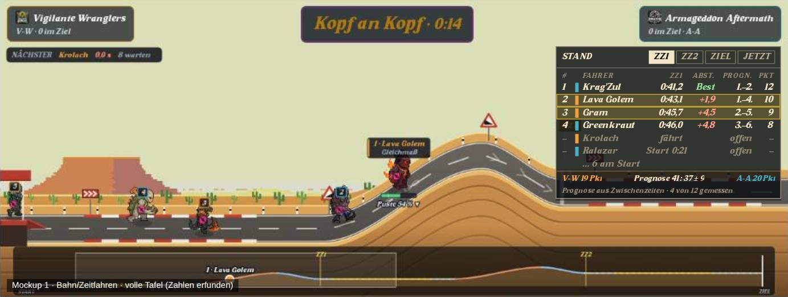
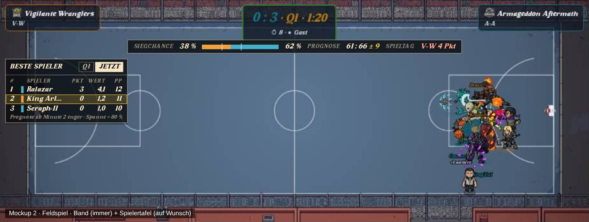
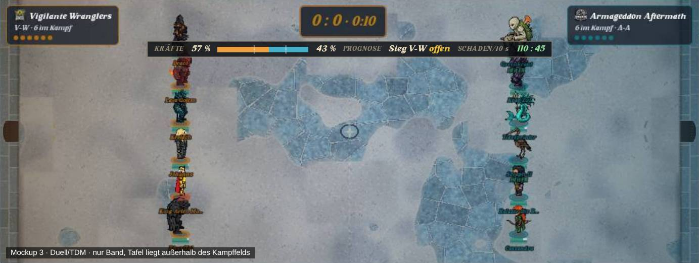
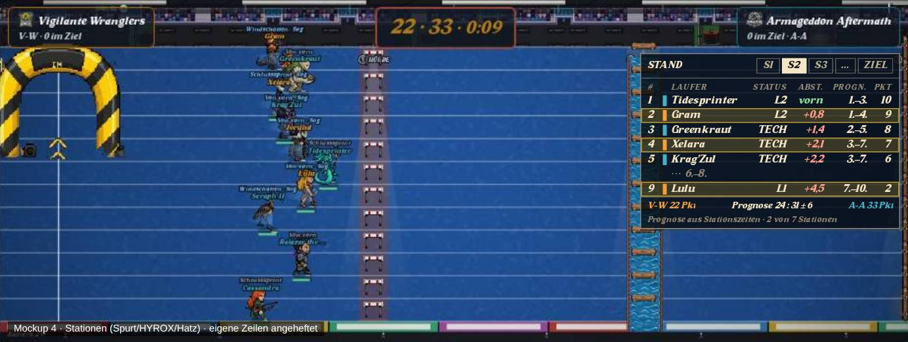

# Live-Stand: ein Overlay für alle zwanzig Disziplinen — Konzept (Fable, 17.11.)

Anlass, Chris am 17.11. wörtlich: „generell seh ich wenige overlays und UI die fable mal erstellt hat
oder bauen wollte; man sieht zwar immer sowas wie +4,5 sek auftauchen aber man hat keine
gesamtübersicht wie gerade der stand realistisch ist“. Dazu beim Zeitfahren: es fehlt ein Overlay mit
den Rängen je Zwischenzeit 1, 2 und Finale.

Dieses Papier ist ein Konzept. Es ist kein Code entstanden, nichts ist committet, nichts bei PixelLab
bestellt. Der Wertungs-Fingerabdruck (`e80babacb68c`) wurde nicht neu gemessen, weil keine Motordatei
angefasst wurde.

## 0. Kurzfassung

1. **Der Befund stimmt, und er ist älter als heute.** Die Arena hat viele Einzel-HUDs (Abschnitt 1),
   aber keine einzige Stelle, die über alle Teilnehmer sagt: wer liegt wo, mit welchem Abstand, und
   was heißt das für das Ergebnis. Genau diese Tafel wurde zweimal entworfen und nie gebaut: als
   „Q5 Bahn-Overlay“ (`fable-konzept-chris-feedback-13-10.md` 3.5) und als „ZF1 Wertung als Overlay“
   (`fable-konzept-broadcast-vorbilder-13-10.md` 3.1). Im Motor findet sich davon nichts.
2. **Vorschlag: ein Bauteil „Live-Stand“ mit zwei Größen.** Ein **Band** (eine Zeile unter der
   Spielanzeige, immer sichtbar) und eine **Tafel** (Rangliste mit wählbarem Messpunkt, auf Tastendruck).
   Gleiche Bildsprache wie die HYROX-Rangleiste und die Eiskunstlauf-Zwischenstand-Tafel: dunkle
   Fläche, heller Rand, Teamfarbe als Zeilenstreifen, Hausschrift.
3. **Die Prognose rechnet nur mit dem, was schon auf dem Bildschirm stand.** Sie zeigt immer eine
   Spanne („2.–4.“, „41 : 37 ± 9“), nie eine einzelne Zahl. Fünf Methoden, eine je Formattyp
   (Abschnitt 3). Verboten als Quelle: der vorab gebuchte Spieltags-Snapshot und der HYROX-Fahrplan.
4. **Bau in fünf Wellen.** Welle 1 verallgemeinert das Zeitfahren-Overlay des anderen Agenten auf
   das ganze Bahn-Chassis. Danach Stationen, Bühne, zuletzt Feldspiel und Kampf, weil deren Prognose
   eine Kalibrier-Messreihe braucht.
5. **PixelLab: Empfehlung nichts bestellen.** Das Bauteil besteht aus Text, Zahlen und Rechtecken;
   in `public/sprites/arena/` liegt kein UI-Rahmen und kein Icon, das dafür taugt. Ein gemalter
   Rahmen bleibt ein optionaler Posten (Abschnitt 4.6).

## 1. Bestandsaufnahme

### 1.1 Wie gemessen wurde

- Dokumente gelesen: `broadcast-praesentation-uebergreifend-recherche-06-09.md`,
  `staffel-oval-broadcast-hud-recherche-06-09.md`, `fable-ideen-broadcast-praesentation-30-09.md`,
  `fable-konzept-chris-feedback-13-10.md`, `fable-konzept-broadcast-vorbilder-13-10.md`,
  `time-trial-broadcast-paket-plan-07-10.md`, `tdm-broadcast-paket-plan-07-10.md`,
  `fable-uiux-brainstorm-14-11.md`, `hyrox-optik-konzept-17-11.md`,
  `pixellab-hud-effekte-schiri-plan-17-11.md`, `strategie-pilot-hyrox-in-game-17-11.md`,
  `battle-arena-spieltag-anbindung-02-11.md`.
- Motor gegengeprüft per `grep` in `public/mockups/battle-mode.engine.js` und `battle-mode.html`.
- Screenshots der laufenden Arena (Playwright, `public/` über einen lokalen Dateiserver, kein
  `npm run dev`, Demo-Kader). **Angesehen** habe ich acht: Time-Trial, Spurt, Staffel, Takeshi,
  Basketball, TDM, Eiskunstlauf, Gewichtheben. Für die übrigen zwölf stützt sich die Tabelle auf
  Code und Dokumente; das steht in der Spalte „Beleg“.

### 1.2 Was frühere Konzepte vorgeschlagen haben und was davon steht

| Vorschlag | Quelle | Stand im Motor |
|---|---|---|
| Ein gemeinsamer Overlay-Behälter über der Leinwand (`#bbug`) | Recherche 06.09., 3.1 | **gebaut** (`aktualisiereBbug()`): Spielanzeige mit Teamschildern in jeder Disziplin |
| Staffel-HUD mit Live-Abstand und „aktuell/nächster“ | Staffel-Recherche 06.09., 4 | **gebaut** (`#bahnHud`) |
| Zeitfahren: Hot Seat, Geisterfahrer, Zwischenzeit-Tafel am Fahrer, Startliste, Höhenprofil | Recherche 06.09., Paket 07.10. | **gebaut** (`#ttfokus`, `renderZeitfahrenPanel()`, `u.vizZzFlash`) |
| Eiskunstlauf: Zwischenstand-Tafel mit gleitenden Zeilen | 13.09. | **gebaut** (`zeichneEisStand()`), Leinwand |
| HYROX: Rangleiste rechts mit Status L1/TECH/✓ | Nahkamera 08.11. | **gebaut** (`zeichneHyroxRangleiste()`), Leinwand |
| Vier-Team-Tafel für Pods | — | **gebaut** (`zeichneBahnPodTafel()`, `zeichneBfPodTafel()`) |
| Wettessen: „auf Kurs für N“, „braucht +X“ | Wettessen-Tafel 17.09. | **gebaut** (`zeichneWettessenBand()`), rechnet nur aus gezeigten Minuten |
| Tennis: Siegchance | Tennis-Nachtkonzept | **gebaut** (`tennisSiegchance()`), im Ticker und Endstand |
| **Q5 Bahn-Overlay-Tafel**: kompakt Z1·Z2·Z3, ausklappbar, für alle fünf Bahnen | Chris-Feedback 13.10., 3.5 | **nicht gebaut** |
| **ZF1 Wertung als Overlay** (Rang · Name · Rückstand, 5–6 Zeilen) | Broadcast-Vorbilder 13.10., 3.1 | **nicht gebaut** |
| „Was jetzt zählt“-Zeile in der Spielanzeige (C4) | Fable-Ideen 30.09. | nicht gebaut |
| Comeback-Tracker (D1), Statistik-Einblender (D6) | Fable-Ideen 30.09. | nicht gebaut |
| Abspann „Tabellen-Auswirkung“ (A8) | Fable-Ideen 30.09. | nicht gebaut |
| Killfeed (K1), Minimap | 27.09. | nicht gebaut bzw. verworfen |
| Erwartungs-Waage, Live-Delta | Einsatzliste 08.11. | betrifft die Einsatzliste, nicht die Arena |

Das Muster: gebaut wurden die **disziplin-eigenen** Anzeigen. Liegen geblieben sind genau die
**übergreifenden** — und Chris vermisst die übergreifende.

### 1.3 Was heute in jeder Disziplin gleich ist

Jede Disziplin zeigt denselben Rahmen (auf allen acht Screenshots gleich):

- Kopfzeile über der Leinwand mit Teamnamen, Stand und einer Unterzeile („Punkte nach Rang (von 55)
  · vorläufig“, „Zeitsumme (Hochrechnung)“, „Ausschaltungen“).
- Spielanzeige auf der Leinwand mit denselben Zahlen noch einmal.
- Rechts neben der Leinwand die Box „WERTUNG laufend“: zwei getrennte Listen (eigenes Team, Gegner)
  mit Statistikspalten, **in Kaderreihenfolge, nicht nach Rang**, ohne Abstand, ohne Prognose.
- Ticker.

Die Mannschaftszahl oben ist also da. Was fehlt, ist die Rangliste über beide Teams und die Antwort
auf „was wird daraus“.

### 1.4 Disziplin × vorhandenes HUD × Lücke

Beleg: **S** = Screenshot angesehen, **C** = nur Code/Dokument.

| # | Disziplin | Typ | Vorhanden | Lücke | Beleg |
|---|---|---|---|---|---|
| 1 | Time-Trial | Bahn | Hochgerechnete Zeitsumme je Team; Panel unter der Leinwand „Rang 3/12 · +9,2 s (hochgerechnet)“ **nur für den Fahrer im Fokus**; Zwischenzeit-Tafel 3 s am Fahrer; Höhenprofil | **Keine Rangliste je ZZ1/ZZ2/Ziel.** Die „+x s“ erscheinen einzeln und verschwinden. Bester Ausgangspunkt, weil Hochrechnung schon existiert (`bahnHochrechnung()`) | S |
| 2 | Staffel | Bahn | Live-Abstand groß in der Mitte, aktueller/nächster Läufer mit Eignung, Abschnitt x/6 | Kein Verlauf je Übergabe (wer hat wo Zeit geholt), keine Prognose | S |
| 3 | Spurt klassisch | Bahn | „22 · 33 Punkte nach Rang · vorläufig“, Streckenband | Keine Einzel-Rangliste, kein Abstand | S |
| 4 | Spurt HYROX | Stationen | Rangleiste rechts mit Status; Zonenschilder | Kein Abstand, keine Stationszeiten, keine Prognose, keine Punkte | C |
| 5 | Spurt Hatz | Stationen | Fegearm-Balken, Wellen-Text | Wer ist diese Welle bedroht, wer ist raus: nur am Läufer | C |
| 6 | Climbing | Bahn | Höhe je Team, Balance-Ring | Rangliste nach Höchstmarke, Abstand in Griffen | C |
| 7 | Takeshi | Stationen | Burgpunkte je Team, „noch 12 im Rennen“, Fallen-Schild | Wer hat wie viele Punkte, was sind die restlichen Fallen noch wert | S |
| 8 | Basketball | Feldspiel | Stand, Viertel, Uhr, Shot-Clock, Ballbesitz | Keine Einordnung des Stands (führt 3 nach 80 Sekunden: was heißt das), beste Spieler nur rechts in der Box | S |
| 9 | Hockey | Feldspiel | Stand, Drittel, Überzahl-Uhr, Torschüsse | wie Basketball | C |
| 10 | Football | Feldspiel | Stand, Down/Distance | wie Basketball | C |
| 11 | TDM | Duell | Ausschaltungen, Lebenspunkte je Seite, Sudden-Death-Uhr | Stand 0:0 bis zur ersten Ausschaltung, obwohl der Schaden längst ungleich verteilt ist (Screenshot: 110 gegen 45 nach zehn Sekunden) | S |
| 12 | Battlefield | Duell | wie TDM, Pod-Tafel | wie TDM | C |
| 13 | Mini-DM | Duell (FFA) | eigene Turnieransicht (`#minidmffa`) mit Paarungen und Podest | Bereits eine Übersicht; nur Bildsprache angleichen | C |
| 14 | Fechten | Duell (Bühne) | FIE-Tafel, Trefferlampen, Bahnleiste | Mannschaftsstand über alle Gefechte, was noch aussteht | C |
| 15 | Tennis | Bühne-Duell | Satzstand, Hawk-Eye, Siegchance im Ticker | Siegchance nicht dauerhaft sichtbar | C |
| 16 | Eiskunstlauf | Bühne | **Zwischenstand-Tafel** (Rang, Paar, Punkte, wer noch läuft) | Vorbild. Fehlt nur: Prognose und Punkte-Spalte | S |
| 17 | Showcase | Bühne | X-Wand, Applaus-Meter, Jury | Rangliste der Acts | C |
| 18 | Gewichtheben | Bühne | Versuchstafel, Bedarfszeile, Duell-Reihenfolge am Boden | Stand über alle sechs Duelle; Screenshot zeigt „0 : 0“ trotz laufendem ersten Duell | S |
| 19 | Wettessen | Bühne | Wendetafeln, Tempo, Band mit Hochrechnung | Vorbild für die Prognose-Zeile; Rangliste der Esser fehlt | C |
| 20 | Breaking | Bühne-Duell | Kettenleiste, Lebensbalken, Qual-Skala | Wie viele Kämpfer hat jede Seite noch, wer steht als Nächster | C |
| — | Speed-Schach, I-Spy | Bühne | Uhr, Vorteilsanzeige bzw. Zug-Uhr, Split-Tafel | Brett-/Truhen-Stand als Rangliste | C |

Zählhinweis: Spurt belegt drei Zeilen (klassisch, HYROX, Hatz), Speed-Schach und I-Spy teilen sich
die letzte, weil ihr Befund derselbe ist. Das sind zusammen die zwanzig Disziplinen.

## 2. Das Bauteil „Live-Stand“

### 2.1 Zwei Größen, drei Zustände

```
Zustand 1  BAND   (Standard)   eine Zeile unter der Spielanzeige
Zustand 2  TAFEL               Band + Rangliste, am rechten Bildrand
Zustand 0  AUS                 nichts
```

- **Band**: höchstens 24 px hoch, mittig unter der Spielanzeige. Inhalt je Typ, immer drei Felder:
  *Stand in einer Zahl* · *Prognose mit Spanne* · *was das für den Spieltag heißt*.
- **Tafel**: rechts oben unter dem Teamschild, dieselbe Stelle wie heute die HYROX-Rangleiste
  (`x0=W-BREITE-10`, ab `hudBandUnten()+20`). Höchstens acht Zeilen. Kopf mit Messpunkt-Reitern.

Ehrliche Maßangabe aus den Mockups: mit der Hausschrift braucht die Tafel bei sieben Spalten rund
**260 × 180 px** auf einer 922 px breiten Leinwand, also gut ein Viertel der Breite. Das ist mehr als
die HYROX-Rangleiste (166 px). Deshalb ist sie nicht der Standard, sondern der zweite Zustand, und
deshalb bekommen Feldspiel und Kampf im Standard nur das Band.

### 2.2 Spalten der Tafel

```
#  ▌ NAME          WERT    ABST.   PROGN.   PKT
1  ▌ Krag'Zul      0:41,2  Best    1.–2.    12
2  ▌ Lava Golem    0:43,1  +1,9    1.–4.    10     ← eigene Zeile: goldener Rahmen
```

| Spalte | Inhalt | Regel |
|---|---|---|
| `#` | Rang am gewählten Messpunkt | Wer den Messpunkt noch nicht erreicht hat, bekommt „–“ und steht gedimmt darunter |
| ▌ | Teamfarbe | dieselben Farben wie Spielanzeige (`--home`, `--away`, Pod-Farben) |
| WERT | Zeit, Punkte oder Status | je Typ, siehe Abschnitt 3 |
| ABST. | Abstand zum Ersten am Messpunkt | **hier landen die „+4,5 s“** (2.4) |
| PROGN. | voraussichtlicher Endrang als Spanne | „offen“, solange die Spanne mehr als das halbe Feld umfasst |
| PKT | Punkte, die dieser Rang jetzt bringt | Welle 1–4 die Punkte des Motors („Punkte nach Rang“), ab Welle 5 Spieltagspunkte (Frage 3) |

Fußzeile: Teamsumme links und rechts, in der Mitte die Team-Prognose mit Spanne. Darunter eine
graue Zeile, **worauf die Prognose beruht** („aus Zwischenzeiten · 4 von 12 gemessen“). Diese Zeile
ist Pflicht: sie ist der Unterschied zwischen einer Schätzung und einer Behauptung.

### 2.3 Eigene Mannschaft

- Eigene Zeilen: goldener Rahmen und leicht aufgehellter Grund, zusätzlich zum Teamfarbstreifen.
- **Anheften**: passen nicht alle in acht Zeilen, zeigt die Tafel die ersten fünf, eine Auslassungszeile
  („⋯ 6.–8.“) und dann die eigenen Zeilen, die sonst herausfielen (Mockup 4). Die eigene Mannschaft
  verschwindet nie aus der Tafel.
- „Eigen“ ist die Heimseite im freien Reiter und im Spieltag das Team des Spielers (`spieltag`-Prop
  des Hosts kennt es bereits, `battle-arena-spieltag-anbindung-02-11.md`).

### 2.4 Die „+4,5 s“-Popups

Die Tafel am Fahrer (`u.vizZzFlash`, drei Sekunden) bleibt. Neu ist nur, dass dieselbe Zahl im selben
Augenblick in der Spalte ABST. der Tafel steht und dort **stehen bleibt**. Die betroffene Zeile
blinkt einmal kurz auf, damit das Auge den Zusammenhang herstellt. Das Popup wird damit vom
einzigen Träger der Information zum Hinweis auf eine Zeile, die man nachlesen kann.

### 2.5 Messpunkte wählen

Reiter im Kopf der Tafel, je Typ:

| Typ | Reiter |
|---|---|
| Bahn | ZZ1 · ZZ2 · ZIEL · JETZT |
| Stationen | S1 … S7 · ZIEL (HYROX), Welle 1 … n (Hatz), Falle 1 … 14 in Vierergruppen (Takeshi) |
| Feldspiel | Q1 … Q4 bzw. Drittel · JETZT |
| Bühne | Durchgang 1 … n · JETZT |
| Duell | nur JETZT (plus „nach Minute 1/2“ als Rückblick) |

Standard ist **automatisch**: die Tafel springt auf den jüngsten Messpunkt, den mindestens zwei
Teilnehmer erreicht haben. Wer einen Reiter anklickt, hält ihn fest, bis er „JETZT“ oder „Auto“
wählt. Ein Reiter, den noch niemand erreicht hat, ist grau und nicht wählbar — auch das ist
Spoilerschutz.

### 2.6 Skizzen je Formattyp

Mockups (aus echten Screenshots der Arena, Overlay per HTML darübergelegt, **alle Zahlen erfunden**):

| | |
|---|---|
|  | **Bahn/Zeitfahren**, Tafel am Messpunkt ZZ1. Vier gemessen, zwei unterwegs, sechs am Start. |
|  | **Feldspiel**, Band mit Siegchance und Endstand-Prognose; die Spielertafel links nur auf Wunsch. |
|  | **Duell/TDM**, nur das Band. Der Stand „0 : 0“ bekommt eine zweite Zeile, die den Schaden zeigt. |
|  | **Stationen**, Tafel mit Status-Spalte der HYROX-Rangleiste und angehefteten eigenen Zeilen. |

Bühne/Wertung als Textskizze — sie ist die Eiskunstlauf-Tafel von heute plus zwei Spalten:

```
┌ STAND ───────────── [DG 1][DG 2][JETZT] ┐
│ #  ▌ PAAR / ACT        PKT   ABST. PROGN. PKT │
│ 1  ▌ Johanna & Krolach 409   Best  1.–2.  12  │
│ 2  ▌ Gram & Lava       276   −133  2.–4.  10  │  ← eigen
│ 3  ▌ Ralazar & Tide…   270   −139  2.–4.   9  │  ← läuft gerade (heller Grund)
│ –  ▌ King & Draco      Start 5      offen   –  │
│ V-W 685        Prognose 1010 : 760 ± 90   A-A 468 │
│ Prognose aus 8 von 12 Durchgängen              │
└────────────────────────────────────────────────┘
```

Band je Typ:

```
Bahn       RANG 2/12 · +1,9 s zu Krag'Zul │ PROGNOSE 1.–4. │ TEAM 41 : 37 ± 9
Stationen  RANG 2/10 · Station 2/7 · +0,8 s │ PROGNOSE 1.–4. │ TEAM 24 : 31 ± 6
Feldspiel  SIEGCHANCE 38 % ▓▓▓░░░░ 62 % │ PROGNOSE 61 : 66 ± 9 │ SPIELTAG 4 Pkt
Duell      KRÄFTE 57 % ▓▓▓▓░░░ 43 % │ PROGNOSE Sieg V-W, offen │ SCHADEN/10 s 110 : 45
Bühne      VORN Johanna & Krolach 409 │ PROGNOSE 1010 : 760 ± 90 │ NOCH 4 Durchgänge
```

„RANG 2/12“ im Band ist immer der beste eigene Teilnehmer.

## 3. Die Prognose: ehrlich, ohne die Zukunft der Saat

### 3.1 Die Regel

Im Spieltag ist das Ergebnis **schon gebucht**, bevor die Wiedergabe läuft
(Hintergrund-Vorlauf, `resolutionSource === "arena"`). Der Motor könnte die Prognose also
trivial „richtig“ machen. Genau das darf er nicht. Die Regel:

> Die Prognose liest ausschließlich Werte, die zu diesem Zeitpunkt schon auf dem Bildschirm
> standen oder vor dem Anpfiff öffentlich waren.

| Erlaubt | Verboten |
|---|---|
| Gezeigte Zwischenzeiten `u.zz[ci]`, Zielzeiten Fertiger, aktuelle Streckenposition, gezeigte Punkte, Treffer, Schaden, Lebenspunkte, Uhr | Der gebuchte Snapshot des Spieltags |
| Aufstellung und Eignung aus dem Einlauf (dort für jeden sichtbar) | `u.hyroxPlan` jenseits der aktuellen Position (der Fahrplan enthält die künftigen Stationszeiten) |
| Feste Kalibrierkonstanten je Disziplin, offline aus vielen Spielen gemessen (3.7) | Jeder neue `rr()`-Aufruf, jeder Vorauslauf der Simulation |
| | Noch nicht enthüllte Runden (`runden[aktuell+1..]`), dieselbe Spoiler-Regel wie in `zeichneEisStand()` |

Zwei Vorbilder im Motor halten diese Regel schon ein: `zeichneWettessenBand()` („Hochrechnung NUR
aus bereits gezeigten Minuten“) und `bahnHochrechnung()` (verstrichene Zeit durch Streckenanteil).

### 3.2 Die Spanne

Jede Prognose ist ein Bereich, der in etwa vier von fünf Fällen stimmen soll (80 %).

- Je Teilnehmer: Schätzwert und Streubreite, z. B. Zielzeit 1:48 ± 4 s.
- Rangspanne: bester Rang, wenn der eigene Wert am günstigen Ende liegt und die der anderen am
  ungünstigen; schlechtester Rang umgekehrt. Angezeigt als „2.–4.“.
- Umfasst die Spanne mehr als das halbe Feld, steht dort **„offen“** statt einer Zahl. Das ist kein
  Mangel, sondern die ehrliche Auskunft zu Beginn eines Rennens.
- Die Spanne wird mit jedem Messpunkt enger und fällt am Ende auf den gebuchten Rang zusammen.

Die 80 % sind eine Zusage, die der Probe-Test nachmisst (Abschnitt 5).

### 3.3 Bahn und Zeitfahren (Time-Trial, Staffel, Spurt klassisch, Climbing)

- **Schätzwert**: vorhanden. `bahnHochrechnung(u)` = verstrichene Zeit ÷ Streckenanteil. Besser, sobald
  es geht: Zeit am letzten Messpunkt × (Zielzeit ÷ Zeit an diesem Messpunkt, Median über alle, die
  schon im Ziel sind). Das berücksichtigt, dass die zweite Streckenhälfte anders läuft als die erste,
  und nutzt nur Fahrer, deren Zielzeit schon gezeigt wurde.
- **Streubreite**: Streuung genau dieses Verhältnisses unter den Fertigen (ab drei Fertigen), davor die
  Kalibrierkonstante, mit dem restlichen Streckenanteil skaliert.
- **Einzelstart**: wer noch auf der Rampe steht, hat keine Prognose („offen“). Der Rang heißt bis zum
  letzten Start „vorläufig, n von 12 gemessen“.
- **Staffel**: Messpunkte sind die Übergaben; je Abschnitt steht die Abschnittszeit, die Prognose
  rechnet die restlichen Abschnitte mit dem bisherigen Team-Schnitt.
- **Climbing**: Wert ist die Höchstmarke (`u.hoch`), Abstand in Prozent der Wand; Prognose aus
  Steiggeschwindigkeit, Spanne breit, weil Stürze alles ändern.

### 3.4 Stationen (HYROX, Hatz, Takeshi)

- **HYROX**: Messpunkt ist jede verlassene Station. Schätzwert = bisherige Zeit + für jede
  restliche Station die eigene mittlere Stationszeit, korrigiert um den Feldschnitt derjenigen
  Stationen, die **schon jemand hinter sich hat** („Station 5 kostet im Feld 6,2 s“). Stationen, die
  noch niemand erreicht hat, gehen mit dem eigenen Schnitt und voller Streubreite ein. Die
  Status-Spalte (L1/TECH/✓) wird aus der heutigen Rangleiste übernommen.
- **Hatz**: Die Frage ist nicht der Endrang, sondern „wer fliegt in dieser Welle“. PROGN. zeigt deshalb
  „sicher“, „bedroht“ oder „raus“, gemessen am Abstand zum Fegearm und zum Letzten der Welle.
- **Takeshi**: Wert sind Burgpunkte. Schätzwert = bisherige Punkte + restliche Fallen × eigene
  Bestehensquote, gestützt durch die Quote des Feldes an Fallen, die schon jemand versucht hat.

### 3.5 Feldspiel (Basketball, Hockey, Football)

- **Endstand**: aktueller Stand + Restzeit × Punkterate. Die Rate mischt die eigene bisherige Rate
  (Gewicht = Anteil gespielter Zeit) mit dem Disziplinschnitt aus der Kalibrierung. So steht nach
  80 Sekunden nicht „Hochrechnung 0 : 135“.
- **Siegchance**: Vorsprung ÷ (Streuung je Restminute × Wurzel der Restminuten), durch die
  Normalverteilung. Dieselbe Formel und dieselbe `erf`-Näherung wie `tennisSiegchance()`. Hockey mit
  seinen wenigen Toren bekommt statt der Normalverteilung eine Tor-Zählverteilung (Poisson), sonst
  gleich.
- **Kaderstärke**: bewusst **nicht** in Welle 4. Die Eignungssummen sind zwar öffentlich, aber eine
  Prognose, die schon vor dem Anpfiff 70 : 30 sagt, nimmt dem Spiel mehr als sie gibt. Als
  spätere Option vermerkt.
- **Spieler**: Rangliste nach dem Wert, den die Wertungsbox heute schon führt, plus PKT.

### 3.6 Duell und Bühne

- **TDM, Battlefield**: „Kräfte“ = Anteil an (verbleibende Lebenspunkte × Schadensrate der letzten
  zwanzig Sekunden). Prognose nennt den Favoriten und „offen / wahrscheinlich / klar“ statt einer
  Prozentzahl mit Scheingenauigkeit. Bis ein Viertel aller Lebenspunkte weg ist, steht „offen“.
- **Fechten, Breaking, Gewichtheben, Tennis** (Duellfolgen): gewonnene Duelle + offene Duelle × bisherige
  Quote; für Tennis die vorhandene Siegchance, jetzt dauerhaft im Band.
- **Eiskunstlauf, Showcase, Wettessen, Speed-Schach, I-Spy** (Wertung): bisherige Summe + noch offene
  Auftritte × Schnitt der bisherigen eigenen Auftritte (ab zwei, davor Feldschnitt). Streubreite aus
  der Streuung der gezeigten Wertungen × Wurzel der offenen Auftritte. Dazu, wo es passt, die Zeile
  „braucht X“ nach dem Muster der Heben-Bedarfszeile.

### 3.7 Kalibrierkonstanten

Streuungen und Disziplinschnitte kommen aus einer Messreihe über viele Spiele (`window.__arena.serie`
und Verwandte, Demo-Kader plus zwei Saatstämme) und stehen als feste Zahlen in
`data/generated/live-stand-kalibrierung.json`. Sie beschreiben die Disziplin, nicht das laufende
Spiel, und verraten deshalb nichts. Ändert sich ein Rezept, wird die Datei neu gemessen; der
Probe-Test (Abschnitt 5) wird rot, wenn die 80 % nicht mehr stimmen.

## 4. Technik

### 4.1 Aufbau: ein Rahmen, ein Adapter je Typ

```
Motorzustand (nur lesen)
   └─ liveStandLesen<Typ>()      je Typ eine Funktion, liefert ein schlichtes Datenobjekt
        └─ liveStandPrognose()   reine Funktion: Datenobjekt + Kalibrierung → Spannen
             └─ liveStandZeichnen()   ein Renderer für Band und Tafel
```

Das Datenobjekt ist der Vertrag (auch mit dem Zeitfahren-Agenten, 4.5):

```
{ typ, messpunkte:[{id,kurz,erreichtVon}], aktiv,
  zeilen:[{id, seite, name, eigen, rang, wert, abstand, status, prognose:{von,bis,offen}, punkte}],
  teams:[{seite, summe, prognose:{mitte,spanne}}],
  band:{links, mitte, rechts}, grundlage }
```

Der Renderer kennt keine Disziplin. Eine neue Disziplin anschließen heißt: eine Lesefunktion schreiben.

### 4.2 DOM statt Leinwand

Empfehlung: Band und Tafel als **DOM-Elemente** im vorhandenen Overlay-Stapel über der Leinwand
(neben `#bbug`, `#bahnHud`, `#ttfokus`), nicht als Leinwandzeichnung.

- Kein Eingriff in den Zeichenzustand der Leinwand, also kein Weg, über den Wertung berührt wird.
- Reiter sind anklickbar und per Tastatur erreichbar, Text bleibt bei jeder Skalierung scharf.
- Der Node-Motor des Fingerabdrucks hat kein DOM: der ganze Zweig hängt hinter derselben
  `document`-Prüfung wie die übrigen DOM-HUDs und läuft dort gar nicht.

Die zwei Leinwand-Vorbilder (HYROX-Rangleiste, Eiskunstlauf-Tafel) bleiben stehen, bis ihre Welle sie
ablöst; in der Übergangszeit blendet der Live-Stand sich in diesen beiden Disziplinen nicht doppelt ein.

### 4.3 Gezeigt = gebucht

- Alle Werte kommen aus Feldern, die die Wertung selbst liest: `u.zz[]`, `u.fertig`, `bahnZeit()`,
  `bahnRangliste()`, `u.summe`, `fsPunkte`, Boxscore. Am Ende stehen in der Tafel exakt die gebuchten
  Ränge und Punkte.
- **Keine neuen `rr()`-Aufrufe**, keine Schreibzugriffe auf Läufer- oder Spielerobjekte.
- Neuer Zustand nur als Modulvariablen und WeakMap: Schnappschüsse je Messpunkt
  (`lsSchnappschuss`), Zeilenpositionen für das Gleiten (`WeakMap` nach dem Muster
  `viSchnappschussKF`), gewählter Reiter, Zustand Aus/Band/Tafel. Alles wird in `reset()` geleert.
- Bekannte Grenze: wo die Wiedergabe von der Buchung abweicht (früher Spurt/Takeshi, Punkt 1 in
  `battle-arena-spieltag-anbindung-02-11.md`, laut Nachtrag behoben), zeigt der Live-Stand die
  Wiedergabe; die Zeile „Gewertet: …“ des Hosts bleibt maßgeblich. Der Probe-Test deckt das auf.

### 4.4 Umschalter, Ruhe-Modus, Leistung

- **Knopf** „STAND“ in der Bedienleiste neben „TEMPO“, schaltet Band → Tafel → Aus.
  **Taste `L`** tut dasselbe; `1`–`4` wählen den Reiter, `0` Auto. Es gibt heute keine globalen
  Tastenkürzel im Motor, ein Konflikt ist also nicht zu erwarten; der Hörer ignoriert Eingaben in
  Textfeldern.
- Gemerkt je Zuschauer in `localStorage` (wie Lautstärke und der Finale-Schalter), mit `try/catch`.
- **Ruhe-Modus**: während eines großen Moments (`callout` aktiv), im Anpfiff-Countdown, im
  Finale-in-Echtzeit und in der Viertelpause klappt die Tafel auf das Band zusammen und kommt
  danach wieder. Bei `prefers-reduced-motion` gleiten Zeilen nicht, sie wechseln hart.
- **Schalter „ohne Prognose“** im Kopf der Tafel: blendet PROGN. und die Team-Prognose aus, für
  Zuschauer, die sich überraschen lassen wollen.
- **Leistung**: gelesen und gerechnet wird höchstens **viermal je Sekunde Wandzeit** und zusätzlich
  bei einem Messpunkt-Ereignis, nicht je Bild. Das DOM wird nur angefasst, wenn sich die Signatur
  der Daten ändert (Muster `ttPanelSig`). Im Zustand Aus und in der Quick-Sim (`schnellDurch()`)
  läuft nichts außer dem Festhalten der Messpunkt-Schnappschüsse, das ein Feldvergleich je Ereignis ist.
  Größenordnung: zwölf Zeilen, ein paar Dutzend Rechenschritte.

### 4.5 Verträglichkeit mit dem Zeitfahren-Overlay des anderen Agenten

Sein Overlay ist Welle 0 und die erste Instanz dieses Bauteils. Damit Welle 1 es verallgemeinern
kann, ohne es umzuwerfen, vier Bitten (falls schon anders gebaut: Welle 1 zieht nach, das Aussehen
bleibt):

1. Lesen und Zeichnen trennen: eine Funktion, die die Rangliste je ZZ1/ZZ2/Ziel als Datenobjekt
   liefert (Form aus 4.1), und eine, die es darstellt.
2. Platz rechts oben unter dem Teamschild, Breite höchstens 260 px, Reiter ZZ1 · ZZ2 · ZIEL.
3. Kein neues Feld an `u`; Schnappschüsse in einer Modulvariable.
4. Elementname `#livestand`, Klassen mit Vorsilbe `ls-`, damit Welle 1 nichts umbenennen muss.

Das Panel `#ttfokus` unter der Leinwand (Fokusfahrer, Höhenprofil, Startliste) bleibt, es beantwortet
eine andere Frage („wie fährt dieser eine“).

### 4.6 Assets

- Geprüft: `public/sprites/arena/` enthält Böden, Hindernisse, Fallen, Truhen, Kulissenteile und einen
  Effekt (`fx_hieb.png`), aber **keinen UI-Rahmen und kein Icon**. Für den Live-Stand ist dort nichts
  verwendbar.
- Das Bauteil kommt mit CSS aus: Fläche `rgba(8,10,14,.78)`, Rand in Cremeweiß `#f4e6c4`,
  Hausschrift RaniraSeason, Teamfarben. Das sind exakt die Werte von `zeichneBahnPodTafel()` und der
  Spielanzeige, es sieht also aus wie der Rest.
- **Optional, nicht empfohlen**: ein gemalter 9-Slice-Rahmen plus drei Icons (Uhr, Pokal, Trend).
  Schätzung nach `pixellab-hud-effekte-schiri-plan-17-11.md` (U9, Preis dort als nicht dokumentiert
  vermerkt): rund 15 Gen. für den Rahmen und 13 je Icon, zusammen etwa **40 Gen.** Sinnvoll erst,
  wenn die Spielanzeige `#bbug` denselben Rahmen bekommt — ein gemalter Live-Stand neben einer
  CSS-Spielanzeige wäre ein Stilbruch, kein Gewinn.

## 5. Bau-Reihenfolge

Gemeinsam für alle Wellen:

- **Fingerabdruck**: vor und nach jeder Welle `node scripts/pruefe-wertung-fingerabdruck.mjs`, Soll
  unverändert `e80babacb68c (75 Einträge)`. Abweichung heißt: zurück, nicht neue Zahl eintragen.
- **Probe-Test** `scripts/probe-live-stand.mjs` (neu, Playwright wie `probe-zeitfahren-anzeige.mjs`),
  wächst mit jeder Welle um die neuen Disziplinen. Vier Prüfungen:
  1. **Endstand**: Ränge und PKT der Tafel am Spielende = gebuchte Ränge und Punkte, exakt, drei Saaten.
  2. **Messpunkte**: Rang im Reiter ZZ1 = Rang nach `u.zz[0]` unter denen, die ihn erreicht haben; der
     Abstand = Differenz zur Bestzeit; dieselbe Zahl wie im Popup.
  3. **Trefferquote**: über 200 Spiele liegt der gebuchte Endrang in mindestens 75 % und höchstens
     90 % der Fälle in der gezeigten Spanne, gemessen bei 25, 50 und 75 % Spielfortschritt. Zu
     selten heißt zu forsch, zu oft heißt nutzlos breit.
  4. **Spoilerwächter**: die Prognosefunktion bekommt im Test ein Datenobjekt, dessen verbotene
     Felder beim Lesen einen Fehler werfen. So fällt ein versehentlicher Blick in die Zukunft
     im Test auf, nicht erst beim Zuschauen.
- **Sichtprüfung**: je Disziplin ein Screenshot Band und einer Tafel, mit Blick darauf, dass nichts
  Wichtiges verdeckt wird (Takeshi: die Burg oben rechts; HYROX: die Geräte).

| Welle | Inhalt | Aufwand | Risiko | Nutzen |
|---|---|---|---|---|
| **0** (läuft) | Zeitfahren: Ränge je ZZ1/ZZ2/Ziel — anderer Agent | — | — | Chris' konkreter Punkt |
| **1** | Rahmen `#livestand` (Band, Tafel, Reiter, Knopf, Taste, Ruhe-Modus), Prognose Bahn mit Spanne, Anschluss Time-Trial, Staffel, Spurt klassisch, Climbing; Popup-Kopplung (2.4) | mittel, 1–2 Tage | gering. Hochrechnung existiert; Hauptarbeit ist Layout bei schmaler Leinwand | hoch: vier Disziplinen, beantwortet die Kernkritik |
| **2** | Stationen: HYROX-Rangleiste zieht in den Rahmen um und bekommt Abstand, Stationsreiter, Prognose; Hatz („bedroht“); Takeshi | mittel, 1–2 Tage | mittel. HYROX-Optik (Variante B/C) wird parallel umgebaut, Abstimmung nötig; Fahrplan darf nicht gelesen werden | hoch: HYROX ist Chris' aktuelle Baustelle |
| **3** | Bühne: Eiskunstlauf-Tafel zieht um; Showcase, Gewichtheben, Wettessen, Breaking, Fechten, Tennis, Speed-Schach, I-Spy | mittel bis groß, 2–3 Tage (acht Lesefunktionen, je klein) | gering je Disziplin, Menge ist das Risiko. In zwei PRs teilen | mittel: diese Disziplinen haben schon die meisten eigenen Anzeigen |
| **4** | Feldspiel und Kampf: Band mit Siegchance bzw. Kräften; Kalibrier-Messreihe und `live-stand-kalibrierung.json` | mittel, 2 Tage, davon ein halber für die Messreihe | **am höchsten**: eine Siegchance, die danebenliegt, schadet dem Vertrauen mehr als gar keine. Erst mergen, wenn Prüfung 3 grün ist | mittel bis hoch: TDM-Stand „0 : 0“ wird endlich lesbar |
| **5** | Spieltagspunkte vom Host (PKT-Spalte), Pods mit vier Teams, Mini-DM-Ansicht in gleicher Bildsprache, Reiter „Stand“ in der Wertungsbox rechts | mittel, 1–2 Tage, berührt Host (`FoundationBattleArenaHost`) | mittel: zweite Codebasis, Tabelle `rank-to-points.json` muss als reine Anzeige durchgereicht werden | hoch für den echten Spieltag |

Reihenfolge-Begründung: Welle 1 und 2 bedienen Chris' zwei wörtliche Punkte (Zeitfahren, HYROX) und
kosten am wenigsten, weil Rang und Hochrechnung dort schon im Motor liegen. Welle 4 steht trotz
hohem Nutzen spät, weil sie als einzige neue Zahlen erfindet, die falsch sein können.

Jede Welle ist ein eigener PR mit Fingerabdruck vorher/nachher, Probe-Ausgabe und Screenshots in der
Beschreibung.

## 6. Offene Fragen an Chris

1. **Soll die Prognose standardmäßig eingeschaltet sein?** Empfehlung: **Ja**, immer mit Spanne und mit
   dem Schalter „ohne Prognose“ für alle, die es spannender mögen. Ohne Prognose bliebe genau die Lücke,
   die du beschrieben hast.
2. **Soll im Standard nur das Band sichtbar sein und die Tafel erst auf Knopf oder Taste `L`
   kommen?** Empfehlung: **Ja**. Die Tafel braucht rund ein Viertel der Bildbreite; bei Bahn und
   Stationen merkt sich der Motor, wenn du sie einmal aufgeklappt hast.
3. **Soll die Spalte PKT am Spieltag die echten Spieltagspunkte der Saisonwertung zeigen statt der
   Punkte innerhalb des Spiels?** Empfehlung: **Ja, ab Welle 5**; bis dahin stehen dort die
   Motor-Punkte mit der Kopfzeile „Pkt im Spiel“, damit keine Verwechslung entsteht.

## Quellen im Repo

- Motor: `public/mockups/battle-mode.engine.js` — `aktualisiereBbug()`, `bahnHochrechnung()`,
  `bahnRangliste()`, `renderZeitfahrenPanel()`, `zeichneHyroxRangleiste()`, `zeichneEisStand()`,
  `zeichneBahnPodTafel()`, `zeichneWettessenBand()`, `tennisSiegchance()`, `renderWertungTabelle()`.
- Dokumente: siehe 1.1.
- Mockups: `docs/design/live-stand-overlay-17-11/` (vier JPEG, Qualität 70).
