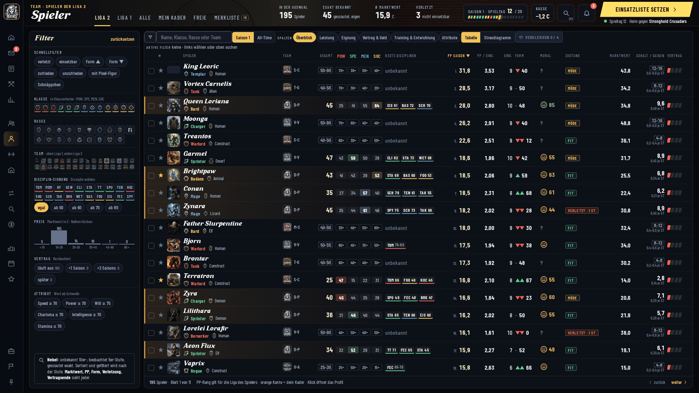
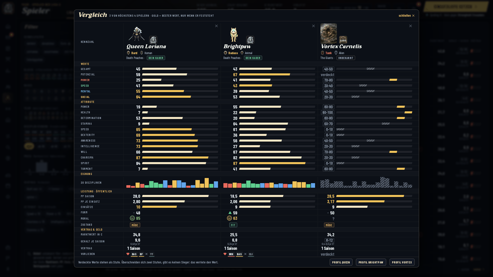
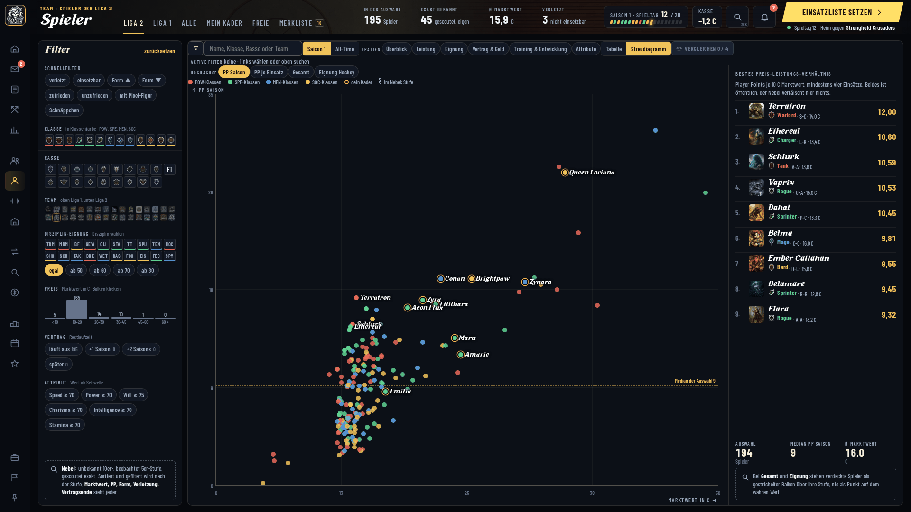
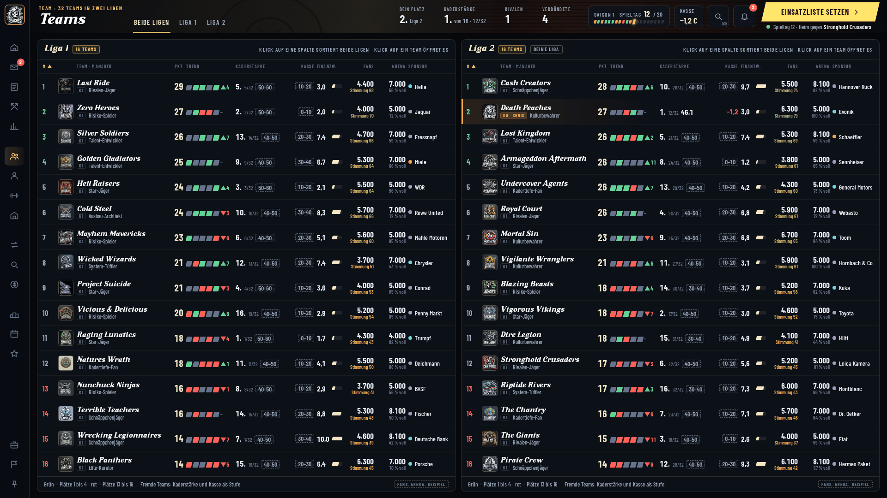
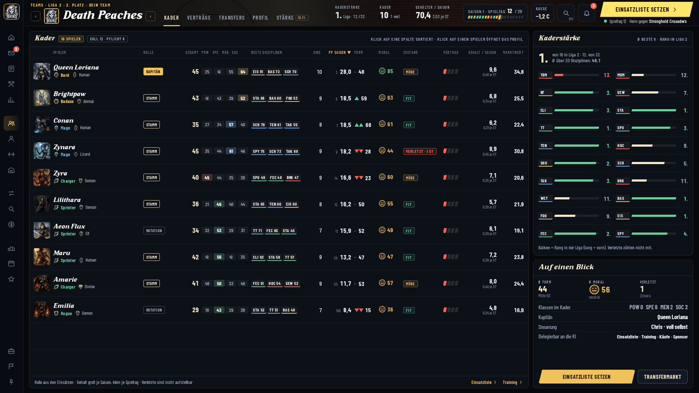
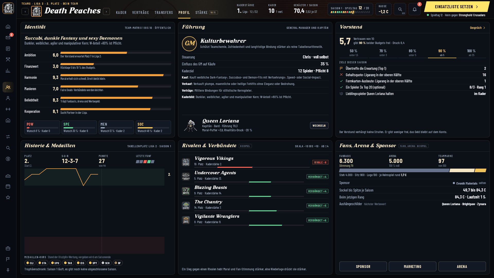
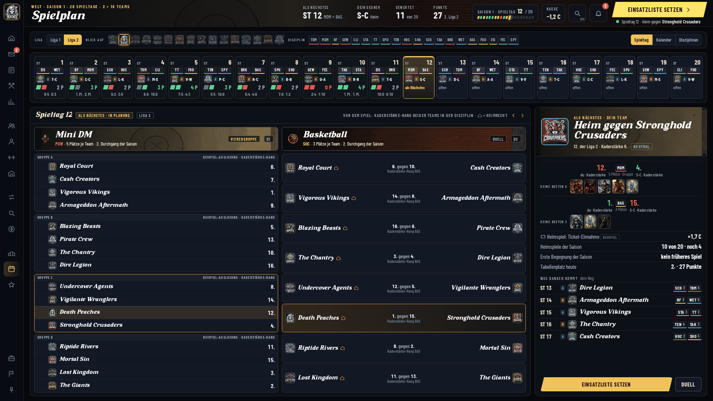
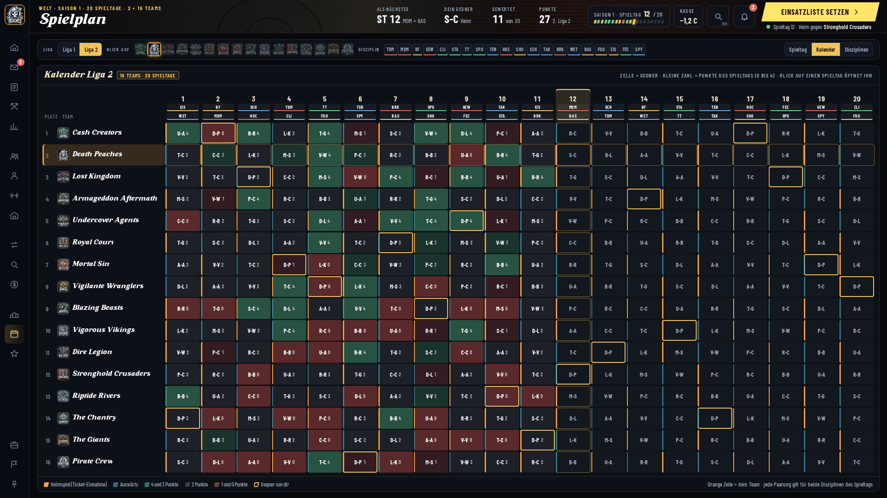
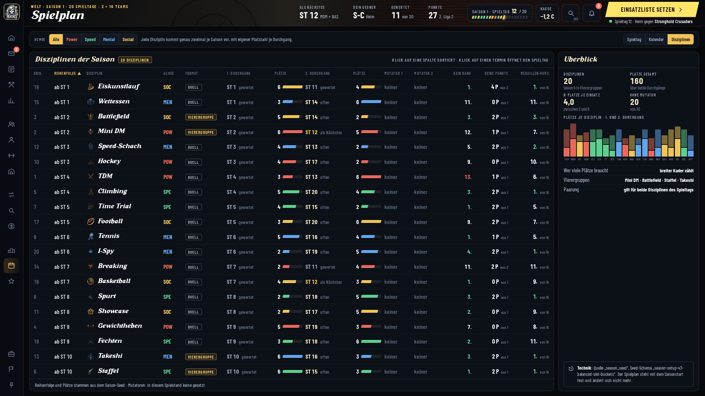

# Spieler, Teams und Spielplan — Mockups im neuen Stil (24.11.2026)

**Status: Mockup + Erklärung. Gebaut wird erst nach Chris' OK. Kein App-Code in diesem Stand.**

| Seite | Mockup (klickbar) | löst ab |
|---|---|---|
| Spieler | `public/mockups/spieler-modern-24-11.html` | `app/foundation/players-table/FoundationPlayersTableNewLook.tsx` samt Vergleichs-Overlay, Podium, Query-Chips, Streudiagramm, Ridgeline |
| Teams | `public/mockups/teams-modern-24-11.html` | `teams-v2/FoundationTeamsNewLook.tsx`, `FoundationTeamsDetailPanel.tsx`, `FoundationRosterSellPeekDrawer.tsx`, `team-profile/TeamProfileNewLook.tsx` |
| Spielplan | `public/mockups/spielplan-modern-24-11.html` | `ranks-v2/FoundationDiszisNewLook.tsx`, `FoundationDiszisPanel.tsx`, `FoundationDiszisHost.tsx` (View `diszis`) |

- Gemeinsame Dateien: `public/mockups/modern-24-11/` (`rahmen.css`, `bausteine.css`, `rahmen.js`, `tabelle.js`, `daten.js`).
- Bilder: `docs/design/spieler-teams-modern-24-11/` (40 Aufnahmen, 1920×1080, 2560×1440, Hauptansichten zusätzlich 1710×1112).
- Stil: Schiene, Regieband, Taktgeber, Tafeln, Knöpfe und Marken sind **unverändert** aus `kader-teams-modern-18-11.html`
  übernommen (`rahmen.css` ist ein Auszug daraus). `--haus` (RaniraSeason) und `--zahl` (Barlow Condensed) lokal, reine CSS/SVG,
  0 PixelLab-Generationen.
- Verhältnis zum Mockup vom 18.11. (`kader-teams-modern-18-11.html`, Entscheidungen in dessen Doku Abschnitt 7a): die drei Seiten
  **führen es weiter**. Die Reiter **Stärke** und **Duell** gelten unverändert und sind aus dem Team-Kopf verlinkt. Neu eingearbeitet
  sind die Entscheidungen vom 18.11. (Marktwert immer exakt, Rang gegen die Liga plus klein gegen alle 32, Nebel abschaltbar,
  Streudiagramm bleibt) und alles, was seither dazukam (Gehalt groß je Saison, Klassenfarbe mit Icon, alle Tabellen sortierbar,
  Trainingsvorlieben, Entwicklung, Werbewert, Arena, Medaillen, E1-Ergebnis).

## 0. Was echt ist und was Beispiel

Die Mockups zeigen den **echten Spielstand** aus dem Live-Abbild (Branch `live-save`, 24.11., Spielstand
`new-game-1795114260527-nzr0z9`, Saison 1, Spieltag 12 in Planung, 11 gewertet). Gelesen in eine temporäre Kopie, nichts
zurückgeschrieben, Kopie gelöscht. Aktives Team ist **Death Peaches** (Chris), 2. in Liga 2.

| Echt | Beispiel (im UI mit „Beispiel“ markiert) |
|---|---|
| 32 Teams, Liga, Tabelle, Punkte je Spieltag, Kasse, Team-Matrix, Thema, GM-Typ und Kaufstil, Vorstand (Vertrauen, Druck, Ziele), Sponsor, Kapitän | Scouting-Stand der fremden Spieler |
| 376 Spieler unter Vertrag und 174 freie: Werte, Eignung, Attribute, Marktwert, Gehalt, Vertrag, Kaufpreis | Trainingsvorlieben, Trainingsziel, Entwicklung der Saison |
| Player Points (C2) und Einsätze, Form mit Verlauf, Moral, Verletzung, Belastung | Werbewert, Werbegeld, Teammarke |
| Spielplan: alle 320 Paarungen mit Heim/Auswärts, Disziplinen und Plätze je Spieltag | Fans, Stimmung, Arena-Plätze, Ticket-Einnahmen (die Arena-Regel gilt in diesem Spielstand erst ab Saison 2) |
| Ergebnisse der 11 Spieltage (Rohwert und E1), Vierergruppen mit Plätzen, 376 Transfers | Beziehungen zwischen Teams, Verkaufs-Einschätzung, Vierergruppen künftiger Spieltage |

Zwei Dinge fallen im echten Stand auf und sind kein Fehler des Mockups: **alle Verträge bis auf einen laufen nach Saison 1 aus**
(Laufzeit 1), und es gibt **noch keinen Abgang** (nur Zugänge). Mutatoren sind in diesem Spielstand keine gesetzt.

## 1. Spieler (`spieler-modern-24-11.html`)

### 1.1 Aufbau

- **Regieband:** Umfang als Reiter (eigene Liga, andere Liga, Alle, Mein Kader, Freie, Merkliste mit Zähler), rechts vier
  Kennzahlen der Auswahl (Anzahl, exakt bekannt, Ø Marktwert, verletzt).
- **Links, Filter (einklappbar):** Schnellfilter (verletzt, einsetzbar, Form ▲/▼, zufrieden, unzufrieden, mit Pixel-Figur,
  Schnäppchen), Klasse (13 Icons in Klassenfarbe), Rasse (Icons), Team (32 Wappen, oben Liga 1, unten Liga 2), Disziplin-Eignung
  (20 Kürzel plus Schwelle ab 50/60/70/80), Preis (Marktwert-Histogramm, Balken klickbar), Vertrag (läuft aus, +1, +2, später,
  je mit Zähler), Attribut-Schwellen. Unten die Lesehilfe zum Nebel.
- **Mitte, die Tabelle (18 Zeilen je Blatt, kein Scrollen):** Suche, Zeitraum (Saison / All-Time), **sechs Spalten-Sätze**,
  Umschalter Tabelle / Streudiagramm, Knopf „Vergleichen n / 4“. Darunter die aktiven Filter als Marken zum Wegklicken.
- Feste Spalten: Vergleichs-Haken, Stern (Merkliste), Bild, Name mit **Klasse in Klassenfarbe samt Icon** und Rasse mit Icon,
  Team. Der eigene Kader hat eine orange Kante. **Jede Spalte sortiert**, auch jede der vier Achsen, 20 Disziplinen und 12
  Attribute einzeln. **Klick auf eine Zeile öffnet das Spielerprofil** (`spielerprofil-modern-18-11.html`), Klick auf das Wappen
  das Team.

### 1.2 Die sechs Spalten-Sätze

| Satz | Spalten | Bild |
|---|---|---|
| Überblick | Gesamt, POW/SPE/MEN/SOC, beste Disziplinen, PP Saison mit Liga-Rang, PP je Einsatz, Einsätze, Form, Moral, Zustand, Marktwert, Gehalt, Vertrag | `01-…` |
| Leistung | Einsätze, PP Saison, PP je Einsatz als Balken bis 5, Bestwert, stärkste Einsätze, Form, Form-Verlauf, Moral, Belastung, Zustand | `02-…` |
| Eignung | Gesamt, **alle 20 Disziplinen** als Wärmefeld (gewählte Disziplin umrandet), PP | `03-…` |
| Vertrag & Geld | Marktwert, Kaufpreis, Wertänderung, Gehalt, Forderung, Vertrag, Vertragsform, PP je 10 C, Werbewert, Werbegeld | `04-…` |
| Training & Entwicklung | Gesamt, Potenzial, Entwicklung der Saison (Zahl und Wort), Trainingsziel mit ×1,30 / ×1,00 / ×0,50, Vorlieben (♥ zwei Lieblinge, ✕ eine ungeliebte), Belastung, Form, Moral, Zustand | `05-…` |
| Attribute | Gesamt, **alle 12 Attribute** als Wärmefeld, Potenzial, PP | `06-…` |

Aktuelle Mechaniken, wie sie erscheinen: **PP-Skala** als Balken bis 5 („Top ≈ 5“) und Bestwert je Einsatz; **Form** als Pfeil
plus Zahl (Mitte 50); **Moral** als Gesicht in Farbe plus Zahl (Stufen 80/60/40/20 wie `BcMoralGesicht`); **Verletzung** als rote
Marke „verletzt · n ST“ (nicht einsetzbar), „müde“ ab Belastung 60; **Gehalt groß je Saison, klein je Spieltag**.

### 1.3 Vergleich und Streudiagramm

**Vergleich (2 bis 4 Spieler):** Figur oder Porträt, Klasse, Team, Scouting-Stand; darunter Werte, 12 Attribute, 20 Disziplinen
als Säulen, Leistung, Vertrag und Geld, Vorlieben. Gold markiert den besten Wert **nur, wenn er feststeht**: überschneiden sich
zwei Nebel-Stufen, gibt es keinen Sieger.

**Streudiagramm** (bleibt laut Entscheidung 12 vom 18.11.): Querachse Marktwert (immer exakt), Hochachse wählbar (PP Saison,
PP je Einsatz, Gesamt, Eignung in der gewählten Disziplin). Punkte in Klassenfarbe, eigener Kader mit orangem Ring, Median der
Auswahl als Linie, rechts das beste Preis-Leistungs-Verhältnis. Verdeckte Werte stehen als gestrichelter Balken über ihre Stufe.

### 1.4 Wo die heutigen Funktionen bleiben

| Heute (`FoundationPlayersTableNewLook` und Overlays) | Im Mockup |
|---|---|
| Umfang Alle / Aktive / Free Agents | Reiter im Regieband, dazu Liga 1, Liga 2, Mein Kader, Merkliste |
| Diese Saison / Alltime | Umschalter „Saison 1 / All-Time“ |
| Namenssuche | Suchfeld (Name, Klasse, Rasse, Team) |
| Team- und Klassenfilter | Filter links (Wappen, Klassen-Icons), dazu Rasse |
| Marktwert-Brackets (Balken klickbar) | Filter „Preis“, dasselbe Histogramm |
| Vertragsauslauf-Buckets | Filter „Vertrag“ mit Zählern |
| Query-Chips (Attribut, Vergleich, Wert) und „Preset laden“ | Attribut-Schwellen und Disziplin-Schwelle links, Schnellfilter als fertige Vorgaben; aktive Filter als Marken |
| Spalten Bild, Name, Team, Klasse, Rasse, OVR, POW/SPE/MEN/SOC, Beste Diszi, PPs, Einsätze, Marktwert, Gehalt, Vertrag | Satz „Überblick“ |
| CA/PO | Gesamt und Potenzial (Satz Training, Attribute) |
| Achsen aufklappbar in Attribute | Satz „Attribute“ (alle zwölf sortierbar) |
| MVS, PPs | PP Saison, PP je Einsatz, Bestwert (Satz Leistung) |
| VK-Wert | Team › Verträge, Spalte „Netto bei Verkauf“ (nur eigener Kader) |
| Traits | Spielerprofil (in der Liste nicht mehr; Frage 3) |
| Spalten-Menü, Spaltengruppen, gespeicherte Ansichten | **sechs feste Spalten-Sätze** (Entscheidung 12: Menü und gespeicherte Ansichten entfallen; Frage 1) |
| Vergleichs-Overlay | Vergleich, unverändert 2 bis 4 Spieler |
| Kennzahlen (Spieler, Ø OVR, Ø MW, Gehälter, Wunschliste) | Kennzahlen im Regieband; Ø Gesamt entfällt, weil er im Nebel nicht ehrlich zu rechnen ist |
| Analyse-Hub: Preis-Leistung (Streudiagramm, Top, Median) | Ansicht „Streudiagramm“ |
| Analyse-Hub: Auf- und Absteiger | Spalte „Wertänderung“ (Satz Vertrag & Geld), sortierbar |
| Analyse-Hub: Spezialisierungs-Verteilung | Disziplin-Filter plus Satz „Eignung“ |
| Leader-Podium, volle Rangliste | Seite Leaders (`leaders-modern-22-11.html`); hier Sortierung nach PP mit Liga-Rang |
| Ridgeline | entfällt (Entscheidung 12) |
| CSV- und TSV-Export | entfällt (Entscheidung 12) |
| Wishlist-Marke, „Dein Spieler“ | Stern (Merkliste je Manager), orange Kante |
| aufgeklappte Zeile | Klick öffnet das Spielerprofil |

### 1.5 Neu

Liga-Reiter (2 × 16), Rasse-, Disziplin- und Zustandsfilter, Spalten für Form-Verlauf, Belastung, Trainingsziel, Vorlieben,
Entwicklung, Werbewert, Kaufpreis und Wertänderung, PP je 10 C, Nebel-Regeln in Sortierung, Filter, Vergleich und Diagramm.

## 2. Teams (`teams-modern-24-11.html`)

### 2.1 Liga-Übersicht (`?ansicht=liga`, `&liga=beide|1|2`)

Beide Ligen nebeneinander, je 16 Zeilen: Platz (grün 1 bis 4, rot 13 bis 16), Wappen, Team mit Manager (Mensch oder KI, GM-Typ),
Punkte, **Trend** (letzte fünf Spieltage, Platz gegen Startplatz), **Kaderstärke** (Rang in der Liga, klein unter allen 32, Wert),
**Kasse**, **Finanzwert 1 bis 10**, **Fans** mit Stimmung, **Arena** mit Auslastung, **Sponsor** mit Seltenheit. Klick auf eine
Spalte sortiert beide Ligen, Klick auf ein Team öffnet es. Reiter „Liga 1“ / „Liga 2“ zeigt eine Liga breit mit S-U-N,
Verhältnis, Kadergröße und Verletzten, Ø Moral, Gehältern, Marktwert des Kaders, Vorstand und Beziehung
(`11-teams-liga-2-breit-1920.png`).

### 2.2 Team-Detail: Kader, Verträge, Transfers

Kopf für jedes Team gleich: ‹ › blättert durch die Liga, Reiter **Kader · Verträge · Transfers · Profil**, dazu Stärke und (bei
fremden Teams) Duell aus dem Mockup vom 18.11.

- **Kader:** Tabelle mit Rolle (Kapitän, Stamm, Rotation, Ergänzung, abgeleitet aus den Einsätzen), Gesamt, Achsen, beste
  Disziplinen, Einsätze, PP mit Liga-Rang, Form, Moral, Zustand, Vertrag, Gehalt, Marktwert. Rechts **Kaderstärke** (Ø der besten
  sechs, Rang je Disziplin als Balken) und **Auf einen Blick** (Ø Form, Ø Moral, Verletzte, Klassen im Kader, Kapitän, Steuerung
  und was an die KI delegierbar ist).
- **Verträge** (`14-…`): Laufzeit, Gehalt, Anteil am Gehaltstopf, Forderung bei Verlängerung, Vertragsform, Marktwert, Kaufpreis,
  Netto bei Verkauf, Knöpfe Verlängern und Verkaufen (Verkaufen zeigt erst die Einschätzung). Rechts „Wer läuft wann aus“ mit den
  gebundenen Gehältern je Saison und **Zwei Budgets** (Transfer-/Investitionstopf, Gehaltstopf, Freigabe des Vorstands, Vertragsmix).
- **Transfers** (`16-…`): alle Zu- und Abgänge der Saison mit Ablöse, Gehalt, Laufzeit, Marktwert heute, Wertänderung, PP seither
  und Weg (Transfermarkt, KI-Kauflauf). Rechts Bilanz, Top-Kauf, Top-Verkauf, **Transferbedarf** (schwächste Disziplinen nach
  Liga-Rang) und der Kauf-, Verkaufs- und Vertragsstil des Managers.

### 2.3 Team-Profil (`?ansicht=profil`)

Sechs Tafeln: **Identität** (Thema, sechs Werte der Team-Matrix mit ihrer Wirkung, Wunsch-Achsen gegen den Kader), **Führung**
(GM-Typ, Einfluss, Kaderziel, Kauf-, Verkaufs- und Vertragsstil, Kapitän), **Vorstand** (Vertrauen, Freigabe-Stufe, Ziele der
Saison), **Historie & Medaillen** (Platz, S-U-N, Punkte, Verlauf des Tabellenplatzes, Medaillen-Kurs je Disziplin,
Trophäenschrank), **Rivalen & Verbündete**, **Fans, Arena & Sponsor** (Fanbasis, Stimmung, Steh/Sitz/Loge, Teammarke, Sponsor mit
Sockel bis Spitze, Aushängeschilder).

### 2.4 Wo die heutigen Funktionen bleiben

| Heute | Im Mockup |
|---|---|
| Teams · Liga, Teamtabelle (`FoundationTeamsDetailPanel`) | Liga-Übersicht |
| Kacheln Rang, Punkte, Kader, Cash, Marktwert, Gehalt | Regieband des Teams, Liga-Übersicht breit |
| Kader-Ansicht Portraits / Liste & Verträge, Filter Starter / Bench | Reiter Kader (Rolle als Spalte, sortierbar) und Verträge |
| Spalten Spieler, Status, Form, Moral, OVR, Achsen, PPs, PPs ges., MVS | Reiter Kader |
| Stärken je Disziplin, Disziplin-Profil, Sortierung, Radar | Kaderstärke-Tafel im Kader; ausführlich Reiter Stärke (18.11.); Radar entfällt (Entscheidung 12) |
| Kapitän wählen, Kandidaten, Führungswertung | Profil › Führung („Wechseln“); Kandidaten wie im Reiter Klub vom 18.11. |
| Verträge & Auslauf, Auslauf-Center, Restlaufzeiten, Ø Restlaufzeit, Ausläufer | Verträge: Spalte Laufzeit, Tafel „Wer läuft wann aus“ |
| Gehaltsforecast, gebundene Summen je Saison, Gehaltslast p. a. | Säulen „Gebundene Gehälter je Saison“ |
| Vertragsmix, Vertragsform | Spalte Vertragsform, Zeile Vertragsmix |
| Gehalt gegen üblich, VK gegen Marktwert, Buyout, Netto bei VK (`FoundationRosterSellPeekDrawer`) | Spalten „Forderung neu“ und „Netto bei Verkauf“; „Verkaufen“ öffnet die Einschätzung (Brutto, Buyout, Netto, gegen Marktwert) |
| Verlängern (`ContractRenewalNegotiationModal`) | Knopf „Verlängern“ führt in die Verhandlung des Transfermarkts |
| Reiter Transfers: Zugänge, Abgänge, Top-Kauf, Top-Verkauf | Reiter Transfers (zurück im Team; am 18.11. war er in die Markt-Historie verlegt, Frage 4) |
| Transferbedarf, Need Score, Roster Gap, Transfermarkt-Tendenz, AI Preview | Tafel Transferbedarf mit dem Stil des Managers; die KI-Vorschau bleibt im Office |
| Cash · GuV (Projektion), Budget Pressure, Upkeep Pressure | Tafel „Zwei Budgets“, Detail auf der Finanzseite |
| Team Identity, Ambition / Finanzen, Board / Harmony, Manners / Coop, Popularity, Zielachsen | Profil › Identität |
| Board-Ziele, Board-Vorschlag, Board-Vertrauen, Druck | Profil › Vorstand |
| General Manager, GM-Achsen, GM-Historie | Profil › Führung (GM-Historie ab der zweiten Saison in der Historie-Tafel) |
| Saison-Verlauf (Rang, Punkte, Cash, Marktwert), Ligatabelle | Profil › Historie & Medaillen (Rang); Cash und Marktwert auf der Finanzseite |
| Medaillen (Gold, Silber, Bronze), archivierte Team-Saisons | Medaillen-Kurs und Trophäenschrank |
| Teambeziehungen | Profil › Rivalen & Verbündete, Spalte „Beziehung“ |
| Fans & Beliebtheit, Fan-Favoriten, Starpower | Profil › Fans, Arena & Sponsor (Aushängeschilder) |
| Squad Depth Chart, Tiefe-Stress, Top-Disziplinen, Zusammensetzung | Kaderstärke-Tafel, „Klassen im Kader“, Reiter Stärke |
| Blättern zwischen Teams, Sprung ins Spielerprofil | ‹ › im Kopf, Klick auf jede Spielerzeile |

### 2.5 Neu

Beide Ligen auf einem Bildschirm, Trend, Fans, Arena, Sponsor und Finanzwert in der Übersicht, Rang gegen die Liga und klein
gegen alle 32, zwei Budgets mit Vorstands-Freigabe, Medaillen-Kurs, Teammarke und Aushängeschilder, Steuerung und Delegation je
Team, Nebel für fremde Teams.

## 3. Spielplan (`spielplan-modern-24-11.html`)

Chris: „sehr unübersichtlich“. Heute stehen 20 gleich große Karten ohne Gegner und ohne Ergebnis über einer Konfigurations-Tabelle.
Neu führt **eine Leiste mit 20 Spieltagen** durch die Saison, darunter steht immer **ein** Spieltag vollständig.

### 3.1 Ansicht „Spieltag“ (`?ansicht=saison`, `&st=1..20`)

- **Filterleiste:** Liga 1 / Liga 2, „Blick auf“ (16 Wappen: wessen Weg die Leiste zeigt, Standard das eigene Team), Disziplin
  (20 Kürzel: blendet alle Spieltage ohne diese Disziplin ab und springt zum nächsten Termin), Umschalter Spieltag / Kalender /
  Disziplinen.
- **Saison-Leiste:** je Spieltag die zwei Disziplinen in Achsenfarbe (Vierergruppen heller), der Gegner mit **H** oder **A**,
  bei gewerteten Spieltagen Sieg/Remis/Niederlage je Disziplin, Punkte (0 bis 4) und die Ergebnisse. Der nächste Spieltag hat
  eine goldene Kante.
- **Spieltag:** oben die zwei Disziplinen mit Kulisse, Achse, Plätzen je Team, Durchgang (1. oder 2.) und Format. Darunter je
  Disziplin die acht **Duelle** (Heim links mit Haus-Zeichen, Gast rechts) oder die vier **Vierergruppen**. Das eigene Duell bzw.
  die eigene Gruppe ist orange. Gewertet: „6.019 : 4.871 → E1“ klein, **8 : 5** groß; Gruppen mit Platz, Wert und Punkten
  (`21-…`, `22-…`). Vor dem Spiel: Kaderstärke-Rang beider Teams in der Disziplin.
- **Rechts, der Spieltag aus Sicht des Teams:** Gegner, Heim oder Auswärts, Beziehung; je Disziplin der eigene Rang gegen den des
  Gegners und die besten eigenen Spieler für die Plätze; **Ticket-Einnahme bei Heimspielen**, Heimspiele der Saison, Hinspiel,
  Tabellenplatz; **„Was danach kommt“** (die nächsten fünf Spieltage). Knopf „Einsatzliste setzen“ bzw. „Spieltag ansehen“.

### 3.2 Ansicht „Kalender“ (`?ansicht=kalender`)

16 Teams × 20 Spieltage. Zelle = Gegner, linker Strich orange = Heimspiel, Farbe und kleine Zahl = Punkte des Spieltags. Das
eigene Team ist orange hinterlegt, die Gegner des Blick-Teams sind gold umrandet, ein Disziplin-Filter hebt deren Spieltage
hervor (`24-…`). Klick auf einen Spieltag öffnet ihn, Klick auf ein Team stellt den Blick um.

### 3.3 Ansicht „Disziplinen“ (`?ansicht=disziplinen`)

Die bisherige Konfigurations-Tabelle, sortierbar: Original-Position, Reihenfolge, Disziplin, Achse, Format, 1. und 2. Durchgang
mit Termin und Plätzen, Mutator 1 und 2, dazu neu der eigene Kaderstärke-Rang, die eigenen Punkte und der Medaillen-Kurs. Rechts
Kennzahlen, Plätze je Disziplin als Säulen und die technischen Details (Quelle, Seed).

### 3.4 Wo die heutigen Funktionen bleiben

| Heute (`FoundationDiszisNewLook`) | Im Mockup |
|---|---|
| Spieltag-Ablauf: Kartenraster über alle Spieltage, je zwei Disziplinen mit Plätzen | Saison-Leiste und Spieltag-Kopf |
| Achsen-Farblegende | Achsenfarbe an jeder Disziplin, Achse im Spieltag-Kopf und als Spalte |
| Disziplin-Konfiguration: Original, Reihenfolge, Disziplin, Spieler, Mutator 1, Mutator 2 | Ansicht Disziplinen, dieselben Spalten |
| Sortierung der Konfiguration | jede Spalte sortiert |
| Kategorie-Filter Alle / POW / SPE / MEN / SOC, „Alle anzeigen“ | Achsen-Filter der Ansicht Disziplinen |
| Kennzahlen (Disziplinen, Spieler gesamt, Ø Spieler je Diszi, ohne Mutator) | Tafel Überblick |
| Balken „Spieleranzahl je Disziplin“ | Säulen „Plätze je Disziplin“, beide Durchgänge |
| Technische Details (Quelle, Seed) | Kasten „Technik“ |
| Leerzustand „Noch kein Saison-Matchday-Plan“ | bleibt als Leerzustand der Leiste (im Mockup nicht gezeigt) |

Neu: Paarungen und Vierergruppen, Heim und Auswärts, Ergebnisse (Rohwert und E1), Weg des eigenen Teams, Kalender, Filter nach
Liga, Team und Disziplin, Ticket-Einnahme, Vorschau auf den nächsten Spieltag.

## 4. Scouting-Nebel

Die Regeln sind die vom 18.11. mit Chris' Entscheidungen. `?nebel=aus` zeigt die Einstellung „Fog of War aus“.

| | Unbekannt | Beobachtet | Gescoutet / eigener Kader |
|---|---|---|---|
| Gesamt, Achsen, Eignung, Attribute | 10er-Stufe | 5er-Stufe | exakt |
| Beste Disziplinen | „unbekannt“ | eine, mit Stufe | drei, mit Wert |
| Potenzial, Vertragsform, Forderung, Vorlieben, Entwicklung, Belastung, Werbegeld | verdeckt | verdeckt | sichtbar |
| Moral | „?“ | Gesicht | Gesicht und Zahl |
| Gehalt (Spieler unter Vertrag) | Stufe (4 C je Saison) | Stufe | exakt |
| **Marktwert**, Kaufpreis, Forderung freier Spieler | exakt | exakt | exakt |
| Name, Bild, Klasse, Rasse, Team, Form, Verletzung, Einsätze, Player Points, Vertragsende | öffentlich | öffentlich | öffentlich |

1. **Feste Stufen**, nie ein Bereich um den wahren Wert.
2. **Sortieren rechnet mit der Stufe**, bei Gleichstand der Name; die Fußzeile sagt es an (`09-…`).
3. **Filtern rechnet mit dem, was man sieht:** eine Schwelle trifft nur Stufen, die ganz darüber liegen.
4. **Vergleich und Streudiagramm erben den Nebel** (kein Sieger bei überlappenden Stufen, Balken statt Punkt).
5. **Fremde Teams:** Kaderstärke-Rang exakt, Wert als 10er-Stufe (exakt erst, wenn der ganze Kader gescoutet ist); Kasse und
   Gehaltssumme als Stufe; Vorstand als hoch / mittel / niedrig, Ziele und Budgets gar nicht; Ø Moral nur als Gesicht; Sponsor
   mit Namen und Seltenheit, ohne Beträge. Öffentlich: Tabelle, Trend, Team-Matrix, Fans, Arena, Laufzeiten, Ablösen
   (`13-…`, `15-…`, `18-…`).

## 5. Mehrspieler

Das aktive Team kommt aus dem angemeldeten Manager (`activeManagerTeamId`), nie aus einer festen Annahme. Im Mockup schaltet
`?ich=V-W` auf Franky mit den Vigilante Wranglers (`19-teams-mehrspieler-franky-1920.png`): orange Kante, „du“, Nebel, Blick
im Spielplan, Kennzahlen und Taktgeber folgen. Je Manager getrennt: Merkliste, Scouting-Stand, Vergleichsauswahl. Menschliche
Teams tragen ihre Marke (Chris, Franky, Ramona) in jeder Liste; „Auf einen Blick“ zeigt Steuerung und Delegation.

## 6. Offene Fragen für Chris, jeweils mit Empfehlung

| # | Frage | Empfehlung |
|---|---|---|
| 1 | **Spalten-Sätze statt Spalten-Menü.** Am 18.11. hast du Spalten-Menü und gespeicherte Ansichten gestrichen. Das Mockup bietet sechs feste Sätze. Reicht das? | **Ja.** Wenn ein Satz fehlt, kommt er als siebter dazu. |
| 2 | **Filter links** (alles sichtbar, einklappbar) oder als Leiste über der Tabelle? | **Links.** Mit `?filter=zu` hat die Tabelle die volle Breite. |
| 3 | **Traits** stehen nur noch im Spielerprofil. Eigene Spalte? | **Nein**, sie sprengen die Zeile. |
| 4 | **Reiter Transfers im Team.** Am 18.11. war er in die Historie des Transfermarkts verlegt. Jetzt steht er wieder im Team. | **Im Team die laufende Saison**, ältere Saisons in der Markt-Historie. |
| 5 | **Kasse fremder Teams** als 10er-Stufe, Gehaltssumme als 20er-Stufe? | **Ja.** Der Finanzwert ist öffentlich und reicht zur Einordnung. |
| 6 | **Arena, Fans, Sponsor-Name fremder Teams öffentlich**, Beträge nicht? | **Ja.** |
| 7 | **Rolle im Kader** aus den Einsätzen (Stamm ab 8, Rotation ab 4) statt aus dem Vertragsfeld? Im Spielstand steht bei fast allen „prospect“. | **Aus den Einsätzen**, Schwellen beim Bau an der Saisonlänge ausrichten. |
| 8 | **Vorlieben und Trainingsziel fremder Spieler:** verdeckt bis zum Scouting? | **Ja.** |
| 9 | **Spielplan: Blick auf ein fremdes Team** zeigt dessen Weg und Ergebnisse (öffentlich), aber nicht dessen beste Spieler. | **So übernehmen.** |
| 10 | **Vierergruppen künftiger Spieltage** stehen im Mockup als Beispiel. Im Spiel sind sie schon vorab bestimmt. Vorab zeigen? | **Ja, vorab zeigen.** |
| 11 | **Rohwert neben dem E1-Ergebnis** („6.019 : 4.871 → 8 : 5“): der Rohwert ist vierstellig. | **Klein lassen**, groß nur das E1-Ergebnis. |
| 12 | **Kalender als eigene Ansicht** oder nur die Leiste? | **Beides.** |
| 13 | **Ticket-Einnahme im Spielplan:** je Heimspiel die Erwartung des eigenen Teams; bei fremden Teams nur die Auslastung. | **Ja.** |
| 14 | **Medaillen-Kurs** (Stand der Disziplin-Wertung während der Saison) zeigen, obwohl erst am Saisonende vergeben wird? | **Ja**, als „Kurs“ beschriftet. |

## 6a. Entscheidungen (Chris, 24.11.) — gelten für den Bau, gehen den Empfehlungen in Abschnitt 6 vor

Die drei Mockups sind freigegeben, **gebaut wird ab Samstag, 28.11., 16:05**.

| # | Entscheidung |
|---|---|
| 1 | Sechs feste Spalten-Sätze reichen erstmal. |
| 2 | Filter links. |
| 3 | **Traits bekommen eine eigene Spalte** in der Liste, gern untereinander gestapelt. Nur wenn die Zeile dann wirklich zu breit wird, weglassen. |
| 4 | Reiter Transfers im Team zeigt die **laufende Saison**; ältere Saisons in der Historie (alternativ als eigener Reiter im Transfermarkt). |
| 5 | **Kasse fremder Teams als Spanne mit wechselnder Breite** (mal enger, mal weiter, etwa 10–30, also rund 20 bis 30 C Unterschied), nicht immer dieselbe 10er-Stufe. **Gehaltssumme in 10er-Schritten** (40–50 usw.). **Der Finanzwert wird gar nicht angezeigt** — er ist ein reiner Hintergrundwert (gilt für alle Seiten). |
| 6 | Arena, Fans und Sponsor-Name fremder Teams öffentlich, Beträge nicht. |
| 7 | **Rolle im Kader ausblenden.** Erst später, falls sie in Vertragsverhandlungen eingebunden wird (Prospect, Stammspieler …). |
| 8 | Trainingsvorlieben und Trainingsziel gehören zum Fog of War (verdeckt bis gescoutet). |
| 9 | **Spielplan fremder Teams komplett öffentlich**: Weg, Ergebnisse **und** Top-Spieler. |
| 10 | **Der komplette Spielplan der Saison ist einsehbar**, auch die Vierergruppen; er wird am Saisonanfang festgelegt. |
| 11 | **Nur das Ergebnis zeigen** („8 : 5“), den Rohwert **nur im Hover**. |
| 12 | Kalender als eigene Ansicht **und** die Leiste. |
| 13 | Ticket-Einnahme wie vorgeschlagen: eigenes Team erwartete Einnahme je Heimspiel, fremde Teams nur Auslastung. |
| 14 | Medaillen-Kurs schon während der Saison sichtbar (als „Kurs“). |

**Neuer Auftrag aus Punkt 14 (Konzept + Mockup zuerst, ab Samstag):**

- **Spieler-Awards** wie MVP (Most Valuable Player), Most Improved Player usw. Konzept überlegen, Awards (Embleme) generieren
  (PixelLab-Requisiten), sie erscheinen im Spielerprofil.
- **Medaillen der Teams** (Gold, Silber, Bronze) im Teamprofil, damit sich die Teams damit schmücken können, plus
  **Medaillenspiegel**.
- **Team-Historie über die Saisons:**
  - Wie oft war ein Team 1., 2., 3., Top 5, Top 10?
  - Marktwert-, Kassen- und Vermögensentwicklung (Kasse + Kader + Gebäude).
  - Punkte je Saison (S1, S2, S3 …), All-Time-Punkte und Durchschnittspunkte, sortiert nach Durchschnittspunkten.
  - **Getrennt nach Ligen**, damit ein Liga-2-Team mit 20 Punkten nicht zu den besten insgesamt zählt.
- **Spieler:** ähnliche Historie, aber **ohne Liga-Trennung**, weil Player Points ligaübergreifend vergleichbar sind.

## 7. Bedienung

Graue Leiste oben (gehört nicht zum UI): Ansicht, Spalten-Satz bzw. Team bzw. Spieltag, aktiver Manager, Nebel. `?still=1`
blendet sie aus. Die Schiene verbindet die drei Seiten untereinander und mit den übrigen Mockups.

| Seite | URL-Schalter |
|---|---|
| Spieler | `?ansicht=liste\|vergleich\|streu`, `?umfang=liga2\|liga1\|alle\|kader\|frei\|merk`, `?spalten=ueber\|leist\|eig\|geld\|train\|attr`, `?sort=…&dir=-1\|1`, `?d=0..19`, `?eig=60`, `?kl=Mage,Bard`, `?team=C-C`, `?mw=0..5`, `?vt=1..4`, `?zu=verl,formauf`, `?vgl=slug,slug`, `?y=pps\|ppe\|ov\|eig`, `?filter=zu` |
| Teams | `?ansicht=liga\|kader\|vertrag\|transfers\|profil`, `?team=D-P\|C-C\|…`, `?liga=beide\|1\|2`, `?sort=…&dir=…` |
| Spielplan | `?ansicht=saison\|kalender\|disziplinen`, `?st=1..20`, `?liga=1\|2`, `?team=…`, `?d=0..19`, `?achse=0..3` |
| alle | `?nebel=aus`, `?ich=V-W`, `?still=1` |

Hinweis: „Profil öffnen“ führt in `spielerprofil-modern-18-11.html`. Dieses Mockup kennt nur seine eigenen Beispielspieler und
zeigt für die Spieler des Live-Stands seinen Standardspieler.

## 8. Bilder

Alle unter `docs/design/spieler-teams-modern-24-11/`, mit `?still=1`, Geräte-Pixelverhältnis 1, auf 256 Farben verkleinert.
Geprüft je Aufnahme: kein Seitenscroll, keine überlaufende Tafel, kein abgeschnittener Text.

| Nr. | Inhalt | Größen |
|---|---|---|
| 01 | Spieler, Überblick | 1920, 2560, 1710 |
| 02 bis 06 | Spalten-Sätze Leistung, Eignung (Hockey), Vertrag & Geld, Training & Entwicklung, Attribute (Nebel aus, Filter zu) | 1920 |
| 07, 08 | Vergleich, Streudiagramm | 1920, 2560 |
| 09 | Nebel-Sortierung mit aktiven Filtern | 1920 |
| 10 | Teams, beide Ligen | 1920, 2560, 1710 |
| 11 | Liga 2 breit | 1920 |
| 12, 14, 16, 17 | Kader, Verträge, Transfers, Profil (eigenes Team) | 1920, 2560 |
| 13, 15, 18 | Kader, Verträge, Profil eines fremden Teams im Nebel | 1920 |
| 19 | Mehrspieler: Franky als aktiver Manager | 1920 |
| 20 | Spielplan, nächster Spieltag | 1920, 2560, 1710 |
| 21, 22 | gewerteter Spieltag mit Duellen bzw. mit zwei Vierergruppen | 1920 |
| 23, 25 | Kalender, Disziplinen | 1920, 2560 |
| 24 | Kalender mit Blick auf ein anderes Team und Disziplin-Filter | 1920 |
| 26 | mit grauer Mockup-Leiste | 1920 |
