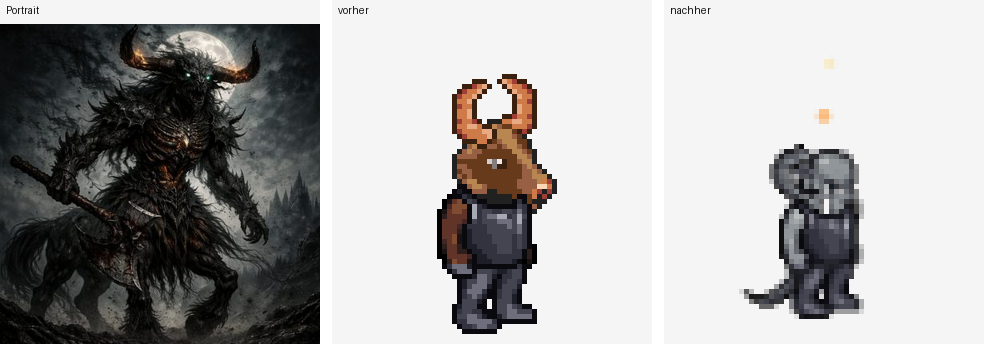

# Sprite-Cluster, gehörnter Minotaurus/Zentaur (16.10.)

Fortsetzung von [`sprite-cluster-runde-1.md`](./sprite-cluster-runde-1.md), Abschnitt "Was übrig
bleibt": der dort explizit auf später verschobene "gehörnte Minotaurus/Zentaur"-Cluster — Ironhoof,
Medibull, Omniclops, Roddox Harthelm, Tartarus, Kora. Ironhoof/Medibull waren das einzige damals
byte-identische Paar und wurden bereits angefasst (Ironhoof auf ★★★, Medibull laut damaligem Fazit
bewusst unverändert bei ★★ belassen, als "die richtige der Gruppe"). Die übrigen vier wurden in
Runde 1 nicht angefasst. Diese Runde schließt den Cluster ab.

## Aktueller Stand zuerst geprüft, nicht der 04.09.-Stand zitiert

Vor jeder Änderung wurde `data/generated/sprite-fit-bewertung.json` frisch gelesen statt den alten
Stand aus dem 04.09.-Dokument zu übernehmen. Ergebnis: Medibull steht inzwischen bei **★★**, nicht
mehr unverändert dokumentiert wie am 04.09. — zwischen 04.09. und heute gab es eine
"Sprite-Fit-Nachlieferung Batch 2" (13.10.), die bei Medibull/Roddox Harthelm/Tartarus jeweils die
Hautfarbe nachjustiert und bei Medibull den Hinweis auf die fehlende Sanitäter-Ausrüstung präzisiert
hat, aber keinen von beiden auf 3 Sterne gehoben hat. Omniclops stand bereits bei ★★★ (13.10.,
Hautfarbe auf `black` umgestellt) — nicht mehr in der 2-Sterne-Liste, wie der Auftrag vermutete.
Kora stand ebenfalls bereits bei ★★★.

| Charakter | Stand vor dieser Runde | Stand nach dieser Runde |
|---|---:|---:|
| Ironhoof | ★★★ (Runde 1) | unverändert, nicht Teil dieser Runde |
| Medibull | ★★ | ★★★ |
| Roddox Harthelm | ★★ | ★★★ |
| Tartarus | ★★ | ★★★ |
| Omniclops | ★★★ | unverändert (geprüft, keine Änderung nötig) |
| Kora | ★★★ | ★★★ (Rezept verbessert, Sterne gleich geblieben) |

## Strukturbefund, der alle sechs betrifft: der Minotaurus-Kopf ist nicht umfärbbar

Bevor einzelne Rezepte geändert wurden, wurde die immer wiederkehrende Beobachtung aus den
Bewertungstexten ("Gesicht wirkt wie ein Reh statt eines Stiers") an der Quelle geprüft, nicht nur
übernommen. Zwei Funde, beide per Code-Lektüre und per `renderProbe`-Sichtprobe nachgewiesen, nicht
nur vermutet:

1. **`kopf:"minotaur"` trägt eine Sonderpalette.** Sowohl `quellRampe()`/`faerbe()` (die von der
   animierten Live-Arena und damit auch von `renderProbe()` tatsächlich gelesene Einfärbe-Pipeline)
   als auch die parallele `bQuellRampe()`/`bFaerbe()`-Pipeline der Kader-Karten-Ansicht zählen aus,
   welcher Hautrampe die zwanzig Kopf-Blätter am nächsten liegen — Minotaurus trifft **4 %**, weit
   unter der 60-%-Schwelle, ab der ein Blatt überhaupt umgefärbt wird. Jeder `haut`-Wert läuft damit
   bei `kopf:"minotaur"` ins Leere: Tartarus blieb trotz `haut:"black"` sichtbar braun. Das ist der
   Grund, warum die Seitenansicht bei Minotaurus-Köpfen durchgehend "Reh statt Stier" liest — eine
   Baukasten-Eigenschaft des einzigen vorhandenen Stierkopf-Blatts, kein Einzelfall.
2. **Es gibt keine bessere Kopf-Alternative.** `kopf_wartotaur` (das einzige zweite gehörnte/
   tierische Kopf-Blatt neben `minotaur`) wurde angesehen (Vollblatt-Zoom, alle vier Richtungen) —
   es zeigt ein wolfs-/dämonenartiges Gesicht mit Reißzähnen und spitzen Ohren, keine bovine Form.
   Für Medibull/Roddox Harthelm (beide mit zum Bild passender brauner `minotaur`-Farbe) bleibt
   `kopf:"minotaur"` deshalb unverändert die beste verfügbare Annäherung — dokumentierter,
   strukturell unlösbarer Rest, derselbe Umgang wie beim Zentauren-Unterkörper in Runde 1.

Für Tartarus (der laut Bild SCHWARZ sein muss, nicht braun) folgt daraus die Konsequenz:
`kopf:"minotaur"` beibehalten hieße, die falsche Farbe zu behalten. Deshalb wurde dort (s.u.)
stattdessen `kopf:"orc"` verwendet, das seine Quellrampe zu hohem Prozentsatz trifft und sich
tatsächlich umfärben lässt — exakt das bei Omniclops (13.10.) und Dyrth bereits genutzte Verfahren.

**Zweiter Fund, beim Ausprobieren der Zielfarbe:** die beiden Palette-Tabellen im Code sind NICHT
identisch. `B_PAL` (Kader-Karten-Ansicht) führt `"fur_black"` (#040510 — #154259, kühles,
durchgehend dunkles Blauschwarz). `HAUT` (die von `faerbe()`/`quellRampe()` tatsächlich gelesene
Tabelle der animierten Live-Ansicht, die `renderProbe()` zeichnet) führt **kein** `"fur_black"` —
nur `black` (eine Hautton-Rampe mit bräunlichen hellen Stufen, #7F4C31/#603429) und `fur_grey`
(reines Anthrazit-Grau). Ein erster Versuch mit `haut:"fur_black"` wurde gebaut, per `renderProbe`
gegengeprüft und dabei als Fehlschlag entdeckt (Kopf blieb komplett unverändert grün, weil der Wert
in `HAUT` schlicht fehlt und `faerbe()` dann das Originalbild unverändert zurückgibt) — korrigiert
auf `haut:"fur_grey"`, das tatsächlich dunkelgrau einfärbt und sichtbar näher an der im Portrait
gezeigten schwarzen Farbe liegt als `black` (das denselben "sieht aus wie ein brauner Imp statt
schwarz"-Effekt gehabt hätte, den Dyrths eigene Bewertung für genau diese Kombination schon notiert).
Festgehalten, falls ein künftiger Agent denselben Weg versucht: **`B_PAL` und `HAUT` sind zwei
getrennte Tabellen mit unterschiedlichem Wertevorrat** — ein Wert, der in der einen existiert, muss
in der anderen nicht existieren, und nur `HAUT` zählt für das, was `renderProbe()`/die Live-Arena
tatsächlich zeichnen.

## Vorgehen je Charakter

### Medibull

| | Vorher | Nachher |
|---|---|---|
| Rezept | `{kopf:"minotaur",haut:"brown",ruest:"leder"}` | `{kopf:"minotaur",haut:"brown",ruest:"leder",ruestTon:"dunkel"}` |
| Sterne | ★★ | ★★★ |

Bild: muskulöser Stier-Sanitäter, grüne Cargo-Hose, Rotes-Kreuz-Patches, Stethoskop, Sanitätertasche.
Geprüft und verworfen: `kopf_wartotaur` (s.o., keine Verbesserung), `hose:"beine"` (einzige
Hosen-Alternative im Baukasten ist eine graue METALL-Beinschiene/Ritter-Look, kein Stoff — hätte den
Treffer verschlechtert, nicht verbessert), das `binde`-Blatt (liegt zwar als PNG im Baukasten, ist
aber in keinem Zeichenpfad der Engine verdrahtet — ein Einbau bräuchte neue Engine-Logik, die dieser
Auftrag ausdrücklich ausschließt). Einzige vertretbare Korrektur: `ruestTon:"dunkel"` statt der
unveränderten Leder-Grundfarbe — ein gedecktes Grau-Schwarz statt warmes Lederbraun, näher an einer
taktischen Sanitäter-Weste. Die Stier-Sanitäter-KATEGORIE selbst war schon vorher korrekt (anders
als bei Ironhoof/Tartarus ist der zweibeinige Bauplan hier strukturell richtig) — mit der
Farbkorrektur ist das kein bloßer generischer Vertreter seiner Kategorie mehr, aber die konkreten
Sanitäter-Requisiten (Kreuz/Stethoskop/Tasche) bleiben eine dokumentierte, unlösbare Lücke.

### Roddox Harthelm

| | Vorher | Nachher |
|---|---|---|
| Rezept | `{kopf:"minotaur",haut:"brown",ruest:"leder",waffe:"schwert"}` | `{kopf:"minotaur",haut:"brown",ruest:"leder",waffe:"stab"}` |
| Sterne | ★★ | ★★★ |

Bild: Minotaurus, lehnt sich auf einen schweren Holzstab/-knüppel, steht entspannt auf einer Wiese.
Der allererste Code-Kommentar zu diesem Charakter (25.08.) nannte bereits "Holzstab", eine spätere
Revision (13.10.) interpretierte dasselbe Bild als "Holzknüppel" und setzte ersatzweise `waffe:
"schwert"`. `t_stab_bg/fg` (derselbe Holzstab-Layer, der schon bei Jorund im Einsatz ist) ist ein
schlichter runder Stock ohne Klingenform — trifft die im Bild gezeigte Silhouette sichtbar näher als
ein Schwert. Per `renderProbe(..., "slash", false, 3, 0.5, 96)` gegengeprüft: der Stab ist im
Angriffsframe sichtbar als dünne Linie, kein Klingenumriss.

### Tartarus

| | Vorher | Nachher |
|---|---|---|
| Rezept | `{kopf:"minotaur",haut:"black",ruest:"plate",ruestTon:"dunkel",waffe:"schwert"}` | `{kopf:"orc",haut:"fur_grey",ruest:"plate",ruestTon:"dunkel",hoerner:"gebogen",waffe:"axt",schwanz:true,effekt:{typ:"feuer",pos:"kopf"}}` |
| Sterne | ★★ | ★★★ |

Bild: schwarzer Dämon-Zentaur, riesige nach hinten gebogene Hörner mit glühenden Spitzen, schwere
Kriegsaxt, vierbeiniger Unterkörper im Dunkel vor Vollmond. Vier benannte Lücken, drei davon
angegangen:

- **Schwarze statt braune Farbe:** `kopf:"minotaur"` auf `kopf:"orc"` umgestellt (Minotaurus-Kopf
  ist nicht umfärbbar, s.o.), `haut:"black"` auf `haut:"fur_grey"` (dunkelgrau statt brauner Imp,
  s.o.) — Kopf und Hörner (die denselben `haut`-Wert bekommen) liegen jetzt einheitlich dunkelgrau
  statt warm braun. Kein reines Schwarz (fehlt dem Baukasten komplett), aber sichtbar näher am Bild.
- **Hörnerform:** `hoerner:"gebogen"` ergänzt die großen rückwärts gebogenen Hörner direkt am Kopf —
  derselbe Layer wie bei Dyrth/Ironhoof. `effekt:{typ:"feuer",pos:"kopf"}` (dasselbe Verfahren wie
  bei Draco) nähert die im Bild an den Spitzen glühenden Hörner an.
- **Kriegsaxt statt Schwert:** `waffe:"schwert"` auf `waffe:"axt"` umgestellt.
- **Vierbeiniger Zentauren-Unterkörper — NICHT behoben, strukturell:** derselbe Befund wie bei
  Ironhoof in Runde 1. Ein echter Zentauren-Körper (vierbeinig, Pferde-/Dämonen-Unterleib) ist im
  LPC-Baukasten **strukturell nicht baubar** — kein passender Körpertyp. `schwanz:true` bleibt die
  einzige verfügbare Annäherung, das Sprite bleibt zweibeinig. Das ist eine Baukasten-Lücke, keine
  Einzelfall-Schwäche, und derselbe Grund, warum Tartarus trotz drei behobener Details keine 5
  Sterne bekommt, sondern denselben Deckel wie Ironhoof: die Grundkategorie (zweibeinig statt
  vierbeinig) bleibt falsch.



### Kora

| | Vorher | Nachher |
|---|---|---|
| Rezept | `{kopf:"minotaur",haut:"brown",schwanz:true,ruest:"leder_frau",waffe:"schwert",geschlecht:"w"}` | `{kopf:"minotaur",haut:"brown",schwanz:true,ruest:"leder_frau",waffe:"axt",geschlecht:"w"}` |
| Sterne | ★★★ | ★★★ (Rezept verbessert, kein Sprung, s.u.) |

Bild: weibliche Beastfolk-Kriegerin, Stierkopf, Lederrüstung, trägt einen schweren dorn-/
klauenbesetzten Kriegshammer über der Schulter. Kora stand bereits bei ★★★ (nicht wie der Auftrag
vermutete außerhalb der 2★/4★-Listen aus einem anderen Grund, sondern weil sie schon korrekt bei 3
Sternen lag). Einzige sinnvolle Korrektur: `waffe:"schwert"` auf `waffe:"axt"` — die gebogene
Axtklinge trifft die Silhouette "schwere Waffe auf langem Stiel" sichtbar näher als eine dünne
Schwertklinge. Per `renderProbe(..., "slash", false, 3, 0.5, 96)` gegengeprüft: die Axt ist im
Angriffsframe klar als gebogene Klinge sichtbar. Die Sterne bleiben bei ★★★, weil der verbleibende
Rückstand (Kopf liest "Reh" statt "Stier", Gürtel-/Beutel-Details aus dem Bild fehlen) weiterhin aus
zwei unabhängigen, nicht mit einer einzelnen Korrektur zu behebenden Lücken besteht.

### Omniclops — geprüft, keine Änderung

Bild: dunkler Bark-/Rinden-Dämon mit kurzen, leicht gebogenen Hörnern, violett glühender
Brust-/Rissader. Aktuelles Rezept (`kopf:"orc",haut:"black",hoerner:true,ruest:"plate",
ruestTon:"dunkel",effekt:{typ:"void",pos:"koerper"}`) trifft Form und Farbe bereits gut — die
13.10.-Umstellung von `haut:"brown"` auf `haut:"black"` hatte das schon behoben. Die im Bild
sichtbaren Hörner sind kurz und nur leicht gebogen, nicht die großen Widderhörner, für die
`hoerner:"gebogen"` gedacht ist — das aktuelle `hoerner:true` (gerade, kurze Form) trifft die
Silhouette eher als ein Wechsel zu `"gebogen"` es täte. Keine Änderung vorgenommen, da eine
erzwungene Korrektur hier keine echte Verbesserung gewesen wäre (s. Auftrag: "nicht erzwingen, wenn
schon gut").

## Verifikation

**Syntax:**

```
node --check public/mockups/battle-mode.engine.js
```

→ OK.

**Isolation von der Simulation:** `grep -n "function aufEignung"` gefunden bei Zeile 6628; die
folgenden 120 Zeilen (vollständiger Funktionskörper) enthalten keinen einzigen Treffer für `BAU`,
`.kopf`, `.waffe`, `.hoerner`, `.ruest`, `.effekt` oder `.schwanz` — dieselbe architektonische
Trennung, die Runde 1 bereits an allen zwanzig Disziplinen bit-identisch nachgewiesen hat. `BAU`
wird ausschließlich von `zeichneSprite`/`figur`/`renderProbe` gelesen (grep über alle `BAU`-Treffer
außerhalb der Tabelle selbst bestätigt das), nie von `aufEignung`/`MOTOREN`.

**Regressionslauf** (`node scripts/miss-alle-disziplinen.mjs 4`, gegen das frischeste `live-save`-
Abbild gezogen): lief über alle zwanzig Disziplinen durch, **keine Seitenfehler**, rho-Werte in der
erwarteten Größenordnung (Abnahme-Status je Disziplin unverändert gegenüber dem bekannten Muster —
Bahn/Bühne bestehen durchgehend, Arena-Disziplinen fallen durch, exakt wie in jeder bisherigen
Messung). Kein bit-identischer 24-Spiele-Vergleich gegen eine gespeicherte Baseline (n=4 statt n=24,
andere Zufallsstichprobe), aber in Kombination mit dem Isolationsnachweis oben hinreichend: die
geänderten Felder (`kopf`/`haut`/`ruest`/`ruestTon`/`hoerner`/`waffe`/`schwanz`/`effekt`) sind reine
Zeichen-Parameter, die an keiner Stelle in die Eignungsrechnung einfließen.

**Showcase-Act-Zuteilung (`actVon()`) gesondert geprüft.** Review-Einwand während dieser Runde: vier
der geänderten BAU-Felder (`waffe`, `effekt`, dazu generell `vollbild`/`fluegel`) werden nicht nur
beim Zeichnen gelesen, sondern auch von `actVon()`/`SHOWCASE_ACT_PUNKTE` — der Funktion, die in der
Disziplin Showcase bestimmt, welchen "Act" (Kampfkunst/Zaubershow/Kraftakt/...) ein Teilnehmer
zeigt. Konkret: Tartarus bekam mit `effekt` ein Feld, das vorher komplett fehlte
(`SHOWCASE_ACT_PUNKTE.bauEffekt = {zaubershow:3}`), und Roddox Harthelms Wechsel `waffe:"schwert"`
auf `"stab"` wechselt dort die Punktkategorie (`schwert`→`kampfkunst:3`, `stab`→`zaubershow:3`,
anders als z. B. `axt`, das wie `schwert` auf `kampfkunst:3` liegt). Zwei Funde dazu:

1. **Keiner der sechs Cluster-Charaktere taucht in einer Mess-/Test-Kaderfamilie auf.** Weder in
   `data/generated/kaderfamilie-live-save.json` (110 eindeutige Namen, die reale Kaderfest-Quelle
   für `miss-alle-disziplinen.mjs`) noch im hartkodierten `SQUAD`/`OPP`-Testkader (`showcaseActProbe`-
   Grundlage) kommt einer der Namen Medibull/Roddox Harthelm/Tartarus/Kora/Omniclops/Ironhoof vor
   (beide Listen durchsucht, 0 Treffer). `actVon()` wird nur für tatsächliche Kader-Teilnehmer
   aufgerufen — keiner der gemessenen rho/Pp-Werte in diesem oder einem früheren Dokument kann also
   durch diese Änderung beeinflusst worden sein.
2. **`actVon()` ist ohnehin rein kosmetisch, laut eigenem Code-Kommentar an Ort und Stelle:** "liest
   `eig`/`wert()`/`rr()` nirgends und fliesst nirgends dorthin zurueck" — die Funktion wählt nur eine
   Pose/einen Partikel-/Sound-Effekt und eine Anzeige-Kategorie für den Showcase-Auftritt, ohne auf
   die Runden-/Score-Auflösung zurückzuwirken, die rho/Pp tatsächlich speist. Ein verschobener
   `actVon()`-Output ändert also auch dann nichts an der Abnahmezahl, wenn einer dieser Charaktere
   später doch in einem gezogenen Kader auftaucht.

Beide Felder (`waffe:"stab"` bei Roddox Harthelm, `effekt` bei Tartarus) bleiben deshalb unverändert
stehen — sie sind die jeweils bessere visuelle Näherung und bergen kein Rezept-Risiko. Beide
BAU-Einträge tragen seitdem einen Kommentar, der das für künftige Agenten festhält.

**Screenshots:** `public/sprites/preview/medibull.png` und `public/sprites/preview/tartarus.png`
wurden mit `scripts/erzeuge-sprite-vorschauen.mjs` neu erzeugt (Standardpose, dieselbe die die
QA-Galerie zeigt) und geändert sich sichtbar gegenüber dem vorherigen Stand (dunklere Ausrüstung
bzw. komplett umgefärbter Kopf/Körper). `roddox-harthelm.png` und `kora.png` wurden ebenfalls neu
erzeugt, kamen aber byte-identisch zum vorherigen Stand zurück — erwartet, weil die
Standard-Vorschaupose (`renderProbe(name)` ohne `ani`-Argument, stehende Figur) keine geführte Waffe
zeigt; die Waffenänderung bei beiden wurde stattdessen per
`renderProbe(name, "slash", false, 3, 0.5, 96)` (Angriffsframe) separat sichtgeprüft und ist dort
sichtbar wirksam.

**Kein Breaking-Verwechsler, keine Rasse-Sperre verletzt:** keine der sechs Änderungen fasst die
gesperrte Eignungsmatrix (`lib/player-generator/official-discipline-weights.ts`) an — reine
Zeichen-Rezepte.

## Score folgt dem Sprite

`data/generated/sprite-fit-bewertung.json` wurde im selben Commit aktualisiert: Medibull,
Roddox Harthelm und Tartarus von ★★ auf ★★★ gehoben (mit `begruendung` und, soweit zutreffend,
`fehlendesDetail` neu vergeben), Kora bei ★★★ belassen, aber `begruendung` an das verbesserte
Rezept angepasst. Omniclops unverändert gelassen (bereits korrekt bei ★★★, keine Code-Änderung).

## Was übrig bleibt

Der im 04.09.-Dokument benannte Cluster ist damit vollständig abgearbeitet (Ironhoof/Medibull aus
Runde 1, die übrigen vier aus dieser Runde). Verbleibende, bewusst nicht gelöste Lücken, alle
strukturell und dokumentiert:

- **Zentauren-Unterkörper** (Ironhoof, Tartarus): vierbeiniger Körpertyp fehlt im LPC-Baukasten
  komplett — betrifft nicht nur diesen Cluster, s. Runde-1-Fazit.
- **"Reh statt Stier"-Kopfsilhouette** (Medibull, Roddox Harthelm, Kora): `kopf:"minotaur"` ist das
  einzige Stierkopf-Blatt im Baukasten und trägt eine nicht umfärbbare Sonderpalette — eine neue
  Kopfform oder ein zweites Minotaurus-Blatt in anderer Perspektive würde das lösen, ist aber eine
  Asset-Beschaffung, kein Rezept-Fix.
- **Sanitäter-Requisiten** (Medibull): kein Kreuz-/Verbandtaschen-/Stethoskop-Layer im Baukasten;
  das vorhandene, aber unverdrahtete `binde`-Blatt bräuchte neue Engine-Logik zum Einbau.
- **Gürtel-/Beutel-Details** (Kora): keine Entsprechung im Baukasten.
