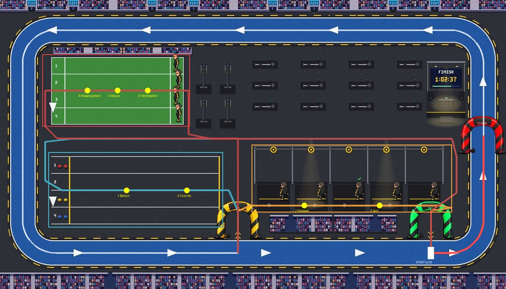

# Spurt/HYROX: Hallenrunde statt gerader Bahn — Opus-Design-Review (09.11.)

Design-Recherche-Stufe vor dem Bau. **Dieses Dokument ändert keinen Code.** Es soll die
Bau-Agentin in die Lage versetzen, ohne Rückfragen loszulegen: Geometrie in Pixelkoordinaten,
Zeitabbildung als Formel, Integrationspunkte mit Funktionsnamen und Zeilen (Stand Branch
`claude/spurt-hyrox-nahkamera-0811`, Commit `1ac2fda5d`, `public/mockups/battle-mode.engine.js`
62 654 Zeilen).

Chris am 09.11., nachdem er die Nahkamera (PR #1369) gesehen hatte, wörtlich: „du solltest nur
die arena neu gestalten weil jetzt hast du ja immernoch nen 2d lauf von links nach rechts ,ist das
nach wie vor das beste für hyrox und co?" — und danach: „Bau mal neues hyrox frag mal fable opus
wegen design".

## 0. Kurzantwort

1. **Ja, die gerade Bahn ist für HYROX die falsche Grundlage. Den Ausschlag gibt aber nicht
   „links nach rechts", sondern zwei Befunde, die keine Kamera und keine Geometrie allein
   behebt:** (a) Stationen kosten im Bild **keine Zeit**. `stepSpurtHyrox()` setzt
   `u.pos = rennT / u.hyroxZeit`, also läuft jeder Läufer mit **konstantem Tempo** durch alle
   sieben Stationen. Die 0,4-s-Arbeitspose ist das einzige Zeichen von „Arbeit". (b) Die
   Live-Rangfolge steht deshalb **ab dem ersten Tick fest und ist schon der Endstand**: Wer am
   Ende vorn liegt, führt das ganze Rennen. Das ist ein Spoiler, und es gibt kein einziges
   Überholen. Echtes HYROX lebt aber genau davon, dass Läufer auf der Strecke Zeit gutmachen und
   Kraftleute sie an den Stationen wieder verlieren (Abschnitt 2).
2. **Die Kamera war nicht das Problem.** Sie ist jetzt gelöst. Mit ihr sieht man nur noch
   deutlicher, dass alle gleichmäßig durchgleiten.
3. **Die Hallengeometrie ist billiger, als sie klingt, weil die Halle schon gemalt ist.**
   `public/szenen/spurt/hyrox.jpg` (Asset-Runde 01./02.11., PixelLab) ist eine Draufsicht auf
   eine echte HYROX-Halle. Darin: eine 1-km-Laufschleife gegen den Uhrzeigersinn, IN-, OUT- und
   FINISH-Bogen, Schlitten-Kunstrasen, SkiErgs, zwölf Rudergeräte, ein Wall-Ball-Rig,
   Farmers-Carry-Gassen und eine Anzeigetafel. Batch 6/15 hat davon nur Belag, Publikumsstreifen
   und zwei Bögen benutzt. `scripts/baue-spurt-szene.py` → `clean_bg()` stempelt die
   eingebrannten Figuren bereits heraus. Es entsteht **kein neues PixelLab-Asset**, nur eine
   bereinigte Ableitung eines vorhandenen (dasselbe Verfahren wie bei den Bögen aus Batch 15).
4. **Empfehlung: in zwei Stufen bauen, beide in einer PR.**
   - **Stufe 1 — Fahrplan**: eine rein zeichnerische Zeitabbildung je Läufer. Lauf-, Roxzone-
     und Stationsabschnitte, rho-neutral aus den vier schon gewürfelten Teilwerten abgeleitet,
     auf exakt `u.hyroxZeit` normiert. Läufer bleiben an Stationen sichtbar hängen und überholen
     sich wirklich.
   - **Stufe 2 — Hallenrunde**: die Szene als Weltkarte unter der 2-D-Kamera, nach dem
     Muster `istRoute()`/`routeXY()`/`weltZuSchirm()`. Drei Runden mit Ausflug in die Roxzone,
     eine Stationsgruppe je Ausflug, Ziel unter dem FINISH-Bogen.
5. **Aufwand: mittel.** Rund 450–550 Zeilen Motor, ein kleines Python-Ableitungsskript und
   Tests, eine Bau-Sitzung. Das ist näher an `istWand()` (Climbing PR 1) als am verworfenen
   Hatz-Rundoval. Der Grund: es gibt **keine zwölf Individualspuren**. Bei HYROX laufen alle auf
   einer gemeinsamen Strecke, und das Überrunden ist im echten Wettkampf genauso. **Risiko für
   rho/Pp: null by construction** (Abschnitt 9). Das visuelle Risiko ist mittel und benannt
   (Abschnitt 12).



*Skizze (bereinigte Szene, Koordinaten = Quellpixel 1680×960): weiß = Laufrunde (dreimal), blau =
Ausflug TECHNIK, orange = Ausflug KLETTERN, rot (dünn) = Ausflug KRAFT, rot (dick) = Schlussstück
zum FINISH-Bogen, gelbe Punkte = die sieben Stationen, Kästen = Kamera-Zonen.*

## 1. Recherche: wie ein HYROX-Rennen räumlich aussieht

Worauf sich das stützt: eine kurze Websuche (Quellen am Ende) plus Weltwissen. Ein offizieller
Hallenplan mit Maßen war in der Suche nicht zu finden. Die Aussagen unten sind deshalb das
**gemeinsame Muster** mehrerer Kursbeschreibungen, kein Normmaß.

- **Halle, nicht Stadion.** HYROX läuft immer in großen Messehallen.
- **Laufen außen, Stationen innen.** Die Laufstrecke ist eine ovalartige Schleife am Hallenrand.
  Die acht Stationen liegen im Innenraum. Je nach Halle ergibt eine 1-km-Laufetappe 2, 3 oder 4
  Runden.
- **Roxzone als Schleuse.** Zwischen Strecke und Station liegt die Roxzone. Man betritt sie
  immer durch den **IN**-Bogen und verlässt sie durch den **OUT**-Bogen. Wer den falschen Bogen
  nimmt, bekommt eine Strafe. Insgesamt kommen dabei rund 0,7 km Roxzone-Weg zusammen.
- **Ablauf:** Lauf 1 → Station 1 → Lauf 2 → Station 2 → … achtmal. Nach der letzten Station
  (Wall Balls) folgt das Ziel.
- **Stationsanordnung je Halle verschieden**, oft nicht in Reihenfolge. Jede Station hat
  mehrere parallele Geräte oder Bahnen, die nacheinander von den Athleten belegt werden.
- **Zuschauerperspektive (Weltwissen, nicht recherchiert belegt):** Übertragungen schneiden
  zwischen Totale von der Traverse, Begleitkamera am Athleten und Nahaufnahme an der Station.
  Eine Grafik zeigt je Athlet **„Run 3" / „Station 3"** und die Zeitabstände. Gerade weil die
  Athleten in verschiedenen Runden auf derselben Strecke laufen, ist diese Status-Grafik der
  Lesbarkeitsanker, nicht die Bildposition.

**Was daraus fürs Spiel folgt:** Die bestimmende Silhouette ist das **Wechselspiel Strecke ↔
Roxzone ↔ Station** in getrennten Räumen, nicht „eine Strecke mit Hindernissen drauf". Ein
gerades Band mit sieben Stationen im Belag liest sich als Hindernislauf oder Spartan Race. Genau
das war Spurt vor Batch 15 auch.

## 2. Befund am Code: was an der heutigen Bahn wirklich fehlt

### 2.1 Stationen kosten im Bild keine Zeit (der schwerste Befund)

`stepSpurtHyrox(dt)` (Z. 48598–48635):

```js
u.pos=Math.max(0,Math.min(0.99, rennT/z));          // z = u.hyroxZeit
```

Das ist eine **lineare** Bewegung. Ein Läufer mit starkem KRAFT-Wurf und einer mit schwachem
bewegen sich an der Mauer exakt so wie auf der freien Strecke. Der einzige Unterschied ist das
Gesamttempo. Die Stationswirkung steckt vollständig in `u.hyroxZeit`, das vor dem Start
feststeht (`baueHyroxStationen()`, Z. 48583). Sichtbar wird sie nirgends. Die Arbeitspose
(`u.stolper=0.4` beim Überqueren von `st.pos`) läuft, **während die Figur weitergleitet**.

### 2.2 Live-Rangfolge = Endstand, ab dem ersten Tick

`bahnRangliste()` (Z. 41401) sortiert Unfertige nach `b.pos-a.pos`. Mit `u.pos = rennT/z` gilt
für zwei Läufer zu jedem Zeitpunkt `pos_a > pos_b ⇔ z_a < z_b`. Die Rangleiste der Nahkamera
(`zeichneHyroxRangleiste()`, Z. 48669) und das Streckenband (`zeichneStreckenband()`, Z. 51391,
Punkte bei `u.pos`) zeigen deshalb **vom Start an den Endstand**. Es gibt kein Überholen und
keine Spannung. Das ist das genaue Gegenteil der HYROX-Dramaturgie.

### 2.3 Geometrie

Sieben Stationen liegen auf der Laufstrecke (`BA().hindernisse`, 0,14…0,86). Laufen und
Stationsarbeit teilen sich denselben Streifen. Zwölf Bahnen nebeneinander zeigen ein
Leichtathletik-Bild, keine Halle.

### 2.4 Nebenbefund Nahkamera: Schnitt alle ~39 Zuschausekunden

`HYROX_CAM_SCHNITT_SEK=3.5` (Z. 48532) ist **Simulationszeit** (`rennT`). Mit
`ZEIT_DEHNUNG.spurt=11.14` (Z. 52471) sind das rund **39 s Zuschauzeit** zwischen zwei
Schnitten. Gemeint war laut Nahkamera-Dokument „alle 3–4 s". Für die Hallenkamera gilt deshalb
eine neue Konstante (Abschnitt 8.3).

## 3. Bewertung: Bahn oder Kamera? Wo ich Chris und dem Koordinator zustimme, wo nicht

**Zustimmung im Ergebnis:** Für HYROX ist die gerade Bahn nicht das Beste. Die Gegenprobe,
die der Auftrag verlangt („reicht die Bahn, wenn nur X fehlt?"), habe ich ernsthaft
durchgerechnet. Mit dem Fahrplan aus Stufe 1 allein, also auf der geraden Bahn, bekäme man
Verweilen und Überholen. Man sähe aber weiterhin ein Hürdenband: die Läufer stauen sich an
Stationen *auf ihrer Laufbahn*, und es gibt keine Roxzone, kein Hinein und Hinaus und keine
Runden. Das ist besser als heute, aber es ist immer noch kein HYROX. Die Bahn „reicht" also
nur im Sinne von „rechnet richtig". Für das, was Chris sehen will, reicht sie nicht.

**Widerspruch in der Begründung:** Die Einschätzung „echte Rennen laufen nicht geradeaus, also
Geometrie umbauen" greift zu kurz. **Eine Hallengeometrie ohne Fahrplan wäre fast wertlos.**
Läufer, die mit konstantem Tempo durch die Roxzone und an Rudergeräten vorbeigleiten, sähen in
der schönsten Halle genauso falsch aus wie heute auf dem Band. Der Kern des Umbaus ist die
**Zeitabbildung** (Stufe 1). Die Geometrie ist das Gefäß dafür. Deshalb sollen beide Stufen in
einer PR kommen. Stufe 1 soll zuerst und als eigener Commit gebaut werden, damit ein
Vorher-/Nachher-Bild auf der alten Bahn möglich bleibt (Schalter, Abschnitt 7.1).

**Zu „und co":** Der klassische Hürdenlauf soll gerade bleiben, denn echte Hürdenrennen laufen
geradeaus. Die Hatz wäre auf derselben Hallenschleife denkbar (Fegearm auf der Runde). Das ist
aber ausdrücklich **nicht** Teil dieses Auftrags. Ihre Lücke beim Kamera-Tick
(Nahkamera-Dokument Abschnitt 1.0) bleibt, wie sie ist.

## 4. Der Fund: die Halle ist schon da

| Was | Wo | Zustand |
|---|---|---|
| Draufsicht HYROX-Halle 1680×960 | `public/szenen/spurt/hyrox.jpg` | PixelLab, Asset-Runde 01./02.11., im Repo |
| Figuren heraus stempeln | `scripts/baue-spurt-szene.py`, `PATCHES` + `clean_bg()` (Z. 75–114) | fertig, sechs Flicken |
| Schlitten als Einzelsprite | dieselbe Datei, `SLED_BOX` + `sled_sprite()` | fertig (optional, Abschnitt 6.6) |
| Abspielbarer Prototyp „Läufer auf der 1-km-Schleife gegen den Uhrzeigersinn" | `public/szenen/spurt/kurs.html` (Poster `kurs.jpg`) | Demo-Szene, nicht im Battle Mode |
| IN-/FINISH-Bogen als Sprite | `public/sprites/arena/spurt_bogen_{in,finish}.png` | Batch 15, aus derselben Szene freigestellt |
| Die sieben Stationssprites | `public/sprites/arena/hind_{huerde,balken,wand,seil,wasser_l,wasser_r,mauer,heu}.png` | Batch 15 / U3 |

Ein Prototyp, in dem Läufer über diese Szene laufen, existiert also schon (`kurs.html`). Was
fehlt, ist der Schritt in den Motor.

## 5. Stufe 1 — der Fahrplan (Zeitabbildung, rho-neutral)

### 5.1 Idee

Heute wird `u.hyroxZeit` als eine Zahl berechnet. Sie entsteht aber aus **vier
unabhängigen Würfen** (`hyroxScore()`, Z. 48558), die heute nur aufsummiert und dann verworfen
werden. Der Fahrplan **zerlegt dieselbe Zahl in vier Teilzeiten**, eine je Wurf. Jede Teilzeit
wird auf die passenden Wegabschnitte verteilt. Die Summe ist exakt `u.hyroxZeit`, also bleibt
die Zielzeit bitgleich. Es wird nichts neu gewürfelt.

### 5.2 Die vier Teilwerte festhalten (einzige Änderung an einer bestehenden Rechenfunktion)

```js
function hyroxScore(u){
  const W=HYROX_W, rauschen=HYROX_RAUSCHEN_AKTUELL.wert;
  const wurf=(basis)=>basis*(1+(rr()-0.5)*2*rauschen);
  const pace=…, technik=…, kletter=…, kraft=…;            // unverändert
  const a=wurf(pace*W.pace), b=wurf(technik*W.technik), c=wurf(kletter*W.kletter), d=wurf(kraft*W.kraft);
  u.hyroxTeile={lauf:a, technik:b, kletter:c, kraft:d};   // NEU, rein kosmetisch
  return a+b+c+d;
}
```

**Warum das bitgleich ist:** JavaScript wertet die Operanden von `wurf(x)+wurf(y)+wurf(z)+wurf(w)`
von links nach rechts aus, und die Addition ist linksassoziativ. Die vier `rr()`-Aufrufe
erfolgen also in derselben Reihenfolge, und `((a+b)+c)+d` ist dieselbe Gleitkommarechnung wie
vorher. **Die Bau-Agentin muss das mit einem Vorher-/Nachher-Lauf von
`miss-spurt-hyrox-rangtreue.mjs` belegen: die Zahlen müssen identisch sein, nicht nur ähnlich
(Abschnitt 11).**

### 5.3 Zerlegung in Teilzeiten

Mit `B=HYROX_BASIS_SEK_AKTUELL.wert` (26), `k=HYROX_SKALA_SEK_AKTUELL.wert` (0,165) und
`W=HYROX_W` (0,40/0,20/0,20/0,20, Summe 1) gilt vor dem Deckel:

```
zeit = B − k·(a+b+c+d) = Σ_g ( W_g·B − k·teil_g )        für g ∈ {lauf, technik, kletter, kraft}
```

Also ist `roh_g = W_g·B − k·teil_g` eine Zerlegung, die sich exakt zur Zielzeit aufsummiert.
Positivität: `teil_g = W_g·basis_g·(1±0,18)`. Damit ist `roh_g = W_g·(B − k·basis_g·(1+n))`,
und das ist positiv, solange `basis_g·(1+n) < B/k ≈ 157`. Bei Sub-Skills um 0…100 ist das
immer erfüllt. Für Ausreißer (Mutatoren) gibt es trotzdem eine Untergrenze, und der
`HYROX_MIN_SEK`-Deckel wird mit abgefangen:

```js
function hyroxFahrplan(u){                                   // NEU, kein rr()
  const B=HYROX_BASIS_SEK_AKTUELL.wert, k=HYROX_SKALA_SEK_AKTUELL.wert, Wg=HYROX_W, T=u.hyroxTeile;
  const roh={lauf:Wg.pace*B-k*T.lauf, technik:Wg.technik*B-k*T.technik,
             kletter:Wg.kletter*B-k*T.kletter, kraft:Wg.kraft*B-k*T.kraft};
  for(const g in roh) roh[g]=Math.max(0.15*(g==="lauf"?Wg.pace:Wg[g])*B, roh[g]);
  const f=u.hyroxZeit/(roh.lauf+roh.technik+roh.kletter+roh.kraft);   // exakt auf die Zielzeit
  for(const g in roh) roh[g]*=f;
  // … Verteilung auf die Abschnitte, 5.4
}
```

### 5.4 Verteilung auf die Wegabschnitte

Der Weg (Stufe 2, Abschnitt 6) ist eine Folge von **Abschnitten** mit Art, Gruppe, Station und
Länge. Ohne Hallengeometrie (Schalter `hyroxAnsicht:"bahn"`) gibt es eine 1-D-Fassung
(Abschnitt 7.1). Regeln:

| Art | Zeitquelle | Anteil | Verteilung innerhalb |
|---|---|---|---|
| `lauf` (Laufrunden + Schlussstück) | `roh.lauf` | 100 % | ∝ Weglänge, konstante Laufgeschwindigkeit |
| `rox` (IN/OUT und Roxzone-Gänge des Ausflugs zu Gruppe g) | `roh[g]` | `HYROX_ANTEIL_ROX=0.30` | ∝ Weglänge |
| `zone` (Gehstücke innerhalb der Stationszone g, zwischen den Stationen) | `roh[g]` | `HYROX_ANTEIL_ZONE=0.10` | ∝ Weglänge |
| `arbeit` (an einer Station der Gruppe g) | `roh[g]` | `HYROX_ANTEIL_ARBEIT=0.60` | gleich auf die Stationen der Gruppe (2/2/3) |

Die Roxzone-Zeit kommt bewusst aus dem Gruppenbudget, nicht aus dem Laufbudget. Wer an einer
Station schwach ist, geht auch die Roxzone langsamer. Das ist gut so: die Roxzone gehört
dramaturgisch zur Station. Die Anteile ergeben grob 40 % Laufen, 18 % Roxzone und 42 % Arbeit.
Elite-HYROX liegt ungefähr bei 50/10/40, das passt also, ohne Präzision vorzutäuschen.

Ergebnis je Läufer: `u.hyroxPlan = {t0: Float64Array(n+1), …}`, die kumulierten Startzeiten
der n Abschnitte, mit `t0[n] === u.hyroxZeit`. Den letzten Abschnitt bekommt der Rest
zugewiesen (`dauer[n-1] = z − t0[n-1]`), damit das Rundungsrauschen exakt aufgeht.

### 5.5 Zustand zum Zeitpunkt t

```js
function hyroxZustand(u){                                     // NEU, reine Lesefunktion
  const P=u.hyroxPlan, A=HYROX_WEG.abschnitte, t=Math.min(rennT, u.hyroxZeit);
  // Binärsuche j mit P.t0[j] <= t < P.t0[j+1]
  const frac=(t-P.t0[j])/Math.max(1e-9,P.t0[j+1]-P.t0[j]);
  const s=A[j].s0+(A[j].s1-A[j].s0)*frac;                     // Bogenlänge 0..1 auf HYROX_WEG
  const art=A[j].art;
  const prog=art==="arbeit"?(((t-P.t0[j])/HYROX_ARBEIT_TAKT_SEK)%1):0;
  return {s, art, gruppe:A[j].gruppe||null, station:A[j].station??-1, lauf:A[j].lauf||0, prog, j};
}
```

`HYROX_ARBEIT_TAKT_SEK = 0.12`: eine Arbeitsbewegung (Schub, Zug, Sprung) je 0,12 Sim-s, also
rund 1,3 s Zuschauzeit. `prog` läuft damit **schleifend** 0→1 und speist dieselben Kanäle wie
heute `hyroxProg`. Cassandras acht Bilder der Hyrox-Posen werden so zu wiederholten Stößen
statt zu einem einzigen 0,4-s-Ruck (`zeichnePixelFigur()`, Z. 4695: `f=floor(hyroxProg*n)`,
unverändert lauffähig).

**`u.pos` bleibt unverändert `rennT/z`.** Gezeichnet wird ab Stufe 1 aus `hyroxZustand(u).s`,
nicht mehr aus `u.pos`. Alles, was `u.pos` heute liest (Wertungstabelle „Weit", `bahnRangliste()`,
`bahnLauf()`-Sonde), bleibt bitgleich. Siehe Abschnitt 9.

## 6. Stufe 2 — die Hallenrunde

### 6.1 Weltkoordinaten

- **Quellraum** = Pixel der Szene `hyrox.jpg` (1680×960). Alle Koordinaten in diesem Dokument
  sind Quellpixel.
- **Welt** = Quellraum × `HALLE_S`, mit `HALLE_S = W/1680` (bei W=1240: 0,7381). Die Welt ist
  damit 1240 × 708,6. In der Breite deckt sie die Leinwand bei Zoom 1, in der Höhe ist sie
  1,51× höher als die Leinwand (H=470).
- **Bildschirm** über die vorhandene `weltZuSchirm(wx,wy)` (Z. 46646) mit `camR`/`cam.zoom`.
  `camR` teilt sich die Halle mit Takeshi. Das ist unkritisch, weil immer nur eine Disziplin
  zeichnet. Gesichert und wiederhergestellt wird `camR` bereits in
  `bahnAnzeigeSichern()`/`bahnAnzeigeZurueck()` (Z. 58662/58696).
- **Zoomgrenzen der Halle:** `HALLE_ZOOM_MIN = H/(960*HALLE_S)` (0,663, ganze Halle im Bild,
  links und rechts Rand) bis `HALLE_ZOOM_MAX = 3.2`. Bei 3,2 ist ein Quellpixel 2,36
  Leinwandpixel groß. Das JPEG wird mit `imageSmoothingEnabled=false` gezeichnet und bleibt
  so scharf wie die übrige Pixelkunst.

### 6.2 Die Laufschleife

Mittellinie des blauen Belags als abgerundetes Rechteck: `x∈[75,1605]`, `y∈[100,840]`,
Eckradius `R=110`, Eckmitten (185,210), (1495,210), (1495,730), (185,730).
**Laufrichtung wie die Pfeile der Szene:** unten nach rechts, rechts nach oben, oben nach links,
links nach unten.

Eine Runde von x=1430 unten (OUT) bis x=790 unten (IN):
`(1430,840) → (1495,840) → Viertelbogen um (1495,730) → (1605,210) → Viertelbogen um (1495,210) →
(185,100) → Viertelbogen um (185,210) → (75,730) → Viertelbogen um (185,730) → (790,840)`.
Länge **3711 Quellpixel**, nachgemessen in der Skizzenrechnung.

### 6.3 Der ganze Weg (eine gemeinsame Mittellinie für alle zwölf)

| # | Art | Gruppe / Station | Wegpunkte (Quellpixel) | Länge |
|---|---|---|---|---:|
| 1 | `lauf` (Lauf 1) | — | Runde 1430 → 790 (6.2), **Start bei (1430,840)** | 3711 |
| 2 | `rox` | technik | (790,840) → (790,770) → (790,700) **IN-Bogen** | 140 |
| 3 | `rox` | technik | (790,700) → (760,632) → (725,632) | ~110 |
| 4 | `zone` | technik | (725,632) → (645,632) | 80 |
| 5 | `arbeit` | technik / **0 Hürde**, Mitte x=620 | (645,632) → (595,632) | 50 |
| 6 | `zone` | technik | (595,632) → (460,632) | 135 |
| 7 | `arbeit` | technik / **1 Balken**, Mitte x=420 | (460,632) → (380,632) | 80 |
| 8 | `zone` | technik | (380,632) → (205,632) | 175 |
| 9 | `rox` | technik | (205,632) → (150,600) → (150,470) → (240,460) → (1500,460) → (1515,520) → (1515,640) → (1430,700) | ~1830 |
| 10 | `rox` | technik | (1430,700) → (1430,770) → (1430,840) **OUT-Bogen** | 140 |
| 11 | `lauf` (Lauf 2) | — | Runde 1430 → 790 | 3711 |
| 12 | `rox` | kletter | IN wie #2, dann (790,700) → (830,682) | ~185 |
| 13 | `zone` | kletter | (830,682) → (990,682) | 160 |
| 14 | `arbeit` | kletter / **2 Palisade**, Mitte x=1010 | (990,682) → (1030,682) | 40 |
| 15 | `zone` | kletter | (1030,682) → (1230,682) | 200 |
| 16 | `arbeit` | kletter / **3 Seil**, Mitte x=1260 | (1230,682) → (1290,682) | 60 |
| 17 | `zone` | kletter | (1290,682) → (1460,682) | 170 |
| 18 | `rox` | kletter | (1460,682) → (1500,690) → (1430,700), dann OUT wie #10 | ~220 |
| 19 | `lauf` (Lauf 3) | — | Runde 1430 → 790 | 3711 |
| 20 | `rox` | kraft | IN wie #2, dann (790,700) → (790,460) → (190,460) → (150,420) → (150,300) → (215,300) | ~1250 |
| 21 | `zone` | kraft | (215,300) → (250,300) | 35 |
| 22 | `arbeit` | kraft / **4 Wassergraben**, Mitte x=290 | (250,300) → (330,300) | 80 |
| 23 | `zone` | kraft | (330,300) → (360,300) | 30 |
| 24 | `arbeit` | kraft / **5 Mauer**, Mitte x=390 | (360,300) → (420,300) | 60 |
| 25 | `zone` | kraft | (420,300) → (450,300) | 30 |
| 26 | `arbeit` | kraft / **6 Strohballen**, Mitte x=490 | (450,300) → (530,300) | 80 |
| 27 | `zone` | kraft | (530,300) → (565,300) | 35 |
| 28 | `rox` | kraft | (565,300) → (625,300) → (625,445) → (700,460) → (1500,460) → (1515,520) → (1515,640) → (1430,700), dann OUT wie #10 | ~1450 |
| 29 | `lauf` (Schluss) | — | (1430,840) → (1495,840) → Viertelbogen um (1495,730) → **(1605,450) FINISH-Bogen** | 518 |

Gesamtlänge rund **18 560 Quellpixel**. Die Reihenfolge der Stationen auf dem Weg entspricht
genau den Indizes 0…6 von `HYROX_STATIONEN`/`HYROX_GRUPPE_JE_STATION` (Z. 48582). Gruppen,
Namen und Bilder bleiben also, wie sie sind.

**Warum diese Zuordnung von Gruppen zu Hallenzonen** (statt die Geräte der Szene umzudeuten):

- **TECHNIK → Farmers-Carry-Gassen** (unten links, vier Bahnen, fast leer). Hürde und Balken
  stehen quer in den Gassen. Cassandras bereits bezahlte Pose `hyroxTechnik` („leaps … over a
  low hurdle") passt direkt. Die Gassen werden von rechts nach links durchlaufen, also nach
  Westen. Der Ost-Streifen wird gespiegelt, und das kann der Code schon
  (`zeichnePixelFigur()`, Z. 4694–4702: `spiegel&&d==="east"`).
- **KLETTERN → Wall-Ball-Rig** (Mitte rechts). Ein Stahlgerüst mit Zielscheiben ist das
  einzige „Klettergerüst" der Szene. Palisade und Seil stehen in Box 2 und Box 4. Die Pose
  `hyroxKletter` („grips a thick rope … legs bracing against a wooden wall") passt. Die Läufer
  gehen auf y=682 durch die Boxen, also **unter** den Kampfrichtern hindurch, die bei y≈610–660
  stehen. Erster Skizzenentwurf y=655 lief durch ihre Füße und wurde verworfen.
- **KRAFT → Schlitten-Kunstrasen** (oben links, vier Bahnen). Wassergraben, Mauer und
  Strohballen stehen in Schubrichtung (links nach rechts, zu den Kampfrichtern bei x≈585). Die
  Pose `hyroxKraft` (Schlitten schieben) passt genau zum Kunstrasen.
- **SkiErgs, Rudergeräte und Anzeigetafel bleiben reine Hallenkulisse.** Sie umzudeuten (etwa
  TECHNIK an die Rudergeräte) würde die gesperrten Gruppen-Namen und zwei der drei
  Cassandra-Posen sinnlos machen: ein Hürdensprung am Rudergerät. Neue Posen wären eine neue
  PixelLab-Runde, und die ist ausgeschlossen. Mehr dazu in Abschnitt 13, Punkt 1.

### 6.4 Breite quer zur Laufrichtung (wie `routeBreite` bei Takeshi)

Jeder Läufer liegt um `q` quer zur Mittellinie versetzt. Das ist dieselbe Formel wie im
Routenzweig von `laeuferXY()` (Z. 46952), nur mit einer **Breite je Abschnitt**:

```js
const q=((u.bahnZ+0.5)/BAHNEN_N()-0.5)*(breite(s)-14);        // in Quellpixeln, danach *HALLE_S
```

| Abschnittsart | Breite (Quellpx) | Begründung |
|---|---:|---|
| `lauf` | 64 | blauer Belag ist ~85 px breit, Rand bleibt frei |
| `rox` | 30 | Gänge, Bögen ~100 px breit, Gruppe zieht sich zusammen |
| `zone`/`arbeit` technik | 210 | vier Gassen (y 520…745) → zwölf Versätze ≈ drei je Gasse |
| `zone`/`arbeit` kraft | 210 | vier Rasenbahnen (y 190…410) |
| `zone`/`arbeit` kletter | 40 | Boxenboden y≈662…702 |

Wechselt die Breite von einem Abschnitt zum nächsten, wird sie über die **ersten 60 Quellpixel**
des neuen Abschnitts linear übergeblendet, damit niemand springt. Die Läufer fächern sichtbar in
die Gassen auf, wenn sie aus dem Roxzone-Gang kommen. Zwölf Versätze auf vier Gassen: Läufer
`bahnZ` 0/1/2 liegen in Gasse 1 (Versätze −98/−80/−62 um die Gassenmitte −84), und so weiter.
Die Requisiten stehen je Gasse einmal (6.6). Das ist dasselbe Bild wie bei echtem HYROX: mehrere
Athleten teilen sich nacheinander eine Gasse.

### 6.5 Start und Ziel

- **Start:** s=0 bei (1430,840) auf der unteren Geraden, direkt unter dem OUT-Bogen. Die
  Startlinie ist ein weißer Strich quer über den Belag (x=1430, y 800…880). Alle zwölf stehen
  mit Querversatz `q` nebeneinander. Längsstaffelung braucht es nicht, das Feld zieht sich nach
  der ersten Kurve auseinander.
- **Ziel:** s=1 bei (1605,450), unter dem eingebrannten FINISH-Bogen. Die Ziellinie ist
  gestrichelt weiß quer (y=450, x 1560…1650).
- **Eingelaufene** stehen **nicht** auf der Strecke, auf der andere noch Runden laufen, sondern
  in einem Zielpferch im Innenraum zwischen Anzeigetafel und Rig. Platz `p` (0-basiert in
  `rennFertig`) steht bei `x = 1500 − (p%6)·28`, `y = 425 + floor(p/6)·30`. Das ist das
  Gegenstück zum `platz>=0`-Zweig in `laeuferXY()`.

### 6.6 Requisiten (alles vorhanden)

- **Hallenbild:** neues Ableitungsskript `scripts/baue-hyrox-halle.py`. Es übernimmt
  `PATCHES`/`clean_bg()` aus `scripts/baue-spurt-szene.py` (importieren oder die sechs Zeilen
  kopieren) und ergänzt **drei weitere Flicken, die die übrigen Schlitten vom Kunstrasen
  nehmen**. Auf dem KRAFT-Rasen sollen die Stationssprites stehen, nicht vier Schlitten:

  ```python
  EXTRA = [
      ((222, 186, 268, 238), +100),   # Schlitten Rasenbahn 1
      ((518, 296, 564, 348), -150),   # Schlitten Rasenbahn 3
      ((222, 352, 268, 404), +100),   # Schlitten Rasenbahn 4
  ]
  ```

  Das ist in der Skizze schon so angewendet und sauber. Vor dem Einchecken soll die Bau-Agentin
  die Flicken trotzdem am 3,2×-Ausschnitt prüfen und bei Bedarf um ±5 px nachsetzen. Ausgabe:
  `public/sprites/arena/hyrox_halle.jpg` (JPEG Qualität 92, `subsampling=0` wie `enc_jpg()`,
  ~400 KB). **Nicht** in `A_TEILE` aufnehmen: `tests/arena-kulissen.test.ts` prüft für deren
  Einträge PNG-Maße. Stattdessen ein eigener Lader nach dem Muster `SB_TEILE`/`sbBild`
  (Z. 42582–42585), etwa `hallenBild` + `hallenDa()`. Herkunft in
  `public/sprites/arena/quellen.json` eintragen („abgeleitet aus public/szenen/spurt/hyrox.jpg,
  Flicken in scripts/baue-hyrox-halle.py, kein neuer PixelLab-Auftrag").
- **Stationssprites** im Quellraum zeichnen (das heißt unter `scale(cam.zoom*HALLE_S)` in
  natürlicher Pixelgröße), Unterkante auf der Fußlinie:
  - TECHNIK: Hürde (32×32) bei x=620 und Balken (64×32) bei x=420, **je einmal pro Gasse** auf
    den Gassenmitten y = 548/604/660/716.
  - KRAFT: Wassergraben (`hind_wasser_l`+`_r`, 2×32×32, wie Z. 44046–44048) bei x=290, Mauer
    (40×32) bei x=390 und Strohballen (64×32) bei x=490, je einmal pro Rasenbahn auf
    y = 218/274/330/385.
  - KLETTERN: Palisade (`hind_wand`, 32×64) bei (1010, 700) und Seil (64×32) bei (1260, 700),
    je **einmal**. Die Boxen sind zu niedrig für mehrere übereinander.
- **Stationsboden** (Pfütze, Kies, Matte …): Die sieben `stationsBoden`-Funktionen aus
  `bodenSpurtGerade()` (Z. 43951–43988) sind ans Band `oben..unten` gebunden. Sie sollen **nicht**
  wiederverwendet werden. Szene und Gassen tragen die Zonen bereits. Optional ein schwacher
  Scheinwerferkegel je Station, gleiche Deckkraft (16 %).
- **Optional:** der Schlitten aus `sled_sprite()` als mitgeschobenes Requisit an einem
  KRAFT-Läufer. Das gehört **nicht** zum Pflichtumfang.

## 7. Integration in den Code

### 7.1 Schalter und Weiche

- `BAHN_FLAGS` (direkt vor `const BAHN_ART`) bekommt `hyroxAnsicht:"halle"`. Erlaubte Werte
  sind `"halle"|"bahn"`. Die Anzeige ist standardmäßig an, `"bahn"` nur für
  Vorher-/Nachher-Screenshots. Setzbar über dieselben Wege wie `spurtFormat`
  (`__arena.bahnFlags`, `__olyBahnFlags`). `scripts/screenshot-kulisse.mjs` reicht `--format=`
  durch. Für die Ansicht braucht es eine zweite Option (`--hyrox-ansicht=bahn`) oder einen
  direkten `bahnFlags`-Aufruf im QA-Skript.
- Eine Weiche, analog zu `istRoute()`/`istWand()`:
  `const istHyroxHalle=()=>bahnHyroxAktiv&&!!HYROX_WEG&&BAHN_FLAGS.hyroxAnsicht!=="bahn";`
- **Fahrplan (Stufe 1) gilt in beiden Ansichten.** In der Ansicht `"bahn"` bildet
  `hyroxZustand().s` auf die gerade Bahn ab. Dafür bekommt die 1-D-Fassung einen eigenen
  Abschnittsplan, der auf `BA().hindernisse` sitzt: Lauf bis `pos_i − 0,02`, Arbeit
  `pos_i ± 0,02`, kein Rox. `laeuferXY()` nimmt `camX(s)` statt `camX(u.pos)`. So hat Stufe 1
  einen eigenen, vorzeigbaren Zwischenstand.

### 7.2 Wegtabelle (`HYROX_WEG`)

- `baueHyroxWeg()` (neu, nahe `baueHyroxStationen()`) erzeugt die Abschnittstabelle aus 6.3.
  Die Viertelbögen werden analytisch abgetastet (je 12 Stützpunkte wie in der Skizzenrechnung),
  die Geraden direkt. Alle Punkte liegen dicht genug (≤ 8 px Abstand), dass **lineare**
  Interpolation reicht. Catmull-Rom braucht es nicht.
- Ergebnis: `{pts:[{x,y}], cum:[], len, abschnitte:[{art,gruppe,station,lauf,breite,s0,s1,laenge}]}`
  mit `s0/s1` als Bogenlängenanteil.
- Gebaut wird einmal bei `baueHyroxStationen()`. Die Tabelle ist im Quellraum fest und hängt
  nicht an `W/H`, also braucht sie keinen Cache-Schlüssel wie `routeCache`. Erst beim Zeichnen
  wird mit `HALLE_S` skaliert.
- **Lookup teilen, nicht kopieren:** `routeXY(s)` (Z. 46632–46638) als
  `tabelleXY(R,s)` herauslösen, sodass `routeXY(s)=tabelleXY(routeTabelle(),s)` gilt. Für
  Takeshi ist das bitgleich, denn es ist derselbe Funktionskörper. `hallenXY(s)=tabelleXY(HYROX_WEG,s)`
  liefert `{x,y,tx,ty,nx,ny}` im Quellraum.

### 7.3 `baueHyroxStationen()` (Z. 48583)

Nach der bestehenden Schleife, die `u.hyroxZeit` setzt (Z. 48591–48596, unverändert):

```js
if(!HYROX_WEG) HYROX_WEG=baueHyroxWeg();
for(const u of LAEUFER) u.hyroxPlan=hyroxFahrplan(u);     // kein rr()
hyroxCamZiel=null; hyroxCamNaechsterSchnitt=0; hyroxCamGruppe=null;
if(istHyroxHalle()){ const p=hallenXY(0); camR={x:p.x*HALLE_S, y:p.y*HALLE_S}; cam.zoom=1.6; }
```

Hinweis: `bauSpurt()` setzt `cam={zoom:1,cx:0.5}` in Z. 47273, **vor** dem Format-Hook in
Z. 47679. Die Kamerazeile oben steht also richtig hinter dem Reset.

### 7.4 `stepSpurtHyrox()` (Z. 48598)

- `u.pos`, `u.fertig`, `rennFertig`, `done`: **nicht anfassen.**
- Die Stationsschleife (Z. 48617–48620), die `u.stolper`/`u.hyroxGruppe` an `st.pos` setzt,
  wird **nur bei aktivem Fahrplan übersprungen** (`if(!u.hyroxPlan)…`). Ihre Positionen
  beziehen sich auf `u.pos` und passen nicht mehr zum Bild. Ließe man sie laufen, kämen
  Geister-Posen an falscher Stelle. Die Felder sind rein kosmetisch, keine Wertung liest sie
  (Nahkamera-Dokument Abschnitt 4).
- `kameraUpdate(dt)` am Ende bleibt.

### 7.5 `laeuferXY()` (Z. 46926)

Ganz oben, vor `istOval()`, ein neuer Zweig:

```js
if(istHyroxHalle()){
  const platz=rennFertig.indexOf(u);
  if(platz>=0) return weltZuSchirm((1500-(platz%6)*28)*HALLE_S, (425+Math.floor(platz/6)*30)*HALLE_S);
  const z=hyroxZustand(u), r=hallenXY(z.s), q=((u.bahnZ+0.5)/BAHNEN_N()-0.5)*(hyroxBreite(z.s)-14);
  return weltZuSchirm((r.x+r.nx*q)*HALLE_S, (r.y+r.ny*q)*HALLE_S);
}
```

`laeuferSchwebeXY()` (Z. 46969) folgt automatisch.

### 7.6 `zeichneSpurt()` (Z. 50659)

| Zeile | heute | in der Halle |
|---|---|---|
| 50676 `reihe` | nach y sortiert nur bei `istRoute()` | `istRoute()\|\|istHyroxHalle()` |
| 50680 `sk0` | `istRoute()?min(1.3,0.9+0.12*zoom):1` | Halle: `Math.min(1.35,0.75+0.15*cam.zoom)` |
| 50758 `tg` | Tangente nur auf der Route | Halle: `hallenXY(z.s)` (Tangente im Quellraum, Richtung bleibt gleich) |
| 50813–50815 Pose | `bahnHyroxAktiv&&u.stolper>0 → u.hyroxGruppe`, `hyroxProg` aus 0,4-s-Fenster | Halle **und** Fahrplan in Bahnansicht: `z.art==="arbeit" ? z.gruppe : null`, `hyroxProg=z.prog` |
| 50825 `vx` | `u.stolper>0?0:…` | Halle: `tg.tx*4`, auch während der Arbeit (die Figur schaut zur Station, die Pose übernimmt die Bewegung) |
| 50841 `down` | `bahnHyroxAktiv?false:…` | unverändert |
| 51172 Platzetikett | `!istRoute()` | auch `!istHyroxHalle()`, im Zielpferch steht die Rangleiste |
| 51187 `spurtSaeule` | `!istRoute()` | auch `!istHyroxHalle()`, Säule wird in Hyrox ohnehin nie aktiv, als Absicherung |

Die Hilfsgrößen der Pose (`hyroxTechnikHop`, `hyroxKraftHaltung`, `parcSpriteArg.hyroxPose/.hyroxProg`)
bleiben, wie sie sind. Sie bekommen nur ein schleifendes `hyroxProg`.

### 7.7 Boden: `bodenSpurt()` (Z. 43783)

Direkt nach den beiden Publikums-Loop-Abschaltungen (Z. 43788/43792), **vor** `istRoute()`:

```js
if(istHyroxHalle()) return bodenHyroxHalle();
```

`bodenHyroxHalle()` (neu, Vorbild `bodenTakeshiRoute()`, Z. 43543ff.):

1. Ganze Leinwand `#15161b` füllen (Ränder bei Zoom < 1).
2. `ctx.save(); ctx.translate(W/2-camR.x*cam.zoom, H/2-camR.y*cam.zoom); ctx.scale(cam.zoom*HALLE_S, cam.zoom*HALLE_S); ctx.imageSmoothingEnabled=false;`
3. `hallenDa()` ? Bild bei (0,0,1680,960) zeichnen : **Vektor-Rückfall**: Innenraum `#2a2c33`,
   Laufschleife als Strich (Breite 84, `#2b5fa8`, weiße Ränder) entlang der ersten Runde,
   drei Zonenrechtecke (6.3/8.2) als Matten. Das folgt dem Takeshi-Grundsatz: „EINE Weiche …
   für jede Kachel eine Farbfassung", Boden und Läufer laufen nie auseinander, auch headless
   nicht.
4. Start- und Ziellinie (6.5), Stationssprites (6.6).
5. Optional: die Live-Zeit auf der eingebrannten Anzeigetafel. Rechteck (1432,250)…(1530,280)
   dunkel übermalen, dann `bahnZeitText(bahnRealSek(rennT))` in Gelb. Das ist rein kosmetisch.
6. `ctx.restore()`. Danach im Bildschirmraum `Kamera n,n×` wie bei Takeshi.

Die Kulisse (`kulisseZeichnen()`) wird in der Halle **nicht** gezeichnet, das Hallenbild ersetzt
sie.

### 7.8 Überlagerung: `zeichneHyroxUeberlagerung()` (Z. 48643)

- Die Gruppenschilder stehen heute bei `camX(st.pos), bahnY(0)-34`. In der Halle gibt es **ein
  Schild je Zone** (nicht je Station) über der Zonenmitte oben, mit derselben Farbe und
  demselben Text. Ab `cam.zoom≥1.6` zusätzlich der Stationsname klein über jedem Sprite (eine
  Gasse genügt).
- **Rangleiste** (`zeichneHyroxRangleiste()`, Z. 48669), nur bei aktivem Fahrplan:
  - **Sortierung:** Fertige nach `u.fertig` aufsteigend, Unfertige nach `hyroxZustand(u).s`
    absteigend, also nach **Streckenposition**. `bahnRangliste()` selbst bleibt unangetastet,
    sie wird hier nur nicht mehr als Quelle benutzt. Damit verschwindet der Spoiler aus 2.2,
    und Überholen wird sichtbar.
  - **Statusspalte** rechts, im Stil der HYROX-Grafik: `L1`…`L3`/`ZIEL` auf Laufabschnitten,
    `TECH`/`KLET`/`KRAFT` in Roxzone, Zone oder Arbeit, `✓` mit Zeit bei Fertigen. Die Spalte
    ist bei laufenden Runden die einzige verlässliche Auskunft darüber, wer wie weit ist. Bei
    echtem HYROX ist das genauso.
  - Kopfzeile: Name der gezeigten Zone statt der Station (`TECHNIK · HÜRDE/BALKEN`, `STRECKE`).
- **Streckenband** (`zeichneStreckenband()`, Z. 51391): Bei aktivem Fahrplan sitzen die
  Läuferpunkte bei `hyroxZustand(u).s`, nicht bei `u.pos`. Die Striche markieren die
  Abschnittsgrenzen: Arbeit farbig nach Gruppe, Rox grau. Auch hier verschwindet sonst der
  Spoiler. Klassisch und Hatz bleiben unberührt (Weiche auf `bahnHyroxAktiv&&LAEUFER[0]?.hyroxPlan`).

### 7.9 Sonde und Sicherung

- `window.__arena.hyroxKameraProbe()` (Z. 60392) erweitern: `halle:istHyroxHalle()`,
  `ziel:hyroxCamZiel`, `camR:{...camR}` und je Läufer `{s, art, gruppe, station, lauf}` aus
  `hyroxZustand(u)`. Das bleibt ein reiner Lesezugriff.
- `bahnAnzeigeSichern()`/`bahnAnzeigeZurueck()` (Z. 58654ff., Z. 58675/58682): `hyroxCamZiel`
  und `HYROX_WEG` mitnehmen. `u.hyroxPlan`/`u.hyroxTeile` hängen am Läuferobjekt und reisen mit
  `LAEUFER` mit, wie `u.hyroxZeit` heute schon.

## 8. Die Nahkamera in der Halle: was bleibt, was sich ändert

### 8.1 Was bleibt (die Entscheidungen 1–3 des Nahkamera-Dokuments)

- **Aktivität statt Spitzenreiter.** Die Kamera geht dorthin, wo am meisten passiert.
- **Schnitt-Takt mit eingefrorener Gruppe** (`hyroxCamGruppe` als `Set` von IDs) und weicher
  Anziehung (`t=min(1,dt*2.2)`).
- **Rangleiste** für alle, die nicht im Bild sind.

### 8.2 Was sich ändert: 1-D-Stationen → 2-D-Ziele

Die Kandidaten sind nicht mehr die sieben Stationspositionen, sondern **vier Kamera-Ziele**:

| Ziel | Wer zählt dazu (aus `hyroxZustand(u)`) | Fester Kasten (Quellpx) |
|---|---|---|
| `technik` | `art∈{rox,zone,arbeit}` und `gruppe==="technik"` | (160,505)…(740,755) |
| `kletter` | dito `"kletter"` | (835,480)…(1500,705) |
| `kraft` | dito `"kraft"` | (140,180)…(630,420) |
| `strecke` | `art==="lauf"` | kein fester Kasten, s.u. |

**Wahl beim Schnitt:** Das Ziel mit den meisten Zugehörigen gewinnt. Bei Gleichstand gewinnt
eine Station vor der Strecke (die Stationen sind das Neue), unter Stationen die frühere. Das ist
dieselbe Minimalabstand-Idee wie bisher, denn jeder Läufer gehört immer genau einem Ziel an.
Die Summe ist die Feldgröße, der Kasten ist also nie leer.

**Kasten zwischen zwei Schnitten:**

- Stationsziel: der feste Zonenkasten ∪ Weltpositionen der eingefrorenen Gruppe, **solange
  ihr Mitglied noch im Ausflug dieser Gruppe ist**. Wer durch den OUT-Bogen auf die Strecke
  geht, fällt aus dem Kasten. Sonst zöge ein einzelner Davonlaufender den Ausschnitt über die
  halbe Halle. Im 1-D-Fall war dieser Fall harmlos, in 2-D ist er es nicht.
- `strecke`: beim Schnitt die dichteste Läufergruppe auf Laufabschnitten. Schiebefenster der
  Breite `0.05` in `s` (≈ 930 Quellpx Strecke) über die nach `s` sortierten Läufer, das Fenster
  mit den meisten gewinnt. Diese Läufer werden eingefroren, der Kasten folgt ihren aktuellen
  Positionen.

**Zoom und Mitte** (wie im Routenzweig, Z. 47175–47186):

```js
const bw=(x1-x0)*HALLE_S+90/z0, bh=(y1-y0)*HALLE_S+130/z0;          // Namen über dem Kopf, Balken darunter
const zielZoom=clamp(Math.min(W/bw,H/bh), HALLE_ZOOM_MIN, HALLE_ZOOM_MAX);
// Mitte: in Welt-x auf [W/2/zielZoom, weltB-W/2/zielZoom] klemmen, sonst weltB/2; y analog mit weltH=960*HALLE_S
cam.zoom+=(zielZoom-cam.zoom)*t; camR.x+=(cx-camR.x)*t; camR.y+=(cy-camR.y)*t;   // t=min(1,dt*2.2)
```

`cam.cx` bleibt in der Halle unbenutzt. `camX()` liest es nur auf der geraden Bahn.

**Niemand läuft mehr:** Die Kamera geht auf die Totale (`HALLE_ZOOM_MIN`, Hallenmitte) statt
wie heute in den generischen Zweig zu fallen. Der generische Zweig rechnet `cam.cx` und hätte
in der Halle keine Wirkung.

### 8.3 Schnitt-Takt in Zuschauzeit

Neue Konstante `HYROX_HALLE_SCHNITT_SEK = 0.8` (Sim-s, ≈ 9 s Zuschauzeit bei Dehnung 11,14).
**Nicht** die 3,5 Sim-s der Bahn-Nahkamera wiederverwenden (2.4). Die Bahn-Nahkamera selbst
(Ansicht `"bahn"`) bleibt bei ihren 3,5 s. Sie zu ändern ist nicht Teil dieses Auftrags, es ist
nur als Befund festgehalten.

### 8.4 Integrationsstelle

In `kameraUpdate()` (Z. 46976) **vor** dem bestehenden Hyrox-Zweig (Z. 47082):
`if(istHyroxHalle()){ …8.2…; return; }`. Der bestehende 1-D-Zweig bleibt für die Ansicht
`"bahn"` unverändert stehen. Er liest dort dann `hyroxZustand(u).s` statt `u.pos` für Zählung
und Kasten, damit der Fahrplan auch in der Bahnansicht mit der Kamera zusammenpasst.

## 9. Was sich NICHT ändern darf (Matrix- und rho-Neutralität)

Das ist eine reine Darstellungsänderung hinter `bahnHyroxAktiv`, das die echte App nie setzt
(`BAHN_FLAGS.spurtFormat` bleibt dort `"klassisch"`).

**Unverändert, Zeichen für Zeichen:**

- `lib/player-generator/official-discipline-weights.ts` (gesperrt), `BAHN_ART.spurt` komplett
  (`rezept`, `hindernisse`, `hindernisBilder`, `hindernisNamen`, `hindernisTypen`).
- `MOTOREN.spurt.wert()`, `bahnZeit()`, `bahnRangliste()`, `bahnTeamstand()`, `bahnLauf()`.
- `stepSpurt()`, `stepSpurtHatz()`, alle klassischen und Hatz-Pfade, `camX()`/`camView()`/`bahnY()`.
- In Hyrox: die `rr()`-Reihenfolge und Arithmetik von `hyroxScore()` (nur zusätzlich
  `u.hyroxTeile` speichern, 5.2), `HYROX_W`, `HYROX_RAUSCHEN_AKTUELL`, `HYROX_BASIS_SEK_AKTUELL`,
  `HYROX_SKALA_SEK_AKTUELL`, `HYROX_MIN_SEK`, `u.hyroxZeit`, `u.fertig`,
  **`u.pos = rennT/z` (clamp 0,99)**, `rennFertig`, `done`.
- `routeTabelle()`/`routeXY()`: Ergebnisse für Takeshi bitgleich nach der Herauslösung von
  `tabelleXY()`.
- **Keine neue Funktion ruft `rr()` auf.** `baueHyroxWeg`, `hyroxFahrplan`, `hyroxZustand`,
  `hallenXY`, `bodenHyroxHalle` und der Kamerazweig sind reine Funktionen von bereits festen
  Werten und `rennT`.

**Warum das wirkt, bevor man misst:** `u.fertig` wird weiter aus `u.hyroxZeit` gesetzt.
`wert()` sortiert nach `u.fertig`. Der Fahrplan entscheidet nur, *wo* eine Figur zwischen Start
und `u.hyroxZeit` gezeichnet wird. Gemessen werden muss trotzdem (Abschnitt 11).

## 10. Assets: nichts Neues bei PixelLab

| Verwendet | Herkunft | neu bestellt? |
|---|---|---|
| Hallenbild `hyrox_halle.jpg` | Ableitung aus `szenen/spurt/hyrox.jpg` mit 6+3 Flicken | **nein** (Ableitung wie die Bögen in Batch 15) |
| 7 Stationssprites | `sprites/arena/hind_*.png` | nein |
| Cassandras `hyroxTechnik/-Kletter/-Kraft` | PR #1369 | nein, nur weiterbenutzt |
| `angriff`/`walk`/Nord-/Süd-Streifen aller Figuren | Bestand | nein |

**Ausdrücklich nicht vorausgesetzt:** Hyrox-Posen für weitere Figuren (der „Rollout-Fahrplan"
in Abschnitt 3.3 des Nahkamera-Dokuments), Nord-Streifen für Figuren, die noch keinen haben,
und neue Gerätesprites. Figuren ohne eigene Hyrox-Pose zeigen weiter den `angriff`-Rückfall
(PixelLab) bzw. „slash" (Baukasten). Ohne Nord-Animation zeigen sie auf der rechten und linken
Geraden den Ost-Streifen. Beides ist bestehendes Verhalten, bekannt und akzeptiert. Die Halle
macht das nicht schlechter, als es auf Takeshis Route heute schon ist.

## 11. Prüfplan für die Bau-Agentin (Abnahme)

**Vorher** (auf `1ac2fda5d`) und **nachher** jeweils laufen lassen und die Ausgaben vergleichen:

1. `node scripts/pruefe-wertung-fingerabdruck.mjs` ergibt `GESAMT 22f04e06e285 (69 Eintraege)`,
   unverändert.
2. `node scripts/miss-spurt-hyrox-rangtreue.mjs 24` muss **identische** Zahlen liefern
   (Referenz: hyrox rho/Spiel 0,895, Saison 0,951). Weicht eine Stelle ab, ist 5.2 falsch
   umgesetzt.
3. `node scripts/messe-spurt-hyrox-einfluss.mjs 192 0` und `… 192 10000000` müssen identisch
   20,2 / 20,5 Pp ergeben.
4. Neuer Test `tests/spurt-hyrox-fahrplan.test.ts` (headless über `__arena`, wie die Bahn-Tests):
   - je Läufer ist `t0[n] === u.hyroxZeit` (Toleranz 1e-9), und alle Dauern sind > 0.
   - `hyroxZustand(u).s` ist monoton nicht fallend über das Rennen, `s(z)=1`.
   - Die Summe der Arbeitsdauern einer Gruppe ist monoton fallend im jeweiligen Teilwert. Ein
     besserer KRAFT-Wurf heißt also weniger Zeit am Rasen. Damit ist die Matrixtreue **im
     Bild** belegt: wer stark ist, ist an seiner Station sichtbar schneller.
   - Zwischen zwei aufeinanderfolgenden Ticks springt keine Figur weiter als
     `HALLE_ZOOM_MAX*maxGeschw*dt+Breitenblende` Leinwandpixel.
   - `tabelleXY(routeTabelle(),s)` ist für 1000 Werte s bitgleich zum alten `routeXY(s)`.
5. `npx vitest run tests/arena-kulissen.test.ts tests/arena-pixel-figuren.test.ts` grün.
6. Bildbeleg `scripts/screenshot-kulisse.mjs spurt - <ms> <out> --format=hyrox` bei vier
   Zeitpunkten (Totale am Start, erster Ausflug TECHNIK, KLETTERN mit Läufern verschiedener
   Runden auf der Strecke, Zieleinlauf), dazu einmal `--hyrox-ansicht=bahn` als Vorher.
   **Inhaltlich prüfen:** Stehen Figuren an Stationen sichtbar länger als auf der Strecke?
   Ändert sich die Reihenfolge in der Rangleiste während des Rennens mindestens einmal? Sind die
   Flicken im Hallenbild bei 3,2× unsichtbar?
7. Headless: `bahnLauf("spurt",…)` mit `spurtFormat:"hyrox"` und ohne geladenes Hallenbild darf
   nicht werfen (Vektor-Rückfall, Kamera nur rechnend).

## 12. Aufwand und Risiko

**Aufwand (Schätzung):**

| Teil | Zeilen etwa |
|---|---:|
| `baue-hyrox-halle.py` (Ableitung) | 40 Python |
| `baueHyroxWeg` + `tabelleXY`-Herauslösung | 90 |
| `hyroxFahrplan` + `hyroxZustand` + `hyroxScore`-Ergänzung | 70 |
| `laeuferXY`/`zeichneSpurt`-Weichen | 45 |
| Kamerazweig Halle | 80 |
| `bodenHyroxHalle` inkl. Vektor-Rückfall | 90 |
| Überlagerung, Rangleiste, Streckenband | 60 |
| Sonde, Sichern/Zurück, Flags | 25 |
| Test | 80 |

Zusammen **~500 Zeilen Motor und Test, eine Bau-Sitzung.** Zum Vergleich: Die Wand für Climbing
(PR 1) war ein ähnlicher Schnitt mit neuem Boden, eigenem Kamerazweig und `laeuferXY`-Zweig.
Das verworfene Hatz-Rundoval war groß wegen der **zwölf Individualspuren, des Überrundens und
der Start-/Zielgeometrie für zwölf** auf `istOval()`, das an zwei Mannschaften hängt. Alle drei
Punkte fallen hier weg: eine gemeinsame Strecke mit Querversatz (das Takeshi-Muster), Überrunden
ist dramaturgisch erwünscht und wird über die Statusspalte lesbar, und Start und Ziel sind feste
Punkte. **Ein großes Projekt ist das nicht.** Es ist auch kein Fünfzeiler.

**Risiken, ehrlich:**

| Risiko | Wahrscheinlichkeit | Gegenmittel |
|---|---|---|
| rho/Pp verschiebt sich | sehr gering | 5.2 bitgleich, Prüfungen 11.1–11.3 vorher/nachher |
| KLETTERN-Boxen zu eng: zwölf Querversätze auf 40 px, ein Requisit je Station | mittel | Etiketten-Kollisionsvermeidung existiert (Z. 50694ff.). Bei Bedarf die Breite auf 30 senken und die Arbeit auf ±30 px längs strecken |
| Läufer verschiedener Runden überlagern sich auf der Strecke, „wer führt?" | mittel, gewollt | Statusspalte `L1/L2/L3` in der Rangleiste, Rangleiste nach Strecke sortiert |
| JPEG-Blockartefakte bei 3,2× | gering bis mittel | `HALLE_ZOOM_MAX` notfalls auf 2,8 senken |
| Sehr schnelles Bildtempo auf der Strecke (eine Runde ≈ 2,2 Sim-s ≈ 24 s Zuschauzeit, bei Nahzoom huschen Läufer durchs Bild) | mittel, eher erwünscht | Läufer „sausen vorbei, Stationen dauern" ist genau der HYROX-Kontrast. Falls es zu hektisch wirkt, `HYROX_ANTEIL_ROX` auf 0,20 senken. Das verschiebt nur Zeit zwischen Rox und Arbeit derselben Gruppe |
| Flicken für die drei Schlitten sitzen nicht pixelgenau | gering | am 3,2×-Ausschnitt prüfen, ±5 px nachsetzen |
| Hatz/Klassisch verändert | sehr gering | alles hinter `bahnHyroxAktiv`/`istHyroxHalle()`, Fingerabdruck |

**Alternativen, falls Chris den Umbau kleiner will:**

- **A — nur Stufe 1 (Fahrplan auf der geraden Bahn), ~180 Zeilen.** Bringt Verweilen,
  Überholen und eine spoilerfreie Rangleiste. Das Bild bleibt ein Band. Es löst den
  schwersten Befund (2.1/2.2), aber nicht Chris' Kritik.
- **B — Zickzack-/Mäanderroute ohne Halle.** Damit ist nichts gewonnen: Sie kostet fast so viel
  wie die Hallenrunde (eigener Boden, eigene Kamera) und sieht weniger nach HYROX aus. **Nicht
  empfohlen**, gerade weil die echte Halle schon gemalt im Repo liegt.

## 13. Punkte, an denen Chris anders entscheiden könnte (kein Baustopp, Standard gesetzt)

1. **Fantasie-Stationen in echter HYROX-Halle.** Hürde, Palisade und Wassergraben stehen neben
   eingebrannten Rudergeräten und SkiErgs. Standard: so bauen. Es ist „Olympiade der Welten",
   und Gruppen-Mechanik, Namen und die schon bezahlten Cassandra-Posen hängen an genau diesen
   sieben Stationen. Die Alternative wären echte HYROX-Stationen (SkiErg, Rudern, Schlitten,
   Wall Balls, Farmers Carry). Dann bräuchte es neue Gruppen-Namen und neue Posen, also eine
   neue PixelLab-Runde, und die gibt es nur mit Chris' Freigabe.
2. **Drei Runden statt acht.** Die Mechanik hat drei Checks, also drei Ausflüge. Acht wären
   näher am Original, würden aber nur Gehstrecke vervielfachen, ohne Information hinzuzufügen.
   Standard: drei.
3. **Rangleiste nach Streckenposition statt nach Endstand.** Standard: Streckenposition. Das
   ist ehrlicher, denn der heutige Stand verrät den Sieger ab Sekunde eins.

## Quellen

- [HYROX UK race maps 2026 — indoor arena venue layout with running course, Roxzone and workout stations (hyroxinsider.com)](https://hyroxinsider.com/hyrox-uk-race-maps-2026/)
- [HYROX Race Format & Course Layout Overview (HYROX APAC Help Center)](https://hyroxapac.zendesk.com/hc/en-us/articles/8314161522319)
- [The 8 HYROX Stations: A Comprehensive Walkthrough (fitnessexperiment.co)](https://fitnessexperiment.co/?p=483)
- [HYROX Boston Course Map 2025 (fitnessexperiment.co)](https://fitnessexperiment.co/?p=5849)
- [2025 HYROX Hamburg Course Map (fitnessexperiment.co)](https://fitnessexperiment.co/?p=5897)
- [7 ways to improve Roxzone time (roxlyfe.com)](https://roxlyfe.com/7-ways-to-improve-roxzone-time/)
- [A beginner's guide to HYROX (roxlyfe.com)](https://roxlyfe.com/a-beginners-guide-to-hyrox/)
- [How a HYROX race works (hyranking.com)](https://hyranking.com/learn/explainers/how-a-hyrox-race-works-the-full-race-format-explained-step-by-step)
- Repo: `public/szenen/spurt/hyrox.jpg`, `scripts/baue-spurt-szene.py`, `docs/design/spurt-format-hyrox-stationen-08-11.md`,
  `docs/design/spurt-hyrox-nahkamera-08-11.md`, `docs/design/spurt-format-die-hatz-08-11.md` Abschnitt 2,
  `docs/design/arena-kulissen-im-motor-03-11.md` Batch 15.
