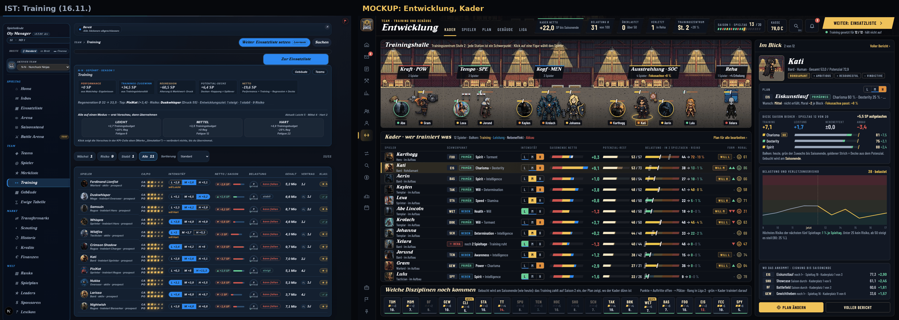
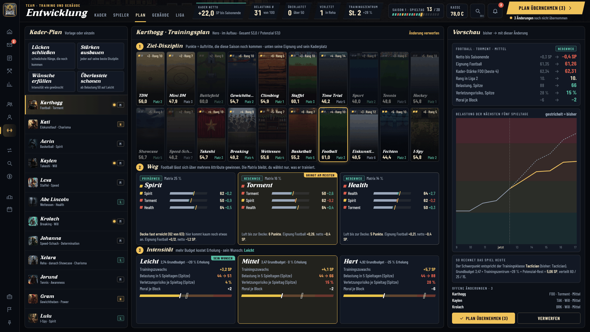

# Entwicklung: Training und Gebäude modern (Fable, 18.11.) — Mockup und Erklärung

Auftrag aus dem Fahrplan (`seiten-umbau-fahrplan-18-11.md`, Punkt 5, Seiten 19 und 20): Training und Gebäude als ein
Bereich „Entwicklung“, neu gedacht statt umgestylt. Dies ist ein Entwurf. `app/`, `components/`, `lib/` und der Motor sind
nicht angefasst, der Wertungs-Fingerabdruck ist unberührt. 0 PixelLab-Generationen: Halle, Geräte und Figuren sind
vorhandene Bilder.

## Ansehen

| Was | Datei |
|---|---|
| Mockup, klickbar | `public/mockups/training-modern-18-11.html` |
| Bilder | `docs/design/training-modern-18-11/` |

Läuft per Doppelklick ohne Server, über den Dev-Server unter `/mockups/training-modern-18-11.html`. Die graue Leiste oben
gehört nicht zum UI; sie schaltet Ansicht, Belastung, Buchung und Vorstand. Dasselbe per Adresse:
`?ansicht=kader|spieler|plan|gebaeude|liga`, `?spieler=kati|krolach|xelara|karthogg|…`, `?last=hoch`, `?buchung=block`,
`?vorstand=spar`, `?diszi=0..19`, `?geb=0..7`, `?bau=aus`, `?entwurf=1`, `?vorlage=0..3`, `?fest=1` (Figuren stehen),
`?still=1` (ohne graue Leiste).

Ein Durchlauf zum Klicken: Leiste „Belastung: überlastet“ → in der Halle blinkt Krolach, oben rechts „Überlastete
schonen“ → Reiter **Plan** → Karthogg wählen → Schritt 2 zeigt „Decke fast erreicht“ am Primärweg, der Nebenweg
„bringt am meisten“ → Intensität Mittel → rechts fällt das Risiko → „Plan übernehmen“. Danach Reiter **Gebäude** →
Trainingszentrum → „Ausbauen“ → Bestätigung zeigt Kasse, freies Budget, Unterhalt und Trainingszuwachs vorher/nachher.

| Bild | Zustand |
|---|---|
| `01`–`03-kader-*` | Kader-Training bei 2560×1440, 1920×1080, 1710×1112 |
| `04`–`06-kader-ueberlastet-*` | **Überlastung**: vier Spieler über 50, Krolach am Limit, drei Bildschirme |
| `07-kader-filter-eiskunstlauf` | Klick auf eine Disziplin im Radar: wer trainiert darauf |
| `08-kader-verletzt-reha` | verletzter Spieler im Blick, Buchung in Blöcken |
| `09`–`11-spieler-*` | Spieler-Detail (Kati), drei Bildschirme |
| `12-spieler-ohne-figur` | Spieler ohne Pixel-Figur (Portrait als Ersatz) |
| `13`–`15-plan-*` | Plan-Editor mit drei offenen Änderungen, drei Bildschirme |
| `16-plan-ueberlastet-schonen` | Vorlage „Überlastete schonen“ angewandt |
| `17`–`19-gebaeude-*` | Gebäude, drei Bildschirme |
| `20-gebaeude-ausbau-bestaetigen` | Ausbau-Bestätigung mit Folgen |
| `21-gebaeude-fanshop-abgenutzt` | Zustand unter 80, Reparatur lohnt |
| `22-gebaeude-sparauflage` | Vorstand sperrt den Bau |
| `23`–`25-liga-*` | Vergleich mit den KI-Teams |
| `26-mit-mockup-leiste` | mit grauer Leiste |
| `abgleich-training-ist-mockup.png`, `abgleich-gebaeude-ist-mockup.png` | links Ist (Aufnahmen vom 16.11. und 14.11.), rechts Mockup |

Geprüft bei allen drei Zielbildschirmen: nichts scrollt, keine Tafel läuft über (Messung `scrollWidth/-Height` je Tafel),
keine Skriptfehler. Alle Bilder auf 256 Farben reduziert.

**Echt:** Spieler, Portraits, Pixel-Figuren in ihren vorhandenen Posen (Stand, Lauf, Angriff), Klassen, Traits, zwölf
Attribute, Gesamtwert, Potenzial, Marktwert, Eignung je Disziplin, Matrixgewichte, Plätze je Disziplin, die drei
Trainingsmodi mit Budget/Erholung/Last, die Risikokurve der Erschöpfung (25: 0 %, 50: 3 %, 80: 25 %, 100: 33 %), die
Wunsch-Traits, die stärksten Attribute der 13 Trainingsklassen, der komplette Gebäude-Katalog (Kosten, Unterhalt,
Wirkung), Zustandsschwelle 80 mit Untergrenze 25 % und die Reparaturformel, Liga-2-Teams mit Manager-Typ.
**Erfunden:** alle Zustände (Belastung, Form, Moral, Verletzung, Pläne, Gebäudestufen, Kasse 78 C, Stimmung 58), der
Spielplan, die Zuwachs-Zahlen (vereinfachtes Modell, Größenordnung an der Ist-Aufnahme geeicht), die Attribut-Decken,
die Belastungsprognose, die Werte der 15 KI-Teams.

## 1. Was sich gegenüber heute ändert

Heute sind es zwei Seiten mit je über 1400 Zeilen (`TrainingCompactNewLook.tsx`, `FacilitiesV2NewLook.tsx`). Training
ist eine Tabelle mit drei Knöpfen L/M/H je Spieler und einer Sternezeile; **was** ein Spieler trainiert, steckt als
„trainiert Hero“ im Kleingedruckten. Gebäude ist ein Kartenraster mit Balkendiagramm darunter.

| Thema | Heute | Im Entwurf | Warum |
|---|---|---|---|
| Ort | zwei Punkte in der Schiene (Training, Gebäude) | **ein Punkt „Entwicklung“** mit fünf Reitern im Regieband: Kader, Spieler, Plan, Gebäude, Liga | ein Thema: Gebäude wirken aufs Training, beides zahlt aus demselben Topf |
| Einstieg | KPI-Kacheln und Modus-Schalter für alle | **Trainingshalle** als Szene: fünf Stationen (Kraft, Tempo, Kopf, Ausstrahlung, Reha), jeder Spieler steht mit seiner Figur dort, wo sein Schwerpunkt liegt | man sieht auf einen Blick, wer was trainiert, wer überlastet ist, wer fehlt |
| Was wird trainiert | Trainingsklasse (13 abstrakte Namen) | **Ziel-Disziplin + Weg** (Primärweg oder Nebenweg), darunter die drei Attribute mit 60 / 25 / 15 % | der Spieler denkt in Disziplinen, nicht in Klassennamen; „mehrere Wege zum Erfolg“ wird wählbar |
| Wie hart | L/M/H mit Zuwachs-Zahl | L/M/H, zusätzlich je Wahl: Belastung der nächsten fünf Spieltage, Verletzungsrisiko in Prozent, Moral-Folge, Wunsch des Spielers | die Kosten der Härte standen bisher nur als Wort „kann fallen“ da |
| Belastung | Ring „0 Fatigue“ | Balken mit den vier Zonen der echten Risikokurve, Marke „jetzt“ und Marke „in 3 Spieltagen“, Risiko in Prozent | die Zahl sagt erst mit der Kurve etwas |
| Überlastung | nichts | roter Zustand: Hinweis in der Halle, Zähler am Reiter, Statuszeile im Taktgeber, ein Knopf „Überlastete schonen“ | Verletzung heißt seit 18.11. „nicht einsetzbar“; das muss vorher sichtbar sein |
| Fortschritt | Netto-Zahl je Spieler | je Attribut: heute, Zuwachs, Decke; je Spieler: Training, Leistung, Nebeneffekt, Abbau getrennt | zeigt, wo Training ankommt und wo es an der Decke verpufft |
| Wirkung | Top-Disziplinen im Spielerprofil | Wirkung auf alle 20 Disziplinen mit Kaderplatz und offenen Auftritten; unten im Kader ein Radar der 20 Disziplinen (Auftritte offen, Plätze, Liga-Rang, wer darauf trainiert) | Training wird gezielt statt pauschal |
| Verletzte | trainieren weiter | stehen in der Reha-Ecke, Training ruht | Vorgabe aus dem Fahrplan („Verletzte trainieren nicht“) |
| Gebäude | Raster + Kostenkurve | Vereinsgelände mit acht Häusern (Stockwerke = Stufe), oben der gemeinsame Topf „frei für Käufe und Gebäude“, rechts Stufenleiter, Zustand, „wer im Kader profitiert“, Liga-Verteilung, Ausbau mit Folgen-Vorschau | Finanzkonzept V2: Unterhalt je Spieltag, Vorstand gibt Budget frei |
| KI | unsichtbar | Reiter Liga: Intensitäts-Mix, Belastung, Verletzte, Entwicklung und Gebäudestufen aller 16 Teams, daneben fünf Regeln der KI in Klartext | beantwortet „mache ich es besser oder schlechter als die anderen“ |

## 2. Die fünf Ansichten

**Kader.** Halle oben, Tabelle darunter, Disziplin-Radar unten, rechts „Im Blick“ (gewählter Spieler: Plan, Saison bisher,
Belastungskurve, wo es ankommt). Die Intensität lässt sich direkt in der Zeile umstellen. Figuren: Kraft-Station in
Angriffs-Pose, Tempo im Lauf, Kopf und Ausstrahlung im Stand, Reha grau. Spieler ohne Figur (heute 362 von 2984 haben
eine) stehen als Portrait-Medaillon an ihrer Station.

**Spieler.** Links die Figur an ihrer Station, Entwicklungskurve, Plan, „Entwicklung vor Verkauf“ (Marktwert heute →
Saisonende, Vertragsrest). Mitte: zwölf Attribute mit den vier Quellen und der Decke, darunter der Trainingsverlauf je
Spieltag. Rechts: Wirkung in 20 Disziplinen.

**Plan.** Links Kader und vier Vorlagen (Lücken schließen, Stärken ausbauen, Wünsche erfüllen, Überlastete schonen).
Mitte drei Schritte: Ziel-Disziplin, Weg, Intensität. Rechts Vorschau „bisher → mit dieser Änderung“ und die offenen
Änderungen; übernommen wird gesammelt, auch über den Taktgeber oben rechts.

**Gebäude.** Budgetleiste, Vereinsgelände, Detail. Reparieren bleibt bei Sparauflage erlaubt, Bauen nicht.

**Liga.** Tabelle der 16 Teams und „Was die KI anders macht“.

## 3. Datenquellen je Element

| Element | Quelle | Stand |
|---|---|---|
| Trainingsmodus L/M/H, Budget, Erholung, Last | `training-mode-presentation.ts`, `training-recovery-impact.ts`, `player.trainingMode` | vorhanden |
| Zuwachs je Attribut (Training, Leistung, Nebeneffekt, Abbau, Netto), Decke | `organic-season-progression.ts` (`OrganicProgressionAttributeBreakdown`), `player-attribute-ceiling-service.ts`, Zeilenmodell `training-player-row-view.ts` | vorhanden |
| „Diese Saison bisher“ | `seasonSoFar`, `trainingAccumulatorForecast`, `matchday-training-accumulator.ts` | vorhanden |
| Trainingsverlauf je Spieltag, Historie mit Hauptklasse | `player-matchday-training-history.ts`, `player-training-history.ts` | vorhanden |
| Wirkung auf 20 Disziplinen | `player-discipline-training-forecast.ts` | vorhanden |
| Wunsch des Spielers, Moral-Folge | `training-mode-demand-service.ts` (`moraleReward`, `moralePenalty`) | vorhanden |
| Belastung jetzt, Risikokurve | `player.fatigue`, `fatigue-calibration.ts` | vorhanden |
| Belastung der nächsten Spieltage | `projectedFatigueAfterMode` in `ai-player-training-load-service.ts` (bisher nur für die KI) | **Rechnung vorhanden, Anzeige neu**; braucht die geplante Aufstellung als Annahme |
| Fokusachse, Routenbonus | `facility-effects.ts` (`getSpecialistWingFocusAxis`, `…BonusPct`) | vorhanden |
| Stationen der Halle | Achse des stärksten Schwerpunkt-Attributs | Ableitung, neu |
| Ziel-Disziplin und Weg | Matrix `official-discipline-weights.ts` (nur gelesen) | **neu**, siehe 4 |
| Disziplin-Radar: offene Auftritte, Plätze, Liga-Rang | Spielplan der Saison, `playerCount`, Saisonstand je Disziplin | vorhanden, neu zusammengestellt |
| Entwicklung vor Verkauf | Marktwertformel + Prognose, `economy` in der Zeile | vorhanden |
| Gebäude: Stufen, Kosten, Unterhalt, Wirkung | `facility-catalog.ts` | vorhanden |
| Zustand, Wirkungsgrad, Reparaturkosten | `facility-condition.ts`, `facility-maintenance-service.ts` | vorhanden |
| Unterhalt je Spieltag, Einnahme je Heimspiel, Stimmung | Finanzkonzept V2 Abschnitt 2.1 und 4 | **neu mit dem Finanzbau** (Stufe 5 und 8) |
| Frei für Käufe und Gebäude, Sparauflage | Finanzkonzept V2 Abschnitt 5.6 und 5.7 | **neu mit dem Finanzbau** |
| Liga-Vergleich | dieselben Dienste über alle Teams der Liga | vorhanden, neu zusammengestellt |
| Entwicklungskurve | Gesamtwert, Potenzial | vorhanden. **Ein Alter gibt es im Spiel nicht**: das Feld `age` ist bei 0 von 2984 Spielern gesetzt, der Abbau rechnet mit festem Sockel und Marktwert-Druck. Die Kurve zeigt deshalb Potenzial-Rest statt Lebensalter |

## 4. Nur Anzeige oder neue Spielregel

**Nur Anzeige (kein Eingriff in die Rechnung):** Halle, Tabelle, Belastungsbalken mit Risiko, Attribut-Tabelle mit Decke,
Wirkung in 20 Disziplinen, Radar, Vorschau im Editor, Gebäude-Ansicht samt Liga-Verteilung, Reiter Liga, Vorlagen
„Wünsche erfüllen“ und „Überlastete schonen“ (setzen nur den vorhandenen Modus).

**Brücke ohne neue Regel:** „Ziel-Disziplin + Weg“ lässt sich zuerst als **Auswahlhilfe** bauen. Der Editor rechnet für
die gewählte Disziplin und den Weg aus, welche der 13 vorhandenen Trainingsklassen dem Attribut-Profil am nächsten kommt,
und setzt diese (im Mockup steht das unter „So rechnet das Spiel heute“: „entspricht der Trainingsklasse Tactician“).
Die Engine bleibt, wie sie ist.

**Neue Spielregeln (jede einzeln entscheidbar, jede mit Messlauf und Review):**

| Regel | Was sich ändert | Risiko |
|---|---|---|
| A. Schwerpunkt direkt aus der Matrix | das Trainingsprofil kommt aus den drei schwersten Matrix-Attributen der Ziel-Disziplin (60 / 25 / 15) statt aus der Klasse. Die Matrix wird nur gelesen, nicht geändert | verschiebt, welche Attribute wachsen; Liga-Schnitt der Entwicklung neu messen |
| B. Verletzte trainieren nicht | während der Ausfall-Spieltage läuft kein Trainingsbudget und keine Trainingslast auf | klein; trifft Mensch und KI gleich |
| C. Buchung in vier Blöcken | Zuwachs wird nach Spieltag 5, 10, 15, 20 gebucht statt nur am Saisonende | groß: Eignung, Marktwert und Rangtreue-Messungen ändern sich mitten in der Saison; Summe je Saison muss gleich bleiben |
| D. Unterhalt je Spieltag, Einnahme je Heimspiel, Bau aus dem Freigabe-Budget, Sparauflage | Finanzkonzept V2, schon beschlossen | kommt mit dem Finanzbau, nicht mit dieser Seite |
| E. Überlastung drückt die Form | nicht im Mockup, nur als Frage unten | — |

Wichtig für die Erwartung: **heute wirkt Training erst in der nächsten Saison**, weil am Saisonende gebucht wird. Das
Radar zeigt deshalb im Standard ehrlich „zahlt auf Saison 2 ein“. Mit Regel C (Schalter „Buchung: vier Blöcke“ in der
grauen Leiste) wird daraus „Block 3 wird nach Spieltag 15 gebucht“, und die Disziplinen, die danach noch kommen, sind
markiert. Ebenfalls ehrlich: die Zuwächse sind klein. Ein Spieler im Aufbau legt in seinem Schwerpunkt-Attribut etwa
zwei bis drei Punkte je Saison zu, die Eignung in der Ziel-Disziplin steigt um rund 0,3 bis 1; nur ein Rohdiamant wie
Kati schafft sieben. Das entspricht der Größenordnung der heutigen Engine.

## 5. Bau-Reihenfolge (kleine PRs, Sonnet)

1. **Bereich und Rahmen.** Ein Schienenpunkt „Entwicklung“, fünf Reiter im Regieband, Slot und Taktgeber-Text. Alte
   Seiten bleiben erreichbar, bis ihr Ersatz steht.
2. **Kader-Tabelle und „Im Blick“** aus `training-player-row-view.ts` (nur Anzeige). Belastungsbalken mit Risikokurve.
3. **Trainingshalle** (Figuren-Baustein aus dem Spielerprofil wiederverwenden, Stationen aus dem Schwerpunkt).
4. **Überlastungs-Zustand**: Prognose der nächsten Spieltage für das eigene Team, Hinweis, Knopf „schonen“.
5. **Spieler-Ansicht**: Attribut-Tabelle, Trainingsverlauf, Wirkung in 20 Disziplinen.
6. **Plan-Editor als Auswahlhilfe** (Brücke): Ziel-Disziplin, Weg, Intensität, Vorschau, gesammeltes Übernehmen, Vorlagen.
7. **Disziplin-Radar** mit Filter.
8. **Gebäude**: Gelände, Detail, Ausbau mit Folgen-Vorschau. Budgetleiste erst mit Zahlen von heute (Kasse), nach dem
   Finanzbau mit Freigabe, Raten und Heimspiel-Einnahme.
9. **Liga-Vergleich.**
10. **Altlasten löschen:** `training-compact/`, `facilities-v2/`, `facilities-overview-v2/`, CSS-Blöcke `.nl-training*`
    und `.nl-facility*` (Zeilen laut Fahrplan Abschnitt 5).
11. Danach je nach Entscheidung die Regeln B, A, C als eigene PRs mit Messlauf (32 KI-Teams) und Opus-Review.

Jeder Schritt mit Abgleich Mockup | App bei 2560×1440, 1920×1080, 1710×1112 und der Liste drin / angepasst / fehlt.

## 6. PixelLab

Verbraucht: 0. Die Halle ist `kulissen/gewichtheben/sandsack.jpg`, die Geräte sind die HYROX-, Hindernis-, Climbing- und
I-Spy-Requisiten aus `sprites/arena/`. Kein neuer Charakter, keine neue Animation; die Figuren nutzen Stand, Lauf und
Angriff.

Vorschlag, nicht bestellt: eine **eigene Trainingshalle** als Kulisse (1 Bild, mit Stilprobe 2 bis 3 Generationen) und
**acht Gebäude-Sprites** fürs Vereinsgelände statt der CSS-Häuser (8 Gebäude × 2 Ausbau-Looks = 16, mit Stilprobe etwa
20 Generationen). Zusammen rund 25 Generationen; fällt unter „Kulissen und Requisiten“, also ohne Einzelfreigabe
möglich, aber erst nach deinem OK zum Mockup sinnvoll.

## 7. Offene Fragen für Chris, mit Empfehlung

1. **Ein Bereich „Entwicklung“ statt zwei Schienenpunkten?** Empfehlung: ja.
2. **Ziel-Disziplin + Weg statt Trainingsklasse?** Empfehlung: ja, zuerst als Auswahlhilfe auf den vorhandenen Klassen
   (kein Eingriff), Regel A danach mit Messlauf.
3. **Buchung in vier Blöcken (Regel C) oder weiter am Saisonende?** Empfehlung: Blöcke, aber als letzter Schritt und
   erst nach dem Finanzbau. Ohne sie bleibt Training ein Thema für die nächste Saison; mit ihnen lohnt der Blick auf den
   Spielplan wirklich.
4. **Verletzte trainieren nicht (Regel B)?** Empfehlung: ja, mit Reha-Ecke.
5. **Soll Überlastung zusätzlich die Form drücken (Regel E)?** Empfehlung: nein. Das Verletzungsrisiko und der Ausfall
   sind Strafe genug, eine zweite Strafe macht die Rechnung undurchsichtig.
6. **Alter einführen?** Das Spiel kennt keines. Empfehlung: nein, die Entwicklungskurve über Potenzial-Rest reicht; ein
   Alter wäre ein eigenes Konzept (Generator, Abbau, Vertrag, Markt).
7. **Wechsel der Fokusachse (Specialist-Wing-Variante) mitten in der Saison frei?** Empfehlung: einmal je Saison,
   sonst wird die Achse jede Woche nachgezogen.
8. **Eigene Halle und Gebäude-Sprites bei PixelLab bestellen (rund 25 Generationen)?** Empfehlung: ja, nach deinem OK
   zum Layout.
9. **Sind die Zuwächse spürbar genug?** Zwei bis drei Punkte je Saison im Schwerpunkt. Empfehlung: erst sichtbar machen
   (dieser Bau), dann mit echten Spielständen entscheiden, ob das Budget steigen soll.

## 7a. Entscheidungen von Chris (18.11.)

Chris: „Entwicklung und Training sieht mega geil aus! Bitte setz das 1:1 so um … auch dass man nun Disziplinen targeten
kann, wo der Spieler sich rein entwickeln soll, ist mega.“

| # | Entscheidung |
|---:|---|
| 1 | Ein Bereich „Entwicklung“: **ja**. |
| 2 | Ziel-Disziplin + Weg statt Trainingsklasse: **ja** (Regel A, mit Messlauf). |
| 3 | **Training wirkt je Spieltag und wird je Spieltag gebucht und getrackt** — keine vier Blöcke, kein Saisonende-Buchen. Muss neu gebalanced werden: die heutigen Raten waren auf rund 10 Spieltage ausgelegt, die Saison hat 20. |
| 4 | Verletzte trainieren nicht (Regel B): **ja**. |
| 5 | Überlastung drückt die Form (Regel E): **ja, aber gering**. |
| 6 | Alter: **nein**. |
| 7 | Fokus kann **beliebig gewechselt** werden (keine Sperre je Saison). |
| 8 | PixelLab-Halle und Gebäude-Sprites (~25 Generationen): **ja**. |
| 9 | Zuwächse sichtbar machen, dann mit echten Spielständen entscheiden: **ja**. |

## 8. Grenzen des Mockups

- Die Zuwachs-Zahlen stammen aus einem vereinfachten Modell (Budget × Trainingszentrum × Potenzial-Rest, verteilt
  60 / 25 / 15, Decke bremst, 30 % des Überschusses als Nebeneffekt). Die App zeigt die Werte der Engine.
- Die Belastungsprognose nimmt an, dass jeder Spieler aufgestellt wird, wenn sein Kaderrang in die Plätze der Disziplin
  passt. Im Bau kommt sie aus der Einsatzliste bzw. der letzten Aufstellung.
- Kader und Zustände sind die aus dem Spielerprofil-Mockup (Vigilante Wranglers, Spieltag 13).
- Phone ist nicht Teil dieses Entwurfs.
