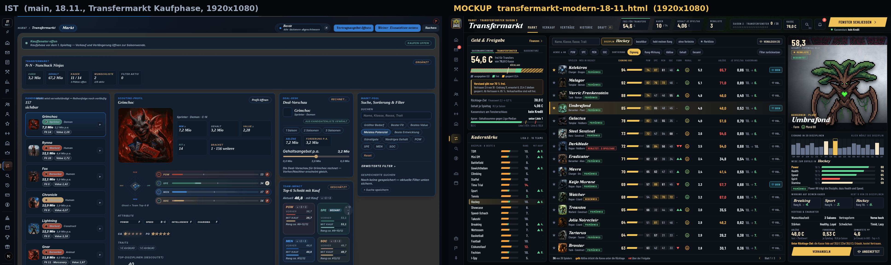
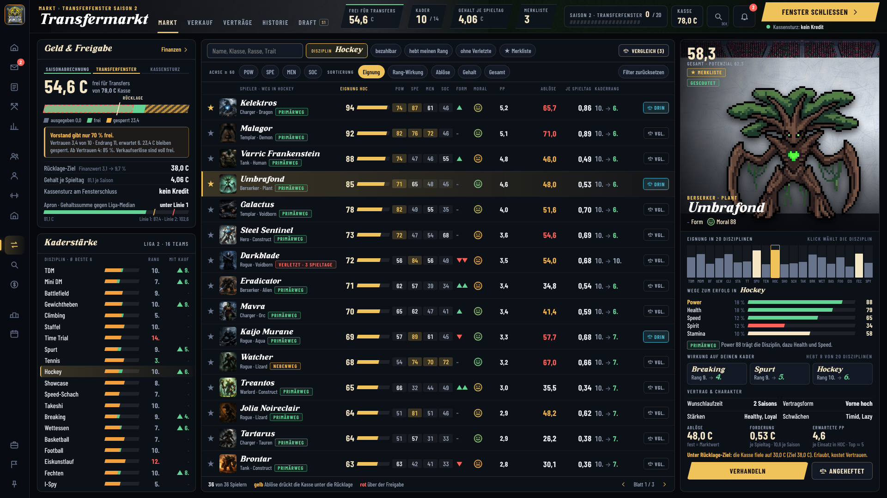
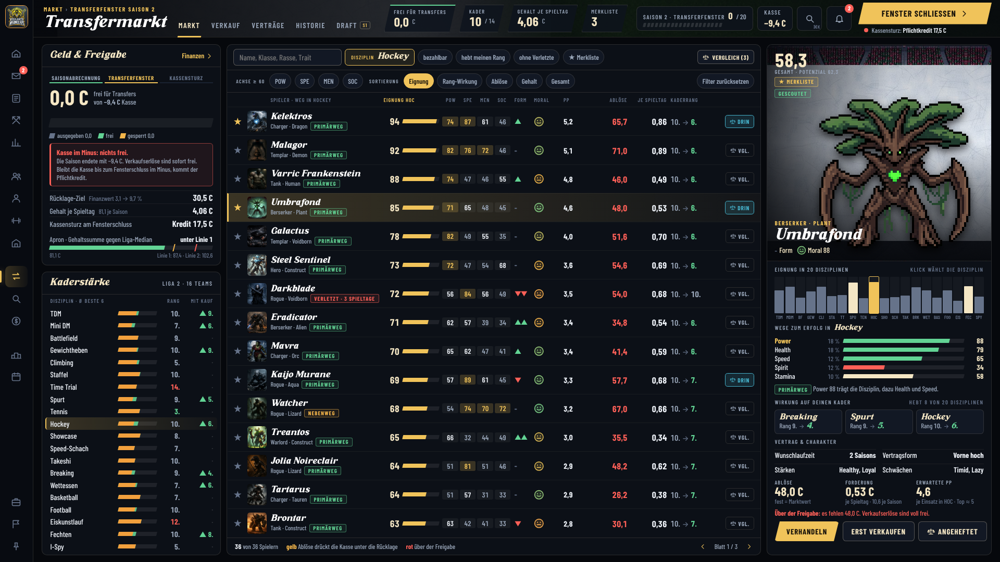
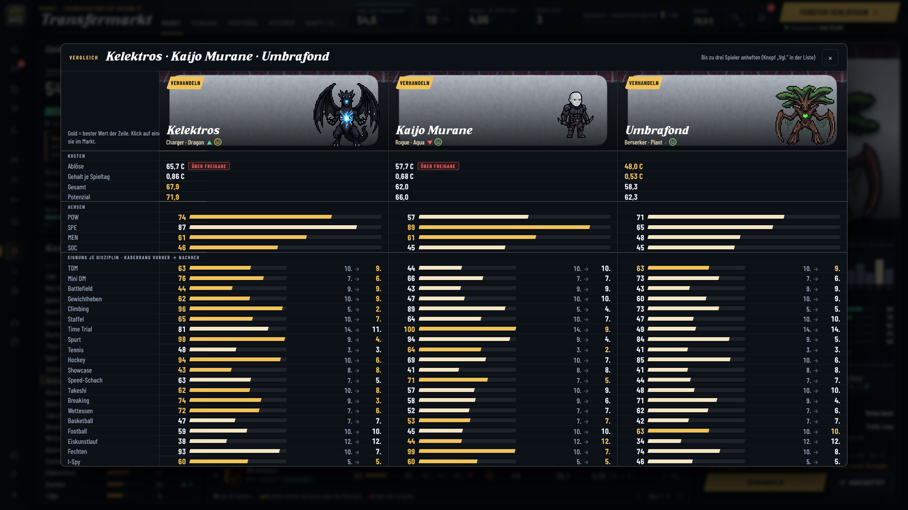
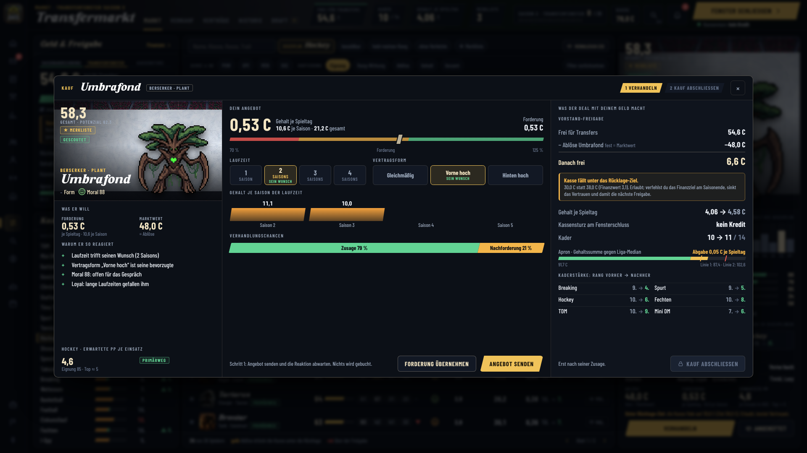
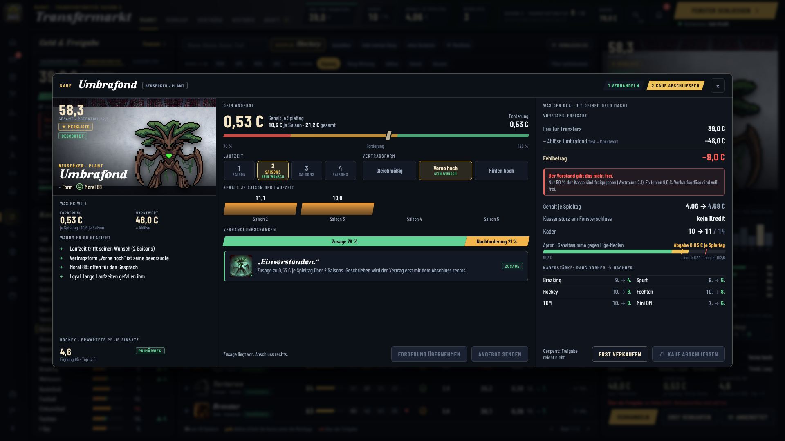
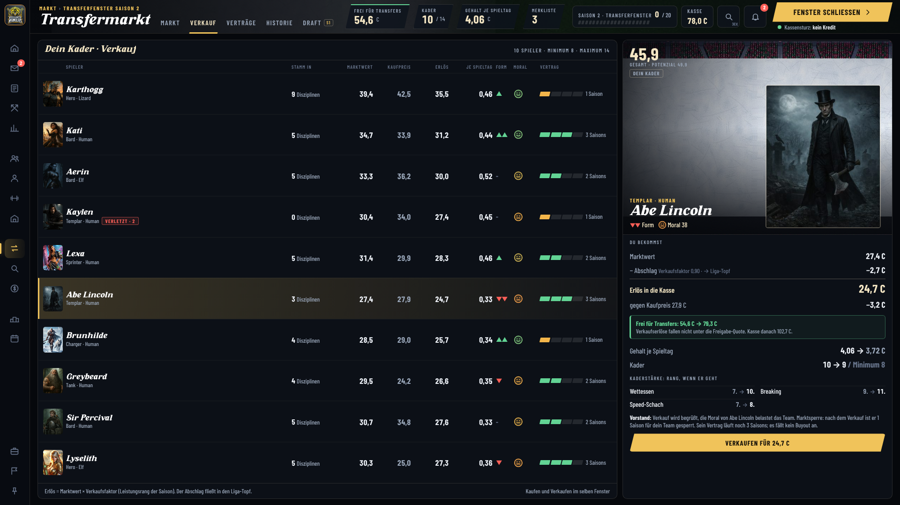
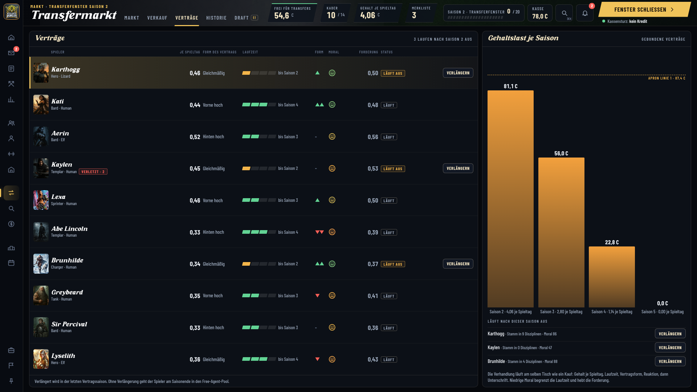
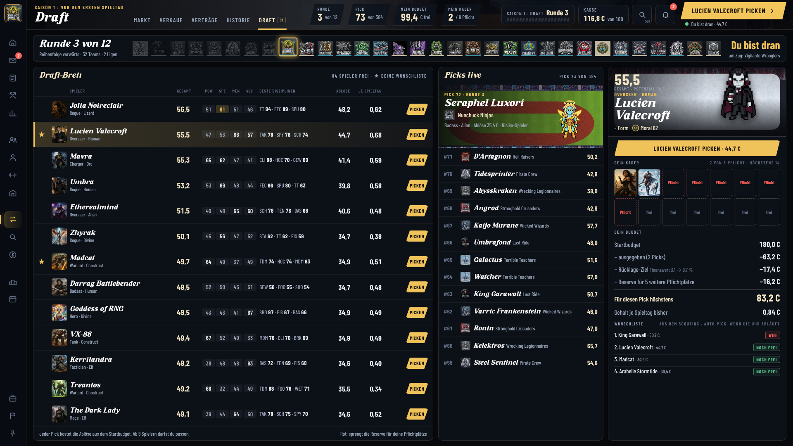

# Transfermarkt mit Draft, Kauf, Verkauf und Verträgen — Mockup im neuen Stil (18.11.2026)

**Status: Mockup + Erklärung. Gebaut wird erst nach Chris' OK. Kein App-Code in diesem PR.**

- Mockup (klickbar): `public/mockups/transfermarkt-modern-18-11.html`
- Bilder: `docs/design/transfermarkt-modern-18-11/`
- Fahrplan-Bezug: `docs/design/seiten-umbau-fahrplan-18-11.md`, Zeilen 22 bis 24 (Transfermarkt, Draft-Phase, Dialoge), Welle 2
- Stil: steht im Rahmen aus `public/mockups/app-rahmen-modern-18-11.html` (Schiene, Regieband, Taktgeber, Meldungen; das CSS des
  Rahmens ist unverändert übernommen), Tafeln und Tabellen wie `oly-start-modern-18-11`, Geld-Bausteine wie `finanzen-modern-18-11`

---

## 0. Die fünf Kernentscheidungen

1. **Die Liste ist die Seite.** Heute zeigt die Kaufphase sechs Karten links und vier Tafeln daneben (Scouting-Profil, Deal-Vorschau,
   Team-Impact, Filter). Neu: eine Tabelle mit 15 Spielern je Blatt in der Mitte, links das Geld und die Kaderstärke, rechts der
   gewählte Spieler mit seiner PixelLab-Figur. Die Deal-Vorschau ist kein Dauergast mehr, sie öffnet sich als Dialog.
2. **Eine Disziplin führt durch alles.** Ein Klick auf eine der 20 Disziplinen (links in der Kaderstärke, rechts im Balkenprofil
   oder im Vergleich) stellt die ganze Seite um: Eignung, erwartete PP, „Weg“ über die Matrix-Attribute, Kaderrang vorher → nachher.
   Die Frage „wen brauche ich für Hockey“ ist damit ein Klick, kein Filterformular.
3. **Das Geld erklärt sich selbst.** Oben links steht nicht „Cash“, sondern „frei für Transfers“, als Balken aus drei Teilen:
   ausgegeben, frei, vom Vorstand gesperrt. Darunter steht der Grund in einem Satz („Vorstand gibt nur 70 % frei · Vertrauen 3,4 ·
   Endrang 11, erwartet 6“). Jeder Preis in der Liste ist gegen diesen Balken gefärbt: rot über der Freigabe, gelb unter dem
   Rücklage-Ziel.
4. **Ein Verhandlungstisch für Kauf und Verlängerung.** Derselbe Dialog, dieselben drei Spalten: der Spieler und warum er so
   reagiert, mein Angebot (Gehalt je Spieltag, Laufzeit, Vertragsform, Chancen), was der Deal mit meinem Geld macht (Freigabe,
   Gehalt je Spieltag, Apron, Kassensturz, Kaderränge). Zwei Schritte wie heute: verhandeln, dann abschließen.
5. **Der Draft ist ein geführter Ablauf, keine Marktliste.** Zwölf Runden, 32 Teams in Schlangen-Reihenfolge als Wappenkette, die
   KI pickt sichtbar (Figur, Team, Preis, GM-Typ), der Taktgeber im Regieband führt („Weiter zu meinem Pick“ → „Du bist dran“ →
   „Runde 4 starten“). Das Budget rechnet die Pflichtplätze mit: es zeigt, was dieser eine Pick höchstens kosten darf.

---

## 1. Was sich gegenüber heute ändert

| Bereich | Heute (`TransfermarktV2NewLook.tsx`, 3211 Zeilen, `.nl-market*`) | Mockup |
|---|---|---|
| Aufbau | Kopf-Karte mit fünf Kacheln, Kandidaten als Karten (6 sichtbar), Scouting-Profil, Deal-Vorschau, Team-Impact, Filter-Tafel; Seite scrollt | drei Spalten ohne Seitenscroll: Geld + Kaderstärke, Tabelle, Fokus-Spieler; Kennzahlen im Regieband |
| Kandidaten | 6 je Bildschirm, Fit und Value als Chips | 15 je Blatt, Spalten: Eignung in der gewählten Disziplin, vier Achsen, Form, Moral, erwartete PP, Ablöse, Gehalt je Spieltag, Kaderrang vorher → nachher |
| Spielerbild | Porträt | PixelLab-Figur vor der Kulisse der gewählten Disziplin (Porträt als Rückfall und in der Liste) |
| Bedarf | „Was ich noch brauche“ als Text, Team-Impact über vier Achsen (Top-6-Schnitt) | Kaderstärke in allen 20 Disziplinen mit Liga-Rang (16 Teams der eigenen Liga) und Vorschau „mit Kauf“ für den gewählten Spieler |
| Eignung erklären | Top-Disziplinen (gescoutet), Attribute als Tier-Buchstaben | „Wege zum Erfolg“: die fünf schwersten Matrix-Attribute der Disziplin mit Gewicht und seinem Wert, Urteil Primärweg / Nebenweg / kein Weg |
| Geld | Kacheln „Cash“ und „Gehalt“ (je Saison) | „frei für Transfers“ mit Vorstand-Freigabe, Rücklage-Ziel nach Finanzwert, Gehalt je Spieltag, Apron-Linien, Kassensturz-Vorschau |
| Deal | Deal-Vorschau dauerhaft in der Seite, eigener Reiter „Vertragsangebot“ | Dialog „Verhandlungstisch“ (ein Baustein für Kauf und Verlängerung) |
| Vergleich | „angeheftet vs. Fokus“ (zwei Spieler, Achsen) | bis zu drei Spieler nebeneinander, 31 Zeilen, bester Wert je Zeile gold, Kaderrang je Disziplin |
| Verkauf | eigener Unterreiter, Verkaufsfenster vor dem Kauffenster, Dialog mit Board-Reaktion | Reiter „Verkauf“ im selben Fenster: Kader-Tabelle links, rechts Erlös, Abschlag an den Liga-Topf, Wirkung auf Freigabe, Gehalt und Kaderränge, zweistufige Bestätigung |
| Verträge | im Team-Detail (`ContractRenewalNegotiationModal.tsx`, 807 Zeilen) | Reiter „Verträge“: Laufzeiten, Forderungen, Gehaltslast je Saison gegen Apron-Linie 1; Verlängern öffnet den Verhandlungstisch |
| Draft | Phase des Marktes plus Wunschliste im Scouting, KI kauft im Block | eigene Ansicht in Saison 1: Runden, Pick-Kette, Picks live, Budget mit Pflichtplatz-Reserve, Wunschliste als Auto-Pick |
| Einheit | „Mio“, Gehalt p. a. | „C“ wie im Finanzkonzept V2, Gehalt **je Spieltag** vorn, je Saison klein dahinter |
| Fenster-Status | Banner „Kauffenster offen“ über der Seite | Drei-Schritt-Leiste im Geld-Kasten (Saisonabrechnung · Transferfenster · Kassensturz), Taktgeber „Fenster schließen“ mit Kassensturz-Vorschau |

Was bewusst **bleibt**: zwei Schritte beim Kauf (verhandeln, dann final abschließen), Zusage / Nachforderung / Absage mit
Wahrscheinlichkeiten, Laufzeit 1 bis 4 Saisons, drei Vertragsformen, Wunschlaufzeit und Wunschform des Spielers, Moral begrenzt die
Laufzeit, Absage wird nachgetragen, Merkliste, verdeckte Traits bis zum Scouting, Kader 8 bis 14, Marktsperre nach Verkauf,
Bestätigungsfrage vor dem Verkauf.

Was **entfällt oder umzieht**: „Value = MW ÷ Gehalt“ und „Fit“ als eigene Chips (die Spalten Eignung, Kaderrang und Weg sagen dasselbe
konkreter; als Sortierung nachrüstbar), „Gespeicherte Suchen“ (durch die Disziplin-Führung selten nötig; Frage 8), der Reiter
„Vertragsangebot“ (ist der Dialog), „Bracket“ und „CA/PO“-Sterne (ersetzt durch Gesamt und Potenzial als Zahl).

---

## 2. Die Ansichten

Alle Ansichten stehen im selben Rahmen. Unterreiter im Regieband: **Markt · Verkauf · Verträge · Historie · Draft (nur Saison 1)**.

### 2.1 Markt (`?ansicht=markt`)

- **Links oben, Geld & Freigabe:** große Zahl „frei für Transfers“, Balken (ausgegeben · frei · gesperrt, Marke für das
  Rücklage-Ziel), Kasten mit dem Grund der Freigabe, drei Zeilen (Rücklage-Ziel, Gehalt je Spieltag, Kassensturz), Apron-Balken.
  Wählt man einen Spieler, erscheint seine Ablöse gestrichelt im Balken.
- **Links unten, Kaderstärke:** 20 Zeilen, Stärke (Ø der besten sechs, verletzte zählen nicht), Rang in der eigenen Liga, Spalte
  „mit Kauf“ für den gewählten Spieler. Klick wählt die Disziplin.
- **Mitte:** Suche, gewählte Disziplin, Schnellfilter (bezahlbar, hebt meinen Rang, ohne Verletzte, Merkliste), Achsen-Filter,
  Sortierung (Eignung, Rang-Wirkung, Ablöse, Gehalt, Gesamt), „Vergleich (n)“. Darunter die Tabelle, 15 Zeilen teilen sich die Höhe.
- **Rechts, Fokus:** Figur vor der Kulisse der Disziplin, Gesamt und Potenzial, Form und Moral, Eignung in 20 Disziplinen als
  Balkenprofil, Wege zum Erfolg, Wirkung auf den Kader (die drei größten Rangsprünge), Vertrag und Charakter, Kosten, ein Satz zur
  Freigabe, Knöpfe „Verhandeln“ und „Vergleichen“.
- Verletzte Spieler tragen „verletzt · n Spieltage“ statt eines Formabzugs; der Kaderrang zählt sie erst danach (CLAUDE.md,
  „Verletzung heißt: nicht einsetzbar“).

Lage „Kasse im Minus“ (`?kasse=minus`): nichts ist frei, der Taktgeber zeigt den drohenden Pflichtkredit, der Fokus bietet „Erst
verkaufen“ an.

### 2.2 Vergleich (`?ansicht=vergleich`)

Bis zu drei angeheftete Spieler. Zeilen: Kosten, Gesamt, Potenzial, vier Achsen, 20 Disziplinen mit Eignung und Kaderrang
vorher → nachher. Der beste Wert je Zeile ist gold. „Über Freigabe“ steht direkt an der Ablöse.

### 2.3 Kauf-Dialog (`?ansicht=kauf`, `&schritt=gegen|ja`, `&freigabe=50`)

| Spalte | Inhalt |
|---|---|
| Spieler | Figur, Forderung je Spieltag, Marktwert = Ablöse, „Warum er so reagiert“ (Laufzeit, Vertragsform, Moral, Traits, Verletzung), erwartete PP in der gewählten Disziplin |
| Angebot | Gehalt je Spieltag als Regler (70 bis 125 % der Forderung), Laufzeit, Vertragsform (sein Wunsch markiert), Gehalt je Saison der Laufzeit, Chancen-Balken, Antwort des Spielers |
| Geld | Freigabe-Rechnung (frei − Ablöse = danach frei), Hinweis oder Sperre, Gehalt je Spieltag vorher → nachher, Kassensturz, Kader n → n+1, Apron mit dem neuen Stück in Gold, Kaderränge vorher → nachher |

Drei Antworten: Zusage, Gegenangebot (übernehmbar), Absage. Der Abschluss-Knopf ist bis zur Zusage gesperrt. Reicht die Freigabe
nicht, bleibt er gesperrt und daneben steht „Erst verkaufen“:

### 2.4 Verkauf (`?ansicht=verkauf`, `&schritt=1`)

Links der Kader mit „Stamm in n Disziplinen“ (in wie vielen Disziplinen der Spieler den Kaderrang hält), Marktwert, Kaufpreis,
Erlös, Gehalt je Spieltag, Form, Moral, Restlaufzeit. Rechts: Marktwert − Abschlag (→ Liga-Topf) = Erlös, Vergleich zum Kaufpreis,
„frei für Transfers vorher → nachher“, Gehalt je Spieltag, Kader gegen das Minimum 8, Kaderränge, wenn er geht, Vorstand und
Marktsperre. Bestätigung in zwei Schritten.

### 2.5 Verträge und Verlängerung (`?ansicht=vertrag`, `?ansicht=verl`)

Tabelle mit Gehalt je Spieltag, Vertragsform, Laufzeit, Forderung bei Verlängerung, Status. Rechts die gebundene Gehaltslast je
Saison gegen Apron-Linie 1 und die Liste der auslaufenden Verträge. „Verlängern“ öffnet den Verhandlungstisch ohne Ablöse-Teil;
statt der Freigabe steht dort, was ohne Verlängerung passiert.

### 2.6 Draft, Saison 1 (`?ansicht=draft`, `&zug=1`)

- **Oben:** Runde, Wappenkette der 32 Teams in Pick-Reihenfolge (erledigt grau, am Zug gold, eigenes Team orange, Strich = Liga),
  rechts „in n Picks“ oder „Du bist dran“.
- **Draft-Brett:** freie Spieler nach Gesamtwert, Achsen, beste drei Disziplinen, Ablöse, Gehalt je Spieltag, ★ Wunschliste,
  „Picken“ nur am eigenen Zug, „zu teuer“, wenn der Pick die Reserve für die Pflichtplätze sprengt.
- **Picks live:** der jüngste Pick groß mit Figur, Team, Preis, GM-Typ; darunter die letzten 13.
- **Dein Draft:** vorgemerkter Spieler mit Pick-Knopf, 14 Plätze (8 Pflicht), Budget als Rechnung (Startbudget − ausgegeben −
  Rücklage-Ziel nach Finanzwert − Reserve für die übrigen Pflichtplätze = für diesen Pick höchstens), Wunschliste mit Status.
- **Taktgeber:** „Weiter zu meinem Pick“ lässt die KI sichtbar picken und hält am eigenen Zug.

---

## 3. Datenquellen je Element

„Vorhanden“ heißt: Wert oder Funktion gibt es heute im Code. „Neu“ heißt: hängt an einer Mechanik-Stufe des Finanzkonzepts V2 oder
muss gebaut werden.

| Element | Quelle | Stand |
|---|---|---|
| Marktliste, Suche, Laden in Blättern | `lib/market/transfermarkt-read-service.ts`, `app/api/transfermarkt/free-agents`, `docs/design/marktliste-ladeverhalten.md` | vorhanden |
| Name, Klasse, Rasse, Traits, Achsen, Marktwert, Gehaltsforderung, Potenzial | Spielerdaten (`oly-player-stats.json` als Abbild), `player-display-market-value.ts`, `player-economy-contract.ts` | vorhanden |
| Verdeckte Traits, Scouting-Stand, Merkliste | `lib/market/transfermarkt-scouting.ts`, Wunschliste (`ScoutingShortlistBoard`) | vorhanden |
| Eignung je Disziplin | `disciplineRatings` des Spielers | vorhanden |
| Wege zum Erfolg (Gewicht je Attribut) | `lib/player-generator/official-discipline-weights.ts` (gesperrte Matrix), Football zusätzlich `spiel-eignung-overrides.ts` | vorhanden, Darstellung neu |
| Kaderstärke je Disziplin, vorher → nachher | `lib/market/transfermarkt-roster-impact.ts` (`computeDisciplineTopSixImpact`, `computeCandidateAxisTeamRankEstimate`) | vorhanden für Achsen und einzelne Disziplinen; **neu:** alle 20 Disziplinen und Rang gegen die 16 Teams der eigenen Liga |
| Form, Moral | `docs/design/form-moral-bau-18-11.md`, `BcFormPfeil`, `BcMoralGesicht` | im Bau (Branch `claude/form-moral-bau-18-11`) |
| Verletzung = nicht einsetzbar | `docs/design/verletzung-regel-18-11.md` | Regel fest, Anzeige neu |
| Erwartete PP je Einsatz | PP-Referenzen je Disziplin (`data/generated/*-pps-referenz.json`), Zielskala Top ≈ 5 | **neu** (Umrechnung Eignung → PP je Disziplin; im Mockup eine erfundene Gerade) |
| Kasse | `team.cash` | vorhanden |
| Vorstand-Freigabe (X % der Kasse) | Vorstandsvertrauen (`identity.boardConfidence`), Finanzkonzept V2 Abschnitt 5.7 | **neu** (Regel aus CLAUDE.md „Der Vorstand verhängt keine Geldstrafen“; Stufen siehe Frage 1) |
| Rücklage-Ziel | Finanzkonzept V2 Abschnitt 5.2, `q = 5 % + 20 % × (Finanzwert − 1) ÷ 9`, Finanzwert aus `identity.finances` | **neu** (Mechanik-Stufe 2) |
| Gehalt je Spieltag | Jahresgehalt ÷ 20, Finanzkonzept V2 Abschnitt 2.1 | **neu** als Buchung (Stufe 1), als Anzeige sofort möglich |
| Apron-Linien und Abgabe | `lib/finance/apron-projection.ts`, `apron-service.ts`; neue Linien Median × 1,15 / × 1,35 | vorhanden, Linien neu (Stufe 9) |
| Kassensturz, Pflichtkredit | Finanzkonzept V2 Abschnitt 6 | **neu** (Stufe 7) |
| Forderung, Chancen, Antwort, Nachtragen | `lib/market/contract-negotiation-preview.ts`, `transfermarkt-buy-service.ts`, `app/api/transfermarkt/buy` | vorhanden |
| Laufzeit, Vertragsform, Gehalt je Saison | `buildContractSalarySchedule`, `contract-shape-context.ts` | vorhanden |
| Verlängerung | `contract-renewal-service.ts`, `ContractRenewalNegotiationModal.tsx` | vorhanden, neuer Ort |
| Verkaufspreis, Abschlag, Buyout | `transfermarkt-sale-factor.ts` (`buildTransfermarktSaleFactorBreakdown`), `transfermarkt-sell-proceeds.ts` | vorhanden; im Mockup vereinfacht auf Faktor 0,90 |
| Abschlag → Liga-Topf | Finanzkonzept V2 Abschnitt 2.3 | **neu** (heute wird der Abschlag vernichtet) |
| Vorstand zum Verkauf, GM-Hinweis | `transfermarkt-sell-board-reaction.ts`, `transfermarkt-sell-coaching-service.ts` | vorhanden |
| Marktsperre nach Verkauf | `transfer-sold-cooldown.ts`, `anti-rebuy-guard.ts` | vorhanden |
| Fenster-Phasen | `transfer-window-policy.ts` | vorhanden; ein gemeinsames Fenster wäre neu (Frage 2) |
| Draft: Reihenfolge, Runden, KI-Pick je Zug | `lib/ai/ai-picks-run-service.ts` (kauft heute im Block je Team) | **neu** (Rundenlogik, Einzelschritt, Uhr) |
| Draft: Wunschliste, Auto-Pick | `isTeamSetupDraftWishlistPhase`, `ScoutingShortlistBoard` | vorhanden, Auto-Pick neu |
| Teams, Liga, Startbudget, Finanzwert, GM-Typ | Team-Stammdaten (Abbild: `ki-kaufverhalten-stammdaten-18-11.json`) | vorhanden |
| Figuren, Porträts, Kulissen | `public/sprites/figuren/<slug>/south.png`, `public/portraits/<slug>.jpg`, `public/sprites/kulissen/` | vorhanden; rund 360 Figuren, sonst Porträt |

**Echt im Mockup:** Spieler (Name, Klasse, Rasse, Traits, Porträt, Figur, Marktwert, Forderung, Achsen, zwölf Attribute, 20
Eignungen), Matrixgewichte, Teams, Wappen, Liga, Startbudget 180 C und Finanzwert 3,1 der Wranglers, GM-Typen, Formeln für Rücklage,
Apron-Linien und Pflichtkredit. **Erfunden:** Kader-Zuordnung, Kasse 78 C, Vertrauen und Freigabe-Stufen, Liga-Median 76 C, Form,
Moral, Verletzungen, Ränge der 15 Gegner, PP-Umrechnung, Verkaufsfaktor 0,90, Reihenfolge und Picks im Draft.

---

## 4. Bau-Reihenfolge (nach dem OK, kleine PRs, Sonnet baut)

Jede Stufe ist eine eigene neue Komponente im Mockup-Stil (`app/foundation/transfermarkt-modern/`), nicht in die alte Seite
eingehängt; die alte Fassung fliegt am Ende raus (CLAUDE.md, „Neuer Stil überall“).

| # | PR | Inhalt | Hängt an |
|---|---|---|---|
| 1 | Markt-Tabelle + Fokus | Drei-Spalten-Raster, Tabelle mit Disziplin-Führung, Fokus mit Figur, Wege, Merkliste; Geld-Kasten nur mit Kasse und Gehalt je Spieltag als Anzeige | App-Rahmen (#1580), sonst nichts |
| 2 | Kaderstärke 20 Disziplinen | Lese-Dienst: Stärke und Liga-Rang je Disziplin, Vorschau „mit Kauf“; eine Quelle für Markt, Dialog, Verkauf, Vergleich und Startseite | `transfermarkt-roster-impact.ts` erweitern |
| 3 | Verhandlungstisch (Kauf) | Dialog mit den drei Spalten, an `contract-negotiation-preview` und `buy`-Route; löst Deal-Vorschau und Reiter „Vertragsangebot“ ab | 1, 2 |
| 4 | Vergleich | drei Spalten, 31 Zeilen | 1, 2 |
| 5 | Verkauf | Reiter mit Kader-Tabelle und Erlös-Tafel an `sell`-Route und Sale-Factor-Aufschlüsselung | 2 |
| 6 | Verträge + Verlängerung | Reiter, Gehaltslast je Saison; Verhandlungstisch im Modus Verlängerung; `ContractRenewalNegotiationModal` entfällt | 3 |
| 7 | Geld-Mechanik anschließen | Freigabe, Rücklage-Ziel, Kassensturz-Vorschau, neue Apron-Linien, Abschlag → Liga-Topf | Finanzkonzept V2 Stufen 2, 7, 9 (PR #1582); bis dahin zeigt der Kasten nur, was es gibt |
| 8 | Draft | Rundenlogik und Einzelschritt im KI-Kauflauf (Wertung: Opus-Review), dann die Ansicht | eigene Mechanik, Frage 3 bis 5 |
| 9 | Aufräumen | `TransfermarktV2NewLook.tsx`, Buy-/Sell-Hosts, `.nl-market*` (Zeilen 50561 bis 51374) und Kauf-Modal „F1“ entfernen | alle |

Abnahme je PR wie im Fahrplan: Abgleich Mockup | App bei 2560×1440, 1920×1080 und 1710×1112, Seite scrollt nicht, keine Tafel läuft
über, bestehende Tests grün. Stufe 8 braucht zusätzlich einen Messlauf mit 32 KI-Teams (CLAUDE.md, „Test- und Messläufe ohne
menschliches Team“), weil sie die Reihenfolge der KI-Käufe ändert.

---

## 5. Offene Fragen für Chris, jeweils mit Empfehlung

| # | Frage | Empfehlung |
|---|---|---|
| 1 | **Freigabe-Stufen des Vorstands.** Das Mockup rechnet: Vertrauen ab 6 → 100 %, 4 bis 6 → 85 %, 2,5 bis 4 → 70 %, darunter („Sparauflage“) → 50 % der Kasse zu Fensterbeginn. | **So übernehmen.** Die vier Stufen sind dieselben Schwellen wie in Abschnitt 5.7 des Finanzkonzepts. |
| 2 | **Ein Fenster für Kauf und Verkauf?** Heute liegt das Verkaufsfenster vor dem Kauffenster. Mit der Freigabe ist „erst verkaufen, dann kaufen“ der normale Weg aus einer Sperre. | **Ja, ein gemeinsames Transferfenster** bis zum Kassensturz. Sonst steht der Knopf „Erst verkaufen“ vor einer geschlossenen Tür. |
| 3 | **Verkaufserlöse und Freigabe.** Fallen Erlöse aus demselben Fenster unter die Quote? | **Nein, Erlöse sind zu 100 % frei.** Wer selbst Platz schafft, darf das Geld nutzen; das ist der Hebel des Spielers gegen die Sperre. |
| 4 | **Ist die Freigabe hart, die Rücklage weich?** Mockup: über die Freigabe geht kein Kauf; unter das Rücklage-Ziel darf man, mit Warnung (verfehltes Finanzziel kostet Vertrauen). | **Ja.** Der Kassensturz trifft dann nur, wer mit Minus aus der Saison kommt oder über Gebäude ins Minus geht. |
| 5 | **Draft-Regeln.** Mockup: 12 Runden, Schlangen-Reihenfolge über alle 32 Teams, jeder Pick kostet die Ablöse aus dem Startbudget, Passen ab 8 Spielern, höchstens 14. Reihenfolge der ersten Runde? | **Erste Runde nach Startbudget aufsteigend** (kleine Budgets picken zuerst), danach Schlange. Alternative: gelost. |
| 6 | **Verhandeln im Draft?** | **Nein.** Im Draft gilt die Forderung als Vertrag (Wunschlaufzeit, Wunschform), sonst dauert ein Pick zu lang. Verhandelt wird ab Saison 2. |
| 7 | **Pick-Uhr und Auto-Pick.** | **Keine Uhr im Einzelspiel**; „Auto-Pick aus der Wunschliste“ als Knopf für alle, die durchklicken wollen. |
| 8 | **Entfallen „Fit“, „Value“, „Bracket“ und gespeicherte Suchen?** | **Ja**, bis auf „Value“ als sechste Sortierung, falls du sie vermisst. |
| 9 | **Einheit „C“ oder „Mio“?** Die App und der Rahmen-Chip sagen „Mio“, das Finanzkonzept V2 „C“. | **Eine Einheit überall, „C“** wie in den freigegebenen Finanz-Mockups; im App-Rahmen mitziehen. |
| 10 | **Kaderstärke über die besten sechs** (wie der heutige Team-Impact) **oder über die Einsatzplätze der Disziplin?** | **Einsatzplätze der Disziplin**, sobald Stufe 2 gebaut wird; das Mockup nimmt sechs, weil es die vorhandene Funktion spiegelt. |
| 11 | **Draft-Reiter ab Saison 2.** | **Ausblenden.** Im Mockup steht er nur, damit man hinklicken kann. |

---

## 6. Bedienung des Mockups

Graue Leiste oben (gehört nicht zum UI): Ansicht, Freigabe-Stufe (100 / 70 / 50 %), Kasse (+78 C / −9,4 C). Mit `?still=1`
verschwindet sie.

Klickbar: Disziplin wählen (Kaderstärke, Balkenprofil, Vergleich), Zeile wählen, ★ Merkliste, „Vgl.“ anheften, Schnellfilter,
Achsen, Sortierung, Suche, Blättern, Verhandeln (Regler, Laufzeit, Vertragsform, Angebot senden, Forderung übernehmen, Gegenangebot
übernehmen, abschließen: Kasse, Freigabe, Kader und Ränge rechnen mit), Verkaufen mit Bestätigung, Verlängern, im Draft Vormerken,
„Weiter zu meinem Pick“, Picken, nächste Runde. „Fenster schließen“ zeigt den Kassensturz als Meldung.

## 7. Bilder

Ordner `docs/design/transfermarkt-modern-18-11/`, alle ohne Mockup-Leiste außer Nr. 14.

| Datei | Zeigt |
|---|---|
| `00-ist-vs-mockup-1920.png` | Ist (aus `docs/design/app-volle-breite-18-11/nachher-transfermarkt-1920x1080.png`) neben dem Mockup |
| `01-markt-2560.png`, `-1920`, `-1710` | Markt bei den drei Zielbildschirmen |
| `02-vergleich-1920.png` | Vergleich dreier Spieler |
| `03-kauf-angebot-2560.png`, `-1920`, `-1710` | Kauf-Dialog, Schritt 1 |
| `04-kauf-gegenangebot-1920.png` | Gegenangebot des Spielers |
| `05-kauf-zusage-1920.png` | Zusage, Abschluss frei |
| `06-kauf-gesperrt-freigabe-50-1920.png` | Sparauflage: Abschluss gesperrt |
| `07-markt-kasse-minus-1920.png` | Kasse im Minus, Pflichtkredit droht |
| `08-verkauf-2560.png`, `-1920`, `-1710` | Verkauf |
| `09-verkauf-bestaetigen-1920.png` | zweite Stufe der Bestätigung |
| `10-vertraege-1920.png` | Verträge, Gehaltslast je Saison |
| `11-verlaengerung-1920.png` | Verhandlungstisch im Modus Verlängerung |
| `12-draft-ki-pickt-1920.png` | Draft, KI pickt |
| `13-draft-du-bist-dran-2560.png`, `-1920`, `-1710` | Draft, eigener Zug |
| `14-mit-mockup-leiste-1920.png` | mit der grauen Steuerleiste |

Geprüft je Bild: keine Skriptfehler, kein Seitenscroll, keine Tafel läuft über (automatisch gemessen). Ein Klick-Durchlauf (Filter,
Kauf bis Abschluss, Vergleich, Verkauf, Verlängerung, Draft über eine ganze Runde) lief ohne Fehler. Nicht geprüft: Firefox und
Safari, Bedienung mit Tastatur, Breiten unter 1710 px.
