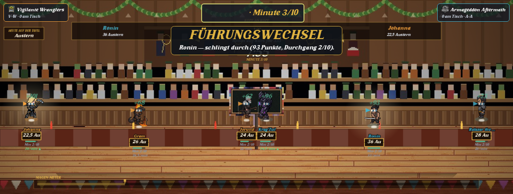
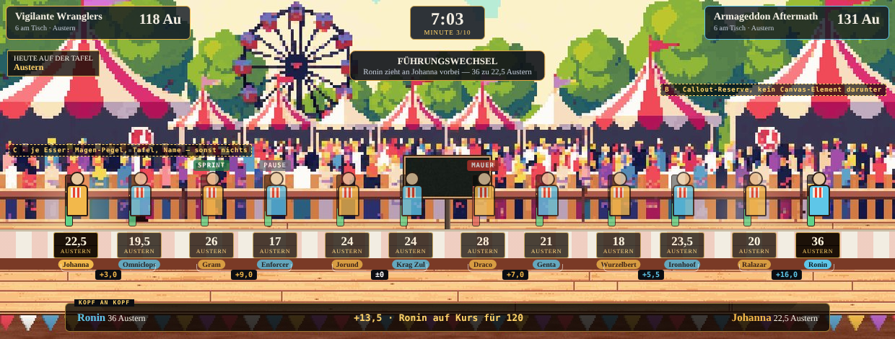

# Wettessen — Übersichtlichkeit, Format, 1 gegen 1: Einschätzung und Vorschlag (03.11.)

**Anlass.** Chris, 03.11., zum Live-Screenshot der Battle Arena: „ich finde wettessen sieht generell
sehr unübersichtlich aus, gibts da ne möglichkeit das zu verbessern? Frag mal fable generell mit der
darstellung und ob das format wie es ist gut ist und sinn macht? Oder sollten die spieler dort im
1v1 antreten? Oder was mach am meisten sinn oder die disziplin etwas mehr besonders?"

**Reine Konzeptrunde, kein Code geändert.** `engine.js` meint `public/mockups/battle-mode.engine.js`
(Stand `main` = `d6139589`, 03.11.). Alle Zeilennummern stammen aus dem Arbeitsbaum dieser Session,
in dem die laufende Kulissen-Arbeit ~140 unkommittierte Zeilen **vor** den Wettessen-Funktionen
hält — auf `main` liegen die Nummern deshalb etwas niedriger; die genannten Funktionsnamen sind die
stabilen Anker. Gelesen wurden die drei
Vorarbeiten (`wettessen-format-opus-gegencheck-23-09.md`, `wettessen-nachtkonzept-03-10.md`,
`wettessen-tafel-17-09.md`), das Wettessen-Kapitel des 13.10.-Konzepts
(`fable-konzept-chris-feedback-13-10.md` Abschnitt 6, W-V1 bis W-V8), der Broadcast-Audit vom 30.09.
und der Motor selbst. Die Live-Bilder von heute liegen neben diesem Papier
(`wettessen-uebersicht-03-11-live.png`), dazu eine Layout-Skizze des Vorschlags
(`wettessen-uebersicht-03-11-skizze.png`).

---

## 0. Fazit vorweg

| Frage | Kurzantwort |
|---|---|
| **Warum unübersichtlich?** | Nicht zu viel Information, sondern **keine Rangordnung der Information und drei Ebenen, die aufeinanderliegen**: HTML-Bug, HTML-Callout, Canvas-Band und Canvas-Uhr teilen sich die oberen 130 px und verdecken sich gegenseitig (Abschnitt 1.2). Dazu steht die Minute **fünfzehnmal** im Bild, der Stand in **drei Währungen** (Punkte, Austern, „/min"), jeder Esser trägt **fünf Textzeilen**, und die einzige Geschichte, die die Mechanik seit dem 04.10. erzählt — die Mauer — ist im Canvas **unsichtbar**. |
| **Das Wichtigste zuerst** | Chris hat genau diese Klage **schon am 13.10. gestellt** („keine Übersicht wer gerade führt"). Das daraus gebaute Rework (W-V1, V2, V5–V8) sitzt in der React-Bühne `platter.tsx` — und **genau die zeigt der Battle Mode seit dem 02.11. nicht mehr** (`battle-arena-spieltag-anbindung-02-11.md`: „zeigt nie mehr die alte Disziplin-Bühne"). Im Motor, den Chris jetzt sieht, ist davon **nichts** angekommen. Das Rework muss in den Motor, nicht noch einmal erfunden werden. |
| **Ist das Format sinnvoll?** | **Ja.** 2–6 je Seite an einem Tisch, zehn Minuten, alle gleichzeitig, Summe zählt — das ist Nathan's, das ist der Sport. Mechanisch steht Wettessen gut da (rho je Spiel 0,910 bei 6, 0,848 bei 4, 0,811 bei 2 je Seite; Pp 8,7/10,0; `stand-aller-disziplinen.md` Abschnitt 9). **Am Format und an der Mechanik ist nichts zu reparieren.** Was fehlt, ist die Erzählung des Formats im Bild. |
| **1 gegen 1?** | **Nein, nicht als Format** — aus denselben Gründen wie am 23.09. (nicht realistischer, bricht die 2–6-Saisonregel, nimmt 1–5 Spielern je Team den Einsatz, Teamergebnis zufälliger: 92,3 → 88,1 %). **Aber ja als Bild:** die Frage kommt zurück, weil das Kopf-an-Kopf-Band, das am 23.09. als Antwort gebaut wurde, im Live-Bild unter dem Callout liegt und zu klein ist. Vorschlag: **Tischduelle** — Heim und Gast sitzen abwechselnd, jedes Nachbarpaar ist ein Duell mit Klammer und Abstand — sechsmal 1 gegen 1 im selben Bild, Wertung unverändert (Abschnitt 3). |
| **Mehr Besonderes?** | **Die Mauer sichtbar machen.** Keine andere Disziplin hat einen Zustand „voll" — ein Magen-Pegel je Esser mit Kapazitätslinie, ein MAUER-Stempel in der Minute, in der er fällt, PAUSE-Stempel, Haltungsschild. Dazu Gürtel und Nachzählung am Ende (in `platter.tsx` schon gebaut, W-V8). Alles **Klasse A**: liest Rundeneinträge, die der Motor seit dem 04.10. ohnehin schreibt (`runden[].fuell/mauer/mauerNeu`, engine.js 19972), kein `rr()`, rho bit-identisch. |
| **Empfehlung** | Ein Paket in drei PRs (Abschnitt 5): **(1) Ebenen entwirren** — eine Uhr, eine Währung, eine Zeile je Esser, Callout-Reserve ohne Canvas darunter; **(2) Magen-Pegel, Mauer-, Pause-, Haltungs-Stempel**; **(3) Tischduelle + Bauchbinde unten + Callout-Dosis**. Optional danach Gürtel/Nachzählung und Nahaufnahme. Kein 1v1-Format, keine Mechanik-, Matrix- oder Sendezeitänderung. |

---

## 1. Was Chris sieht — Diagnose des Live-Bilds

### 1.1 Welche Bühne das ist

Seit dem 02.11. zeigt ein Battle-Mode-Spielstand in der Spieltags-Arena den **Canvas-Motor**
(`FoundationBattleArenaHost` mit Prop `spieltag`, `app/foundation/battle-arena/
FoundationBattleArenaHost.tsx` 149–160). Die React-Bühne `app/foundation/discipline-stage/arena/
disciplines/platter.tsx` läuft nur noch im Manager-Modus. Das ist die eine Feststellung, die alles
andere einordnet:

| Baustein des 13.10.-Reworks | `platter.tsx` / `DisciplineStageNativeArena.tsx` | Motor (`engine.js`) |
|---|---|---|
| W-V1 Rangliste als Turm, Teller-Stand | gebaut (NativeArena 4051 ff., 5416) | **fehlt** |
| W-V2 Zähltafel klappt je Esser im Takt | gebaut (platter 49–59) | Wendetafel vorhanden, zählt stetig (W-B1) |
| W-V3 Der Bauch (Füllstand, Mauer) | **nicht möglich** — `u.mauerK`/`u.haltung` gibt es nur im Motor (NativeArena 3305–3307) | **fehlt**, obwohl die Daten genau hier liegen |
| W-V4 Haltung am Platz | nicht möglich (s. o.) | **fehlt** |
| W-V5 Duell über den Tisch | gebaut (NativeArena 5511, 5616) | **fehlt** |
| W-V6 Hochrechnung | gebaut (5505, 5605) | im Band („auf Kurs für") |
| W-V7 Regie / Nahaufnahme | gebaut (2779, 3302) | **fehlt** |
| W-V8 Zählung und Gürtel | gebaut (platter 61–70, 543–564) | **fehlt** |

Die beiden Bausteine, die nur der Motor überhaupt bauen *kann* (Mauer, Haltung), sind nirgends
gebaut; die sechs, die gebaut sind, sieht der Battle Mode nicht. Das erklärt, warum Chris dieselbe
Klage drei Wochen später noch einmal stellt.

### 1.2 Die Ebenen im Live-Bild (1178 × 447 px im Screenshot; Motor rechnet mit 1240 × 470)

Von oben nach unten, mit Fundstelle:

1. **HTML-Score-Bug** (`battle-mode.html` 163–167, CSS `.bbug` top:8px, zwei Zeilen, reicht bis
   ~61 px): links „Vigilante Wranglers · V-W · **0 am Tisch**", Mitte „· **Minute 3/10**", rechts
   „**0 am Tisch** · A-A". Das „0" ist die Zahl der *fertigen* Esser (`fertig()`, engine.js
   29413–29419: `u.aktuell+1>=u.runden.length`), die bei Wettessen bis Minute 10 immer 0 ist. Der
   Zuschauer liest „niemand am Tisch", während sechs sitzen. Die Mitte zeigt keine Uhr, nur die
   Minute (`updateHudBuehne`, 29316–29326 — bewusst so, um die „zwei Uhren" des Audits vom 30.09.
   zu vermeiden).
2. **Canvas-Kopf-an-Kopf-Band** (`zeichneWettessenBand`, 32623–32708): y 0,115–0,205 H, x 14–86 %
   — „Ronin 36 Austern · VS · +13,5 · Johanna 22,5 Austern". 12-px-Namen, 9-px-Zahlen.
3. **HTML-Callout** „FÜHRUNGSWECHSEL / Ronin — schlingt durch (93 Punkte, Durchgang 2/10)."
   (`callout()`, 50939–50965, 2,6 s). `positioniereCallout()` (50905–50934) setzt ihn **8 px unter
   die Bug-Unterkante**, also ab ~69 px, und kennt als weitere Bezugskanten nur `ispyZugUhr` und
   `bahnHud` — **nicht das Wettessen-Band und nicht die Wettessen-Uhr**. Folge im Bild: der Callout
   liegt exakt auf der Bandmitte („VS", Abstand, Trendzeile) **und** auf der 28-px-Uhr
   (`zeichneWettessenUhr`, `uhrY=H*0.275` ≈ 129 px). Im Screenshot ist von „7:03" nur die Unterkante
   zu erahnen, „MINUTE 3/10" lugt darunter hervor.
4. **Canvas-Uhr** „7:03 / MINUTE 3/10" — die dritte Minutenanzeige; die Scoreline **über** der
   Leinwand (`live-we-seite.png`: „218 : 260 · Minute 3/10 · läuft · Punkte") ist die vierte.
5. **Menüschild** „HEUTE AUF DER TAFEL / Austern" links (30181 ff.) — in Ordnung, kollidiert mit nichts.
6. **Figuren** auf `WETTESSEN_REIHE_Y=0.575` (32404), also mitten in der **Publikums-/Zaunzone der
   Kulisse** (Publikum ~170–250 px, Zaun ~255–300 px). Die zwei mittleren Esser stehen auf dem
   leeren **Tafel-Requisit** der Kulisse (`public/sprites/kulissen/wettessen/jahrmarkt.jpg`,
   Bildmitte) — ein Brett, das nach Anzeigetafel aussieht und nichts anzeigt. Die **Schwebezahlen**
   „+101", „+68", „+62 +96" (`schwebe()`, 26554; gezeichnet bei `p.y-30`, 32612) fliegen in die
   Publikumsreihe hinein, in Punkten, nicht in Austern.
7. **Fünf Textzeilen je Esser** (32521–32566): Name (y+44), Wendetafel „36 Au" (y+59), 30-px-Balken
   relativ zum Besten (y+71), „Min 2/10" (y+81), Tempo „x/min ▲" (y+91). Bei 6 gegen 6 sind das
   **60 Textelemente** in einem 90 px hohen Band, in 7,5–10 px Schrift. Der Balken sagt dasselbe wie
   die Zahl, „Min 2/10" steht zwölfmal und ist für alle gleich (die Minute läuft synchron,
   `buehneGruppenGroesse`), das Tempo ist eine dritte Währung.
8. **„Magen-Meter"** am unteren Rand (`meterY=H-24`, 32583–32602): er ist **kein Magen**, sondern der
   Anteil der gespielten Minuten (`(leader.aktuell+1)/rundenN`), also dieselbe Information wie die
   Uhr — und er liegt im Live-Bild auf der **Wimpelreihe der Kulisse** (unterste 20 px der
   Kulissen-JPG).
9. **Drei Währungen.** Callout und Schwebezahlen sagen „Punkte", Wendetafel und Band „Austern",
   Tempo „/min"; die Scoreline über der Leinwand summiert in Punkten („218 : 260"), die
   Wertungstabelle rechts führt PKT **und** AU. Der **Teamstand in Austern steht nirgends auf der
   Leinwand**, der Teamstand in Punkten nirgends im Canvas-HUD.
10. **Callout-Takt.** Für Wettessen gibt es **keine Drossel** (27174–27176: `wettBig` feuert direkt in
    `feed(...,true,...)`); `buehneAuftrittBig()` (26438–26444) feuert bei Führungswechsel, bei
    „Patzer des Führenden" und beim letzten Durchgang des Führenden. Die Erfolgschance liegt bei
    `0,15+TECHNIK·0,0055+NERVEN·0,0035`, bei 50/50 also 60 % — der Führende „pausiert" rechnerisch in
    rund vier von zehn Minuten, und jede davon ist ein Banner. Gemessen am 30.09. (vor der Mauer):
    26 % Bannerzeit bei 52 s Sendezeit (`f1-broadcast-audit-runde-2-30-09.md` 6.1). Da jede Minute
    6 s hat und der Callout 2,6 s steht, ist er in der Hälfte der Minuten die größte Schrift im Bild
    — **und steht dann genau auf Band und Uhr**.
11. **Die Mauer ist unsichtbar.** `BUEHNE_FLAGS.wettessenMauer` steht auf **2** (19431): Füllstand,
    Kapazität `K`, Mauer-Minute und Haltung werden je Esser gerechnet und auf den Rundeneintrag
    geschrieben (`{punkte,ereignis,knapp,mauer,mauerNeu,fuell}`, 19972). Sichtbar davon ist **eine
    Tickerzeile** („Mauer! X ist voll (Minute 7) …", 27170–27173, bewusst nicht big). Kein Stempel,
    kein Pegel, keine Farbe. Die heute gebauten Kulissen-Vorschauen
    (`szenen-varianten-staffel2-03-11-wettessen.png`) zeigen MAUER- und PAUSE-Stempel und die Uhr
    auf dem Tafel-Requisit — das ist die **Skizze des Generators**, nicht der Motor. Die Vorschau
    verspricht ein aufgeräumteres Bild, als der Motor liefert.

**Lesung.** Die Informationsmenge ist nicht das Problem — Nathan's auf ESPN zeigt mehr. Das Problem
ist, dass (a) vier Anzeigesysteme (Scoreline, Bug, Callout, Canvas) ohne gemeinsamen Plan in dieselbe
Kopfzone zeichnen, (b) dieselbe Zahl mehrfach und in verschiedenen Einheiten steht, (c) je Esser
nichts priorisiert ist und (d) die einzige echte Geschichte fehlt. Chris' Wort „unübersichtlich" ist
exakt.

---

## 2. Ist das Format nachvollziehbar und spannend?

**Das Format, wie es läuft:** je Saison 2–6 Esser je Seite (Permutation über `[2,3,4,5,6]` je
Kategorie, `season-discipline-schedule.ts` 270), alle an einem Tisch, zehn Minuten = zehn Durchgänge
zu je 6 s Bildschirmzeit (60 s gesamt), jede Minute ein Wurf je Esser, Erfolg „schlingt durch",
Fehlschlag „muss kurz pausieren" (Minute zählt 65 %). Seit dem 04.10. mit Mauer (Füllstand gegen
Kapazität aus AUSDAUER, danach isst nur noch NERVEN) und Haltung (Sprint / Gleichmäßig / Schlussspurt,
heute immer KI-gewählt — das Rohr `{d,slot,haltung}` steht, `arena-aufstellung-adapter.ts` 38–56,
die Buchse in der Einsatzliste fehlt). Teamstand = Summe. Anzeige in der Einheit des Gerichts des
Tages (Skala, keine Wertung).

**Urteil: nachvollziehbar, ja. Realistisch, ja. Spannend — nur, wenn man es sieht.**

- Die Regel passt auf einen Satz: *Wer in zehn Minuten am meisten isst.* Einfacher ist keine der
  zwanzig Disziplinen. Das Teamergebnis als Summe ist das, was auch ein Zuschauer intuitiv rechnet.
- Die Mechanik erfüllt beide Pflichtabnahmen mit Reserve (rho 0,910 / Pp 8,7 und 10,0, zwei Stämme).
  Die Mauer hat die Kurve gebogen (73 72 73 72 69 61 56 59 58 63 je Minute) — es **gibt** jetzt ein
  Vorne-weg und ein Einbrechen, Sprinter und Willensesser. Das ist genau die Verlaufskurve, die das
  Nachtkonzept gefordert hat.
- Was das Format **nicht** hat und auch nicht haben soll: Wechselwirkung zwischen den Essern. Das
  Nachtkonzept hat „Rivalen-Druck" als Mechanik getestet und verworfen (K4), weil es die
  Feldgrößen-Robustheit bricht und im Sport eher bremst als treibt. Die Spannung eines Wettessens
  ist der **Abstand zweier Zähler über die Zeit** — eine reine Anzeigefrage.
- Eine ehrliche Schwäche: **bei 2 je Seite** (eine von fünf Saisons) liegt rho mit Mauer bei 0,811,
  knapp über der Schranke. Das ist Statistik (vier Teilnehmer, sechs Paare), nicht Mechanik — und
  ausgerechnet dort ist das Bild heute am aufgeräumtesten. Die Präsentation muss für **12** gebaut
  und bei 4 geprüft werden, nicht umgekehrt.

**Fazit zu Frage 2:** Das Format ist richtig. Die „Verwirrung" entsteht nicht aus der Regel, sondern
daraus, dass das Bild die Regel nicht erzählt: kein lesbarer Stand, keine sichtbare Mauer, keine
sichtbare Haltung, Minute fünfzehnmal, Stand in drei Währungen. **Man arbeitet am Bild, nicht am
Rezept.**

---

## 3. 1 gegen 1 — abgewogen

### 3.1 Was seit dem 23.09. feststeht (nicht neu gemessen, nur zusammengefasst)

| | 6 gegen 6 (heute) | 1 gegen 1 |
|---|---:|---:|
| Teamergebnis trifft den Eignungsbesseren | 92,3 % | 88,1 % |
| Pp-Abweichung | 13,8 (vor Mauer) → 8,7/10,0 | 13,6 / 10,0 |
| rho je Spiel | 0,910 | **undefiniert** (n = 2) |
| Realismus (Nathan's: ~20 je Finale, Duell nur als Show/Stechen) | Vorbild | Ausnahme |
| Spieler je Team im Einsatz | 2–6 | 1 |

Mechanisch trüge ein Duell, aber es wäre nicht realistischer, es bräuchte einen Feldgrößen-Override
wie Mini-DM (`MINI_DM_FIXED_PLAYER_COUNT`, Chris' Einzelentscheidung vom 14.09.), eine neue
PPS-Referenz für n = 1, eine neue Abnahmegröße, und es nähme der Kadertiefe in dieser Disziplin jeden
Sinn — der Kapazitäts-Esser und der Tempo-Esser desselben Teams könnten nie zusammen antreten.
Das Nachtkonzept hat die Haltung als Managerhebel **je Esser** gebaut; bei einem Esser je Team wäre
auch davon nur ein Knopf übrig.

### 3.2 Warum die Frage trotzdem wiederkommt

Am 23.09. war die Antwort: *Format bleibt, aber das Band oben liefert das 1-gegen-1-Gefühl.* Im
Live-Bild von heute ist dieses Band (a) 86 % breit mit 9-px-Zahlen, (b) in jeder zweiten Minute vom
Callout verdeckt und (c) mit zwei Namen besetzt, die am Tisch 700 px auseinandersitzen (Heim links,
Gast rechts). **Das 1-gegen-1 wurde versprochen und nie gezeigt.** Chris reagiert auf das Bild, nicht
auf die Statistik.

### 3.3 Die Alternativen

| Variante | Was Chris bekäme | Kosten | Urteil |
|---|---|---|---|
| **A — echtes 1v1** (Feldgröße 1) | ein Duell, zwei Tafeln | Override, PPS-Referenz n=1, neue Abnahme, 1–5 Spieler je Spieltag ohne Einsatz, Teamergebnis zufälliger | **nicht empfohlen** (wie 23.09.) |
| **B — Tischduelle** (Sitzordnung H G H G …, Klammer und Abstand je Nachbarpaar, Teamstand bleibt Summe) | sechsmal 1 gegen 1 im selben Bild; der eigene Esser hat **einen** sichtbaren Gegner | Klasse A: nur `wettessenSitzplaetze()` (32405–32416, eine Quelle für Figuren, Tafeln, Spotlight, Schwebezahlen) und eine Klammer; rho bit-identisch | **empfohlen** |
| **B\* — Tischduelle gewertet** („gewonnene Duelle" als Teamstand wie Speed-Schach) | echtes Duellformat | Klasse W: neue Wertung, neue Messung, PPS-Referenz neu, und im Sport zählt die Summe | nicht empfohlen |
| **C — Nahaufnahme** (Kamera auf das führende Paar bei Führungswechsel/Mauer, Rest klein) | Fernsehbild, zwei Köpfe groß | Klasse A (Präzedenz: Showcase/Breaking „zwei Ränge", W-V7 in React) | als Politur nach B |
| **D — Stechen bei Gleichstand** (Teambeste, fünf Würstchen) | der eine echte Duellmoment des Sports | Klasse W (klein), kommt bei 4–12 Essern fast nie vor | nur, wenn Chris das Ereignis will |

**Empfehlung: B, danach C.** Das gibt den Spielern, die Chris im Kopf hat, das Gesicht eines Duells,
ohne das Format, die Saisonregel oder die Abnahme anzufassen. Wer das Teamergebnis liest, sieht
weiterhin „131 : 118 Austern"; wer auf seinen Esser schaut, sieht „+3,0 gegen Omniclops".

---

## 4. „Etwas mehr besonders" — was Wettessen hat und keine andere Disziplin

1. **Die Mauer.** Ein Zustand, den es sonst nirgends gibt: *voll*. Der Motor weiß je Esser und
   Minute, wie voll er ist (`fuell`), wo seine Grenze liegt (`wettessenKapazitaet()`, 19927) und in
   welcher Minute er sie reißt (`mauerNeu`). Das ist der Stoff für das eine Bildelement, das
   Wettessen unverwechselbar macht: ein **Magen-Pegel je Esser** mit Kapazitätslinie, der sich
   minütlich füllt, über der Linie rot wird, und ein **MAUER-Stempel** im Moment des Reißens. Zehn
   Esser, zehn verschiedene Mauer-Minuten — die Verlaufskurve wird sichtbar, ohne dass ein Zuschauer
   eine Zahl lesen muss. (Das heutige „Magen-Meter" am unteren Rand sollte dafür verschwinden: es
   heißt Magen, zeigt aber die Uhr.)
2. **Die Haltung.** Ein Schild am Platz — SPRINT / SCHLUSSSPURT (Gleichmäßig ohne Schild, es ist der
   Standard), das ab Minute 8 beim Schlussspurt aufleuchtet. Das ist zugleich die Voraussetzung
   dafür, dass ein Manager das Feld in der Einsatzliste je überhaupt will: Was man nie sieht, stellt
   man nicht ein.
3. **Die Pause.** Der Fehlschlag heißt bei Chris „muss kurz pausieren". Heute ist er ein 0,3 s
   langer Bewegungszustand (`stepWettessen`, 29169–29171). Ein grauer PAUSE-Stempel über dem Esser
   für die Dauer der Minute macht aus zwölf gleichen Figuren zwölf verschiedene.
4. **Der Gürtel und die Nachzählung** (W-V8): nach der Schlusshupe drehen sich die Tafeln ein letztes
   Mal von hinten nach vorn, der Tagesbeste bekommt den Senfgürtel. In `platter.tsx` fertig gebaut,
   in den Motor zu portieren — ein Ende, das nach Wettessen aussieht statt nach Boxscore.
5. **Die Tafel-Uhr auf dem Requisit.** Alle drei Kulissen (Jahrmarkt, Nachtmarkt, Festzelt) tragen
   in der Bildmitte ein leeres Anzeigebrett. Die 10:00-Uhr dorthin zu malen statt in die Kopfzone,
   wäre das stimmigste Bild — mit Rückfall auf die Kopfzone, falls eine künftige Kulisse das Brett
   nicht hat. (Variante, nicht Pflicht; die Skizze unten lässt die Uhr im Bug.)
6. **Tunken als Bild** (K3a des Nachtkonzepts): Wasserglas am Platz bei TECHNIK ≥ 55, sonst nicht.
   Reine Kulisse, kein Punkt, keine Messung.

Alles davon liest nur, was der Motor schon schreibt — es berührt weder `rr()` noch `u.summe`, noch
das Rezept, noch die Matrix. Die Abnahme aus CLAUDE.md (rho > 0,80, Pp ≤ 25) bleibt per Bauart
bit-identisch; der Vertrag dafür steht seit dem 17.09. in `stepWettessen()` („niemals `rr()`, nur
`viz*`-Felder").

---

## 5. Der Vorschlag: vier Zonen, drei PRs

*Die Skizze ist eine Layout-Studie (HTML auf der echten Kulissen-JPG, Figuren als Silhouetten) —
keine Motor-Ausgabe. Sie zeigt 6 gegen 6, den schwierigsten Fall.*

### 5.1 Die Zonen

| Zone | Inhalt | Was heute dort steht |
|---|---|---|
| **A** Kopf (0–60 px) | **Ein** Bug: Teamname + Teamstand **in der Einheit des Tages** links/rechts, **die Uhr** (7:03 · MINUTE 3/10) in der Mitte, „6 am Tisch" statt „0 am Tisch" | Bug ohne Uhr, „0 am Tisch", Minute als Text |
| **B** Callout-Reserve (60–130 px) | nur der HTML-Callout, **kein Canvas-Element** darunter; Menüschild links außen | Band (0,115–0,205 H), Uhr (0,275 H), Callout — alle drei übereinander |
| **C** Tisch (230–380 px) | Esser **paarweise H/G** (Tischduelle); je Esser **genau drei Dinge**: Magen-Pegel links neben der Figur, Wendetafel auf der Tischkante (zweizeilig, 17 px Zahl), Namens-Chip in Teamfarbe; Stempel MAUER / PAUSE / SPRINT über dem Kopf; Klammer mit Abstand unter jedem Paar; Spotlight auf die zwei Führenden bleibt | fünf Zeilen je Esser, Schwebezahlen im Publikum, Balken, „Min x/10", Tempo |
| **D** Bauchbinde (unten) | Kopf an Kopf als **Lower Third**: Erster · Abstand · Zweiter, Trendzeile / „auf Kurs für" — dieselben Funktionen wie heute (`wettessenAnzeigeSumme`, Trend, Hochrechnung), nur unten statt oben | „Magen-Meter" (= Uhr) auf der Wimpelreihe |

### 5.2 Die drei PRs

| PR | Inhalt | Klasse | Aufwand | Fundstellen |
|---|---|---|---|---|
| **1 — Ebenen entwirren** | (a) Uhr in den Bug (`updateHudBuehne` 29316–29326 schreibt `#clock` mit `wettessenRestSek`), Canvas-Uhr weg oder auf das Kulissen-Brett; (b) Band nach unten (Zone D), `zeichneWettessenBand` bekommt neue `bandY0/1`, Magen-Meter entfällt; (c) `positioniereCallout()` braucht dann keine vierte Bezugskante — falls das Band oben bliebe, müsste es dort als Kante eingetragen werden; (d) je Esser nur Tafel + Name: Balken (32540–32542), „Min x/10" (32543–32544) und Tempozeile (32549–32566) entfallen — das Tempo lebt im Pegel weiter; (e) Schwebezahlen in Austern und an der Tafel statt bei `p.y-30` im Publikum (32612); (f) **eine Währung** in Callout, Schwebezahl und Bug: Einheit des Tages; Punkte nur in der Wertungstabelle; (g) „am Tisch" zählt Sitzende, nicht Fertige (29413–29419); (h) Teamstand in Austern im Bug (`wettessenWuerstchen(seitensumme)`) | A | klein–mittel, 1 Tag | s. links |
| **2 — Die Mauer sichtbar** | Magen-Pegel je Esser aus `runden[0..aktuell].fuell` gegen `u.mauerK` (Kapazität, Haltung und Mauer-Minute liegen nach `wettessenMauerSetz()` als `L.mauerK`/`L.haltung`/`L.mauerMinute` am Teilnehmer, 19987–19990), Farbwechsel über der Linie; MAUER-Stempel 1,5 s bei `r.mauerNeu`; PAUSE-Stempel für die Minute bei `failWort`; Haltungsschild aus `u.haltung` (Sprint immer, Schlussspurt ab Minute 8 leuchtend); Mauer-Tickerzeile bleibt, bekommt aber `kind` und darf **einmal je Seite** big sein (erste Mauer der Seite) | A | mittel, 1 Tag | 19927–19975, 27170–27173, 32436 ff. |
| **3 — Tischduelle und Dosis** | Sitzordnung H G H G … in `wettessenSitzplaetze()` (eine Quelle, alle Leser folgen automatisch), Klammer + Abstand je Paar (Austern, Vorzeichen in Teamfarbe), bei ungleicher Kopfzahl (`lineup-roster-shortfall`) bleibt der letzte Platz ohne Klammer; Callout-Drossel wie `buehneBahnGrossDrosseln` (38465) auch für `wettBig`; „patzer" nur noch, wenn der Führende durch die Pause die Führung **verliert**; Callout-Text in Austern („Ronin zieht an Johanna vorbei — 36 zu 22,5 Austern") statt „schlingt durch (93 Punkte, Durchgang 2/10)" | A | klein–mittel, ½–1 Tag | 32405–32416, 27174–27176, 26438–26444 |
| *optional 4 — Ende und Regie* | Nachzählung + Gürtel aus `platter.tsx` portieren (W-V8), Nahaufnahme auf das führende Paar bei Führungswechsel/Mauer (W-V7; Präzedenz Showcase „zwei Ränge", 32884 ff.) | A (W-V8: T, falls der Nachlauf länger als die heutigen 3,5 s wird) | mittel | platter 61–70, 543–564 |

**Was ausdrücklich nicht vorgeschlagen wird:** feste Feldgröße 1 (oder 2–3); Duelle als Wertung
(B\*); jede Änderung an `rezept`, `rundenN`, `rundenDauer`, `failAbzug`, den Mauer-Konstanten oder
der Matrix; Verlängerung der 60 s Sendezeit im Wettkampf; Wechselwirkung zwischen Essern.

### 5.3 Abnahme

- `node scripts/miss-alle-disziplinen.mjs 24 wettessen` **bit-identisch** (0,910 / Saison 0,916) —
  alle drei PRs lesen nur; dazu `scripts/miss-arena-buehne-spiegel.mjs` und
  `npm run ci:rangtreue-schranke` unverändert.
- Sicht-QA mit `scripts/screenshot-disziplin.mjs` bzw. dem Live-Skript dieser Session: **2, 4 und 6
  je Seite**, alle drei Kulissen, Minute 1 / 6 / 10, einmal mit stehendem Callout — die vier Fragen,
  die jeder Frame beantworten muss: *Wer führt? Wie viel Zeit ist noch? Wer ist voll? Wie steht mein
  Esser gegen seinen Nachbarn?*
- Messbare Ziele gegenüber heute: Textelemente je Esser 5 → 3; Minutenanzeigen im Bild 15 → 2
  (Scoreline, Bug); Währungen im Canvas-HUD 3 → 1; Überlappungen Callout/Canvas 2 → 0; Bannerzeit
  ≤ 20 % (heute 26 % ohne Mauer-Banner).

---

## 6. Offene Fragen an Chris

1. **Tischduelle (B) — ja?** Abwechselnde Sitzordnung und Klammer je Paar, Wertung bleibt Summe.
   Oder reicht die Bauchbinde mit den zwei Führenden?
2. **Uhr im Bug oder auf dem Kulissen-Brett?** Beides ist Klasse A; das Brett ist das schönere Bild,
   der Bug der sicherere Ort.
3. **Stechen bei Gleichstand** als echtes Ereignis (Klasse W, selten) — oder bleibt das Duell ein Bild?
4. **Gürtel und Nachzählung** am Ende: darf der Nachlauf nach der Hupe länger als 3,5 s werden
   (dann Klasse T), oder soll die Zählung in die heutige Zeit passen?
5. **Haltung in der Einsatzliste**: sobald das Schild am Platz steht, lohnt die Buchse im
   Aufstellungs-Dialog — soll das in dieses Paket, oder bleibt es beim Grundgerüst-Fahrplan?

---

## 7. Quellen

**Repo (gelesen, nichts geändert):** `public/mockups/battle-mode.engine.js` — `BUEHNE_ART.wettessen`
(18519–18597), `BUEHNE_FLAGS` (19431), `wettessenMauerRunden()`/`wettessenMauerSetz()`
(19937–19990), `buehneAuftrittBig()` (26438), Wettessen-Zweig in `stepBuehne()` (27157–27203),
`stepWettessen()` (29139), `updateHudBuehne()` (29307–29419), `bodenWettessen()`/
`zeichneWettessenMenuSchild()` (30166–30238), `WETTESSEN_MENU`/`wettessenSitzplaetze()`/
`zeichneWettessenTafel()`/`zeichneWettessen()`/`zeichneWettessenBand()`/`zeichneWettessenUhr()`
(32347–32753), `callout()`/`positioniereCallout()` (50892–50965), `feed()` (51218);
`public/mockups/battle-mode.html` (163–178), `battle-mode.css` (`.bbug` 945 ff., `.bbugcallout`
1105 ff.), `battle-mode.kulissen.js`, `public/sprites/kulissen/wettessen/*.jpg`;
`app/foundation/discipline-stage/arena/disciplines/platter.tsx`,
`app/foundation/discipline-stage/arena/DisciplineStageNativeArena.tsx` (2779, 3273–3312, 4051, 5416,
5500–5616), `app/foundation/battle-arena/FoundationBattleArenaHost.tsx` (140–160),
`lib/foundation/battle-arena/arena-aufstellung-adapter.ts` (38–56),
`lib/season/season-discipline-schedule.ts` (129, 270).

**Dokumente:** `wettessen-format-opus-gegencheck-23-09.md`, `wettessen-nachtkonzept-03-10.md`,
`wettessen-tafel-17-09.md`, `fable-konzept-chris-feedback-13-10.md` (Abschnitt 6),
`chris-feedback-breite-runde-13-10.md` (Punkt 20), `f1-broadcast-audit-runde-2-30-09.md`
(Punkte 3, 6, 7, 10; Tabelle 6.1; Bild 11), `stand-aller-disziplinen.md` (Abschnitt 9, Zeilen 1050,
1456), `battle-arena-spieltag-anbindung-02-11.md`, `arena-kulissen-im-motor-03-11.md`,
`takeshi-uebersichtlichkeit-konzept-15-10.md` (Leitsatz „nacheinander schneiden, nicht nacheinander
antreten").

**Bilder:** `wettessen-uebersicht-03-11-live.png` (Live-Battle-Arena 03.11., Vigilante Wranglers gegen
Armageddon Aftermath, Minute 3/10, Jahrmarkt), `wettessen-uebersicht-03-11-skizze.png` (Layout-Studie,
HTML + Playwright auf `jahrmarkt.jpg`, 1240 × 470), `szenen-varianten-kostprobe-03-11-wettessen.png`,
`szenen-varianten-staffel2-03-11-wettessen.png`.
