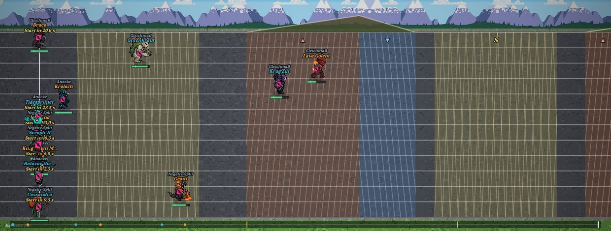
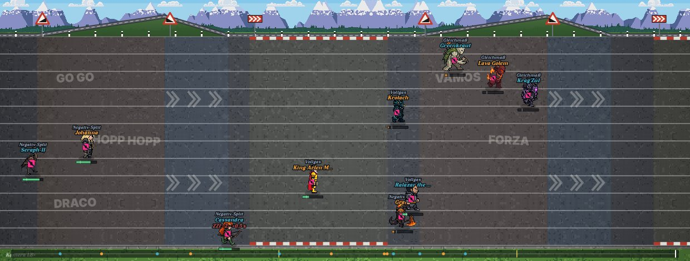

# Zeitfahren: Streckenbild statt Farbbänder (Kulissen-Rework, 10.11.)

Anlass: Chris' Screenshot vom 10.11., wörtlich: „was ist das ingame für ein time trial? dachte da
sind schon überall die neuen assets und dass es gut aussieht? aber das ist auch trash wie spurt was
noch nichts mit hyrox zu tun hat".

## 1. Diagnose

**Einordnung: (a), ein Integrationsfehler — kein fehlender Content.** Für Zeitfahren musste kein
neues PixelLab-Bild erzeugt werden.

- **Die Szenen gibt es vollständig.** `public/szenen/time-trial/<karte>/assets/` enthält für alle elf
  Karten (Standard + die zehn aus `lib/foundation/discipline-scenes.ts`) die vier Parallax-Ebenen
  `far`, `mid`, `course` und `front`, je 4000 px breit, dazu ein `poster.jpg`. Das ist eine fertige
  Seitenansicht mit Alpenpanorama, Wald, Straße, Leitpfosten und Startrampe.
- **Die Verdrahtung läuft auch.** `battle-mode.kulissen.js` listet die elf Varianten,
  `kulisseWaehlen()` lädt das Bild, `bodenZeitfahren()` → `bodenSpurtGerade()` →
  `kulisseZeichnen()` zeichnet es (nachgeprüft: `__arena.kulisse()` meldet die gewählte Karte, das
  Bild ist geladen).
- **Aber das Bild ist fast leer.** `scripts/baue-kulisse-zeitfahren.py` (Batch 8, 08.11.) nimmt aus
  den 4000-px-Ebenen nur einen **58 px hohen, starren** Panoramastreifen und kachelt darunter grauen
  Asphalt über die ganze Bahnfläche. Von der Szene bleiben also ein dünner Bergstreifen, der sich
  nicht bewegt, und 376 px graue Fläche.
- **Über diesen Asphalt legte der Motor seine alte Rückfall-Grafik**, unverändert: Zonenbänder in
  voller Bahnhöhe (rötlich, bläulich, gelblich, Deckkraft 16–22 %) mit Schraffur über die ganze
  Höhe, dazu ▲/▼/„S"-Glyphen und eine braune Höhensilhouette. Genau das sind die „flachen,
  generischen Vertikalbänder" und die „S/Dreieck-Symbole" auf Chris' Screenshot.

Ergebnis: Was das Bild beherrschte, war die Rückfall-Grafik, nicht die Kulisse.

**Das „Attacke"-Label ist kein falsch auslösendes Kampf-Label.** Es ist der Name eines der drei
Rennpläne im Zeitfahren (`BAHN_ART["time-trial"].plaene.attacke`, neben „Gleichmaß" und
„Negativ-Split"). Die Bahn-Zeichnung schreibt ihn bewusst über jeden Fahrer, damit man die
Aufstellung wiedererkennt. Über einem Fahrer liest sich das Wort aber wie ein Kampfstatus. Behoben
ist deshalb nur der angezeigte Name, aus „Attacke" wird „Vollgas". Unverändert bleiben der
Schlüssel `attacke`, `planJeSlot`, Tempo und Reserve.

## 2. Was gebaut wurde (nur Anzeige, `public/mockups/battle-mode.engine.js`)

Neuer Weg `zfStreckenbild()`. Er läuft nur, wenn eine Kulisse sichtbar ist (`kulisseSichtbar()`).
Ohne Kulisse, also im Headless-Runner oder wenn das Bild fehlt, läuft der alte Code von
`bodenZeitfahren()` Wort für Wort weiter.

1. **Panorama als Parallaxe aus den echten PixelLab-Ebenen.** `far.png` und `mid.png` der gewählten
   Karte werden direkt aus `public/szenen/time-trial/…` geladen. Sie laufen mit der Kamera mit (0,12
   bzw. 0,30 ihrer Fahrt), ab x = 1000 gespiegelt gekachelt (dieselbe Regel wie `ZF_PANORAMA_X0` im
   Builder). Der Horizont je Karte steht in `ZF_PANO_HORIZONT` und wurde mit derselben Regel gemessen
   wie `dicht` im Builder. Die Berge ziehen jetzt beim Kameraschwenk sichtbar mit.
2. **Höhenprofil als Straße.** Die Kontur aus `gelaende` und `ZF_HUEGEL_PX` ist dieselbe wie
   bisher. Gezeichnet wird sie jetzt als Wiesenhügel mit Asphaltband und gestricheltem
   Mittelstrich statt als braune Fläche.
3. **Zonen als Straßenbild statt Farbband, Schraffur und Glyphe:**
   - Steigung: Fan-Parolen auf den Asphalt gemalt, wie an jedem Tour-Anstieg (ALLEZ, HOPP, VAMOS,
     FORZA … und die Vornamen der Fahrer). Ihr Abstand richtet sich nach Bildschirmpixeln, damit
     sie sich nie überlappen. Passt eine Parole nicht ganz in die Zone, entfällt sie, statt
     abgeschnitten zu werden.
   - Abfahrt: gemalte Doppelpfeile in Fahrtrichtung.
   - Kurve: rot-weiße Curbs an beiden Bahnrändern.
   - Für jede Zone steht an ihrem Beginn ein Warnschild am Straßenrand: rotes Dreieck mit
     steigender oder fallender Rampe, bzw. eine rote Richtungstafel bei Kurven. Dazu Leitpfosten
     entlang der Bahnoberkante.
   - Eine leise Tönung bleibt (6–10 % statt 16–22 %). Damit gilt die Dreifachkodierung aus Farbe,
     Muster und Schildform weiter, und die Zonen bleiben ohne Farbunterscheidung lesbar.
4. **Rennplan-Name „Attacke" → „Vollgas"** (nur `label`).

Alle neuen Zeichnungen sind an Streckenpositionen verankert (`camX`) und wandern mit der Kamera.
Sie lesen nur `BA().gelaende`, `LAEUFER[].n`, `camView()` und `kulisseAktiv`. Es gibt kein `rr()`
und keinen Schreibzugriff auf den Rennzustand.

## 3. Vorher / Nachher (Playwright, echte Battle Arena, Karte „Bergzeitfahren Alpen")

| Vorher | Nachher |
|---|---|
|  |  |

Gegenprobe an einer anderen Karte: `zeitfahren-kulissen-rework-10-11/nachher-etappe-vulkan.jpg`
(Vulkan-Panorama im Abendlicht). „Abfahrt Kamm" wurde ebenfalls fotografiert. Bei keiner Karte gab
es Seitenfehler.

## 4. Wertung unverändert

`node scripts/pruefe-wertung-fingerabdruck.mjs` lief im selben Moment zweimal parallel: einmal auf
`origin/main` (972b970cb, eigener Worktree) und einmal auf diesem Branch. Das Ergebnis steht in
Abschnitt 6.

## 5. Was für volle Parität mit Spurt/HYROX noch fehlt

- **Ansicht.** HYROX hat eine eigene Weltkarte mit eigener Kamera (`bodenHyroxHalle()`, Route statt
  gerader Bahn). Zeitfahren bleibt eine Draufsicht auf zwölf gerade Bahnen. Echte Parität hieße,
  das Rennen in der Seitenansicht der PixelLab-Szene zu zeigen (`course.png` mit eingebranntem
  Profil). Dafür müssten `gelaende` und das Demo-Profil der Karte zusammenpassen, also entweder die
  Zonen aus `scene.json` `G[]` ableiten (Mechanik, braucht eine Abnahme) oder die Szene neu nach
  `gelaende` bauen.
- **Wartende am Start.** Sie stehen übereinander bei x ≈ 75. Ihre Beschriftungen (Name, Plan,
  „Start in …") überlagern sich zu Textsalat. Eine Startrampe bzw. ein Startzelt wie im Poster
  der Szene (Requisite) würde das ordnen.
- **Fahrer laufen zu Fuß** und tragen die Magenta-Weste (`zeichneZeitfahrWeste`). Räder oder
  Fahranimationen wären neue Animationen und brauchen Chris' Freigabe.
- **Gleiches Profil auf jeder Karte.** `BAHN_ART["time-trial"].gelaende` ist fest. „Flachsprint
  Küste" zeigt deshalb dieselben Anstiege wie „Bergzeitfahren Alpen". Das ist eine
  Mechanik-Entscheidung und braucht rho- und Pp-Abnahme.
- Den Builder `baue-kulisse-zeitfahren.py` könnte man ausdünnen, weil sein Panorama-Kopfstreifen
  jetzt überzeichnet wird. Er bleibt vorerst als Rückfall stehen, solange die Ebenen laden.

## 6. Fingerabdruck-Ergebnis

Beide Läufe liefen gleichzeitig, mit 69 Einträgen je Lauf.

- **66 von 69 Einträgen sind bit-identisch.** Das sind alle 19 anderen Disziplinen,
  `disziplinProbe`, `spieleArenaDomination`, `spieleBahnPod` (Staffel, Takeshi) und
  `spieleBattlefieldPod`.
- **Die drei Einträge `spiele time-trial 1/7/42` weichen ab, und zwar nur wegen des Labels.**
  `spiele()` gibt den Rennplan samt `label` im Ergebnis mit. Gegenprobe: Ich habe die drei
  Ergebnisse vorher/nachher als JSON abgelegt und im Nachher-Text „Vollgas" durch „Attacke"
  ersetzt. Danach sind beide Fassungen byte-identisch. Zeiten, Ränge, Punkte und Reserven sind
  unverändert. Die Kulissenarbeit selbst wirkt nicht auf die Wertung, denn `zfStreckenbild()`
  läuft im Headless-Runner ohnehin nicht, weil dort keine Kulisse sichtbar ist.
- Gesamt-Hash vorher `a6493301291e`, nachher `ac611b516e33`. Der Unterschied kommt allein vom
  Label. Wer einen strikt identischen Hash braucht, kann das Label zurückdrehen. Dann ist der
  Branch ein reiner Kulissen-Fix.

`tests/arena-kulissen.test.ts` ist grün (14/14), einschließlich der Zeitfahren-Prüfung (Bahnband
H·0,14 bis H·0,94, `gelaende` frei von Kulissen).
