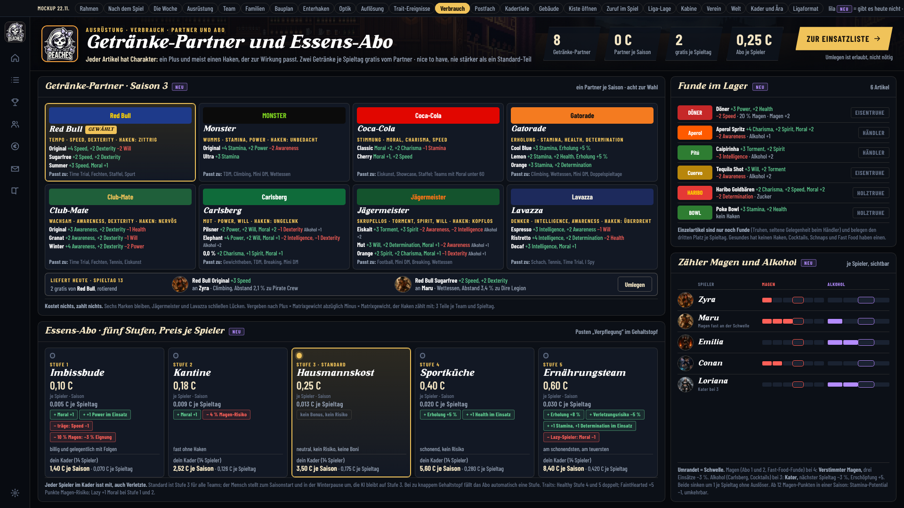
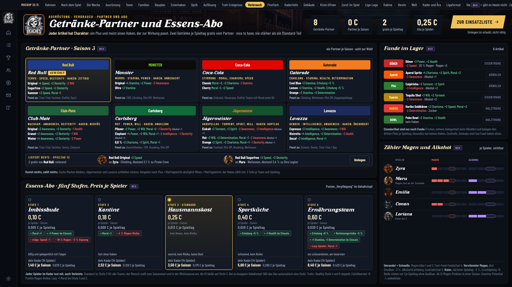
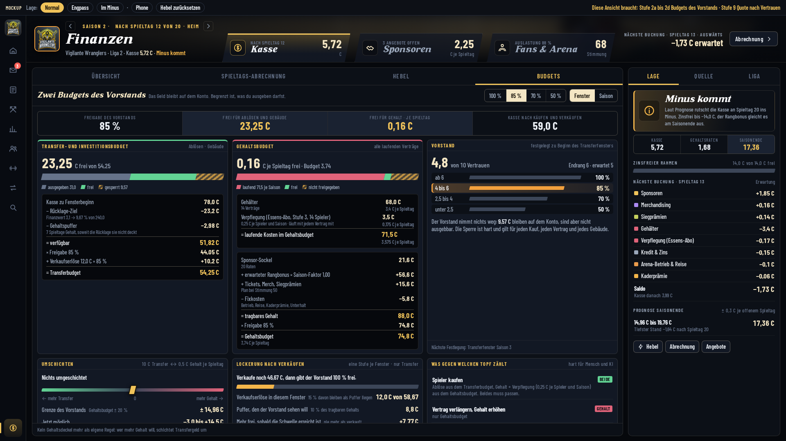
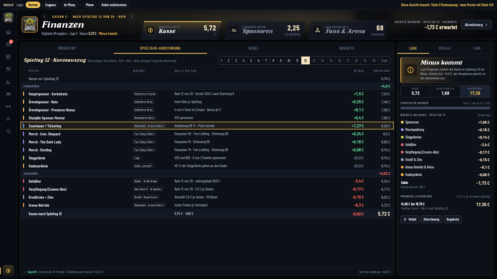

# Zwischen den Spieltagen: Rahmenkonzept (22.11.)

Status: **Konzept und Mockup, nichts gebaut, nichts bestellt.** Mockup
`public/mockups/zwischen-den-spieltagen-22-11.html` (`?ansicht=rahmen|woche|ausruestung|lage|liga`), Aufnahmen
1920×1080 und 2560×1440 in `docs/design/zwischen-den-spieltagen-22-11/` (selbst angesehen: kein Scrollen, kein Überlauf).
Alle Zahlen sind **grobe Startwerte**. Karten, Kiste, Lager und Antworten im Mockup sind anklickbar.

Anlass, Chris: „Was macht man zwischen den Spieltagen? … Events, Zauberkarten oder Equipment … Lootboxen … Was hältst du
von 20 Teams pro Liga oder 3 Ligen à 16?“ Dazu seine Vorgaben vom selben Tag:

1. Ausrüstung, Ereignisse, Kisten und Karten sind **Ideen, nicht der Plan**. Zuerst das große Bild, sie sind Bausteine darin.
2. Ausrüstung = **Punkte on top**, nicht durch die Matrix gedeckelt, Ausreißer gewollt. Haltbarkeit vielfältig.
3. Die **KI muss alles nutzen** können, deterministisch und billig.
4. **Server mit 4 GB RAM:** schlankes Datenmodell, keine teuren Rechenwege je Spieltag.
5. Ereignisse **ligaweit**, nicht für ein einzelnes Team; Reaktionen der Teams sind in Ordnung.
6. **Kein Pokal, keine Weltmeisterschaft** vorerst.

Die Eignungsmatrix bleibt unangetastet. Formkarten werden nicht ersetzt.

---

## 1. Das große Bild

### 1.1 Vier Schleifen

Ein Managerspiel trägt, wenn jede Schleife eine eigene Frage stellt, eine Rückmeldung gibt und etwas in die nächste
Schleife weiterreicht.

| Schleife | Dauer | Frage des Managers | Entscheiden | Erfahren | Bekommen | Stand heute |
|---|---|---|---|---|---|---|
| **Spieltag** | 10–15 min, 20-mal | Wie gewinne ich heute? | Platz, Einsatzstufe, zwei Formkarten, Captain | Arena, Ergebnis | Punkte, PP | stark gerechnet, die Rückmeldung fehlt |
| **Woche** (Zwischenphase) | 5 min, 19-mal | Was mache ich aus dem, was passiert ist? | Training, Scouting, Vorstand | Form-Meldungen, Moral | Erholung | eine Prüfliste, kein Ort, kaum eigene Entscheidung |
| **Saison** | 20 Spieltage, zwei Hälften | Erreiche ich mein Ziel? | Kartenhaushalt, Rotation, Geld gegen Vorstand und Sponsor | Tabelle | Aufstieg, Prämien | Bausteine da, Momente fehlen |
| **Ära** | mehrere Saisons | Was für ein Verein werde ich? | Kaderprofil, Gebäude, Verträge | Historie | (wenig) | ab Saison 3 erstarrt die Liga |

Die Frage „Was macht man zwischen den Spieltagen?“ ist deshalb die Frage nach der zweiten Schleife. Sie ist heute die
schwächste, weil sie nichts Eigenes entscheidet und nichts Eigenes belohnt. Ausrüstung oder Kisten allein beheben das
nicht; sie brauchen einen Ort und einen Takt.

**Vergleichsspiele, was sie zwischen den Spielen tragen:** Football Manager (Training, Gespräche, Presse, Scouting: viel
Tiefe, viel Pflichtarbeit), Hattrick (ein Zug je Woche, langer Atem), Motorsport Manager (Teile entwickeln mit
Haltbarkeit und Risiko, Regelabstimmungen der ganzen Liga), OSM (ein Zug am Tag, Trainingslager als Karte), Blood Bowl
(Verletzungen, Zukäufe für ein Spiel, Liga-Ereignisse), Slay the Spire (eins aus drei wählen statt blind ziehen), Marvel
Snap (kleine Hand, eine Entscheidung je Zug), Mario Strikers (Gegenstände als sichtbare, kurzlebige Ausreißer). Was sich
übertragen lässt: **ein Zug statt einer Liste**, **eins aus drei statt Lotterie**, **Teile mit Haltbarkeit**, **die Liga
als Mitspieler**. Was nicht passt: Pflichtarbeit und alles, was Echtgeld nachbildet.

### 1.2 Fünf Säulen

| Säule | Frage | Trägt heute | Fehlt |
|---|---|---|---|
| **1 Kader** | Wen habe ich, was wird aus ihm? | Draft, Fenster, Training mit Weg, Scouting-Nebel, Verträge, Belastung | Zugang und Abgang über die Saisons |
| **2 Spieltag** | Wie setze ich ihn ein? | Einsatzliste, Formkarten, Einsatzstufe, Captain, 20 Disziplinen | Rückmeldung nach dem Spiel, eigene Handschrift |
| **3 Verein** | Womit bezahle ich das? | zwei Töpfe, Vorstand, Sponsor, Gebäude, Finanzen je Spieltag | Geldentscheidungen in der Saison mit sportlicher Folge; Zweck der Gebäude |
| **4 Welt** | Was passiert um mich herum? | zwei Ligen, Auf-/Abstieg, Pause | fast alles: jede Saison läuft gleich, Höhepunkte sind Buchungsknöpfe |
| **5 Rivalen** | Gegen wen, mit wem? | Delegation, drei Logins, Team-Beziehungen als Daten (`lib/rivalries/`) | Vergleich, Derby, gemeinsame Momente |

Die Säulen 1 bis 3 stehen. **Die Lücken liegen in Welt und Rivalen**, also genau dort, wo Chris’ Ideen (Ereignisse) und
die Review (Rennen, Manager-Leiste) hinzeigen. Ausrüstung und Kisten gehören dagegen zu Säulen, die schon tragen; sie
sind Würze, kein Fundament. Das bestimmt die Reihenfolge in Abschnitt 4.

### 1.3 Der Kreislauf

Sechs Mittel laufen durch das Spiel: **Punkte** (Tabelle), **Geld** (zwei Töpfe), **Kraft** (Erschöpfung), **Karten**
(Formkarten-Haushalt), **Vertrauen** (Vorstand) und neu **Ruhm** (aus sportlicher Leistung, kauft Beute).

**Regel für jeden Baustein:** er muss mindestens zwei Mittel tauschen und zwei Säulen verbinden. Sonst wird er eine Insel
neben dem Spiel. Ausrüstung: Ruhm → Beute → Punkte, Haltbarkeit kostet Geld oder Teile (Säulen 1, 2, 3). Liga-Lage: die
Welt verschiebt Geld und Kraft für alle, jeder antwortet mit seinem Verein (Säulen 3, 4). Eine Kiste, die nur Zahlen
verteilt, erfüllt die Regel nicht; eine Kiste, die aus Leistung bezahlt wird und eine Wahl verlangt, schon.

### 1.4 Spannungsbögen und Ziele

- **Spieltag:** Karte jetzt oder sparen, Vollgas oder schonen; neu: lohnt das Einweg-Teil heute?
- **Hälfte:** Kraft bis zur Pause einteilen; neu: eine Liga-Lage, die den Plan verschiebt.
- **Saison:** Rennen um Titel, Aufstieg, Abstieg und das Vorstandsziel; Halbzeit als Wendepunkt; Finale als Sendung.
- **Ära:** aufsteigen, sich halten, Titel holen; einen Erzfeind haben; für etwas stehen (Wimpel, Rekorde, Legenden).
- **Zu dritt:** Derby, Managertabelle, dieselbe Liga-Lage verschieden beantwortet.

### 1.5 Die Woche als Ort

Bevor irgendein Baustein kommt, braucht die zweite Schleife einen Ort: **eine Seite „Die Woche“** (Mockup, Beispiel 1).
Sie ersetzt die Prüfschritte des Taktgebers zwischen zwei Spieltagen und folgt drei Regeln:

1. **Ein Zug, nicht eine Liste.** Je Woche eine echte Entscheidung (später: eine Aktionskarte), dazu höchstens eine
   Reaktion auf die Liga-Lage. Fünf Minuten.
2. **Nichts ist Pflicht.** „Weiter zum Spieltag“ ist immer möglich; was offen bleibt, füllt die KI nach derselben Logik
   wie für KI-Teams. Training, Vorstand, Scouting erscheinen nur bei Anlass.
3. **Delegierbar.** Bereich „Woche“ (Zug, Ausrüstung, Antworten) in `TeamControlSettings.delegation`; für Ramona
   (Halbautomatik) macht die KI alles außer Käufen. „Mensch überschreibt, KI respektiert das.“

---

## 2. Bausteine

Kurzkarten. Welle und Aufwand in Abschnitt 4. **KI** = wie die KI den Baustein nutzt. **Last** = Speicher und Rechenzeit.

### B1 Deine Entscheidungen · B2 Rennen und Halbzeitbericht · B3 Manager-Leiste und Derby
Eigenes Mockup und Dokument: `spieltag-entscheidungen-rennen-22-11.md`. Zweck: Rückmeldung (Schleife 1), Bogen
(Schleife 3), Vergleich (Säule 5). KI: nicht betroffen. Last: null, reine Anzeige. Aufwand S bis M.

### B4 Die Woche als Ort
- **Zweck:** gibt Schleife 2 einen Ort und einen Takt (Abschnitt 1.5). Voraussetzung für B5 bis B8.
- **Wechselwirkung:** bündelt Kader-Zustand, Verein, Rivalen, Welt auf einer Seite.
- **KI:** füllt jeden offenen Schritt; ein Spieltag wartet nie auf einen delegierten Bereich.
- **Last:** null. **Aufwand:** M. **Abhängig von:** Taktgeber-Umbau (Review 3.2), Mockup-Freigabe.

### B5 Liga-Lage (ligaweite Ereignisse)
- **Zweck:** macht jede Saison anders und gibt der Säule Welt einen Inhalt. Etwa fünf Lagen je Saison, je zwei bis drei
  Spieltage, **für beide Ligen und alle 32 Teams gleich**, einen Spieltag vorher angekündigt.
- **Arten:** Wirtschaft (Sponsor-Auszahlungen ±15 %, Stadion ±25 %, Gehaltsdruck bei Verlängerungen, Transfer-Inflation
  im nächsten Fenster, Materialknappheit im Laden), Wetter und Saison (Hitzewelle: Belastung im Freien +2 Grundlast;
  Grippewelle: Erholung −20 %), Regel (Schonfrist: Verletzungsrisiko halbiert; Kartenruhe: keine Formkarten;
  Materialkontrolle: seltene Ausrüstung gesperrt; Flutlicht: Prämien doppelt).
- **Reaktion:** je Lage zwei bis drei Antworten mit **vorher sichtbaren, festen Folgen**, kein versteckter Würfel (wie
  das Vorstandsgespräch). Nach dem Spieltag sieht man, wie die Liga geantwortet hat.
- **Wechselwirkung:** Verein (Geld, Rücklage, Vorstand), Kader (Belastung), Rivalen (dieselbe Lage, andere Antwort).
  Greift **nicht** in die Wertung der Arena ein; Wetter wirkt nur auf Belastung und Erholung.
- **KI:** Nachschlagetabelle je Lage: Antwort nach Team-Matrix (Finanzwert, Beliebtheit, Ehrgeiz) und Kassenlage.
- **Last:** je Saison fünf Einträge und 32 Antworten, unter 2 KB. Rechenzeit: ein Faktor in bestehenden Buchungen.
- **Aufwand:** M. **Abhängig von:** B4, Finanzen je Spieltag (gebaut).

### B6 Ausrüstung (Punkte on top, Haltbarkeit)
- **Zweck:** sichtbare Ausreißer und eine Entscheidung je Spieltag mehr („lohnt das Teil heute?“).
- **Wirkung:** der Bonus kommt **auf die gespielte Leistung des Trägers obendrauf**, in den Disziplinen, die auf dem
  Gegenstand stehen, unabhängig von der Eignung und ohne Deckel aus der Matrix. Startwerte: Standard +2 bis +4, Selten
  +4 bis +5, Episch +6 bis +7, Legendär +9; Einweg-Teile +4 bis +6. Zwei Plätze je Spieler: Ausrüstung und Verbrauch.
  Zum Vergleich: eine Formkarte bringt bis 12, ein Mutator-Treffer 3,5.
- **Haltbarkeit, fünf Arten:** Einweg (ein Einsatz), Leihgabe (N Spieltage ab Anlegen), Verschleiß in Prozent je Einsatz
  (robust 5–8, normal 15, empfindlich 34), gebraucht oder beschädigt erhalten (Zustand unter 100 %), Reparatur gegen
  Teile (danach höchstens 80 % des alten Höchstwerts). Vollgas verschleißt doppelt.
- **Woher:** Ruhm und Kisten (B7), Laden für Geld (nur Standard und Selten, oft gebraucht, ein Kauf je Woche, aus dem
  Investitionstopf unter der Vorstands-Freigabe), Sponsor-Leihgabe zum Saisonstart, Belohnung für Ziele und Wimpel.
- **Gezeigt = gebucht:** **eine** Funktion `ausruestungsBonus(spielstand, spieler, disziplin, spieltag)` für
  Einsatzliste, Legacy-Wertung, Motor-Umschlag, KI und „Deine Entscheidungen“ (eigene Zeile „Ausrüstung“). Verschleiß
  wird beim Buchen des Spieltags fortgeschrieben, bei Replay zurückgenommen.
- **Rangtreue:** siehe Abschnitt 3.
- **Besitz:** gehört dem Verein, nicht dem Spieler; bei Verkauf geht sie ins Lager. Marktwert bleibt davon unberührt.
- **KI:** vor jeder Aufstellung für die zwei Disziplinen des Tages: Gegenstände nach Bonus absteigend, jeder an den
  aufgestellten Spieler mit der höchsten Eignung in einer passenden Disziplin und freiem Platz; Gleichstand nach
  Spieler-ID. Einweg-Teile, wenn der erwartete Abstand zum Gegner kleiner ist als der Bonus, in den letzten fünf
  Spieltagen im Rennen immer, oder wenn das Lager voll ist. Reparatur, wenn Restnutzen > Kosten und Teile da sind.
  Kauf im Laden, wenn Nutzwert je C über einer Schwelle liegt, die am Ehrgeiz des Teams hängt, und die Rücklage hält.
- **Last:** Katalog (rund 60 Arten) im Code. Je Gegenstand ein Datensatz aus Art, Zustand, Höchstzustand, Restlaufzeit,
  Träger: rund 80 Byte. Lager höchstens 16 je Team plus angelegte: Obergrenze 32 × 44 × 80 Byte ≈ 110 KB, üblich
  unter 30 KB je Spielstand. Rechenzeit: Nachschlagen je aufgestelltem Spieler, kein zusätzlicher Motorlauf.
- **Aufwand:** L (Wertung, alle Abnehmer, Messung, Review). **Abhängig von:** B1 (Zeile im Ergebnis), B4.

### B7 Ruhm und Kisten
- **Zweck:** der Belohnungsweg, der Leistung in Beute verwandelt und das Loot-Gefühl bringt.
- **Ruhm:** 1 je Duellpunkt, +1 je Disziplin über der Erwartung (hilft Außenseitern), Bonus für Derby-Sieg, Wimpel,
  Etappen der Vorstandsziele. Rund 60 bis 80 je Saison.
- **Kisten:** nur für Ruhm oder als Belohnung, **nie für Geld** (reiche Teams kaufen Breite im Laden, nicht Seltenes).
  Holz 8, Eisen 20, Gold nur als Belohnung. **Eins aus drei wählen**, der Rest wird zu Teilen. Chancen stehen an der
  Kiste (Eisen: 40 / 40 / 17 / 3 %). Mitleidszähler: spätestens jede fünfte Eisenkiste zeigt etwas Episches. Duplikat:
  Teile oder das eigene Stück auf 100 %. Etwa sieben Öffnungen je Saison, also jede zweite bis dritte Woche.
- **Glück:** die Saat hängt an Spielstand, Team, Saison und Zähler (kein Neuladen-Trick, serverseitig hinter
  `authorizeServerRoomWrite`). Die Wahl aus drei halbiert die Streuung.
- **KI:** öffnet die teuerste bezahlbare Kiste, sobald Ruhm ≥ 20; wählt nach Nutzwert = Bonus × erwartete Einsätze ×
  Restspieltage mit passender Disziplin; Gleichstand nach Katalognummer.
- **Last:** ein Zähler und ein Ruhmwert je Team. **Aufwand:** M. **Abhängig von:** B6.

### B8 Aktionskarten
- **Zweck:** der eine Zug je Woche. Unterschied zur Formkarte: Formkarten liegen **am Spieltag** und gehen in die
  Wertung; Aktionskarten liegen **zwischen** den Spieltagen und ändern Zustände (Kraft, Moral, Trainingsfortschritt,
  Scouting-Stufe, Kasse, Haltbarkeit), nie direkt ein Ergebnis.
- **Regeln:** Hand 3, je Woche eine spielen, eine nachziehen. Grunddeck für alle gleich; Gebäude ab Stufe 2 legen je
  eine Karte dazu (gibt Gebäuden einen spürbaren Zweck), Kisten können Karten enthalten.
- **Keine Sabotage** gegen andere Teams: zu dritt erzeugt das Ärger statt Rivalität. Rivalität kommt aus B9.
- **KI:** feste Rangfolge nach Zustand: Erholung, wenn zwei Stammspieler ab 60 Erschöpfung; Moral, wenn ein
  Stammspieler unter 40; Vorstand, wenn Vertrauen unter 5; sonst Training für den Spieler mit dem größten Abstand zur
  Decke; sonst die älteste Karte.
- **Last:** Hand und Stapel als Zähler je Kartenart, rund 200 Byte je Team. **Aufwand:** M. **Abhängig von:** B4.

### B9 Rivalitäten und Erzfeind
- **Zweck:** Geschichten zwischen Vereinen, auch gegen KI-Teams. Die Beziehungen gibt es als Daten
  (`lib/rivalries/team-rivalries.ts`); sie werden sichtbar und wachsen mit knappen Spielen, Direktduellen im Rennen,
  Derbys.
- **Wirkung:** Marke im Spielplan, Bilanz über Saisons, kleine Moral- und Ruhm-Folge beim Sieg, Stadion-Einnahmen im
  Derby. Keine Wertungsänderung.
- **KI:** nichts zu entscheiden. **Last:** vorhanden. **Aufwand:** S. **Abhängig von:** B3.

### B10 Wimpel und Rekorde (Vereinsidentität)
- **Zweck:** belohnt Spezialisierung: bestes Team je Disziplin und Liga über die Saison bekommt einen Wimpel, dazu
  Vereinsrekorde je Disziplin. Zählt für Vorstands- und Sponsorziele, gibt Ruhm.
- **KI:** nichts. **Last:** 40 Einträge je Saison. **Aufwand:** S. **Abhängig von:** Historie-Seite.

### B11 Spielweisen (Handschrift)
- **Zweck:** der Manager entscheidet, **wie** gespielt wird (Review 3.3). Sie ändern, was die Spieler tun, nie wie gut.
- **KI:** Wahl nach Kaderprofil. **Last:** null. **Aufwand:** L je Disziplin-Familie, mit rho- und Pp-Abnahme und
  neuen Fingerabdruck-Zeilen. **Abhängig von:** Pilot Wettessen (`OLY_STRATEGIE_VORLAGEN`).

### B12 Nachwuchs und Abgang
- **Zweck:** der Motor der Ära. Kleiner jährlicher Nachwuchs-Draft (Schwächere zuerst), sanfter Abgang ohne Alter.
- **KI:** bestehende Draft-Logik. **Last:** gering. **Aufwand:** L. **Abhängig von:** Grundsatzentscheidung; neue
  Spieler brauchen Portrait und für Kader von Menschen eine Figur.

### B13 Legenden · B14 Saisonfinale als Sendung
- **Zweck:** Abschluss und Gedächtnis. Finale in fünf Tafeln (Review 3.6); Spieler mit vielen Saisons, Wimpeln oder
  MVP-Titeln werden Vereinslegenden (Ruhmeshalle, kleine Moralwirkung).
- **KI:** nichts. **Last:** gering. **Aufwand:** M und S. **Abhängig von:** B10, Mockup.

### Später, wenn es drei Ligen gibt
Pokal über die Ligen, Supercup, Weltspiele. Vorerst gestrichen (Vorgabe 6).

---

## 3. Ausrüstung und Rangtreue: Abschätzung

**Keine Messung am Motor**, sondern eine Modellrechnung (`Leistung = Eignung + Rauschen + Ausrüstung`, zehn Spieler je
Spiel, Rangkorrelation je Spiel, 6000 Spiele, Ausgang 0,79). Sie zeigt die Richtung, nicht die Zahl.

| Wer trägt, wie viel | rho gegen Eignung | rho gegen Eignung + Ausrüstung |
|---|---:|---:|
| niemand | 0,79 | 0,79 |
| 20 % tragen +2 bis +4, zufällig verteilt | 0,78 | 0,79 |
| 20 % tragen +2 bis +4, die Schwächsten | 0,73 | 0,74 |
| 30 % tragen +2 bis +6, die Besten | 0,84 | 0,84 |
| 30 % tragen +2 bis +6, zufällig | 0,76 | 0,79 |
| 30 % tragen +2 bis +6, die Schwächsten | 0,68 | 0,72 |
| 50 % tragen +4 bis +9, zufällig | 0,72 | 0,81 |
| 50 % tragen +9 bis +17, zufällig | 0,59 | 0,85 |

Lesart:

- **Ausreißer sind kein Zufall.** Der Bonus ist vorher sichtbar. Gegen „Eignung + Ausrüstung“ bleibt die Rangtreue
  stehen oder steigt. Das ist die Zahl, die sagt, ob das Ergebnis aus Können und Entscheidung kommt.
- **Gegen die nackte Eignung fällt rho**, sobald viele schwache Spieler viel tragen. Trägt der Beste das Teil (so
  rüstet die KI aus), steigt rho sogar.
- **Die Bremse ist die Menge im Umlauf**, nicht ein Deckel am Gegenstand: Haltbarkeit, Ruhm-Einkommen, Lagergröße,
  Zahl der Plätze. Bei den Startwerten trägt etwa jeder vierte aufgestellte Spieler etwas mit im Mittel +4.

**Vorschlag für die Abnahme** (zu entscheiden, offene Frage 1):

1. **Mechanik:** rho und Pp je Disziplin werden wie heute **ohne Ausrüstung** gemessen; GESAMT des Fingerabdrucks bleibt
   mit ausgeschalteter Ausrüstung unverändert. Die Mindestschranke 0,75 gilt für diese Zahl weiter.
2. **Mit Ausrüstung:** eigene Fingerabdruck-Zeilen außerhalb von GESAMT; rho gegen „Eignung + Ausrüstung“ darf nicht
   unter der Zahl ohne Ausrüstung liegen.
3. **Umlauf-Wächter:** in einer Saison mit 32 KI-Teams (`scripts/miss-alle-disziplinen.mjs` um einen Schalter
   erweitert) bleibt rho gegen die nackte Eignung über 0,75. Fällt es darunter, wird das Angebot gedrosselt.
4. **Pp-Abweichung:** der Bonus hängt an keinem Attribut, verschiebt die Attributanteile also nicht gezielt; gemessen
   wird trotzdem mit und ohne, Schranke 25.

Abnehmer, die man kennen muss: PP (steigen mit dem Bonus; Bestenliste und MVP ja, Marktwert-Fortschreibung besser
ohne), Moral und Form (Leistung gegen Erwartung: die Erwartung muss den Bonus enthalten), Training (unberührt).

---

## 4. Reihenfolge

Jede Welle bringt allein schon etwas und setzt keine spätere voraus.

| Welle | Inhalt | Warum an dieser Stelle | Aufwand | Freigabe nötig |
|---|---|---|---|---|
| **1 Verstehen und vergleichen** | B1, B2, B3, Ziel-Stufen | reine Anzeige, macht alles Vorhandene spürbar | S–M | nein (freigegeben) |
| **2 Die Woche und die Welt** | B4, B5, B9, B10 | füllt die schwächsten Säulen, ohne die Wertung zu berühren; gibt B6 bis B8 ihren Ort | M | Mockup „Die Woche“, Katalog der Lagen |
| **3 Beute** | B6, B7 | größtes Risiko (Wertung), deshalb erst, wenn Ort und Rückmeldung stehen | L | Abnahmeregel (Frage 1), Opus-Review, neuer Fingerabdruck |
| **4 Handschrift** | B8, B11 | braucht den Zug aus Welle 2; Spielweisen je Disziplin-Familie | M–L | Mockup je Familie |
| **5 Ära** | B14, B13, B12, Ligaformat | zahlt sich erst über mehrere Saisons aus | L | Grundsatzfragen, PixelLab für neue Teams und Figuren |

**PixelLab-Bedarf (nur Vorschlag, nichts bestellt):** Requisiten sind frei, Figuren nicht. Welle 3: rund 60
Gegenstands-Icons und drei Kisten, geschätzt 60 bis 90 Generationen (eine je Icon, Stilprobe zuerst). Welle 2: fünf bis
acht Lagen-Bilder, geschätzt 10. Welle 5 (2 × 20): acht Team-Logos und Figuren nur für Kader von Menschen. Bis dahin
SVG-Platzhalter wie im Mockup.

**Mess- und Abnahmeplan in Kürze:** Welle 1 und 2: Fingerabdruck unverändert, Aufnahmen gegen Mockup, Finanz-Korridor
einer Saison mit 32 KI-Teams mit und ohne Lagen (Kassen-Median ±5 %). Welle 3: Abschnitt 3, dazu Ruhm- und
Kisten-Verteilung über eine KI-Saison (kein Team über dem Doppelten des Medians an Ausrüstungspunkten). Welle 4:
je Spielweise rho, Pp, neue Fingerabdruck-Zeile.

---

## 5. Ligaformat

| | 2 × 16 (heute) | 2 × 20 | 3 × 16 |
|---|---|---|---|
| Teams | 32 | 40, acht neue (zehn Vorschläge vom 21.11.) | 48, sechzehn neue |
| Spielplan, 20 Spieltage | 15 Gegner, fünf doppelt | 19 Gegner, jeder einmal + ein freier Spieltag (Derby, Erzfeind) | wie heute |
| Vierergruppen | 4 je Liga | 5 je Liga | 4 je Liga |
| Rennen | L1 Titel, Abstieg; L2 Aufstieg | dieselben; mit vier Wechslern 20 % | Liga 2 hat Aufstieg **und** Abstieg |
| Kader, Draft | unverändert | rund +100 Plätze, Draft 25 % länger | rund +190 Plätze, dritte Stärkestufe |
| Wirtschaft | geeicht | Liga 2 breiter, Eichung prüfen | neue Stufe für Sponsor, Prämien, Startbudget |
| Layouts | nichts | alle Tabellen 20 Zeilen (passt bei 1080 mit 2,6 rem je Zeile) | Tabellen bleiben; überall drei Ligen, Ränge gegen 48 |
| Rechenzeit am Spieltag | Wertung 13,6 s | etwa +25 % | etwa +50 %, auf dem 4-GB-Server zu prüfen |
| Drei Menschen | höchstens zwei Ligen | höchstens zwei Ligen | können sich auf drei verteilen |
| PixelLab | nichts | acht Logos; Figuren nur für Kader von Menschen | sechzehn Logos |

**Empfehlung: jetzt 2 × 16 lassen, als Ziel 2 × 20 mit vier Auf- und Absteigern (Welle 5), nicht 3 × 16.**
2 × 20 löst das eine echte Problem des heutigen Formats, den ungleichen Spielplan, und schenkt einen freien Spieltag
für das Derby. Die Teams liegen als Vorschlag vor, die Menschen bleiben beisammen, der Preis ist ein Layoutdurchgang.
3 × 16 hätte die besseren Rennen in der Mitte und die längere Leiter, kostet aber doppelt so viele neue Teams, die
Hälfte mehr Rechenzeit und trennt die Mitspieler; ohne Pokal treffen sie sich dann nicht mehr. Die Zahlen zum Spielplan
und zur Rechenzeit sind aus `season-fixture-schedule.ts` und `spieltag-tempo-21-11.md` abgeleitet, nicht gemessen.

---

## 6. Offene Fragen an Chris

1. **Abnahme mit Ausrüstung:** gilt die Schranke 0,75 für rho gegen die nackte Eignung auch bei getragener Ausrüstung
   (dann begrenzt sie die Menge im Umlauf), oder zählt dort rho gegen „Eignung + Ausrüstung“?
2. **Trägt der Rahmen so:** vier Schleifen, fünf Säulen, zuerst Welt und Rivalen füllen, Beute erst in Welle 3?
3. **Die Woche:** ein Zug je Woche, oder lieber frei so viel man will?
4. **Ligaweite Lagen mit Regelwirkung** (Kartenruhe, Materialkontrolle): gewollt, oder nur Wirtschaft und Wetter?
5. **Ligaformat:** 2 × 20 als Ziel für Welle 5 vormerken, mit vier statt drei Auf- und Absteigern?

---

# Runde 2 (22.11.): Feedback von Chris, fünf Punkte ausführlicher

Neue Ansichten im Mockup: `?ansicht=nachspiel`, `kiste` (`&phase=1|2|3` friert einen Takt ein), `verein`, `welt`, `aera`.
Weiter grob: Zahlen sind Startwerte, nichts ist gemessen, wo es nicht dabeisteht.

## 7. Kader und Ära: Potential, das wandert

Chris: „Ich würde nicht sagen, dass sich jeder Spieler zwangsweise dem Peak nähert … Wenn Potentiale sich pro Attribut und
Saison ein bisschen nach oben oder unten anpassen können und Training und Regression so laufen, dass über alle Ligen die
Spieler im SCHNITT nicht zu viel zulegen, passt es.“ Das korrigiert Abschnitt 1.2: Die Lücke ist nicht „es fehlt ein
Motor“, sondern „der Motor ist nicht geeicht und nicht sichtbar“.

**Was es schon gibt** (gelesen, nicht gemessen):
- Decke je Attribut mit Saison-Drift: `applyAttributeCeilingSeasonDrift` (`lib/scouting/player-attribute-ceiling-service.ts`)
  zieht je Attribut und Saison −2, 0 oder +2 aus einer Saat, verschoben nach Ausblick (`growthOutlook`). Das ist heute
  **reiner Zufall ohne sichtbaren Grund**.
- Abnehmender Ertrag und Abbau: `lib/training/organic-season-progression.ts` (Drossel nahe der Decke, Regression,
  Einstellskript `scripts/long-run-auto-tune-organic.ts`).
- Messung der Bilanz: `docs/design/training-je-spieltag-18-11.md` weist „Netto Summe aller Attribute, Liga-Mittel **+6,78**
  je Saison“ aus. Die Liga legt also im Schnitt deutlich zu. Genau das soll nicht sein.
- Zu- und Abgänge stehen in der Historie (`app/foundation/historie`, `transfer-history-v2`).

**Baustein B15 „Potential, das wandert“ (Startwerte):**

| Teil | Regel |
|---|---|
| Drift je Attribut und Saison | −2 bis +2, meist 0. Summe über alle zwölf Attribute eines Spielers höchstens ±4 je Saison |
| Auslöser nach oben | viel Spielzeit auf einem Platz, der das Attribut braucht; Trainingsziel die Saison gehalten; Wimpel oder mehrfach beste des Spieltags; passendes Gebäude oder Trainerin |
| Auslöser nach unten | kaum Einsätze; viele Spieltage verletzt; dauernd über 65 Erschöpfung; Attribut die ganze Saison in keiner gespielten Disziplin gebraucht |
| Rest | kleiner Zufall aus der Saat, höchstens ±1, damit zwei gleiche Laufbahnen nicht identisch enden |
| Ertrag nahe am Potential | ab 6 Punkten Abstand voller Trainingssatz, darunter linear fallend bis rund 25 % am Potential; darüber nichts |
| Regression | wer ein Attribut nicht trainiert und nicht spielt, verliert langsam (Startwert −0,5 je Saison), über dem Potential schneller |
| Kein Alter | bleibt. Laufbahnen enden über sinkendes Potential und über den Abschied (B12), nicht über Jahre |

**Abnahme: Liga-Mittel neutral.** Messlauf wie für das Training (`scripts/miss-training-je-spieltag.ts`, 32 KI-Teams von
Anfang an), aber über **fünf Saisons** (`lib/season/long-run-*`):
1. Netto-Summe aller Attribute je Spieler und Saison, **Liga-Mittel zwischen −1 und +1** (heute +6,8).
2. Streuung gewollt: etwa ein Drittel wird schwächer, ein Drittel stärker, Rest ±1.
3. Mittlere Kaderstärke (beste 6) je Disziplin driftet über fünf Saisons um höchstens ±1.
4. Die Rangfolge der Teams bewegt sich: Rangkorrelation der Kaderstärke Saison 1 gegen Saison 5 unter 0,8.
5. rho und Pp bleiben unberührt (die Mechanik ändert sich nicht, nur die Werte der Spieler).

Stellschrauben sind Trainingsfaktor, Ertragskurve und Regression; nicht die Drift, die soll klein bleiben.

**Sicht für den Spieler** (Mockup `aera`): im Profil je Attribut Wert, Potential als Rahmen, **Pfeil** für die Bewegung zum
Saisonwechsel und **Ertrag in Prozent**; eine **Karrierekurve** je Attribut und für den Gesamtwert über die Saisons mit
Marken (Wechsel, Verletzung, Wimpel) und dem Grund je Potential-Schritt. Der Scouting-Nebel gilt weiter: bei fremden
Spielern Potential nur als Spanne, Pfeile erst mit Scouting Office.

**KI:** nutzt dieselbe Ertragszahl bei der Wahl des Trainingsziels (nicht in ein Attribut am Potential trainieren) und
beim Kauf (Potential-Spanne nach Scouting-Stufe, wie heute). Sie verkauft Spieler mit zwei fallenden Pfeilen im
Schlüsselattribut eher. Kein neuer Rechenweg je Spieltag: die Drift läuft einmal im Saisonwechsel.

**Historie erweitern:** je Saison Nachwuchs und Abschiede der Liga, je Spieler die Laufbahn (Vereine, Ablösen,
Karrierekurve, Wimpel, Bestwerte), je Verein Zu- und Abgänge mit „was aus ihnen wurde“. Speicher: je Spieler und Saison
ein Datensatz mit zwölf Werten und zwölf Potentialen, rund 0,1 KB, bei 400 Spielern 40 KB je Saison.

**Aufwand:** M für Auslöser, Eichung und Messung; S–M für die Sicht. Die Ära insgesamt bleibt „später, aber sehr
wichtig“. Vorschlag: Eichung und Sicht schon in Welle 2 (sie berührt keine Wertung und wirkt ab der zweiten Saison),
Nachwuchs und Abschied in Welle 5.

## 8. Nach dem Spiel: die Sendung

„Deine Entscheidungen“ erklärt die Zahlen. Davor fehlt die **Erzählung**: was ist passiert, wer war es, was folgt. Eine
Seite, sechs Tafeln (Mockup `nachspiel`), als erster Halt nach der Arena; „Deine Entscheidungen“ ist der zweite Reiter.

| Tafel | Inhalt | Quelle |
|---|---|---|
| Schlagzeile | eine Zeile, zwei Sätze, drei Stimmen (Gegner, Fans, Vorstand) | Satzbausteine nach Regeln aus Ergebnis, Abstand, Serie, Rang, Vorstandslage; Saat je Spieltag. Kein Textgenerator |
| Schlüsselmomente | je Disziplin drei bis vier Momente mit Stand | Ereignisliste des Arena-Laufs (Tore, Führungswechsel, Ausfälle); die mit der größten Wirkung auf den Stand; Sprung zur Stelle in der Wiederholung |
| Matchwinnerin | großes Bild, gespielt gegen Grundwert, PP, Zählbares, Laufbahn-Satz, Pechvogel | `matchday-mvp-scoring-service.ts`, `baueSpielerPp`, Verletzungsstand |
| Formpfeile | fünf Spieler mit Pfeil und Grund | Form-Meldungen (`nach-dem-spieltag.ts`) |
| Folgen für die nächste Woche | fünf Zeilen, jede springt | Erschöpfung, Verletzte, Kartenhaushalt, nächster Gegner, Kasse des Spieltags |
| Rund um die Liga | Mitspieler zuerst, dann Rekord, Überraschung | Buchung der anderen Begegnungen |

Regeln: jede Zeile stammt aus Gebuchtem; ein Satzbaustein ohne passende Lage erscheint nicht. Die Stimmen bekommen
Charakter über Typen (KI-Manager aus der Team-Matrix, Vorstand aus Abschnitt 9). Voraussetzung für die Schlüsselmomente:
der Arena-Lauf muss eine kurze Ereignisliste mit Zeitpunkt und Stand speichern (**prüfen**, was der Motor heute ausgibt);
das ist reine Anzeige, der Fingerabdruck bleibt. Für legacy-gewertete Disziplinen gibt es Momente nur als „bester Wert,
größter Ausreißer, knappste Platzierung“. Aufwand M, Welle 1 oder 2.

## 9. Verein: was hinein könnte

Leitgedanke: der Verein wird eine **Figur mit Haltung, Leuten, Publikum und Gedächtnis**. Acht Elemente (Mockup `verein`).

| Element | Zweck | Wechselwirkung | KI | Aufwand |
|---|---|---|---|---|
| **Identität (drei Leitsätze)** | gibt eine Richtung mit Vorteil und Preis, z. B. „Bühne vor Kraft“, „Eigene Leute“, „Volles Haus“ | färbt Vorstandsziele, Sponsor-Passung, Fan-Vorlieben, Training | wählt aus der Team-Matrix (Achsen, Ehrgeiz, Beliebtheit), fest je Saison | M |
| **Fans und Stadion** | Stimmung 0–100 aus Ergebnissen, Derbys, eigenen Leuten; bestimmt Auslastung und Einnahme je Heimspiel | Spieltag → Kasse; Schonen im Heimspiel und Star-Verkäufe kosten Stimmung; Arena-Ausbau hebt die Obergrenze | keine Entscheidung, nur Folge | M |
| **Gebäude mit Zweck** | jedes Gebäude liefert etwas zum Anfassen: eine Aktionskarte, ein Ladenangebot, ein aufgedeckter Potential-Pfeil | Woche, Training, Scouting, Beute | baut nach Identität und Kassenlage (wie heute) | M |
| **Personal (Trainerin, Scout, Physio)** | drei Stellen, je ein Typ mit Vorteil und Preis; zweite Verwendung für den Gehaltstopf | Training, Scouting-Nebel, Erholung; unter der Vorstands-Freigabe | nimmt den Typ, der zur Identität passt | M |
| **Jugend und Nachwuchs** | ein bis drei Plätze, lange Sicht, eigener Nachwuchs-Draft (Schwächere zuerst) | Academy, Leitsatz „Eigene Leute“, Fans, Ära | bestehende Draft-Logik | L, Welle 5 |
| **Sponsor-Beziehung** | Treue wächst mit erfüllten Zielen und Jahren; ab einer Schwelle mehr Grundbetrag und eine Leihgabe | Finanzen, Ausrüstung, Wirtschaftslage | bleibt, solange Treue über der Schwelle und kein besseres Angebot | S–M |
| **Vorstand mit Gesichtern** | drei Stimmen (Kasse, Ehrgeiz, Tradition) mit Gewicht; das Vertrauen ist ihr Mittel | Gespräch, Ziele; Freigabe-Quote bleibt wie entschieden | nicht betroffen (KI-Teams haben denselben Vorstand) | M |
| **Vereinsgeschichte** | Wimpel, Rekorde, Legenden, Erzfeind, ewige Tabelle | Fans, Traditionalist, Saisonfinale, Historie | nichts | S |

Serverlast überall klein: wenige Zahlen je Team und Saison. Personal braucht **keine neuen Figuren** (Symbole und
Typnamen). Die festen Finanz-Vorgaben bleiben: keine Geldstrafen, Freigabe als Quote, zwei Töpfe, Rücklage nach
Finanzwert. Reihenfolge: Fans und Gebäude-Zweck zuerst (sie machen Vorhandenes spürbar), dann Identität und Vorstand,
dann Personal.

## 10. Welt: die Zeit geht weiter

Das Gefühl von Zeit entsteht nicht durch mehr Zufall, sondern durch **Zustände mit Gedächtnis**: Sie ändern sich langsam,
sind angekündigt, bleiben und haben einen Grund. Vier Uhrwerke (Mockup `welt`):

1. **Wirtschaftslage (träge Stufe).** Fünf Stufen von Krise bis Boom, höchstens eine Stufe je Saison, die Richtung steht
   eine Saison vorher fest. Wirkt auf Sponsor-Grundbetrag, Stadion, Ablösen, Gehaltsforderungen. Die kurzen Liga-Lagen
   (B5) werden aus der Stufe gezogen: im Boom Feiertagsspiele, in der Krise Sponsorenflaute. Rückkopplung: viel Geld im
   Umlauf treibt Ablösen, das kühlt ab.
2. **Regel der Saison (bleibend).** Jede Saison bringt genau **eine** dauerhafte Änderung. Die Liga stimmt in der
   Saisonpause über drei Vorschläge ab, jedes Team eine Stimme, die KI nach Vorteil für den eigenen Kader. Beispiele:
   vier statt drei Auf- und Absteiger, Kader 14, eine dritte Formkarte, Format einer Disziplin. Beschlossenes steht in
   der Chronik und gilt weiter.
3. **Trends und Formate (aus dem Spiel selbst).** Welche Achse gewinnt, wird gemessen und gezeigt. KI-Teams ziehen im
   Fenster eine Saison verzögert nach, danach lohnt das Gegenmittel: ein Kreislauf ohne Würfel. Dazu wechseln je Saison
   zwei Disziplinen ihr **Format** (Canyon, Fünf Punkte und Tag-Team gibt es schon als Stempel im Spielstand); das
   verschiebt, welche Plätze zählen, ohne die Matrix anzufassen.
4. **Chronik und Rekorde.** Die Liga erinnert sich: Rekorde je Disziplin, Serien, Aufstieg und Niedergang von Teams,
   ewige Tabelle, Legenden. Sichtbar auf Startseite, in Profilen und im Saisonfinale.

Dazu eine **Dynastie-Bremse** mit Grund statt Gummiband: Stars des Meisters fordern mehr Gehalt, die Letzten wählen im
Nachwuchs zuerst, abgestiegene Teams verlieren Sponsor-Treue. KI-Teams bekommen damit eigene Bögen (Aufstieg, Blüte,
Niedergang), weil ihre Kasse, ihr Kader und ihr Potential über die Saisons wandern.

**KI:** stimmt nach Tabelle ab, folgt dem Trend verzögert, reagiert auf die Wirtschaftsstufe über Rücklage und
Kaufschwelle. **Last:** ein Zustand und ein Chronik-Eintrag je Saison, Rekorde 20 × wenige Werte. **Aufwand:** Chronik
und Rekorde S, Wirtschaftsstufe M, Regel der Saison M–L (jede Regel einzeln abzunehmen; Formate brauchen rho, Pp und
Fingerabdruck), Trends S als Anzeige, M mit KI-Nachzug. **Abnahme:** fünf Saisons mit 32 KI-Teams; der Kassen-Median
bleibt im Korridor, kein Team ist fünfmal in Folge Meister, mindestens ein Team wechselt in fünf Saisons zweimal die Liga.

## 11. Ausrüstung: der Kreislauf und die Kiste

**Kreislauf in sechs Schritten** (Mockup `kiste`, links):

1. **Woher:** Ruhm aus Punkten kauft Kisten; Laden für Geld (nur Standard und Selten, ein Kauf je Woche);
   Sponsor-Leihgabe ab Treue 70; Belohnung für Wimpel, Vorstandsziel, Derby-Sieg.
2. **Lager:** 16 Plätze je Verein, Duplikate werden Teile.
3. **Anlegen:** in der Einsatzliste direkt am Platz, je Spieler ein Feld Ausrüstung und ein Feld Verbrauch. Ein Knopf
   „Vorschlag“ rüstet wie die KI. Auch vom Spielerprofil und vom Lager aus.
4. **Wirkung:** Punkte on top in den Disziplinen des Gegenstands. Sichtbar an drei Stellen: Vorschau der Einsatzliste,
   kurze Einblendung in der Arena beim ersten Auftritt des Trägers (Symbol am Namensschild), Zeile „Ausrüstung“ in
   „Deine Entscheidungen“.
5. **Abnutzung:** Einweg weg, Leihgabe läuft ab, Verschleiß je Einsatz, Vollgas doppelt. Vor dem letzten Einsatz warnt
   die Einsatzliste.
6. **Zurück:** Reparatur mit Teilen (danach höchstens 80 %) oder zerlegen. Teile entstehen nur aus Beute, nie aus Geld.

**Kiste öffnen, drei Sekunden, überspringbar** (Mockup `kiste`, läuft beim Laden, „nochmal öffnen“ wiederholt):

| Zeit | Takt | Was man sieht |
|---|---|---|
| 0,0 s | Aufbau | Kiste im Lichtkegel, rüttelt, dumpfer Ton |
| 1,2 s | Spannung | Rütteln schneller, Deckel einen Spalt offen, Licht pulsiert **in der Farbe des seltensten Fundes**, Strahlen drehen an |
| 2,0 s | Deckel | springt federnd auf, Lichtsäule, Funken, Fanfare je Stufe |
| 2,3 s | Auftritt | drei Karten steigen nacheinander auf und drehen sich um |
| danach | Wahl | eine nehmen, zwei zerfallen sichtbar zu Teilen |

Die Farbe im Spalt ist der eigentliche Moment: eine halbe Sekunde Vorahnung. Zu dritt stehen epische und legendäre Funde
im Liga-Ticker. KI-Teams öffnen ohne Animation. Das Mockup ist eine CSS/SVG-Skizze; im Bau kommen Kiste und Effekte als
Bilder.

**PixelLab-Bedarf (Schätzung, nichts bestellt, nur Requisiten und Effekte):**

| Was | Generationen |
|---|---:|
| 3 Kisten (Holz, Eisen, Gold), je zu und offen | 6–9 |
| VFX: Lichtstrahl, Funken, Zerfall zu Teilen | 6–10 |
| rund 60 Gegenstands-Icons | 60–80 |
| Kartenrahmen je Seltenheit (4) | 4–6 |
| **Summe** | **rund 75–105** |

Erst Stilprobe (eine Kiste und fünf Icons, rund 8 Generationen), dann der Rest. Keine Figuren, keine Figuren-Animation;
die Bewegung der Kiste ist CSS über zwei Standbildern. Reserve 150 bleibt unberührt.

## 12. Was sich am Rahmen ändert

- Säule 1 „Kader“: die Lücke heißt jetzt **Eichung und Sicht** (B15); Nachwuchs und Abschied bleiben Welle 5.
- Säule 2 „Spieltag“: die Rückmeldung hat zwei Teile, **die Sendung** (Abschnitt 8) und „Deine Entscheidungen“.
- Säule 3 „Verein“: acht Elemente statt drei Bausteinen, Reihenfolge in Abschnitt 9.
- Säule 4 „Welt“: neben den kurzen Liga-Lagen vier Uhrwerke über die Saisons (Abschnitt 10). Das ist der größte Block.
- Wellen: Welle 2 bekommt zusätzlich B15 (Eichung, Profil), Chronik und Rekorde, Fans und Gebäude-Zweck. Wirtschaftsstufe
  und Regel der Saison folgen als eigene Welle zwischen 2 und 3, weil sie erst ab der zweiten Saison wirken und früh
  angelegt sein müssen. Die Übersicht `?ansicht=rahmen` zeigt noch den Stand der ersten Runde.

## 13. Neue offene Fragen (Runde 2)

1. **Liga-Mittel:** Zielkorridor −1 bis +1 für die Netto-Summe aller Attribute je Spieler und Saison, oder darf die Liga
   leicht wachsen (z. B. +1 bis +2)?
2. **Regel der Saison:** per Abstimmung der 32 Teams, oder legt die Liga sie fest und kündigt nur an?
3. **Identität:** drei Leitsätze frei wählbar je Saison, oder einmal gewählt und nur selten änderbar (stärkere Bindung)?
4. **Personal:** drei Stellen mit Typen gewollt, oder ist das zu viel Verwaltung neben den Gebäuden?
5. **Stilprobe Kiste:** rund 8 Generationen für eine Kiste und fünf Icons freigeben, damit die Animation mit echten
   Bildern gezeigt werden kann?

---

# Runde 3 (22.11.): zweites Feedback von Chris

Geänderte und neue Ansichten: `woche` (neu geordnet), `ausruestung` (Figur in der Mitte, Attribute, Vorschau), `zuruf` (neu).
In `spieltag-entscheidungen-rennen-22-11.html`: Gegnerspalte im Wasserfall, Rennen neu. **Liga: bleibt vorerst 2 × 16,
später möglicherweise 2 × 20. Entschieden, wird hier nicht weiter ausgearbeitet** (Abschnitt 5 bleibt als Begründung stehen).

## 14. Ausrüstung: Attribute statt Punkte

Chris: Gegenstände **erhöhen Attribute** eines Spielers um X, nicht pauschal das Ergebnis; Ausreißer bleiben gewollt, kein
Deckel aus der Matrix. Das ersetzt die Wirkungsregel aus B6 und Abschnitt 3.

- **Wirkung:** `Attribut mit Ausrüstung = Attribut + Bonus`, auch über das Potential und über 99 hinaus. Die Eignung wird
  wie immer aus der Matrix gerechnet, nur mit dem erhöhten Attribut. Was ein Gegenstand bringt, hängt damit am
  Matrixgewicht des Attributs in der Disziplin: +8 Power bringt im Climbing viel, im Speed-Schach nichts.
- **Drei Arten:** *disziplinspezifisch* (nur in ein bis zwei genannten Disziplinen aktiv, dafür stark), *Disziplinfarbe*
  (aktiv in allen Disziplinen einer Farbe POW/SPE/MEN/SOC), *allgemein* (immer aktiv, dafür schwächer).
- **Startwerte je Attribut:** Standard +3 bis +5, Selten +4 bis +8, Episch +8 bis +12, Legendär +12 bis +18 (oder auf zwei
  Attribute verteilt). Einweg-Teile liegen eine Stufe höher als ihre Seltenheit. Allgemeine Teile etwa halb so stark wie
  disziplinspezifische derselben Stufe.
- **Plätze:** fünf je Spieler, um die Figur herum wie in einem Rollenspiel: Kopf, Körper, Hände, Füße, Verbrauch
  (Mockup `ausruestung`). Bremse ist das Lager (16 je Verein), nicht die Zahl der Plätze.
- **Vorschau:** je Spieler die Eignung ohne und mit Ausrüstung für die Disziplinen der nächsten vier Spieltage, mit Rang im
  Team und dem Hinweis, wo es am meisten lohnt. Dazu **Vormerken**: ein Gegenstand wird für eine kommende Disziplin
  reserviert; die Einsatzliste legt ihn an und warnt, wenn er vorher verbraucht wird oder ausläuft.
- **Gezeigt = gebucht** wird einfacher als in Runde 1: eine Funktion liefert die wirksamen Attribute je Spieler, Disziplin
  und Spieltag; alles dahinter (Einsatzliste, Motor, Legacy-Wertung, KI, „Deine Entscheidungen“) rechnet unverändert.
- **Rangtreue und Pp:** weil der Bonus durch die Matrix läuft, verschiebt er die Attributanteile nicht: die Pp-Abweichung
  bleibt, gemessen an den wirksamen Attributen. rho gegen die Eignung **mit** Ausrüstung bleibt ebenfalls, rho gegen die
  nackten Attribute fällt nur, wenn viele schwache Spieler viel tragen. Die Modellrechnung aus Abschnitt 3 gilt der
  Richtung nach weiter; die Wirkung je Gegenstand ist kleiner (ein +8 auf ein Attribut mit 25 % Gewicht sind +2 Eignung),
  der Stapel aus fünf Plätzen kann sie aber wieder groß machen. Abnahme wie in Abschnitt 3 vorgeschlagen.
- **Abnehmer:** Training und Potential rechnen mit den nackten Attributen, Marktwert ebenso. Scouting zeigt bei fremden
  Spielern die getragene Ausrüstung offen (sie gehört dem Verein, nicht dem Spieler).
- **KI:** unverändert billig: für die zwei Disziplinen des Tages jeden Gegenstand an den aufgestellten Spieler, bei dem
  `Bonus × Matrixgewicht` am größten ist; vorgemerkt wird nichts, Einweg-Teile nach der Regel aus B6.

## 15. Die Woche: was sie braucht, damit sie zieht

Chris: „ok, kickt aber noch nicht“. Befund: die erste Fassung war eine Übersicht mit sechs gleich lauten Kästen. Eine
Woche zieht, wenn sie **einen Aufhänger** hat und höchstens drei echte Entscheidungen. Neu geordnet (Mockup `woche`):

1. **Die Liga-Lage steht vorn, mit ihren drei Antworten** (das, was Chris gut fand). Mitspieler haben verdeckt gewählt.
2. **Der fahrende Händler** daneben: nur diese Woche da, drei Angebote.
3. **Dein Zug** (eine Aktionskarte) und der **Spielplan** für den nächsten Spieltag (Haltung und Wenn-dann, Abschnitt 17).
4. Alles andere (Kader, Kiste, Vorstand) schrumpft auf eine Spalte „nur was Anlass hat“.

Was aus den übrigen Systemen noch in die Woche kann, jeweils nur wenn es anliegt: Schlagzeile der Sendung, Derby-Vorschau,
Abstimmung zur Regel der Saison (nur in der Winterpause), Potential-Pfeile (nur im Saisonwechsel), Fan-Stimmung,
Vormerk-Warnungen der Ausrüstung. Regel: nie mehr als ein Aufhänger und drei Entscheidungen; der Rest ist eine Zeile.

### 15.1 Katalog der Liga-Lagen (Skizze)

**Umfang:** rund 36 Lagen in sechs Kategorien, fünf je Saison gezogen. Bei drei bis vier neuen Saisons sieht man keine
Lage zweimal in derselben Lage der Liga. Jede Lage hat drei Antworten aus sechs Antworttypen.

| Kategorie | Anzahl | Beispiele | Wirkt auf |
|---|---:|---|---|
| Geld | 8 | Sponsorenflaute, Boom, Zuschauerschwund, Feiertagsspiele, Ticketpreis-Deckel, Steuerprüfung, Fernsehvertrag, Prämienregen | Sponsor je Spieltag, Stadion, Prämien |
| Markt | 6 | Transfer-Inflation, Gehaltsdruck, Materialknappheit, Ausverkauf beim Händler, Talentschwemme, Vertragswelle | Ablösen, Gehälter, Ladenpreise, Verlängerungen |
| Wetter und Körper | 6 | Hitzewelle, Kälteeinbruch, Grippewelle, Dauerregen, Reisestrapazen, goldener Herbst | Belastung, Erholung, Verletzungsrisiko |
| Regel | 6 | Schonfrist, Kartenruhe, Materialkontrolle, Flutlicht, strenge Schiedsrichter, Kader-Meldeschluss | Formkarten, Ausrüstung, Risiko, Prämien |
| Stimmung | 5 | Presse-Sommerloch, Fan-Protest ligaweit, Derby-Woche, Jubiläum der Liga, Wettskandal | Moral, Fan-Stimmung, Vertrauen |
| Disziplin | 5 | Trend-Disziplin (doppelte Prämie), Formatprobe, Rekordjagd, Gastschiedsrichter, Hallenwechsel | Prämien und Ruhm je Disziplin, Kulisse |

| Antworttyp | Muster | Wer wählt ihn (KI-Tabelle) |
|---|---|---|
| Aussitzen | nichts tun, volle Wirkung der Lage | Finanzwert hoch, Vorstand zufrieden |
| Investieren | Geld jetzt, Vorteil später oder Wirkung gemildert | Kasse über Rücklage, Ehrgeiz hoch |
| Sparen | Geld bekommen, Preis bei Moral oder Stimmung | Kasse unter Rücklage |
| Mannschaft | Kraft oder Training opfern, Moral gewinnen (oder umgekehrt) | Harmonie hoch, Kader breit |
| Fans | Stimmung einsetzen oder gewinnen | Beliebtheit hoch |
| Risiko | fester kleiner Vorteil gegen einen sichtbaren möglichen Nachteil am nächsten Spieltag | Außenseiter, im Rennen hinten |

**Balance:** jede Antwort hat einen Wert in einer gemeinsamen Verrechnungseinheit (1 C ≈ 4 Moral ≈ 3 Stimmung ≈ 0,3
Vertrauen ≈ 6 Erschöpfung im Kader, Startwerte); die drei Antworten einer Lage liegen innerhalb von ±15 %. Abnahme über
eine Saison mit 32 KI-Teams: keine Antwort wird von mehr als 60 % oder weniger als 15 % der Teams gewählt, und kein
Antworttyp bringt über die Saison mehr als 1 Tabellenplatz im Mittel. **KI:** reine Nachschlagetabelle aus Team-Matrix
(Finanzwert, Ehrgeiz, Beliebtheit, Harmonie) und zwei Lagewerten (Kasse zur Rücklage, Stand im Rennen); deterministisch,
kein Rechenweg. **Last:** Katalog im Code, je Saison fünf Lagen und 160 Antworten, rund 2 KB.

### 15.2 Winterpause und Händler: drei Varianten

Chris: der Halbzeitbericht gefällt; die Pause könnte ein eigener Status „Winterpause“ sein, in dem sich Transferfenster
oder Item-Shop öffnen. Alternativ Shop immer offen, oder fahrende Händler.

| Variante | Mehrspieler-Fairness | KI | Wirtschaft | Gefühl |
|---|---|---|---|---|
| **A Shop immer offen**, alle sehen dasselbe | perfekt gleich | einfach | Geld wird laufend zu Stärke: reiche Teams kaufen jede Woche das Beste | bequem, kein Anlass hinzusehen |
| **B Nur Winterpause** (Markt für alle, einmal je Saison) | gleich | einfach | ein großer Kaufmoment, dazwischen nichts; Kisten tragen die Woche allein | ein Höhepunkt, 19 Wochen leer |
| **C Fahrende Händler** (je Woche ein Händler je Team, drei Angebote, zieht weiter) | gleich **über die Zeit**: Reihum-Plan, jeder Händler kommt in einer Halbserie gleich oft zu jedem Team; in einer einzelnen Woche bewusst ungleich | Nutzwert je C über Schwelle, höchstens ein Kauf je Woche | kleines, stetiges Angebot; Preise folgen der Wirtschaftsstufe | „nur diese Woche“, Gesprächsstoff zu dritt |

**Empfehlung: C und B zusammen.** Unter der Saison fahrende Händler (vier bis fünf Händlertypen: Schmiedin für Kopf und
Hände, Schneider für Körper, Schuster für Füße, Kräuterfrau für Verbrauch, Trödler mit Gebrauchtem), in der
**Winterpause der Markt**, auf dem alle Händler für alle stehen. Die Winterpause wird damit ein eigener Status mit
Halbzeitbericht, Markt, Abstimmung zur Regel der Saison und Erholung. Sicherungen: gleicher Reihum-Plan für Mensch und KI
aus der Saat des Spielstands, drei Angebote je Besuch, höchstens ein Kauf je Woche, nur Standard bis Episch für Geld
(Legendäres bleibt Beute), Zahlung aus dem Investitionstopf unter der Vorstands-Freigabe. Variante A empfehle ich nicht:
sie macht aus Geld direkt Stärke und nimmt der Woche den Anlass.

**Transferfenster in der Winterpause:** wäre der stärkste Hebel für Comebacks, widerspricht aber der Entscheidung vom
18.11. (kein Handel in der Saison). Wenn überhaupt, dann klein: ein Zugang und ein Abgang je Team. Offene Frage.

## 16. Rückmeldung: Gegnerspalte und Rennen neu

- **Deine Entscheidungen mit Gegner:** jede Zeile des Wasserfalls hat rechts die Zahl des Gegners (Grundwert, Karte,
  Einsatzstufe, Captain, Form und Moral, Erschöpfung, Vorhersage, Spielverlauf, gespielt). Große Hebel des Gegners sind
  hell hinterlegt, der Satz darunter nennt den Grund („Lost Kingdom hat im Schach Vollgas und den Captain gesetzt“).
  Quelle: dieselbe Buchung der Gegenseite; nach dem Spieltag ist das alles öffentlich, vorher nichts davon.
- **Rennen neu:** statt einer Balkentabelle eine Seite je Rennen mit vier Tafeln: **Wie es so weit kam** (Abstand zur
  Linie über die Spieltage, zwei markierte Wendepunkte, ein Absatz Geschichte aus Regeln), **Wenn, dann** (drei gerechnete
  Szenarien: eigener Sieg, eigene Niederlage, Direktduell der Verfolger; Punktestände statt geschätzter Chancen),
  **Die entscheidenden Spieltage** (Restprogramm der Teams im Rennen, Farbe nach Kaderstärke in den zwei Disziplinen gegen
  diesen Gegner, Direktduelle hervorgehoben), **Direktvergleich** mit dem nächsten Rivalen (Punkte, Serie, Hinspiel, Rang
  der Kaderstärke in den verbleibenden Disziplinen). Die Balkentabelle bleibt als Reiter „Tabelle“.

## 17. Baustein B16: Entscheidungen im Spiel (Zuruf)

Chris: im Spieltag kleine Entscheidungen, die das Verhalten der eigenen Spieler ändern; bei zwanzig Disziplinen nicht so
leicht wie im Football Manager.

**Modell: drei Haltungen, die jede Disziplin anders übersetzt.**

| Haltung | Bedeutung überall | Wirkung (Startwert) |
|---|---|---|
| **Druck** | mehr wagen | Streuung des Ergebnisses +15 %, Erschöpfung +10 % |
| **Kontrolle** | sicher spielen | Streuung −15 % |
| **Kräfte sparen** | haushalten | Leistung −2 %, Erschöpfung −20 %, Verletzungsrisiko −25 % |

Beispiele der Übersetzung: Hockey (viele Schüsse und Forechecking / Scheibe halten / kurze Wechsel), Climbing
(Risiko-Route / sichere Route / Pausen an den Griffen), Speed-Schach (scharfe Eröffnung / solide Stellung / schnelle
Remis-Angebote), Gewichtheben (höheres Gewicht ansagen / sicheres Gewicht / einen Versuch auslassen), Staffel (früh
attackieren / Wechsel sicher / Tempo halten), Showcase (schwierige Nummer / saubere Kür / kürzeres Programm).

**Wann:** jede Disziplin hat drei Abschnitte und damit **zwei Wechselpunkte**. Die Arena ist ein vorgerechneter Lauf;
ein Anhalten mitten im Spiel würde alle anderen warten lassen und den Vorlauf sprengen. Deshalb zwei Stufen:

- **Stufe 1 (Empfehlung): Spielplan vor dem Spiel.** In der Einsatzliste je Disziplin eine Start-Haltung und bis zu zwei
  **Wenn-dann-Regeln** aus einer kurzen Liste von Bedingungen (Rückstand, Führung, Führung ab zwei, Spieler ab 65 müde,
  Captain fällt aus). Der Motor wertet die Regeln an den Wechselpunkten aus; die Arena zeigt den Moment als **Zuruf von
  der Bank** mit der Regel, die gegriffen hat (Mockup `zuruf`). Fühlt sich wie eine Entscheidung im Spiel an, hält
  niemanden auf, und drei Vorlagen („Favorit“, „Außenseiter“, „Kräfte sparen“) machen es zu einem Klick.
- **Stufe 2 (später): echtes Zuruf-Fenster** von wenigen Sekunden mit dem Spielplan als Standardwahl, nur wenn alle
  Menschen im Raum dasselbe Spiel sehen (Derby, Solo). Braucht einen Motorlauf in drei Teilen und gehört zum
  Spielabend-Modus.

**Gezeigt = gebucht:** der Spielplan reist wie Format und Formkarten im Kader-Umschlag zu Host, Runner und Node-Motor und
steht im Eingabe-Hash des Vorlaufs. „Deine Entscheidungen“ bekommt eine Zeile „Haltung“ je Abschnitt.

**Kein bester Knopf:** Druck und Kontrolle verschieben nur die Streuung, nicht den Erwartungswert; Kräfte sparen kostet
Leistung und zahlt in Kraft. Damit lohnt Druck für den Außenseiter und Kontrolle für den Favoriten, wie im Sport.

**Rangtreue:** mehr Streuung senkt rho. Schranke: je Haltung höchstens 0,01 unter dem Wert ohne, nie unter 0,75; die
Pp-Abweichung muss gleich bleiben (die Haltung hängt an keinem Attribut). Messung mit
`scripts/miss-alle-disziplinen.mjs` je Haltung, eigene Fingerabdruck-Zeilen außerhalb von GESAMT; ohne Spielplan bleibt
GESAMT unverändert (Standard „Kontrolle ohne Regeln“ = heutiges Verhalten, Streuung ±0).

**KI und Delegation:** Favorit nach Kaderstärke → Kontrolle; Außenseiter → Druck; mittlere Erschöpfung der Aufstellung ab
55 → Kräfte sparen; Regel „Führung ab zwei → Kräfte sparen“ immer. Deterministisch, eine Tabelle. Für Ramona
(Halbautomatik) setzt die KI den Spielplan mit.

**Einordnung:** Säule 2 „Spieltag“, ersetzt den schweren Baustein B11 „Spielweisen“ durch eine leichte, gemeinsame
Schicht; disziplin-eigene Spielweisen können später darauf aufsetzen. **Aufwand:** L insgesamt (zwanzig Übersetzungen im
Motor), deshalb in Scheiben: zuerst je ein Pilot pro Chassis (Feldspiel, Bahn, Bühne, Arena), dann der Rest.
**Abhängig von:** „Deine Entscheidungen“ (Rückmeldung), Opus-Review je Chassis. **Last:** ein paar Byte je Aufstellung,
kein zusätzlicher Motorlauf in Stufe 1.

## 18. Offene Fragen (Runde 3)

1. **Plätze je Spieler:** fünf (Kopf, Körper, Hände, Füße, Verbrauch) wie im Mockup, oder weniger, damit ein einzelner
   Spieler nicht zu weit über seine Eignung wächst?
2. **Händler:** fahrende Händler unter der Saison plus Markt in der Winterpause, wie empfohlen?
3. **Winterpause mit kleinem Transferfenster** (ein Zugang, ein Abgang), oder bleibt es bei „kein Handel in der Saison“?
4. **Zuruf Stufe 1** (Spielplan mit Wenn-dann vor dem Spiel) als Start, das echte Fenster erst mit dem Spielabend-Modus?
5. **Lagen mit Antworttyp „Risiko“** (sichtbarer möglicher Nachteil am nächsten Spieltag): gewollt, oder sollen alle
   Folgen fest sein?

---

# Runde 4 (22.11.): Regel-Abstimmungen, Schranke, Verteilungsziele

## 19. Baustein B17: Regel-Abstimmungen auf Zeit

Chris: „Regeländerungen, wenn es Votes gibt für Verteilung der Punkte, Blockieren von irgendwas usw. … Erlaubt, wenn es
nicht permanent im Code ist, sondern immer vorübergehend für max. eine Season oder nur wenige Spieltage.“ Das **ersetzt**
Uhrwerk 2 aus Abschnitt 10: es gibt keine bleibende „Regel der Saison“, nur **befristete Regeln als Stempel**.

**Ablauf.**
1. **Zwei Abstimmungen je Saison:** vor Spieltag 1 (gilt für die Hinrunde oder die ganze Saison) und in der Winterpause
   (gilt für die Rückrunde oder wenige Spieltage). Die Liga legt aus dem Katalog **zwei Vorschläge plus „alles bleibt“**
   vor, gezogen aus der Saat des Spielstands und passend zur Lage (Wirtschaftsstufe, Trend).
2. **Alle 32 Teams stimmen ab,** jedes mit einer Stimme, verdeckt, einfache Mehrheit; bei Gleichstand bleibt alles.
3. **KI stimmt nach Eigeninteresse:** je Vorschlag eine feste Nutzenformel aus Größen, die das Team schon hat
   (Kaderstärke nach Achse, Kaderbreite, Kasse zur Rücklage, Tabellenlage, Bestand an Ausrüstung und Formkarten). Größter
   Nutzen gewinnt, Gleichstand → „alles bleibt“. Deterministisch, keine Simulation.
4. **Menschen:** eine Stimme wie jedes Team, in der Woche bzw. im Halbzeitbericht. Vor der Abgabe sieht man, wem der
   Vorschlag nützt (eigene Formel, in Worten) und die Stimmung der Liga als grobe Tendenz, nicht das Ergebnis. Wer nicht
   abstimmt oder delegiert hat, bekommt die KI-Stimme. Das Ergebnis kommt als Meldung mit Stimmenzahl; die Stimmen der
   Mitspieler sind danach sichtbar.
5. **Ablauf der Frist:** die Regel endet von selbst. Dieselbe Regel kann frühestens in der übernächsten Abstimmung wieder
   vorgeschlagen werden.

**Katalog befristeter Regeln (Skizze, rund 18).**

| Gruppe | Regel | Dauer | Berührt die Wertung? |
|---|---|---|---|
| Punkte | Sieg zählt 3 statt 2 (Remis bleibt 1) | Halbserie | nein, nur die Tabellenbuchung |
| Punkte | Doppelpunkte-Spieltag (ein vorher benannter Spieltag) | 1 Spieltag | nein |
| Punkte | Vierergruppe 3-2-1-0 statt 2-1-0-0 | Halbserie | nein |
| Punkte | Bonuspunkt für einen Kantersieg (10 : 0 bis 9 : 2) | wenige Spieltage | nein |
| Blockieren | Kartenruhe: keine Formkarten | 2–3 Spieltage | nein, Eingabe |
| Blockieren | Materialkontrolle: epische und legendäre Ausrüstung gesperrt | 3–5 Spieltage | nein, Eingabe |
| Blockieren | Vollgas-Verbot oder höchstens eine Disziplin Vollgas je Spieltag | wenige Spieltage | nein, Eingabe |
| Blockieren | Captain-Pause | 2 Spieltage | nein, Eingabe |
| Kader | Rotationspflicht: niemand in beiden Disziplinen eines Spieltags | wenige Spieltage | nein, Eingabe |
| Kader | Einsatzgrenze: höchstens N Einsätze je Spieler in der Halbserie | Halbserie | nein, Eingabe |
| Belastung | Schonfrist: Verletzungsrisiko halbiert | wenige Spieltage | nein (Belastung) |
| Belastung | Harte Wochen: Erholung −20 %, dafür Prämien +20 % | wenige Spieltage | nein |
| Belastung | Zweite Pause (zusätzlicher Ruhe-Spieltag nach Spieltag 15) | einmalig | nein |
| Geld | Prämientopf: Sieger eines Spieltags bekommt Bonus aus Umlage | Halbserie | nein |
| Geld | Gehaltsbremse: Verlängerungen höchstens +10 % | Saison | nein |
| Geld | Solidaritätsfonds: die unteren vier bekommen je Spieltag Zuschuss | Halbserie | nein |
| Format | Format-Variante einer Disziplin (z. B. Climbing Standard statt Canyon) | Halbserie | **ja**, nur vorhandene, abgenommene Formate |
| Format | Trend-Disziplin: doppelter Ruhm und Prämie in einer Disziplin | Halbserie | nein |

**Keine dauerhafte Code-Änderung.** Jede Regel ist ein Eintrag im Katalog mit Parametern und ein **Stempel im
Spielstand**: `seasonState.ligaRegeln = [{ id, parameter, vonSpieltag, bisSpieltag, stimmen }]`, nach dem Muster von
`wertungsSkalen`, `climbingFormat` und `battlefieldFormat`. Jeder Rechenweg fragt „welche Regel gilt an diesem
Spieltag“, nie eine Prozess-Variable. Gebuchte Spieltage behalten ihre Regel (Replay rechnet mit dem Stempel), ein
Notschalter je Regel-ID nimmt eine Regel ab dem nächsten Spieltag aus dem Spiel. Fällt der Katalogeintrag weg, bleibt der
Standard übrig: das ist der Rückweg.

**Gezeigt = gebucht.** Die geltenden Regeln stehen als Band auf Startseite, Einsatzliste und Arena („Kartenruhe · noch 2
Spieltage“) und in „Deine Entscheidungen“. Punkteregeln wirken nur in der Tabellenbuchung; die Arena-Wertung und der
Fingerabdruck bleiben unberührt. Format-Regeln nutzen ausschließlich Formate, die schon abgenommen sind und eigene
Fingerabdruck-Zeilen haben.

**Balance und Abnahme.** Je Regel ein Messlauf mit 32 KI-Teams: die Regel darf die Endplatzierung im Mittel um höchstens
einen Platz verschieben und keinem Kaderprofil dauerhaft nützen; über fünf Saisons soll jede Regelgruppe einmal gewinnen.
**Aufwand:** Abstimmung und Stempel M; je Regel S (Eingabe- und Punkteregeln) bis M (Format). **Last:** wenige Byte je
Regel, 32 Stimmen je Abstimmung. **Mehrspieler:** die Abstimmung ist ein gemeinsamer Moment zu dritt; drei von 32 Stimmen
entscheiden selten allein, deshalb lohnt das Werben. Schreibweg hinter `authorizeServerRoomWrite`.

## 20. Rangtreue: die Schranke gilt für die Mechanik

Chris: die Schranke 0,75 gilt **nur gegen die reine Eignung, für die Mechanik ohne On-top-Effekte**. Form, Moral,
Formkarten, Ausrüstung und Zurufe zählen nicht dagegen: „da sind Spieler einfach gut drauf, haben bessere Ausrüstung etc.
Das MUSS sich ja sogar auswirken, dass Schwächere besser sein könnten.“

Damit gilt, und ersetzt die Abnahmevorschläge in den Abschnitten 3, 14 und 17:

- **Abnahme = Mechanik ohne On-top gegen 0,75** (Ziel über 0,80), gemessen wie heute mit ausgeschalteter Ausrüstung, ohne
  Zuruf, ohne Formkarten. Der Fingerabdruck GESAMT bleibt in diesem Zustand unverändert.
- **On-top-Effekte werden gemessen und gezeigt, aber nicht gegen die Schranke geprüft.** Die „Menge im Umlauf“ ist keine
  Abnahmebedingung mehr, nur noch eine **Balance-Empfehlung**: Ausrüstung soll Spiele kippen können, aber nicht jede
  Tabelle bestimmen. Richtwert zum Beobachten, kein Zwang: in einer Saison mit 32 KI-Teams entscheidet Ausrüstung
  höchstens etwa jedes sechste Duell anders, als es ohne ausgegangen wäre.
- **Pflicht bleibt, dass on top sichtbar ist** (gezeigt = gebucht): eine Zeile je Effekt in der Einsatzliste und in
  „Deine Entscheidungen“, bei beiden Seiten.
- Die Pp-Pflichtprüfung (≤ 25) bleibt für die Mechanik ohne On-top bestehen.

Offene Frage 1 aus Abschnitt 6 und die rho-Schranke je Haltung aus Abschnitt 17 sind damit erledigt.

## 21. Kader: Verteilungsziele für Entwicklung, und Training gegen Leistung

Chris: nur wenige Spieler sollen sich stark verbessern und wenige stark verschlechtern, die Masse kaum. Und zwischen
Trainingspunkten (SP) und Leistung in PP muss ein gesundes Verhältnis bestehen: wer spielt und leistet, entwickelt sich
plausibel; Training ersetzt nicht Leistung und umgekehrt. Das schärft Abschnitt 7.

**Verteilungsziel je Saison** (Netto-Summe aller zwölf Attribute je Kaderspieler; Startwerte, an einem Messlauf zu eichen):

| Gruppe | Änderung | Anteil der Spieler |
|---|---|---:|
| stark verbessert | +6 und mehr | 5–8 % |
| leicht verbessert | +2 bis +5 | 15–20 % |
| kaum verändert | −1 bis +1 | 50–60 % |
| leicht verschlechtert | −2 bis −5 | 15–20 % |
| stark verschlechtert | −6 und weniger | 5–8 % |

Dazu: Liga-Mittel zwischen −1 und +1, Median 0, im Schlüsselattribut höchstens +3 je Saison außer bei den „stark
verbessert“. Heute liegt das Liga-Mittel bei +6,8 und der Median des Schwerpunkt-Attributs bei +2,4: fast alle legen zu.

**Zwei Quellen, die sich brauchen.**
- **SP (Training)** bestimmen, **wohin** ein Spieler wächst: Ziel-Disziplin und Weg, wie gebaut.
- **PP (Leistung)** bestimmen, **wie viel davon ankommt**: ein Faktor auf den Trainingsertrag der Saison aus den PP je
  Einsatz gegen den Liga-Median der Rolle. Startwert: von 0,6 (kaum gespielt oder weit unter Median) bis 1,4 (regelmäßig
  deutlich darüber). Ohne Training kommt auch mit vielen PP nichts an; ohne Einsätze kommt vom Training nur gut die
  Hälfte an.
- PP aus On-top-Effekten zählen dabei nicht doppelt: maßgeblich ist die Leistung gegen die **Erwartung mit Ausrüstung**,
  sonst kauft Ausrüstung Entwicklung.

**Abnahme „gesundes Verhältnis“** (derselbe Fünf-Saisons-Lauf wie in Abschnitt 7):
1. Die Verteilung trifft die Tabelle oben in jeder der fünf Saisons.
2. Unter den „stark verbessert“ haben mindestens 80 % **beides**: Trainingsziel gehalten und PP je Einsatz über dem Median.
3. Anteil des Zuwachses, der allein durch SP erklärt wird, und Anteil allein durch PP: je höchstens 60 % (keine Quelle
   dominiert); gemessen als Rangkorrelation Zuwachs gegen SP und Zuwachs gegen PP, beide zwischen 0,3 und 0,7.
4. Ein Bankspieler mit hartem Training und ohne Einsätze landet in „kaum verändert“ oder „leicht verbessert“, nie in
   „stark verbessert“. Ein Stammspieler ohne Trainingsziel ebenso.
5. Die Zahl der „stark verschlechtert“ kommt überwiegend aus den Auslösern (kaum Einsätze, lange verletzt, überlastet),
   nicht aus dem Zufallsrest: mindestens 70 %.

**Sicht:** im Profil neben der Karrierekurve zwei Balken je Saison, „Training“ und „Leistung“, und ein Satz („viel
trainiert, wenig gespielt: der Ertrag blieb bei 60 %“). **KI:** unverändert; sie profitiert automatisch, weil sie
Stammspieler trainiert. **Aufwand:** S zusätzlich zu Abschnitt 7 (ein Faktor in der Saisonend-Progression und die
Auswertung im Messskript). Die Skala der PP (bester Spieler um 5 je Disziplin) bleibt unberührt.

## 22. Entschieden in dieser Runde

- **Liga:** 2 × 16 bleibt.
- **Regeln:** nur befristet, als Stempel (Abschnitt 19).
- **Schranke 0,75:** nur für die Mechanik ohne On-top (Abschnitt 20).
- Die offenen Fragen zu Teil A (drittes Rennen, Gegenprobe, Sicht auf Mitspieler) sind entschieden, siehe
  `spieltag-entscheidungen-rennen-22-11.md`.

**Offen bleiben** die fünf Fragen aus Abschnitt 18 und aus Abschnitt 13 die Fragen 1 (Korridor des Liga-Mittels), 3
(Identität), 4 (Personal) und 5 (Stilprobe Kiste).

---

# Runde 5 (22.11.): Kabine und Moral, Nachträge

## 23. Baustein B18: Kabine und Moral

Chris: „moral soll sich stärker ändern oder schwanken, oder es gibt events zwischen spielern in den teams die sich positiv
oder negativ auswirken können, oder items dafür die man nutzen kann etc“. Ausgangslage: Moral wirkt heute höchstens
±0,67 % auf die Eignung und bewegt sich träge (`docs/design/form-moral-17-11.md`). Mockup `?ansicht=kabine`.

### (a) Stärkere Schwankung

- **Dosis:** `Wirkung = (Moral − 50) ÷ 50 × 2,5 %` auf die Eignung, also **±2,5 %** an den Rändern statt ±0,67 %. Das ist ein
  On-top-Effekt und zählt nicht gegen die Schranke 0,75 (Abschnitt 20). Er steht als Zeile in der Einsatzliste und in
  „Deine Entscheidungen“, für beide Seiten.
- **Änderung je Spieltag (Startwerte):**

  | Anlass | Moral |
  |---|---:|
  | Einsatz und Sieg | +3 |
  | beste oder bester des Spieltags | +5 |
  | Einsatz und Niederlage | −2 |
  | einsatzfähig auf der Bank | −3 |
  | ab dem dritten Mal Bank in Folge | −5 |
  | Serie: drei Siege / drei Niederlagen (ganzes Team) | +4 / −4 |
  | Derby-Sieg (ganzes Team) | +5 |
  | Freund oder Freundin verkauft (einmalig) | −10 |
  | Vertrag verlängert (einmalig) | +8 |
  | Rückkehr zur Mitte | 10 % des Abstands zu 50 |

  Schnelle Ausschläge, langsame Rückkehr: nach fünf Spieltagen Bank steht ein Spieler um 34 statt um 47. Ein verletzter
  Spieler verliert keine Moral für die Bank.
- **Zielbild für die Eichung** (Saison mit 32 KI-Teams): Streuung der Moral in der Liga etwa 15 Punkte; je Spieltag liegen
  10–15 % der Kaderspieler unter 40 und 10–15 % über 70; ein Stammspieler schwankt über eine Halbserie um mindestens 12
  Punkte. Die Team-Wirkung am Spieltag liegt meist zwischen −1 % und +1 %, in Extremfällen bei ±2 %.
- **Kabinen-Stimmung** je Team = Mittel der Moral + Zusammenhalt (Beziehungen und Serie, −10 bis +10). Sie steuert, welche
  Kabinen-Ereignisse anstehen, und färbt Fans und Vorstand.

### (b) Kabinen-Ereignisse im eigenen Team

Im Unterschied zu den ligaweiten Lagen betreffen sie nur das eigene Team. Deshalb gilt:

- **Gleiche Häufigkeit für alle:** jedes Team bekommt genau **zwei je Halbserie**, an Spieltagen aus der Saat des
  Spielstands. Niemand hat mehr Pech oder Glück als ein anderer.
- **Auslöser aus dem Spielstand:** an einem Ereignis-Spieltag werden alle Typen geprüft, deren Bedingung erfüllt ist; der
  mit der stärksten Bedingung gewinnt, der Zufall entscheidet nur bei Gleichstand. Ist nichts erfüllt, gibt es „Ruhige
  Woche“ (kleiner Bonus), damit die Zahl gleich bleibt.

| Ereignis | Auslöser | Antworten (je 2–3, feste sichtbare Folgen) |
|---|---|---|
| **Platzhirsch** | zwei Spieler derselben Klasse unter den besten drei, einer ist Captain | einen stützen (+6 / −10) · Aussprache (beide +3, Training der Woche halb) · laufen lassen (beide −2 je Spieltag, kann Rivalität werden) |
| **Streit** | zwei Spieler auf demselben Platz, einer dreimal Bank; Stimmung unter 40 | schlichten (kostet eine Aktionskarte) · Partei ergreifen · Geldstrafe geht nicht: der Vorstand straft nie, also „Sondertraining für beide“ (Erschöpfung +6) |
| **Freundschaft** | zwei Spieler fünfmal gemeinsam eingesetzt und gewonnen | fördern (Beziehung entsteht: gemeinsam aufgestellt je +1 Moral) · nichts tun |
| **Mentor und Schützling** | starker Spieler und einer mit großem Abstand zum Potential, gleiche Klasse oder Achse | zusammenspannen (Schützling trainiert +10 %, Mentor −1 Erholung) · getrennt lassen |
| **Heimweh** | neu verpflichtet, in den ersten fünf Spieltagen höchstens ein Einsatz | Einsatz zusagen (bindet einen Platz am nächsten Spieltag, +8) · Gespräch (+3) · abwarten (−4) |
| **Feier** | drei Siege in Folge, Derby-Sieg oder Wimpel; Stimmung über 75 | feiern lassen (alle +5, Erschöpfung +3) · Fokus halten (Captain +3, Rest ±0) |
| **Ruhige Woche** | nichts erfüllt | alle +1 |

- **Beziehungen** bleiben als wenige Paare je Team bestehen (höchstens vier): Freunde, Rivalen, Mentor und Schützling. Sie
  wirken klein und dauerhaft (gemeinsam aufgestellt ±1 Moral je Spieltag) und einmalig stark, wenn einer verkauft wird.
- **KI:** Nachschlagetabelle je Ereignis aus der Team-Matrix (Harmonie, Ehrgeiz) und der Tabellenlage, deterministisch.
  Delegierte Teams (Bereich „Woche“) bekommen die KI-Antwort; ein Spieltag wartet nicht.
- **Mehrspieler:** Kabinen-Ereignisse sind privat; die Mitspieler sehen nur die öffentliche Folge (z. B. Wechselwunsch).

### (c) Moral-Gegenstände

Im selben Lager wie die Ausrüstung, von Händlern (eigener Händlertyp „Wirtin“), aus Kisten oder als Aktionskarte:

| Gegenstand | Art | Wirkung (Startwert) |
|---|---|---|
| Teamabend | Verbrauch | alle +6 Moral, einmal |
| Mannschaftsfahrt | Verbrauch, nur Winterpause | alle +10, ein offener Streit endet |
| Friedenspfeife | Verbrauch | beendet eine Rivalität zwischen zwei Spielern |
| Glücksbringer | Ausrüstung (Körper) | Moral des Trägers fällt nicht unter 40 |
| Kapitänsbinde | Ausrüstung (Körper), nur Captain | bei Sieg +2 Moral für alle Aufgestellten |
| Tagebuch | Ausrüstung (Kopf) | Rückkehr zur Mitte doppelt so schnell (dämpft beide Richtungen) |

Sie belegen dieselben Plätze wie andere Ausrüstung: wer den Glücksbringer trägt, verzichtet auf ein Attribut-Teil.

### (d) Anzeige

- **Kabine** als Ansicht unter Kader: je Spieler Gesicht in Farbe plus Zahl (wie `BcMoralGesicht`, kein Herz, kein Emoji),
  Verlauf der letzten acht Spieltage, Grund in einem Satz, Wirkung in Prozent; sortierbar.
- **Kabinen-Stimmung** je Team als eine Zahl mit Zerlegung; auf Startseite und in der Woche als Zeile.
- Offenes Ereignis mit den beiden Beteiligten und den Antworten; Liste der Beziehungen.
- Im Spielerprofil der Moralverlauf über die Saison (der Form-Verlauf liegt schon in `playerFormState[].verlauf`; die
  Moral bekommt dasselbe Feld).

### Wirkung, KI, Last, Aufwand

- **Wechselwirkung:** Rotation bekommt einen zweiten Preis neben der Erschöpfung (Bank kostet Moral); Verkäufe und
  Verlängerungen wirken in die Kabine; Kaderbreite 14 heißt mehr Bankspieler und damit mehr Moral-Arbeit. Fans und der
  Traditionalist im Vorstand lesen die Stimmung. Verbindet Kader, Spieltag und Verein.
- **KI:** stellt wie heute auf; die Bank-Abzüge gelten für sie genauso. Zusätzlich eine Regel in der Aufstellung: ein
  Spieler unter 35 Moral bekommt Vorrang, wenn sein Platzwert höchstens 3 % schlechter ist. Antworten per Tabelle,
  Moral-Gegenstände nutzt sie, wenn die Stimmung unter 45 fällt.
- **Last:** je Spieler ein Verlauf von 20 Werten je Saison, je Team höchstens vier Paare und vier Ereignisse: rund 12 KB
  je Saison. Kein Rechenweg je Spieltag außer der Fortschreibung, die es schon gibt.
- **Aufwand:** Dosis und Raten S (Schalter und Stempel im Spielstand nach dem Muster `OLY_FORM_MORAL`, damit eine laufende
  Saison nicht mitten im Lauf umspringt), Messung S, Ereignisse und Beziehungen M, Gegenstände S nach der Ausrüstung,
  Ansicht M. **Welle 2** (Dosis, Raten, Ansicht, Ereignisse), Gegenstände mit Welle 3.
- **Abnahme:** Zielbild aus (a); die Mechanik ohne On-top bleibt unverändert (Fingerabdruck); Vergleich der Endtabellen mit
  alter und neuer Dosis: höchstens zwei Plätze Verschiebung im Mittel; kein Team sinkt allein durch Kabinen-Ereignisse um
  mehr als einen Platz.

## 24. Nachträge

- Die Übersicht `?ansicht=rahmen` führt jetzt B15 (Potential, das wandert), B16 (Zuruf im Spiel), B17 (Regel-Abstimmung
  auf Zeit) und B18 (Kabine und Moral); „Spielweisen“ ist kein eigener Baustein mehr.
- In `?ansicht=welt` ist der Satz zum Formatwechsel je Saison gestrichen; Formate ändern sich nur per befristeter
  Regel-Abstimmung.
- Die Klicks (Karte, Antwort auf Lage und Kabine, Lager, Haltung, Fund) und die laufende Kisten-Animation sind in
  Chromium geprüft: die drei Takte folgen bei 0 / 1,2 / 2,0 Sekunden, die Karten sind danach sichtbar, „nochmal öffnen“
  startet neu. Dabei gefunden und behoben: Karten in der neuen Woche und die Haltungs-Knöpfe reagierten nicht auf Klicks.
- **Kadergröße:** die Obergrenze bleibt bei 14 (Chris). Dass die KI tiefer kauft, baut ein anderer Agent.

---

# Runde 6 (22.11.): Antworten von Chris eingearbeitet

Geänderte und neue Ansichten: `ausruestung` (drei Plätze, Schmiede), `team` (neu: alle 14 Spieler), `zuruf` (Fenster in der
Arena), `kiste` (klickbar, mit echten Bildern aus der PixelLab-Stilprobe).

## 25. Entschieden

- **Ausrüstung:** kleines Inventar statt fünf Körperplätze (Abschnitt 26).
- **Winterpause:** vorerst **ohne** Transferfenster. Halbzeitbericht, Markt der Händler, Regel-Abstimmung und Erholung
  bleiben. Offene Frage 3 aus Abschnitt 18 ist erledigt.
- **Entwicklung:** das Liga-Mittel bleibt verbindlich bei **−1 bis +1** (Abschnitte 7 und 21).
- **Zuruf:** als echtes Fenster **in der Arena**, nicht nur als Spielplan vorher (Abschnitt 28 ersetzt die Stufen aus 17).
- **Risiko-Antworten** (Projektleitung): erlaubt, aber sparsam. Höchstens eine je Ereignis, die Chance steht immer da,
  kein Ausgang beschädigt einen Spieler dauerhaft. Gilt für Liga-Lagen und Kabinen-Ereignisse.
- **Kiste:** Stilprobe bestellt, Ansicht klickbar (Abschnitt 29).

## 26. Ausrüstung: drei Plätze je Spieler

Chris’ Sorge: 14 Spieler mal fünf Plätze wäre „ne verdammte Menge“. Deshalb:

- **Drei Plätze je Spieler: zwei für Ausrüstung, einer nur für Verbrauch.** Keine festen Körperteile mehr; ein Teil passt
  in jeden der beiden Ausrüstungsplätze. Die Figur bleibt in der Mitte, die drei Plätze liegen um sie herum
  (Mockup `ausruestung`).
- **Menge:** höchstens 28 Ausrüstungen und 14 Verbrauchsteile im ganzen Kader, das Lager fasst 16. Üblich sind nach
  einer Saison 8 bis 12 Teile im Verein: die meisten Spieler tragen nichts, wenige tragen viel.
- **Team-Übersicht** (Mockup `team`): alle 14 Spieler als Karten mit ihren drei Plätzen (eckig = Ausrüstung, rund =
  Verbrauch) und der Wirkung auf die Eignung in den Disziplinen des Tages; rechts das unverteilte Lager mit einem
  Vorschlag je Teil. Ziehen vom Lager auf den Spieler, oder „Vorschlag verteilen“ nach der Regel der KI; selbst Gesetztes
  bleibt. Klick auf eine Karte öffnet den Spieler.
- Die Wirkung bleibt wie in Abschnitt 14: Gegenstände heben Attribute, ohne Deckel, drei Arten (Disziplin, Farbe,
  allgemein). Die Startwerte je Teil bleiben; weil nur noch zwei Ausrüstungen stapeln, ist der größte Ausreißer eines
  Spielers etwa zwei legendäre Teile plus ein Verbrauch.
- **Speicher:** unverändert klein; die Obergrenze sinkt auf 32 × (16 + 42) Datensätze, rund 150 KB, üblich unter 30 KB.

## 27. Schmiede: zusammenlegen mit festem Ausgang

Teil des Kreislaufs (Schritt 6), als Tafel unten in `ausruestung`. Grundsatz von Chris: nicht zu viel Glück. **Jedes
Rezept hat einen festen, vorher sichtbaren Ausgang.**

| Rezept | Zutaten | Ergebnis | Kosten |
|---|---|---|---|
| **Drei gleiche** | drei Teile derselben Art und Stufe | ein Teil der nächsten Stufe derselben Familie, Zustand 100 % (Standard → Selten → Episch; Legendär entsteht nie in der Schmiede) | 0,5 C / 1,5 C |
| **Aufwerten** | ein Teil + 4 Teile (Material) | dasselbe Teil „+1“: Bonus +1 je Attribut, Zustand 100 %; höchstens bis „+2“ | 4 bzw. 8 Teile |
| **Reparieren** | ein Teil + 3 Teile | Zustand zurück, Höchstwert danach 80 % des alten | 3 Teile |
| **Zerlegen** | ein Teil | Teile nach Stufe: Standard 1, Selten 2, Episch 4, Legendär 8 | nichts |
| **Umwidmen** | ein Teil + 2 Teile | dieselbe Stufe, andere Disziplin derselben Farbe | 2 Teile + 0,5 C |

- **Woher die Teile:** aus zerlegten Duplikaten und aus den zwei nicht gewählten Funden jeder Kiste. Nie für Geld.
  Das Geld in den Rezepten kommt aus dem Investitionstopf unter der Vorstands-Freigabe.
- **Keine Abkürzung zur Spitze:** Legendäres bleibt Beute; „drei gleiche“ verlangt drei Lagerplätze und Geduld.
- **KI-Regel:** legt drei gleiche zusammen, sobald sie im Lager liegen und keines davon getragen wird; wertet das Teil
  mit den meisten Einsätzen auf, wenn mindestens 4 Teile da sind; repariert vor dem Aufwerten, wenn ein getragenes Teil
  unter 25 % steht; zerlegt das schwächste Teil, wenn das Lager voll ist. Eine feste Reihenfolge, kein Rechenweg.
- **Mit Gebäude:** bis es eine Werkstatt gibt, steht die Schmiede jedem offen. Später kann ein Gebäude die Kosten senken
  oder „+3“ freischalten.
- **Aufwand:** S nach der Ausrüstung (fünf Rezepte als Tabelle, ein Schreibweg hinter `authorizeServerRoomWrite`).

## 28. Zuruf in der Arena (ersetzt die Stufen aus Abschnitt 17)

Chris will den Eingriff **während** des Spiels. Die drei Haltungen und ihre Übersetzung je Disziplin bleiben
(Abschnitt 17); neu ist das Wann und das Wie.

**Ablauf für den Menschen.** Jede Disziplin hat drei Abschnitte, also **zwei Haltepunkte**. An jedem Haltepunkt steht die
Arena, ein Fenster zeigt Stand, Lage der eigenen Mannschaft und drei Zurufe mit ihrer Wirkung in Worten; acht Sekunden,
ohne Wahl gilt der eigene Spielplan (Mockup `zuruf`). Danach läuft der nächste Abschnitt.

**Wie das mit „gezeigt = gebucht“ zusammengeht.** Heute wird vorgerechnet und dann gezeigt. Zwei Wege sind denkbar:

| Weg | Idee | Rechenläufe je Begegnung | Urteil |
|---|---|---|---|
| **A Baum vorab** | alle Äste vor dem Anpfiff rechnen | gegen KI 1 + 3 + 9 Abschnitte; zwei Menschen 1 + 9 + 81 | gegen KI machbar, im Derby nicht |
| **B Neu rechnen ab dem Zuruf** | nach jedem Halt dasselbe Spiel mit derselben Saat und der bisherigen Zuruf-Liste neu rechnen | 3 ganze Läufe statt einem | **Empfehlung** |

Weg B im Einzelnen:
1. **Lauf 1** vor dem Anpfiff mit den Start-Haltungen. Gezeigt wird nur Abschnitt 1.
2. **Halt 1:** Fenster. Beide Seiten rufen verdeckt; KI und Abwesende sofort.
3. **Lauf 2:** dasselbe Spiel, dieselbe Saat, mit der Zuruf-Liste `[Halt 1: …]`. Abschnitt 1 kommt bit-gleich wieder
   heraus, Abschnitt 2 ist neu und wird gezeigt.
4. **Halt 2, Lauf 3:** ebenso. **Lauf 3 ist das Ergebnis und wird gebucht**; die Zuruf-Liste steht im Eingabe-Hash und
   reist im Kader-Umschlag.
5. Was man gesehen hat, ist damit genau das Gebuchte: die Abschnitte 1 und 2 der früheren Läufe sind Präfixe von Lauf 3.

**Die eine technische Bedingung:** ein Zuruf darf nichts **vor** seinem Haltepunkt ändern (auch nicht über den
Zufallsstrom). Das braucht eine Motor-Regel („Haltung wird erst ab Abschnitt n gelesen, der Zufall je Abschnitt hat
eine eigene Saat“) und einen **Wächter-Test**, der für jede Disziplin prüft, dass Lauf 1 und Lauf 3 bis zum ersten
Haltepunkt identisch sind. Ein Motor-Schnappschuss zum Weiterrechnen ist nicht nötig. Das ist ein Eingriff in die
Arena-Engine: Opus-Review, je Chassis ein Pilot.

**Wer ruft, wenn keiner da ist.**
- **KI-Team:** Tabelle am Haltepunkt aus dem echten Stand: führt → Kontrolle, liegt hinten → Druck, mittlere Erschöpfung
  der Aufstellung ab 55 → Kräfte sparen. Deterministisch.
- **Mensch sieht nicht zu** (nicht in der Arena, oder Spieltag läuft ohne ihn): sein **Spielplan** aus der Einsatzliste
  (Start-Haltung und bis zu zwei Wenn-dann-Regeln) ruft für ihn. Kein Fenster, keine Wartezeit. Der Spielplan aus
  Abschnitt 17 wird damit vom Hauptweg zum Autopiloten.
- **Delegiert** (Ramona, Halbautomatik): wie KI-Team.

**Mehrspieler.**
- **Zwei Menschen im Duell:** ein gemeinsames Fenster, beide rufen verdeckt, nach acht Sekunden oder wenn beide gewählt
  haben wird zusammen aufgedeckt. Gerechnet wird einmal mit beiden Zurufen.
- **Vierergruppe:** ein Fenster für alle Menschen der Gruppe.
- **Menschen in verschiedenen Begegnungen:** jeder hat seine eigenen Fenster in seinem Spiel; niemand wartet auf das
  Fenster eines anderen. Der Spieltag ist gebucht, wenn die letzte Begegnung mit einem zusehenden Menschen durch ist; das
  sind höchstens 16 Sekunden Fenster je Disziplin.

**Kosten und Risiken.**
- Drei Läufe statt einem, nur für Begegnungen mit Menschen: bei drei Menschen in drei Begegnungen und zwei Disziplinen
  höchstens 12 zusätzliche Läufe je Spieltag. Die Laufzeit einer einzelnen Begegnung im Node-Motor auf dem 4-GB-Server ist
  **nicht gemessen**; das ist die erste Messung vor dem Bau. Lauf 2 und 3 können während des Fensters und der
  Wiederholung des Zurufs gerechnet werden (Ziel: unter zwei Sekunden Wartezeit).
- Nicht jede der zwanzig Disziplinen hat heute drei saubere Abschnitte (Rennen, Mini-DM). Dort braucht es feste
  Haltepunkte nach Strecke oder Zeit; im Zweifel bekommt eine Disziplin zunächst nur einen Haltepunkt.
- Tempo: zwei Fenster je Disziplin verlängern den Spieltag um bis zu 32 Sekunden. Einstellung „Zuruf-Fenster aus“ je
  Manager (dann ruft immer der Spielplan).

**Abnahme.** Die Schranke 0,75 gilt für die Mechanik ohne Zuruf. Mit Zuruf: Präfix-Wächter grün für alle Disziplinen und
Haltungen; eigene Fingerabdruck-Zeilen je Haltung; gebucht = Lauf 3 (Test: Wiederholung der Aufnahme zeigt dasselbe
Ergebnis). **Aufwand:** L (Motor je Chassis, Raumsteuerung für das Fenster, Autopilot); Reihenfolge: Laufzeit messen,
Pilot Hockey, dann je Chassis.

## 29. Kiste: Stilprobe bestellt

Freigabe Chris: rund 8 Generationen, nur Requisiten und VFX. Bestellt am 22.11. über `/create-image-pixflux`
(`no_background`), jeder POST genau einmal, jeweils unter `flock /tmp/pixellab-bestell.lock`:

| Datei (`public/sprites/beute/`) | Größe | `usage.generations` |
|---|---|---:|
| `kiste-eisen-zu.png` | 128×128 | 1,0 |
| `kiste-eisen-offen.png` | 128×128 | 1,0 |
| `lichtkranz.png` | 128×128 | 1,0 |
| `fundrahmen.png` | 96×128 | 1,0 |
| `icon-windlaeufer.png` | 64×64 | 1,0 |
| `icon-energieriegel.png` | 64×64 | 1,0 |
| `icon-sturmhandschuhe.png` | 64×64 | 1,0 |
| **Summe** | | **7,0** |

Guthaben laut `/balance` vorher 313,54, nachher 306,54 (Differenz 7,0, deckt sich mit der Summe). Reserve 150 unberührt.
Prompts und Saaten stehen in `public/sprites/beute/quellen.json`. Alle sieben Bilder waren beim ersten Versuch
brauchbar; nichts wurde wiederholt. Keine Figuren, keine Animationen: die Bewegung (Wippen, Rütteln, Lichtkranz, Wechsel
zu/offen, Auftritt der Funde) ist CSS über den Standbildern.

Die Ansicht `?ansicht=kiste` ist klickbar: Klick auf die Kiste startet die Animation, drei Funde im Rahmen erscheinen,
ein Klick wählt einen Fund, „nochmal öffnen“ setzt zurück und startet neu. In Chromium geprüft (Takte bei 0 / 1,2 / 2,0
Sekunden). Befund zur Stilprobe: Kiste zu und offen stammen aus zwei getrennten Bildern und unterscheiden sich leicht in
Winkel und Schloss; für den Bau lohnt ein Paar aus einem Auftrag mit Referenzbild. Der Lichtkranz ist violett und passt
damit zu „Episch“; die anderen Seltenheitsfarben lassen sich per Farbdrehung ableiten oder einzeln bestellen.

Rest für Welle 3 (Schätzung): zwei weitere Kisten je zu und offen, rund 57 Icons, Funken und Zerfall: 70 bis 95
Generationen.

## 30. Offen nach Runde 6

1. **Zuruf:** Weg B (neu rechnen ab dem Zuruf) als Grundlage, und zuerst die Laufzeit einer Begegnung messen?
2. **Zuruf-Fenster abschaltbar** je Manager, damit der Spieltag kurz bleiben kann?
3. **Identität und Personal** (Abschnitt 13, Fragen 3 und 4) sind noch offen.

---

# Runde 7 (22.11.): Auto-Ausrüsten, Schmiede mit Glück, Verkaufen, Hierarchie, Identität

Geändert: `ausruestung`, `team`, `kabine`, `verein`. Neu: eigenständige Datei `public/mockups/kiste-demo-22-11.html`
(Kiste und Schmiede zum Ausprobieren, 19 KB, alles inline).

## 31. Automatisch ausrüsten

Ein Knopf in `ausruestung` (am Lager) und in `team` (Hauptknopf): **„Automatisch ausrüsten“** verteilt Lager und Inventare
neu für die beiden Disziplinen des anstehenden Spieltags.

- **Regel = die der KI:** jedes Teil an den aufgestellten Spieler, bei dem `Bonus × Matrixgewicht` in einer der beiden
  Disziplinen am größten ist; Gleichstand nach Spieler-ID. Dieselbe Funktion wie für KI-Teams und delegierte Bereiche.
- **Bleibt unberührt:** Vorgemerktes (für eine spätere Disziplin reserviert) und von Hand gesperrte Plätze. Einweg-Teile
  werden nur vorgeschlagen, nicht automatisch verbraucht, außer der Manager erlaubt es in den Einstellungen.
- **Rückmeldung:** eine Zeile „3 Teile neu verteilt, Teamwert Climbing +1,1“ und ein Rückgängig-Knopf bis zur Abgabe.
- Die Einsatzliste ruft dieselbe Funktion beim „Auffüllen“ mit auf, damit niemand das Ausrüsten vergisst.

## 32. Schmiede: zwei Wege, und Verkaufen

Chris: Craften darf auch Glück sein. Abschnitt 27 bleibt für die festen Rezepte gültig und bekommt einen zweiten Weg.

| Weg | Rezept | Ausgang | Kosten | Angelehnt an |
|---|---|---|---|---|
| **Fest** | zwei **bestimmte** Teile aus dem Rezeptbuch | ein **bestimmtes** Teil (z. B. Sturmhandschuhe + Zielbrille → Fängerhandschuhe) | 0,5 C | Horadrim-Würfel aus Diablo: feste, bekannte Rezepte |
| **Glück** | drei **gleiche** Teile | eine Stufe höher mit sichtbarer Chance auf zwei: Standard → **80 % Selten, 20 % Episch**; Selten → **85 % Episch, 15 % Legendär**. Welches Teil der Stufe es wird, ist Zufall | 1 Teil | Händler-Rezepte aus Path of Exile: gleiche Dinge werden etwas Besseres |
| **Fest** | ein Teil + Teile | „+1“ (höchstens „+2“), Reparatur, Umwidmen | 2 bis 8 Teile | wie Abschnitt 27 |
| **Zerlegen** | ein Teil | Teile: 1 / 2 / 4 / 8 nach Stufe | nichts | Entzaubern in Hearthstone: alles wird eine Währung |

- **Rezeptbuch:** feste Rezepte sind sichtbar, sobald man beide Zutaten einmal besessen hat; neue Rezepte bringen Händler
  und Kisten. Start mit etwa zehn Rezepten.
- **Glück mit Grenzen:** die Chance steht am Knopf, es gibt keinen Fehlschlag (mindestens eine Stufe höher ist sicher),
  die Saat hängt an Spielstand, Team und Zähler (kein Neuladen-Trick). Legendäres kann damit auch aus der Schmiede
  kommen, aber nur über neun gleiche Standard-Teile oder drei gleiche seltene.
- **KI:** nutzt den Glücksweg, sobald drei gleiche ungetragene Teile liegen; feste Rezepte, wenn das Ergebnis für einen
  Stammspieler mehr bringt als beide Zutaten zusammen.

**Verkaufen beim Händler** (in der Händler-Tafel der Woche und in der Schmiede):

| Stufe | Händlerpreis (Startwert) | Verkauf | Anteil |
|---|---:|---:|---:|
| Standard | 1,0 C | 0,25 C | 25 % |
| Selten | 3,0 C | 0,9 C | 30 % |
| Episch | 6,0 C | 2,1 C | 35 % |
| Legendär | nicht kaufbar, Richtwert 12 C | 4,8 C | 40 % |

- Mal **Zustand**: ein Teil mit 60 % Haltbarkeit bringt 60 % davon. Kaputte Teile lassen sich nur zerlegen. Einweg-Teile
  bringen 25 %.
- **Finanzregeln:** der Erlös unterliegt wie ein Spielerverkauf der **Vorstands-Quote** (bei 90 % sind von 2,1 C nur
  1,9 C ausgebbar, der Rest bleibt als Puffer auf dem Konto) und fließt in den Investitionstopf.
- Kaufen und sofort Verkaufen verliert immer 60 bis 75 %: kein Kreisgeschäft. Verkauft wird nur an den Händler, der
  gerade da ist, oder auf dem Markt der Winterpause.
- **KI:** verkauft das schwächste Teil, wenn das Lager voll ist und die Teile für nichts gebraucht werden; sonst zerlegt sie.

Die Datei `kiste-demo-22-11.html` spielt beides durch: Kiste mit den angezeigten Chancen und Mitleidszähler, Wahl eins
aus drei, Lager, fester Weg, Glücksweg, Verkaufen mit Quote, Zerlegen. Sie würfelt wirklich. In Chromium durchgeklickt.

## 33. Kabine: Hierarchie

Chris: eine Team-Hierarchie, **nicht wählbar**; sie ergibt sich aus Beliebtheit im Team und Führungskompetenz.

**Fünf Ebenen** (Mockup `kabine`, Diagramm rechts): Anführer (ein bis zwei), Einflussreich (zwei bis drei), Fest im Team,
Neuling, Außenseiter.

**Woraus sie sich ergibt** (zwei Werte je Spieler, je 0–100, nach jedem Spieltag neu, träge):

| Wert | Speist sich aus |
|---|---|
| **Beliebtheit** | Charisma und Spirit (Attribute), Vereinsjahre, Zahl der Freundschaften, gemeinsame Siege, positive Kabinen-Ereignisse; minus Rivalitäten und Wechselwünsche |
| **Führung** | Will und Determination (Attribute), passende Traits, Leistung in PP über die Saison, Einsätze als Captain, gehaltene Form in Niederlagen |

Rang = Summe beider Werte im Vergleich zum Kader; die Ebenen haben feste Größen (die besten zwei sind Anführer, wenn sie
eine Schwelle erreichen, sonst bleibt der Platz leer). Ein Neuzugang ist bis zu fünf Einsätzen Neuling. Außenseiter ist,
wer keine Beziehung hat **und** unter 40 Moral steht. Der Rang wechselt höchstens eine Ebene je drei Spieltage.

**Was sie bewirkt.**
- **Ansteckung:** je Spieltag zieht die Moral der Anführer alle um 10 % des Abstands mit, Einflussreiche ihr Grüppchen
  um 5 %. Ein gut gelaunter Anführer hebt die Kabine, ein verärgerter zieht sie herunter.
- **Verkäufe:** Anführer verkauft: alle −8, die Fans −5 Stimmung. Einflussreicher: sein Grüppchen −5. Fest im Team: nur
  Freunde −10 wie bisher. Außenseiter: keine Folge.
- **Neuzugänge:** starten als Neuling. Ein Star (unter den besten zwei des Kaders) fordert einen Einflussreichen heraus:
  das löst das Ereignis „Platzhirsch“ aus.
- **Kabinen-Ereignisse:** im Streit wiegt die Seite des Ranghöheren doppelt; ist ein Anführer unbeteiligt, gibt es die
  zusätzliche Antwort „den Anführer schlichten lassen“ (ohne Kosten, wirkt halb so stark).
- **Captain:** einen Anführer als Captain zu setzen gibt +1 Moral für alle Aufgestellten; ein Neuling als Captain kostet
  die Anführer −2. Die Wahl bleibt frei, die Kabine hat nur eine Meinung dazu.

**Weitere Kabinen-Ideen** (Football-Manager-Art, alle klein):
- **Grüppchen:** Spieler gleicher Klasse oder Rasse bilden ab drei Mitgliedern ein Grüppchen; ihre Moral wandert
  gemeinsam (20 % Ansteckung untereinander). Ein Kader aus einem Grüppchen ist stabil, aber kippt als Ganzes.
- **Versprechen:** in einem Kabinen-Ereignis oder Gespräch kann man einem Spieler etwas zusagen (zwei Einsätze bis
  Spieltag X, Captain im Derby, Vertragsgespräch). Gehalten +8, gebrochen −12 und Führung der Anführer −5. Höchstens
  zwei offene Versprechen je Team.
- **Mannschaftsrat:** vor einer großen Entscheidung (Verkauf eines Einflussreichen, Regel-Abstimmung) sagt die Kabine in
  einem Satz, was sie davon hält. Nur Anzeige, aber sie macht die Folgen vorher sichtbar.
- **Rückkehrer und Abschied:** ein Spieler mit vielen Vereinsjahren, der geht, wird zur Legende (Abschnitt 9,
  Vereinsgeschichte); die Kabine verliert Zusammenhalt für drei Spieltage.

**KI:** nichts zu entscheiden; die Hierarchie wirkt auf ihre Teams genauso. Beim Verkauf rechnet die KI die Moral-Folge
als Abschlag auf den Preis mit (ein Anführer wird nur mit Aufpreis verkauft). **Last:** zwei Werte und eine Ebene je
Spieler, vier Grüppchen und zwei Versprechen je Team. **Aufwand:** Hierarchie und Ansteckung M, Grüppchen und Versprechen
S je Stück; alles On-top über die Moral, die Mechanik bleibt unberührt.

## 34. Verein: Identität wächst, Personal später

Antworten von Chris auf die offenen Fragen aus Abschnitt 13:

**Identität** ist grundlegend und bleibt, kann sich aber langsam entwickeln: „Wenn ich mit Wizards immer mehr Fighter
picke und das funktioniert, ändert sich ggf. die Priorisierung über die Jahre.“ Das ersetzt die drei wählbaren
Leitsätze aus Abschnitt 9.

- **Start:** aus der Team-Matrix (die vier Achsen POW / SPE / MEN / SOC und die vorhandenen Teamwerte), als Anteile, die
  zusammen 100 % ergeben. Nicht wählbar.
- **Gelebtes Profil je Saison:** aus Kaderzusammensetzung (Klassen, Rassen), Einsätzen und geholten Punkten je Achse.
- **Drift:** zum Saisonwechsel verschiebt sich die Identität um **höchstens 10–20 %** (Startwert 15 %) des Abstands zum
  gelebten Profil, **und nur, wenn es Erfolg hatte** (Saisonziel erreicht oder die Achse hat überdurchschnittlich
  gepunktet). Ohne Erfolg bleibt die Identität stehen.
- **Anzeige:** Verlauf über die Saisons je Achse („SOC 50 → 46 → 41 %, POW 5 → 8 → 12 %“) im Verein und in der Historie.
- **Wirkung:** Fans mögen Spieler und Siege, die zur Identität passen (Stimmung); Sponsoren derselben Achse bauen
  schneller Treue auf; Vorstandsziele werden zur Identität passend gezogen; die **KI kauft nach ihrer Identität** und
  ändert damit über Jahre ihr Kaderprofil. Auch KI-Teams driften so: das ist ein fünftes, langsames Uhrwerk der Welt.
- **Last:** vier Zahlen je Team und Saison. **Aufwand:** M.

**Personal** (Trainerin, Scout, Physio): **vorerst nicht.** Aus dem Verein-Baustein und der Reihenfolge herausgenommen;
im Mockup `verein` steht an der Stelle jetzt die Kabine. Reihenfolge im Verein damit: Fans und Gebäude-Zweck, Identität
und Vorstand mit Gesichtern, Sponsor-Treue, Vereinsgeschichte; Jugend in Welle 5; Personal später.

## 35. Entschieden in Runde 7

- **Zuruf:** Grundlage ist „neu rechnen ab dem Zuruf“; zuerst wird die Laufzeit einer Begegnung gemessen (Bau-Agent).
- **Zuruf-Fenster je Manager abschaltbar;** abgeschaltet ruft der Spielplan.
- **Identität** driftet aus Handeln und Erfolg, **Personal** später.
- Keine PixelLab-Bestellung in dieser Runde.

---

# Runde 8 (22.11.): Signatur-Gegenstände, Schmiede und Handelsposten als Gebäude

Neue Ansichten: `bauplan` (Baum und Katalog, filterbar, Felder anklickbar), `haken` (Arena-Moment Climbing), `gebaeude`.
Die Kisten-Demo hat im Schmiede-Reiter den Bauplan „Seil + Eisen → Enterhaken“ und die neue Glücksregel.

## 36. Glücksregel der Schmiede, neu

Chris: **drei Gegenstände derselben Seltenheit ergeben einen zufälligen der nächstbesseren Stufe.** Standard → Selten,
Selten → Episch, Episch → Legendär. Das ersetzt die gemischten Chancen aus Abschnitt 32:

- Die **Stufe ist sicher**, zufällig ist nur, **welches** Teil dieser Stufe entsteht (jedes gleich wahrscheinlich).
- Die drei Teile müssen dieselbe Stufe haben, nicht dieselbe Art.
- Legendäres darf damit aus der Schmiede kommen: drei epische Teile ergeben einen zufälligen Signatur-Gegenstand.
- Kosten 1 Teil. Getragene Teile müssen vorher abgelegt werden. Die Saat hängt an Spielstand, Team und Zähler.

## 37. Signatur-Gegenstände: Bauplan wie in Teamfight Tactics und Dota

Chris: „starke kombinierbare Items, die sich stark auf gewisse Dinge auswirken … sowas wie ein Enterhaken, den man im
Climbing nutzen kann und den man dann auch real sieht in der Diszi und der natürlich das Ergebnis stark verändern kann,
wenn ihn z. B. ein schwacher Spieler bekommt … nicht nur Items mit +x Stats.“

**Prinzip.** Acht **Grundteile** (selten, je +3 auf ein Attribut): Seil, Eisen, Feder, Linse, Rauchkraut, Kristall,
Banner, Leder. **Zwei Grundteile ergeben einen Signatur-Gegenstand** (legendär) mit einem **Effekt**, der im Motor
etwas geschehen lässt und in der Arena zu sehen ist. 36 Paare sind möglich, 26 sind belegt: mindestens einer je
Disziplin, fünf für alle Disziplinen. Der Baum steht im Mockup `bauplan` als Tafel Grundteil mal Grundteil.

**Katalog** (Effekt = was der Motor bucht; Sicht nur mit Requisiten-Sprites und Effekten über vorhandenen Posen):

| Gegenstand | Rezept | Disziplin | Effekt im Motor | In der Arena | Grenze, Gegenmittel | KI rüstet |
|---|---|---|---|---|---|---|
| **Enterhaken** | Seil + Eisen | Climbing | überspringt einmal je Lauf die schwerste Sektion vor dem Träger (feste Flugzeit) | Haken-Sprite, Seil-Linie, Figur gleitet in der Lauf-Pose | nicht in der letzten Sektion | den schwächsten Kletterer |
| **Rauchbombe** | Eisen + Rauchkraut | TDM | drei Takte lang sind Träger und Nachbarn nicht anvisierbar | Rauchwolke, Namensschilder grau | einmal je Gefecht; Fernglas sieht durch | wer am häufigsten zuerst ausscheidet |
| **Feldbanner** | Eisen + Banner | Battlefield | der erste eingenommene Punkt zählt fünf Takte doppelt | Banner steckt am Punkt | fällt mit dem Träger | den schnellsten Punktnehmer |
| **Köder** | Rauchkraut + Leder | Mini DM | Attrappe schluckt den nächsten Angriff auf den Träger | Attrappe neben der Figur, zerplatzt | einmal je Runde; Flächenangriffe treffen beide | die niedrigste Health |
| **Bleiweste** | Eisen + Leder | Gewichtheben | ein zusätzlicher letzter Versuch am höchsten angesagten Gewicht, Erschöpfung +25 % | Weste über der Figur, vierter Versuch im Zähler | kostet Kraft | nur unter 50 Erschöpfung |
| **Magnetstab** | Eisen + Feder | Staffel | ein Wechsel kann nicht misslingen und kostet keine Zeit | Stab leuchtet beim Wechsel | einmal je Rennen | den schwächsten Wechsler |
| **Rückenwind-Segel** | Feder + Banner | Time Trial | längstes gerades Stück +15 % Tempo, Kurven −5 % | Segel hinter der Figur, Windlinien | ein Abschnitt; bei Lage „Sturm“ wirkungslos | die beste Kurvenlage |
| **Sprungfedern** | Feder + Feder | Spurt | die erste Station ohne Zeitverlust | Federn unter den Füßen | nur die erste Station | den schlechtesten Stationswert |
| **Linienbrille** | Linse + Linse | Tennis | einmal je Satz wird ein knapper Ausball zum Punkt | Marke auf der Linie, „Challenge“ | nur knappe Bälle | die meisten Fehler |
| **Torwand** | Eisen + Eisen | Hockey | der Torwart hält einmal je Drittel ein sicheres Tor | Schild vor dem Tor, Puck prallt ab | nur beim Torwart | immer den Torwart |
| **Feuerwerk** | Rauchkraut + Banner | Showcase | letzte Nummer zählt 1,5-fach, misslingt sie: halb | Feuerwerk oder Blindgänger | Risiko, Chance sichtbar | nur über 70 % Gelingchance |
| **Joker-Figur** | Rauchkraut + Kristall | Speed-Schach | der schwerste Fehler der Partie wird einmal zurückgenommen | Joker am Brettrand, Zug läuft rückwärts | kostet zehn Sekunden Bedenkzeit | das engste Brett |
| **Gummistiefel** | Feder + Leder | Takeshi | die erste ausgelöste Falle wirft nicht zurück | Stiefel, Figur prallt ab | Wassergräben zählen nicht | die schwächste Awareness |
| **Daumenschraube** | Eisen + Kristall | Breaking (Folter-Duell) | der erste Peinigungs-Gang wirkt eine Geräte-Stufe stärker | Gerät in der Hand, Schmerz-Effekt | einmal je Duell; Beißholz hebt es auf | den stärksten Peiniger |
| **Beißholz** | Kristall + Leder | Breaking (Folter-Duell) | übersteht einmal einen Gang, der zum Aufgeben brächte | Holz, Figur zittert und steht | einmal je Duell | die kürzeste Standzeit |
| **Eisenmagen** | Leder + Leder | Wettessen | der erste Schwächeanfall entfällt | Magen-Symbol leuchtet | einmal je Wettkampf | die höchste Schlagzahl |
| **Heiße Hand** | Linse + Banner | Basketball | nach zwei Treffern in Folge geht der nächste Wurf sicher rein | Flammen an Ball und Hand | einmal je Viertel | den besten Werfer |
| **Spielzugtafel** | Kristall + Banner | Football | ein misslungener vierter Versuch wird wiederholt | Tafel an der Seitenlinie | einmal je Spiel | den Spielmacher |
| **Spiegeleis** | Feder + Kristall | Eiskunstlauf | der schwerste Sprung kann nicht stürzen | Glitzer unter den Kufen | nur ein Sprung, kein Bonus über „sauber“ | das höchste Sturzrisiko |
| **Parierdolch** | Eisen + Linse | Fechten | der erste gegnerische Treffer je Gefecht wird pariert | Funken, zweite Klinge | einmal je Gefecht | die schwächste Abwehr |
| **Fernglas** | Seil + Linse | I-Spy | prüft einmal eine Truhe aus der Ferne, spart den Weg zu einer Niete | Sichtkegel, Niete wird grau | einmal je Halle; sieht auch durch Rauch | den langsamsten Sucher |
| **Schiedsrichterpfeife** | Banner + Banner | alle | hebt den ersten Signatur-Effekt des Gegners auf | Pfiff, gegnerisches Symbol durchgestrichen | einmal je Begegnung | Derbys, bekannte Signaturen |
| **Zweite Luft** | Feder + Rauchkraut | alle | im letzten Abschnitt entfällt die Bremse durch Erschöpfung | Atem-Effekt | Erschöpfung danach bleibt | den müdesten Stammspieler |
| **Glücksmünze** | Kristall + Kristall | alle | negative Tagesform wird einmal neu gezogen | Münze dreht sich vor dem Start | kann wieder negativ fallen | die wichtigste Rolle |
| **Kapitänsschärpe** | Seil + Banner | alle | Captain-Wirkung gilt zusätzlich für einen Nachbarn | Schärpe, Linie zum Nachbarn | nur am Captain | immer den Captain |
| **Maske** | Rauchkraut + Rauchkraut | alle | eigene Ausrüstung ist vor dem Spiel für den Gegner verdeckt | Masken-Symbol in der Gegnervorschau | wirkt nur auf die Vorschau | Derbys |

**Leitplanken.**
- **On top:** Effekte zählen nicht gegen die Schranke 0,75 (Abschnitt 20). Sie sollen Schwächere besser machen können.
- **Einzigartig:** jeder Signatur-Gegenstand höchstens einmal je Team; je Spieler höchstens einer (belegt einen
  Ausrüstungsplatz); je Team wirken höchstens zwei Effekte je Disziplin.
- **Einmal je Spiel** oder je Abschnitt, nie dauerhaft. Kein Effekt gewinnt allein: jeder greift an einer Stelle ein.
- **Gegenmittel:** die Schiedsrichterpfeife gegen alles, dazu Paare (Fernglas gegen Rauchbombe, Beißholz gegen
  Daumenschraube). Liga-Lage „Materialkontrolle“ sperrt sie befristet für alle.
- **Wenige im Umlauf:** Baupläne muss man kennen (drei zum Start, passend zur Identität; weitere von Händlern, aus
  Kisten, für Wimpel). Bau kostet zwei Grundteile und 6 Teile und braucht Schmiede Stufe 4. Richtwert: zwei bis vier
  Signatur-Gegenstände je Team nach einer Saison.
- **Haltbarkeit:** wie andere Ausrüstung (robust, 5 % je Einsatz), reparierbar.
- **Sichtbar vorher:** Signaturen des Gegners stehen in der Gegnervorschau (außer mit Maske). Kein verstecktes Ass.

**Gezeigt = gebucht.** Der Effekt ist ein Schalter im Motor der jeweiligen Disziplin; er reist wie Format und Zuruf im
Kader-Umschlag und steht im Eingabe-Hash. Jeder Signatur-Gegenstand bekommt eigene Fingerabdruck-Zeilen außerhalb von
GESAMT; ohne Gegenstand bleibt GESAMT unverändert. In der Arena: Einblendung beim Auslösen, Kürzel am Namen, verbraucht =
grau. Nach dem Spiel eine Zeile in „Deine Entscheidungen“ („Enterhaken +1,9“), für beide Seiten.

**Keine neuen Figuren-Animationen.** Jeder Effekt kommt mit einem Requisiten-Sprite, einem Effekt-Bild oder einer
gezeichneten Linie aus; die Figur bleibt in ihren vorhandenen Posen (Lauf, Angriff, Treffer). Beispiel Enterhaken
(Mockup `haken`): Haken-Sprite, Seil-Linie, die Figur gleitet in der Lauf-Pose nach oben.

**Aufwand und Risiko** (Einschätzung aus der Doku der Motoren, **nicht am Code geprüft**):

| Stufe | Disziplinen | Warum |
|---|---|---|
| **leicht** | Climbing, Spurt, Takeshi, Staffel, Gewichtheben, I-Spy, Breaking, Wettessen | der Motor hat schon einzelne Schritte, an denen ein Schalter greifen kann (Sektionen, Stationen, Fallen, Wechsel, Versuche, Truhen, Gänge) |
| **mittel** | TDM, Battlefield, Mini DM, Time Trial, Showcase, Eiskunstlauf, Fechten, Speed-Schach | Takte, Punkte oder Nummern sind da, der Effekt braucht aber eigene Regeln (Sichtbarkeit, Zurücknehmen) |
| **schwer** | Hockey, Basketball, Football, Tennis | Echtzeit-Feldspiele mit Ball; jeder Eingriff verändert viele Folgeereignisse und ist schwer sauber zu zeigen |
| **überall leicht** | Schiedsrichterpfeife, Glücksmünze, Zweite Luft, Kapitänsschärpe, Maske | greifen vor dem Motor oder an vorhandenen Größen an |

**Pilot (klein starten):** Enterhaken (Climbing), Gummistiefel (Takeshi), Fernglas (I-Spy), Daumenschraube und Beißholz
(Breaking, als Paar mit Gegenmittel), Schiedsrichterpfeife. Fünf Effekte in vier leichten Disziplinen plus das
allgemeine Gegenmittel. Jeder Effekt: Motor-Schalter, Fingerabdruck-Zeile, Arena-Einblendung, Opus-Review.

**PixelLab-Schätzung (nichts bestellt):** 8 Grundteil-Icons und 26 Signatur-Icons: 34. Arena-Requisiten (Haken, Banner,
Attrappe, Weste, Segel, Stiefel, Tafel und weitere): rund 20. Effekte (Rauch, Funken, Glitzer, Wind, Schild, Flammen,
Feuerwerk, Pfiff): rund 10 bis 20, je nach Endpunkt. **Zusammen rund 65 bis 75 Generationen, der Pilot allein rund 15.**
Nur Requisiten und Effekte, keine Figuren, keine Animationen.

## 38. Schmiede und Handelsposten als Gebäude

Chris: „Schmiede und Händler könnten sonst auch baubare Gebäude sein! Dann hat man da noch mal Fokus drauf, weil die sogar
richtig wichtig wären, um stärker zu werden als Team.“ Zwei neue Einträge im bestehenden Gebäudekatalog
(`lib/facilities/facility-catalog.ts`, fünf Stufen wie Recovery Center und Scouting Office, Kosten in derselben
Größenordnung). Das ersetzt „die Schmiede steht jedem offen“ aus Abschnitt 27.

**Schmiede**

| Stufe | Schaltet frei | Bau | Unterhalt je Saison (je Spieltag) | Bauzeit |
|---:|---|---:|---:|---:|
| 1 | Zerlegen und Reparieren | 7 C | 0,7 C (0,03) | 2 Spieltage |
| 2 | feste Rezepte, Aufwerten bis +1 | 13 C | 1,2 C (0,06) | 3 |
| 3 | Glücks-Rezepte (drei derselben Stufe) | 22 C | 2,1 C (0,11) | 3 |
| 4 | Signatur-Gegenstände aus Grundteilen, Aufwerten bis +2 | 35 C | 3,3 C (0,16) | 4 |
| 5 | Meisterschmiede: Rezepte kosten halbe Teile, ein zusätzlicher Bauplan je Saison | 54 C | 4,8 C (0,24) | 5 |

Ohne Schmiede kann man Kisten öffnen, anlegen und verkaufen; Kaputtes bleibt kaputt.

**Handelsposten**

| Stufe | Schaltet frei | Bau | Unterhalt je Saison (je Spieltag) | Bauzeit |
|---:|---|---:|---:|---:|
| 1 | ein Händler je Woche, drei Angebote, Verkauf zum Grundsatz (25–40 %) | 6 C | 0,6 C (0,03) | 2 |
| 2 | vier Angebote, Verkauf +5 Punkte | 12 C | 1,1 C (0,06) | 2 |
| 3 | epische Ware im Angebot, Verkauf +10 Punkte | 20 C | 1,8 C (0,09) | 3 |
| 4 | Vorbestellung: ein Wunsch für den übernächsten Besuch, Verkauf +15 Punkte | 32 C | 2,8 C (0,14) | 3 |
| 5 | zwei Händler je Woche, Grundteile regelmäßig, Verkauf +20 Punkte | 50 C | 4,2 C (0,21) | 4 |

Ohne Handelsposten kommt nur jede zweite Woche ein Händler mit zwei Angeboten. Der Markt der Winterpause steht allen
offen. Auch mit Stufe 5 bleibt der Verkauf bei höchstens 60 % des Händlerpreises: Kaufen und Verkaufen lohnt nie.

- **Finanzen:** Bau und Ausbau aus dem Investitionstopf, hart gegen die Vorstands-Freigabe
  (`pruefeGebaeudeGegenVorstandFreigabe`), für Mensch und KI gleich. Der Unterhalt wird je Spieltag gebucht.
  Während der Bauzeit gilt die alte Stufe.
- **Abwägung:** dasselbe Geld wie Recovery Center, Trainingszentrum, Scouting. Erholung und Training wirken jeden
  Spieltag auf alle; die Schmiede wirkt nur, wenn Beute da ist, dann aber stark. Wer wenig Geld hat, baut zuerst den
  Handelsposten, weil Verkaufen Geld bringt.
- **KI-Regel:** Recovery und Training zuerst bis Stufe 2. Danach: Finanzwert ab 7 → Schmiede bis 3; Finanzwert unter 4 →
  Handelsposten bis 2, Schmiede nur 1; Ehrgeiz ab 7 und im Rennen → Schmiede 4. Identität: Vereine mit breitem Kader eher
  Handelsposten, Vereine um wenige Stars eher Schmiede. Deterministisch, eine Tabelle.
- **Mehrspieler:** je Team getrennt; Bereich „Gebäude“ delegierbar, die delegierte KI hält die Freigabe ein.
- **Im Mockup:** `gebaeude` zeigt beide mit allen Stufen, Kosten, Unterhalt, Bauzeit und dem Vergleich „was 22 C sonst
  kaufen“. Die Schmiede-Tafel in `ausruestung` und der Händler in `woche` nennen ihre Stufe und was die nächste bringt.
- **PixelLab (Schätzung, nichts bestellt):** zwei Gebäude mit je drei Ausbaubildern, 6 bis 10 Generationen. Die Händler
  selbst wären Figuren und damit freigabepflichtig; im Mockup sind sie Symbole.
- **Aufwand:** S je Gebäude im Katalog, M für die Stufen-Prüfung in Schmiede und Händler, mit Ausrüstung in Welle 3.

## 39. Offen nach Runde 8

1. **Signatur-Gegenstände als Pilot** mit den fünf genannten, in den leichten Disziplinen?
2. **Wie stark dürfen sie sein?** Der Enterhaken macht im Mockup aus der Sechsten die Dritte. Ist das die gewünschte
   Größenordnung, oder eher kleiner oder größer?
3. **Händler als Figuren** (PixelLab, freigabepflichtig) oder als Symbole?

---

# Runde 9 (22.11.): Stufen, Materialien, Baum wie im Dota-Shop, Reparatur in Geld

Chris' Vorgaben: starke Effekte nur auf hoher Stufe; Materialien als eigene Sache in Kisten; fertige Gegenstände
miteinander kombinieren; Gegenstände dürfen im Team mehrfach vorkommen; Reparieren kostet Geld; Auto-Reparatur.
Dieser Teil ersetzt in §37 die Regeln „zwei Grundteile ergeben einen Signatur-Gegenstand“ und „einzigartig je Team“.

## 40. Stufenregel und die Frage „Elite“

| Stufe | Was der Gegenstand kann | Woher |
|---|---|---|
| Standard | nur Attribut (+X) | Kiste, Händler |
| Selten | nur Attribut (+X), dazu alle Grundgegenstände der Schmiede | Kiste, Händler, Schmiede Schritt 1 |
| Episch | Attribut und **ein kleiner Effekt** | Kiste (selten), Schmiede Schritt 2 |
| Legendär | Attribut und **ein großer Effekt**, den man in der Arena sieht | Schmiede Schritt 3, Kiste (2 %) |

**Entscheidung: keine fünfte Stufe „Elite“.** Episch übernimmt genau diese Rolle. Eine weitere Stufe bräuchte eine
eigene Farbe, eine Zeile in den Kisten-Chancen, eine Verkaufszeile und einen vierten Glücks-Schritt, brächte dem Spieler
aber keine neue Entscheidung. Vier Stufen mit klarer Aussage (nichts / nichts / klein / groß) lassen sich auf einen Blick
lesen.

**Klein und groß, als Maß:** ein kleiner Effekt verändert einen Abschnitt um 10 bis 30 % (erste Sektion 20 % schneller).
Ein großer Effekt verändert, *was* passiert (eine Sektion wird übersprungen). Die Attribute der Vorstufe bleiben beim
Aufstieg erhalten, sonst würde ein Bauschritt einen Verlust bedeuten.

## 41. Materialien

- **Acht Materialien:** Seil, Eisen, Feder, Linse, Rauchkraut, Kristall, Banner, Leder. Sie sind **keine Ausrüstung**:
  nicht anlegbar, kein Bonus, kein Lagerplatz. Sie liegen gestapelt im **Materialbeutel** des Vereins.
- **Signatur-Materialien** je Disziplin (Bergführer-Abzeichen, Burgschlüssel, Schatzkarte, Folterknecht-Siegel,
  Ligasiegel …). Sie sind der seltene Teil: aus dem Wimpel der Disziplin, aus der Goldkiste, beim Händler ab Stufe 4 per
  Vorbestellung. Über sie steuert man, wie viele Legendäre in Umlauf kommen.
- **Kisten-Chancen der Eisenkiste, je Fund (Startwert):** Material 30 %, Standard 28 %, Selten 28 %, Episch 12 %,
  Legendär 2 %. Mindestens einer der drei Funde ist Ausrüstung. Der Mitleidszähler bleibt (jede fünfte zeigt Episches).
  Die Chancen stehen immer sichtbar neben der Kiste, Materialien als eigener Balken.
- **Händler** führen Materialien für Geld (Richtwert 0,4 C), mit Handelsposten Stufe 5 regelmäßig.
- **Zerlegen** gibt weiter Teile (1 / 2 / 4 / 8). Teile zahlen die Bauschritte, nicht mehr die Reparatur.

## 42. Der Baum: drei Schritte

1. **Zwei Materialien → Grundgegenstand** (Selten, nur Attribut). Schmiede Stufe 2, keine Teile.
2. **Zwei Grundgegenstände → epischer Gegenstand** mit kleinem Effekt. Schmiede Stufe 3, 3 Teile.
3. **Epischer Gegenstand + Signatur-Material → legendärer Gegenstand** mit großem Effekt. Schmiede Stufe 4, 6 Teile.

Neun Grundgegenstände, jedes Rezept eindeutig:

| Grundgegenstand | Materialien | Bonus |
|---|---|---|
| Kletterseil | Seil + Leder | +5 Dexterity |
| Eisenhaken | Eisen + Eisen | +5 Power |
| Laufschuhe | Feder + Leder | +5 Speed |
| Polster | Leder + Leder | +5 Health |
| Lupe | Linse + Kristall | +5 Awareness |
| Messingrohr | Eisen + Linse | +5 Intelligence |
| Schraubstock | Eisen + Kristall | +5 Torment |
| Kräuterbeutel | Rauchkraut + Leder | +5 Will |
| Wimpelband | Banner + Banner | +5 Charisma |

Die sechs Pilot-Bäume:

| Legendär (großer Effekt, §37) | Episch (kleiner Effekt) | aus | Signatur-Material |
|---|---|---|---|
| **Enterhaken** · Climbing | **Wurfanker** +4 Dexterity, +4 Power · erste Sektion 20 % schneller | Kletterseil + Eisenhaken | Bergführer-Abzeichen |
| **Gummistiefel** · Takeshi | **Rutschsohlen** +4 Speed, +4 Health · Zeitverlust der ersten Falle halbiert | Laufschuhe + Polster | Burgschlüssel |
| **Fernglas** · I-Spy | **Feldstecher** +4 Awareness, +4 Intelligence · erste Truhe 30 % schneller geprüft | Lupe + Messingrohr | Schatzkarte |
| **Daumenschraube** · Breaking | **Zwinge** +4 Power, +4 Torment · erster Peinigungs-Gang 10 % stärker | Eisenhaken + Schraubstock | Folterknecht-Siegel |
| **Beißholz** · Breaking | **Mundschutz** +4 Health, +4 Will · im ersten Gang 10 % mehr Standzeit | Polster + Kräuterbeutel | Folterknecht-Siegel |
| **Schiedsrichterpfeife** · alle | **Regelbuch** +4 Charisma, +4 Awareness · Signaturen des Gegners in der Vorschau immer sichtbar | Wimpelband + Lupe | Ligasiegel |

Wie in Dota stecken Eisenhaken, Polster und Lupe in je zwei Bäumen: wer einen Eisenhaken hat, entscheidet zwischen
Climbing und Breaking. Die übrigen zwanzig Legendären aus §37 bekommen ihren Baum nach demselben Muster, wenn ihre
Disziplin gebaut wird; im Mockup sind sie ehrlich als „noch nicht ausgearbeitet“ gezeichnet.

**Glücksregel bleibt** (drei derselben Stufe → eines der nächsten). Sie ist der zweite Weg zu Episch und Legendär, ohne
Wahl, was herauskommt.

**Schmiede-Stufen, angepasst:** 1 Zerlegen und Reparieren · 2 Grundgegenstände · 3 Kombinieren und Glück · 4 Legendäre
Gegenstände · 5 Meisterschmiede (halbe Teile, Reparatur 20 % günstiger). Kosten wie in §38.

## 43. Leitplanken, neu

- **Mehrfach im Team erlaubt.** „Einzigartig je Team“ entfällt. Es gilt nur: **ein Spieler trägt denselben Gegenstand
  nicht zweimal.** Zwei verschiedene Legendäre an einem Spieler sind erlaubt.
- **Einmal je Spiel (oder Abschnitt): bleibt.** Das ist keine Mengenbremse, sondern die Art des Effekts: ein sichtbarer
  Moment, kein Dauerbonus. Ohne diese Regel würde ein Effekt zur zweiten Eignung.
- **„Höchstens zwei Effekte je Team und Disziplin“ wird zum Effekt-Budget 4:** kleiner Effekt 1, großer 2. Also zwei
  große, oder ein großer und zwei kleine, oder vier kleine. Die Bremse bleibt, weil sie jetzt die einzige ist, die sechs
  Enterhaken in einem Climbing-Team verhindert. Zwei gleiche Gegenstände zählen als zwei. Liegt mehr an als das Budget,
  wählt der Manager in der Einsatzliste, welche wirken; ohne Wahl die stärksten, bei Gleichstand nach Platz.
- **Gegenmittel: bleiben.** Sie geben dem Gegner eine Antwort, die nichts mit Geld zu tun hat. Die Pfeife hebt den ersten
  großen Effekt auf und kostet selbst 2 Budget.
- **Neue Bremsen statt Einzigartigkeit:** drei Bauschritte, das Signatur-Material und die laufende Reparatur.
- Weiter on top: zählt nicht gegen die Schranke 0,75 (reine Eignung). Gezeigt = gebucht, für beide Seiten.

## 44. Reparatur kostet Geld

- **Verschleiß:** 5 % je Einsatz, in dem der Gegenstand wirkt (wie bisher). Einweg und Leihgaben werden nicht repariert.
- **Preis:** `Händlerpreis × 25 % × fehlende Haltbarkeit`, ein **kaputtes** Teil (0 %) kostet das 1,5-Fache.

| Stufe | Händlerpreis | von 0 auf 100 % | kaputt | je Einsatz (5 %) |
|---|---:|---:|---:|---:|
| Standard | 1 C | 0,25 C | 0,38 C | 0,013 C |
| Selten | 3 C | 0,75 C | 1,13 C | 0,038 C |
| Episch | 6 C | 1,50 C | 2,25 C | 0,075 C |
| Legendär | 12 C | 3,00 C | 4,50 C | 0,150 C |

- **Größenordnung (gerechnet, nicht gemessen):** der Kader im Mockup (fünf reparierbare Teile) kostet rund **6,0 C je
  Saison** (0,30 C je Spieltag). Ein voll ausgerüsteter Kader (28 Teile, Mischung 8 / 12 / 6 / 2) rund **15,6 C je
  Saison** (0,78 C je Spieltag). Das ist mehr als der Unterhalt aller fünf Schmiede-Stufen zusammen. Die Zahl hängt an
  den Händlerpreisen und muss mit den Gehältern einer Messliga abgeglichen werden (Ziel: voll ausgerüstet etwa 15 bis
  20 % der Gehaltskosten).
- **Topf:** Investitionstopf, wie die Gebäude, **hart gegen die Vorstands-Freigabe** (eigene Prüfung nach dem Muster
  `pruefeGebaeudeGegenVorstandFreigabe`). Der Gehaltstopf bleibt frei davon, damit Reparaturen keine Verträge blockieren.
- **Finanzen:** je Spieltag ein Posten **„Ausrüstung: Reparatur“**, groß je Saison, klein je Spieltag.
- **Ort:** Reparieren braucht die Schmiede Stufe 1. Der Schleifstein vom Händler bleibt als Verbrauchsteil für Vereine
  ohne Schmiede.

## 45. Auto-Reparatur

- **Je Gegenstand an oder aus** (Marke „Auto-Rep.“ am Teil), dazu **„Alles automatisch reparieren“** für den Verein.
- **Ablauf:** nach der Buchung des Spieltags wird jedes eingeschaltete Teil auf 100 % gebracht und der Posten gebucht.
- **Anzeige:** neben dem Schalter stehen die erwarteten Kosten je Saison und je Spieltag für das, was eingeschaltet ist.
  Schaltet man ein Teil ab, sinkt die Zahl sofort.
- **Wenn das Geld nicht reicht:** zuerst, was am nächsten Spieltag wirkt, dann nach Stufe. Der Rest bleibt, es gibt eine
  Meldung in der Inbox. Nichts wird über die Freigabe hinaus bezahlt.
- **KI, dieselbe Funktion:** Finanzwert 8 bis 10 repariert alles; 5 bis 7 alles ab Selten und was am nächsten Spieltag
  aufgestellt ist; 1 bis 4 nur aufgestellte Teile unter 50 %. Nie unter die Rücklage, nie über die Freigabe.
- **Mehrspieler:** Schalter je Team, im Bereich „Einsatzliste/Formkarten“ delegierbar; die delegierte KI ändert nichts,
  was der Mensch von Hand gesetzt hat.

## 46. Im Mockup und in der Demo

- `?ansicht=bauplan`: links die 26 Legendären (sechs mit Baum), Mitte der Baum von unten nach oben mit „hast du / fehlt“,
  rechts Gegenstand und Leitplanken. Bilder: `bauplan-1920.png`, `bauplan-2560.png`, `bauplan-fernglas-1920.png`.
- `?ansicht=ausruestung`: Schalter „Alles automatisch reparieren“ mit Kosten, Marke je Teil (anklickbar, die Summe
  rechnet mit), Schmiede-Leiste mit der Kette und „Reparatur kostet Geld“.
- `?ansicht=team`: Tafel „Reparatur und Unterhalt“ (Schalter, jetzt offen, voll ausgerüstet, Posten in den Finanzen).
- `?ansicht=gebaeude`, `?ansicht=kiste`: Stufen und Kreislauf angepasst.
- `public/mockups/kiste-demo-22-11.html` (24 KB, eigenständig): Kiste liefert Materialien, Chancen mit Material-Balken;
  Schmiede in drei Schritten bis zum Enterhaken; Reparatur mit Geld, Auto-Reparatur, „Spieltag spielen“.
  Klicktest ohne Fehler. Bilder `kiste-demo-*.png`.

## 47. Aufwand, Risiko, offen

- **Aufwand:** Materialien und Baum sind Katalogarbeit (S bis M) auf dem Ausrüstungs-Baustein. Reparatur und
  Auto-Reparatur: M (Finanzposten, Freigabe-Prüfung, KI-Regel). Kleine Effekte brauchen je Disziplin denselben
  Motor-Haken wie die großen, nur mit kleinerer Zahl.
- **Risiko:** jeder Effekt bewegt den Wertungs-Fingerabdruck seiner Disziplin und braucht einen Stempel im Spielstand.
  Das Budget 4 und die Reparaturkosten sind Startwerte ohne Messung.
- **Offen:**
  1. Effekt-Budget 4 (klein 1, groß 2) als Ersatz für „höchstens zwei Effekte“: einverstanden?
  2. Zwei gleiche Legendäre in einer Disziplin: beide wirken (zählt als zwei), oder wirkt derselbe Effekt je Team nur
     einmal?
  3. Reparaturkosten: Zielgröße „voll ausgerüstet etwa 15 bis 20 % der Gehaltskosten“ richtig, oder härter?
  4. Signatur-Material nur über Wimpel, Goldkiste und Händler Stufe 4, oder auch in der Eisenkiste?

---

# Runde 10 (22.11.): Preise aus dem Gegenwert, Lager statt Budget, Mehrfach-Gegenstände, Truhen, Optik, Sichtbarkeit, KI, Traits

Dieser Teil ersetzt aus Runde 9: die Reparaturpreise (§44), das Effekt-Budget (§43) und den Katalog mit einer Disziplin
je Legendärem (§37, §42). Die Stufenregel (§40), die Materialien (§41) und der Baum in drei Schritten (§42) bleiben.

## 48. Preise aus dem Gegenwert

**Anker aus dem Gehaltsmarkt (Chris):** ein Spieler kostet etwa 6,5 C je Saison und bringt etwa 45 Punkte.

    Preis je Leistungspunkt  = 6,5 C ÷ 45        = 0,144 C
    Gegenwert je Einsatz     = Mehrertrag je Einsatz × 0,144 C
    Gegenwert je Saison      = Gegenwert je Einsatz × wirksame Einsätze je Saison
    Reparatur je Einsatz     = 30 % × Gegenwert je Einsatz
    volle Reparatur (0→100)  = Reparatur je Einsatz × 20      (5 % Verschleiß je Einsatz)
    Händlerpreis             = Gegenwert je Saison × 2        (rechnet sich nach zwei Saisons)

Der **Mehrertrag je Einsatz** ist der Zielwert aus dem Messplan (§49), in Punkten des Trägers. Die **wirksamen Einsätze**
zählen nur Disziplinen, in denen der Gegenstand wirkt und der Spieler aufgestellt ist (jede Disziplin kommt zweimal je
Saison; ein allgemeines Teil an einem Stammspieler kommt auf rund 20).

| Stufe | Mehrertrag je Einsatz (Ziel) | Einsätze je Saison (typisch) | Gegenwert je Saison | Reparatur je Einsatz | volle Reparatur | Händlerpreis |
|---|---:|---:|---:|---:|---:|---:|
| Standard | 0,08 | 10 | 0,12 C | 0,004 C | 0,07 C | 0,25 C |
| Selten | 0,15 | 8 | 0,17 C | 0,006 C | 0,13 C | 0,35 C |
| Episch | 0,30 | 5 | 0,22 C | 0,013 C | 0,26 C | 0,50 C |
| Legendär (3 Disziplinen) | 0,60 | 6 | 0,52 C | 0,026 C | 0,52 C | 1,00 C |

- Ein kaputtes Teil kostet weiter das 1,5-Fache. Topf, Posten in den Finanzen und Auto-Reparatur bleiben wie in §44/§45.
- **Legendär voll reparieren: 0,52 C statt 3 C.** Ein Legendäres kostet im Unterhalt etwa 0,16 C je Saison, also rund
  2,5 % eines Spielergehalts.
- **Folge, offen gesagt:** ein voll ausgerüsteter Kader (28 Teile) kostet so etwa **1,6 C je Saison**, der Kader im
  Mockup 0,63 C. Das ist ein Viertel eines Spielergehalts und damit nicht „deutlich mehr Unterhalt“. Beides zugleich geht
  nicht: entweder der Preis folgt dem Gegenwert, oder Ausrüstung ist ein spürbarer Kostenblock. Der Stellhebel ist der
  Anteil (30 %): bei 50 % wären es 2,7 C. Der eigentliche Preis der Ausrüstung liegt dann in Ruhm, Schmiede und
  Signatur-Material, nicht in der Reparatur.
- Verkauf bleibt 25 / 30 / 35 / 40 % vom Händlerpreis mal Zustand. Alle Zahlen sind Startwerte, bis §49 gemessen ist; danach
  wird nur die Spalte „Mehrertrag“ ersetzt, der Rest rechnet sich daraus.

## 49. Messplan für die Effektgröße

Gemessen wird vom Bau-Agenten, bevor ein Gegenstand live geht. Ein Effekt ohne Messung bleibt hinter seinem Stempel aus.

- **Sonde:** `scripts/miss-alle-disziplinen.mjs --node`, erweitert um einen Schalter „Träger + Gegenstand“ (Node-Motor,
  kein Chromium). Je Zelle zwei Läufe mit derselben Saat: ohne und mit Gegenstand. 32 KI-Teams, `OLY_FORM_MODUS=echt`.
- **Zellen:** je Gegenstand × Disziplin × Träger (schwächster, mittlerer, bester Aufgestellter) × 200 Spiele × zwei
  Saatstämme. Dazu je Legendärem eine Zelle mit Gegenmittel.
- **Kennzahlen:**
  1. Punkte-Delta des Trägers je Einsatz (C2-Skala), das ist der „Mehrertrag“ aus §48.
  2. Rangverschiebung des Trägers im Feld (Median der Ränge mit minus ohne).
  3. Duellpunkte-Delta des Teams (E1-Skala).
  4. Siegquote mit Gegenstand bei gleich starken Teams (Spiegelkader, ohne Gegenstand 50 %).
  5. Auslösequote: in wie viel Prozent der Spiele zündet der Effekt.
  6. Kontrolle: der Fingerabdruck ohne Gegenstand bleibt bit-gleich, rho gegen die reine Eignung unverändert.
- **Zielkorridor je Stufe:**

| Stufe | Punkte-Delta je Einsatz | Rang des Trägers | Siegquote (Spiegelkader) |
|---|---:|---:|---:|
| Standard | 0,05 bis 0,10 | unter 0,3 | 50,5 bis 52 % |
| Selten | 0,10 bis 0,20 | 0,3 bis 0,5 | 52 bis 54 % |
| Episch | 0,25 bis 0,40 | 0,5 bis 1 | 54 bis 57 % |
| Legendär | 0,50 bis 0,80 | 1 bis 2 | 57 bis 62 % |

- **Zu schwach:** unter dem Korridor oder Auslösequote unter 60 %. **Zu stark:** Siegquote über 65 %, oder der schwächste
  Träger landet im Median auf Rang 1, oder zwei gleiche Legendäre bringen mehr als das 1,8-Fache von einem.
- **Ergebnis:** eine Tabelle je Gegenstand in `data/generated/`, daraus die Spalte „Mehrertrag“ in §48.
- Die Verlaufszeilen aus §54 liefern später dieselben Kennzahlen aus echten Spielständen (ohne Vergleichslauf, daher nur
  als Plausibilitätsprüfung).

## 50. Kein Budget je Team, dafür begrenzter Platz

- Das Effekt-Budget aus §43 entfällt. **Wer die Sachen hat und unterhalten kann, darf sie nutzen.**
- **Lager: 16 Plätze**, fest (kein Ausbau über Gebäude). Getragenes zählt nicht mit. Höchstens im Verein: 28 getragene
  Ausrüstungen, 14 Verbrauch, 16 im Lager.
- **Volles Lager:** ein neuer Fund muss sofort getauscht, verkauft oder zerlegt werden. Bei Abwesenden und KI wird das
  wertloseste Teil zerlegt.
- **Materialbeutel:** je Material höchstens 8, je Signatur-Material höchstens 2. Überzähliges wird zu Teilen. Damit lässt
  sich über mehrere Saisons kein Vorrat für zehn Legendäre anlegen.
- Es bleiben: ein Spieler trägt denselben Gegenstand nicht zweimal, einmal je Spiel, Gegenmittel.

## 51. Legendäre über zwei bis vier Disziplinen

Der Katalog hat jetzt **15 Legendäre statt 26**. Zehn wirken in zwei bis vier Disziplinen je unterschiedlich, fünf
übergreifend. Alle zwanzig Disziplinen sind abgedeckt.

| Legendär | Disziplin: großer Effekt |
|---|---|
| **Enterhaken** | Climbing: schwerste Sektion überspringen · TDM, Mini DM: Gegner heranziehen, nächster Treffer sitzt · Battlefield: Verteidiger vom Punkt ziehen |
| **Rauchbombe** | TDM: drei Takte nicht anvisierbar · Battlefield: Punkt verdeckt einnehmen · I-Spy: Gegner sehen fünf Sekunden keine Truhen-Marken |
| **Torwand** | Hockey: Torwart hält einmal je Drittel · Fechten, Mini DM: erster gegnerischer Treffer prallt ab · Football: stoppt einen vierten Versuch |
| **Sprungfedern** | Spurt: erste Station ohne Zeitverlust · Takeshi: erste Falle wirft nicht zurück · Basketball: ein Rebound je Viertel sicher |
| **Rückenwind-Segel** | Time Trial: +15 % auf der längsten Geraden · Staffel: ein Wechsel kostet keine Zeit · Eiskunstlauf: schwerster Sprung stürzt nicht |
| **Fernglas** | I-Spy: Truhe aus der Ferne prüfen · TDM: erster Schuss trifft · Tennis: ein knapper Ausball je Satz zählt |
| **Daumenschraube** | Breaking: erster Peinigungs-Gang eine Stufe stärker · Fechten: erster Treffer zählt doppelt · Football: ein Tackle erzwingt Ballverlust |
| **Beißholz** | Breaking: übersteht einen Gang · Wettessen: erster Schwächeanfall entfällt · Gewichtheben: ein zusätzlicher Versuch |
| **Feuerwerk** | Showcase: letzte Nummer 1,5-fach · Eiskunstlauf: Schlusssprung 1,3-fach · Basketball: nach zwei Treffern sitzt der nächste Wurf |
| **Joker-Karte** | Speed-Schach: schwerster Fehler zurück · Football: vierter Versuch wiederholt · Tennis: ein Doppelfehler je Satz wiederholt |
| Schiedsrichterpfeife, Zweite Luft, Glücksmünze, Kapitänsschärpe, Maske | alle Disziplinen (wie §37; die Maske schützt jetzt den Träger vor Pfeife und Regelbuch, weil Gegenstände im Vorraum offen sind) |

- **Pilot-Bäume** (§42) mit den neuen Namen: Enterhaken (Wurfanker + Ankerkette), Sprungfedern (Federsohlen +
  Federstahl), Fernglas (Feldstecher + Schliffglas), Daumenschraube (Zwinge + Folterknecht-Siegel), Beißholz (Mundschutz +
  Wurzelholz), Schiedsrichterpfeife (Regelbuch + Ligasiegel). Das Signatur-Material gehört jetzt zum Gegenstand, nicht zur
  Disziplin. Auch die epische Vorstufe wirkt klein in denselben Disziplinen.
- **Gegenwert:** drei Disziplinen sind sechs Einsätze je Saison statt zwei; das ist in §48 schon eingerechnet.
- **Aufwand:** je Gegenstand ein Motor-Haken **je Disziplin** (30 Haken statt 26 für die großen Effekte), dafür nur 15
  Symbole und Requisiten-Sätze. Der Kampf-Enterhaken nutzt die vorhandene Treffer-Pose des Gegners.

## 52. Drei Truhen

| | Holz | Eisen | Gold |
|---|---:|---:|---:|
| Ruhm | 10 | 20 | 45 |
| Material | 45 % | 30 % | 15 % |
| Standard | 40 % | 28 % | 10 % |
| Selten | 13 % | 28 % | 35 % |
| Episch | 2 % | 12 % | 28 % |
| Legendär | – | 2 % | 7 % |
| Signatur-Material | – | – | 5 % |

- Chancen je Fund; drei Funde, einen nimmt man, mindestens einer ist Ausrüstung.
- **Holz:** erster Disziplinsieg des Spieltags (höchstens eine je Spieltag) oder 10 Ruhm.
- **Eisen:** 20 Ruhm, erfülltes Wochenziel, Wimpel. Mitleidszähler: jede fünfte zeigt etwas Episches.
- **Gold:** Derby-Sieg, Saisonziel des Vorstands, Platz 1 bis 3 zur Halbzeit und am Saisonende. Für Ruhm höchstens eine
  je fünf Spieltage. Signatur-Material gibt es nur hier, über Wimpel und beim Händler ab Stufe 4.
- Im Mockup `?ansicht=kiste`, in der Demo drei Knöpfe mit eigenen Chancen-Balken. Die Holz- und Goldtruhe sind dort die
  eingefärbte Eisentruhe; eigene Bilder wären zwei bis vier Generationen (nicht bestellt).

## 53. Optik: was man am Spieler sieht

**Frage von Chris: kann man Modelle bauen, die die Spieler optisch tragen?** Echt am Körper: nein. Jede Figur ist ein
fertig gemaltes Blatt (vier Animationen, drei Richtungen, 9 bis 17 Bilder). Ein getragenes Teil hieße, jedes Blatt je Figur
und Gegenstand neu zu erzeugen, rund 25 Generationen je Figur und Gegenstand, bei 368 Figuren. Das fällt unter die Sperre
für neue Animationen und ist auch für die 14 eigenen Spieler (rund 350 je Gegenstand) nicht bezahlbar.

**Was geht, ohne neue Animation:** alles, was über dem Sprite liegt. Nachgemessen an fünf Figuren (Zyra, Emilia, Conan,
Maru, Brightpaw): der oberste Punkt der Silhouette wandert beim Laufen 1 bis 2 Pixel, beim Angriff bis 6 (beim Wolf
Brightpaw 30), im Tod ist er weg. Ein Symbol über dem Kopf sitzt also sauber; ein Teil *am* Kopf braucht eine Ankertabelle
je Bild und eine Stichprobe (Hörner, Hüte).

**Entschieden (Chris, 22.11.):**
- **In der Arena im Normalzustand nichts** über dem Kopf.
- **Beim Einsatz** ploppt das Symbol des Gegenstands in Stufenfarbe für 1 bis 1,5 Sekunden über dem Kopf auf, dazu
  Requisit und Effekt (Haken, Seil) und eine Zeile im Ereignis-Ticker.
- **Im Vorraum vor der Arena offen:** je Spieler ein kleines Symbol in Stufenfarbe für jedes getragene Teil, bei eigenen
  und gegnerischen Spielern. Maus darüber zeigt eine Karte mit Name, Stufe, Zustand, Attributbonus, Effekt in der heutigen
  Disziplin (was, wann, wie oft), übrigen Disziplinen und Gegenmittel.
- Nicht gewählt: dauerhafte Aura oder Ring. Später möglich: Teil am Kopf.

**Kosten (Schätzung, nichts bestellt):** Symbol und Ticker 0 zusätzlich (Icons kommen mit dem Lager); Requisiten für 15
Legendäre je 1 bis 3, zusammen 25 bis 40 Generationen, einmalig und unabhängig von der Zahl der Figuren. Teile am Kopf
später 18 bis 24. Im Mockup: `?ansicht=optik` mit echter Lauf-Animation aus dem Bestand.

## 54. Sichtbarkeit, Verlauf, Auflösung

| Stelle | eigenes Team | fremdes Team |
|---|---|---|
| Einsatzliste | Gegenstände je Spieler, „Automatisch ausrüsten“ | – |
| Vorraum | offen, Karte bei Maus | offen, Karte bei Maus |
| Arena | Aufleuchten beim Einsatz, Ticker | gleich |
| Auflösung nach der Disziplin | eigene Spalte, Effekt-Moment | gleich |
| Nach dem Spiel, Sendung | „Schlüsselmoment: Enterhaken“ | gleich |
| Spielerprofil | getragene Gegenstände, Verlauf | getragene Gegenstände, Verlauf |
| Teamprofil | alles, auch Lager und Materialbeutel | Getragenes offen, Lager und Beutel verdeckt |
| Liga, Saisonstand | keine Kennzahl | Statistik „Gegenstände der Saison“ |

- **Kein Nebel auf Getragenem.** Der Scouting-Nebel gilt für Attribute, nicht für Ausrüstung. Verdeckt bleibt nur, was im
  Lager liegt.
- **„Ausrüstungsstärke“ als Spalte: nein.** Eine Zahl je Team nimmt das Ergebnis vorweg, wie eine zu genaue Kaderstärke.
  Im Teamprofil steht, was getragen wird (zum Beispiel „2 Legendäre, 5 Epische“), das sind offene Tatsachen.
- **Verlauf je Gegenstand:** jeder Gegenstand hat eine Kennung. Je Einsatz eine Zeile im Spielstand: Gegenstand, Spieler,
  Spieltag, Disziplin, Eignungs-Bonus, gezündet ja/nein, Wirkung des Effekts (Motor-Ereignis), Zustand. Daraus: wer trug
  ihn wann, wie oft gezündet, geschätzter Ertrag (Eignungs-Bonus mal gemessene Steigung aus §49; als „geschätzt“
  beschriftet, weil es im Spiel keinen Vergleichslauf gibt). Größe: höchstens rund 60 Zeilen je Spieltag in der ganzen
  Liga.
- **„Gegenstände der Saison“:** meistgenutzt, wirksamster, meistgezündet, je Liga; geht in Chronik und Rekorde.
- **Auflösungs-Bildschirm** (`?ansicht=aufloesung`, Zielform für `DisciplineStageSpieltagswertung` und
  `DisciplineStageResultTable`): je Spieler `Eignung roh + Slot + Formkarte + Mutator + Gegenstand ± Belastung = Wert`,
  daneben der Effekt-Moment mit Symbol und Takt. Die Zeile lässt sich aufklappen: Mutator (welcher, wie viele Treffer,
  +3,5 Attribut je Treffer als Form, keine Punkte), Gegenstand (Attributbonus durch die Matrix), Effekt-Moment (was
  passiert ist). Der Effekt-Moment hat keine Zahl in der Summe, weil er ein Ereignis im Motor ist. Beide Teams.

## 55. KI-Nutzung

Grundsatz: dieselben Funktionen wie der Mensch, je Bereich eine Nachschlagetabelle oder Prioritätsliste, **keine Suche
über Kombinationen**. Alles ist linear in der Zahl der Teile (höchstens 58 je Team) und läuft einmal je Spieltag. Die
delegierte KI eines Menschen nutzt dieselben Listen und fasst nichts an, was er von Hand gesetzt oder gesperrt hat.

| Bereich | Regel | Aufwand je Team und Spieltag |
|---|---|---|
| **Ausrüsten** | Gierig: für die zwei Disziplinen des Spieltags jedes Teil nach `Bonus × Matrixgewicht` sortieren, der Reihe nach an den aufgestellten Spieler mit dem höchsten Wert, der noch einen Platz frei hat und das Teil nicht schon trägt. Legendäre zuerst, nach der Spalte „KI rüstet“ im Katalog. Verbrauchsteile nur in Derbys und engen Duellen. | eine Sortierung, höchstens 58 × 12 Vergleiche |
| **Effekte zünden** | Kein Entscheid im Spiel: der Motor zündet nach der festen Bedingung des Gegenstands (erste Gelegenheit bzw. schwerste Sektion), für Mensch und KI gleich. | keiner |
| **Kombinieren** | Feste Wunschliste je Team: die Legendären, deren Disziplinen zu den zwei stärksten Farben des Teams passen (Tabelle aus der Team-Identität). Nach jeder Truhe: den ersten Schritt bauen, der möglich ist, von oben nach unten (Legendär vor Episch vor Grundgegenstand). Glücksregel nur mit drei Teilen, die keiner trägt und die auf keiner Wunschliste stehen. | Liste mit höchstens 15 Einträgen |
| **Reparieren** | Auto-Reparatur nach Finanzwert: 8 bis 10 alles; 5 bis 7 ab Selten und Aufgestelltes; 1 bis 4 nur Aufgestelltes unter 50 %. Nie über die Vorstands-Freigabe, nie unter die Rücklage. | eine Schleife |
| **Verkaufen und Zerlegen** | Nur wenn das Lager über 12 von 16 steht oder die Kasse unter der Rücklage liegt: das Teil mit dem kleinsten `Bonus × Matrixgewicht` über alle 20 Disziplinen. Verkaufen, wenn ein Händler da ist, sonst zerlegen. Nie Teile der Wunschliste. | eine Sortierung |
| **Truhen öffnen** | Sofort öffnen, sobald der Ruhm für die Eisentruhe reicht; Goldtruhe, wenn erlaubt. Wahl aus drei: Wunschlisten-Material vor höchster Stufe vor höchstem `Bonus × Matrixgewicht`. | drei Vergleiche |
| **Händler** | Kauft ein Material der Wunschliste, sonst nichts, solange der freie Investitionsbetrag nach Reparatur reicht. | eine Abfrage |
| **Schmiede und Handelsposten bauen** | Tabelle aus §38 (Finanzwert, Ehrgeiz, Identität). | einmal je Saisonabschnitt |

- **Gleich für alle:** die Vorstands-Freigabe, Lager- und Beutelgrenzen und die Regel „nicht zweimal derselbe Gegenstand“
  gelten für KI-Teams unverändert.
- **Rechenlast:** 32 Teams × wenige Sortierungen je Spieltag, kein Vorausrechnen von Spielen, keine Vergleichsläufe. Der
  Vorraum und die Auflösung lesen nur, was schon gebucht ist.
- **Prüfung:** ein Messlauf mit 32 KI-Teams über zwei Saisons muss zeigen, dass KI-Teams im Mittel zwei bis vier Legendäre
  tragen, ihr Lager nicht volläuft und kein Team wegen Reparaturen unter die Rücklage fällt.

## 56. Ereignisse, die Traits treffen

Im Spiel gibt es genau 36 Traits (`CANONICAL_POSITIVE_TRAITS` und `CANONICAL_NEGATIVE_TRAITS` in
`lib/training/class-progression-config.ts`, je 18). Die Ereignisse nutzen nur diese. Die Traits behalten ihre heutige
Rolle (Mutator-Treffer, Trainingsfaktor, bei Healthy und FaintHearted die Erschöpfung); die Ereignisse sind ein eigener,
kleiner Kanal über Form, Moral und Erschöpfung.

**Global, als Liga-Lage** (dieselbe Regel für alle 32 Teams, zwei bis drei Spieltage, einen Spieltag vorher angekündigt):

| Lage | Dauer | profitiert | leidet |
|---|---|---|---|
| Hitzewelle | 2 Spieltage | Healthy: Erschöpfung −10 %, Eignung +1 % | FaintHearted: Erschöpfung +10 % · Lazy: Eignung −1 % |
| Medien-Rummel | 3 Spieltage | FanFavorite, Eloquent, Sexy: +2 % in SOC-Disziplinen | Timid, Paranoid: −2 % in SOC-Disziplinen |
| Schiedsrichter greifen durch | 2 Spieltage | Fair, Disciplined: Form +1 Stufe | Cheater, Devious: Form −1 Stufe |
| Derby-Fieber | 1 Derby-Spieltag | Fearless, FiredUp: +2 % | Timid, FaintHearted: −2 % |
| Transfergerüchte | 3 Spieltage | Loyal: Moral +3 | Mercenary, Renegade: Moral −4, fordern bei Verlängerung 10 % mehr |

**In der Kabine** (nur das eigene Team, Auslöser aus dem Spielstand, für jedes Team gleich viele je Halbserie):

| Ereignis | Auslöser | hilft | schadet |
|---|---|---|---|
| Streit | zwei Spieler mit Feisty, Vindictive oder Egomaniac in einer Aufstellung, 25 % je Spieltag | Fair, Caring oder Altruistic unter den Anführern: nach einem Spieltag vorbei | sonst beide Moral −3 je Spieltag bis zur Antwort |
| Teamabend | zwei Siege in Folge | Relaxed, Caring: Kabinen-Stimmung +2 zusätzlich | Diva: will Sonderbehandlung, sonst Moral −4 |
| Vorbild im Training | jede Woche, Paare wählbar | Diligent, Disciplined, Motivated: Trainingspartner +5 % Trainingspunkte | Lazy: Trainingspartner −5 % |

- **Größe:** höchstens ±2 % Eignung oder eine Form-Stufe. On top, zählt nicht gegen die Schranke 0,75.
- **Fair:** globale Lagen treffen alle gleich; ungleich ist nur, wer die Traits hat. Die Lage ist ein befristeter Stempel
  im Spielstand, nie eine Regel im Code.
- **KI:** stellt mit derselben Eignungsrechnung auf, in der die Wirkung schon steckt, und antwortet auf Kabinen-Ereignisse
  nach der Tabelle aus §25 (Harmonie, Ehrgeiz). Paare im Training: Vorbild zum Spieler mit dem größten Potential.
- **Anzeige:** in der Lage steht, welche eigenen Spieler betroffen sind; in der Auflösung läuft die Wirkung über die
  Spalten Form bzw. Belastung. Im Mockup: `?ansicht=traits`, Hinweise in `lage` und `kabine`.

## 57. Im Mockup und offen

- Neu: `?ansicht=optik`, `?ansicht=aufloesung`, `?ansicht=traits`. Geändert: `bauplan` (15 Legendäre mit mehreren
  Disziplinen, kein Budget), `kiste` (drei Truhen), `ausruestung`, `team`, `woche` (neue Preise), `lage`, `kabine`.
- Demo `public/mockups/kiste-demo-22-11.html` (25 KB): drei Truhen mit eigenen Chancen, Signatur-Material nur in Gold,
  neue Reparatur- und Händlerpreise, Enterhaken mit vier Disziplinen.
- **Offen:**
  1. Reparatur: Preis nach Gegenwert (voll ausgerüstet rund 1,6 C je Saison) oder doch ein spürbarer Kostenblock? Der
     Anteil (30 %) ist der Hebel.
  2. Lager fest bei 16, Materialbeutel 8 je Sorte und 2 je Signatur-Material: passt das?
  3. Zwei gleiche Legendäre in einer Aufstellung zünden beide. Die Messung prüft, ob das zu stark ist (Grenze 1,8-fach).
  4. Goldtruhe für Ruhm höchstens eine je fünf Spieltage: zu streng?
  5. Trait-Ereignisse: Größe ±2 % richtig, und soll „Transfergerüchte“ wirklich auf Gehaltsforderungen durchschlagen?

---

# Runde 11 (22.11.): Ein Lager, Gegenstands-Familien, Stufen-Optik, Affixe

**Entschieden von Chris:** Lager 16 Plätze, kein eigener Materialbeutel. Zwei gleiche Legendäre wirken beide. Goldtruhe für
Ruhm höchstens alle fünf Spieltage. Das ersetzt den Materialbeutel aus §41 und §50.

## 58. Ein Lager für alles

- **16 Plätze** für Ausrüstung **und** Materialien. Getragenes zählt nicht mit.
- **Materialien stapeln bis 10 je Platz**, Signatur-Material bis 2 je Platz. Ein elfter Fund derselben Sorte wird zu
  einem Teil. Acht Materialsorten können also bis zu acht Plätze binden: wer alles hortet, hat kaum Platz für Ausrüstung.
- Volles Lager: ein Fund muss getauscht, verkauft oder zerlegt werden (bei Abwesenden und KI das wertloseste Teil).

## 59. Acht Familien

Die Attribute sind die zwölf aus `lib/player-generator/official-discipline-weights.ts` (`playerGeneratorAttributeKeys`):
power, health, determination, stamina, speed, dexterity, awareness, intelligence, will, charisma, spirit, torment.
Jede Familie bevorzugt zwei davon; zusammen decken sie alle zwölf ab.

| Familie | bevorzugt | Material | Standard | Selten | Episch | Legendär |
|---|---|---|---|---|---|---|
| Lederrüstung | Dexterity, Speed | Leder | Einfache | Verstärkte | Verzierte | Schattenhaut |
| Plattenpanzer | Health, Power | Eisen | Einfacher | Verstärkter | Verzierter | Bollwerk |
| Robe | Intelligence, Will | Rauchkraut | Einfache | Verstärkte | Verzierte | Sternenrobe |
| Handschuhe | Power, Dexterity | Leder | Einfache | Verstärkte | Verzierte | Titanenfäuste |
| Schuhe | Speed, Stamina | Feder | Einfache | Verstärkte | Verzierte | Siebenmeiler |
| Helm | Awareness, Determination | Linse | Einfacher | Verstärkter | Verzierter | Krone der Wachsamkeit |
| Umhang | Charisma, Spirit | Banner | Einfacher | Verstärkter | Verzierter | Mantel des Phönix |
| Amulett | Will, Torment | Kristall | Einfaches | Verstärktes | Verziertes | Herz der Qual |

- **Bevorzugt** heißt: 60 % der Affixe fallen auf die zwei Attribute der Familie, 40 % auf die übrigen zehn.
- **Kein Körperplatz-Zwang:** es bleibt bei zwei Ausrüstungsplätzen und einem Verbrauch je Spieler. Zwei Teile derselben
  Familie am selben Spieler sind erlaubt, solange es nicht derselbe Gegenstand ist (Frage 2 unten).
- Die Bauteile der Schmiede (Kletterseil, Eisenhaken …) und die 15 Legendären mit großem Effekt bleiben eigene, feste
  Gegenstände; die Familien sind die gewöhnliche Ausrüstung aus Truhen und vom Händler.

## 60. Stufen sehen anders aus

| Stufe | Icon | Affixe | Wert je Affix | dazu |
|---|---|---:|---:|---|
| Standard | schlicht, gestrichelter Rand, grau | 1 | +2 bis +3 | – |
| Selten | blauer Rand, Nieten in den Ecken | 2 | +3 bis +5 | – |
| Episch | lila, doppelter Rand, Verzierung, leichtes Leuchten | 3 | +4 bis +6 | kleiner Effekt |
| Legendär | gold, eigener Name, Strahlenkranz, starkes Leuchten | 4 | +5 bis +8 | großer Effekt |

Die Stufen-Optik gilt für Lager, Ausrüstung, Vorraum-Karte und Truhe. In der Arena bleibt es beim Aufleuchten im Moment
des Einsatzes. Im Mockup sind die Icons Skizzen aus Linien; die echten kämen aus PixelLab (§64).

## 61. Affixe

- **Aufbau:** ein Affix ist `+X auf ein Attribut`. Es läuft wie jeder Bonus durch die Matrix in die Eignung.
- **Zweischneidig (20 % je Affix):** das Affix ist 1,5-mal so groß und zieht dafür ein anderes Attribut um ein Drittel
  seines Werts herunter. Beispiel Episch: `+9 Health, −3 Stamina` statt `+6 Health`. Im Tooltip steht Positives grün,
  Negatives rot.
- **Eingeschränkt (15 % je Affix, ab Selten):** „nur in POW-Disziplinen“ oder „nur im Climbing“, dafür 1,5-mal so groß.
  Damit gehen die drei Arten aus §19 (Disziplin, Farbe, allgemein) in den Affixen auf.
- **Pflege-Affixe (10 %, ab Selten, zählen als Affix):** Robust (Verschleiß halbiert), Pflegeleicht (Reparatur −30 %),
  Leicht (Erschöpfung −5 % in Einsätzen mit dem Teil).
- **Name:** Stufenwort + Familie + Beiname nach dem größten Affix: „Verzierter Plattenpanzer des Ochsen“. Beinamen:
  Power des Bären, Health des Ochsen, Determination des Dachses, Stamina des Wolfs, Speed des Falken, Dexterity der Katze,
  Awareness des Luchses, Intelligence der Eule, Will des Mönchs, Charisma des Pfaus, Spirit des Phönix, Torment des
  Henkers. Legendäre tragen ihren eigenen Namen.
- **Würfeln:** beim Fund und beim Bauen, einmal, mit der Saat des Spielstands (kein Neuladen für bessere Werte). Ein Fund
  kann mit einem Affix weniger als dem Höchstwert kommen (30 %), dann ist ein Platz frei für das Handwerk.
- **Gegenwert:** die Summe der Affixe je Stufe ist so gewählt, dass der Mehrertrag im Korridor aus §48/§49 landen soll
  (Standard rund +3, Selten +8, Episch +15, Legendär +26 Attributpunkte). Gemessen ist das nicht; der Messplan aus §49
  bekommt je Stufe eine Zelle „typischer Wurf“ und eine Zelle „bester Wurf“.

## 62. Legendäre wachsen über Stufen

Die 15 Legendären mit großem Effekt haben drei Ausbaustufen. Beispiel Enterhaken:

| Stufe | Bedingung | großer Effekt | passiv | Icon |
|---|---|---|---|---|
| I | gebaut (§42) | Sektion überspringen · einen Gegner heranziehen | – | gold |
| II | 8 Zündungen + eine Ankerkette + 8 Teile | Wirkung +25 % (kürzere Flugzeit, mehr Schaden nach dem Zug) | erste Sektion 20 % schneller | gold, doppelter Rand |
| III | 20 Zündungen + eine Ankerkette + 12 Teile | zieht zwei Gegner, auch in der letzten Sektion erlaubt | Verschleiß halbiert | gold, weißes Leuchten |

- Die Zündungen zählt der Verlauf aus §54. Wer einen Gegenstand lange trägt, macht ihn besser; ein gekaufter oder
  gefundener startet bei I.
- Jede Stufe bewegt den Gegenwert und damit Reparatur und Preis (§48); II und III werden wie eigene Gegenstände gemessen.

## 63. Affix-Handwerk in der Schmiede

Ab Schmiede Stufe 3. Bezahlt wird mit dem Material der Familie und mit Teilen. Die Chancen stehen immer daneben.

| Handgriff | was passiert | Kosten |
|---|---|---|
| **Neu würfeln** | ein zufälliges, nicht gesperrtes Affix wird ersetzt (60 % bevorzugtes Attribut, 20 % zweischneidig) | 1 Material + 2 Teile |
| **Hinzufügen** | ein neues Affix, nur wenn ein Platz frei ist | 2 Material + 3 Teile |
| **Sperren** | ein Affix je Gegenstand bleibt beim Würfeln erhalten; lösen kostet nichts | 3 Teile |

- **Zahm:** nichts geht verloren außer dem einen Affix, das neu gewürfelt wird. Kein Zerstören, kein Stufenwechsel.
- Der große und der kleine Effekt sind keine Affixe und lassen sich nicht würfeln.
- KI: würfelt nur, wenn ein getragenes Teil ein Affix auf einem Attribut hat, das für den Träger in keiner seiner drei
  besten Disziplinen zählt, und sperrt vorher das beste Affix. Höchstens ein Wurf je Spieltag.

## 64. Auto-Ausrüsten, KI, PixelLab

- **Bewertung, eine Summe:** `Wert(Teil, Spieler, Disziplin) = Summe über die Affixe (Wert × Matrixgewicht des Attributs
  in der Disziplin)`, negative Affixe ziehen ab, eingeschränkte zählen nur in ihren Disziplinen. Dazu ein fester Zuschlag
  für Effekte, wo sie wirken (klein 2, groß 5). Summiert über die zwei Disziplinen des Spieltags; danach die gierige
  Zuteilung aus §55. Höchstens 58 Teile × 12 Spieler × 4 Affixe × 2 Disziplinen je Team, keine Suche.
- Derselbe Wert steht im Tooltip („Wert für Zyra im Climbing heute“), sortiert das Lager und entscheidet bei der KI über
  Verkaufen und Zerlegen.
- **PixelLab-Schätzung (nichts bestellt):** 8 Familien × 4 Stufen = 32 Icons; 15 Legendäre × 3 Stufen = 45; 8 Materialien
  und rund 6 Signatur-Materialien = 14. Zusammen 91, mit Fehlversuchen rund 105 Generationen (ein Bild = eine Generation,
  wie in der Stilprobe). Verfügbar über der Reserve sind 156. Mit den Requisiten aus §53 (25 bis 40) wäre das Guthaben
  damit fast aufgebraucht. Sparweg: Legendäre II und III als Code-Verzierung desselben Icons (Rand, Leuchten), dann 61
  statt 91.

## 65. Im Mockup, in der Demo, offen

- `?ansicht=familien`: Familien-Tafel mit vier Stufen nebeneinander, Tooltip im PoE-Stil (Affix anklicken sperrt,
  „würfeln“ und „hinzufügen“ arbeiten wirklich, Name und Wert rechnen mit), Lager mit 16 Plätzen samt Material-Stapeln,
  Enterhaken I bis III.
- Demo `public/mockups/kiste-demo-22-11.html` (27 KB): Funde aus Truhen sind Familien-Teile mit gewürfelten Affixen und
  gebildetem Namen; Materialien liegen als Stapel im selben Lager und zählen zu den 16 Plätzen.
- **Offen:**
  1. Affix-Werte und die Quoten (60 % bevorzugt, 20 % zweischneidig, 15 % eingeschränkt): Startwerte, bis gemessen.
  2. Zwei Teile derselben Familie an einem Spieler (zwei Plattenpanzer): erlaubt lassen oder „höchstens eines je
     Familie“?
  3. Legendäre II und III über Zündungen: gewünscht, oder lieber nur über Material?
  4. Icons: volle 91 Generationen oder der Sparweg mit 61?

## 66. Entscheidungen nach Runde 11 (Chris, 22.11.)

1. **Höchstens ein Teil je Familie und Spieler.** Kein Spieler trägt zwei Plattenpanzer, und nie denselben Gegenstand
   doppelt. Das ersetzt den Satz „zwei Teile derselben Familie sind erlaubt“ in §59. Auto-Ausrüsten und KI überspringen in
   der gierigen Zuteilung (§55, §64) jeden Spieler, der schon ein Teil dieser Familie trägt; von Hand lässt sich ein
   zweites nicht anlegen (der Platz zeigt den Grund).
2. **Legendäre steigen nur über Material auf,** nicht über Zündungen. Das ersetzt die Bedingungen in §62:

   | Aufstieg | Kosten | Schmiede |
   |---|---|---|
   | I → II | 1 Signatur-Material des Gegenstands + 8 Teile | Stufe 4 |
   | II → III | 2 Signatur-Materialien des Gegenstands + 12 Teile | Stufe 5 |

   Wirkung und passive Effekte je Stufe bleiben wie in §62. Bis zu Stufe III braucht ein Gegenstand also vier
   Signatur-Materialien (eines zum Bauen, drei zum Aufsteigen); bei 5 % je Fund in der Goldtruhe ist III ein Ziel über
   mehrere Saisons. Der Verlauf zählt Zündungen weiter, aber nur für Statistik und Messung.
3. **Icons: Sparweg, 61 Generationen** (32 Familien-Icons, 15 Legendäre, 14 Materialien; Stufe II und III als
   Code-Verzierung desselben Icons). **Nicht bestellt;** bestellt wird erst zum Bau.
4. **Affix-Quoten 60 / 20 / 15** (bevorzugt, zweischneidig, eingeschränkt) gelten als Startwerte; gemessen wird beim Bau
   nach §49.

Im Mockup `?ansicht=familien` sind die Aufstiegskosten und die Familien-Regel eingetragen. Die Demo ist nicht betroffen
(sie rüstet keine Spieler aus).

---

# Runde 12 (22.11.): Reparatur-Benchmark, Postfach, Kadertiefe

## 67. Entscheidung: ein Legendäres im Dauereinsatz kostet rund 2 C Reparatur je Saison

*Ersetzt die frühere Fassung dieses Abschnitts („2 C für den voll ausgerüsteten Kader“, ein Missverständnis) und die
Reparatur- und Händlerspalten in §48.* Chris, 22.11.: „Ich dachte als Benchmark, was ein Top-Item kosten würde, wenn man
das ständig repariert. Wenn 14 Leute je 3 Items oder so haben, muss das deutlich teurer sein.“

**Einsatzzahl.** Eine Saison hat 20 Spieltage mit je zwei Disziplinen, also 40 Termine; jede Disziplin kommt zweimal. Ein
Teil verschleißt 5 % je Einsatz, in dem es wirkt:

| Bindung des Teils | wirksame Einsätze je Saison | Verschleiß je Saison |
|---|---:|---:|
| allgemein, an einem Stammspieler (spielt rund 65 % der Termine) | 26 | 130 % |
| allgemein, an einem Ergänzungsspieler | 10 bis 13 | 50 bis 65 % |
| nur eine Farbe (fünf Disziplinen), Stammspieler | 8 | 40 % |
| nur eine Disziplin | 2 | 10 % |

**Anker.** Ein Legendäres trägt mit seinen Affixen immer bei, „ständig getragen“ heißt also 26 Einsätze:
`2,0 C ÷ 26 = 0,075 C je Einsatz`, volle Reparatur (20 Einsätze) **1,50 C**. Die anderen Stufen folgen dem Verhältnis des
Mehrertrags aus §48 (0,08 : 0,15 : 0,30 : 0,60). Als Formel: `Reparatur je Einsatz = Mehrertrag × 0,125 C`.

| Stufe | Mehrertrag je Einsatz | Reparatur je Einsatz | volle Reparatur | kaputt (× 1,5) | je Saison im Dauereinsatz (26) | nur eine Farbe (8) | nur eine Disziplin (2) |
|---|---:|---:|---:|---:|---:|---:|---:|
| Standard | 0,08 | 0,010 C | 0,20 C | 0,30 C | 0,26 C | 0,08 C | 0,02 C |
| Selten | 0,15 | 0,019 C | 0,38 C | 0,56 C | 0,49 C | 0,15 C | 0,04 C |
| Episch | 0,30 | 0,038 C | 0,75 C | 1,13 C | 0,98 C | 0,30 C | 0,08 C |
| Legendär | 0,60 | 0,075 C | 1,50 C | 2,25 C | **1,95 C** | 0,60 C | 0,15 C |

**Drei Kader.** 14 Spieler × 3 Plätze = 28 Ausrüstung + 14 Verbrauch. Verbrauch wird nicht repariert, sondern nachgekauft
(eigene Zeile). Ein Team spielt rund 220 Spieler-Einsätze je Saison; je mehr Teile, desto mehr liegen bei
Ergänzungsspielern und verschleißen langsamer. Gehälter zum Vergleich: 14 × 6,5 C = 91 C.

| Kader | Teile (Standard / Selten / Episch / Legendär) | Einsätze je Teil | Reparatur je Saison | Anteil an 91 C Gehalt | Mehrertrag je Saison |
|---|---|---:|---:|---:|---:|
| wenig | 6 (3 / 3 / 0 / 0), alle an Stammspielern | 20 | **1,7 C** | 2 % | rund 14 Punkte |
| typisch | 14 (4 / 6 / 3 / 1) | 18, das Legendäre 26 | **6,7 C** | 7 % | rund 54 Punkte |
| voll | 28 (4 / 8 / 10 / 6) | 13, die Legendären 26 | **19,0 C** | 21 % | rund 152 Punkte |

Rechnung „voll“: 4 × 13 × 0,010 + 8 × 13 × 0,019 + 10 × 13 × 0,038 + 6 × 26 × 0,075 = 0,5 + 2,0 + 4,9 + 11,7 = 19,0 C.
Dazu Verbrauch: 14 Plätze, bei einem Einweg-Teil je Spieler und Spieltag-Einsatz bis zu rund 4 C je Saison für die, die
jeden Platz füllen (Standard-Verbrauch 0,1 C); üblich ist ein Bruchteil davon.

**Stimmt das Verhältnis von Stärke zu Preis?**
- Der voll ausgerüstete Kader bringt rund 152 Punkte je Saison, so viel wie 3,4 durchschnittliche Spieler (45 Punkte), und
  kostet 19 C Reparatur, so viel wie 2,9 Spielergehälter. Je Punkt sind das 0,125 C gegen 0,144 C beim Spieler.
- Reparatur allein wäre damit etwas billiger als ein Spieler. Das ist zu günstig, weil Ausrüstung keinen Kaderplatz
  braucht und auf die besten Spieler obendrauf kommt. **Deshalb muss auch der Händlerpreis hoch.**
- **Vorschlag: Händlerpreis = zwei volle Reparaturen**, also 0,40 / 0,75 / 1,50 / 3,00 C (Legendäres gibt es beim Händler
  weiter nicht, der Preis gilt für Verkauf und Wert). Damit ist Reparieren nie teurer als Neukaufen (voll 50 %, kaputt
  75 % vom Neupreis), und Wegwerfen und Nachkaufen lohnt nie.
- Mit Anschaffung über etwa zwei Saisons Lebensdauer kostet ein Punkt aus Ausrüstung rund 0,19 C, also ein Drittel mehr
  als ein Punkt aus einem Spieler. Das ist die Abwägung: Ausrüstung ist teurer je Punkt, braucht dafür keinen Platz im
  Kader und keinen Einsatzplatz. Wer wenig Geld hat, kauft besser einen Spieler; wer oben mitspielt, kauft sich die
  letzten Punkte über Ausrüstung.
- Gegen Gebäude: der voll ausgerüstete Kader kostet im Jahr so viel wie der Unterhalt aller Gebäude zusammen; ein
  typischer so viel wie eine Schmiede Stufe 5 (4,8 C) plus ein Handelsposten.
- Verkauf bleibt 25 / 30 / 35 / 40 % vom Händlerpreis mal Zustand.
- **Weiter Startwerte:** die Spalte „Mehrertrag“ kommt aus dem Messplan (§49). Wird ein Legendäres dort stärker oder
  schwächer gemessen, verschieben sich die anderen Stufen mit, der Anker 2 C bleibt.

Im Mockup stehen die drei Kader in `?ansicht=team`; `ausruestung`, `familien`, `woche` und die Demo tragen die neuen
Preise.

## 68. Entscheidung: Trait-Ereignisse

±2 % ist in Ordnung. „Transfergerüchte“ wirken auf Gehaltsforderungen (§56 bleibt so). Die Gerüchte bekommen dazu eine
Nachricht im Postfach (§69).

## 69. Postfach: drei neue Nachrichtentypen

**Was es heute gibt** (`lib/foundation/game-inbox-service.ts`, `inbox-quick-action-service.ts`,
`app/foundation/inbox-v2/PostfachModern.tsx`): Nachrichten der Kategorien Aufgabe, Warnung, Transfer, Vertrag, Training,
Gebäude, Sponsor, Finanzen, Ergebnis, Nachricht; zwei Listen (Entscheidungen, Chronik); Schnellantworten der Art
anwenden, hinspringen, später. Gerüchte, Schnäppchen und Auflösungswünsche gibt es nicht, und keine Nachricht hat mehrere
Antworten mit Folgen. **Neu wäre** also: Antwort-Karten (dieselben wie bei Liga-Lage und Kabine), eine Frist und ein
Standard, der ohne Antwort gilt.

| Typ | Auslöser | Antworten | Standard ohne Antwort | KI-Regel |
|---|---|---|---|---|
| **Transfergerücht** | Spieler in zwei von drei Spieltagen unter den besten fünf seiner Disziplin, und Vertrag läuft aus oder Trait Mercenary/Renegade; in der Liga-Lage „Transfergerüchte“ doppelt so oft. Wirkung: fordert bei Verlängerung 10 % mehr, solange es läuft (3 Spieltage) | Jetzt verlängern (mit Aufschlag, Gehaltstopf, Moral +5) · Gespräch führen (50 %, mit Loyal immer; sonst Moral −2) · Abwarten (40 %: echtes Angebot im nächsten Fenster) · Angebote anhören (Ablöse +15 %, Moral −3) | Abwarten | Finanzwert ab 7 und beste 6: verlängern · Harmonie ab 6: Gespräch · außerhalb der besten 6: anhören · sonst abwarten |
| **Schnäppchen** | ein fremdes Team liegt unter seiner Rücklage oder hat einen Spieler mit Moral unter 35; geforderte Ablöse etwa 75 % des Marktwerts. Geht gleichzeitig an alle Teams, deren Scouting-Stufe reicht (ab Stufe 2) | Merkliste · Beobachten lassen (eine Scouting-Stufe mehr für den Spieler) · Anfrage vormerken (bindet Freigabe, Zuschlag in Reihenfolge der Anfragen) · Ignorieren | Ignorieren | Bedarf laut Kaderplan und freie Freigabe: Anfrage · Scouting ab 3: beobachten · sonst ignorieren |
| **Vertragsauflösung** | Moral drei Spieltage unter 30 und Außenseiter oder fünf Spieltage ohne Einsatz; Diva und Egomaniac schon unter 40 | Einsätze versprechen (3 in 5 Spieltagen; gehalten Moral +15, gebrochen: geht ablösefrei, Kabine −3) · Transferliste (Moral +5 bis zum Fenster) · Auflösen (sofort, Gehalt zu 100 % zurück in den Gehaltstopf, Abfindung 25 % des Restgehalts) · Ablehnen (Moral −5, steckt das Grüppchen an, fragt nach drei Spieltagen erneut) | Transferliste | beste 8: versprechen · Finanzwert unter 4: auflösen · sonst Transferliste · nie ablehnen |

- **Regeln, die gelten:** Auflösung ist ein ablösefreier Verkauf (Chris, 22.11.). Der Pflichtkader 8 wird nie
  unterschritten. Verlängerung und Kauf laufen hart gegen die Vorstands-Freigabe. Der Marktwert bleibt immer genau
  sichtbar; das Schnäppchen ist die geforderte Ablöse, nicht ein versteckter Wert.
- **Mehrspieler:** je Team getrennt; Schnäppchen sehen alle Berechtigten gleichzeitig. Bereich „Käufe, Verkäufe, Verträge“
  ist delegierbar, dann antwortet die KI-Regel. Kein Spieltag wartet auf eine Antwort.
- **Menge:** höchstens zwei solche Nachrichten je Team und Spieltag.
- Im Mockup: `?ansicht=postfach`, die drei Nachrichten sind anklickbar.

## 70. Kadertiefe neben der Kaderstärke

Ausgangslage: die Kaderstärke rechnet über die besten 6 (damit sie das Ergebnis nicht vorwegnimmt). Die Saison belohnt aber
Tiefe. Drei Varianten in `?ansicht=tiefe`:

| | Variante | gut | schwach |
|---|---|---|---|
| A | zweite Kennzahl „Tiefe“ = Mittel der Plätze 7 bis 12, neben „Stärke (Top 6)“ | klar, sortierbar, passt in jede Tabelle | zwei Zahlen ergeben zusammen fast die Saisonstärke; Verletzte unsichtbar |
| B | Balken mit 12 Säulen (plus 13 und 14 als Umriss): Top 6 hell, 7 bis 12 gedimmt, Verletzte schraffiert, leere Plätze gestrichelt | ein Blick zeigt Spitze, Abfall und Lücken, ohne Zahl | nicht sortierbar, braucht Breite |
| C | Belastbarkeit: einsetzbare Spieler gegen die höchste Platzsumme der nächsten drei Spieltage | sagt, ob der Kader die Woche trägt | hängt am eigenen Spielplan, kein Maß für Qualität |

**Empfehlung:** B als Standardbild überall. A nur im Teamprofil, für fremde Teams erst bei vollem Scouting; in Tabellen
bleibt allein „Stärke (Top 6)“. C nur für das eigene Team, in der Woche und der Einsatzliste, als Warnung vor engen
Spieltagen.

- **Nebel:** für fremde Teams werden die Säulen auf die bekannten Stufen gerundet (ungescoutet 10er, beobachtet 5er,
  gescoutet genau). Verletzungen sind öffentlich und auch dort schraffiert.
- **Wo es steht:** Draft (Balken wächst mit jedem Pick; bei Gegnern in Stufen) · Transfermarkt (Balken vorher und nachher)
  · Teamprofil (Balken, dazu A und C) · Arena-Vorschau (beide Balken nebeneinander) · Woche und Einsatzliste (C).
- **Rechenweg:** Sortierung der Disziplin-Eignungen wie bei der heutigen Kaderstärke, nur über 14 statt 6 Plätze; kein
  neuer Wert im Spielstand.

**Offen:** soll die Tiefe (A) in der Liga-Tabelle wirklich fehlen, oder reicht dir dort der Balken (B) als kleine Spalte?

---

# Runde 13 (22.11.): Händlerpreis, Tiefe-Reiter, Verbrauch mit Marken, Ernährung

## 71. Entscheidungen

- **Händlerpreis = zwei volle Reparaturen** (0,40 / 0,75 / 1,50 / 3,00 C), vorerst so übernommen (§67).
- **Kadertiefe als eigener Reiter „Tiefe“ in der Team-Ansicht:** Variante B als Hauptbild (14 Säulen mit Porträts,
  Verletzte schraffiert), darunter A (Stärke Top 6, Tiefe 7–12) und C (Belastbarkeit). **Die Ligatabelle bleibt ohne
  Tiefe.** Im Mockup: `?ansicht=team&reiter=tiefe`. Fremde Teams zeigen denselben Reiter in Nebel-Stufen und ohne die
  Zahlen A, bis sie voll gescoutet sind.

## 72. Verbrauchsgegenstände mit bekannten Namen

*Die Artikelwerte unten sind seit Runde 18 (§78) durch Charakterwerte mit Plus und Haken ersetzt; maßgeblich ist §78.3. Seit Runde 16 (§76) ist der Kiosk kein Pflichteinkauf mehr: Getränke kommen zu zwei je Spieltag gratis vom Getränke-Partner,
Einzelartikel nur noch als Truhen-Fund oder seltene Gelegenheit beim Händler. Die Artikelwerte unten bleiben der Rahmen für
Partner-Linien und Funde.*

*Fassung nach Runde 15 (Chris, 22.11.: „bitte getränke und food nicht op machen im vergleich zu gegenständen, das soll nur
ein nice to have sein!“). Wirkung, Moral-Boni, Nebenwirkungen und Preise sind etwa halbiert, siehe §75.*

*Vorherige Fassung nach Runde 14 (Chris, 22.11.: „ein bisschen teurer, aber auch ein bisschen mehr Auswirkung, damit das sinnvoll
ist und man das nicht jedes Mal zuspammt“). Ersetzt die erste Tabelle aus Runde 13.*

Wie der Sponsoren-Katalog (`lib/sponsor/sponsor-brand-catalog.ts`) nutzt der Kiosk echte Namen. Jeder Artikel wirkt für
**einen Einsatz**, liegt im Verbrauchsplatz des Spielers und ist danach weg. Im Lager stapeln sie wie Materialien (bis 10
je Platz).

**Kalibrierung.** Ein Verbrauchsteil bringt in seinem Einsatz etwa so viel wie ein Standard-Ausrüstungsteil (+3), nur
einmalig — nice to have, kein Ersatz für Ausrüstung. Selbst der stärkste Artikel bleibt deutlich unter einem seltenen Teil
(+8). Regeln: ein Attribut +2 bis +4, zwei Attribute zusammen höchstens +5; nur Fast Food darf mit Risiko bis +5 auf einem
Attribut. Moral-Boni +1 bis +2. Gesundes liegt etwas darunter und hat keinen Haken.

| Kategorie | Artikel | Wirkung für einen Einsatz | Nebenwirkung | Preis | Zähler |
|---|---|---|---|---:|---|
| **Energy und Süßes** | Red Bull | +3 Speed, +2 Stamina | nächster Einsatz −2 Stamina | 0,06 C | Zucker +1 |
| | Monster Energy | +4 Stamina | nächster Einsatz −3 Awareness | 0,06 C | Zucker +2 |
| | Coca-Cola | +3 Speed, Moral +1 | – | 0,05 C | Zucker +1 |
| | Pepsi | +3 Dexterity, Moral +1 | – | 0,05 C | Zucker +1 |
| | Gatorade | +4 Stamina | – | 0,06 C | Zucker +1 |
| | Club-Mate | +3 Awareness, +2 Stamina | – | 0,06 C | Zucker +1 |
| | Haribo Goldbären | +3 Speed, Moral +2 | 30 %: −2 Awareness | 0,05 C | Zucker +2 |
| | Snickers | +3 Stamina, Moral +1 | – | 0,05 C | Zucker +1 |
| **Cocktails und Bier** | Aperol Spritz | +4 Charisma, Moral +2 | −2 Awareness | 0,07 C | Alkohol +1 |
| | Mojito (Bacardí) | +4 Spirit | −2 Dexterity | 0,07 C | Alkohol +1 |
| | Caipirinha (Pitú) | +3 Charisma, +2 Spirit | −3 Intelligence | 0,08 C | Alkohol +2 |
| | Espresso Martini (Kahlúa) | +3 Charisma, +2 Awareness | −2 Stamina | 0,08 C | Alkohol +1 |
| | Jägermeister | +4 Will, Moral +2 | −4 Awareness | 0,07 C | Alkohol +2 |
| | Carlsberg | +2 Spirit, Moral +2 | −1 Speed | 0,06 C | Alkohol +1 |
| **Gesund** | Poke Bowl | +3 Stamina, +2 Health | – | 0,07 C | Gesund +1 |
| | Proteinriegel (PowerBar) | +3 Power | – | 0,07 C | Gesund +1 |
| | Smoothie (innocent) | +3 Awareness | – | 0,07 C | Gesund +1 |
| | Banane (Chiquita) | +3 Stamina | – | 0,06 C | Gesund +1 |
| | Haferflocken (Kölln) | +2 Stamina, +2 Determination | – | 0,06 C | Gesund +1 |
| | Wasser (Volvic) | +1 Stamina, Erschöpfung nach dem Einsatz −5 % | – | 0,06 C | Gesund +1 |
| **Fast Food** | Döner | +3 Power, +2 Health, Moral +2 | 20 %: Magen, −4 Stamina in diesem Einsatz | 0,05 C | Fast Food +2 |
| | Big Mac (McDonald's) | +5 Power, Moral +2 | 20 %: Magen, −4 Stamina | 0,05 C | Fast Food +2 |
| | Whopper (Burger King) | +3 Health, +2 Power | 15 %: träge, −3 Speed | 0,05 C | Fast Food +2 |
| | Pizza (Domino's) | +5 Determination, Moral +2 | 15 %: träge, −3 Speed | 0,04 C | Fast Food +2 |
| | Currywurst | +3 Torment, +2 Power | 25 %: Magen, −4 Stamina | 0,04 C | Fast Food +2 |
| | Bucket (KFC) | +5 Health, Moral +2 | 20 %: Magen, −4 Stamina | 0,05 C | Fast Food +2 |

**Warum diese Preise.** Der reine Gegenwert eines solchen Einsatzes (+3 für einen Einsatz) wäre nach §48 rund 0,01 C. Der
Kiosk verlangt das Fünf- bis Sechsfache (0,04 bis 0,08 C), weil man den Moment wählt (genau das enge Duell), weil nichts verschleißt und kein Ausrüstungsplatz
gebunden wird. Fast Food ist am billigsten, weil es das Risiko und den schnellsten Zähler trägt; Cocktails und Gesundes
sind am teuersten, die einen wegen der hohen Einzelwerte in SOC-Disziplinen, die anderen, weil sie nichts kosten außer
Geld.

**Leitplanke gegen Zuspammen: höchstens 3 Verbrauchsteile je Team und Spieltag,** und höchstens eines je Spieler und
Spieltag. Gewählt statt steigender Kosten, weil die Grenze für alle gleich ist (steigende Kosten bremsen nur arme Teams),
weil man sie ohne Rechnen versteht und weil die KI dafür keine Preisabwägung braucht. Die Einsatzliste zeigt „2 von 3“.

**Kosten.**
- Höchstmaß, jede Woche alle drei: 60 Teile je Saison, je nach Mischung **3 bis 3,6 C** (nur Fast Food 2,8 C, nur
  Cocktails 4,3 C, ganzer Katalog im Schnitt 0,059 C je Teil). Das ist eine Randnotiz neben den Ausrüstungskosten; wer das
  tut, läuft außerdem ständig in die Zähler-Ereignisse.
- Üblich, ein Teil in engen Duellen und zwei bis drei in Derbys: 20 bis 25 Teile, **1,2 bis 1,5 C je Saison**.

**Woher:** Kiosk beim Händler (mit Handelsposten immer offen), Holz- und Eisentruhe als Standard-Funde, Sponsor-Paket (wer
einen Getränke-Sponsor hat, bekommt dessen Artikel geschenkt, sofern der Sponsoren-Katalog die Marke führt; offen).

**KI-Regel:** nur, wenn die Vorschau ein Duell als knapp ausweist (Abstand unter 5 %) oder im Derby, und nie mehr als
drei. Reihenfolge: der aufgestellte Spieler, bei dem `Bonus × Matrixgewicht` am größten ist. Nie ein Artikel, der einen
Zähler auf die Schwelle hebt. Fast Food nur bei Moral unter 40 und Zähler höchstens 1. Cocktails nur in SOC-Disziplinen.
Finanzwert unter 4: höchstens ein Teil je Spieltag. Steht kein enges Duell an und liegt der Finanzwert ab 6, geht ein Platz
an etwas Gesundes für den müdesten Stammspieler.

**Hinweis:** im Mockup sind die Logos Text in CSS, es gibt keine Markenbilder und es wird nichts bei PixelLab bestellt.

## 73. Ernährung mit Langzeitwirkung

*Abgelöst durch §76 (Runde 16): statt vier Zählern je Spieler gibt es ein Essens-Abo für das Team und nur noch die zwei
sichtbaren Zähler „Magen“ und „Alkohol“. Der Rest dieses Abschnitts gilt als Vorstufe und für die beibehaltenen Ereignisse.*

- **Vier Zähler je Spieler:** Fast Food, Zucker, Alkohol, Gesund. Jeder Artikel hebt seinen Zähler um 1 oder 2; ein
  Zähler sinkt um 1 an jedem Spieltag, an dem der Spieler nichts aus dieser Kategorie nimmt (geändert in Runde 14, sonst
  bliebe tägliches Cola-Trinken folgenlos). Sichtbar im Spielerprofil und beim Anlegen, mit markierter Schwelle („noch eine Portion
  bis zum verstimmten Magen“). Nichts ist verborgen.
- **Schwellen lösen Ereignisse aus** (Nachricht im Postfach, bei Alkohol auch in der Kabine):

| Ereignis | Auslöser | Wirkung |
|---|---|---|
| Verstimmter Magen | Fast Food 4 | die nächsten drei Einsätze −3 % Eignung, im Wettessen nicht einsetzbar; Zähler −2 |
| Zuckerabsturz | Zucker 4 | nächster Einsatz −8 Stamina, −4 Awareness; Zähler −2 |
| Kater | Alkohol 3 | nächster Spieltag −3 % Eignung, Erschöpfung +5; ab Alkohol 5 sinkt das Vertrauen des Vorstands um 0,25 |
| Gut im Saft | Gesund 5 und Fast Food 0 | drei Spieltage Erholung +10 %, Verletzungsrisiko −10 % |

- **Über die Saison:** ab 12 Fast-Food-Punkten in einer Saison sinkt das Stamina-Potential um 1, ab 20 um 2 (mehr nie).
  Fünf Spieltage in Folge ohne Fast Food und mit Gesundem holen je einen Punkt zurück. Ab 15 Gesund-Punkten steigt das
  Regenerationstempo für den Rest der Saison um 5 %. **Kein Spieler wird dauerhaft beschädigt;** alles ist umkehrbar.
- **Moral:** Fast Food gibt sofort +2 für einen Spieltag (Moral-Boni der Artikel insgesamt +1 bis +2). Ein verstimmter Magen oder Kater kostet −2.
- **Traits (nur echte):** Healthy verträgt zwei Punkte mehr je Schwelle und bekommt den gesunden Bonus doppelt.
  FaintHearted hat das Magen-Risiko um 10 Punkte höher. Disciplined nimmt Fast Food und Alkohol nur, wenn der Manager es
  anlegt, und verliert dann 1 Moral. Lazy bekommt von Fast Food 1 Moral mehr.
- **Leitplanken:** on top, zählt nicht gegen die Schranke 0,75. Die Wirkung läuft über Attribute, Form, Erschöpfung und
  Moral, also über Kanäle, die es gibt. Mensch und KI nutzen dieselben Regeln; die Zähler stehen im Spielstand je Spieler.
  Verbrauch belegt den Verbrauchsplatz des Mini-Inventars, nie einen Ausrüstungsplatz.
- **Auflösung:** in der Zerlegung je Spieler (§54) läuft Verbrauch in der Spalte „Gegenstand“ mit, ein Ereignis wie der
  verstimmte Magen in der Spalte „Belastung“.
- Im Mockup: `?ansicht=verbrauch` (Katalog in vier Spalten, Zähler für sechs Spieler, Beispiel-Ereignis).

**Entschieden in Runde 16 (§76):** Getränke-Partner liefern gratis, zwei je Spieltag; der Kiosk ist kein Pflichteinkauf mehr.

## 74. Runde 14: Zähler geprüft

Mit höchstens einem Artikel je Spieler und Spieltag und der neuen Abbauregel (ein Zähler sinkt nur an Spieltagen ohne
Artikel dieser Art):

| Dauer-Einsatz | Ereignis nach |
|---|---|
| jeden Spieltag Fast Food (+2) | 2 Spieltagen: verstimmter Magen, danach jeden zweiten Spieltag wieder |
| jeden Spieltag Cola oder Gatorade (+1) | 4 Spieltagen: Zuckerabsturz |
| jeden Spieltag Monster oder Haribo (+2) | 2 Spieltagen |
| jeden Spieltag ein Cocktail (+1) | 3 Spieltagen: Kater; mit Caipirinha oder Jägermeister (+2) nach 2 |
| jeden Spieltag Gesundes (+1) | 5 Spieltagen: „Gut im Saft“ (gewollt) |

Dauer-Einsatz wird also in jeder ungesunden Kategorie bestraft. Mit der alten Regel (jeder Zähler sinkt je Spieltag um 1)
wäre ein täglicher Artikel mit +1 nie an die Schwelle gekommen. Die Saison-Schwellen aus §73 (12 und 20 Fast-Food-Punkte)
bleiben; bei einem Fast Food je Woche sind das sechs bzw. zehn Portionen eines Spielers.

## 75. Runde 15: Verbrauch als nice to have

Chris, 22.11.: „bitte getränke und food nicht op machen im vergleich zu gegenständen, das soll nur ein nice to have sein!“
Zähler, Schwellen, Ereignisse (§73, §74) und die Leitplanke 3 je Team und Spieltag, 1 je Spieler bleiben unverändert.

| | Runde 14 | Runde 15 |
|---|---|---|
| Wirkung je Artikel | +8 bis +12 (seltenes Teil und mehr) | ein Attribut +2 bis +4, zwei zusammen höchstens +5, Fast Food bis +5 |
| Moral-Bonus, Nebenwirkungen | Moral +2 bis +4, Abzüge −2 bis −8 | Moral +1 bis +2, Abzüge etwa halbiert (Wasser: Erschöpfung −5 %) |
| Preis je Stück | 0,08 bis 0,16 C | 0,04 bis 0,08 C (Fast Food am billigsten, Cocktails und Gesundes am teuersten) |
| Kosten, Höchstmaß 60 Teile | 6 bis 7 C | 3 bis 3,6 C |
| Kosten, üblich 20 bis 25 Teile | 2,5 bis 3 C | 1,2 bis 1,5 C |
| Vergleich Ausrüstung | wie ein seltenes Teil (+8) | wie ein Standard-Teil (+3), nur einmalig |

Im Mockup mitgezogen: Ansicht `?ansicht=verbrauch` und der Verbrauchsplatz „Kreideblock“ der Ausrüstung (+8 → +4 Power).

## 76. Runde 16: Getränke-Partner und Essens-Abo

Chris, 22.11., wörtlich: „Getränke-Sponsoren liefern gratis, 2 pro Spieltag immer unterschiedlich? oder soll man nen getränke
partner wählen können? und je nach marke haben die unterschiedliche boosts? nicht zu viel micromanagement / food könnte man als abo
machen wo man eins von 5 stufen wählen muss je teurer desto schonender und ggf. performance boost und je günstiger desto eher mal
magenverstimmung vs kurzfristigen boost und in der mitte wenig vor oder nachteile“. Rahmen aus Runde 15 bleibt: Verbrauch ist nur
nice to have, nie stärker als ein Standard-Ausrüstungsteil (+3; Selten +8, Episch +15, Legendär +26). Entscheidung der
Projektleitung, damit gebaut werden kann; die Zahlen sind Startwerte zum Messen.

Mockup: `public/mockups/zwischen-den-spieltagen-22-11.html?ansicht=verbrauch` (umgebaut), Aufnahmen aus der echten Seite:

(Dateien `docs/design/zwischen-den-spieltagen-22-11/verbrauch-1920.png` und `verbrauch-2560.png`; selbst angesehen: kein Überlauf, kein
Seitenscroll, keine Überlappung, keine JS-Fehler.)

### 76.1 Getränke-Partner (ersetzt den Kiosk-Einzelkauf als Hauptweg)

- **Ein Partner je Saison,** gewählt beim Saisonstart, Wechsel nur zum Saisonwechsel. Kostet nichts, zahlt nichts. Delegierbar
  wie der Sponsor; die KI wählt nach dem Disziplin-Profil des Kaders.
- **Zwei gratis Getränke je Spieltag** aus der Linie des Partners, rotierend (nie zweimal dasselbe hintereinander).
- **Automatische Vergabe:** an die zwei knappsten Duelle des Spieltags, je an den aufgestellten Spieler, bei dem der Netto-Wert
  (Plus × Matrixgewicht abzüglich Minus × Matrixgewicht, §78.4) am größten ist. Der Mensch kann umlegen, muss nicht. Kein Mikromanagement.
- **Grenze:** die zwei zählen in die Grenze 3 je Team und Spieltag (§72); der dritte Platz bleibt für Funde aus Truhen.
- **Kiosk:** Einzelartikel nur noch als Truhen-Fund und beim Händler als seltene Gelegenheit.

Werte im Rahmen der Runde 15, in Runde 18 (§78.1) um den Haken-Spielraum erweitert.

*Seit Runde 18 (§78) haben alle Linien einen Charakter mit Plus und meist einem Haken; die Tabelle unten ersetzt die der Runde 16.
Acht Partner statt sechs: Jägermeister und Lavazza sind neu.*

| Partner | Charakter | Artikel (Wirkung für einen Einsatz, Haken fett) | Passt zu (höchster Netto-Wert, §78.4) |
|---|---|---|---|
| Red Bull | Tempo, zittrig: Speed, Dexterity; Haken Will | Original +4 Speed, +2 Dexterity, **−2 Will**; Sugarfree +2 Speed, +2 Dexterity; Summer +3 Speed, Moral +1 | Time Trial, Fechten, Staffel, Spurt |
| Monster | Wumms, unbedacht: Stamina, Power; Haken Awareness | Original +4 Stamina, +2 Power, **−2 Awareness**; Ultra +3 Stamina | TDM, Climbing, Mini DM, Wettessen |
| Coca-Cola | Stimmung: Moral, Charisma, Speed | Classic Moral +2, +2 Charisma, **−1 Stamina**; Cherry Moral +1, +2 Speed | Eiskunst, Showcase, Staffel; Teams mit Moral unter 60 |
| Gatorade | Erholung: Stamina, Health, Determination; ohne Haken | Cool Blue +3 Stamina, Erholung +5 %; Lemon +2 Stamina, +2 Health, Erholung +5 %; Orange +3 Stamina, +2 Determination | Climbing, Wettessen, Mini DM, Doppelspieltage |
| Club-Mate | Wachsam, nervös: Awareness, Dexterity; Haken Health, Will, Power | Original +3 Awareness, +2 Dexterity, **−1 Health**; Granat +2 Awareness, +2 Dexterity, **−1 Will**; Winter +4 Awareness, +2 Dexterity, **−2 Power** | Time Trial, Fechten, Tennis, Eiskunst |
| Carlsberg | Mut antrinken: Power, Will; Haken Dexterity, Intelligence | Pilsner +2 Power, +2 Will, Moral +2, **−1 Dexterity** (Alkohol +1); Elephant +4 Power, +2 Will, Moral +1, **−2 Intelligence, −1 Dexterity** (Alkohol +2); 0,0 % +2 Charisma, +1 Spirit, Moral +1 | Gewichtheben, TDM, Breaking, Mini DM |
| Jägermeister (neu) | Skrupellos, kopflos: Torment, Spirit, Will; Haken Awareness, Intelligence | Eiskalt +3 Torment, +3 Spirit, **−2 Awareness, −2 Intelligence** (Alkohol +2); Mut +3 Will, +2 Determination, Moral +1, **−2 Awareness** (Alkohol +1); Orange +2 Spirit, +2 Charisma, Moral +1, **−1 Dexterity** (Alkohol +1) | Football, Mini DM, Breaking, Wettessen |
| Lavazza (neu) | Denker, überdreht: Intelligence, Awareness; Haken Will, Health | Espresso +3 Intelligence, +2 Awareness, **−1 Will**; Ristretto +4 Intelligence, +2 Determination, **−2 Health**; Decaf +3 Intelligence, Moral +1 | Schach, Tennis, Time Trial, I Spy |

**KI-Wahl des Partners:** Disziplin-Profil des Kaders (welche Attribute in den kommenden Disziplinen am schwersten zählen)
gegen das Profil der Marke; bei Gleichstand der mit dem geringsten Alkohol-Risiko. Alkohol-Partner (Carlsberg, Jägermeister) nur, wenn ihr mittlerer Netto-Wert mindestens 15 % über dem besten alkoholfreien liegt (das Kater-Risiko zählt mit).

### 76.2 Essens-Abo (ersetzt Einzel-Essen und den Großteil der Ernährungs-Zähler)

Team-weit **eine von fünf Stufen,** Wahl zum Saisonstart und in der Winterpause (sonst fest), Standard Stufe 3 für alle Teams, delegierbar,
**Standard ist Hausmannskost (Stufe 3) für alle Teams, Mensch wie KI** (Chris, 22.11.: „standard is hausmannskost für alle teams“). Die KI wählt nicht mehr nach Finanzwert, sondern bleibt auf Stufe 3; sie weicht nur automatisch ab, wenn der Vorstand den Gehaltstopf so kürzt, dass das Abo nicht mehr passt (dann eine Stufe runter, nie unter 1, mit Postfach, §77.2). Der Mensch stellt zum Saisonstart und in der Winterpause um. Wirkung je Spieler und Spieltag.
**Preis und Topf wurden in Runde 17 geändert (§77): der Preis gilt je Spieler, nicht mehr als Team-Pauschale, und der Posten
läuft im Gehaltstopf.** Die Spalte „Kosten“ unten ist deshalb der Preis je Spieler und Saison; die Team-Pauschalen 0,5/1,0/1,5/2,5/3,5 C
der Runde 16 gelten nicht mehr.

| Stufe | Name | Preis je Spieler und Saison | Vorteil | Nachteil |
|---|---|---:|---|---|
| 1 | Imbissbude | 0,10 C | Moral +1, +1 Power im Einsatz | träge: −1 Speed im Einsatz; 10 % je Spieler und Spieltag verstimmter Magen (−3 % Eignung an diesem Spieltag); zählt für die Fast-Food-Saisonschwelle |
| 2 | Kantine | 0,18 C | Moral +1 | 4 % Magen-Risiko |
| 3 | Hausmannskost | 0,25 C | neutral | kein Risiko, keine Boni |
| 4 | Sportküche | 0,40 C | Erholung +5 %, +1 Health im Einsatz | kein Risiko |
| 5 | Ernährungsteam | 0,60 C | Erholung +8 %, Verletzungsrisiko −5 %, +1 Stamina und +1 Determination im Einsatz | Lazy-Spieler −1 Moral (Gemecker) |

**Traits:** Healthy bekommt Stufe 4 und 5 doppelt und hat das halbe Magen-Risiko; FaintHearted +5 Punkte Magen-Risiko; Lazy
+1 Moral bei Stufe 1 und 2. Nichts liegt über +3 im Einsatz; die Erholungs- und Verletzungswerte sind Dauerwerte und klein.

**Zähler (nur noch zwei sichtbar, je Spieler):**
- **Magen:** +1 je verstimmtem Magen (aus Abo 1 und 2) und je Fast-Food-Fund, −1 je Spieltag ohne Auslöser. Bei 4 das Ereignis
  **Verstimmter Magen** (drei Einsätze −3 % Eignung, im Wettessen nicht einsetzbar, Zähler −2).
- **Alkohol:** +1 oder +2 je Carlsberg oder Cocktail-Fund, −1 je Spieltag ohne. Bei 3 das Ereignis **Kater** (nächster Spieltag
  −3 % Eignung, Erschöpfung +5; ab Alkohol 5 sinkt das Vertrauen des Vorstands um 0,25).
- **Saisonschwelle:** ab 12 Magen-Punkten in einer Saison sinkt das Stamina-Potential um 1 (höchstens −1, umkehrbar nach fünf
  Spieltagen ohne Magen-Auslöser). **Festlegung der Projektleitung:** Abo 1 zählt zusätzlich 0,5 Punkte je Spieltag (20 Spieltage
  ergeben 10) und kommt mit den ohnehin anfallenden verstimmten Mägen knapp an die 12; Abo 2 zählt nicht mit.
- **Entfallen:** Zucker, Fast Food und Gesund als eigene Zähler sowie das Ereignis Zuckerabsturz. **„Gut im Saft“** wird durch
  Abo 4 und 5 ersetzt (Erholung und Verletzungsrisiko dauerhaft, kein Zähler).
- Kein Spieler wird dauerhaft beschädigt. On top, zählt nicht gegen die Schranke 0,75; Wirkung nur über bestehende Kanäle
  (Attribut im Einsatz, Eignung des Tages, Erholung, Verletzungsrisiko, Moral). In der Zerlegung (§54) läuft der Partner-Schub in
  der Spalte „Gegenstand“, ein verstimmter Magen in „Belastung“.

### 76.3 Kosten je Saison (neu gerechnet in §77.2)

Partner 0 C. Funde: etwa fünf Händler-Artikel je Saison à 0,06 C, rund 0,3 C (Truhen-Funde kosten nichts). Das Abo kostet je Spieler
und Saison (Tabelle oben, Herleitung der Team-Werte in §77.1); der Vergleich gegen Reparatur und Legendäre steht in §77.5. Die
Zahlen der Runde 16 (Pauschale fürs Team, Summe 0,8 bis 3,8 C) sind abgelöst.

### 76.4 Offen und Prüfung

- Messen mit `einflussVon`: Partner-Schub darf die Pp-Abweichung (Pflicht ≤ 25) und rho je Spiel nicht berühren (on top).
- Anzeige im Spiel: Partner und „liefert heute“ in der Einsatzliste, Abo in der Woche und im Verein; Vergabe zeigt = bucht.
- Mehrspieler: Partner und Abo je Team, delegierbar mit Voll selbst, Halbautomatik und Voll KI.
- Mockup: Abo-Karten haben bei wenigen Chips viel Leerraum, im Bau kann dort die Wirkung je Spieler als Beispielzeile stehen.

## 77. Runde 17: Essens-Abo je Spieler und in den Finanzen

Chris, 22.11., wörtlich: „essen kostet nur 1,5 pro season? das ist ja n schnapper — Du müsstest x pro season pro spieler oder so
machen und dann wie viel das hier konkret pro spieltag wäre und das muss dann natürlich in die finanz sicht auch rein“. Entscheidung der
Projektleitung, damit gebaut werden kann; die Zahlen sind Startwerte zum Messen. Die Wirkungen der fünf Stufen (§76.2) bleiben
unverändert, geändert werden Preis, Abrechnung und Topf.

Mockups: `public/mockups/zwischen-den-spieltagen-22-11.html?ansicht=verbrauch` (Abo-Karten), `public/mockups/finanzen-modern-18-11.html`
(Ansichten `budget` und `auszug`). Aufnahmen aus den Mockups bei 1920×1080:

(Selbst angesehen: kein Überlauf, kein abgeschnittener Text, kein Seitenscroll, keine JS-Fehler; die Budgetansicht scrollt wie schon
vorher innerhalb ihrer Karte, nicht die Seite.)

### 77.1 Preis je Spieler, abgerechnet je Spieltag

- **Preis je Spieler und Saison,** verbucht **je Spieltag** (Saison geteilt durch 20) **für jeden Spieler im Kader, auch Verletzte:**
  wer im Kader steht, isst mit. Wer mitten in der Saison kommt oder geht, zahlt ab bzw. bis zu diesem Spieltag (wie das Gehalt).
- Wirkung der Stufen unverändert (§76.2). Traits, Zähler und Saisonschwelle unverändert.

| Stufe | Name | je Spieler / Saison | je Spieler / Spieltag (÷ 20) | Team 14 Spieler / Saison | Team 14 / Spieltag | Anteil an typischen Gehaltskosten (14 × 6,5 C ≈ 91 C) |
|---|---|---:|---:|---:|---:|---:|
| 1 | Imbissbude | 0,10 C | 0,005 C | 1,40 C | 0,070 C | 1,5 % |
| 2 | Kantine | 0,18 C | 0,009 C | 2,52 C | 0,126 C | 2,8 % |
| 3 (Standard) | Hausmannskost | 0,25 C | 0,0125 C | 3,50 C | 0,175 C | 3,8 % |
| 4 | Sportküche | 0,40 C | 0,020 C | 5,60 C | 0,280 C | 6,2 % |
| 5 | Ernährungsteam | 0,60 C | 0,030 C | 8,40 C | 0,420 C | 9,2 % |

Kader 8 (Pflichtkader) kostet in Stufe 3 2,0 C je Saison (0,10 C je Spieltag), ein 14er-Kader 3,5 C (0,175 C je Spieltag). Die Buchung je
Spieltag wird auf 0,01 C gerundet angezeigt (0,175 C erscheint als 0,17 oder 0,18 C), die Saisonsumme bleibt exakt.

### 77.2 Finanzen: Posten „Verpflegung (Essens-Abo)“ im Gehaltstopf

- **Eigener Posten im Gehaltstopf** (Chris: „muss in die Finanzsicht auch rein“), kein Gebäude-Unterhalt mehr. Er läuft je Spieler mit wie das
  Gehalt: in der **Gehaltsvorschau** (Karte „Gehaltsbudget“: Gehälter, Verpflegung, Summe der laufenden Kosten) und als eigene Zeile in der
  **Spieltags-Abrechnung (GuV)**, je Spieltag gebucht.
- **Anzeigeregel (CLAUDE.md):** groß der Wert je Saison, klein darunter der je Spieltag. In der Vorschau: „Verpflegung (Essens-Abo,
  Stufe 3, 14 Spieler)“ groß 3,5 C, klein 0,175 C je Spieltag.
- **Vorstands-Kürzung wie bei Gehältern:** der Posten zählt zum Gehaltstopf und unterliegt dessen Freigabe (höchstens auf 75 % gekürzt).
  Wird der Topf zu knapp für Gehälter plus Verpflegung, **fällt das Abo automatisch um eine Stufe, nie unter Stufe 1,** und es kommt eine
  Nachricht ins Postfach (Typ Finanz, mit Stufe alt/neu und der Ersparnis). Sobald der Topf wieder reicht, bleibt die niedrigere Stufe bis zur
  nächsten freien Wahl (Saisonstart oder Winterpause); die KI-Teams folgen derselben Regel (sie bleiben sonst auf Stufe 3, kein Finanzwert-Staffeln mehr).
- **Kaufen und Verpflichten** erhöhen die Verpflegungskosten sofort. Die **Kaufvorschau** zeigt „Gehalt + Verpflegung“ (z. B. 6,5 C + 0,25 C
  je Saison, je Spieltag 0,325 + 0,0125 C); die Prüfung gegen den Gehaltstopf rechnet beides, Mensch und KI gleich. Beim Verkauf fließt
  die Verpflegung zusammen mit dem Gehalt zu 100 % in den Gehaltstopf zurück.
- Mehrspieler: Abo je Team, delegierbar wie bisher (§76.4); der Posten steht in der Finanzsicht jedes Managers getrennt.

### 77.3 Anzeige im Mockup (Verbrauch)

Jede Abo-Karte zeigt groß „x C“ mit „je Spieler · Saison“, klein darunter „y C je Spieltag“, am Fuß „dein Kader (14 Spieler): z C je Saison ·
w C je Spieltag“. Hero-Kennzahl: „0,25 C, Abo je Spieler · Saison“. Das Finanz-Mockup trägt den Posten im Gehaltsbudget (laufend 71,5 C statt
68 C; Rangbonus-Erwartung im Mockup von 52,6 auf 56,6 C angehoben, damit das Gehaltsbudget im Beispiel nicht ohne Not ins Minus kippt) und
in der GuV; ein Notverkauf (13 statt 14 Spieler) senkt die Verpflegung mit.

### 77.4 Messung beim Bau

- Verpflegung in der Saisonbilanz ausweisen (Spielstand-Messlauf mit 32 KI-Teams, nicht ein Preset mit menschlichem Team): Anteil an den
  Gehaltskosten je Stufe sollte bei 1,5 bis 9 % liegen, sonst nachziehen.
- Prüfen, dass kein KI-Team durch die automatische Stufensenkung dauerhaft auf Stufe 1 fällt (Zähler der Senkungen je Saison).
- Gezeigt = gebucht: Kaufvorschau, GuV und Gehaltsvorschau lesen dieselbe Funktion für Verpflegung (eine Wahrheit, wie bei den Formkarten).

### 77.5 Kosten-Vergleich (ersetzt die Tabelle aus §76.3)

Abo für ein 14er-Team plus Funde (0,3 C) gegen die Reparatur voll ausgerüsteter Spieler (~19 C, §67):

| Abo-Stufe | Abo (Team 14) | Funde | Summe je Saison | Anteil an der Reparatur voll (~19 C) | Legendäre à ~2 C |
|---|---:|---:|---:|---:|---:|
| 1 | 1,40 C | 0,3 C | 1,7 C | 9 % | 0,7 |
| 2 | 2,52 C | 0,3 C | 2,8 C | 15 % | 1,4 |
| 3 (Standard) | 3,50 C | 0,3 C | 3,8 C | 20 % | 1,9 |
| 4 | 5,60 C | 0,3 C | 5,9 C | 31 % | 3,0 |
| 5 | 8,40 C | 0,3 C | 8,7 C | 46 % | 4,4 |

Vergleich: ein Legendäres im Dauereinsatz kostet etwa 2 C Reparatur je Saison (§67); das Standard-Abo kostet für 14 Spieler fast zwei
Legendäre, Stufe 5 gut vier. Gegenüber Runde 16 (1,8 C im Standard) ist die Verpflegung damit rund doppelt so teuer und wächst mit dem
Kader, so wie Chris es wollte: der Abo-Preis ist eine echte Entscheidung zwischen Geld und Risiko, kein Schnäppchen mehr.

## 78. Runde 18: Werte mit Charakter

Chris, 22.11., wörtlich: „essen und trinken ist so abgenommen — was du noch anpassen kannst sind wirklich die stats, es muss nicht nur
speed ausdauer moral sein, es können auch andere dinge sein. Cocktails vllt für den spirit oder torment weil skrupelloser oder so, oder
manches power weil man aggressiver wird usw aber dafür weniger aware oder intelligent. Spiel mal etwas mehr damit“. Preise, Abo-Preise,
Zähler und die Grenze 3 je Team und Spieltag bleiben (§72 bis §77). Geändert werden nur die Werte der Artikel: jeder bekommt einen Charakter.
Dazu Chris, 22.11.: „standard is hausmannskost für alle teams“ (eingearbeitet in §76.2, §77.2). Startwerte zum Messen.
Mockup: `public/mockups/zwischen-den-spieltagen-22-11.html?ansicht=verbrauch`, Aufnahmen aus der echten Seite:

### 78.1 Rahmen (nice to have bleibt)

- Jeder Artikel hat ein **Plus und meist einen Haken** (Minus), der zur Wirkung passt: wer sich Mut antrinkt, wird kopflos; wer Kaffee kippt, wird
  nervös; wer Fast Food isst, wird träge. Gesundes und Wasser haben keinen Haken, Cola-Linien und Süßes nur einen kleinen.
- **Ein Plus-Attribut höchstens +4, Plus-Summe höchstens +5.** Nur wenn der Artikel ein echtes Minus von mindestens −2 trägt, darf die Plus-Summe
  +6 sein (ein Attribut dann höchstens +5; im Bestand ist +4 der höchste Einzelwert). Minus je Attribut −1 bis −3. Moral weiter +1 bis +2
  und nicht in der Summe. Nichts erreicht ein seltenes Ausrüstungsteil (+8); ein Standard-Teil (+3) bleibt die Messlatte.
- Der Haken gilt im selben Einsatz wie das Plus (er ersetzt die Nebenwirkung „nächster Einsatz“ der Runde 15). Magen und Alkohol laufen
  als Zähler und Ereignisse (§76.2) unverändert daneben.

### 78.2 Charaktere

| Typ | Plus | Haken |
|---|---|---|
| Cocktail, Schnaps | Torment, Spirit, Charisma (skrupellos, enthemmt); „Mut antrinken“: Will, Determination | Awareness, Intelligence, Dexterity |
| Bier | Power, Will (aggressiver, mutiger) | Intelligence, Dexterity |
| Energy | Speed, Dexterity, Stamina | Will (zittrig) oder Awareness |
| Kaffee, Mate, Tee | Intelligence, Awareness | Will oder Health (nervös) |
| Fast Food | Power, Health (Pizza: Determination, Currywurst: Torment) | Speed, Stamina (träge) |
| Gesundes | Health, Stamina, Determination, Power, Awareness | kein Haken |
| Süßes | Charisma, Moral, kurz Speed | Determination |

### 78.3 Artikelwerte der Funde (Einzelartikel aus Truhen und Händler, ersetzen die Tabelle in §72)

Preise und Zähler wie in §72. Plus-Summe, Minus-Summe in Klammern.

| Artikel | Plus | Haken | Zähler und Hinweis |
|---|---|---|---|
| Aperol Spritz | +4 Charisma, +2 Spirit, Moral +2 (+6) | −2 Awareness (−2) | Alkohol +1 |
| Mojito (Bacardí) | +4 Spirit, +1 Charisma (+5) | −2 Dexterity (−2) | Alkohol +1 |
| Caipirinha (Pitú) | +3 Torment, +2 Spirit (+5) | −3 Intelligence (−3) | Alkohol +2 |
| Espresso Martini (Kahlúa) | +3 Awareness, +2 Charisma (+5) | −2 Stamina (−2) | Alkohol +1 |
| Tequila Shot (José Cuervo) | +3 Will, +2 Torment (+5) | −2 Awareness (−2) | Alkohol +2 |
| Guinness | +3 Health, +2 Determination (+5) | −2 Speed (−2) | Alkohol +1 |
| Döner | +3 Power, +2 Health, Moral +2 (+5) | −2 Speed (−2) | 20 % Magen, Magen +2 |
| Big Mac (McDonald's) | +4 Power, +2 Health, Moral +2 (+6) | −2 Stamina (−2) | 20 % Magen, Magen +2 |
| Whopper (Burger King) | +3 Health, +2 Power (+5) | −2 Speed (−2) | 15 % Magen, Magen +2 |
| Pizza (Domino's) | +4 Determination, Moral +2 (+4) | −2 Speed (−2) | 15 % Magen, Magen +2 |
| Currywurst | +3 Torment, +2 Power (+5) | −2 Stamina (−2) | 25 % Magen, Magen +2 |
| Bucket (KFC) | +4 Health, +2 Power, Moral +2 (+6) | −3 Speed (−3) | 20 % Magen, Magen +2 |
| Poke Bowl | +3 Stamina, +2 Health (+5) | kein Haken | Gesund |
| Proteinriegel (PowerBar) | +3 Power, +1 Determination (+4) | kein Haken | Gesund |
| Smoothie (innocent) | +3 Awareness (+3) | kein Haken | Gesund |
| Banane (Chiquita) | +3 Stamina (+3) | kein Haken | Gesund |
| Haferflocken (Kölln) | +2 Stamina, +2 Determination (+4) | kein Haken | Gesund |
| Wasser (Volvic) | +1 Stamina, Erschöpfung nach dem Einsatz −5 % | kein Haken | Gesund |
| Grüner Tee (Teekanne) | +2 Intelligence, +2 Awareness (+4) | −1 Power (−1) | Ruhe, kein Zähler |
| Haribo Goldbären | +2 Charisma, +2 Speed, Moral +2 (+4) | −2 Determination (−2) | Zucker |
| Snickers | +3 Stamina, Moral +1 (+3) | −1 Determination (−1) | Zucker |
| Pepsi | +3 Dexterity, Moral +1 (+3) | −1 Stamina (−1) | Zucker |

Die alten Fund-Artikel Jägermeister und Carlsberg sind Partner-Linien geworden (§76.1). Die frühere 20-%-Magen-Regel mit −4 Stamina
ist durch den sicheren Haken ersetzt; die Magen-Wahrscheinlichkeit bleibt als Zähler (§76.2).

### 78.4 Passt zu: Netto-Wert gegen die offizielle Matrix

`Netto(Artikel, Disziplin) = Σ Plus × Gewicht − Σ Minus × Gewicht`, Gewichte aus `lib/player-generator/official-discipline-weights.ts`
(nur gelesen, nicht geändert). Die Spalte „Passt zu“ nennt die Disziplinen mit dem höchsten Netto-Wert, dort tragen die Plus-Attribute
wirklich Gewicht (ab 10 Punkten in der Matrix). Beispiele, gemessen:

| Artikel | Höchster Netto-Wert | Schlechtester |
|---|---|---|
| Red Bull Original | Time Trial 138, Fechten 104, Staffel 96 | Wettessen −52 |
| Monster Original | TDM 108, Climbing 104, Mini DM 96 | Schach −42 |
| Carlsberg Elephant | Gewichtheben 120, TDM 100, Breaking 90 | Tennis −56 |
| Jägermeister Eiskalt | Football 101, Mini DM 72, Breaking 62 | Schach −98 |
| Jägermeister Mut | Wettessen 110, Breaking 104, Takeshi 86 | Basketball −28 |
| Lavazza Ristretto | Schach 140, Tennis 100, I Spy 84 | Mini DM −40 |
| Aperol Spritz | Showcase 140, Eiskunst 116, Battlefield 92 | Fechten −30 |
| Tequila Shot | Breaking 128, Mini DM 90, Wettessen 90 | Tennis −40 |
| Big Mac | Gewichtheben 140, TDM 124, Hockey 88 | Staffel −28 |
| Poke Bowl | Wettessen 110, Climbing 98, Mini DM 88 | Eiskunst 0 |

Ein Artikel kann in einer Disziplin deutlich negativ sein (der Haken zählt): ein Eiskalt in Schach ist ein Fehlgriff. Das ist gewollt,
es macht die Wahl zu einer Entscheidung und nicht zu einem Dauer-Plus.

### 78.5 Abdeckung: jedes der zwölf Attribute ist Plus

| Attribut | Artikel mit Plus (Partner-Linien und Funde) | Matrix, Disziplinen mit Gewicht ab 10 |
|---|---|---|
| Power | Monster Original, Carlsberg Pilsner und Elephant, Döner, Big Mac, Whopper, Currywurst, Bucket, Proteinriegel | TDM 28, Gewichtheben 28, Hockey 18, Mini DM 16 |
| Health | Gatorade Lemon, Guinness, Döner, Big Mac, Whopper, Bucket, Poke Bowl, Abo Stufe 4 | TDM 20, Mini DM 20, Wettessen 22, Hockey 18, Breaking 18 |
| Determination | Gatorade Orange, Jägermeister Mut, Lavazza Ristretto, Guinness, Pizza, Haferflocken, Abo Stufe 5 | Climbing 16, Takeshi 18, Wettessen 16, Spurt 15 |
| Stamina | Monster, Gatorade (alle), Poke Bowl, Banane, Haferflocken, Snickers, Abo Stufe 5 | Climbing 26, Wettessen 22, Mini DM 16, Staffel 16 |
| Speed | Red Bull (alle), Coca-Cola Cherry, Haribo | Staffel 24, Time Trial 22, Spurt 18, Fechten 16 |
| Dexterity | Red Bull Original und Sugarfree, Club-Mate (alle), Pepsi | Time Trial 25, Fechten 20, Eiskunst 18 |
| Awareness | Club-Mate (alle), Lavazza Espresso, Espresso Martini, Smoothie, Grüner Tee | Schach 21, Tennis 20, Fechten 15, Basketball 14 |
| Intelligence | Lavazza (alle), Grüner Tee | Schach 28, Tennis 22, Time Trial 18, I Spy 18 |
| Will | Carlsberg Pilsner und Elephant, Jägermeister Mut, Tequila Shot | Breaking 28, Wettessen 26, Takeshi 22, Mini DM 14 |
| Charisma | Coca-Cola Classic, Carlsberg 0,0 %, Jägermeister Orange, Aperol, Mojito, Espresso Martini, Haribo | Eiskunst 28, Showcase 27, Gewichtheben 23, Battlefield 20 |
| Spirit | Carlsberg 0,0 %, Jägermeister Eiskalt und Orange, Aperol, Mojito, Caipirinha | Football 25, Basketball 22, Tennis 18, Battlefield 16 |
| Torment | Jägermeister Eiskalt, Caipirinha, Tequila Shot, Currywurst | Fechten 25, Mini DM 24, Breaking 22, I Spy 17 |

Dünn belegt sind Intelligence (nur Lavazza und Tee), Torment und Will (je vier Artikel, dafür mit hohem Netto in den passenden Disziplinen);
Lücken sind das nicht, aber im Bau lohnt ein Blick, ob die Verteilung der Truhenfunde diese Attribute seltener zieht.

### 78.6 KI-Regel (ergänzt §72 und §76.1)

Die KI wählt einen Artikel für einen Einsatz nur, wenn der **Netto-Wert in der Disziplin des Einsatzes klar positiv** ist: Netto mindestens 30
und mindestens die Hälfte des Plus-Anteils (`Σ Plus × Gewicht`). **Das Minus zählt mit:** ein Artikel, dessen Haken dort schwerer wiegt als
das Plus, wird nicht gewählt, auch wenn das Plus allein groß wäre (Beispiel: Eiskalt in Schach, Netto −98). Unter den passenden Artikeln
gewinnt der höchste Netto-Wert, sonst gelten die Grenzen aus §72 (knappes Duell oder Derby, höchstens 3 je Team und Spieltag, einer je
Spieler). Das gilt auch für die automatische Vergabe der Partner-Getränke an die zwei knappsten Duelle (§76.1): auch dort entscheidet der
Netto-Wert, der Mensch kann umlegen. Alkohol-Artikel nie, wenn der Zähler dadurch auf die Schwelle 3 stiege. Der Essens-Abo-Standard ist für
die KI Stufe 3 (§76.2).

### 78.7 Messung beim Bau

- `einflussVon`: Partner- und Fundwerte sind on top und dürfen weder die Pp-Abweichung (Pflicht ≤ 25) noch rho je Spiel (Mindestschranke 0,75)
  berühren; gebucht wird in Einsatz und Zerlegung (§54), nicht in der reinen Eignung.
- Spot-Check: der Haken wirkt im selben Einsatz sichtbar (Zerlegung, Spalte „Gegenstand“); gezeigt = gebucht.
- Anteil der Alkohol-Partner bei den KI-Teams (Netto-Vorsprung 15 %) und Kater-Ereignisse je Saison zählen; ein Alkohol-Partner darf nicht
  zum Standard der KI werden.
